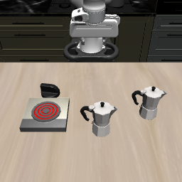
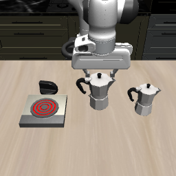
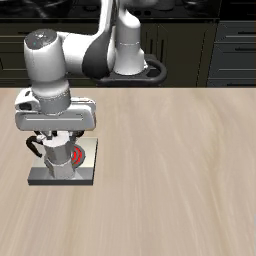

# 实测：让 Codex 在 LIBERO 上操控机械臂

!!! abstract "要点"
    同一个模型、五种接口、两个任务套件各 10 个任务：

    1. **能不能拿到准确的 3D 坐标决定成败。** 没有深度的 direct 在长任务上掉到 6/10，其余带反投影工具的方法 8/10 到 10/10。
    2. **一次决策能执行多少动作决定效率。** code 和 primitives 工具相同，code 的调用次数约为 primitives 的三分之一。
    3. **真值位姿这组对照没有成立。** code_oracle 可以拿真值，但 206 段程序里一次都没调用，所以说明不了真值有没有用。
    4. 每格只跑了一次，ORA 和 code 之间分不出高下。

## 1. 实验设置

| 项目 | 设置 |
| --- | --- |
| 模型 | Codex（gpt-6-astra，reasoning effort high），所有接口相同 |
| 仿真 | LIBERO（MuJoCo + robosuite），Franka Panda 单臂，控制频率 20 Hz |
| 任务 | libero_goal 与 libero_10（长时程）各 10 个任务，seed 0，每任务 1 回合 |
| 接入方式 | Codex 运行在只读沙箱里，只能通过 MCP 工具操作机器人 |
| 成功判定 | LIBERO 官方的 `env._check_success()`，模型自己说做完了不算 |
| 预算 | direct / primitives / code：10,000 控制步、250 次工具调用、30 分钟；ORA：80 次机器人决策、200 次模型调用 |

五种接口的工具清单见 [接口与工具箱](interfaces.md)。ORA 来自 Hao AI Lab 的开源实现[^ora]，我们跑的是工具调用模式的 CPU 精简版（没有 SAM 3 和 Contact-GraspNet）。

## 2. 结果

| 方法 | libero_goal | libero_10 | 平均调用次数（goal / long） | 平均用时（goal / long） |
| --- | --- | --- | --- | --- |
| ORA | 10/10 | 10/10 | 35 / 52（模型调用） | 272 s / 357 s |
| code | 10/10 | 10/10 | 9 / 17 | 116 s / 217 s |
| code_oracle | 10/10 | 10/10 | 8 / 15 | 94 s / 197 s |
| primitives | 9/10 | 8/10 | 25 / 66 | 180 s / 427 s |
| direct | 9/10 | 6/10 | 54 / 90 | 443 s / 970 s |

几点解读：

- **3D 坐标是第一道门槛。** direct 没有深度，只能看图估计位置再换算成增量动作。粗放的任务（把壶放上灶台）还能做成，需要精确对准的长任务就不行了。
- **执行粒度是效率的关键。** code 和 primitives 用的是同一套 `pixel_to_xyz` / `move_to` / `gripper`，区别只在 code 能把“上方 → 下降 → 闭合 → 抬起”写成一段程序一次跑完。调用次数约为三分之一，用时约一半。
- **真值位姿对照失效。** code_oracle 能调用 `robot.object_poses()` 拿仿真真值，但 Codex 在全部 206 段程序里一次都没调用，环境端日志也是 0 次，它仍然看图测量。所以 code_oracle 和 code 同为 20/20，说明不了“真值有没有用”。我们之前据此写过“真值几乎没有额外帮助，瓶颈在接口”，这个结论站不住，已更正。
- **ORA 的审核在仿真里主要体现为成本。** 预览、审核、拒绝码让它的模型调用次数和用时都高于 code。仿真里出错的代价只是重来一次，这层保护的价值要到真机上才体现。
- **统计上分不出 ORA 和 code。** 每格 10 个任务各跑一次，按 [Wilson 区间](../robot/simulation.md#9-补充一个-libero-分数由多少回合组成)，10/10 的 95% 置信区间约为 [72%, 100%]。

## 3. code 方法实际写了什么程序

全部 449 段程序里，各 API 的使用情况：`pixel_to_xyz` 出现在 172 段，`camera()` 23 段，`act()` 22 段，`depth()` 1 段，分割、聚类之类的算法基本为 0。Codex 几乎不写感知算法，主要做两件事：看图挑像素，把动作批量写进一段程序。

下面是 libero_10 第 8 题“put both moka pots on the stove”的完整过程：8 段程序，约 91 秒，成功。

<figure markdown>
  { width="256" loading=lazy }
  <figcaption>初始场景：左边是灶台，右边两个摩卡壶（agentview，256×256）。</figcaption>
</figure>

```python
# ① 粗测：几个关键像素 → 3D（只测量、不动）
for label, u, v in [('pot1',143,167), ('pot2',212,144), ('stove',64,160),
                    ('p1handle',120,160), ('p2handle',191,138)]:
    print(label, robot.pixel_to_xyz('agentview', u, v))
# pot1 [0.077 0.040 1.005]  stove [-0.023 -0.198 0.933] ...

# ② 细测：沿壶纵向打 11 个点，z 从 1.04（壶顶）降到 0.95（桌面），推断壶高和轮廓
for u, v in [(143,149), (143,157), (141,179), ...]:
    print((u, v), robot.pixel_to_xyz('agentview', u, v))
print(robot.move_to(0.06, 0.04, 1.13, yaw_deg=0))       # 移到壶正上方

# ③ 第一次抓：失败
print(robot.move_to(0.045, 0.04, 1.005, yaw_deg=0))     # reached False，误差 3.8 cm：被壶盖挡住
robot.gripper('close', steps=25)
print(robot.move_to(0.045, 0.04, 1.16, yaw_deg=0))      # gripper_opening 0.0011：闭到底 = 空抓
```

<figure markdown>
  { width="256" loading=lazy }
  <figcaption>第③段之后：夹爪抬起，壶还在原地。程序不会因为 reached False 停下，三行照样跑完，是 Codex 读了 stdout 才发现空抓。</figcaption>
</figure>

```python
# ④⑤ 换策略：测壶把附近的像素，转 90° 改抓把手
robot.move_to(0.04, -0.025, 1.012, yaw_deg=90)
robot.gripper('close', steps=25)                          # opening 0.014 = 夹住了

# ⑥ 放到灶台：上方 → 下降 → 张开 → 抬起，一段程序完成，中间不用等模型
robot.move_to(0.005, -0.255, 1.17, yaw_deg=90)
robot.move_to(0.005, -0.255, 1.035, yaw_deg=90)
robot.gripper('open', steps=25)
robot.move_to(0.005, -0.255, 1.19, yaw_deg=90)

# ⑦ 第二个壶：直接用抓把手的经验，一次夹住（opening 0.0145）
# ⑧ 搬到灶台另一侧，下降途中壶一碰到灶台，LIBERO 官方判定通过，回合立即结束
```

<figure markdown>
  { width="256" loading=lazy }
  <figcaption>第⑧段：两个壶都在灶台上，判定成功的瞬间环境抛出 EpisodeOver，夹爪还没来得及张开。</figcaption>
</figure>

几点观察：

- **先测量、后动作。** 前两段程序一个动作都不做，只问坐标。第②段沿纵向打点找壶顶和桌面，是在用 `pixel_to_xyz` 手工做“剖面测量”。
- **失败靠回执发现。** 程序本身不判断成败，只管顺序执行。成败是 Codex 读了 `reached`、`position_error_m`、`gripper_opening_m` 和返回的图像后自己判断的。这就是 URAI 论文里“事先写好整段程序”不如“调用一次、看一次”的原因（见[方法谱系](landscape.md#4-文献里反复出现的结论)）。
- **从失败中学到的经验能复用。** 第一个壶抓壶顶失败、改抓把手成功后，第二个壶直接抓把手，一次成功。

## 4. 同一任务，其他接口怎么做

**primitives**（36 次调用）：步骤和 code 几乎一样，也是第一次抓壶顶失败、改抓壶把，只是每一步都是一次单独的工具调用。

**direct**（19 次调用）：没有深度，只能看图估计，再按“1.0 大约每步 5 cm”换算成增量动作：

```text
act [0.7, 0, 0, 0, 0, 0, -1]   × 20    向前伸，夹爪张开
act [0.18, 0.14, -0.65, ...]   × 20    斜着下降到壶边
act [0, 0, 0, 0, 0, 0, +1]     × 15    闭合，开度停在 0.067 m（没闭到底 = 夹住了壶身）
act [0, 0, 0.65, ...]          × 20    抬起，开度不变，壶跟着起来
act [-0.18, -0.8, 0, ...]      × 26    向右平移到灶台上方
...
```

这个任务比较粗放，靠估计也够用；但在需要精确对准的长任务上，direct 只做成了 6/10。

**ORA**（23 个动作、42 次模型调用）：

```text
observe（RGB + 点云俯视 / 侧视图）
mark_point 壶把 → 被拒（depth_discontinuity）×2 → 改标壶盖
preview_move 到 (0.07, 0.037, 1.14)，夹爪 x 轴沿世界 y、z 轴朝下 → 看预览图
move_pose(preview_id) → close_gripper（开度 78 → 67 mm，夹住）→ move_pose 抬起 160 mm
mark_point 灶台中心 → preview → move → open
第二个壶：下降停高了 → 看腕部相机 + 点云 → 夹爪绕 z 转 90° → 抓住 → 放下
官方判定成功 → check_task → finish_episode
```

ORA 被 `depth_discontinuity` 拒了两次，正是 [接口与工具箱](interfaces.md#6-三个坑附数值验证) 第 6 节“坑 3”的情况：在我们自己写的 primitives / code 接口里，`pixel_to_xyz` 打到把手边缘也会照样返回一个错误的坐标。

## 5. 失败案例都在说明什么

| 方法 | 任务 | 原因 | 说明的问题 |
| --- | --- | --- | --- |
| direct | goal t3 | 碗卡在中间抽屉，模型放弃 | 没有深度，精细放置很难 |
| direct | long t3 / t4 / t9 | 30 分钟预算用完 | 一步一步试探太慢 |
| direct | long t5 | 书滑到书架后面 | 估计的位置不准 |
| primitives | goal t0 | 竖直朝下的夹爪够不到抽屉把手 | 原语的动作空间太窄 |
| primitives | long t6 | 杯子放下后立不稳 | 同上 |
| primitives | long t9 | 开微波炉门耗光预算 | 一步一调用太慢 |

失败分成三类：定位不准（direct）、动作空间太窄（primitives 的 `move_to` 只允许夹爪竖直朝下，侧向的抽屉把手够不到）、太慢（一步一调用耗光预算）。code 同时有准确的定位和大粒度执行，在这组任务上没有失败。它的 `move_to` 和 primitives 是同一个，同样只允许夹爪竖直朝下；区别是 code 还能调用 `act()` 直接控制末端姿态（449 段程序里有 22 段用到），动作空间没有被原语锁死。

## 6. 和 ORA 官方结果对照

ORA 官方用的是完整配置和开源模型，在更难的基准上报告了结果[^ora-blog]（v0.1）：

| 基准 | ORA v0.1 | 对照（官方页面所列） |
| --- | --- | --- |
| RoboTwin C2R | 79.6 | RPent + GPT-5.5 62.4；π0.5 47.9 |
| LIBERO-Pro（Task + Swap） | 88.0 | RPent + GPT-5.5 75.1；π0.5 11.0 |
| RoboLab | 79.2 | — |
| RoboDojo | 39.9（10 月预览版 5.2） | — |

几点和我们实测相关的观察：

- **零样本 agent 在扰动基准上有优势。** [仿真那篇](../robot/simulation.md#11-怎样读论文里的成功率)里 π0.5 在 LIBERO 上 96.85%，到 LIBERO-PRO 只剩约 21%（ORA 页面列的是 11.0）；ORA 不依赖训练数据里的轨迹，扰动后仍有 88.0。原因和我们看到的一致：agent 每次都重新看图测量，而不是复现记住的动作序列。
- **模型差异很大。** 官方在 RoboDojo 39 个任务上测了六个开源模型（代码模式），成功率从 5.1% 到 48.7%，并指出推理量多少不是区分它们的关键。我们只测了一个模型，这一点要谨慎外推。
- **官方也承认判定的局限**：benchmark 的官方成功检查可能高估任务完成度，不同系统的工具、记忆和协议也不同，不能直接横比。

## 7. 局限

- **每格只跑一次**，seed 0，统计功效很低。10/10 和 9/10 之间的差距不显著。
- **只有一个模型**。不同模型对接口的偏好可能不同：ALRM（见[方法谱系](landscape.md)）发现开源模型在逐个调用工具的模式下明显吃力。
- **本地跑的 ORA 是 CPU 精简版**，也没有用 v0.1 的代码模式，没有 SAM 3 分割、文本定位和 Contact-GraspNet 抓取规划。完整的 GPU 配置更接近 MOKA、CoPa 一类方法。
- **没有试 L1 和 L4**：没有“VLA 当工具”的接口，也没有“约束 + 优化器”的接口（见[方法谱系](landscape.md)）。
- **仿真里的审核主要是成本**。ORA 的价值需要在真机或有危险约束的任务上评估。

## 参考

[^ora]: Y. Yang, S. Chen, Z. Wang, J. Gao, H. Zhang. *ORA: Open Robot-Use Agents*. Hao AI Lab（UC San Diego）, 2026. 项目页 <https://fastrua.ai/ora/> · 代码 <https://github.com/fast-rua/ORA> · 两页论文 <https://fastrua.ai/ora/paper/ora-two-page.pdf> · 轨迹数据 <https://huggingface.co/datasets/FastRUA/ora-traces>
[^ora-blog]: FastRUA. *Introducing ORA*（2026-10 预览版）<https://fastrua.ai/blog/2026-10-ora/>；*ORA v0.1: Robot-use agents now write code, move smoothly…*（2026-11）<https://fastrua.ai/blog/2026-11-code-mode/>
