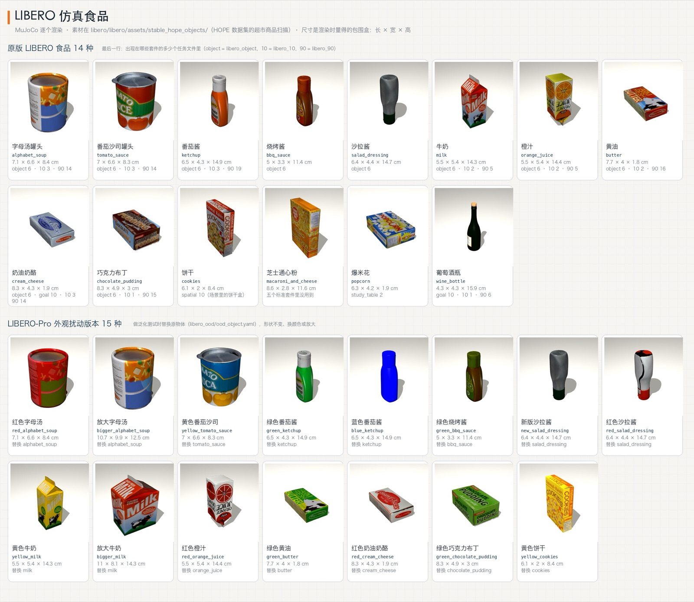

# 术语与素材

## 术语

| 术语 | 含义 |
| --- | --- |
| agentview | 桌子对面固定的第三人称相机，从远处看回机器人；图像上方是机器人，图像右边是世界 +y |
| wrist（腕部相机） | 装在夹爪上、沿手指方向看的相机。夹爪竖直朝下、yaw 为 0 时，图像上方约是 +x |
| eef / grip site | 末端执行器。ORA 控制的是两指之间的 grip site，不是法兰，也不是指尖 |
| OSC | operational space control（操作空间控制）：按末端位姿目标算关节力矩的控制器，LIBERO 默认用 OSC_POSE（见 [仿真是怎么做的](../robot/simulation.md)） |
| MCP | Model Context Protocol：Codex 调用外部工具的协议。实测里所有机器人操作都通过 MCP 工具完成 |
| ToolSurface | ORA 给模型看的一组工具（名字、说明、参数格式），按配置组合 |
| Supervisor | ORA 里审核每个动作提议的进程，审核通过才交给环境执行，并记录回执（见[检查机制](verification.md#2-第一层动作前的检查)） |
| 官方边界 | 只有 benchmark 自己的成功判定算数，即 LIBERO 环境的终止条件；模型说做完了不算 |
| seal（密封） | 把一次运行的全部证据文件做哈希清单写进 `seal.json`，事后改动任何文件都能被发现 |
| LIBERO / LIBERO-Pro | 基于 robosuite + MuJoCo 的桌面操作基准[^libero]；LIBERO-Pro 在其上加了外观、位置等扰动[^liberopro]。实测用 libero_goal 和 libero_10 各 10 个任务，seed 0 |
| 推理摘要 | Codex 公开的推理标题（reasoning summary），不是完整的思考链 |
| VLA | vision-language-action 模型：直接从图像和指令输出动作，相当于训练出来的 direct |
| 路点（waypoint） | 一段运动的终点。`move_to`、`move_pose` 给的就是路点，见[方案总结](summary.md#3-模型的输出接在控制链的哪一层) |

## LIBERO 里的食品素材

LIBERO 的很多任务都要抓放食品：字母汤罐头、番茄酱、牛奶盒、黄油……下图用 MuJoCo 把它们逐个渲染出来，摆放姿态和场景里一致。上面 14 种是原版 LIBERO 的食品，大部分是 HOPE 数据集[^hope]扫描的真实超市商品（素材在 `libero/libero/assets/stable_hope_objects/`），葡萄酒瓶来自 TurboSquid；下面 15 种是 LIBERO-Pro 换了颜色或放大的变体，测试外观泛化时用来替换原物体（`libero_ood/ood_object.yaml`），形状不变。

<figure markdown>
  
  <figcaption>LIBERO 原版 14 种食品（上）与 LIBERO-Pro 外观扰动版 15 种（下）。尺寸是渲染时量得的包围盒（长 × 宽 × 高）；原版卡片最后一行是该物体出现在哪些套件的多少个任务文件里。</figcaption>
</figure>

几个和抓取直接相关的尺寸（cm，长 × 宽 × 高）：

| 物体 | 尺寸 | 备注 |
| --- | --- | --- |
| 黄油 butter / 奶油奶酪 cream_cheese / 爆米花 popcorn | 7.7 × 4.0 × 1.8 / 8.3 × 4.3 × 1.9 / 6.3 × 4.2 × 1.9 | 平放的扁盒，高度不到 2 cm，竖直下降时容易压到桌面 |
| 番茄酱 ketchup / 沙拉酱 salad_dressing / 葡萄酒瓶 | 6.5 × 4.3 × 14.9 / 6.4 × 4.4 × 14.7 / 4.3 × 4.3 × 15.9 | 细高，站立摆放，碰一下容易倒 |
| 字母汤 alphabet_soup / 番茄沙司 tomato_sauce | 7.1 × 6.6 × 8.4 / 7.0 × 6.6 × 8.3 | 罐头，直径约 7 cm，Franka 夹爪全开 8 cm，余量很小 |
| 放大字母汤 / 放大牛奶（LIBERO-Pro） | 10.7 × 9.9 × 12.5 / 11.0 × 8.1 × 14.3 | 宽度达到或超过夹爪最大开度 8 cm，原物体的抓法不一定还能用 |

## 参考

[^libero]: B. Liu et al. *LIBERO: Benchmarking Knowledge Transfer for Lifelong Robot Learning*. NeurIPS 2023 Datasets and Benchmarks. arXiv:2306.03310
[^liberopro]: X. Zhou et al. *LIBERO-PRO: Towards Robust and Fair Evaluation of Vision-Language-Action Models Beyond Memorization*. arXiv:2510.03827, 2025.
[^hope]: S. Tyree et al. *6-DoF Pose Estimation of Household Objects for Robotic Manipulation: An Accessible Dataset and Benchmark*（HOPE）. IROS 2022. arXiv:2203.05701
