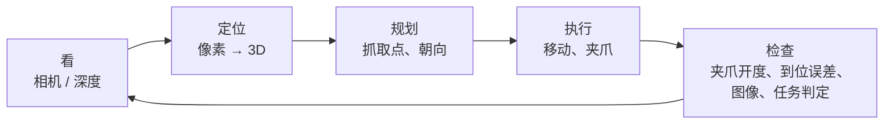

# 接口与工具箱：给 agent 什么工具，它就是什么样的机器人

!!! abstract "要点"
    所有方法都是同一个闭环：**看 → 定位 → 规划 → 执行 → 检查**，区别只在每一格由谁来做。

    - **direct**：模型看图直接出增量动作，没有 3D 定位工具。
    - **primitives**：模型在图上挑像素，`pixel_to_xyz` 反投影成 3D，再调 `move_to` / `gripper` 原语，一次一个。
    - **code**：同样的工具，但模型写一段 Python 程序把多个原语串起来一次跑完。
    - **ORA**：带深度质量检查的 `mark_point`、先预览再提交的 `move_pose`，每个动作都经过 Supervisor 审核。

    `pixel_to_xyz` 不是模型算的，而是标准的针孔反投影，只用到 RGB-D 和相机标定，真机上也有。模型真正要做的是**挑对像素**。

ORA 是 Hao AI Lab 开源的机器人 agent 框架[^ora]，这里列的是它在本地 CPU 版里的工具；完整工具手册和代码模式见其文档与博客[^ora-blog]。本文的接口来自我们在 LIBERO（MuJoCo + robosuite，Franka Panda 单臂）上做的一组实测，结果见 [实测：Codex 在 LIBERO 上](case-study.md)。LIBERO 和底层控制器的细节见 [具身智能仿真是怎么做的](../robot/simulation.md)。

## 1. 一个闭环，五格分工



| 方法 | 看 | 定位 | 执行粒度 | 检查 |
| --- | --- | --- | --- | --- |
| **direct**（类 VLA） | RGB + 本体状态 | 无，模型凭图估计 | 原始增量动作 `act` × N 步 | 模型看图 |
| **primitives**（VLM + 技能原语） | RGB | `pixel_to_xyz` | 一次一个原语 | 原语返回值 + 看图 |
| **code**（Code as Policies 式） | RGB，可取深度和相机参数 | `pixel_to_xyz`，或自己写反投影 | 一段程序串起多个原语 | 程序 stdout + 看图 |
| **code_oracle** | 同上 + 仿真真值位姿（特权） | 同上 | 同上 | 同上 |
| **ORA** | RGB-D、点云视图；GPU 版还有 SAM 3 | `mark_point`（带深度质量检查） | 一个经 Supervisor 审核的动作 | 拒绝码 + 回执 + `check_task` |

按[方法谱系](landscape.md)的分层：direct ≈ L5，primitives ≈ L2，code ≈ L3，ORA ≈ L2 加审核和每步反馈。

## 2. 感知工具：看和定位

| 工具 | 出现在 | 输入 → 输出 | 说明 |
| --- | --- | --- | --- |
| `observe` | 所有方法 | → agentview + 腕部两张 256×256 RGB，加本体状态 | 本体状态含末端位置、四元数、夹爪开度、剩余步数。ORA 版还能选点云俯视 / 侧视图 |
| `pixel_to_xyz(view, u, v)` | primitives、code | 像素 → 世界坐标（米） | 深度相机反投影（见第 5 节）。返回“这个像素看到的表面点”，**不是物体位姿** |
| `robot.depth(view)` | code | → 256×256 深度图（米） | robosuite 的 `get_real_depth_map`，已翻转为正向 |
| `robot.camera(view)` | code | → 内参 3×3、`camera_to_world` 4×4 | 让模型可以自己写投影 / 反投影 |
| `robot.object_poses()` | 仅 code_oracle | → 各物体真值位姿 | **特权信息**，只用来测上界 |
| `mark_point` | ORA | 一批像素（≤ 8 个）→ 世界坐标 | 同样的反投影，外加深度质量检查，不合格就给拒绝码（见第 6 节）。同名点可从另一视角复测，标为 `verified` |
| `geometry_query` | ORA（GPU 版） | 像素 ↔ 世界坐标，或框内深度统计 | 用标定参数算几何量，避免模型心算 |
| `vision_segment` | ORA（GPU 版） | 1–8 个点提示 → 每点最多 3 个候选掩码 | SAM 3 点提示分割，附带足迹中心、尺寸、视角倾斜度 |
| `vision_ground` | ORA（GPU 版） | 一句文字 → 最多 3 个候选区域 | SAM 3 文本 grounding。只缩小范围，是不是目标由 agent 判断 |
| `grasp_plan` | ORA（GPU 版） | 目标区域 → 最多 3 个抓取候选 | Contact-GraspNet 从 RGB-D 生成平行夹爪抓取，编译成预抓取 / 接触位姿，附 IK 可达性参考 |
| `compute` | ORA（GPU 版） | 受限的数学表达式 | 距离、角度、旋转、偏移，可用 numpy 和 `Rotation`。规定数值换算不能靠心算 |

## 3. 执行工具：动

| 工具 | 出现在 | 说明 |
| --- | --- | --- |
| `act([dx,dy,dz,droll,dpitch,dyaw,grip], repeat)` | direct、code | robosuite `OSC_POSE` 的增量动作，20 Hz。位置 1.0 = 单步目标偏移 5 cm，旋转 1.0 = 0.5 rad，grip −1 张开 / +1 闭合 |
| `move_to(x, y, z, yaw_deg)` | primitives、code | 夹爪尖端直线到达目标点，夹爪竖直朝下，`yaw_deg` 是绕世界 z 的转角。内部 P 控制伺服（增益 1.5，容差 4 mm，最多 150 步），返回 `reached`、`position_error_m` 和新本体状态 |
| `gripper(open/close)` | primitives、code | 开合夹爪，手臂保持不动 |
| `preview_move` | ORA | **只渲染、不执行**：把候选位姿画到 agentview 上，返回 `preview_id` |
| `move_pose` | ORA | 提交位姿（`preview_id`、绝对坐标或增量），可指定夹爪坐标轴朝向。经 Supervisor 审核后执行，返回实测回执和新观测 |
| `close_gripper` / `open_gripper` | ORA（CPU 版） | 保持位姿只开合夹爪，同样经过审核 |
| `set_gripper` | ORA（GPU 版） | 闭合被物体挡住时报 `gripper_stalled_before_target`，这正是夹到东西的表现，要比较实测开度和物体宽度 |
| `move_to` / `rotate_wrist` / `rotate_pitch` | ORA（GPU 版） | 语义化运动原语，编译成位姿，带近似可达性预检 |
| `recover_pose` / `wait_ticks` | ORA（GPU 版） | 回到上一动作开始时的构型或 home；原地等待若干控制步 |

`move_to` 这类原语的价值在于：把“走到某个 3D 点”这件事从模型手里拿走。direct 要靠“1.0 大约每步 5 cm”去估算走几步，`move_to` 则由 P 控制器闭环伺服到位，再报告误差。

## 4. 生命周期工具：判定和结束

| 工具 | 出现在 | 说明 |
| --- | --- | --- |
| `check_task` | ORA | 读取环境**官方判定**，只返回 true / false，不暴露判定条件 |
| `finish_episode` | ORA | 结束回合。声明成功必须有 `check_task` 返回过 true；声明失败要写原因和尝试过的方法 |
| `report_issue` | ORA | 记录工具或接口本身的缺陷，不影响环境 |
| `finish` | direct / primitives / code | **只能用来放弃**。成功由环境自动检测，一旦成功回合立刻结束 |
| `run_code(code)` | code、code_oracle | 在新进程里运行 Python（numpy、scipy、PIL），`import robot` 获得上述 API，超时 300 s。返回 stdout / stderr、`robot.show()` 附上的图和结束时的相机图像 |

## 5. `pixel_to_xyz` 到底怎么算

它是 API 提供的标准针孔反投影：

```python
depth = depth_m(view)                                 # 深度图，米
z   = median(depth[v-1:v+2, u-1:u+2])                 # 3×3 邻域取中位数，抗噪
x_c = (u - cx) * z / fx                               # 像素 → 相机坐标
y_c = (v - cy) * z / fy
xyz = camera_to_world @ [x_c, y_c, z, 1]              # 相机坐标 → 世界坐标
```

写成公式：给定像素 $(u, v)$ 和该处深度 $z$，内参 $f_x, f_y, c_x, c_y$，外参 $T_{wc}$（相机到世界的 4×4 变换），

$$
\mathbf{p}_c = z \begin{bmatrix} (u - c_x)/f_x \\ (v - c_y)/f_y \\ 1 \end{bmatrix},
\qquad
\begin{bmatrix} \mathbf{p}_w \\ 1 \end{bmatrix} = T_{wc} \begin{bmatrix} \mathbf{p}_c \\ 1 \end{bmatrix}
$$

它是投影 $u = f_x x_c / z_c + c_x$ 的逆运算。投影会丢掉深度，所以**必须有深度图**才能从一个像素回到 3D，这也是 direct（没有深度）只能靠估计的原因。

robosuite 的相机内参由竖直视场角算出（`camera_utils.get_camera_intrinsic_matrix`）：$f = \dfrac{H/2}{\tan(\text{fovy}/2)}$，主点在图像中心。robosuite 自带场景里 agentview 没有另设视场角，取 MuJoCo 默认的 45°，256×256 图像下 $f \approx 309$ 像素，$c_x = c_y = 128$。

- 只用到 RGB-D 和相机标定，真机也有，**不算特权信息**。
- 模型要做的是**挑像素**：看图判断“壶把大约在第 120 列、第 160 行”。
- 实用技巧：沿物体纵向打一串点看 z 怎么变，就能找到物体顶面和边缘（见[实测](case-study.md)第 3 节第②段）。

## 6. 三个坑（附数值验证）

我用 NumPy 搭了一个与 agentview 同参数的虚拟相机，复现这几个问题（脚本 [`verify_backproject.py`](https://github.com/zsyverse/knowledge/blob/main/scripts/agent4robot/verify_backproject.py)）。世界点 $(0.08, 0.04, 1.005)$ 投影到像素 $(139.3, 116.7)$，深度 1.095 m，反投影能精确还原；取整到整数像素只带来 1.6 mm 误差。

**坑 1：深度噪声和野值。** 给 3×3 邻域加 1 cm 高斯噪声，再让 10% 的像素“打到背景”（深 0.3 m）：

| 取深度的方式 | 平均 3D 误差 |
| --- | --- |
| 只取中心像素 | 4.14 cm |
| 3×3 中位数 | 0.48 cm |

中位数把野值的影响压掉了将近 9 倍，这就是 `pixel_to_xyz` 取邻域中位数的原因。

**坑 2：图像翻转。** MuJoCo / robosuite 渲染出的图是上下颠倒的，内外参按正向图的行号索引。如果多翻了一次，模型在正向图上挑的第 116.7 行会被当成第 138.3 行，反投影误差 **7.7 cm**，足够让夹爪抓空。我们在实测里就踩过这个坑，最后是把真值位姿投影回图上画标记才发现的：投影标记和物体对不上，就说明坐标系约定错了。

**坑 3：物体边缘。** 挑的像素在物体边缘时，邻域一部分在物体上，一部分在后面的桌面上（深 0.25 m）：

| 邻域中落在背景上的像素 | 中位数深度 | 3D 误差 |
| --- | --- | --- |
| 4 / 9 | 1.095 m（正确） | 0.2 cm |
| 5 / 9 | 1.345 m | **25.0 cm** |

只差一个像素，中位数就从物体跳到了背景上，而 `pixel_to_xyz` 会照样返回一个错 25 cm 的坐标。ORA 的 `mark_point` 检查邻域内深度的极差，发现跳变就拒绝（`depth_discontinuity`），让模型换一个点。在[实测](case-study.md)里，Codex 想标壶把手就连续被拒两次，最后改标壶盖。

## 7. 设计接口时要回答的几个问题

把上面的工具表压缩一下，设计一套 agent4robot 接口，要依次回答：

1. **3D 坐标从哪来？** 模型估计（direct）、深度反投影（primitives / code）、带质量检查的反投影（ORA），还是分割 + 位姿估计？
2. **一次决策执行多少动作？** 一步（direct 的一个 `act`）、一个原语、一段程序？粒度越大调用越少，但中途出错越晚被发现。
3. **执行后返回什么？** 只返回图像，还是返回 `reached`、位置误差、夹爪开度这类可直接判读的测量值？
4. **动作前有没有审核？** 工作空间、过期观测、关节极限、自碰撞。仿真里这主要是成本，到真机上是安全底线。
5. **谁判定成功？** 必须是环境的官方判定，模型“觉得做完了”不算数。

后三个问题在 [检查机制](verification.md) 里展开。

**ORA 官方对第 2 个问题的回答。** ORA v0.1 新增了代码模式：模型每轮写一段 Python 程序，从持久工作区调用同一套工具，程序里最多 12 个机器人动作，**每个动作仍然逐一经过 Supervisor 放行**，跑完才返回一次结果[^ora-blog]。官方报告的对比：

| 指标 | 工具调用模式 | 代码模式 |
| --- | --- | --- |
| 每轮平均机器人动作数 | 1.10 | 3.62 |
| 每个动作的推理字符数 | 33.4k | 12.7k |
| 59 组配对案例中的成功数 | 6 | 20 |

这把 code 和 ORA 的优点合在了一起：大粒度执行减少模型调用，逐动作审核保留安全性。和我们实测里“code 的调用次数约为 primitives 的三分之一”方向一致。

## 参考

[^ora]: Y. Yang, S. Chen, Z. Wang, J. Gao, H. Zhang. *ORA: Open Robot-Use Agents*. Hao AI Lab（UC San Diego）, 2026. 项目页 <https://fastrua.ai/ora/> · 代码 <https://github.com/fast-rua/ORA> · 两页论文 <https://fastrua.ai/ora/paper/ora-two-page.pdf> · 轨迹数据 <https://huggingface.co/datasets/FastRUA/ora-traces>
[^ora-blog]: FastRUA. *Introducing ORA*（2026-10 预览版）<https://fastrua.ai/blog/2026-10-ora/>；*ORA v0.1: Robot-use agents now write code, move smoothly…*（2026-11）<https://fastrua.ai/blog/2026-11-code-mode/>
