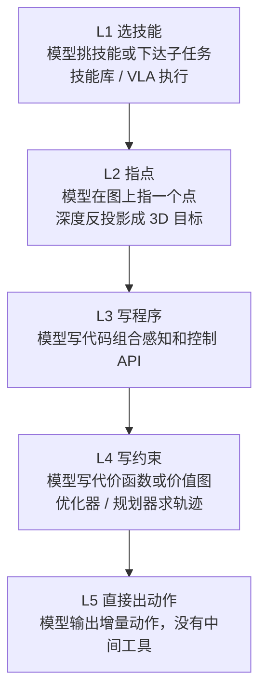

# Agent 操控机器人的方法谱系：从选技能到直接出动作

!!! abstract "TL;DR"
    把大模型接到机器人上，各家方法的差别主要在三件事：

    1. **模型输出什么**：技能名、图上的点、代码、约束 / 价值图，还是原始动作；
    2. **谁把它变成电机指令**：技能库、深度反投影、优化器 / 规划器、VLA；
    3. **有没有闭环检查**：执行后有没有把结果反馈给模型。

    按输出的抽象程度从高到低分成 L1 到 L5 五层。2025–2026 年的工作反复得出同一个结论：**工具抽象越高、执行后反馈越多，成功率越高**；事先写好整段程序一口气跑完，明显不如“调用一次、看一次”。

## 1. 五层谱系

| 层级 | 模型输出 | 谁负责执行 | 代表工作 | 对应[实测](case-study.md)里的接口 |
| --- | --- | --- | --- | --- |
| **L1 选技能** | 技能名或自然语言子任务 | 预训练技能库，或一个 VLA | SayCan、Inner Monologue、Gemini Robotics-ER → VLA、InteractVLA | 没有（LIBERO 没给预训练技能） |
| **L2 指点** | 图上的点、编号、候选箭头 | 深度反投影、候选采样 | MOKA、PIVOT、RoboPoint、Gemini ER 的指点输出 | primitives、ORA |
| **L3 写程序** | Python 程序 | 程序调用感知和控制 API | Code as Policies、CaP-X、CodeActionBench、ALRM、URAI | code |
| **L4 写约束** | 代价函数、3D 价值图 | 优化器、运动规划器 | VoxPoser、ReKep | 没有（需要额外的优化器） |
| **L5 直接出动作** | 增量动作（文字或 token） | 直接交给底层控制器 | RT-2、OpenVLA、π0 等 VLA；EASG | direct |

层级越高，模型越像“指挥官”，执行细节交给可靠的模块；层级越低，模型自己承担的几何和控制推理越多。L5 里的 VLA 是专门训练出来的，而 EASG 这类工作试图让**没训练过**的通用 VLM 直接出动作。

## 2. 经典工作（2022–2024）

| 方案 | 模型输出 | 谁负责执行 / 用到的工具 | 闭环与检查 | 层级 |
| --- | --- | --- | --- | --- |
| **SayCan**[^saycan]（Google，2022） | 从技能库里选下一个技能 | 预训练技能策略；技能价值函数估计“现在做这个能不能成”，与 LLM 打分相乘 | 每步按可行性重排，但技能内部不可见 | L1 |
| **Inner Monologue**[^innermono]（Google，2022） | 下一步指令 | 同样的技能库，外加成功检测器和场景描述器 | 把“成功 / 失败”和场景描述作为文字反馈给模型，模型据此重试或改计划 | L1 |
| **Code as Policies**[^cap]（Google，2022） | Python 程序 | 调用感知 API（开放词汇检测）和控制 API；可以递归定义还没有的函数 | 基本开环：程序写完就跑 | L3 |
| **VoxPoser**[^voxposer]（Stanford，2023） | 调用 VLM 的代码，合成 3D 价值图（该去哪、该避开哪） | 开放词汇检测 + 分割得到物体体素；规划器在价值图上求轨迹，MPC 跟踪 | 价值图随新观测重算，能应对扰动 | L4 |
| **Set-of-Mark**[^som]（2023） | 图上叠加的编号 | 先分割、在每个区域上标号，VLM 只需选编号 | 本身是提示技巧，减少“报像素坐标”的误差 | L2 |
| **MOKA**[^moka]（Berkeley，2024） | 在标了候选点的图上选关键点和路径点 | 分割物体、画候选点，选中的点用深度反投影成 3D | 按子任务分步，每步重新看图 | L2 |
| **PIVOT**[^pivot]（Google，2024） | 从图上画好的候选动作箭头里挑几个 | 系统在挑中的附近重新采样，迭代几轮后收敛 | 迭代视觉提示，本身就是闭环 | L2 |
| **CoPa**[^copa]（2024） | 抓取部位和空间约束 | 先粗后细地定位物体部件，再求解末端位姿 | 按阶段规划 | L2 / L4 |
| **RoboPoint**[^robopoint]（UW / NVIDIA，2024） | 图上的可操作点（affordance） | 专门用合成数据微调的指点 VLM；点经深度反投影后交给运动规划器 | 开环 | L2 |
| **ReKep**[^rekep]（Stanford，2024） | 关键点约束（Python 代价函数） | 视觉基础模型提取关键点，分层优化器求末端位姿序列 | 持续跟踪关键点，失败时退回上一阶段重规划 | L4 |

两条线索值得注意：

- **从报坐标到选点**。直接让 VLM 报像素坐标误差很大，Set-of-Mark、MOKA、PIVOT 都改成“系统先画候选、模型只做选择”。RoboPoint 则走另一条路：专门微调一个会指点的模型。
- **从开环到闭环**。Code as Policies 的程序写完就跑，中途出错不会停；Inner Monologue 把成功检测的结果作为文字喂回模型，是最早的“执行后反馈”。

## 3. 近期工作（2025–2026）

| 方案 | 模型输出 | 执行 / 工具 | 结果或要点 | 层级 |
| --- | --- | --- | --- | --- |
| **Gemini Robotics-ER 1.5 / ER 2**[^gemini15][^gemini-er2]（Google DeepMind，2025.9 / 2026.7） | 函数调用，或给 VLA 的自然语言子任务；也能在图上指点 | ER 做编排，VLA 执行。官方编排示例只声明了 `move(x, y, high)` 和 `setGripperState(opened)` 两个函数 | 标准 agent 循环（执行调用 → 回传结果，示例上限 15 步）。ER 2 基于 Gemini 3.5 Flash，可把动作交给任意底层 VLA；官方称工具编排优于 ER 1.6 | L1 / L2 |
| **ALRM**[^alrm]（2026.1） | 两种模式：CaP 写代码，TaP（Tool-as-Policy）逐个调用工具 | ReAct 式循环：计划、执行、反思；配套几十个任务的仿真基准 | 评了 10 个 LLM；开源模型在 TaP 的高层推理任务上明显吃力；TaP 延迟高于 CaP | L3 / L2 |
| **CaP-X**[^capx]（2026.3，ICML 2026） | 组合感知和控制原语的程序 | CaP-Gym（39 个任务，跨 robosuite、LIBERO-PRO、BEHAVIOR）；CaP-Bench 评 12 个模型；免训练的 CaP-Agent0；可验证奖励强化学习的 CaP-RL | 人工设计的抽象越多越好，去掉就掉点；多轮交互、执行反馈、看前后图差异、自动合成技能都能提升鲁棒性 | L3 |
| **CodeActionBench**[^cab]（2026.9） | 多轮迭代的代码 | 25 个双臂任务（RoboTwin 2.0 / SAPIEN）。共享 API 只有 RGB、标定几何、机器人反馈、有界运动，**不给**专用感知或抓取模块，也不给特权状态 | 隐藏的物理结果验证器判成败；9 种配置、675 次尝试，成功率 2.7%–73.3%，最好的是 GPT-6 Astra + Codex CLI。主要失败模式：空间对准、物体保持、完成判断 | L3 |
| **URAI**[^urai]（2026.9） | 编程 agent 写工具；执行 agent 选工具、填参数 | 每次工具调用在本地跑完一整段动作再把控制权交回；验证过的工具修订跨回合保留，不改模型权重 | 比直接指尖控制，总成功率从 18.0% 升到 53.0%；同一套工具，事先写好的整段程序 24%，每次调用后再决策 56% | L3 + L2 |
| **EASG**[^easg]（2026.10） | 文字形式的连续动作 | 把以夹爪为中心的坐标系画进腕部相机图，用受语法约束的解码保证输出格式，IK 控制器执行 | 27B VLM 零样本可与微调过的 VLA 相当；去掉画出的坐标系或度量深度，成功率降到 0 | L5 |
| **ORA**[^ora][^ora-blog]（Hao AI Lab，2026.10 / 11） | 工具调用，或（v0.1）一段 Python 程序 | 感知（Look / Measure）和运动工具，每个运动经 Supervisor 放行；成功检查对模型不可见；运行封存可回放 | 零样本、不用 VLA。v0.1：RoboTwin C2R 79.6、LIBERO-Pro 88.0、RoboLab 79.2、RoboDojo 39.9 | L2 / L3 |
| **InteractVLA**[^interactvla]（2026.11） | 给 VLA 的末端目标位姿 | 冻结的 flow-based VLA 当工具；测试时几何引导把目标变成对动作专家的引导；动作块和相机重投影回传给 agent 检查 | agent 能发现偏差、改目标、再调用；作者报告 LIBERO-Plus 99.4%、RoboCasa365 89.4% | L1（VLA 当工具） |

!!! warning "读数时注意"
    表里 2026 年工作的数字都是作者在各自基准上的自报结果，任务、预算、模型都不同，不能直接横向比较。

## 4. 文献里反复出现的结论

**抽象和反馈都很重要。** CaP-X 发现性能随人工抽象的去除而下降；URAI 用同一套工具做对照，“调用一次、看一次”（56%）比事先写好整段程序（24%）高出一倍多。这和我们[实测](case-study.md)里 code 路线的观察一致：程序不会自己停下来，空抓之后照样执行“抬起”，靠模型读 stdout 才发现。

**感知还是瓶颈。** CodeActionBench 不给专用感知模块，失败主要来自空间对准；EASG 去掉度量深度直接归零；我们的实测里，没有深度的 direct 在长任务上只有 6/10。能不能拿到准确的 3D 坐标，往往比规划能力更决定成败。

**VLA 正在变成工具。** Gemini Robotics-ER 2 把动作交给任意底层 VLA，InteractVLA 让 agent 给 VLA 下末端目标并检查它的动作块。L1 和 L5 不再是二选一：通用模型负责推理和检查，专门训练的 VLA 负责灵巧动作。

## 5. 常用的感知与抓取模块

agent 方法很少自己写感知算法，通常把下面这些模型包成工具：

| 用途 | 模块 | 说明 |
| --- | --- | --- |
| 分割 | SAM / SAM 2 / **SAM 3**[^sam3] | SAM 3 支持用名词短语（“black bowl”）分割所有实例，并在视频中跟踪 |
| 开放词汇检测 | Grounding DINO[^gdino]、OWL-ViT[^owlvit] | 文字 → 检测框 |
| 抓取生成 | Contact-GraspNet[^cgn]、AnyGrasp[^anygrasp] | RGB-D / 点云 → 平行夹爪抓取位姿 |
| 6D 位姿 | FoundationPose[^fpose] | 给定 CAD 或参考图，估计并跟踪物体位姿 |
| 单目深度 | Depth Anything[^depthany] | 没有深度相机时估计相对深度 |
| 指点 | RoboPoint、Gemini Robotics-ER、Molmo 系列 | 文字 → 图上的点 |

## 参考

[^saycan]: M. Ahn et al. *Do As I Can, Not As I Say: Grounding Language in Robotic Affordances*. CoRL 2022. arXiv:2204.01691
[^innermono]: W. Huang et al. *Inner Monologue: Embodied Reasoning through Planning with Language Models*. CoRL 2022. arXiv:2207.05608
[^cap]: J. Liang et al. *Code as Policies: Language Model Programs for Embodied Control*. ICRA 2023. arXiv:2209.07753
[^voxposer]: W. Huang et al. *VoxPoser: Composable 3D Value Maps for Robotic Manipulation with Language Models*. CoRL 2023. arXiv:2307.05973
[^som]: J. Yang et al. *Set-of-Mark Prompting Unleashes Extraordinary Visual Grounding in GPT-4V*. arXiv:2310.11441, 2023.
[^moka]: F. Liu, K. Fang, P. Abbeel, S. Levine. *MOKA: Open-World Robotic Manipulation through Mark-Based Visual Prompting*. RSS 2024. arXiv:2403.03174
[^pivot]: S. Nasiriany et al. *PIVOT: Iterative Visual Prompting Elicits Actionable Knowledge for VLMs*. ICML 2024. arXiv:2402.07872
[^copa]: H. Huang et al. *CoPa: General Robotic Manipulation through Spatial Constraints of Parts with Foundation Models*. IROS 2024. arXiv:2403.08248
[^robopoint]: W. Yuan et al. *RoboPoint: A Vision-Language Model for Spatial Affordance Prediction for Robotics*. CoRL 2024. arXiv:2406.10721
[^rekep]: W. Huang et al. *ReKep: Spatio-Temporal Reasoning of Relational Keypoint Constraints for Robotic Manipulation*. CoRL 2024. arXiv:2409.01652
[^gemini15]: Google DeepMind. *Gemini Robotics 1.5 brings AI agents into the physical world*. 2025-09. <https://deepmind.google/discover/blog/gemini-robotics-15-brings-ai-agents-into-the-physical-world/>
[^gemini-er2]: Google DeepMind. *Gemini Robotics ER 2* 模型卡, 2026-07-30. <https://deepmind.google/models/model-cards/gemini-robotics-er-2/>
[^alrm]: V. Gaboardi dos Santos et al. *ALRM: Agentic LLM for Robotic Manipulation*. arXiv:2601.19510, 2026.
[^capx]: M. Fu et al. *CaP-X: A Framework for Benchmarking and Improving Coding Agents for Robot Manipulation*. ICML 2026. arXiv:2603.22435
[^cab]: *CodeActionBench: Evaluating Agentic Code-as-Policy for Embodied Manipulation*. arXiv:2609.33807, 2026.
[^urai]: S. Ge, H. Gao et al. *Make Code as Policy Great Again: Frontier Agents Write, Call, and Evolve Robot Tools*. arXiv:2609.39018, 2026.
[^easg]: *VLMs are Native Action Models: Unleashing the Manipulation Capabilities of VLMs with Explicit Action-Space Grounding*. arXiv:2610.12832, 2026.
[^interactvla]: C. Zhao et al. *InteractVLA: Turning VLAs into Interactive Tools for Agentic Robotic Manipulation*. arXiv:2611.22584, 2026.
[^ora]: Y. Yang, S. Chen, Z. Wang, J. Gao, H. Zhang. *ORA: Open Robot-Use Agents*. Hao AI Lab（UC San Diego）, 2026. 项目页 <https://fastrua.ai/ora/> · 代码 <https://github.com/fast-rua/ORA> · 两页论文 <https://fastrua.ai/ora/paper/ora-two-page.pdf> · 轨迹数据 <https://huggingface.co/datasets/FastRUA/ora-traces>
[^ora-blog]: FastRUA. *Introducing ORA*（2026-10 预览版）<https://fastrua.ai/blog/2026-10-ora/>；*ORA v0.1: Robot-use agents now write code, move smoothly…*（2026-11）<https://fastrua.ai/blog/2026-11-code-mode/>
[^sam3]: N. Carion et al. *SAM 3: Segment Anything with Concepts*. ICLR 2026. arXiv:2511.16719
[^gdino]: S. Liu et al. *Grounding DINO: Marrying DINO with Grounded Pre-Training for Open-Set Object Detection*. ECCV 2024. arXiv:2303.05499
[^owlvit]: M. Minderer et al. *Simple Open-Vocabulary Object Detection with Vision Transformers*. ECCV 2022. arXiv:2205.06230
[^cgn]: M. Sundermeyer et al. *Contact-GraspNet: Efficient 6-DoF Grasp Generation in Cluttered Scenes*. ICRA 2021. arXiv:2103.14127
[^anygrasp]: H.-S. Fang et al. *AnyGrasp: Robust and Efficient Grasp Perception in Spatial and Temporal Domains*. IEEE T-RO 2023. arXiv:2212.08333
[^fpose]: B. Wen et al. *FoundationPose: Unified 6D Pose Estimation and Tracking of Novel Objects*. CVPR 2024. arXiv:2312.08344
[^depthany]: L. Yang et al. *Depth Anything: Unleashing the Power of Large-Scale Unlabeled Data*. CVPR 2024. arXiv:2401.10891
