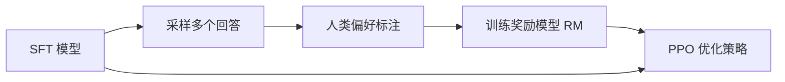

# RLHF / DPO / GRPO

## RLHF（InstructGPT 流程）

奖励模型（Bradley–Terry）：

$$
\mathcal{L}_{\text{RM}} = -\log \sigma\big(r_\phi(x, y_w) - r_\phi(x, y_l)\big)
$$

PPO 阶段的目标带 KL 惩罚，防止偏离参考模型太远：

$$
\max_\pi\ \mathbb{E}\big[r_\phi(x,y)\big] - \beta\, \mathrm{KL}\big(\pi(\cdot\mid x)\,\|\,\pi_{\text{ref}}(\cdot\mid x)\big)
$$

## DPO

无需显式奖励模型和 RL 采样，直接在偏好对上优化：

$$
\mathcal{L}_{\text{DPO}} = -\log\sigma\!\left(\beta\log\frac{\pi_\theta(y_w\mid x)}{\pi_{\text{ref}}(y_w\mid x)} - \beta\log\frac{\pi_\theta(y_l\mid x)}{\pi_{\text{ref}}(y_l\mid x)}\right)
$$

## GRPO

DeepSeekMath / DeepSeek-R1 使用。去掉 critic，对同一问题采样一组 $G$ 个回答，用组内归一化奖励作为优势：

$$
\hat A_i = \frac{r_i - \mathrm{mean}(r_1,\dots,r_G)}{\mathrm{std}(r_1,\dots,r_G)}
$$

再套用 PPO-Clip 目标并加 KL 项。适合可验证奖励（数学、代码）的场景。

| | 需要 RM | 需要 Critic | 在线采样 |
| --- | --- | --- | --- |
| PPO-RLHF | ✓ | ✓ | ✓ |
| DPO | ✗ | ✗ | ✗ |
| GRPO | 规则/RM 均可 | ✗ | ✓ |
