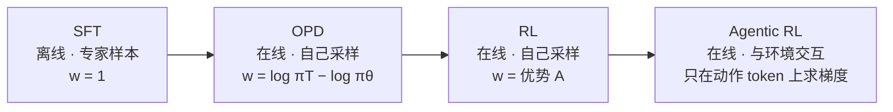

# 从 SFT 到 Agentic RL：一条梯度公式的四次变形

!!! abstract "TL;DR"
    大模型后训练里的四种方法，梯度都可以写成同一个形式：

    $$
    \nabla_\theta \mathcal{J} \;=\; \mathbb{E}_{y \sim q}\Big[\sum_{t} w_t \,\nabla_\theta \log \pi_\theta(y_t \mid s_t)\Big]
    $$

    区别只有两个：**样本 $y$ 从哪个分布 $q$ 来**，以及**每个 token 的权重 $w_t$ 是什么**。

    - **SFT**：$q$ = 专家数据，$w_t = 1$。等价于最小化前向 KL，会有暴露偏差（误差 $O(\varepsilon T^2)$）。
    - **OPD**：$q = \pi_\theta$（自己采样），$w_t$ = 教师与学生的对数概率差。等价于最小化反向 KL，是**奖励为 $\log \pi_T$ 的熵正则 RL**，每个 token 都有信号。
    - **RL**：$q = \pi_\theta$，$w_t$ = 序列奖励的优势 $A$。信号稀疏，每条回答约 1 bit。
    - **Agentic RL**：$q = \pi_\theta \times$ 环境，轨迹里混着环境返回的 token。环境转移不含 $\theta$，所以**梯度里只剩模型自己生成的 token**，这就是 loss mask 的数学来源。

## 0. 记号

给定 prompt $x$，模型逐个生成 token $y = (y_1, \dots, y_T)$。记第 $t$ 步的**状态** $s_t = (x, y_{<t})$，**动作**是 $y_t$。自回归分解：

$$
\pi_\theta(y \mid x) = \prod_{t=1}^{T} \pi_\theta(y_t \mid s_t), \qquad
\log \pi_\theta(y \mid x) = \sum_{t=1}^{T} \log \pi_\theta(y_t \mid s_t)
$$

这就是一个 **token 级 MDP**：状态转移是确定的，$s_{t+1} = s_t \circ y_t$（把新 token 拼到后面）。后面所有推导都反复用到下面这个恒等式，称为**得分函数（score function）期望为零**：

$$
\mathbb{E}_{y_t \sim \pi_\theta(\cdot \mid s_t)}\big[\nabla_\theta \log \pi_\theta(y_t \mid s_t)\big]
= \sum_{v} \pi_\theta(v \mid s_t)\frac{\nabla_\theta \pi_\theta(v \mid s_t)}{\pi_\theta(v \mid s_t)}
= \nabla_\theta \sum_v \pi_\theta(v \mid s_t) = \nabla_\theta 1 = 0
\tag{0.1}
$$

## 1. SFT：前向 KL 与最大似然

### 1.1 目标函数

设专家（人类标注或强模型）的分布是 $\pi^*$，SFT 最小化**前向 KL**：

$$
\min_\theta \; \mathrm{KL}(\pi^* \,\|\, \pi_\theta)
= \mathbb{E}_{y \sim \pi^*}\big[\log \pi^*(y \mid x) - \log \pi_\theta(y \mid x)\big]
$$

第一项与 $\theta$ 无关，所以等价于**最大似然**，也就是常见的 token 级交叉熵：

$$
\mathcal{L}_{\text{SFT}}(\theta) = -\,\mathbb{E}_{(x,y) \sim \mathcal{D}}\Big[\sum_{t=1}^{T} \log \pi_\theta(y_t \mid s_t)\Big],
\qquad
\nabla_\theta \mathcal{L}_{\text{SFT}} = -\,\mathbb{E}_{\mathcal{D}}\Big[\sum_t \nabla_\theta \log \pi_\theta(y_t \mid s_t)\Big]
$$

对照 TL;DR 里的统一公式：$q = \pi^*$（数据分布），$w_t \equiv 1$。

### 1.2 落到 logits 上

设第 $t$ 步的 logits 为 $z \in \mathbb{R}^{|V|}$，$p = \mathrm{softmax}(z)$，目标 token 为 $y_t$，one-hot 向量 $e_{y_t}$。

$$
\ell = -\log p_{y_t} = -z_{y_t} + \log \sum_v e^{z_v}
\quad\Longrightarrow\quad
\frac{\partial \ell}{\partial z_v} = -\mathbb{1}[v = y_t] + \frac{e^{z_v}}{\sum_u e^{z_u}} = p_v - \mathbb{1}[v=y_t]
$$

即 $\nabla_z \ell = p - e_{y_t}$：把正确 token 的 logit 往上推，其他 token 按当前概率往下压。

### 1.3 前向 KL 的性质：覆盖所有模式

$\mathrm{KL}(\pi^* \| \pi_\theta) = \sum_y \pi^*(y)\log\frac{\pi^*(y)}{\pi_\theta(y)}$。只要某处 $\pi^*(y) > 0$ 而 $\pi_\theta(y) \to 0$，这一项就趋于 $+\infty$。所以前向 KL 逼迫学生**覆盖专家的所有模式**（mode-covering / zero-avoiding）。容量不够的小模型会把概率摊到几个模式之间，生成"平均"出来的、哪种模式都不像的输出。

### 1.4 暴露偏差：误差为什么按 $T^2$ 累积

SFT 训练时的前缀 $s_t$ 来自**专家**的状态分布 $d^{\pi^*}$，推理时前缀却来自**模型自己**的分布 $d^{\pi_\theta}$。一旦走错一步，模型就进入训练中没见过的状态，后面可能一直错下去。

**定理**（Ross & Bagnell, 2010）：设在专家的状态分布下，模型每步犯错的概率不超过 $\varepsilon$，每步代价在 $[0,1]$ 之间，则

$$
J(\pi_\theta) \le J(\pi^*) + O(\varepsilon T^2)
$$

**推导要点**：

1. "到第 $t$ 步时已经偏离专家轨迹"意味着前 $t$ 步中出现过**第一次**犯错。第一次犯错之前一直处在专家状态上，每步错误率 $\le \varepsilon$，由 union bound，$\Pr(\text{第 } t \text{ 步前已偏离}) \le t\varepsilon$。
2. 偏离之后最坏情况每步代价为 1；没偏离时第 $t$ 步的额外代价 $\le \varepsilon$。
3. 求和：$\displaystyle\sum_{t=1}^{T}\big(t\varepsilon + \varepsilon\big) = \varepsilon\Big(\frac{T(T+1)}{2} + T\Big) = O(\varepsilon T^2)$。

如果改成**在模型自己的状态分布上**训练（DAgger：让学生走，让专家在学生走到的状态上打标签），每步的错误率直接在 $d^{\pi_\theta}$ 上被控制住，界变成 $O(\varepsilon T)$。**这就是第 2 节在线策略蒸馏的出发点。**

### 1.5 从 RL 的角度看 SFT

把 SFT 看成一种特殊的 RL：奖励只在生成出专家答案时为 1，即 $R(y) = \mathbb{1}[y = y^*]$。它的策略梯度是

$$
\nabla_\theta \mathbb{E}_{y \sim \pi_\theta}\big[\mathbb{1}[y=y^*]\big] = \nabla_\theta \pi_\theta(y^* \mid x) = \pi_\theta(y^* \mid x)\,\nabla_\theta \log \pi_\theta(y^* \mid x)
$$

而 SFT 的梯度是 $\nabla_\theta \log \pi_\theta(y^* \mid x)$。两者只差一个因子：

$$
\nabla_\theta \mathcal{J}_{\text{SFT}} = \frac{1}{\pi_\theta(y^* \mid x)} \cdot \nabla_\theta \mathcal{J}_{\text{RL}}
$$

**SFT 相当于带了 $1/\pi_\theta$ 重要性权重的 RL**：模型越觉得某个答案不可能，SFT 越用力地推它，梯度大、方差也大。这解释了为什么 SFT 容易"背答案"、泛化不如 RL。DFT（Wu et al., 2025）据此把每个 token 的 loss 乘上 $\mathrm{sg}\big(\pi_\theta(y_t \mid s_t)\big)$（$\mathrm{sg}$ 表示停止梯度）来抵消这个权重。

## 2. OPD：在线策略蒸馏 = 反向 KL

### 2.1 目标函数

让**学生自己采样**，**教师**（更强的模型 $\pi_T$）给学生生成的每个 token 打分。目标是最小化**反向 KL**：

$$
\min_\theta \; \mathrm{KL}(\pi_\theta \,\|\, \pi_T)
= \mathbb{E}_{y \sim \pi_\theta}\Big[\sum_{t} \underbrace{\big(\log \pi_\theta(y_t \mid s_t) - \log \pi_T(y_t \mid s_t)\big)}_{c_t}\Big]
$$

难点在于：**期望所在的分布本身依赖 $\theta$**，不能把梯度直接搬进期望里。

### 2.2 推导梯度

一般地，对 $\mathbb{E}_{y\sim\pi_\theta}[f_\theta(y)]$ 求导（乘积法则 + 对数导数技巧）：

$$
\nabla_\theta \mathbb{E}_{y \sim \pi_\theta}[f_\theta(y)]
= \sum_y \Big(\nabla_\theta \pi_\theta(y)\, f_\theta(y) + \pi_\theta(y)\,\nabla_\theta f_\theta(y)\Big)
= \mathbb{E}_{\pi_\theta}\big[f_\theta(y)\,\nabla_\theta \log \pi_\theta(y)\big] + \mathbb{E}_{\pi_\theta}\big[\nabla_\theta f_\theta(y)\big]
$$

取 $f_\theta(y) = \sum_t c_t$。第二项是 $\mathbb{E}\big[\sum_t \nabla_\theta \log \pi_\theta(y_t \mid s_t)\big]$，由 (0.1) 等于 0。于是

$$
\nabla_\theta \mathrm{KL}(\pi_\theta \| \pi_T)
= \mathbb{E}_{y \sim \pi_\theta}\Big[\Big(\sum_{t'} c_{t'}\Big)\Big(\sum_{t} \nabla_\theta \log \pi_\theta(y_t \mid s_t)\Big)\Big]
$$

**因果性化简**：对 $t' < t$，$c_{t'}$ 在 $s_t$ 给定时已经确定，所以

$$
\mathbb{E}\big[c_{t'}\,\nabla_\theta \log \pi_\theta(y_t \mid s_t)\big]
= \mathbb{E}_{s_t}\Big[c_{t'}\;\underbrace{\mathbb{E}_{y_t}\big[\nabla_\theta \log \pi_\theta(y_t \mid s_t)\big]}_{=\,0}\Big] = 0
$$

过去的项全部消掉，只剩"未来"：

$$
\boxed{\;
\nabla_\theta \mathrm{KL}(\pi_\theta \| \pi_T)
= \mathbb{E}_{y \sim \pi_\theta}\Big[\sum_{t} \nabla_\theta \log \pi_\theta(y_t \mid s_t)\sum_{t' \ge t} c_{t'}\Big]
\;}
\tag{2.1}
$$

对 KL 做梯度**下降**，等价于对下面这个奖励做梯度**上升**：

$$
r_t = -c_t = \log \pi_T(y_t \mid s_t) - \log \pi_\theta(y_t \mid s_t)
$$

**OPD 就是一个 RL 问题**：每个 token 都有一个稠密奖励。教师认为这个 token 合理（$\pi_T$ 高于 $\pi_\theta$），奖励为正；反之为负。

### 2.3 和 KL 正则 RL 是同一个东西

把反向 KL 拆开：

$$
-\mathrm{KL}(\pi_\theta \| \pi_T) = \mathbb{E}_{y\sim\pi_\theta}\big[\log \pi_T(y \mid x)\big] + \mathcal{H}(\pi_\theta)
$$

所以 OPD = **以 $\log \pi_T$ 为奖励、熵系数为 1 的熵正则 RL**。第 3.3 节会看到，RL 的 KL 正则目标有闭式最优解 $\pi^* \propto \pi_{\text{ref}}\, e^{R/\beta}$。取 $R = 0$、$\pi_{\text{ref}} = \pi_T$ 时，最优解正好就是 $\pi_T$，与直觉一致。

### 2.4 工程上的两种近似

(2.1) 中 $\sum_{t'\ge t} c_{t'}$ 是蒙特卡洛的"回报"，方差大。实践中常用两种做法：

1. **只取当前 token（折扣 $\gamma = 0$）**：用 $r_t$ 本身作为第 $t$ 个 token 的优势，忽略对后续 token 的影响。这样有偏，但方差小、实现简单，直接套进现有的 RL 框架即可（Thinking Machines 的 On-Policy Distillation 博客就是这么做的）。
2. **逐步精确 KL**：如果能拿到教师在整个词表上的分布，就把采样出的单个 token 换成对整个词表求和：

    $$
    \mathrm{KL}_t(s_t) = \sum_{v \in V} \pi_\theta(v \mid s_t)\big(\log \pi_\theta(v \mid s_t) - \log \pi_T(v \mid s_t)\big)
    $$

    状态 $s_t$ 由学生采样，每一步的 KL 则是解析计算、直接反传。MiniLLM（Gu et al., 2024）和 GKD（Agarwal et al., 2024）属于这一类，GKD 还把反向 KL 推广成了广义 JSD。

### 2.5 反向 KL 的性质：只抓一个模式

$\mathrm{KL}(\pi_\theta \| \pi_T) = \sum_y \pi_\theta(y)\log\frac{\pi_\theta(y)}{\pi_T(y)}$。只要 $\pi_\theta(y) = 0$，那一项就是 0。学生可以**完全放弃**教师的某些模式，只要不把概率放到教师认为不可能的地方（mode-seeking / zero-forcing）。小模型学大模型时，这比前向 KL "平均所有模式"更合理。

### 2.6 小结：SFT、蒸馏、OPD 的关系

| 方法 | 谁采样 $y$ | 优化的散度 | 每个 token 的权重 |
| --- | --- | --- | --- |
| SFT | 人类 / 专家数据 | $\mathrm{KL}(\pi^* \Vert \pi_\theta)$ | $1$ |
| 序列级蒸馏（离线） | 教师 $\pi_T$ | $\mathrm{KL}(\pi_T \Vert \pi_\theta)$ | $1$ |
| 词表级蒸馏（离线） | 教师 $\pi_T$ | 每步 $\mathrm{KL}(\pi_T \Vert \pi_\theta)$ | 软标签 $\pi_T(v \mid s_t)$ |
| **OPD（在线）** | **学生 $\pi_\theta$** | $\mathrm{KL}(\pi_\theta \Vert \pi_T)$ | $\log \pi_T - \log \pi_\theta$ |

关键变化是**换了采样分布**：在学生自己会走到的状态上纠错，对应 1.4 节 DAgger 的 $O(\varepsilon T)$。

## 3. RL：把教师换成奖励

OPD 需要一个教师给每个 token 打分。如果没有更强的教师，只有一个能判断最终答案对错的验证器（数学题对答案、代码跑单测），就到了 RL（RLVR）。

### 3.1 策略梯度

目标是最大化期望奖励 $\mathcal{J}(\theta) = \mathbb{E}_{x,\, y \sim \pi_\theta}[R(x,y)]$。奖励 $R$ 与 $\theta$ 无关，套用 2.2 节的公式（此时 $\nabla f = 0$）：

$$
\nabla_\theta \mathcal{J} = \mathbb{E}_{y\sim\pi_\theta}\big[R(x,y)\,\nabla_\theta \log \pi_\theta(y \mid x)\big]
= \mathbb{E}\Big[\sum_t R(x,y)\,\nabla_\theta \log \pi_\theta(y_t \mid s_t)\Big]
$$

这就是 REINFORCE（Williams, 1992）。和 (2.1) 比，**形式完全一样**，只是每个 token 的权重从"教师的逐 token 打分"变成了"整条回答的同一个奖励"。

**信号密度对比**：二值奖励每条回答最多提供 1 bit 信息，而且要平均分摊给几千个 token。OPD 则每个 token 都有一个实数信号。这是 OPD 往往比 RL 省几个数量级算力的根本原因。

### 3.2 基线不改变期望

用 $R - b$ 代替 $R$，其中 $b$ 不依赖当前动作 $y$：

$$
\mathbb{E}_{y\sim\pi_\theta}\big[b\,\nabla_\theta \log \pi_\theta(y \mid x)\big] = b\,\nabla_\theta \sum_y \pi_\theta(y \mid x) = b \cdot 0 = 0
$$

所以梯度无偏，而方差可以大幅降低。$R - b$ 称为**优势** $A$。PPO 用 Critic 估计 $b = V(s_t)$，GRPO 用同一 prompt 下一组回答的平均奖励。

### 3.3 KL 正则目标的闭式解

为防止策略跑得太远（奖励黑客、语言退化），通常加一个相对参考模型的 KL 惩罚：

$$
\max_\pi \; \mathbb{E}_{y\sim\pi}[R(y)] - \beta\,\mathrm{KL}(\pi \,\|\, \pi_{\text{ref}})
$$

配方：令 $Z = \sum_y \pi_{\text{ref}}(y)\,e^{R(y)/\beta}$，$\pi^*(y) = \pi_{\text{ref}}(y)\,e^{R(y)/\beta}/Z$，则

$$
\begin{aligned}
\mathbb{E}_\pi[R] - \beta\,\mathbb{E}_\pi\Big[\log\frac{\pi}{\pi_{\text{ref}}}\Big]
&= -\beta\,\mathbb{E}_\pi\Big[\log \pi - \log \pi_{\text{ref}} - \frac{R}{\beta}\Big] \\
&= -\beta\,\mathbb{E}_\pi\Big[\log\frac{\pi}{\pi^*}\Big] + \beta\log Z
= -\beta\,\mathrm{KL}(\pi \,\|\, \pi^*) + \beta \log Z
\end{aligned}
$$

$\beta\log Z$ 与 $\pi$ 无关，KL 非负，所以最优解就是

$$
\pi^*(y \mid x) = \frac{1}{Z(x)}\,\pi_{\text{ref}}(y \mid x)\,\exp\!\big(R(x,y)/\beta\big)
$$

反解出 $R = \beta\log\frac{\pi^*}{\pi_{\text{ref}}} + \beta\log Z$，代入 Bradley-Terry 偏好模型后 $Z$ 抵消，就得到 DPO（详见 [从 PPO 到 GRPO](ppo-to-grpo.md)）。

### 3.4 PPO：复用旧样本

采样很贵，希望一批样本能做多步更新。样本来自旧策略 $\pi_{\text{old}}$，用[重要性采样](importance-sampling.md)修正：

$$
L(\theta) = \mathbb{E}_{s_t, y_t \sim \pi_{\text{old}}}\big[\rho_t(\theta)\,A_t\big], \qquad \rho_t(\theta) = \frac{\pi_\theta(y_t \mid s_t)}{\pi_{\text{old}}(y_t \mid s_t)}
$$

在 $\theta = \theta_{\text{old}}$ 处，$\nabla_\theta \rho_t = \nabla_\theta \log \pi_\theta(y_t \mid s_t)$，所以 $\nabla L = \mathbb{E}[A_t\nabla \log \pi_\theta]$，与策略梯度一致。离 $\theta_{\text{old}}$ 越远，这个近似越差，因此要裁剪：

$$
L^{\text{CLIP}}(\theta) = \mathbb{E}\Big[\min\big(\rho_t A_t,\; \mathrm{clip}(\rho_t, 1-\epsilon, 1+\epsilon)\,A_t\big)\Big]
$$

当 $A_t > 0$ 且 $\rho_t > 1+\epsilon$ 时取到常数分支，梯度为 0，不再继续增大该 token 的概率；$A_t < 0$ 时对称。

### 3.5 GRPO：用组均值当基线

对同一个 $x$ 采样 $G$ 条回答 $\{y_i\}$，用组内统计量算优势，从而去掉 Critic：

$$
\hat A_i = \frac{R_i - \mathrm{mean}(R_1,\dots,R_G)}{\mathrm{std}(R_1,\dots,R_G)}
$$

$$
\mathcal{J}_{\text{GRPO}} = \mathbb{E}\Bigg[\frac{1}{G}\sum_{i=1}^{G}\frac{1}{|y_i|}\sum_{t}\min\big(\rho_{i,t}\hat A_i,\ \mathrm{clip}(\rho_{i,t},1\pm\epsilon)\hat A_i\big) - \beta\,\mathbb{D}_{\text{KL}}\Bigg]
$$

**组均值基线有没有偏？** 先只看分子 $R_i - \bar R$，其中 $\bar R = \frac1G\sum_j R_j$ 包含了 $R_i$ 自己。对 $j \ne i$，$R_j$ 与 $y_i$ 独立，按 3.2 节的论证贡献为 0；$j = i$ 那一项贡献 $-\frac1G R_i$。所以

$$
\mathbb{E}\big[(R_i - \bar R)\,\nabla \log \pi_\theta(y_i)\big] = \Big(1 - \frac{1}{G}\Big)\,\mathbb{E}\big[R_i\,\nabla\log\pi_\theta(y_i)\big]
$$

只差一个常数缩放，方向无偏。但**除以 std** 和**按 $1/|y_i|$ 做长度归一化**确实会引入偏差：std 小的题（几乎全对或全错）会被放大；答错时越长的回答单 token 惩罚越轻，鼓励"错的时候写长一点"。Dr. GRPO（Liu et al., 2025）去掉了这两项。

### 3.6 KL 项怎么估计：$k_1$、$k_3$ 及其梯度

序列级 KL 无法精确计算，只能用采样估计。设 $y \sim \pi_\theta$，$r = \pi_{\text{ref}}(y)/\pi_\theta(y)$（Schulman, 2020）：

- $k_1 = -\log r$：无偏，但单个样本可能为负，方差大。
- $k_3 = (r - 1) - \log r$：由 $\log r \le r - 1$ 知 $k_3 \ge 0$；又 $\mathbb{E}_{\pi_\theta}[r] = \sum_y \pi_\theta \frac{\pi_{\text{ref}}}{\pi_\theta} = 1$，所以 $\mathbb{E}[k_3] = 0 + \mathbb{E}[-\log r] = \mathrm{KL}(\pi_\theta\|\pi_{\text{ref}})$，同样无偏，而且方差更小。

GRPO 把 $k_3$ **当作 loss 直接求导**（样本固定）。这时要小心：$\nabla_\theta r = -r\,\nabla_\theta\log\pi_\theta$，所以

$$
\nabla_\theta k_3 = -r\,\nabla\log\pi_\theta + \nabla\log\pi_\theta = (1 - r)\,\nabla_\theta\log\pi_\theta
$$

$$
\mathbb{E}_{\pi_\theta}\big[(1-r)\nabla\log\pi_\theta\big] = \underbrace{\mathbb{E}_{\pi_\theta}[\nabla\log\pi_\theta]}_{0} - \sum_y \pi_{\text{ref}}(y)\,\nabla\log\pi_\theta(y) = \nabla_\theta\,\mathrm{KL}(\pi_{\text{ref}} \,\|\, \pi_\theta)
$$

也就是说，**$k_3$ 的值估计的是反向 KL，它的梯度却是前向 KL 的梯度**。这个区别在 $\pi_\theta$ 离 $\pi_{\text{ref}}$ 很近时影响不大，走远了就要注意。

## 4. Agentic RL：轨迹里混进了环境

### 4.1 多轮 MDP

智能体与环境（工具、代码执行器、浏览器、用户）交互 $K$ 轮。记第 $k$ 轮模型生成的一段 token 为**动作** $a_k$，环境返回的一段 token 为**观测** $o_k$，历史 $h_k = (x, a_1, o_1, \dots, a_{k-1}, o_{k-1})$：

$$
\tau = (x,\ a_1,\ o_1,\ a_2,\ o_2,\ \dots,\ a_K), \qquad
p_\theta(\tau) = \prod_{k=1}^{K} \pi_\theta(a_k \mid h_k)\; \prod_{k=1}^{K-1} P_{\text{env}}(o_k \mid h_k, a_k)
$$

和单轮相比，状态转移**不再确定**：$o_k$ 由外部世界决定，模型无法控制。

### 4.2 Loss mask 的数学来源

对轨迹求对数梯度：

$$
\nabla_\theta \log p_\theta(\tau)
= \sum_{k} \nabla_\theta \log \pi_\theta(a_k \mid h_k) + \underbrace{\sum_{k} \nabla_\theta \log P_{\text{env}}(o_k \mid h_k, a_k)}_{=\,0\text{（环境不含 }\theta\text{）}}
= \sum_{k}\sum_{t \in a_k} \nabla_\theta \log \pi_\theta(y_t \mid s_t)
$$

所以策略梯度是

$$
\nabla_\theta \mathcal{J} = \mathbb{E}_{\tau \sim p_\theta}\Big[\sum_{t} m_t\, A_t\, \nabla_\theta \log \pi_\theta(y_t \mid s_t)\Big],\qquad
m_t = \begin{cases} 1 & y_t \text{ 由模型生成} \\ 0 & y_t \text{ 由环境返回} \end{cases}
$$

**$m_t$ 就是 loss mask**。如果不加 mask，等于把 $\log \pi_\theta(o_k \mid \cdot)$ 也当作要优化的项，相当于在环境输出上做 SFT。模型会学着"自己编造工具返回值"，而不是去调用工具。同理，PPO/GRPO 的重要性比 $\rho_t$、KL 项、长度归一化的分母 $|y_i|$，都只应该统计 $m_t = 1$ 的 token。

### 4.3 信用分配：奖励更稀疏

轨迹可能长达数万 token、几十轮交互，而奖励通常只在最后给出（任务完成与否）。REINFORCE 用同一个 $A$ 去乘所有 token，粗略地说，梯度估计的方差随轨迹长度增长：每个 $\nabla\log\pi_\theta(y_t \mid s_t)$ 都是一个有噪声的项，叠加 $T$ 个噪声项，信号却只有一个标量。常见的缓解办法：

1. **轮级优势**：把一轮 $a_k$ 当成一个宏动作，在轮的粒度上做 GAE：

    $$
    \delta_k = r_k + \gamma V(h_{k+1}) - V(h_k), \qquad \hat A_k = \sum_{l \ge 0} (\gamma\lambda)^l\, \delta_{k+l}
    $$

    同一轮内的所有 token 共享 $\hat A_k$。

2. **过程奖励**：给中间步骤打分（工具调用是否合法、子目标是否达成），把 $r_k$ 从全零变成稠密。

3. **组内比较**：与 GRPO 相同，对同一任务跑多条轨迹，用组均值做基线。

4. **OPD 回归**：如果有更强的智能体当教师，就在学生的多轮轨迹上逐 token 打分 $r_t = \log\pi_T - \log\pi_\theta$，同样只对 $m_t = 1$ 的 token 计算。这把 2.4 节的稠密信号带回了长时程任务。

### 4.4 异步与离策略修正

Agentic rollout 很慢（要等工具、等环境），训练框架通常异步：推理引擎（如 vLLM）用的策略 $\pi_{\text{rollout}}$ 可能落后几步，而且推理与训练的数值实现不同，即使参数相同，两边算出的概率也不完全一致。真正采样的分布是 $\pi_{\text{rollout}}$，不是 $\pi_{\text{old}}$，所以需要再做一层重要性修正，并截断以控制方差（truncated importance sampling，TIS）：

$$
\nabla_\theta \mathcal{J} \approx \mathbb{E}_{\tau \sim \pi_{\text{rollout}}}\Big[\sum_t m_t \cdot \min\Big(\frac{\pi_{\text{old}}(y_t \mid s_t)}{\pi_{\text{rollout}}(y_t \mid s_t)},\ C\Big) \cdot \nabla_\theta \min\big(\rho_t A_t,\ \mathrm{clip}(\rho_t)A_t\big)\Big]
$$

截断 $C$ 引入一点偏差，换来有界方差，这是重要性采样里标准的偏差-方差权衡。

## 5. 总表

回到开头的统一形式 $\nabla_\theta\mathcal{J} = \mathbb{E}_{y\sim q}\big[\sum_t w_t\,\nabla_\theta\log\pi_\theta(y_t \mid s_t)\big]$：

| | 采样分布 $q$ | 权重 $w_t$ | 信号密度 | 等价的目标 |
| --- | --- | --- | --- | --- |
| SFT | 专家数据 $\pi^*$ | $1$ | 稠密，但只在专家状态上 | $\min \mathrm{KL}(\pi^* \Vert \pi_\theta)$ |
| OPD | 学生 $\pi_\theta$ | $\log\pi_T - \log\pi_\theta$ | 稠密，在学生自己的状态上 | $\min \mathrm{KL}(\pi_\theta \Vert \pi_T)$ |
| RL | 学生 $\pi_\theta$（PPO 用 $\pi_{\text{old}}$ + $\rho_t$） | 序列优势 $A$ | 稀疏，约 1 bit / 回答 | $\max \mathbb{E}[R] - \beta\,\mathrm{KL}(\pi_\theta \Vert \pi_{\text{ref}})$ |
| Agentic RL | $\pi_\theta \times P_{\text{env}}$（实际是 $\pi_{\text{rollout}}$） | $m_t \cdot A_t$（$m_t$ = loss mask） | 更稀疏，长时程 | 同上，在多轮轨迹上 |

沿着这条线往下看，**样本越来越"自己的"**，解决了暴露偏差；**监督越来越弱**，从逐 token 的标准答案，到逐 token 的打分，再到整条回答一个分数，最后到一整段交互一个分数。这就要求越来越多的方差控制手段：基线、裁剪、组归一化、轮级优势、截断重要性采样。

## 6. 我的疑问

- OPD 里 $\gamma = 0$ 的近似忽略了"这个 token 会把后面带到哪里"。教师和学生差距很大时，这个偏差有多严重？用轮级或句级的折扣会不会更好？
- $k_3$ 的梯度其实是前向 KL 的梯度。在长时程 agentic RL 里策略漂移很大，这个错配是否值得改用 $k_1$，或者用词表级精确 KL？
- 环境观测 $o_k$ 不参与梯度，但它决定了状态分布。如果环境本身是另一个 LLM（模拟用户），这种"多智能体非平稳性"该如何建模？

## 参考

- Ross & Bagnell, *Efficient Reductions for Imitation Learning*, AISTATS 2010
- Ross, Gordon & Bagnell, *A Reduction of Imitation Learning and Structured Prediction to No-Regret Online Learning*（DAgger）, AISTATS 2011
- Williams, *Simple Statistical Gradient-Following Algorithms for Connectionist Reinforcement Learning*, 1992
- Schulman et al., *Proximal Policy Optimization Algorithms*, 2017
- Schulman, *Approximating KL Divergence*, 博客, 2020
- Rafailov et al., *Direct Preference Optimization*, NeurIPS 2023
- Shao et al., *DeepSeekMath*（GRPO）, 2024
- Gu et al., *MiniLLM: Knowledge Distillation of Large Language Models*, ICLR 2024
- Agarwal et al., *On-Policy Distillation of Language Models: Learning from Self-Generated Mistakes*（GKD）, ICLR 2024
- Liu et al., *Understanding R1-Zero-Like Training: A Critical Perspective*（Dr. GRPO）, 2025
- Wu et al., *On the Generalization of SFT: A Reinforcement Learning Perspective with Reward Rectification*（DFT）, 2025
- Thinking Machines Lab, *On-Policy Distillation*, 博客, 2025
