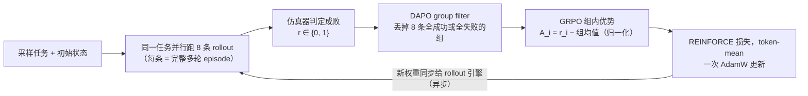
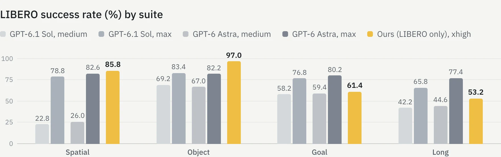
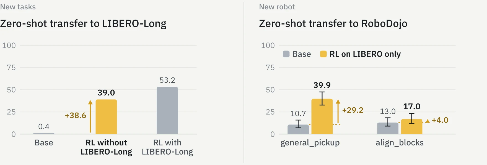

# PEAR：在仿真里用 RL 教推理模型直接操控机器人

!!! abstract "TL;DR"
    - **做了什么**：拿开源推理模型 Qwen3.8-27B，不做 SFT、不用任何示教数据，只在仿真（LIBERO、RoboDojo）里按“任务成没成功”做 RL。论文把这套训练叫 **Robot-Use RL**，训练框架叫 **PEAR**（Post-training Engine for Agentic Robotics）。
    - **怎么用机器人**：和 computer-use agent 用电脑一样。每一轮看相机画面和机械臂状态，写一段思维链，再输出一个 JSON 格式的**末端位姿增量**。IK 和控制器负责执行，中间没有感知工具、抓取规划器或技能库（no harness）。
    - **效果**：LIBERO 成功率 1.6% → 74.4%，接近 GPT-6 Astra / GPT-6.1 Sol 的 max effort。换成新指令时 π0.5 只剩 0.75%，它还有 57.4%。只在仿真训练，真机双臂 YAM 上 18/30 成功。9 个通用 benchmark 没有可测的退化。
    - **代价**：每一步都要先想约 3.2k token，慢；高度依赖 prompt 里对机器人本体的描述；每轮只能出一个位姿，不能出动作块（action chunk）。

原文：[Training Reasoning Models in Simulation to Natively Use Real Robots](https://mit-han-lab.github.io/pear-blog/)（Tang, Zhang, Guo et al., MIT HAN Lab, 2026；[arXiv 2611.18562](https://arxiv.org/abs/2611.18562)）。文中的图都截自原博客，图注里的链接可跳回原图（原图大多可以交互，悬停能看到具体数值）。

!!! note "名字说明"
    严格来说 PEAR 是训练基础设施的名字，方法叫 Robot-Use RL，模型本身没有单独命名。下文用“PEAR”指代这项工作和训练出来的模型，和社区的习惯叫法保持一致。

## 1. Motivation

目前让大模型控制机器人主要有两条路，各有缺陷：

| 路线 | 代表 | 问题 |
|---|---|---|
| **VLA**：VLM 骨干 + 动作头，用示教数据做 SFT | π0.5、OpenVLA、GR00T | 需要大量示教；容易记住“这个场景 → 这条轨迹”，指令一换就失效（见 [§4](#4-扰动对-π05-和-pear-的影响)） |
| **Agent + harness**：通用 VLM 调用感知、抓取规划、技能库等工具 | ORA、Harness VLA、ASPIRE（另见本站 [Agent4Robot](../agent4robot/index.md)） | 上限受工具限制，工具没覆盖的动作做不了；整条管线需要人工维护 |

PEAR 的出发点是 computer-use 的成功经验：前沿模型并没有借助专门的 GUI 解析工具，而是直接“看截图 → 想 → 输出 click(x, y)”，再在环境里用 RL 练出这项能力。PEAR 想验证同样的配方能不能搬到机器人上：

1. **不要 harness**：模型自己在画面里找物体、规划怎么接近、发现动作没到位就修正。
2. **不要示教**：只用任务成败这个稀疏奖励。
3. **保留通用能力**：练完之后仍然能做数学、写代码、看图答题，机器人操作只是新增的一项技能，不靠牺牲其他能力换来。

它押注的是推理模型从预训练里带来的世界知识和指令理解。这些能力 VLA 在 SFT 时容易丢掉，RL 则可以在保留它们的同时教会模型“读懂之后去做”。

## 2. 输入输出

<figure markdown>
  { loading=lazy }
  <figcaption>上：computer-use agent 看截图、推理、输出 click；下：robot-use agent 看三路相机和机械臂状态、写思维链、输出末端下一位姿，由 IK + 控制器执行。每一轮都追加进上下文。原博客 <a href="https://mit-han-lab.github.io/pear-blog/#fig-1">Figure 1</a></figcaption>
</figure>

### 2.1 一轮（round）的输入

| 内容 | 说明 |
|---|---|
| **System / 任务 prompt** | 对机器人本体（几条臂、坐标系、夹爪）、动作格式和任务的文字描述。训练时平均约 **1.8k token**；真机上的难任务（画画、化学实验）需要写得很详细，见 [局限 4](#局限-4依赖-prompt-里的本体信息) |
| **语言指令** | 例如 "put the bowl on the plate"、"Pick up the ⟨object⟩ by 10 cm" |
| **相机画面** | 真机为头部相机 + 左右腕部相机，共三路；训练时一个 episode 有 39–59 张图，平均每轮 2–3 张 |
| **机械臂状态** | 本体状态（末端位姿、夹爪开合等），以文本形式给出 |
| **历史上下文** | 之前**所有轮次**的图像、思维链和动作都保留在上下文里，不做截断。模型因此记得自己看过什么、做过什么，可以在前面动作的基础上接着规划 |

### 2.2 一轮的输出

每轮输出两部分：先是一段**思维链**（CoT），然后是**一个**动作，写成 JSON 文本：

```json
{"left_arm":  {"x": 0.0, "y": 1.0, "z": -17.4, "roll": 0.0, "pitch": 0.0, "yaw": 0.0},
 "right_arm": {...},
 "left_gripper": {"width": -6.5},
 ...}
```

- **输出的是末端执行器位姿的变化量**，不是绝对坐标，也不是关节角。每条臂有 6 个自由度：平移 `x, y, z` 加旋转 `roll, pitch, yaw`，夹爪则用 `width` 的增量控制。原博客 Figure 1 的动画里，思维链说 “Lift it by 10 cm” 时对应的动作是 `"z": 10.0`，夹爪闭合时 `"width": -6.5`。由此推断数值是相对增量，平移单位大概率是 cm（这是根据示例推断的，博客正文没有写明单位）。
- **一次只预测一个位姿**，即一个目标点，不是动作块。IK 把位姿换算成关节角，控制器把机械臂移过去**并停住**，然后拍新画面，进入下一轮。
- **思维链很长**：训练使用的 xhigh effort 下平均每轮约 **3.23k thinking token**。整个 episode 平均 94k token（prompt 1.8k + response 92k），约 19.7 轮。
- **输出长度和轮数都有上限**：LIBERO 训练时序列上限 256k token，RoboDojo 160k。真机上超过 25 轮，或单轮思考超过 32k token，即判失败。

### 2.3 和 VLA 的输入输出对比

| | π0.5（VLA） | PEAR |
|---|---|---|
| 动作表示 | 连续动作，flow matching 动作头 | **文本** JSON，由语言模型头直接生成 |
| 每次预测 | 一个动作块（LIBERO 上预测 10 步、执行前 5 步，见[仿真评测那篇](simulation.md)） | **一个**末端位姿增量 |
| 控制频率 | 每步约 50 ms，高频闭环 | 每轮先想几秒，再走一步，低频 |
| 是否推理 | 不显式推理 | 每步都有 CoT |
| 历史 | 基本只看当前帧 | 整个 episode 的图像、思考和动作都在上下文里 |
| 执行层 | 环境控制器 | IK + 控制器，没有其他工具 |

## 3. 方法和效果

### 3.1 方法：RL 到底怎么做的

整体是一个**多轮 agentic RL**，和训练 computer-use / coding agent 的方式相同：环境是仿真器，一条 rollout 就是一整个 episode，奖励只看最后成没成功。



**奖励。** 只有任务成败：仿真器判定成功记 1，失败记 0。没有稠密的过程奖励、长度惩罚，也没有格式奖励。

**算法。** 以 GRPO 为主，加了几处改动（原博客 Table A1）：

- **GRPO 组内相对优势**：同一个任务和初始状态跑 $G=8$ 条 rollout，用组内统计量做基线，不需要 value 网络：

$$
A_i = \frac{r_i - \operatorname{mean}(r_1,\dots,r_G)}{\operatorname{std}(r_1,\dots,r_G)}
$$

- **DAPO 的 group filter**：8 条全成功或全失败的组，所有 $A_i=0$，不产生梯度，直接丢掉，继续采样，直到凑满 **128 个有效组**。初期成功率只有约 2%，这个过滤决定了 RL 能不能起步：只有偶然成功一次的那几组才提供信号。
- **策略损失**：REINFORCE 形式的策略梯度（博客写作 bypass mode），**不用 PPO clipping，不加 KL 惩罚，不加 entropy bonus**。损失在整个 batch 所有生成 token 上取平均（token-mean）。按 GRPO 的常规做法，一条 episode 里所有轮次模型生成的 token（思维链和 JSON 动作）共享这条 episode 的优势 $A_i$；图像和状态这类观测 token 不计入损失：

$$
\mathcal{L}(\theta) = -\frac{1}{\sum_i |o_i|}\sum_{i}\sum_{t\in o_i} A_i \,\log \pi_\theta\!\left(o_{i,t}\mid \text{context}_{<t}\right)
$$

- **Score Centering**：训练是完全异步的（verl），rollout 用的权重会比正在训练的权重旧几个版本。作者只用 Score Centering 校正这种 off-policy 偏差，没有用截断重要性采样。
- 其他设置：AdamW，学习率 $10^{-6}$，温度 1.0 全分布采样，**训练全程固定 xhigh effort**。

**课程（curriculum）。** 一共 340 个 step，分三段：

| Step | 训练任务 | 设计理由 |
|---|---|---|
| 1–148 | LIBERO-Goal / Spatial / Object | 基座在这三个子集上约 2% 成功，至少还有一点信号 |
| 149–225 | 加入 LIBERO-Long | 基座在 Long 上只有 0.4%，一开始就练几乎没有奖励。先留出来做迁移测试，等迁移把成功率抬到 39% 后再加入 |
| 226–340 | RoboDojo 的 general_pickup + align_blocks（双臂 ARX，Isaac 仿真） | LIBERO 训练后这两个任务成功率约 25%，信号最强。最后一个 checkpoint 就是真机上用的最终模型 |

!!! question "训练曲线横轴的 “RL step” 具体指什么？"
    **1 个 step = 1 次参数更新**（one update per step）。每次更新使用的 batch 是 **128 组 × 8 条 rollout = 1024 条完整 episode**，而且是 group filter 之后的数量，实际采样更多。每条 episode 平均约 19.7 轮、94k token，所以一个 step 大约要生成 $1024 \times 94\text{k} \approx 9.6\times10^{7}$ 个 token，并跑约 2 万轮仿真交互。

    所以“148 个 step 从 2% 涨到 70%”的意思是：只更新了 148 次权重，但背后约有 15 万条 episode、上百亿 token 的 rollout。这和监督学习里一个 step 处理一个小 batch 完全不是一个量级。全部训练约 5 万 H100 GPU 时（新版 PEAR 支持 MTP 投机解码后，作者估计可降到 3 万）。

**PEAR 的系统工作。** 难点在于超长、多模态、多轮的 rollout：

- **Rollout**：verl + LMCache。H100 上用 TP4，把 prefix KV cache 卸载到 CPU 内存，并限制并发数（160k 上限时 64 条/引擎，256k 时 32 条），让前缀缓存命中率保持在 95% 以上。多轮 agent 每一轮都要重新喂入整段历史，这个命中率决定吞吐。
- **训练**：H100 上 FSDP8 × SP8（序列并行），每卡 32,512 token，activation offloading + FlashAttention-3。GB300 上 FSDP4 × SP4，每卡 69,632 token。
- **投机解码**：用模型自带的 MTP 层当 drafter（训练时冻结），3 个 draft token 平均接受 2.4 个。单节点生成速度约 11,000 token/s。
- **仿真器**：LIBERO 在 rollout 节点的 CPU 上渲染；RoboDojo 跑在独立 GPU 节点的 Isaac 容器里。

### 3.2 效果

**LIBERO：从接近 0 练到接近前沿闭源模型。**

<figure markdown>
  { loading=lazy }
  <figcaption>左：所有 VLM 用同一套无 harness 循环，在 LIBERO 2000 个 episode 上评测。右：训练 rollout 成功率随 RL step 的变化，step 149 加入 LIBERO-Long；菱形点是同一次训练在 LIBERO 上的完整评测（64.0 → 69.5 → 74.4）。原博客 <a href="https://mit-han-lab.github.io/pear-blog/#learning">Figure 2</a></figcaption>
</figure>

几个值得注意的点：

- 曲线前 25 步几乎贴着 0 走，之后才开始爬升。这符合“稀疏奖励 + group filter”的预期：先有少数偶然成功的组提供梯度，再滚雪球式上涨。
- 分子集来看（原博客 [Figure A1](https://mit-han-lab.github.io/pear-blog/#fig-A1)），Spatial 85.8、Object 97.0 是所有 VLM 里最高的；Goal 61.4、Long 53.2 偏弱，而且这两个子集分别有 19% 和 33% 的 episode 是因为**耗尽 256k token 预算**而失败的。也就是说，有相当一部分失败是想太久、上下文用完了，并不是不会做。

<figure markdown>
  { loading=lazy }
  <figcaption>LIBERO 分子集成功率，PEAR（xhigh）与 GPT-6.1 Sol、GPT-6 Astra 的 medium / max effort 对比。原博客 <a href="https://mit-han-lab.github.io/pear-blog/#fig-A1">Figure A1</a></figcaption>
</figure>

**零样本迁移：新任务、新机器人、新基准。**

<figure markdown>
  { loading=lazy }
  <figcaption>左：没练过 LIBERO-Long，成功率就从 0.4 到 39.0；加入训练后到 53.2。右：只在 LIBERO（单臂 Franka）上训练，换到 RoboDojo 的双臂 ARX，general_pickup 从 10.7 到 39.9。原博客 <a href="https://mit-han-lab.github.io/pear-blog/#fig-6">Figure 5</a></figcaption>
</figure>

<figure markdown>
  { loading=lazy }
  <figcaption>RoboLab-120（第三个仿真基准，Franka + Robotiq，120 个任务）零样本评测：PEAR 37.3%，与 Cosmos3-Nano-Policy 的 36.8% 相当，高于 π0.5 的 28.0%。原博客 <a href="https://mit-han-lab.github.io/pear-blog/#fig-7">Figure 6</a></figcaption>
</figure>

**Sim-to-real：完全不用真机数据。**

<figure markdown>
  { loading=lazy }
  <figcaption>在 RoboDojo 两个任务上继续 RL 115 步，训练成功率从约 25% 涨到约 70%；评测时 general_pickup 39.9 → 71.2，align_blocks 17.0 → 78.8。原博客 <a href="https://mit-han-lab.github.io/pear-blog/#fig-8">Figure 7</a></figcaption>
</figure>

<figure markdown>
  { loading=lazy }
  <figcaption>真机双臂 YAM：基座 0/30，只训 LIBERO 的版本 7/30，LIBERO + RoboDojo 的版本 18/30。右边是每个 trial 的结果，在原博客上点击格子可以看对应视频。原博客 <a href="https://mit-han-lab.github.io/pear-blog/#fig-9">Figure 8</a></figcaption>
</figure>

**需要知识和推理的真机任务**，例如照着《星月夜》在白板上画线稿，或者从酚酞、碘、乙醇里挑出能检验碱性的试剂并滴进去。这类任务靠的是基座模型的世界知识，VLA 很难做到：

<figure markdown>
  { loading=lazy }
  <figcaption>真机演示：看着附图在白板上画简化线稿；另一个演示是化学实验。视频里能看到实时思维链和 token 数。原博客 <a href="https://mit-han-lab.github.io/pear-blog/#fig-demos">Figure 10</a>（视频请到原页面观看）</figcaption>
</figure>

**通用能力没有退化。**

<figure markdown>
  { loading=lazy }
  <figcaption>同一批题目做配对比较，9 个 benchmark（AIME、GPQA、IFBench、LiveCodeBench、RealWorldQA、ERQA、MMMU 等）的 95% 置信区间都包含 0，平均变化 −0.15 分。降幅最大的是 ERQA（具身推理）−2.0，置信区间 [−6.2, +2.2]。原博客 <a href="https://mit-han-lab.github.io/pear-blog/#fig-11">Figure 11</a></figcaption>
</figure>

这和 “RL's Razor” 的结论一致：在线 RL 学新任务时，对原有能力的侵蚀比 SFT 小得多。作者完全不用 SFT，部分原因也在这里（见[局限 2](#局限-2只用-rl不用-sft)）。

## 4. 扰动对 π0.5 和 PEAR 的影响

这是全文最有意思的一组对比。两个策略**都只在 LIBERO 上训练**，然后放到两个从没见过的扰动集上测试。

<figure markdown>
  { loading=lazy }
  <figcaption>π0.5 在 LIBERO 上领先 22.5 分，到 LIBERO-Pro 反而落后 8.8 分。PEAR 在两个扰动集上各掉约 12 分；π0.5 在 Plus 上掉 11.2，在 Pro 上掉 43.6。原博客 <a href="https://mit-han-lab.github.io/pear-blog/#fig-3">Figure 3</a></figcaption>
</figure>

### 4.1 LIBERO-Plus：只改“看到的”，两者差不多

LIBERO-Plus 主要扰动观测：相机、光照、背景、传感器噪声、语言改写、布局、机器人初始状态。两者掉分接近（π0.5 −11.2，PEAR −12.2）。PEAR 按扰动维度拆开如下：

<figure markdown>
  { loading=lazy }
  <figcaption>PEAR 在 LIBERO-Plus 各扰动维度上的成功率（虚线为 LIBERO 上的 74.4）。原博客 <a href="https://mit-han-lab.github.io/pear-blog/#fig-A3">Figure A3</a></figcaption>
</figure>

- 背景、光照、语言、相机只掉 4–7 分。VLM 的视觉表征本来就见过各种光照和视角，这部分鲁棒性是预训练带来的。
- **机器人初始状态**是 PEAR 唯一的明显短板：37.9，掉 36.5 分。我的推测是，模型输出的是相对位姿增量，它要靠“读状态 + 看图”估计自己现在在哪。初始姿态一旦偏离训练分布（比如手腕已经转过一个角度），后续每一步增量的参照系都会跟着错，而 CoT 里很难用文字推理出这种空间偏差。这也和[局限 4](#局限-4依赖-prompt-里的本体信息)对得上：模型对自己的身体缺乏先验。

### 4.2 LIBERO-Pro：改“要做的事”，差距拉开

| 扰动类型（LIBERO-Pro） | 改了什么 | π0.5 | PEAR | 谁受影响大 |
|---|---|---|---|---|
| 无扰动（LIBERO） | — | 96.9 | 74.4 | — |
| **Task** | 场景和初始状态不变，**指令换成另一个任务** | **0.75**（−96.2） | 57.4（−17.0） | π0.5 几乎全崩 |
| **Position** | 指令不变，**物体位置互换** | **20.8**（−76.1） | 57.5（−16.9） | π0.5 大崩 |
| Semantic | 指令换一种说法，任务本身不变 | 95.8（−1.1） | 73.3（−1.1） | 两者都几乎不掉 |
| Object | 物体换外观，任务本身不变 | 96.0（−0.9） | 60.2（−14.2） | PEAR 掉得多 |
| 平均 | | 53.3 | 62.1 | |

<figure markdown>
  { loading=lazy }
  <figcaption>示意：指令改成“放到炉子上”，π0.5 仍然把碗送到盘子；盘子和炉子换位置，π0.5 把碗送到盘子原来所在的位置（现在是炉子）。PEAR 两种情况都按指令执行。原博客 <a href="https://mit-han-lab.github.io/pear-blog/#fig-4">Figure 4</a></figcaption>
</figure>

**怎么理解这张表：**

1. **π0.5 学到的是“场景 → 轨迹”的映射，语言基本被忽略。** Task 扰动下场景和训练时一模一样，π0.5 就照着训练时的轨迹做了一遍，指令写的是什么几乎不影响它（0.75%）。Position 扰动下它记住的是“往那个位置去”，而不是“往盘子去”。这就是相关工作说的 *vision overrides language*：SFT 在示教上把语言条件学“塌”了，因为在 LIBERO 里每个场景几乎只对应一个任务，看图就足以预测动作。
2. **只要原轨迹仍然正确，π0.5 就很稳**：Semantic 和 Object 扰动不改变要做的动作，π0.5 几乎不掉分。所以它的高分其实是在“考题和训练题动作相同”这个前提下取得的。
3. **PEAR 在每种扰动下都只掉 1–17 分，没有哪一种会让它崩溃。** 它的失败更像是能力上限（74.4 本身就不高）加上一些感知误差，而不是学到了捷径。它读指令、看场景、推理去哪，换了指令就换目标。作者的解读是：**模仿示教**和**对任务做推理**的区别；基座 VLM 原本就会读指令和场景，RL 教会了它按读到的内容去行动。
4. **PEAR 的弱点在感知侧**：Object 扰动（换外观）掉 14 分，LIBERO-Plus 的传感器噪声掉 14 分，都是“看不准”的问题。π0.5 恰好相反，它的弱点在语义侧。

一句话总结：**π0.5 擅长“像训练时那样做”，PEAR 擅长“按要求做”。** 前者在同分布 benchmark 上分数更高，后者在指令或布局变化时更稳。

## 5. 局限

### 局限 1：没有 scaling

受 GPU 资源限制，训练只覆盖 **2 个仿真器**（LIBERO、RoboDojo），RoboDojo 上只练了 **2 个任务**，基座也只有 27B。这只能说明这条路**能走通**，还不能说明它**能 scale**。博客说最后阶段的训练“went smoothly”，作者相信扩大仿真和任务多样性、换更强的基座之后会更好，但目前没有数据点支持任何 scaling 曲线。

### 局限 2：只用 RL，不用 SFT

作者有意不做 SFT，理由有两条：

- 缺少高质量的同分布数据，而且担心 SFT 会损害通用能力（参考 RL's Razor 和 On-Policy Distillation 的讨论）。
- 他们认为机器人数据应该放进 pretraining / mid-training，不该在已经后训练好的模型上再做 SFT。

代价是 **RL 必须从约 2% 的成功率冷启动**。前 25 个 step 几乎没有信号；LIBERO-Long 这种 0.4% 的任务只能靠课程设计间接解决；RoboDojo 上大部分任务基座几乎从不成功，最后只挑了两个约 25% 成功率的任务来练。换句话说，**RL 能练什么，取决于基座在这个任务上能不能偶尔成功一次**。没有 SFT 或 mid-training 抬高起点，任务覆盖面就会受限。

### 局限 3：慢

RL 时没有长度惩罚，也不限制 CoT 长度，所以模型学会了每一步都先想很久：

<figure markdown>
  { loading=lazy }
  <figcaption>左：low effort 每轮 0.86k token，xhigh 每轮 3.23k。中：同一 checkpoint 在 low effort 下 LIBERO 只有 21.9%，xhigh 下 74.4%。右：NVFP4 + DFlash2 投机解码后，M5 Max 52、RTX 5090 221、GB300 747 token/s。原博客 <a href="https://mit-han-lab.github.io/pear-blog/#fig-12">Figure 12</a></figcaption>
</figure>

即使在 GB300 上达到 747 token/s，xhigh 一轮也要约 **4.3 s**；个别轮次 CoT 会长到 32k token，**单步动作超过半分钟**。一个约 20 轮的任务要几分钟才能做完。思考量和成功率还是强绑定的：思考量砍到不足 1/3，成功率也只剩不足 1/3。也就是说，LIBERO 上的大部分能力都来自每步之前的长时间推理，没法简单地把思考关掉来提速。

### 局限 4：依赖 prompt 里的本体信息

27B 基座对“自己控制的是什么身体”缺乏先验，坐标系方向、臂长、夹爪尺寸都要写在 prompt 里。难任务（演示里的画画、化学实验）要在 prompt 里**详细描述本体和任务**才能成功。所以成功率很大程度上取决于模型能否从 prompt 中形成对本体和环境的清晰理解，prompt 写得好坏会直接影响结果。作者把这一点反过来解读为“说明它能遵循详细的语言指令”。但对部署来说，这意味着每换一台机器人都要重新做一遍提示工程。§4.1 中初始状态扰动的大幅掉分，可能也源于这一点。

### 局限 5：无法使用动作块（action chunk）

模型目前**还不能可靠地规划动作块**，所以每轮只输出一个位姿，由 IK + 控制器走过去并停住。这带来三个问题：

- **精度部分取决于控制器**：控制器实现得不好，机械臂会在某些位置跳变或到不了目标位姿。
- **轮数变多**：一个本可以用一个动作块一次完成的连续动作（比如画一条曲线、沿桌面推一段距离），必须拆成很多轮，每一轮都要重新看图、重新想几千 token。
- **吃掉步数预算**：在仿真评测里，低效的控制器会耗尽任务的 step budget。

这一点和局限 3 叠加，就是“每一小步都要花几秒钟想”的根本原因。

## 6. Insight：该想的时候想，不该想的时候别想

PEAR 最打动我的一点是，它证明了**推理模型可以不经过 harness、直接通过 RL 学会用机器人**，而且推理带来的泛化（§4）是 VLA 靠模仿学不到的。但它目前的用法是**每一步都想满 3k token**，这很浪费：

- 一个 episode 里大部分动作是“再往下 2 cm”“夹爪闭合”“抬起 10 cm”这种显而易见的小步，真正需要推理的只有少数关键决策点：看懂指令该去哪、选哪个物体、抓取失败后怎么换策略、化学实验里选哪个试剂。
- Figure 12 说明思考长度**确实可以调**（low effort 下 0.86k token），只是 RL 时从没在低 effort 下训练过，所以一刀切地减少思考就会崩。问题不在于“想得少”，而在于**不分场合地想得少**。

几个可能的方向：

1. **自适应思考长度**：RL 时加入长度惩罚，或者在多个 effort 下混合训练，让模型自己学会在简单步骤上几乎不想、在关键步骤上深想。这和 LLM 领域的 adaptive thinking / thinking budget 是同一个问题。
2. **快慢双系统**：慢系统（推理 VLM）只在关键节点出手，输出子目标或一段动作块；快系统（小 VLA 或经典控制器）负责高频执行。这样既保留 PEAR 的指令跟随和泛化能力，又拿回 VLA 的速度。局限 5 的动作块问题也会顺带缓解。
3. **奖励里显式计入时间**：现在的奖励只看成败，模型没有任何理由想得更短。如果把真实世界里的耗时放进奖励，“什么时候值得想”就成了策略本身要学的东西。

更广义地看，这篇文章把机器人控制变成了和 computer-use、coding agent 同构的问题：多轮、长上下文、稀疏奖励、agentic RL。这意味着 LLM 后训练领域积累的工具（GRPO/DAPO、异步 RL、前缀缓存、投机解码）可以直接搬过来。它开出的真正问题是：**这套配方能否像在 LLM 上那样随算力和数据 scale**（局限 1），以及机器人数据该放在预训练的哪个阶段（局限 2）。

## 参考

- Tang, Zhang, Guo et al. (2026). [Training Reasoning Models in Simulation to Natively Use Real Robots](https://mit-han-lab.github.io/pear-blog/). MIT HAN Lab. [arXiv 2611.18562](https://arxiv.org/abs/2611.18562)
- Black et al. (2025). π0.5: a Vision-Language-Action Model with Open-World Generalization.
- Liu et al. (2023). LIBERO: Benchmarking Knowledge Transfer for Lifelong Robot Learning.
- Fei et al. (2026). LIBERO-Plus；Zhou et al. (2025). LIBERO-PRO: Towards Robust and Fair Evaluation of VLA Models Beyond Memorization.
- Shao et al. (2024). DeepSeekMath（GRPO）；Yu et al. (2025). DAPO.
- Shenfeld et al. (2026). RL's Razor: Why Online Reinforcement Learning Forgets Less.
- 本站相关：[具身智能仿真是怎么做的](simulation.md) · [Agent4Robot](../agent4robot/index.md) · [从 SFT 到 Agentic RL](../rl/sft-to-agentic-rl.md)
