# PEAR：在仿真里用 RL 教推理模型直接操控机器人

!!! abstract "TL;DR"
    - **做了什么**：以开源推理模型 Qwen3.8-27B 为基座，不做 SFT、不使用示教数据，仅以仿真（LIBERO、RoboDojo）中的任务成败为奖励进行 RL。论文把这套训练叫 **Robot-Use RL**，训练框架叫 **PEAR**（Post-training Engine for Agentic Robotics）。
    - **怎么用机器人**：与 computer-use agent 操作计算机的方式一致：每一轮读取相机画面和机械臂状态，生成思维链，再输出一个 JSON 格式的**末端位姿增量**。由 IK 和控制器执行，中间不经过感知工具、抓取规划器或技能库（no harness）。
    - **效果**：LIBERO 成功率 1.6% → 74.4%，接近 GPT-6 Astra / GPT-6.1 Sol 的 max effort。同一场景换为新指令时，π0.5 为 0.75%，PEAR 为 57.4%。仅在仿真中训练，真机双臂 YAM 上成功 18/30。9 个通用 benchmark 没有可测的退化。
    - **局限**：每一步前平均推理约 3.2k token，执行慢；依赖 prompt 中对机器人本体的描述；每轮只输出一个位姿，不支持动作块（action chunk）。

原文：[Training Reasoning Models in Simulation to Natively Use Real Robots](https://mit-han-lab.github.io/pear-blog/)（Tang, Zhang, Guo et al., MIT HAN Lab, 2026；[arXiv 2611.18562](https://arxiv.org/abs/2611.18562)）。文中图片均截自原博客，图注链接指向原图（原图多为交互式图表，可悬停查看数值）。

!!! note "名字说明"
    严格来说 PEAR 是训练基础设施的名字，方法叫 Robot-Use RL，模型本身没有单独命名。下文沿用社区习惯，以“PEAR”指代这项工作及其训练得到的模型。

## 1. Motivation

现有让大模型控制机器人的方法主要分为两类：

| 路线 | 代表 | 问题 |
|---|---|---|
| **VLA**：VLM 骨干 + 动作头，用示教数据做 SFT | π0.5、OpenVLA、GR00T | 依赖大量示教；倾向于学习“场景 → 轨迹”的映射，指令变化时容易失效（见 [§4](#4-扰动对-π05-和-pear-的影响)） |
| **Agent + harness**：通用 VLM 调用感知、抓取规划、技能库等工具 | ORA、Harness VLA、ASPIRE（另见本站 [Agent4Robot](../agent4robot/index.md)） | 能力上限受工具集约束，工具未覆盖的动作无法完成；管线需要人工设计与维护 |

PEAR 借鉴 computer-use 的经验：前沿模型不依赖专门的 GUI 解析工具，而是直接读取截图、推理、输出 click(x, y)，并通过环境中的 RL 获得这项能力。PEAR 检验同一方案能否迁移到机器人操作：

1. **无 harness**：由模型自行在画面中定位物体、规划接近方式，并在动作未达预期时修正。
2. **无示教**：仅使用任务成败这一稀疏奖励。
3. **保留通用能力**：训练后模型在数学、代码、视觉问答上的能力不下降，机器人操作作为新增能力存在。

其核心假设是：推理模型在预训练中获得的世界知识和指令理解能力可以直接用于操作。VLA 的 SFT 过程容易削弱这些能力，而 RL 有望在保留它们的同时，让模型学会依据理解采取动作。

## 2. 输入输出

<figure markdown>
  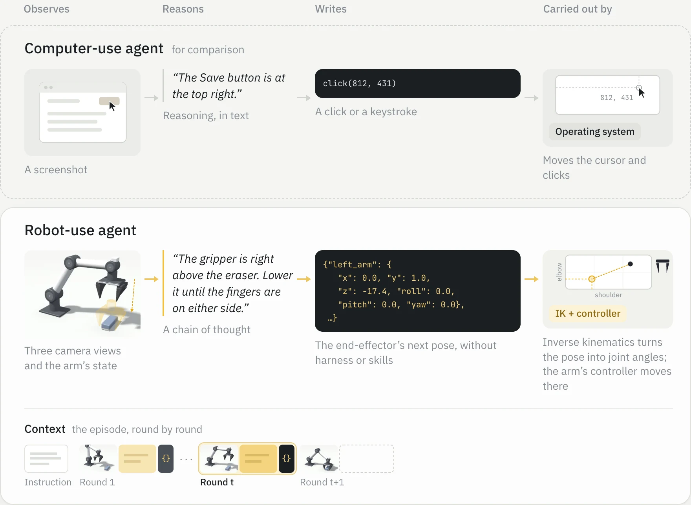{ loading=lazy }
  <figcaption>上：computer-use agent 看截图、推理、输出 click；下：robot-use agent 看三路相机和机械臂状态、写思维链、输出末端下一位姿，由 IK + 控制器执行。每一轮都追加进上下文。原博客 <a href="https://mit-han-lab.github.io/pear-blog/#fig-1">Figure 1</a></figcaption>
</figure>

### 2.1 一轮（round）的输入

| 内容 | 说明 |
|---|---|
| **System / 任务 prompt** | 对机器人本体（几条臂、坐标系、夹爪）、动作格式和任务的文字描述。训练时平均约 **1.8k token**；真机上的难任务（画画、化学实验）需要写得很详细，见 [局限 4](#局限-4依赖-prompt-里的本体信息) |
| **语言指令** | 例如 "put the bowl on the plate"、"Pick up the ⟨object⟩ by 10 cm" |
| **相机画面** | 真机为头部相机 + 左右腕部相机，共三路；训练时一个 episode 有 39–59 张图，平均每轮 2–3 张 |
| **机械臂状态** | 本体状态（末端位姿、夹爪开合等），以文本形式给出 |
| **历史上下文** | 之前**所有轮次**的图像、思维链和动作都保留在上下文里，不做截断。模型因此记得自己看过什么、做过什么，可以在前面动作的基础上接着规划 |

### 2.2 一轮的输出

每轮输出两部分：先是一段**思维链**（CoT），然后是**一个**动作，写成 JSON 文本：

```json
{"left_arm":  {"x": 0.0, "y": 1.0, "z": -17.4, "roll": 0.0, "pitch": 0.0, "yaw": 0.0},
 "right_arm": {...},
 "left_gripper": {"width": -6.5},
 ...}
```

- **输出的是末端执行器位姿的变化量**，不是绝对坐标，也不是关节角。每条臂有 6 个自由度：平移 `x, y, z` 加旋转 `roll, pitch, yaw`，夹爪则用 `width` 的增量控制。原博客 Figure 1 的动画里，思维链说 “Lift it by 10 cm” 时对应的动作是 `"z": 10.0`，夹爪闭合时 `"width": -6.5`。据此推断数值为相对增量，平移单位可能为 cm（原文未明确说明单位，此处为基于示例的推断）。
- **一次只预测一个位姿**，即一个目标点，不是动作块。IK 把位姿换算成关节角，控制器把机械臂移过去**并停住**，然后拍新画面，进入下一轮。
- **思维链很长**：训练使用的 xhigh effort 下平均每轮约 **3.23k thinking token**。整个 episode 平均 94k token（prompt 1.8k + response 92k），约 19.7 轮。
- **输出长度和轮数都有上限**：LIBERO 训练时序列上限 256k token，RoboDojo 160k。真机上超过 25 轮，或单轮思考超过 32k token，即判失败。

### 2.3 和 VLA 的输入输出对比

| | π0.5（VLA） | PEAR |
|---|---|---|
| 动作表示 | 连续动作，flow matching 动作头 | **文本** JSON，由语言模型头直接生成 |
| 每次预测 | 一个动作块（LIBERO 上预测 10 步、执行前 5 步，见[仿真评测那篇](simulation.md)） | **一个**末端位姿增量 |
| 控制频率 | 每步约 50 ms，高频闭环 | 每轮先想几秒，再走一步，低频 |
| 是否推理 | 不显式推理 | 每步都有 CoT |
| 历史 | 基本只看当前帧 | 整个 episode 的图像、思考和动作都在上下文里 |
| 执行层 | 环境控制器 | IK + 控制器，没有其他工具 |

## 3. 方法和效果

### 3.1 方法：RL 到底怎么做的

训练形式为**多轮 agentic RL**，与 computer-use / coding agent 的训练方式相同：环境为仿真器，一条 rollout 对应一个完整 episode，奖励仅由最终是否成功决定。

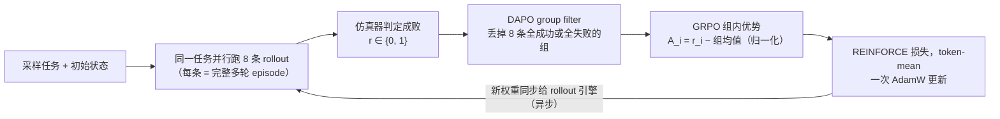

**奖励。** 只有任务成败：仿真器判定成功记 1，失败记 0。没有稠密的过程奖励、长度惩罚，也没有格式奖励。

**算法。** 以 GRPO 为主，加了几处改动（原博客 Table A1）：

- **GRPO 组内相对优势**：同一个任务和初始状态跑 $G=8$ 条 rollout，用组内统计量做基线，不需要 value 网络：

$$
A_i = \frac{r_i - \operatorname{mean}(r_1,\dots,r_G)}{\operatorname{std}(r_1,\dots,r_G)}
$$

- **DAPO 的 group filter**：8 条全成功或全失败的组，所有 $A_i=0$，不产生梯度，直接丢掉，继续采样，直到凑满 **128 个有效组**。初期成功率约 2%，此时只有出现过成功样本的组能提供梯度，过滤对训练能否起步至关重要。
- **策略损失**：REINFORCE 形式的策略梯度（博客写作 bypass mode），**不用 PPO clipping，不加 KL 惩罚，不加 entropy bonus**。损失在整个 batch 所有生成 token 上取平均（token-mean）。按 GRPO 的常规做法，一条 episode 里所有轮次模型生成的 token（思维链和 JSON 动作）共享这条 episode 的优势 $A_i$；图像和状态这类观测 token 不计入损失：

$$
\mathcal{L}(\theta) = -\frac{1}{\sum_i |o_i|}\sum_{i}\sum_{t\in o_i} A_i \,\log \pi_\theta\!\left(o_{i,t}\mid \text{context}_{<t}\right)
$$

- **Score Centering**：训练是完全异步的（verl），rollout 用的权重会比正在训练的权重旧几个版本。作者只用 Score Centering 校正这种 off-policy 偏差，没有用截断重要性采样。
- 其他设置：AdamW，学习率 $10^{-6}$，温度 1.0 全分布采样，**训练全程固定 xhigh effort**。

**课程（curriculum）。** 一共 340 个 step，分三段：

| Step | 训练任务 | 设计理由 |
|---|---|---|
| 1–148 | LIBERO-Goal / Spatial / Object | 基座在这三个子集上约 2% 成功，至少还有一点信号 |
| 149–225 | 加入 LIBERO-Long | 基座在 Long 上只有 0.4%，一开始就练几乎没有奖励。先留出来做迁移测试，等迁移把成功率抬到 39% 后再加入 |
| 226–340 | RoboDojo 的 general_pickup + align_blocks（双臂 ARX，Isaac 仿真） | LIBERO 训练后这两个任务成功率约 25%，信号最强。最后一个 checkpoint 就是真机上用的最终模型 |

!!! question "训练曲线横轴的 “RL step” 具体指什么？"
    **1 个 step = 1 次参数更新**（one update per step）。每次更新使用的 batch 是 **128 组 × 8 条 rollout = 1024 条完整 episode**，而且是 group filter 之后的数量，实际采样更多。每条 episode 平均约 19.7 轮、94k token，所以一个 step 大约要生成 $1024 \times 94\text{k} \approx 9.6\times10^{7}$ 个 token，并跑约 2 万轮仿真交互。

    因此，“148 个 step 内从 2% 提升到 70%”对应的是 148 次参数更新，背后约 15 万条 episode、上百亿 token 的 rollout，与监督学习中一个 step 的数据量不可直接类比。全部训练约 5 万 H100 GPU 时（新版 PEAR 支持 MTP 投机解码后，作者估计可降到 3 万）。

**PEAR 的系统设计。** 主要难点在于超长、多模态、多轮的 rollout：

- **Rollout**：verl + LMCache。H100 上用 TP4，把 prefix KV cache 卸载到 CPU 内存，并限制并发数（160k 上限时 64 条/引擎，256k 时 32 条），让前缀缓存命中率保持在 95% 以上。多轮 agent 每一轮都需要重新输入完整历史，前缀缓存命中率直接决定吞吐。
- **训练**：H100 上 FSDP8 × SP8（序列并行），每卡 32,512 token，activation offloading + FlashAttention-3。GB300 上 FSDP4 × SP4，每卡 69,632 token。
- **投机解码**：用模型自带的 MTP 层当 drafter（训练时冻结），3 个 draft token 平均接受 2.4 个。单节点生成速度约 11,000 token/s。
- **仿真器**：LIBERO 在 rollout 节点的 CPU 上渲染；RoboDojo 跑在独立 GPU 节点的 Isaac 容器里。

### 3.2 效果

**LIBERO：从接近 0 提升至接近前沿闭源模型的水平。**

<figure markdown>
  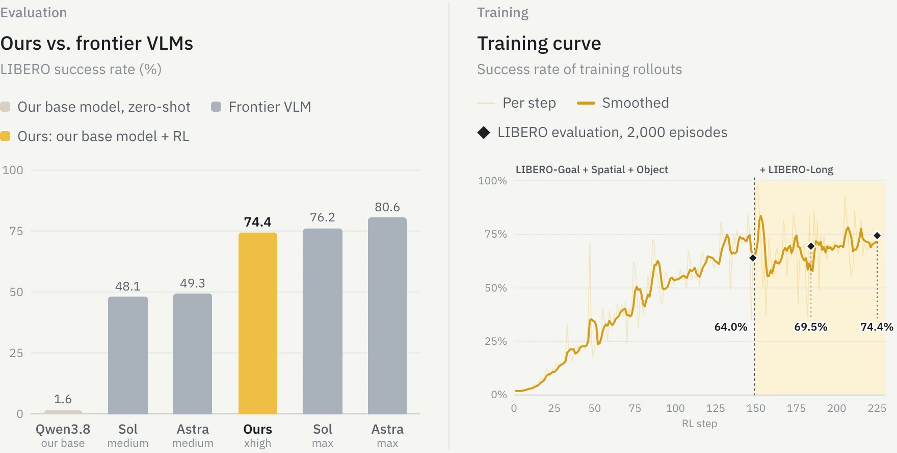{ loading=lazy }
  <figcaption>左：所有 VLM 用同一套无 harness 循环，在 LIBERO 2000 个 episode 上评测。右：训练 rollout 成功率随 RL step 的变化，step 149 加入 LIBERO-Long；菱形点是同一次训练在 LIBERO 上的完整评测（64.0 → 69.5 → 74.4）。原博客 <a href="https://mit-han-lab.github.io/pear-blog/#learning">Figure 2</a></figcaption>
</figure>

需要注意的几点：

- 训练曲线在前约 25 步接近 0，之后开始上升，符合稀疏奖励加 group filter 的预期：少量成功样本先提供梯度，成功率提高后信号随之增多。
- 分子集来看（原博客 [Figure A1](https://mit-han-lab.github.io/pear-blog/#fig-A1)），Spatial 85.8、Object 97.0 为所有 VLM 中最高；Goal 61.4、Long 53.2 相对较弱，且这两个子集分别有 19% 和 33% 的 episode 因**耗尽 256k token 预算**而终止。相当一部分失败来自推理过长导致上下文耗尽，而非动作本身失败。

<figure markdown>
  { loading=lazy }
  <figcaption>LIBERO 分子集成功率，PEAR（xhigh）与 GPT-6.1 Sol、GPT-6 Astra 的 medium / max effort 对比。原博客 <a href="https://mit-han-lab.github.io/pear-blog/#fig-A1">Figure A1</a></figcaption>
</figure>

**零样本迁移：新任务、新机器人、新基准。**

<figure markdown>
  { loading=lazy }
  <figcaption>左：未训练 LIBERO-Long 时成功率由 0.4 升至 39.0，加入训练后为 53.2。右：仅在 LIBERO（单臂 Franka）上训练，迁移到 RoboDojo 双臂 ARX，general_pickup 由 10.7 升至 39.9。原博客 <a href="https://mit-han-lab.github.io/pear-blog/#fig-6">Figure 5</a></figcaption>
</figure>

<figure markdown>
  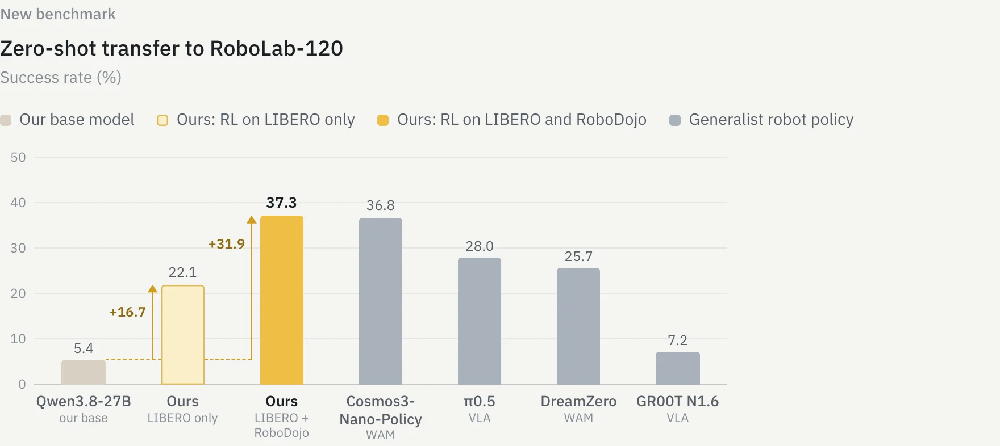{ loading=lazy }
  <figcaption>RoboLab-120（第三个仿真基准，Franka + Robotiq，120 个任务）零样本评测：PEAR 37.3%，与 Cosmos3-Nano-Policy 的 36.8% 相当，高于 π0.5 的 28.0%。原博客 <a href="https://mit-han-lab.github.io/pear-blog/#fig-7">Figure 6</a></figcaption>
</figure>

**Sim-to-real：不使用任何真机数据。**

<figure markdown>
  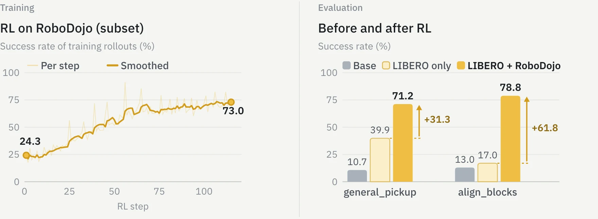{ loading=lazy }
  <figcaption>在 RoboDojo 两个任务上继续 RL 115 步，训练成功率由约 25% 升至约 70%；评测时 general_pickup 39.9 → 71.2，align_blocks 17.0 → 78.8。原博客 <a href="https://mit-han-lab.github.io/pear-blog/#fig-8">Figure 7</a></figcaption>
</figure>

<figure markdown>
  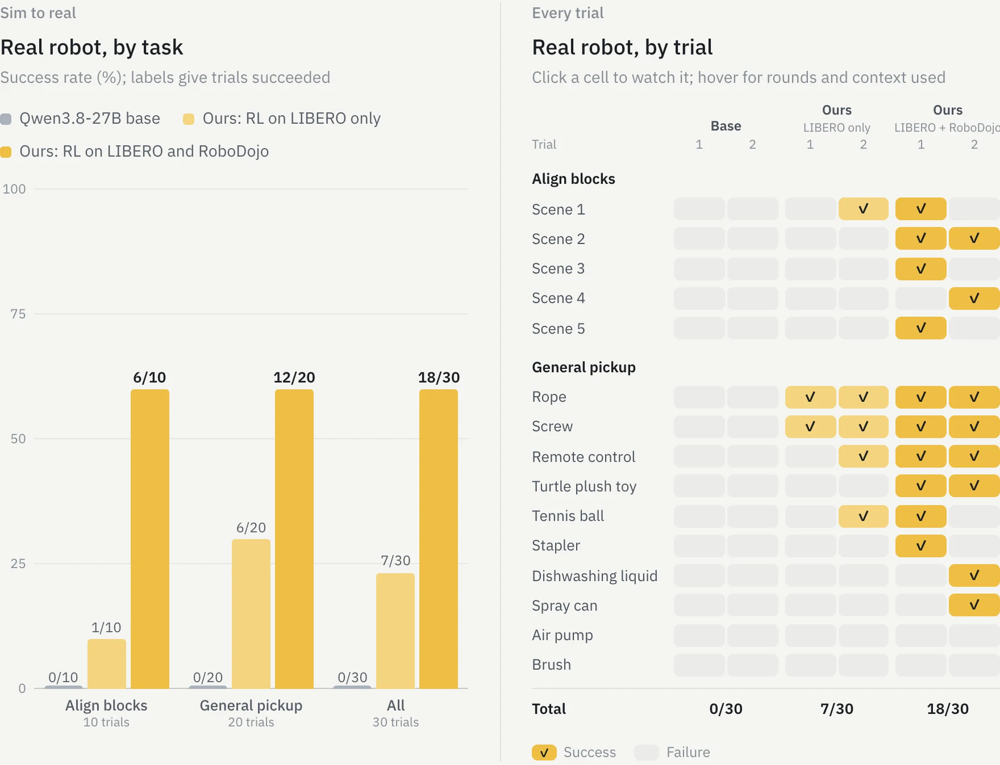{ loading=lazy }
  <figcaption>真机双臂 YAM：基座 0/30，只训 LIBERO 的版本 7/30，LIBERO + RoboDojo 的版本 18/30。右侧为逐 trial 结果，原博客中可点击查看对应视频。原博客 <a href="https://mit-han-lab.github.io/pear-blog/#fig-9">Figure 8</a></figcaption>
</figure>

**需要知识与推理的真机任务**，例如依照《星月夜》在白板上绘制线稿，或从酚酞、碘、乙醇中选出可检验碱性的试剂并滴加。这类任务依赖基座模型的世界知识：

<figure markdown>
  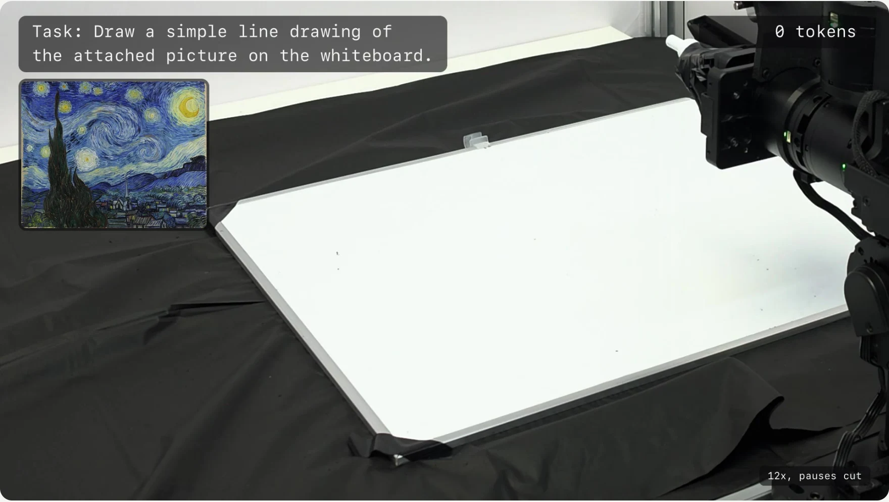{ loading=lazy }
  <figcaption>真机演示：依照附图在白板上绘制简化线稿；另一演示为化学实验。视频中显示实时思维链与 token 数。原博客 <a href="https://mit-han-lab.github.io/pear-blog/#fig-demos">Figure 10</a>（视频请到原页面观看）</figcaption>
</figure>

**通用能力未出现可测的退化。**

<figure markdown>
  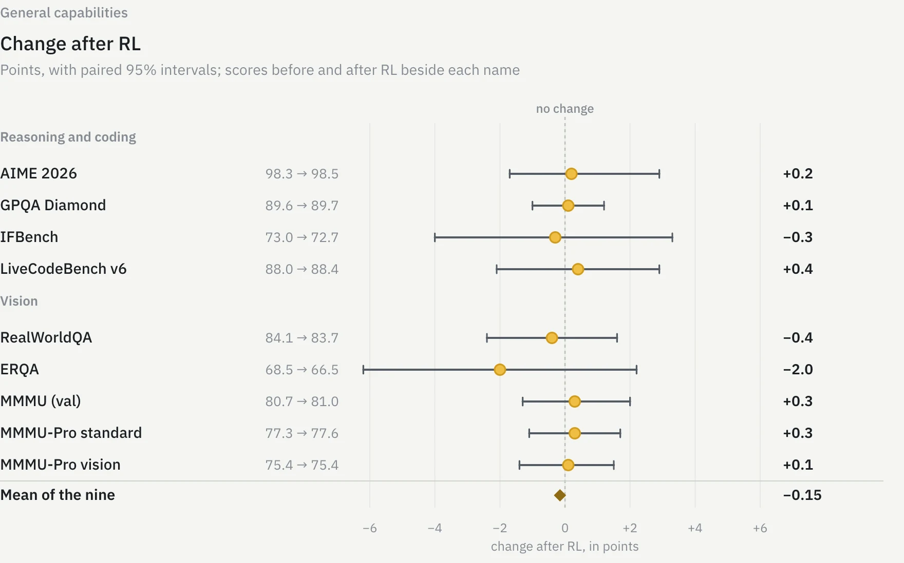{ loading=lazy }
  <figcaption>同一批题目做配对比较，9 个 benchmark（AIME、GPQA、IFBench、LiveCodeBench、RealWorldQA、ERQA、MMMU 等）的 95% 置信区间都包含 0，平均变化 −0.15 分。降幅最大的是 ERQA（具身推理）−2.0，置信区间 [−6.2, +2.2]。原博客 <a href="https://mit-han-lab.github.io/pear-blog/#fig-11">Figure 11</a></figcaption>
</figure>

这与 RL's Razor 的结论一致：在线 RL 学习新任务时，对已有能力的损害小于 SFT。作者不使用 SFT 的部分原因也在于此（见[局限 2](#局限-2只用-rl不用-sft)）。

## 4. 扰动对 π0.5 和 PEAR 的影响

两个策略**均只在 LIBERO 上训练**，随后在两个未见过的扰动集上测试。

<figure markdown>
  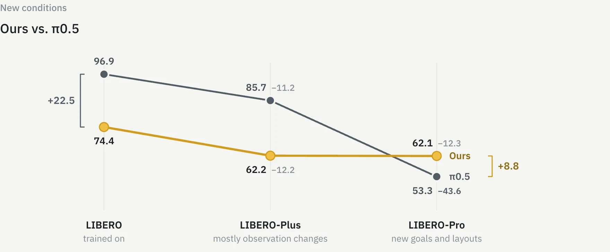{ loading=lazy }
  <figcaption>π0.5 在 LIBERO 上领先 22.5 分，到 LIBERO-Pro 反而落后 8.8 分。PEAR 在两个扰动集上各掉约 12 分；π0.5 在 Plus 上掉 11.2，在 Pro 上掉 43.6。原博客 <a href="https://mit-han-lab.github.io/pear-blog/#fig-3">Figure 3</a></figcaption>
</figure>

### 4.1 LIBERO-Plus：观测扰动，两者降幅相近

LIBERO-Plus 主要扰动观测：相机、光照、背景、传感器噪声、语言改写、布局、机器人初始状态。两者降幅接近（π0.5 −11.2，PEAR −12.2）。PEAR 按扰动维度的结果如下：

<figure markdown>
  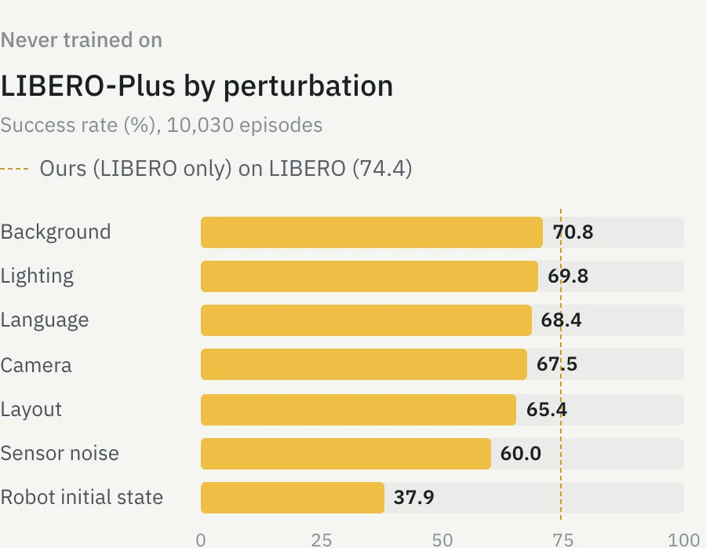{ loading=lazy }
  <figcaption>PEAR 在 LIBERO-Plus 各扰动维度上的成功率（虚线为 LIBERO 上的 74.4）。原博客 <a href="https://mit-han-lab.github.io/pear-blog/#fig-A3">Figure A3</a></figcaption>
</figure>

- 背景、光照、语言、相机扰动仅下降 4–7 分，这部分鲁棒性主要来自 VLM 预训练中对多样光照与视角的覆盖。
- **机器人初始状态**是唯一的显著短板：37.9，下降 36.5 分。一种可能的解释（笔者推测，原文未分析）是：模型输出相对位姿增量，需要依据状态与图像估计当前位姿；初始姿态偏离训练分布时（例如腕部已有旋转），后续增量的参照便会出错，而这类空间偏差难以在文本 CoT 中准确推理。这与[局限 4](#局限-4依赖-prompt-里的本体信息)对得上：模型缺乏对自身本体的先验一致。

### 4.2 LIBERO-Pro：任务扰动，差距显著

| 扰动类型（LIBERO-Pro） | 改动内容 | π0.5 | PEAR | 受影响较大者 |
|---|---|---|---|---|
| 无扰动（LIBERO） | — | 96.9 | 74.4 | — |
| **Task** | 场景和初始状态不变，**指令换成另一个任务** | **0.75**（−96.2） | 57.4（−17.0） | π0.5 |
| **Position** | 指令不变，**物体位置互换** | **20.8**（−76.1） | 57.5（−16.9） | π0.5 |
| Semantic | 指令换一种说法，任务本身不变 | 95.8（−1.1） | 73.3（−1.1） | 均无明显影响 |
| Object | 物体换外观，任务本身不变 | 96.0（−0.9） | 60.2（−14.2） | PEAR |
| 平均 | | 53.3 | 62.1 | |

<figure markdown>
  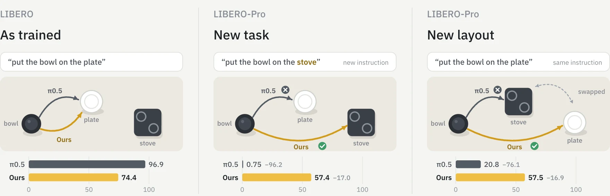{ loading=lazy }
  <figcaption>示意：指令改成“放到炉子上”，π0.5 仍然把碗送到盘子；盘子和炉子换位置，π0.5 把碗送到盘子原来所在的位置（现在是炉子）。PEAR 两种情况都按指令执行。原博客 <a href="https://mit-han-lab.github.io/pear-blog/#fig-4">Figure 4</a></figcaption>
</figure>

**分析：**

1. **π0.5 主要学习了“场景 → 轨迹”的映射，语言条件作用很弱。** Task 扰动下场景与训练时相同，π0.5 执行的仍是训练轨迹，几乎不受新指令影响（0.75%）。Position 扰动下，它趋向原先的目标位置而非目标物体。这与相关工作所称的 *vision overrides language* 现象一致：LIBERO 中每个场景基本只对应一个任务，仅凭图像即可预测动作，SFT 因而弱化了对语言的依赖。
2. **原轨迹仍然正确时，π0.5 表现稳定**：Semantic 与 Object 扰动不改变所需动作，π0.5 几乎不受影响。其高分建立在测试任务与训练任务动作一致的前提上。
3. **PEAR 在各类扰动下的降幅均在 1–17 分之间，不存在失效的扰动类型。** 其失败主要来自整体能力上限（基准成绩 74.4）与感知误差，而非捷径学习；指令改变时，目标随之改变。作者的解读是：**模仿示教**和**对任务做推理**的区别；基座 VLM 具备理解指令与场景的能力，RL 使其能够依据理解执行动作。
4. **PEAR 的薄弱环节在感知**：Object 扰动（外观变化）下降 14 分，LIBERO-Plus 传感器噪声下降 14 分，均属于视觉识别问题。π0.5 的薄弱环节则在语义理解。

综上，**π0.5 的优势在于复现训练分布内的行为，PEAR 的优势在于遵循指令**。前者在同分布基准上得分更高，后者在指令或布局变化时更稳健。

## 5. 局限

### 局限 1：没有 scaling

受 GPU 资源限制，训练只覆盖 **2 个仿真器**（LIBERO、RoboDojo），RoboDojo 上只练了 **2 个任务**，基座也只有 27B。现有结果说明该方案**可行**，但尚不能说明其**可扩展**。作者提到最后阶段训练过程平稳，并认为扩大仿真与任务多样性、更换更强基座能进一步提升性能，但目前没有数据支持 scaling 趋势。

### 局限 2：只用 RL，不用 SFT

作者有意不使用 SFT，理由有二：

- 缺少高质量的同分布数据，而且担心 SFT 会损害通用能力（参考 RL's Razor 和 On-Policy Distillation 的讨论）。
- 他们认为机器人数据应该放进 pretraining / mid-training，不该在已经后训练好的模型上再做 SFT。

代价是 **RL 必须从约 2% 的成功率冷启动**：前约 25 个 step 几乎没有学习信号；LIBERO-Long（0.4%）只能借助课程设计间接解决；RoboDojo 上多数任务基座几乎不成功，最终只选取了两个成功率约 25% 的任务。也就是说，**可训练的任务范围受基座在该任务上的初始成功率限制**；缺少 SFT 或 mid-training 提高起点时，任务覆盖面有限。

### 局限 3：执行速度慢

RL 中未设置长度惩罚，也不限制 CoT 长度，模型因此在每一步前都进行长时间推理：

<figure markdown>
  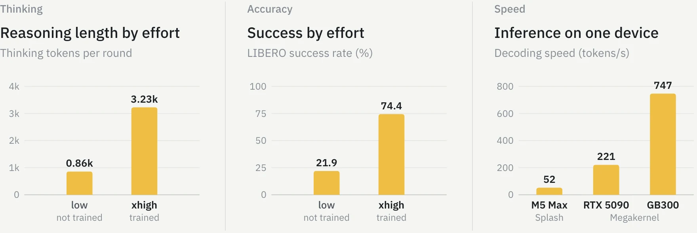{ loading=lazy }
  <figcaption>左：low effort 每轮 0.86k token，xhigh 每轮 3.23k。中：同一 checkpoint 在 low effort 下 LIBERO 只有 21.9%，xhigh 下 74.4%。右：NVFP4 + DFlash2 投机解码后，M5 Max 52、RTX 5090 221、GB300 747 token/s。原博客 <a href="https://mit-han-lab.github.io/pear-blog/#fig-12">Figure 12</a></figcaption>
</figure>

即使在 GB300 上达到 747 token/s，xhigh 下一轮仍需约 **4.3 s**；个别轮次 CoT 达到 32k token，**单步耗时超过半分钟**，约 20 轮的任务需数分钟完成。推理量与成功率高度相关：推理量降至不足 1/3 时，成功率也降至不足 1/3。LIBERO 上的大部分能力来自每步前的长推理，不能通过简单缩短推理来提速。

### 局限 4：依赖 prompt 里的本体信息

27B 基座缺乏关于所控制本体的先验知识，坐标系方向、臂长、夹爪尺寸等信息需写入 prompt。较难的任务（如演示中的绘画、化学实验）需要在 prompt 中**详细描述本体与任务**才能成功，因此成功率在很大程度上取决于模型能否从 prompt 中建立对本体和环境的准确理解。作者将此解读为模型能够遵循详细语言指令的证据；但从部署角度看，这意味着更换机器人时需要重新设计 prompt。§4.1 中初始状态扰动的大幅下降可能也与此有关。

### 局限 5：无法使用动作块（action chunk）

模型目前**尚不能可靠地规划动作块**，因此每轮只输出一个位姿，由 IK 与控制器移动到位后停止。由此产生三个问题：

- **精度部分取决于控制器**：控制器实现不佳时，机械臂可能在某些位置跳变或无法到达目标位姿。
- **轮数增加**：原本可由一个动作块完成的连续动作（如绘制曲线、沿桌面推动物体）需拆成多轮，每轮都要重新观测并推理数千 token。
- **消耗步数预算**：在仿真评测中，低效的控制器会耗尽任务的 step budget。

该局限与局限 3 共同导致了每个小动作都需要数秒推理的现状。

## 6. Insight

本节为笔者基于原文数据的分析与延伸，不代表原文作者的结论。

### 6.1 按需推理：在需要推理的步骤上推理

PEAR 表明推理模型可以不借助 harness、仅通过 RL 获得机器人操作能力，且推理带来的指令泛化（§4）是基于模仿的 VLA 难以获得的。但当前模型在**每一步**都进行约 3k token 的推理，这在计算上并不经济：

- 一个 episode 中多数动作是“下降 2 cm”“闭合夹爪”“抬起 10 cm”这类局部、确定性较高的小步；真正依赖推理的是少数关键决策点，例如解析指令确定目标、选择操作对象、抓取失败后调整策略、在化学实验中选择试剂。
- 推理过长不仅影响速度，也影响成功率：LIBERO-Goal 与 LIBERO-Long 中分别有 19% 和 33% 的 episode 因耗尽 256k token 预算而失败（§3.2）。
- Figure 12 表明推理长度可由 effort 设置调节（low 下每轮 0.86k token），但模型从未在低 effort 下训练，统一缩短推理会使成功率降至 21.9%。问题不在于推理总量，而在于推理量没有随步骤难度分配。
- 训练过程中 episode 长度已有所下降（119k token / 19.9 轮 → 82k token / 18.5 轮），说明即使没有长度惩罚，RL 也在一定程度上压缩了冗余推理，自适应推理具备可学习性。

可能的实现方式：

1. **长度相关奖励**：在成功奖励之外加入长度惩罚，或按成功 episode 的 token 数做组内排序，鼓励在不降低成功率的前提下缩短推理。
2. **多 effort 混合训练**：在 RL 中随机采样 effort 设置，使模型在不同推理预算下均能工作，再由模型或外部调度器按步骤选择预算。
3. **显式的“思考 / 直接执行”决策**：允许模型在每轮选择是否展开 CoT，将这一选择纳入策略，由 RL 依据任务成败与耗时共同优化。这与 LLM 领域的 adaptive thinking、thinking budget 属于同一类问题。

### 6.2 动作接口的粒度

PEAR 选择“末端位姿增量”作为动作接口，可以放在一条粒度谱上理解：

| 接口粒度 | 代表 | 推理负担 | 灵活性 | 速度 |
|---|---|---|---|---|
| 高层技能调用（`pick(obj)`） | harness / code-as-policy | 低 | 受技能库限制 | 快 |
| 单个末端位姿 | **PEAR** | 每步都需推理 | 高 | 慢 |
| 高频动作块 | VLA | 无显式推理 | 高，但受示教分布限制 | 快 |

PEAR 处在中间位置：比技能调用更通用，但每一步都要由语言模型生成。较自然的改进是让动作粒度可变，例如在确定性高的阶段输出多个 waypoint 或一段动作块，在关键节点再回到单步决策。另一种思路是快慢双系统：推理模型负责子目标或关键位姿，由小型 VLA 或经典控制器负责高频执行。这同时对应局限 3 与局限 5。

### 6.3 RL 可训练性取决于基座的初始成功率

PEAR 的训练过程显示，纯 RL 能否在某个任务上起步，取决于基座在该任务上的初始成功率：

- 2% 的初始成功率足以启动训练（Goal / Spatial / Object），0.4%（LIBERO-Long）则基本不可直接训练；
- 无法直接训练的任务可以通过迁移间接解决：在其他子集上训练后，LIBERO-Long 的成功率升至 39%，随后再加入训练；
- RoboDojo 上作者只选择了初始成功率约 25% 的两个任务。

由此可以得到一个实用的判断标准：在设计机器人 RL 任务集时，先测量基座在各任务上的 pass@k（例如 k = 8，与组大小一致），以此决定任务的加入顺序；pass@k 接近 0 的任务需要依靠课程迁移，或通过 mid-training 引入机器人数据来提高起点。这也说明局限 1（scaling）与局限 2（不用 SFT）相互关联：任务种类的扩展受限于基座在新任务上的初始成功率。

### 6.4 评测：同分布高分不等于指令理解

π0.5 在 LIBERO 上为 96.9%，在 LIBERO-Pro Task 扰动下为 0.75%。这说明 LIBERO 这类每个场景基本只对应一个任务的基准，无法区分“依据指令执行”和“依据场景复现轨迹”。对研究的启示：

- 报告 VLA 或机器人智能体的结果时，应同时报告指令扰动（同场景换任务）和位置扰动（同指令换布局）下的成绩，否则同分布成功率可能高估模型的指令理解能力；
- PEAR 与 π0.5 的对比也提示，基准排名会随评测协议显著变化（LIBERO 上 π0.5 领先 22.5 分，LIBERO-Pro 上落后 8.8 分），比较方法时需先确认评测协议一致（参见本站[仿真评测一文](simulation.md)中关于评测协议的讨论）。

### 6.5 本体知识的来源

PEAR 依赖 prompt 提供本体信息，且在机器人初始状态扰动下降幅最大（−36.5）。两者可能指向同一个问题：模型对自身本体的理解主要来自上下文文本，而非训练中形成的内部表征。可能的改进方向包括：

- RL 时随机化本体描述和初始状态，迫使模型从观测中推断本体状态，而不是依赖固定的 prompt 描述；
- 在多种本体（单臂、双臂、不同夹爪）上联合训练，检验跨本体泛化能否从 prompt 依赖中解放出来；
- 按作者的观点，将机器人数据前移到 pretraining / mid-training 阶段，使本体知识成为模型的先验。

### 6.6 机器人操作作为后训练中的一个 RL 环境

9 个通用基准上没有可测的退化（平均 −0.15 分），说明机器人操作可以作为基础模型后训练中的又一个 RL 环境，与数学、代码、computer-use 等环境并列，而不必单独训练专用模型。PEAR 将机器人控制表述为与 computer-use、coding agent 同构的问题（多轮、长上下文、稀疏奖励），因此 LLM 后训练中已有的方法与系统（GRPO / DAPO、异步 RL、前缀缓存、投机解码）可以直接迁移。

由此引出两个尚待验证的问题：

1. **该方案能否像 LLM 的 RL 那样随算力与环境多样性扩展**（局限 1）。原文只有两个仿真器和少量任务，尚无 scaling 曲线。
2. **与其他 RL 环境混合训练时是否存在正迁移**。例如 computer-use 中的空间定位能力、代码中的规划能力，是否能提升机器人操作；反之亦然。

## 参考

- Tang, Zhang, Guo et al. (2026). [Training Reasoning Models in Simulation to Natively Use Real Robots](https://mit-han-lab.github.io/pear-blog/). MIT HAN Lab. [arXiv 2611.18562](https://arxiv.org/abs/2611.18562)
- Black et al. (2025). π0.5: a Vision-Language-Action Model with Open-World Generalization.
- Liu et al. (2023). LIBERO: Benchmarking Knowledge Transfer for Lifelong Robot Learning.
- Fei et al. (2026). LIBERO-Plus；Zhou et al. (2025). LIBERO-PRO: Towards Robust and Fair Evaluation of VLA Models Beyond Memorization.
- Shao et al. (2024). DeepSeekMath（GRPO）；Yu et al. (2025). DAPO.
- Shenfeld et al. (2026). RL's Razor: Why Online Reinforcement Learning Forgets Less.
- 本站相关：[具身智能仿真是怎么做的](simulation.md) · [Agent4Robot](../agent4robot/index.md) · [从 SFT 到 Agentic RL](../rl/sft-to-agentic-rl.md)
