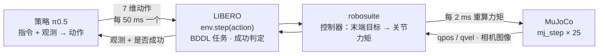
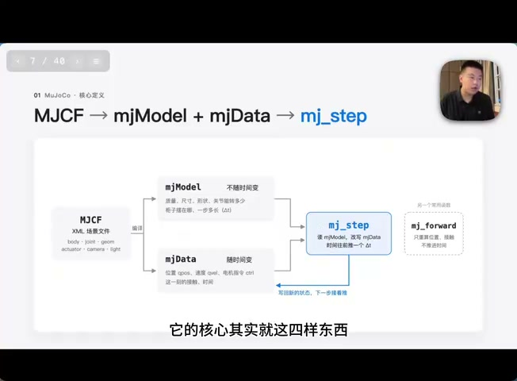
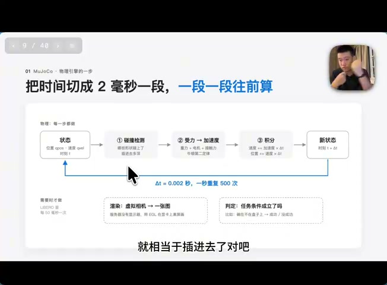
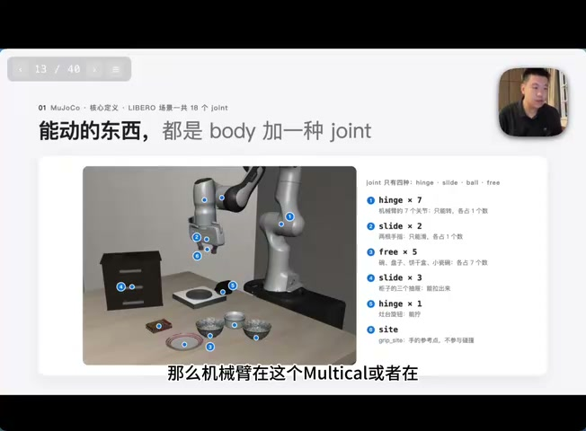
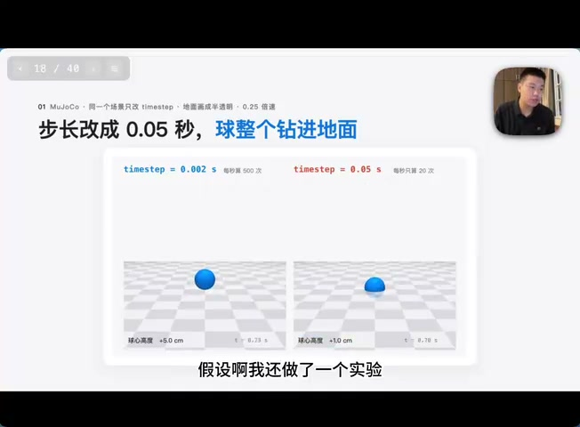
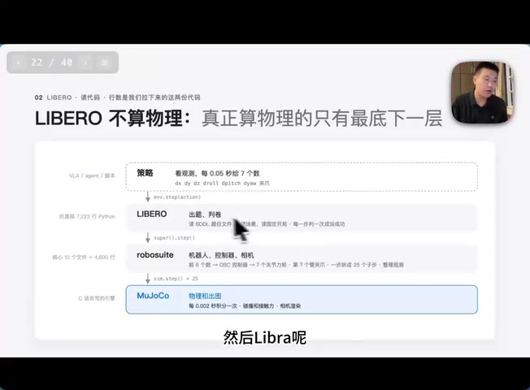
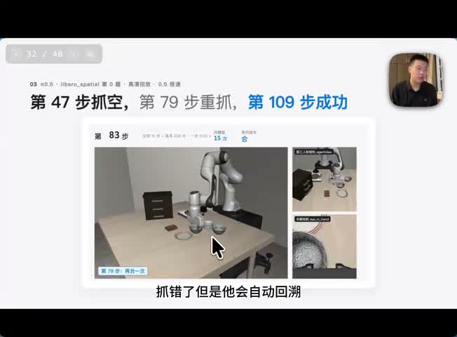
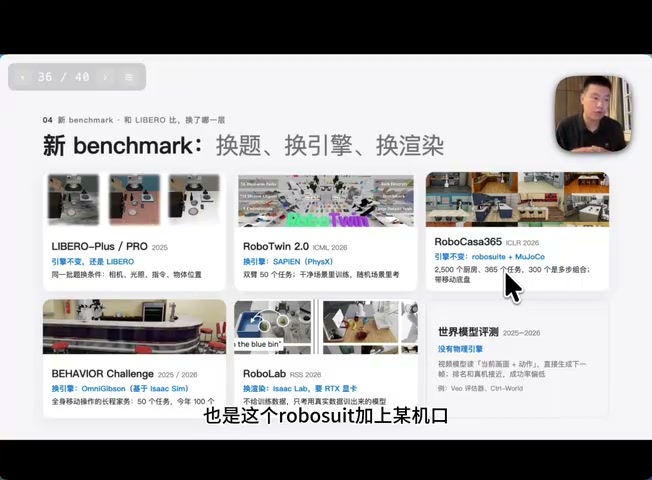
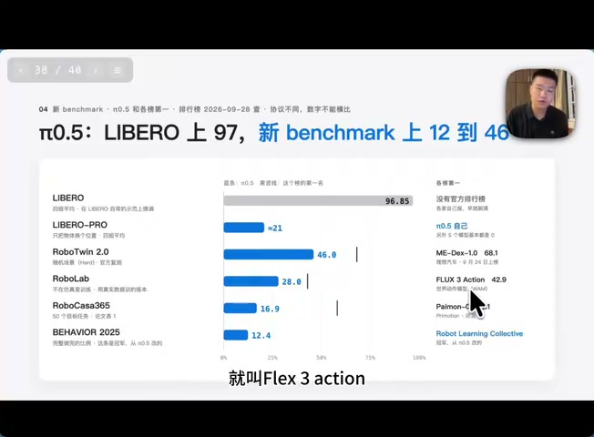

# 具身智能仿真是怎么做的：从小球落地到抓碗评测

!!! abstract "要点"
    具身智能论文几乎都会报仿真基准上的成功率，比如 π0.5 在 LIBERO 上约 97%。这个数背后有四层软件，各管一件事：

    - **基准（LIBERO）**：出题。规定场景、物体摆放、语言指令和成功条件。
    - **机器人框架（robosuite）**：提供机械臂、相机和控制器，把“末端往哪走”换算成关节力矩。
    - **物理引擎（MuJoCo）**：每 2 ms 做一次碰撞检测、受力求解、积分，推进物理状态，并渲染相机画面。
    - **策略（π0.5）**：读图像、本体状态和指令，输出动作。

    一次 50 ms 的控制动作在引擎里拆成 25 个物理子步；策略一次预测 10 个动作只执行前 5 个，再看新画面重新规划。成功率是很多回合的统计。同一个模型在 LIBERO 上 96.85%，换到 LIBERO-PRO 只剩约 21%，所以读成功率前要先读清评测协议。

本文整理自 B 站视频 [BV1mRHW6uEzZ](https://www.bilibili.com/video/BV1mRHW6uEzZ/)（30:48）及其笔记 PDF，文中截图均取自原片，图注里的时间戳可点击跳转回看。落球部分的数字我用 MuJoCo 重新跑过一遍，脚本见 [`scripts/robot/verify_ball_drop.py`](https://github.com/zsyverse/knowledge/blob/main/scripts/robot/verify_ball_drop.py)。

标题带“补充”的小节（3.1、6、7.1、9、12）是视频之外补充的内容：软接触参数、摩擦与抓取、控制器公式、评测协议与置信区间、仿真在训练中的用途。其中的代码细节来自 robosuite 1.4 和 openpi 源码，实验数字由 [`verify_contact_friction.py`](https://github.com/zsyverse/knowledge/blob/main/scripts/robot/verify_contact_friction.py) 复现。



## 1. 为什么要用仿真做评测

在真机上让两个策略各抓一次碗很容易，让它们**从完全相同的位置和朝向开始**却很难：每局要人工复位，物体摆放总有毫米级偏差，碰撞还可能损坏设备。仿真可以保存初始状态，让多个策略面对同一道题、同一套判分规则，差异更容易归因到策略本身。

代价是仿真和现实之间存在差距（sim-to-real gap）：接触模型、摩擦系数、光照、渲染质量都和真实桌面不同。所以仿真成绩回答的是“在这套设定下谁更强”，而不是“上真机能成多少”。

## 2. MuJoCo 的四个核心对象

<figure markdown>
  { loading=lazy }
  <figcaption>MJCF → mjModel / mjData → mj_step。原片 <a href="https://www.bilibili.com/video/BV1mRHW6uEzZ/?t=212">03:32</a></figcaption>
</figure>

MuJoCo（Multi-Joint dynamics with Contact）[^mujoco] 的特点是快、接触算得稳，缺点是画面比较简单。用它只需要认识四样东西：

| 对象 | 是什么 | 是否随时间变化 |
| --- | --- | --- |
| **MJCF** | XML 场景文件，声明刚体（body）、关节（joint）、几何形状（geom）、执行器（actuator）、光源、相机 | — |
| **`mjModel`** | MJCF 编译后的模型：质量、形状、关节、初始位姿、步长等参数 | 固定 |
| **`mjData`** | 运行状态：广义位置 `qpos`、广义速度 `qvel`、接触列表、时间等 | 每步都变 |
| **`mj_step`** | 把 `mjData` 沿时间往前推一个步长 | — |

一个最小例子：一颗 0.1 kg、半径 5 cm 的球，球心初始高 1 m。

```python
import mujoco

XML = """
<mujoco>
  <option timestep="0.002" gravity="0 0 -9.81"/>
  <worldbody>
    <geom type="plane" size="2 2 0.1"/>
    <body name="ball" pos="0 0 1">
      <freejoint/>
      <geom type="sphere" size="0.05" mass="0.1"/>
    </body>
  </worldbody>
</mujoco>
"""
model = mujoco.MjModel.from_xml_string(XML)   # 编译：MJCF → mjModel
data = mujoco.MjData(model)                   # 运行状态
for _ in range(500):
    mujoco.mj_step(model, data)               # 推进 2 ms
print(data.qpos, data.qvel)
```

## 3. 小球落地时，每一步在算什么

<figure markdown>
  { loading=lazy }
  <figcaption>一个物理步 = 碰撞检测 → 受力求解 → 积分。原片 <a href="https://www.bilibili.com/video/BV1mRHW6uEzZ/?t=408">06:48</a></figcaption>
</figure>

每调用一次 `mj_step`，引擎做三件事：

1. **碰撞检测**。先用包围盒粗筛掉明显离得远的物体对（broad phase），再对候选几何体精确计算间距（narrow phase）。球心高度低于半径时，球面已经穿入地面，产生一个接触。
2. **计算受力**。空中只有重力；落地后接触力也参与求解。MuJoCo 用的是**软接触**：允许少量穿透，接触力可以直观理解为带阻尼的硬弹簧，穿得越深、冲得越快，推回来的力越大。
3. **积分**。用加速度更新速度，再用新速度更新位置（半隐式欧拉）：

$$
v_{t+1} = v_t + a\,\Delta t, \qquad z_{t+1} = z_t + v_{t+1}\,\Delta t
$$

**算一下第几步落地。** 球离地净间距 $h = 1 - 0.05 = 0.95$ m，自由落体

$$
t = \sqrt{2h/g} = \sqrt{2 \times 0.95 / 9.81} \approx 0.440\ \text{s}, \qquad v = \sqrt{2gh} \approx 4.32\ \text{m/s}
$$

按 2 ms 一步，约 220 步。实际跑出来：

| 量 | 视频 | 我复跑（MuJoCo 4.0.1） |
| --- | --- | --- |
| 首次接触 | 第 221 步 | 第 221 步（t = 0.442 s） |
| 接触时下落速度 | ≈ 4.32 m/s | 与解析值 4.32 m/s 一致 |
| 穿透深度 | ≈ 3.9 mm | 3.92 mm |
| 首次接触的法向力 | ≈ 45 N（约 46 倍重力） | 45.08 N |
| 静止后的支持力 | ≈ 0.98 N | 0.981 N（= mg） |

第一次接触时支持力是重力的 46 倍，因为它要在几步之内把 4 m/s 的下落速度刹住；球静止后，支持力回落到与重力平衡的 0.98 N。

### 3.1 补充：软接触到底有多“软”

视频里说接触力像“带阻尼的硬弹簧”。在 MuJoCo 里，这根弹簧不是直接给刚度 $k$、阻尼 $b$，而是用两组参数描述[^mujoco-doc]：

- **`solref = (timeconst, dampratio)`**：接触像一个二阶系统，穿透后多快被推回去（时间常数，默认 0.02 s）、阻尼比多大（默认 1，即临界阻尼，不反弹）。
- **`solimp`**：接触的“阻抗”随穿透深度怎么变化，默认 `(0.9, 0.95, 0.001, 0.5, 2)`，穿得越深越硬。

引擎再把所有接触和关节约束放在一起，解一个凸优化问题求约束力[^todorov2014]，而不是对每个接触单独套弹簧公式。因此 MuJoCo 的接触“算得稳”：时间步长内求出的力总是全局一致的。

我把同一颗球的 `timeconst` 改成几个值再跑一遍（2 ms 步长，脚本 [`verify_contact_friction.py`](https://github.com/zsyverse/knowledge/blob/main/scripts/robot/verify_contact_friction.py)）：

| `timeconst` (s) | 最大穿透 (mm) | 峰值法向力 (N) | 反弹高度 (mm) |
| --- | --- | --- | --- |
| 0.005 | 5.0 | 189.3 | 4.7 |
| 0.01 | 12.9 | 91.2 | 2.9 |
| **0.02（默认）** | **28.9** | **45.1** | **0** |
| 0.05 | 76.8 | 18.4 | 0 |

几点观察：

- 上一节的 3.9 mm 是第一次检测到接触时的穿透；接触过程中球还会继续下沉，默认参数下最深约 29 mm，之后被推回到只穿 0.4 mm 左右的静止位置。
- 时间常数越小接触越硬：穿透浅、冲击力大，甚至出现小反弹。它不能无限调小，MuJoCo 建议 `timeconst` 至少是步长的 2 倍，否则会被自动夹到 $2\Delta t$。
- 对机器人操作来说，这组参数决定了“夹爪捏住物体时陷进去多少”，进而影响抓取稳不稳。不同引擎的接触模型不同，这也是第 10 节说“换引擎后同一个抓取可能滑落”的物理原因。

MuJoCo 的其他默认设置：积分器 Euler（半隐式），约束求解器 Newton，摩擦锥用金字塔近似（pyramidal），步长 2 ms。

## 4. 机械臂、夹爪和碗怎么表示

<figure markdown>
  { loading=lazy }
  <figcaption>同一张桌上的 hinge、slide、free 关节和 grip_site。原片 <a href="https://www.bilibili.com/video/BV1mRHW6uEzZ/?t=626">10:26</a></figcaption>
</figure>

读一个场景时，先问：**每个物体相对它的父物体还能怎样动？** MuJoCo 把这写成关节类型：

| 关节 | 自由度 | 例子 |
| --- | --- | --- |
| `hinge`（转动） | 1 个角度 | Franka Panda 的 7 个臂关节、灶台旋钮 |
| `slide`（滑动） | 1 个位移 | 两根手指各一个、抽屉 |
| `ball`（球关节） | 绕一点转动 | — |
| `free`（自由） | 平移 + 转动 | 碗、盘子、落下的小球 |

两指之间的 `grip_site` 是控制器定位末端用的参考点（site），不参与碰撞。

**为什么 free 关节的 `qpos` 有 7 个数，`qvel` 只有 6 个？** `qpos` = 3 个位置 + 4 个单位四元数（朝向）；`qvel` = 3 个线速度 + 3 个角速度。四元数有一个“模长为 1”的约束，所以多一个数但不多一个自由度。上面落球例子里 `model.nq = 7`、`model.nv = 6`，初始 `qpos = [0, 0, 1, 1, 0, 0, 0]`。

## 5. 步长调大会发生什么

<figure markdown>
  { loading=lazy }
  <figcaption>左 2 ms、右 50 ms，地面设为半透明。原片 <a href="https://www.bilibili.com/video/BV1mRHW6uEzZ/?t=799">13:19</a></figcaption>
</figure>

初学者常把动作发送的间隔当成物理计算的间隔。同一颗球只改步长：

- **50 ms 一步**：落地前速度约 4 m/s，一步能走约 20 cm。球心在一步里从地面上方约 12 cm 跳到地下约 10 cm，等求解器发现接触时，球已经深深嵌进地面。我复跑时检测到接触那一刻穿透达 154 mm。
- **2 ms 一步**：同样速度一步只走约 8 mm，求解器能在穿透几毫米时就施力。软接触模型下仍会有少量穿透，这是正常的。

所以机器人控制和物理仿真用两套频率：LIBERO 里一次控制动作持续 50 ms（20 Hz），引擎把它细分成 25 个 2 ms 的物理子步。

## 6. 补充：摩擦决定抓得住还是滑掉

视频没有展开摩擦，但抓取成败很大程度取决于它。MuJoCo 每个 geom 有三个摩擦系数 `friction = (滑动, 扭转, 滚动)`，默认 `(1, 0.005, 0.0001)`。两个物体接触时取两者中较大的值。

**一个斜面实验。** 把 0.2 kg 的方块放在 30° 斜面上。按库仑摩擦，静摩擦系数 $\mu > \tan 30^\circ \approx 0.577$ 时方块不滑；$\mu$ 更小时方块以 $a = g(\sin 30^\circ - \mu\cos 30^\circ)$ 加速下滑。复跑时先让方块落到斜面上（0.2 s，滑动的方块此时已有初速度），再记录之后 1 s 的位移：

| $\mu$ | 1 s 后位移 |
| --- | --- |
| 0.3 | 174.6 cm（加速下滑） |
| 0.5 | 46.1 cm（下滑） |
| 0.7 | 0.65 cm（基本不动） |
| 1.0 | 0.34 cm（基本不动） |

仿真结果和 $\tan 30^\circ$ 的临界值吻合。$\mu > 0.577$ 时仍有几毫米位移，这是软接触带来的缓慢蠕动，真实世界里没有。

**放到抓取上。** 两指平行夹爪竖直夹起质量 $m$ 的物体，两个接触面的摩擦力要托住重力：

$$
2\mu F_N \ge m g \quad\Longrightarrow\quad F_N \ge \frac{m g}{2\mu}
$$

例如 0.2 kg 的碗、$\mu = 1$ 时，每根手指至少要压 0.98 N。仿真里摩擦系数通常是随手设的，真实碗的釉面可能只有 0.3 到 0.5，这时同样的夹持力就不够了。这类差异是 sim-to-real gap 的典型来源，也是第 12 节域随机化要随机摩擦系数的原因。

## 7. LIBERO：把一句指令变成一道题

LIBERO[^libero] 最初是为终身学习（lifelong learning）设计的基准。每道题包含指令、场景和成功条件，并配有人用三维鼠标遥操作采集的 50 条示范。全套 130 道题，常用的是四组、每组 10 题：

| 子集 | 考什么 |
| --- | --- |
| LIBERO-Spatial | 空间关系（同样的物体，不同的摆放） |
| LIBERO-Object | 更换目标物体 |
| LIBERO-Goal | 同一场景，更换目标 |
| LIBERO-Long（LIBERO-10） | 连续完成多个操作的长时程任务 |

<figure markdown>
  { loading=lazy }
  <figcaption>策略 → LIBERO → robosuite → MuJoCo 的调用链。原片 <a href="https://www.bilibili.com/video/BV1mRHW6uEzZ/?t=1050">17:30</a></figcaption>
</figure>

**沿着一个动作往下走：**

1. 策略输出 7 维动作：末端 3 个方向的位移、3 个方向的旋转、夹爪开合。
2. LIBERO 根据 BDDL 任务描述搭好场景，通过 `env.step(action)` 接收动作。
3. robosuite[^robosuite] 的操作空间控制器（OSC）把末端目标换算成关节力矩。
4. MuJoCo 推进物理。50 ms 内控制器每 2 ms 按最新状态重算一次力矩，共 25 个子步。

**观测和判定沿调用链返回：** 桌对面斜向下的外部相机能同时看到机械臂和目标，随手移动的腕部相机能看清夹爪附近；两路图像加上末端位置、姿态、手指开合组成观测。LIBERO 另外检查场景是否满足目标条件，把连续的物理运动变成可统计的“成 / 败”。

### 7.1 补充：7 维动作是怎么变成关节力矩的

以下细节来自 robosuite 1.4 源码（LIBERO 依赖的版本）中的 `OSC_POSE` 控制器。

**动作是增量，且被缩放。** 策略输出的前 6 维在 $[-1, 1]$ 之间，控制器把它线性映射成每步末端的**目标位移 ±5 cm、目标旋转 ±0.5 rad**（`control_delta=true`），加到当前末端位姿上得到目标位姿。第 7 维控制夹爪开合（$-1$ 张开、$+1$ 合拢）。所以策略学到的不是“去坐标 (x, y, z)”，而是“这 50 ms 往哪个方向挪多少”。

**操作空间控制（OSC）[^khatib]** 把末端误差当成弹簧阻尼，算出“想在末端施加的力”，再通过雅可比转置换成关节力矩：

$$
F = \Lambda(q)\,\big[k_p\,(x_d - x) - k_d\,\dot x\big], \qquad
\tau = J(q)^\top F + \tau_{\text{bias}} + \tau_{\text{null}}
$$

- $x_d - x$：目标位姿与当前末端位姿的误差（位置误差 + 姿态误差）；
- $\Lambda = (J M^{-1} J^\top)^{-1}$：末端的等效惯量，让不同姿态下“推得动的程度”一致；
- $k_p = 150$，$k_d = 2\sqrt{k_p} \approx 24.5$（临界阻尼）；
- $\tau_{\text{bias}}$：重力和科氏力补偿，直接取 MuJoCo 算好的 `qfrc_bias`；
- $\tau_{\text{null}}$：7 自由度机械臂比末端 6 维多一个冗余度，零空间力矩让手臂姿态保持在初始关节角附近。

**一次 `env.step` 里发生了什么**（robosuite `base.py`，简化）：

```python
def step(self, action):
    policy_step = True
    for i in range(int(self.control_timestep / self.model_timestep)):   # 0.05 / 0.002 = 25
        self._pre_action(action, policy_step)   # 第 1 个子步：设定新目标位姿；每个子步：按最新状态重算 τ
        self.sim.step()                         # mj_step，推进 2 ms
        policy_step = False
    reward, done, info = self._post_action(action)   # LIBERO 在这里检查目标条件
    return self._get_observations(), reward, done, info  # 渲染相机、读本体状态
```

目标位姿每 50 ms 只设一次，力矩却每 2 ms 按最新的 $q, \dot q$ 重算一次。视频里说的“控制器每隔 2 毫秒根据最新状态重算力矩”指的就是这个。

## 8. 闭环：π0.5 一次抓空之后怎么继续

以“把碗放到盘子上”为例，判分程序要同时读到三件事：

- 碗与盘**有接触**；
- 碗心**不低于**盘心；
- 两个中心的**水平距离 < 3 cm**。

只擦到盘沿，或者碗悬停在盘子正上方，都不算完成。

<figure markdown>
  { loading=lazy }
  <figcaption>第 83 步，重新抓取后的外部视角和腕部视角。原片 <a href="https://www.bilibili.com/video/BV1mRHW6uEzZ/?t=1372">22:52</a></figcaption>
</figure>

**系统架构：** 客户端跑 LIBERO + robosuite + MuJoCo；服务端跑针对 LIBERO 微调过的 π0.5[^pi05]，两者通过 openpi[^openpi] 的 WebSocket 连接。

```python
# openpi examples/libero/main.py 的主循环（删减了日志和异常处理）
env.reset()
obs = env.set_init_state(initial_states[episode_idx])   # 载入第 episode_idx 个固定初始状态
plan = collections.deque()
for t in range(max_steps + 10):
    if t < 10:                                  # 前 10 步发“不动 + 张开夹爪”，等物体落稳
        obs, reward, done, info = env.step([0.0] * 6 + [-1.0])
        continue
    img = obs["agentview_image"][::-1, ::-1]               # 外部相机，翻转 180°
    wrist = obs["robot0_eye_in_hand_image"][::-1, ::-1]    # 腕部相机
    if not plan:                                # 动作用完了就重新问策略
        chunk = client.infer({
            "observation/image": resize_with_pad(img, 224, 224),
            "observation/wrist_image": resize_with_pad(wrist, 224, 224),
            "observation/state": np.concatenate((         # 3 + 3 + 2 = 8 维
                obs["robot0_eef_pos"],                    # 末端位置
                quat2axisangle(obs["robot0_eef_quat"]),   # 末端姿态（轴角）
                obs["robot0_gripper_qpos"])),             # 两根手指的位置
            "prompt": task_description,
        })["actions"]                           # 一段动作块
        plan.extend(chunk[:5])                  # 只执行前 5 个
    obs, reward, done, info = env.step(plan.popleft())    # 内部 25 个物理子步
    if done:                                    # LIBERO 判定成功
        break
```

几个容易忽略的工程细节：

- **图像要翻转**。MuJoCo 的离屏渲染读出的像素是上下颠倒的，openpi 用 `[::-1, ::-1]`（上下、左右各翻一次，即旋转 180°）处理，与训练数据的预处理保持一致。训练数据和评测如果翻转方式不一致，策略会直接失效。
- **无显示器渲染**。服务器上跑 MuJoCo 渲染要设 `MUJOCO_GL=egl`（GPU）或 `osmesa`（CPU）；openpi 的说明里，EGL 报错时改用 `MUJOCO_GL=glx`。
- **先等 10 步**。初始状态里物体可能略微悬空或互相穿透，先空跑 0.5 s 让它们落稳，这 10 步不计入步数上限。

## 9. 补充：一个 LIBERO 分数由多少回合组成

上面只是一回合。openpi 公开的 π0.5 LIBERO 结果[^openpi]按下面的协议统计：

| 设置 | 取值 |
| --- | --- |
| 每个子集 | 10 个任务 × 每个任务 50 个固定初始状态 = **500 回合** |
| 四个子集合计 | 2,000 回合 |
| 每回合步数上限 | Spatial 220、Object 280、Goal 300、LIBERO-10 520（约为最长示范步数的 1.03 到 1.14 倍） |
| 重新规划间隔 | 每 5 步 |
| 随机种子 | 7（脚本注释说种子会影响物体位置，即使用了固定初始状态） |

对应的成绩：

| 模型 | Spatial | Object | Goal | LIBERO-10 | 平均 |
| --- | --- | --- | --- | --- | --- |
| π0.5（openpi，LIBERO 上微调 30k 步） | 98.8 | 98.2 | 98.0 | 92.4 | **96.85** |

片头说的“97%”就是这四个数的平均。步数上限也会影响结果：上限设得越宽，策略越有时间纠错，成功率越高。比较不同论文时，步数上限和初始状态集合都应一致。

**这个百分数有多准？** 每回合非成即败，成功率服从二项分布。用 Wilson 区间估计 95% 置信区间：

| 观测结果 | 成功率 | 95% 置信区间 |
| --- | --- | --- |
| 485 / 500 | 97.0% | [95.1%, 98.2%] |
| 1937 / 2000 | 96.9% | [96.0%, 97.5%] |
| 48 / 50 | 96.0% | [86.5%, 98.9%] |
| 2 / 2（视频的两次抓碗） | 100% | [34.2%, 100%] |

单个子集 500 回合的误差约 ±1.5 个百分点。两篇论文在 LIBERO 上差 0.5 个点，在统计上分不出高下；只跑一个任务 50 回合时，区间宽达十几个点。

**想自己复现**，openpi 提供了现成脚本（详见其 `examples/libero/README.md`）：

```bash
git submodule update --init --recursive
# 终端 1：启动策略服务器（默认加载 pi05_libero 权重）
uv run scripts/serve_policy.py --env LIBERO
# 终端 2：在 LIBERO 的 Python 3.8 环境里跑评测客户端
python examples/libero/main.py --args.task-suite-name libero_spatial
```

**这一局发生了什么：** 第 47 步夹爪合拢时抓空，碗还留在桌上。仿真器算出碗没动，相机拍到新画面，模型据此调整后续动作：第 79 步重抓，第 109 步放置成功。作者跑了两次，分别在 109 步和 114 步成功。

这说明“每 5 步重新看一次”的动作分块（action chunking）给了策略纠错的机会。还有一个仿真与真机的区别：等待推理时客户端可以暂停仿真时钟，真机上物体却会继续运动，推理延迟会改变抓取时机。

## 10. 换一个基准，成绩为什么变

<figure markdown>
  { loading=lazy }
  <figcaption>六类评测的任务、场景和底层引擎。原片 <a href="https://www.bilibili.com/video/BV1mRHW6uEzZ/?t=1490">24:50</a></figcaption>
</figure>

比较基准时，先看任务和环境改了哪些条件，再看底层用的是哪个引擎：

| 基准 | 引擎 | 改了什么 |
| --- | --- | --- |
| LIBERO-Plus[^liberoplus] / LIBERO-PRO[^liberopro] | 沿用 LIBERO（MuJoCo） | 扰动视角、光照、指令措辞、物体位置、初始状态等，检验是不是在背轨迹 |
| RoboTwin 2.0[^robotwin] | SAPIEN / PhysX | 50 个双臂任务；干净场景训练、随机化场景测试 |
| RoboCasa365[^robocasa365] | MuJoCo（robosuite） | 2,500 个厨房、365 个任务，含多步组合和移动操作 |
| BEHAVIOR Challenge[^behavior] | OmniGibson / Isaac Sim | 全屋家务，长时程 |
| RoboLab[^robolab] | Isaac Lab[^isaaclab] | 考查只用真实数据（如 DROID）训练的策略，仿真只用来评测 |
| 世界模型评测（如 Ctrl-World[^ctrlworld]） | 生成模型 | 不用物理引擎，根据当前图像和动作“想象”后续画面 |

换引擎带来的差异不只是界面：

- **接触求解**不同，同一个抓取动作可能让物体滑落；
- **GPU 并行**能力决定每小时能跑多少回合；
- **光照、反射、阴影**直接改变视觉策略看到的输入。

## 11. 怎样读论文里的成功率

<figure markdown>
  { loading=lazy }
  <figcaption>横向对比前，先核对每行的训练和评测设置。原片 <a href="https://www.bilibili.com/video/BV1mRHW6uEzZ/?t=1710">28:30</a></figcaption>
</figure>

视频汇总的 π0.5 成功率（图表记录于 2026-09-28，各行采用各自的评测协议，**不可直接横比**）：

| 基准 | 成功率 |
| --- | --- |
| LIBERO | 96.85% |
| LIBERO-PRO | ≈ 21% |
| RoboTwin 2.0（困难场景） | 46.0% |
| RoboLab | 28.0% |
| RoboCasa365 | 16.9% |
| BEHAVIOR 2025 | 12.4% |

读到一个百分数时，把它还原成一次实验，依次问：

1. 模型是否用过该基准的训练数据（在 LIBERO 示范上微调过）？
2. 测试相对训练改变了哪些条件？
3. 从哪些初始状态出发，共多少回合（分母是多少）？
4. 每回合允许执行多少步？
5. 程序怎样判定成功？

抓碗演示里的两次成功说明闭环可以纠错，但两次运行不足以估计成功率，估计成功率需要在指定测试集上统计多个回合并报告分母。

仿真让多个模型面对同一场景、初始条件和判分规则，性能差异更容易定位；真机实验则检验接触、感知和推理延迟带来的真实后果。两类证据放在一起，才能说明策略在哪些条件下已经可靠、在哪里仍会失手。

## 12. 补充：仿真不只用来评测

视频聚焦评测，但在具身智能里，仿真器至少还有两个同样重要的用途。

**生成训练数据。** 真机遥操作采数据贵且慢。MimicGen[^mimicgen] 把少量人类示范按物体位姿切段、变换、重组，在仿真里自动生成大量新示范；RoboCasa365 的 2,000 多小时数据里，约 1,600 小时就是这样合成的。RoboTwin 2.0 则让多模态大模型写任务程序，用仿真反馈修正，再批量产出带随机化的专家轨迹。

**大规模并行训练强化学习。** 强化学习要海量交互。把物理仿真搬上 GPU 后，可以在一张卡上同时跑几千个环境：Isaac Gym[^isaacgym] 上训练四足机器人走路只需几分钟[^rudin]；MuJoCo 也有基于 JAX 的 MJX 和基于 Warp 的 GPU 版本。这时仿真器的指标从“算得多准”变成了“每秒能跑多少步”。

**缩小 sim-to-real gap：域随机化。** 既然仿真参数（摩擦、质量、光照、纹理、相机位置）和现实对不上，干脆每回合随机抽一组，让策略学会对这些变化不敏感，现实就成了“又一种随机情况”[^tobin][^peng]。在 MuJoCo 里，这只需要在每回合开始前改 `mjModel` 里的数组：

```python
rng = np.random.default_rng(0)
def randomize(model, nominal):
    model.geom_friction[:, 0] = nominal["friction"] * rng.uniform(0.5, 1.5, model.ngeom)  # 滑动摩擦
    model.body_mass[:]        = nominal["mass"]     * rng.uniform(0.8, 1.2, model.nbody)  # 质量
    model.light_diffuse[:]    = rng.uniform(0.3, 1.0, model.light_diffuse.shape)          # 光照强度
    model.cam_pos[:]          = nominal["cam_pos"]  + rng.normal(0, 0.02, model.cam_pos.shape)  # 相机抖动 2 cm
```

这和第 10 节的评测是一体两面：RoboTwin 2.0 用随机化场景**训练**来提升鲁棒性，LIBERO-Plus / PRO 用同类扰动来**检验**鲁棒性。在固定场景上训练、固定场景上测试的 96.85%，和在扰动下测试的约 21%，差距主要就来自这里。

## 视频与参考文献

**视频**

- 原视频：B 站 [BV1mRHW6uEzZ](https://www.bilibili.com/video/BV1mRHW6uEzZ/)（30:48）。回看导航：[03:28 MuJoCo 怎样推进物理状态](https://www.bilibili.com/video/BV1mRHW6uEzZ/?t=208) · [10:33 怎样表示机械臂和自由运动的碗](https://www.bilibili.com/video/BV1mRHW6uEzZ/?t=633) · [15:15 LIBERO 怎样定义一道题](https://www.bilibili.com/video/BV1mRHW6uEzZ/?t=915) · [21:14 π0.5 怎样接入抓碗实验](https://www.bilibili.com/video/BV1mRHW6uEzZ/?t=1274) · [23:46 换一套评测，成绩为什么变化](https://www.bilibili.com/video/BV1mRHW6uEzZ/?t=1426)
- 本文截图均取自该视频，版权归原作者所有；实验数字采用视频所示设置。

**参考文献**

[^mujoco]: E. Todorov, T. Erez, Y. Tassa. *MuJoCo: A physics engine for model-based control*. IROS 2012. 文档：<https://mujoco.readthedocs.io/>
[^robosuite]: Y. Zhu et al. *robosuite: A Modular Simulation Framework and Benchmark for Robot Learning*. arXiv:2009.12293, 2020. <https://robosuite.ai/>
[^libero]: B. Liu et al. *LIBERO: Benchmarking Knowledge Transfer for Lifelong Robot Learning*. NeurIPS 2023 Datasets & Benchmarks. arXiv:2306.03310
[^pi05]: Physical Intelligence. *π0.5: a Vision-Language-Action Model with Open-World Generalization*. arXiv:2504.16054, 2025.
[^openpi]: Physical Intelligence. *openpi*（π0 / π0.5 开源代码与 LIBERO 评测示例）. <https://github.com/Physical-Intelligence/openpi>
[^liberoplus]: S. Fei et al. *LIBERO-Plus: In-depth Robustness Analysis of Vision-Language-Action Models*. arXiv:2510.13626, 2025.
[^liberopro]: X. Zhou et al. *LIBERO-PRO: Towards Robust and Fair Evaluation of Vision-Language-Action Models Beyond Memorization*. arXiv:2510.03827, 2025.
[^robotwin]: T. Chen et al. *RoboTwin 2.0: A Scalable Data Generator and Benchmark with Strong Domain Randomization for Robust Bimanual Robotic Manipulation*. arXiv:2506.18088; ICML 2026.
[^robocasa365]: S. Nasiriany et al. *RoboCasa365: A Large-Scale Simulation Framework for Training and Benchmarking Generalist Robots*. arXiv:2603.04356; ICLR 2026.
[^behavior]: C. Li et al. *BEHAVIOR-1K: A Human-Centered, Embodied AI Benchmark with 1,000 Everyday Activities and Realistic Simulation*. CoRL 2022 / arXiv:2403.09227. 挑战赛：<https://behavior.stanford.edu/challenge/>
[^robolab]: Yang et al. *RoboLab: A High-Fidelity Simulation Benchmark for Analysis of Task Generalist Policies*. arXiv:2604.09860, 2026.
[^isaaclab]: NVIDIA. *Isaac Lab*. arXiv:2511.04831, 2025. SAPIEN 见 F. Xiang et al., *SAPIEN: A SimulAted Part-based Interactive ENvironment*, CVPR 2020.
[^ctrlworld]: Y. Guo, L. X. Shi, J. Chen, C. Finn. *Ctrl-World: A Controllable Generative World Model for Robot Manipulation*. arXiv:2510.10125; ICLR 2026.
[^mujoco-doc]: MuJoCo Documentation, *Computation* 与 *Modeling → Solver parameters*（solref / solimp 的定义）. <https://mujoco.readthedocs.io/en/stable/computation/index.html>
[^todorov2014]: E. Todorov. *Convex and analytically-invertible dynamics with contacts and constraints: Theory and implementation in MuJoCo*. ICRA 2014.
[^khatib]: O. Khatib. *A unified approach for motion and force control of robot manipulators: The operational space formulation*. IEEE Journal on Robotics and Automation, 1987.
[^mimicgen]: A. Mandlekar et al. *MimicGen: A Data Generation System for Scalable Robot Learning using Human Demonstrations*. CoRL 2023. arXiv:2310.17596
[^isaacgym]: V. Makoviychuk et al. *Isaac Gym: High Performance GPU-Based Physics Simulation For Robot Learning*. NeurIPS 2021 Datasets & Benchmarks. arXiv:2108.10470
[^rudin]: N. Rudin et al. *Learning to Walk in Minutes Using Massively Parallel Deep Reinforcement Learning*. CoRL 2021. arXiv:2109.11978
[^tobin]: J. Tobin et al. *Domain Randomization for Transferring Deep Neural Networks from Simulation to the Real World*. IROS 2017. arXiv:1703.06907
[^peng]: X. B. Peng et al. *Sim-to-Real Transfer of Robotic Control with Dynamics Randomization*. ICRA 2018. arXiv:1710.06537
