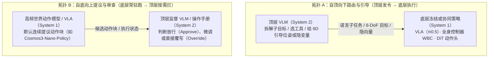

# 路线五：快慢双系统——调度、引导或审查底层学习策略（VLM + VLA / WAM / WBC）

!!! abstract "要点"
    前四类路线有一个共同弱点：底层接管模块都是**刚性逆运动学、解析规划器或几行手写比例控制代码**。一旦遇到叠软衣服、揉面团、紧凑插拔等富接触操作，或者四足/人形机器人的毫秒级全身动态平衡，解析几何控制极易卡死；反过来，纯端到端 VLA 虽然擅长局部柔顺接触，却容易在场景布局变化或长程多步任务中迷失方向。

    第五类控制方式采用**快慢双系统（System 2 + System 1）架构**：让慢速但具备开放世界常识与纠错推理能力的顶层 VLM（System 2，0.5–9 Hz）与高频闭环的底层神经网络策略（System 1，20–200 Hz 的 VLA、世界动作模型 WAM 或强化学习全身控制器 WBC）协同工作。按“谁主导日常动作、谁按需介入”，演化出**自顶向下路由引导**与**自底向上提议审查**两种拓扑，以及针对顶层大脑的专项 SFT + RL 后训练。

---

## 1. 零样本路由调度、几何引导与在线动作审查（Zero-Shot）

这一方向的思路继承自早期用 LLM 给预训练技能库打分排优的 SayCan[^saycan] 与 Inner Monologue[^innermono]，但在 2025–2026 年把底层“死板的单技能策略”换成了通用的多任务 VLA、WAM 或全身控制器，并发展出两种截然不同的主次分工：

### 1.1 自顶向下：把底层 VLA / WBC 当成一个可调度的“接触工具”

平时由顶层 VLM 掌控全局状态机，决定什么时候走传统解析规划、什么时候调底层神经网络策略，以及给底层喂什么条件：

- **Gemini Robotics ER 2（子任务分解与函数路由）**[^gemini-er2]：由 Google DeepMind 的具身推理模型充当顶层编排器，在标准多轮智能体循环中看图推理当前进度，既可以输出二维指点或调用高层运动函数，也可以拆解出细粒度自然语言子任务交给任意底层高频 VLA 执行，跑完一段再看图决定下一步。
- **Harness VLA 与 RPent（无接触走解析几何、有接触切冻结 VLA）**[^harness-vla]：研究团队发现，冻结的预训练 VLA（如 $\pi_{0.5}$[^pi05]）真正吃亏的地方是大范围跨桌面移动和布局剧变（容易走偏），而它真正不可替代的地方是最后几厘米的**柔顺抓取与接触插入**。因此 Harness VLA 把冻结 VLA 封装成一个可重复调用、可中断重试的接触原语 `vla_act`，与无接触的解析几何运动原语（平移、转腕）并列交给顶层大模型调度：远距离搬运走确定性几何原语，到了目标跟前再切入 `vla_act` 处理精细接触，并配合任务级与全局成功/失败记忆库避免重复踩坑。
- **InteractVLA（双向 6-DoF 几何引导 + 动作块重投影检查）**[^interactvla]：只靠自然语言字符串去指挥底层 VLA 往往“说不清道不明”（比如你说“再往左偏一点抓壶把”，冻结 VLA 根本听不懂“一点”是几厘米）。InteractVLA 把顶层智能体与底层冻结流匹配 VLA 之间的接口升级为**双向几何通道**：
  1. *向下引导*：顶层 VLM 输出明确的 6-DoF 末端目标位姿，在测试时（无需微调 VLA）通过几何引导项直接把流匹配动作专家的去噪轨迹拉向该目标；
  2. *向上核验*：底层 VLA 生成的一整段连续动作块在真正驱动电机前，先用相机参数**重投影画回图像平面**传给顶层 VLM 检查——如果发现轨迹偏离壶把，智能体当场修改目标位姿重算，从而在 LIBERO-Plus 上拿到 99.4%、RoboCasa365 上拿到 89.4% 的高成功率。
- **四足与人形全身控制器调度**：在移动与足式本体上，底层保持平衡和迈步需要 50–500 Hz 的关节力矩闭环。Claude Plays Robotics[^claude-robotics] 与足式导航模型 NaVILA[^navila] 让顶层 VLM 只输出中层速度向量、步态模式或“右转 30°、前进 50 cm”的指令，底层的关节协调与抗打滑平衡完全交给仿真强化学习预训练好的全身控制器（WBC）。

### 1.2 自底向上：底层高频模型常驻提议，顶层按需审查与覆写

自顶向下路由有一个隐患：每换一个子阶段都要停下来等顶层大模型思考几秒，动作衔接处会有明显停顿。如果反过来，**平时让高频底层策略自己一直往前跑，顶层大模型只在旁边“盯梢”并按需介入呢？**

- **Astranomy（Orchestrated Policy，NVIDIA SRL）**[^astranomy]：底层常驻运行高频世界动作模型 **`Cosmos3-Nano-Policy`**（基于 NVIDIA Cosmos 3 多模态架构在 DROID 真机数据上后训练出的快速策略），连续生成动作块推进任务；顶层 **GPT-6 Astra** 在有界记忆会话中观察执行进展与底层提议的动作，每轮做出三种裁决之一：**放行（Approve）**底层动作继续跑、**微调修正**，或在底层卡死/偏航时**直接接管覆写（Override）**动作序列。在 RoboLab-120 上，单独跑 `Cosmos3-Nano-Policy` 成功率只有 **36.8%**，加入顶层按需审查覆写后直接拉升至 **66.5%**，同时比纯顶层一步步控制的 Agentic 模式大幅降低了延迟与 Token 消耗。
- **RHD（Recursive Harness Distillation，递归脚手架蒸馏）**[^rhd]：如果在真机端侧连调云端 GPT-6 做在线盯梢的预算或网速都没有怎么办？RHD 提出了一种**完全不改模型权重的跨智能体经验蒸馏**：
  1. 先让闭源**强智能体**监督底层冻结 VLA 跑一批回合，诊断 VLA 在哪些视觉状态下会犯什么典型错误，把干预条件与修正动作编译成一份结构化的外部**操作手册（Playbook）**；
  2. 再让端侧**轻量智能体**拿着这份手册去监督同一个冻结 VLA，把轻量模型读手册执行时暴露出的歧义或新失败回传给强智能体，递归修订手册。
  最终不更新任何一个神经网络参数，就让轻量模型引导冻结 VLA 的真机操作成功率从 **37.3% 跃升至 64.0%**（SimplerEnv Bridge 从 41.7% 升至 66.7%）。

---

## 2. 顶层策略调度器的专项 SFT + 多轮 RL

### 到底在做什么

当固定住底层的预训练 VLA 或扩散动作头不改（避免破坏底层昂贵学来的高频接触手感），专门用 SFT 和强化学习去后训练**顶层 VLM 调度器**时，就能用很小的开源模型（如 7B–9B）替代昂贵的闭源 API，同时让高低层配合得比手工提示词更默契。

### 三种代表性训练机制

1. **复杂指令与人类中途语音纠偏微调（Hi Robot）**[^hirobot]
   Physical Intelligence 的 Hi Robot 把顶层 VLM（System 2）和底层 $\pi_0$ 流匹配动作模型（System 1）配成一对：利用大模型自动为机器人轨迹合成“复杂约束指令”（如“帮我做个素食三明治，别放西红柿”）和“人类中途插话纠偏”（如手刚伸向奶酪时人类突然说“算了先放生菜”），微调顶层 VLM 以约 1–2 Hz 将长上下文与实时语音反馈压缩翻译成干净、简短的当前步原子子目标（如 `"put down cheese"` → `"pick up lettuce"`）喂给底层 $\pi_0$。工业界人形机器人双系统 **GR00T N1**[^groot-n1] 与 **Helix**[^helix] 则更进一步，把高低层之间的文字接口直接换成**连续隐向量通道**（如 Helix 在机载嵌入式 GPU 上以 7–9 Hz 运行 System 2 VLM，持续向 200 Hz 的 System 1 全身灵巧手策略传递隐表征）。

2. **去特权记忆重构 SFT + 多轮在线 RL（AgenticRoboRL，RPent 模式）**[^agenticroborl]
   在 RPent[^harness-vla] 框架下，闭源 GPT-5.5 之所以能把冻结 $\pi_{0.5}$ 调度到 72.1% 的高成功率，很大程度上依赖外挂了一个检索历史成功/失败案例的**特权外部记忆库**；而未经训练的 9B 开源模型在无外部记忆时只有 **18.1%**。AgenticRoboRL 分两步把这门手艺直接训进 9B 模型权重里：
   - **第一步（上下文重构 SFT）**：收集强教师在挂载外部记忆库时的成功多轮工具调用轨迹，但在构造 SFT 训练样本时，**把提示词里的特权外部记忆段落删掉、改写成无记忆的标准观测上下文**。这样模型被迫学会仅凭当前画面和历史交互就做出原本需要查记忆库才能做出的调度决策。
   - **第二步（代理捕获多轮在线 RL）**：通过捕获代理（capture proxy）在真实 RPent 循环外无侵入地记录每一轮顶层模型生成的 Token 与对数概率，以仿真回合最终成败为奖励做多轮在线 RL，学会在底层 VLA 某次执行没到位时果断重调或切回几何调整。最终 9B 开源模型在**完全不带外部记忆库**的条件下，于 LIBERO-PRO 拿到 **71.0%** 成功率，几乎追平带外部记忆的闭源 GPT-5.5（72.1%）。

3. **SFT 冷启动 + 动作对齐 RL 训练视觉规划隐变量（ThinkAct）**[^thinkact]
   用自然语言句子连接高低层会有信息瓶颈（很多空间轨迹细节一句话描述不清楚），而直接端到端反传扩散损失又容易破坏顶层推理。ThinkAct 让顶层多模态大模型先生成一段显式的具身思维链推理，最后输出一组紧凑的**视觉规划隐变量（Visual Plan Latents）**送入底层的扩散 Transformer（DiT）动作头生成高频连续动作：
   - 先用机器人轨迹与具身问答数据做 **SFT 冷启动**，建立推理链与隐变量的初始映射；
   - 再冻结或解耦底层，专门设计**动作对齐奖励**（衡量顶层隐变量所蕴含的二维关键点终点完成度与整条视觉轨迹一致性）对顶层大模型做 **GRPO 强化学习**。顶层“想得越准”，底层扩散头生成的轨迹就越贴合复杂长程与少样本任务，还自发涌现出执行失误后的视觉重规划能力。

---

## 小结：双系统路线为什么成为复杂本体的主流

- **扬长避短**：它既保留了前四类智能体路线“每阶段显式推理、抗布局和指令扰动、可做安全拦截”的优点，又补上了前四类最缺的“高频柔顺接触与全身动态平衡”能力。
- **工程代价在哪**：系统从单模型变成了多模型异构管线，显存占用更高，且高低层之间存在**能力边界对齐问题**——如果顶层以为底层 VLA 听得懂“把杯子倒扣过来”，而底层 VLA 的训练分布里只有正放杯子，顶层再怎么重发子任务也会陷入死循环。这也推动了像 InteractVLA[^interactvla]（用几何位姿而非模糊语言引导）和 Astranomy[^astranomy]（发现底层不行时顶层直接覆写位姿）这样的混合兜底设计。

## 参考文献

[^saycan]: M. Ahn, A. Brohan, N. Brown et al. *Do As I Can, Not As I Say: Grounding Language in Robotic Affordances* (SayCan). CoRL 2022. [arXiv:2204.01691](https://arxiv.org/abs/2204.01691)
[^innermono]: W. Huang, F. Xia, T. Xiao et al. *Inner Monologue: Embodied Reasoning through Planning with Language Models*. CoRL 2022. [arXiv:2207.05608](https://arxiv.org/abs/2207.05608)
[^gemini-er2]: Google DeepMind. *Gemini Robotics ER 2 Model Card*. 2026-07. <https://deepmind.google/models/model-cards/gemini-robotics-er-2/>
[^harness-vla]: Y. Zhang, H. Zhang, F. Gao et al. *Harness VLA: Steering Frozen VLAs into Reliable Manipulation Primitives via Memory-Guided Agents* (RPent). 2026. [arXiv:2607.08448](https://arxiv.org/abs/2607.08448) · [GitHub](https://github.com/RLinf/RPent)
[^pi05]: Physical Intelligence. *$\pi_{0.5}$: a Vision-Language-Action Model with Open-World Generalization*. 2025. [arXiv:2504.16054](https://arxiv.org/abs/2504.16054)
[^interactvla]: C. Zhao, Z. Ye, S. Bao et al. *InteractVLA: Turning VLAs into Interactive Tools for Agentic Robotic Manipulation*. 2026. [arXiv:2611.22584](https://arxiv.org/abs/2611.22584)
[^claude-robotics]: S. Berman, M. Ilie, J. Deng, D. Freeman. *How Claude performs on robotics tasks* (Claude plays robotics). Anthropic Research, 2026-07. <https://www.anthropic.com/research/claude-plays-robotics>
[^navila]: A.-C. Cheng, Y. Ji, Z. Yang et al. *NaVILA: Legged Robot Vision-Language-Action Model for Navigation*. RSS 2025. [arXiv:2412.04453](https://arxiv.org/abs/2412.04453)
[^astranomy]: J. X. Yang, A. Khetan, S. Zhang. *Astranomy: An Empirical Study of GPT-6 Astra as a Native Robot Policy*. NVIDIA Seattle Robotics Lab, CoRL 2026 Late-Breaking Results. <https://research.nvidia.com/labs/srl/projects/astranomy/>
[^rhd]: S. Kim, J. Lee, M. Kim, B. Kim, N. Kwak. *Recursive Harness Distillation across Agents for Robot Manipulation* (RHD). 2026. [arXiv:2609.33378](https://arxiv.org/abs/2609.33378)
[^hirobot]: L. X. Shi, B. Ichter, M. Equi et al. *Hi Robot: Open-Ended Instruction Following with Hierarchical Vision-Language-Action Models*. ICML 2025. [arXiv:2502.19417](https://arxiv.org/abs/2502.19417)
[^groot-n1]: J. Bjorck, F. Castañeda, N. Cherniadev et al. (NVIDIA). *GR00T N1: An Open Foundation Model for Generalist Humanoid Robots*. 2025. [arXiv:2503.14734](https://arxiv.org/abs/2503.14734)
[^helix]: Figure AI. *Helix: A Vision-Language-Action Model for Generalist Humanoid Control*. Figure AI Technical Report, 2025-02. <https://www.figure.ai/news/helix>
[^agenticroborl]: X. Liu, B. Xu, W. Bao, M. Li, W. Bao, C. Chen, Y. Shang. *AgenticRoboRL: Bringing Coding-Agent Post-Training to Agentic Robotics*. 2026. [arXiv:2610.28589](https://arxiv.org/abs/2610.28589)
[^thinkact]: C.-P. Huang, Y.-H. Wu, M.-H. Chen, Y.-C. F. Wang, F.-E. Yang. *ThinkAct: Vision-Language-Action Reasoning via Reinforced Visual Latent Planning*. NeurIPS 2025. [arXiv:2507.16815](https://arxiv.org/abs/2507.16815)
