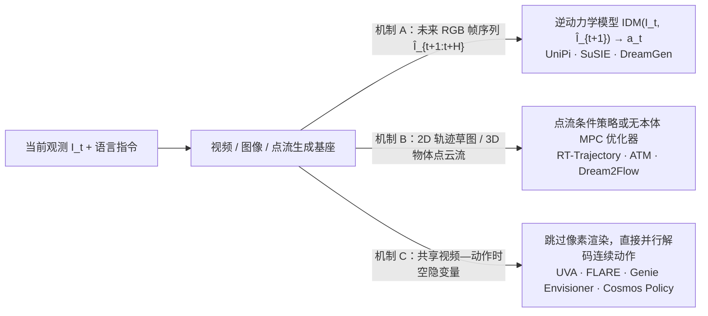

# 查漏补缺专题：世界动作模型、力控柔顺、异构本体与安全护栏

!!! abstract "要点"
    在补齐了[路线二的空间指认 RL](spatial-keypoints.md#3-空间关键点与指认的强化学习spatial-grounding-rl) 与[路线六的端到端 VLA 强化学习 / 知识隔离](vla-and-out-of-loop.md#14-端到端-vla-怎么做强化学习突破示范天花板)这两个矩阵空白格之后，若站在整个具身智能文献版图审视原框架，还有**四个关键维度**尚未展开：

    1. **一层独立的中间控制抽象——生成式视觉 / 视频与三维点流子目标（Video-as-Policy / WAM）**：高层模型预测的不是文字代码或稀疏关键点，而是“未来画面长什么样”或“物体三维点云怎么流动”；
    2. **力控、可变阻抗与触觉柔顺抽象**：解释为什么纯运动学接口（位姿、关键点、普通原语）一遇到精密插拔和擦拭就会卡死，以及怎么把刚度与接触力写进接口；
    3. **超越桌面二指平行夹爪**：移动操作、足式全身导航与 20 自由度五指灵巧手的特殊控制分层；
    4. **正向控制之外的逆向防线**：动作前形式化安全护栏与执行中高频几何监控代码。

---

## 1. 缺失的中间控制抽象层：生成式视频与三维点流子目标（WAM）

### 为什么需要这层抽象？

互联网上有数以亿计的人类做饭、叠衣、修理物品的视频，但这些视频里既没有 7-DoF 机械臂关节角，也没有 Python 原语调用日志。如果高层模型直接把**未来视觉画面、稠密像素运动或三维物体点流**作为输出接口，就能把无动作标注的视频生成大模型直接变成机器人的“物理直觉规划器”。这一大类方法统称为 **Video-as-Policy** 或**世界动作模型（World-Action Models, WAM）**[^wam-survey]，按底层如何把视觉预测转成电机指令分成三种机制：

### 三种具体机制是怎么运作的

1. **机制 A：先画未来 RGB 画面，再用逆动力学模型反推控制量**
   - **UniPi**[^unipi]：顶层是一个文本条件视频扩散模型，给定当前相机画面 $I_t$ 和指令 `"open the drawer"`，直接想象并渲染出未来十几帧机械臂拉开抽屉的连续视频 $\hat{I}_{t+1:t+H}$；底层只需训练一个极轻量的**逆动力学模型（Inverse Dynamics Model, IDM）** $a_t = f_{\text{IDM}}(\hat{I}_t, \hat{I}_{t+1})$——因为“已知前后两帧画面，求中间这一步关节动了多少”是一个纯局部几何匹配问题，只需极少量真机无指令随机交互数据就能训准。
   - **SuSIE**[^susie] 把耗时的整段视频生成简化为用预训练图像编辑扩散模型每几秒生成一张“下一阶段目标完成图” $\hat{I}_{\text{goal}}$，底层接一个目标图像条件扩散策略 $\pi(a \mid I_t, \hat{I}_{\text{goal}})$ 高频闭环追过去；**DreamGen**[^dreamgen] 则微调视频世界模型（如 Cosmos）在新物体和新环境里批量“做梦”合成逼真操作视频，再用 IDM 或隐动作模型自动打上伪动作标签喂给下游策略训练。

2. **机制 B：剥离背景外观，只预测稠密 2D 点轨迹或 3D 物体点云流**
   直接生成整张 RGB 图像有两个毛病：一是扩散渲染几百万个背景像素太慢，二是视频模型想象出的是“人手拿杯子”，而真机画面里是“金属夹爪”，直接喂给 IDM 会有外观域差。
   - **RT-Trajectory**[^rt-traj] 与 **ATM（Any-point Trajectory Modeling）**[^atm] 改为只预测画面上采样点的未来二维运动轨迹（ATM 在无动作视频上训出一个任意点轨迹预测器，推理时先预测场景关键像素往哪流，再引导底层策略动作）。
   - **Dream2Flow**[^dream2flow] 则彻底消除了“人手 vs. 机械臂”的外观鸿沟：它先让现成视频生成模型想象任务过程，再用深度估计与点跟踪从生成视频里只提取**被操作物体本身的三维点云流（3D Object Flow）**——不管视频里是人手推碗还是章鱼触手推碗，碗本身的三维刚体/非刚体运动流是一样的；底层直接用无模型 MPC 或轨迹优化计算“机械臂夹住碗之后该走什么 6-DoF 轨迹才能复现这段三维物体流”。

3. **机制 C：视频与动作共享隐空间，测试时跳过像素渲染以实现高速闭环（原生 WAM）**
   为了兼顾视频预训练的物理常识与端侧 20 Hz 以上的实时速度，最新一代原生 WAM 把视频生成与动作生成揉进同一个隐空间：
   - **UVA（Unified Video Action Model）**[^uva] 在训练时联合去噪未来视频隐变量与连续动作块，迫使共享隐表征吃透物理动力学；到了**在线测试时直接跳过耗时的视频像素解码分支**，只跑动作解码分支即可高速控制。
   - **FLARE**[^flare-wm] 通过轻量未来潜变量 Token 将端到端 VLA 的内部扩散特征对齐到未来观测表征上，无需渲染像素即可吸收海量无动作人类视频；**Genie Envisioner**[^genie-env] 与 **Ctrl-World**[^ctrlworld] 构建多视角可控视频世界模型，支持把待测 VLA 直接放进世界模型的“想象闭环”里做离线打分和合成微调；**Cosmos Policy**[^cosmos-policy] 则通过单阶段隐帧注入把预训练视频基座直接改造为兼具动作生成与未来状态价值评估的规划器。

---

## 2. 正交物理盲区一：力控、可变阻抗与触觉柔顺抽象

### 为什么纯运动学接口在富接触任务里必然卡死？

回顾前五类路线，绝大多数方法输出的都是纯几何量（目标位置 $\mathbf{x}_{\text{des}}$、关键点或路点）。如果底层用高刚度位置控制器去跟踪，一旦遇到轴孔间隙只有 $0.5\,\mathrm{mm}$ 的插头插拔、擦黑板或削果皮，只要深度相机标定偏了 $2\,\mathrm{mm}$，夹爪按死命令往黑板里硬捅 $2\,\mathrm{mm}$，接触法向力 $F_n = K_p \Delta x$ 就会瞬间飙升到几十牛顿，触发机械臂急停保护或把零件掰断。

人类完成这类动作靠的是**阻抗柔顺（Compliance）**：在需要贴合试探的方向把“手腕放软”（低刚度），在需要推进的方向施加受控恒力。阻抗控制律写为：

$$
\mathbf{F}_{\text{cmd}} = \mathbf{K}_p(\mathbf{x}_{\text{virt}} - \mathbf{x}) - \mathbf{K}_d \dot{\mathbf{x}}
$$

要让机器人做好富接触任务，高层或底层不仅要决定去哪（虚拟平衡点 $\mathbf{x}_{\text{virt}}$），**还必须输出方向刚度矩阵 $\mathbf{K}_p \in \R^{6\times 6}$ 或六维力/力矩（F/T）条件**。近期文献在三个不同抽象层补上了这块拼图：

| 切入层级 | 代表工作 | 具体是怎么把“力和柔顺度”塞进接口的 |
| --- | --- | --- |
| **代码原语层（对应路线三）** | **GenCHiP**[^genchip] | 把 Code as Policies 的刚性运动函数升级为**带显式柔顺参数与力终止条件的 API**，例如 `move_compliant(target, stiffness=[800, 800, 100], stop_if_force_z=8.0)`。大模型据此写出“先低刚度下探直到接触力达 5 N 确认触底，再保持下压力横向柔顺滑移找孔，掉入孔位的瞬间力突降即插入”的装配程序，在紧公差 NIST 装配板上成功率提升 3–4 倍 |
| **快慢双系统层（对应路线五）** | **CompliantVLA-adaptor**[^compliant-adaptor] | 不改底层已经训好的冻结 VLA（如 OpenVLA、$\pi_0$），而是在外层挂一个 VLM 阻抗适配器：顶层 VLM 根据当前图像所处的接触阶段（自由空间接近 vs. 对准插入 vs. 擦拭表面），实时输出任务相关的时变刚度与阻尼参数调节底层阻抗控制器 |
| **高频策略与端到端 VLA 层（对应路线六）** | **ACP**[^acp] · **FoAR**[^foar] · **FACTR**[^factr] · **ForceVLA**[^forcevla] · **CompVLA**[^compvla] | **ACP** 让扩散策略同时预测三维时变刚度椭球与虚拟目标点；**FoAR** 与 **FACTR** 解决多模态 Transformer 容易走“只看图像、忽略腕部力传感器读数”视觉捷径的问题（FACTR 在训练初期故意模糊图像，逼模型必须看力矩信号才能学会翻面擀皮）；**ForceVLA** 用力感知 MoE 融合六维力信号，**CompVLA** 则在 VLA 内专设柔顺度专家同步输出轨迹与时变刚度矩阵 |

---

## 3. 正交物理盲区二：移动底盘、足式本体与多指灵巧手

桌面固定单臂 + 二指平行夹爪只有 $6+1=7$ 个自由度，而且基座焊死在桌面上。一旦换到更通用的物理本体，控制抽象会出现两处关键变形：

### 3.1 移动操作与足式全身导航（工作空间不再有界且相机随时在动）

- **开放词汇移动抓放（OK-Robot）**[^okrobot]：机器人在陌生家庭房间里巡游时，单帧相机看不到全屋。系统用 RGB-D 边走边构建一张带 CLIP 开放词汇特征的**三维体素语义记忆地图**；收到“把客厅地上的毛绒玩具捡到沙发旁篮子里”指令后，直接向体素地图检索目标三维位置，先后调用底盘导航原语与 AnyGrasp 抓取原语，零样本在真实陌生家庭达到 58.5% 成功率。
- **长上下文拓扑导航与足式语言桥接（Mobility VLA、NaVILA）**[^mobility-vla][^navila]：Mobility VLA 让长上下文 VLM 直接吞下整段先验巡检视频，输出拓扑地图上的目标节点编号交给局部避障器；四足/人形导航模型 **NaVILA**[^navila] 则针对台阶、碎石等非结构化地形做双层切分——顶层 VLM 绝不碰高频腿部关节，只以约 1 Hz 输出**中层运动语言指令**（如 `"turn left 30 degrees"`、`"move forward 50 cm"`），底层由大规模仿真 RL 训出的盲视/局部地形全身步态控制器以 50 Hz 负责跨台阶与防摔平衡。

### 3.2 高自由度多指灵巧手（16–24 DoF 指关节协同）

二指夹爪只需输出一个标量 `grip ∈ {-1, +1}`，而五指灵巧手（如 Allegro、Shadow、Inspire Hand）有十几个高耦合指关节——让通用 VLM 用文字零样本报出 16 个指关节弧度去捏起一枚硬币，几乎不可能成功。当前有效路线集中在两类：

1. **手部三维关键点重映射（对应路线二）**：如 **DexCap**[^dexcap] 利用便携式电磁动捕手套采集人手在自然环境下的三维指尖姿态，通过逆运动学重映射（retargeting）转为灵巧手关节角训练模仿策略，把“控制二十个电机”化简为“跟踪五个指尖三维点”。
2. **VLM 语义意图 + 扩散灵巧动作专家（对应路线五/六）**：如 **DexVLA**[^dexvla] 与 **DexGraspVLA**[^dexgraspvla]，顶层 VLM 负责理解“捏住喷壶扳机并按压”这类功能语义或框定抓取目标，底层的十亿参数级扩散动作专家负责高频生成多指包络与指内协同轨迹。

---

## 4. 正交工程盲区三：动作前安全护栏与实时失败监测

前面所有路线讨论的都是**正向通路**（指令怎么变成动作），但在真机部署时，同样决定生死的是**逆向监督通路**——模型被越狱或幻觉出危险指令谁来拦？动作执行到一半杯子滑掉了怎么在几十毫秒内停下？（本站实测总结的五层检查体系见 [Agent4Robot：检查机制](../agent4robot/verification.md)。）

1. **执行前安全护栏（Pre-execution Guardrails）**
   - **AutoRT（语义层机器人宪法）**[^autort]：在大规模真机车队自采数据时，用一套显式的“机器人宪法”（禁止接触人类与动物、禁止触碰锋利刀具与带电液体、禁止搬运超载重物）在任务下发前对 VLM 提出的候选任务做独立安全过滤。
   - **RoboGuard（形式化时序逻辑护栏）**[^roboguard]：一个独立受信任的安全模型根据当前环境感知（例如画面中出现了人或易碎玻璃），把通用安全准则实时编译成**线性时序逻辑（LTL）公式**（如 $\square \neg \text{goto}(\text{person})$），通过控制综合算法对规划大模型的动作序列做形式化拦截与最小修改——即使顶层规划大模型遭到提示词越狱攻击，底层也绝对执行不出违背 LTL 约束的危险轨迹。
2. **执行中与执行后实时失败监测（Reactive & Proactive Monitoring）**
   - **REFLECT（多模态事后归因）**[^reflect]：把机械臂操作全过程的视觉关键帧、麦克风接触声音（比如物体掉落桌面的撞击声）与夹爪力/开度传感器读数浓缩成按时间对齐的分层文字摘要，让大模型精准定位“第 12 秒抬起时抓空了”，解释原因并针对性重规划。
   - **Code-as-Monitor（高频几何断言代码，与路线三精确对偶）**[^cam]：如果每帧都调 VLM 看图检查有没有出事，等大模型花 2 秒看出水洒了，水早就倒光了。Code-as-Monitor 的思路非常巧妙——既然大模型能写控制代码（Code as Policies），就让它在动作开始前同时**写一段极轻量的几何监控断言代码**！代码把任务不变量写成关于点、线、面三维跟踪元素的实时不等式（例如“搬运途中，碗心与夹爪中心距离必须始终 `< 4 cm`；倒水前，杯身倾角必须 `< 15°`”）。这段监控代码在底层三维点跟踪器上以 **30 Hz 零大模型延迟**实时运行，一旦濒临越界（proactive）或刚发生滑脱（reactive）立刻毫秒级刹停机械臂并唤醒顶层大模型重规划。

## 参考文献

[^wam-survey]: Z. Lu, H. Zhai, G. Wang et al. *World-Action Models for Robot Learning and Control: A Survey*. 2026. [arXiv:2609.16074](https://arxiv.org/abs/2609.16074)
[^unipi]: Y. Du, M. Yang, B. Dai et al. *Learning Universal Policies via Text-Guided Video Generation* (UniPi). NeurIPS 2023. [arXiv:2302.00111](https://arxiv.org/abs/2302.00111)
[^susie]: K. Black, M. Nakamoto, P. Atreya et al. *Zero-Shot Robotic Manipulation with Pretrained Image-Editing Diffusion Models* (SuSIE). ICLR 2024. [arXiv:2310.10639](https://arxiv.org/abs/2310.10639)
[^dreamgen]: J. Jang, S. Ye, Z. Lin et al. *DreamGen: Unlocking Generalization in Robot Learning through Video World Models*. CoRL 2025. [arXiv:2505.12705](https://arxiv.org/abs/2505.12705)
[^rt-traj]: J. Gu, S. Kirmani, P. Wohlhart et al. *RT-Trajectory: Robotic Task Generalization via Hindsight Trajectory Sketches*. ICLR 2024. [arXiv:2311.01977](https://arxiv.org/abs/2311.01977)
[^atm]: C. Wen, X. Lin, J. So et al. *Any-point Trajectory Modeling for Policy Learning* (ATM). RSS 2024. [arXiv:2401.00025](https://arxiv.org/abs/2401.00025)
[^dream2flow]: K. Dharmarajan, W. Huang, J. Wu, L. Fei-Fei, R. Zhang. *Dream2Flow: Bridging Video Generation and Open-World Manipulation with 3D Object Flow*. ICRA 2026. [arXiv:2512.24766](https://arxiv.org/abs/2512.24766)
[^uva]: S. Li, Y. Gao, D. Sadigh, S. Song. *Unified Video Action Model* (UVA). RSS 2025. [arXiv:2503.00200](https://arxiv.org/abs/2503.00200)
[^flare-wm]: R. Zheng, J. Wang, S. Reed et al. *FLARE: Robot Learning with Implicit World Modeling*. 2025. [arXiv:2505.15659](https://arxiv.org/abs/2505.15659)
[^genie-env]: Y. Liao, P. Zhou, S. Huang et al. *Genie Envisioner: A Unified World Foundation Platform for Robotic Manipulation*. 2025. [arXiv:2508.05635](https://arxiv.org/abs/2508.05635)
[^ctrlworld]: Y. Guo, L. X. Shi, J. Chen, C. Finn. *Ctrl-World: A Controllable Generative World Model for Robot Manipulation*. ICLR 2026. [arXiv:2510.10125](https://arxiv.org/abs/2510.10125)
[^cosmos-policy]: M. J. Kim, Y. Gao, T.-Y. Lin et al. *Cosmos Policy: Fine-Tuning Video Models for Visuomotor Control and Planning*. 2026. [arXiv:2601.16163](https://arxiv.org/abs/2601.16163)
[^genchip]: K. Burns, A. Jain, K. Go, F. Xia, M. Stark, S. Schaal, K. Hausman. *GenCHiP: Generating Robot Policy Code for High-Precision and Contact-Rich Manipulation Tasks*. IROS 2024. [arXiv:2404.06645](https://arxiv.org/abs/2404.06645)
[^compliant-adaptor]: H. Zhang, W.-H. Huang, Q. Tong et al. *CompliantVLA-adaptor: VLM-Guided Variable Impedance Action for Safe Contact-Rich Manipulation*. 2026. [arXiv:2601.15541](https://arxiv.org/abs/2601.15541)
[^acp]: Y. Hou, Z. Liu, C. Chi et al. *Adaptive Compliance Policy: Learning Approximate Compliance for Diffusion Guided Control*. ICRA 2025. [arXiv:2410.09309](https://arxiv.org/abs/2410.09309)
[^foar]: Z. He, H. Fang, J. Chen, H.-S. Fang, C. Lu. *FoAR: Force-Aware Reactive Policy for Contact-Rich Robotic Manipulation*. IEEE RA-L / IROS 2025. [arXiv:2411.15753](https://arxiv.org/abs/2411.15753)
[^factr]: J. J. Liu, Y. Li, K. Shaw, T. Tao, R. Salakhutdinov, D. Pathak. *FACTR: Force-Attending Curriculum Training for Contact-Rich Policy Learning*. RSS 2025. [arXiv:2502.17432](https://arxiv.org/abs/2502.17432)
[^forcevla]: J. Yu, H. Liu, Q. Yu et al. *ForceVLA: Enhancing VLA Models with a Force-aware MoE for Contact-rich Manipulation*. NeurIPS 2025. [arXiv:2505.22159](https://arxiv.org/abs/2505.22159)
[^compvla]: J. Kim, J. Ha, C. Park et al. *CompVLA: A Variable Compliance Vision-Language-Action Model for Contact-rich Manipulation*. 2026. [arXiv:2609.23614](https://arxiv.org/abs/2609.23614)
[^okrobot]: P. Liu, Y. Orru, J. Vakil, C. Paxton, N. M. M. Shafiullah, L. Pinto. *OK-Robot: What Really Matters in Integrating Open-Knowledge Models for Robotics*. RSS 2024. [arXiv:2401.12202](https://arxiv.org/abs/2401.12202)
[^mobility-vla]: H.-T. L. Chiang, Z. Xu, Z. Fu et al. *Mobility VLA: Multimodal Instruction Navigation with Long-Context VLMs and Topological Graphs*. CoRL 2024. [arXiv:2407.07775](https://arxiv.org/abs/2407.07775)
[^navila]: A.-C. Cheng, Y. Ji, Z. Yang et al. *NaVILA: Legged Robot Vision-Language-Action Model for Navigation*. RSS 2025. [arXiv:2412.04453](https://arxiv.org/abs/2412.04453)
[^dexcap]: C. Wang, H. Shi, W. Wang, R. Zhang, L. Fei-Fei, C. K. Liu. *DexCap: Scalable and Portable Mocap Data Collection System for Dexterous Manipulation*. RSS 2024. [arXiv:2403.07788](https://arxiv.org/abs/2403.07788)
[^dexvla]: J. Wen, Y. Zhu, J. Li et al. *DexVLA: Vision-Language Model with Plug-In Diffusion Expert for General Robot Control*. 2025. [arXiv:2502.05855](https://arxiv.org/abs/2502.05855)
[^dexgraspvla]: Y. Zhong, X. Huang, R. Li et al. *DexGraspVLA: A Vision-Language-Action Framework Towards General Dexterous Grasping*. 2025. [arXiv:2502.20900](https://arxiv.org/abs/2502.20900)
[^autort]: M. Ahn, D. Dwibedi, C. Finn et al. *AutoRT: Embodied Foundation Models for Large Scale Orchestration of Robotic Agents*. 2024. [arXiv:2401.12963](https://arxiv.org/abs/2401.12963)
[^roboguard]: Z. Ravichandran, A. Robey, V. Kumar, G. J. Pappas, H. Hassani. *Safety Guardrails for LLM-Enabled Robots* (RoboGuard). IEEE RA-L 2026. [arXiv:2503.07885](https://arxiv.org/abs/2503.07885)
[^reflect]: Z. Liu, A. Bahety, S. Song. *REFLECT: Summarizing Robot Experiences for Failure Explanation and Correction*. CoRL 2023. [arXiv:2306.15724](https://arxiv.org/abs/2306.15724)
[^cam]: E. Zhou, Q. Su, C. Chi et al. *Code-as-Monitor: Constraint-aware Visual Programming for Reactive and Proactive Robotic Failure Detection*. CVPR 2025. [arXiv:2412.04455](https://arxiv.org/abs/2412.04455)
