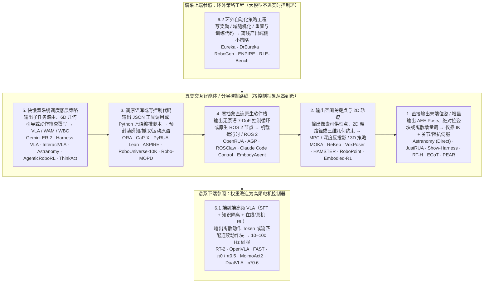

# VLM4Robot

以**控制抽象层级**（VLM 直接输出什么、底层由谁接管）为纵轴，以**训练与适应范式**（零样本调用 Zero-Shot、监督微调与在线蒸馏 SFT / OPD、强化学习 RL）为横轴，系统拆解视觉语言模型（VLM）控制机器人的每一条技术路线到底是怎么运作的。

整个技术版图由 **5 类保持交互智能体或分层形态的控制方式**，以及 **2 类位于谱系两端的参照路线**（端到端高频 VLA 微调与环外自动化策略工程）构成。每一章均按“输入输出长什么样 → 底层模块怎么接管执行 → 零样本与后训练（SFT / 蒸馏 / RL）各自解决什么瓶颈 → 在哪里会失效”展开，并附完整学术文献标注。

## 章节导航

1. **[全景总纲：控制抽象 × 训练范式的统一框架](taxonomy.md)**：为什么按“模型交出控制权的位置”切分？用同一个抓壶倒水任务直观对比 6 类路线的输入输出形态，给出统一二维总表与核心指标权衡。
2. **[路线一：直接输出末端位姿或增量](direct-pose.md)**：不靠规划器和原语库，VLM 直接报位姿给 IK 控制器；逐一拆解零样本连续动作块、离散增量词 LoRA SFT、具身思维链 SFT、无 SFT 纯仿真 RL 与视觉坐标锚定五种解法。
3. **[路线二：输出空间关键点、2D 轨迹与几何约束](spatial-keypoints.md)**：把“语义指认”与“高频几何控制”解耦；详解网格选点反投影、三维体素场、关键点非线性约束 MPC、跨领域 2D 路径 SFT 与空间指认强化学习。
4. **[路线三：调用动作原语库或编写控制代码](primitives-and-code.md)**：把感知、抓取与运动封装成确定性 API；详解单步 ReAct 工具循环、多步 Python 脚本、免改权重的技能库自演化、万级 Real-to-Sim 场景多轮 SFT，以及多教师在线逆 KL 蒸馏。
5. **[路线四：零抽象直连原生软件栈与底层接口](native-stack.md)**：撤掉全部人工原语，直接暴露 ROS 2 话题或裸 7-DoF 接口；详解机载本地高频控制函数合成与“黑盒教师合成 → 全参数图文 SFT → 在线 GRPO”三阶段训练。
6. **[路线五：快慢双系统——调度、引导或审查底层学习策略](dual-system.md)**：慢速 VLM（System 2）搭配高频 VLA / WAM / 全身控制器（System 1）；对比自顶向下路由引导、自底向上提议覆写、无权重操作手册蒸馏与顶层规划器专项 RL。
7. **[路线六：谱系两端的参照——端到端高频 VLA 与环外策略工程](vla-and-out-of-loop.md)**：拆解离散分桶 / 频域 FAST Token 与流匹配动作专家、动作微调退化通用推理的机理与知识隔离、流匹配真机强化学习（RECAP），以及大模型在环外自动写奖励与改代码训策略的闭环。
8. **[横向专题：后训练配方拆解（SFT、在线蒸馏与强化学习）](post-training-recipes.md)**：拉通六条路线对比训练信号——何时能跳过 SFT 直接 RL、四类不同的 SFT 监督目标、逆 KL 在线蒸馏公式与视觉骨干保护。
9. **[查漏补缺专题：世界动作模型、力控柔顺、异构本体与安全护栏](gaps-and-frontiers.md)**：系统补齐原框架之外的四块关键拼图——生成式视频与三维点流世界动作模型（WAM）、力控与可变阻抗柔顺抽象、移动/足式/多指灵巧手本体，以及动作前安全护栏与实时失败监测。

## 与本站其他模块的分工

- [Agent4Robot](../agent4robot/index.md)：聚焦零样本通用编程 agent（Codex）在 LIBERO 上四种接口的对比实测、`pixel_to_xyz` 反投影误差验证与五层安全检查机制。
- [Robot](../robot/index.md)：物理仿真底层机制（[MuJoCo / LIBERO 仿真是怎么做的](../robot/simulation.md)）与代表性单篇深读（如路线一纯仿真 RL 代表作 [PEAR 论文笔记](../robot/pear.md)）。
- [强化学习](../rl/index.md)：SFT、在线策略蒸馏（OPD）、GRPO 与 Agentic RL 的统一梯度推导见 [从 SFT 到 Agentic RL](../rl/sft-to-agentic-rl.md)。

## 全部文章

<!-- articles -->
