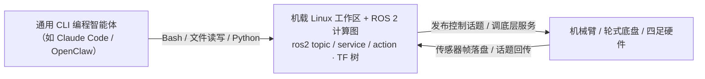
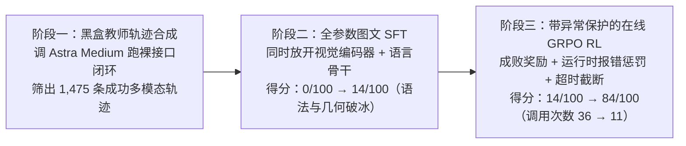

# 路线四：零抽象直连原生软件栈与底层接口（Native ROS 2 & Raw APIs）

!!! abstract "要点"
    在[路线三](primitives-and-code.md)里，每换一台新构型的机器人或新任务场景，人类工程师往往要先花几周时间帮模型写好 `vision_ground`、`grasp_plan`、`move_to` 等定制原语。

    第四类控制方式提出一个更彻底的问题：**能不能把人工编写的中间原语层全部砍掉**，只给智能体一台连着机器人的机载 Linux 电脑、原生 ROS 2 通信接口，或者最底层的 `obs = env.observation()` 与 `env.action(a)` 两个裸函数，让模型自己用代码把图像处理、三维反投影、比例闭环控制和异常恢复全部写出来？

## 0. 撤掉原语后，模型自己要多干哪些活？

对比路线三与路线四的代码，就能看清“零抽象”到底意味着什么：

- **路线三（有原语）**：模型只需写 `p = mark_point("cup", 140, 165); move_to(p.x, p.y, p.z)`，底层的邻域深度中位数滤波、相机外参左乘、比例伺服增益、150 步超时判停全由人类事先写死。
- **路线四（零抽象）**：环境没有任何高层动作 API。模型必须自己写 Python 代码完成四件事：
  1. **原生数据解析与坐标解算**：直接读取 RGB 数组、深度矩阵或 ROS 2 `/camera/points` 点云消息，调用 `cv2` / `numpy` 定位目标像素并用内外参矩阵手算世界坐标；
  2. **手写本地高频闭环伺服**：自己写 `for step in range(80):` 循环，每步计算当前末端位姿与目标的三维误差 $\mathbf{e}$，乘上比例增益并做限幅裁剪（clip），发给底层 7-DoF 接口；
  3. **接触与终止条件判断**：在循环内部自己检查 `np.linalg.norm(err) < 0.005` 或夹爪指间距变化，一旦到位或卡死立即 `break`，避免盲目跑满步数；
  4. **规避云端往返延迟**：把需要毫秒级响应的反馈控制逻辑下沉到机载本地脚本里执行，而不是每走 50 ms 都等云端大模型回一次包。

---

## 1. 零样本接管原生 ROS 2 与本地控制器函数（Zero-Shot）

### 1.1 直接向通用编程智能体开放机载终端与原生 ROS 2

既然 Claude Code、Codex 这类通用 CLI 编程智能体已经能在未知代码仓库里自己跑 `ls`、读文档、写测试脚本并修 Bug，这一派工作直接把整台机器人的机载工作空间当成代码仓库交给智能体：



- **OpenRUA（“工作区即脚手架”，UCL & CMU）**[^openrua]：不写任何任务专用中间件，只给通用命令行编程智能体开放机载终端权限、原生 ROS 2 接口与一份基础接口说明文档。在此设定下，**“感知就是文件 I/O，操作就是写程序”**——智能体需要看环境时，自己写脚本订阅相机与深度话题存成图片查看、甚至自己临时写一个图像处理测量小工具测算像素与三维距离；需要动机械臂时，自己编写闭环控制脚本发布 ROS 2 消息并读取反馈重修代码，在 LIBERO-PRO 与 CaP-Bench 上无需任何预封装原语即取得强零样本表现。
- **Agent as Policy（AGP）**[^agp]：将通用编程智能体直接放进真机运行闭环，围绕机器人的原生软件接口持续执行 **`感知观测 → 编写控制代码 → 真机运行 → 观察物理偏差并改写代码`** 循环。由于不被预定义技能集束缚，同一套零样本智能体在真实物理机械臂上横跨精密装配、搭积木、翻骰子、定点抛掷与双臂叠毛巾五类物理特性迥异的任务。
- **ROSClaw**[^rosclaw]（以及早期 NASA JPL 用于火星车场外巡检的 **ROSA**[^rosa]）：解决原生 ROS 2 接口直接暴露给自主智能体（如 OpenClaw、Claude Code）时的系统治理问题。它通过 `rosclaw_discovery` 动态自省当前机器人的 ROS 2 计算图（自动发现有哪些传感器 Topic、控制 Service 与导航 Action，支持轮式、四足 Unitree Go2 与人形 G1），同时在执行前挂载守护层 `rosclawd` 校验速度上限与安全边界，防止智能体发出的错乱话题指令损坏硬件。

### 1.2 编写本地高频闭环函数 `controller(obs) -> action`

为什么不让大模型直接一步步输出关节力矩或 20 Hz 控制量？Anthropic 在 **Claude Plays Robotics**[^claude-robotics] 中用一组对照实验把这个物理瓶颈测得非常透彻：

- **直接控制（Direct Raw Control）几乎全败**：当让云端模型在每一拍直接读取传感器数值、直接输出底层关节目标或力矩时，哪怕模型懂物理，一次 API 往返加思考的几秒钟延迟也会让四足或机械臂控制环相位严重滞后，系统迅速发散摔倒。
- **代码控制（Code Control）大幅胜出**：改为让 Claude 读取任务说明与传感器/动作空间定义后，**一次性编写一个纯本地运行的 Python 闭环控制函数 `controller(obs) -> action`**（内部可包含状态机、PD 误差反馈、坐标投影与异常保护），把这个函数注入机载本地进程以 **20–50 Hz 零网络延迟连续运行**；跑完一个回合或几秒钟后，再把运行轨迹摘要、传感器曲线和关键帧截图发回给 Claude 分析问题并迭代重写 `controller`。这种“云端慢思考改控制律、本地零延迟跑闭环”的方式在 MuJoCo 仿真与真实四足/机械臂硬件上均显著跑通（双臂无预封装原语基准 **CodeActionBench**[^cab] 也验证了类似的多轮代码迭代模式）。

---

## 2. 无原语底层接口的黑盒蒸馏 SFT + 在线 GRPO RL

### 到底在解决什么极端难题

零样本直连原生接口极其吃基础模型的代码与三维几何功底（在 CodeActionBench[^cab] 等无专用感知基准上，强闭源模型可达 73.3%，而中小模型跌至 2.7%）。如果手头只有一个 **9B 开源 VLM**，且环境只提供两个最原始的裸函数——没有任何运动原语、没有任何抓取器、也没有任何坐标转换辅助函数——能不能把它训出来？

清华团队提出的 **EmbodyAgent**[^embodyagent] 给出了完整的三阶段后训练答案。

### 极简裸接口长什么样

整个 Python 运行时只向模型暴露两个方法：

```python
obs = env.observation()   # 返回当前多视角 RGB 图像 + 机械臂本体状态向量（末端位置、姿态、夹爪开度）
obs = env.action(a)       # 输入 7 维连续底层动作 a = [dx, dy, dz, droll, dpitch, dyaw, grip]，推进物理一步
```

模型要想把碗拿起来，必须在代码块里自己写 `for` / `while` 循环反复调 `env.action(a)` 并实时读 `obs` 判断到没到位。未经训练的 9B 开源 VLM 面对这个裸接口，在 LIBERO-Spatial 留出测试集上的得分是严格的 **0 / 100**（要么写出死循环超时，要么语法/维度报错，要么手爪乱挥）。

### 三阶段训练管线是怎么一步步把它拉到 84 / 100 的



1. **阶段一：黑盒教师轨迹合成与清洗**
   用闭源强模型（Astra Medium）在训练任务上与裸接口多轮交互，要求每轮先输出 `<think>` 推理规划，再输出一段自包含的 Python 控制代码块（含循环与状态判断）。只保留最终任务成功的回合，过滤掉冗余报错后得到 **1,475 条**高质量多模态交互轨迹。
2. **阶段二：放开视觉与语言骨干的全参数 SFT（破冰阶段）**
   不同于有现成 `pixel_to_xyz` 工具的路线三可以冻结视觉编码器，在裸接口下模型必须自己从图像像素和本体读数中对齐三维空间位置。因此 EmbodyAgent **同时放开视觉编码器与语言骨干做全参数 SFT**。训完这一步，9B 模型学会了合法的代码循环结构与粗略视觉定位，测试集得分从 **0 / 100 升至 14 / 100**——依然很低，因为离线模仿无法教会它在手爪偏了 2 cm 抓空后怎么根据新画面修正循环参数，但 **14% 的非零命中率已经足够为强化学习提供正样本梯度**。
3. **阶段三：带运行时护栏的在线 GRPO 强化学习（质变阶段）**
   把 SFT 后的 9B 模型放进并行仿真环境做多轮在线组相对策略优化（GRPO）。针对“模型写任意 Python 代码做 RL”特有的崩溃风险，设计了两项关键工程机制：
   - **运行时报错惩罚与异常截断保护**：如果某轮生成的代码触发语法错误、`NameError`、数组越界或单段执行超时，沙箱立即截断捕获异常并施加负奖励惩罚，防止死循环卡死整个并行 rollout 批次；
   - **纯结果驱动的多轮信度分配**：以回合最终成败为主奖励，只在模型生成的推理与代码 Token 上更新梯度。

   经过在线 GRPO 后，留出测试集成功率从 **14 / 100 跃升至 84 / 100**；同时出现了一个非常有启发性的自发演化现象：**单回合模型调用次数的中位数从 36 次大幅压缩到了 11 次**。因为在多轮交互中，每多拆一次零碎调用就多一次出错与超时风险，RL 自动促使模型学会在单次代码块里写出带条件退出的完整闭环阶段（例如一段代码同时完成“比例趋近 → 到位检测 → 闭合夹爪 → 抬起验证”），在保持闭环鲁棒性的同时大幅降低了大模型推理开销。

---

## 小结：零抽象原生路线的定位

- **最大魅力在于“零人工中间件税”**：新买一台带 ROS 2 驱动的机械臂或移动底盘，不需要专门配备机器人算法团队封装一套原语库，编码智能体读完消息定义就能上手写控制闭环，并通过在线 RL 把控制代码越训越紧凑。
- **物理边界在哪**：模型在 Python 里手写的依然是比例控制、状态机或简单几何启发式算法。面对揉捏软体、高速动态捕捉或全身双足抗推搡平衡这类**人类控制工程师自己也写不出显式解析公式**的高维非线性接触问题，手写 Python 循环就触到了上限——这时就必须引入学习出来的底层神经策略，进入[路线五：快慢双系统](dual-system.md)。

## 参考文献

[^openrua]: Z. Chu, E. T. Barr, C. Le Goues et al. *OpenRUA: Robot-Use Agents Are Zero-Shot Visuomotor Policies*. 2026. [arXiv:2610.02459](https://arxiv.org/abs/2610.02459)
[^agp]: M. Jia, Y. Lin, X. Zhang, Z. Zhang, M. Jiang. *Agent as Policy for Robotic Manipulation* (AGP). 2026. [arXiv:2609.12541](https://arxiv.org/abs/2609.12541)
[^rosclaw]: I. S. Cardenas, M. A. Arnett, N. C. Yeo, L. Shah, J.-H. Kim. *ROSClaw: An OpenClaw ROS 2 Framework for Agentic Robot Control and Interaction*. 2026. [arXiv:2603.26997](https://arxiv.org/abs/2603.26997)
[^rosa]: R. Royce, M. Kaufmann, J. Becktor et al. *Enabling Novel Mission Operations and Interactions with ROSA: The Robot Operating System Agent*. IEEE Aerospace Conference 2025. [arXiv:2410.06472](https://arxiv.org/abs/2410.06472)
[^claude-robotics]: S. Berman, M. Ilie, J. Deng, D. Freeman. *How Claude performs on robotics tasks* (Claude plays robotics). Anthropic Research, 2026-07. <https://www.anthropic.com/research/claude-plays-robotics>
[^cab]: Y. Lyu, X. Jiang, W. Li, S. Lu, G. Zhang. *CodeActionBench: Evaluating Agentic Code-as-Policy for Embodied Manipulation*. 2026. [arXiv:2609.33807](https://arxiv.org/abs/2609.33807)
[^embodyagent]: W. Dai, J. Liu, J. Chen, H. Liu, W. Ding, S. Huang. *EmbodyAgent: Post-Training Embodied VLM Agents via Distillation, SFT, and RL*. 2026. [arXiv:2611.26196](https://arxiv.org/abs/2611.26196)
