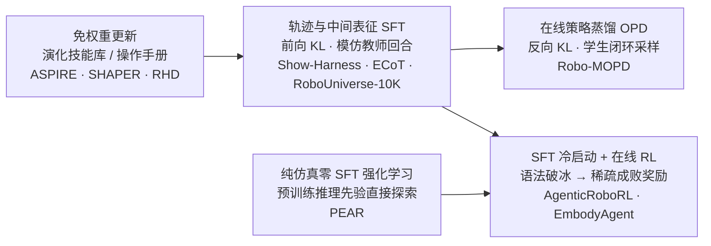

# 后训练配方横向对照：从 SFT、在线蒸馏到强化学习

!!! abstract "要点"
    在 [全景总纲](taxonomy.md) 的纵轴确定“VLM 输出哪一层抽象”（详见[路线一](direct-pose.md)至[路线六](vla-and-out-of-loop.md)）之后，横轴要回答的问题是：**怎样把一个原本不会操控机器人的中小尺寸开源 VLM（2B–35B）变成可靠的机器人控制器？**

    把所有类别的后训练工作横过来对比，训练信号同样遵循 [从 SFT 到 Agentic RL](../rl/sft-to-agentic-rl.md) 中的统一梯度视角，只是落点因控制接口而异：

    1. **不改权重的上下文 / 代码库蒸馏**：把失败纠错经验写进外部技能代码库或操作手册；
    2. **监督微调（SFT）**：涵盖离散语义增量 LoRA、中间具身推理链联合 SFT，以及多轮智能体纠错轨迹 SFT；
    3. **在线策略蒸馏（OPD）**：在学生自身的闭环轨迹上向多个专精教师做 token 级逆 KL 对齐；
    4. **多轮环境强化学习（Agentic RL）**：接口语法自然对齐时可直接纯仿真 RL（如 PEAR），接口语法复杂或无原语时则必须先用 SFT 冷启动再跑 GRPO（如 AgenticRoboRL、EmbodyAgent）。

## 1. 为什么有的接口能跳过 SFT 直接 RL，有的必须 SFT 冷启动？

对比同在 2026 年提出的三项代表工作——第 1 类的 PEAR[^pear]、第 3/5 类的 AgenticRoboRL[^agenticroborl] 和第 4 类的 EmbodyAgent[^embodyagent]——可以看到**控制接口的先验命中率**直接决定了能否跳过 SFT：

| 工作 | 基座模型 | 控制接口 | 未训练初始成功率 | 训练管线 | 最终表现 |
| --- | --- | --- | --- | --- | --- |
| **PEAR**[^pear] | Qwen3.8-27B | 思维链 + 单步 JSON $\Delta\text{EE Pose}$ | LIBERO 1.6%（偶有命中） | **跳过 SFT**，直接异步多轮 GRPO + DAPO 组过滤 | LIBERO 74.4%；双臂真机 60% |
| **AgenticRoboRL**[^agenticroborl] | 9B 开源 VLM | CaP-X 代码原语 / RPent 调 VLA | CaP-X 2.7% / RPent 18.1% | 强教师轨迹重构 **SFT → 多轮在线 RL** | CaP-X 28.5% / RPent 71.0% |
| **EmbodyAgent**[^embodyagent] | 9B 开源 VLM | 无原语 `env.observation()` + `env.action(a)` | **0 / 100**（完全无正样本） | Astra 合成 1,475 条 → **全参数图文 SFT**（14/100）→ **在线 GRPO** | LIBERO-Spatial 84 / 100 |

规律非常清晰：

- **GRPO 的前提是同一任务的采样组内必须同时有成功与失败样本**。如果 $G$ 条 rollout 奖励全为 0，组内优势 $A_i = r_i - \bar{r} \equiv 0$，梯度恒为零，训练一步也走不动。
- **PEAR 能跳过 SFT**，一方面因为基座是 27B 强推理模型，另一方面因为接口只是简单的 JSON 位姿增量——模型天然写得出合法 JSON，靠粗略空间直觉就能在简单任务上撞出 1.6% 的正奖励，再配合丢弃全 0 / 全 1 组的动态过滤把探索滚起来。
- **EmbodyAgent 与中小模型代码控制不能跳过 SFT**，是因为 9B 模型面对无原语的 7-DoF 裸接口时，连坐标方向、循环终止条件和夹爪闭合时机都写不对，初始成功率为严格的 0%。此时约 1,500 条黑盒教师轨迹 SFT 的作用不是教它精通所有任务，而是把成功率从 0% 抬到 14% 的“破冰线”以上，把语法格式和基础闭环结构教给模型，真正的长尾纠错与调用压缩（中位数 36 次 → 11 次）仍然由后续在线 GRPO 完成。

## 2. 四类 SFT 配方：分别在拟合什么监督信号

同样叫 SFT，不同控制层级构造的目标序列完全不同：

1. **单 Token 离散动作 LoRA SFT（拼低延迟）**
   Show-Harness[^show-harness] 把每一步决策压缩成词表里的**单个离散语义增量词**，用 LoRA 微调 Qwen3.5-2B。因为每次前向只解码 1 个动作 Token（不生成几千字的思维链），单步延迟压到 39 ms，使 2B 模型能够进入 25 Hz 准实时闭环，在动态追踪滚动网球时反超推理更慢的 9B 模型。

2. **具身中间表征与动作联合 SFT（防盲目背坐标）**
   直接把“图像 → 浮点数动作”喂给大模型做交叉熵，模型很容易记住背景纹理对应的固定轨迹。RT-H[^rth] 插入自然语言微动作、ECoT[^ecot] 插入检测框与子目标思维链、LLARVA[^llarva] 插入 2D 未来末端像素轨迹、HAMSTER[^hamster] 与 FSD[^fsd] 则干脆只训练 VLM 输出 2D 路径或可供性点。共同逻辑是：**强迫梯度先流过可解释的二维视觉或语义中间层**，充分利用 VLM 预训练已有的图文对齐先验。

3. **多轮闭环交互轨迹 SFT（教模型读回执与修错）**
   单轮专家示范里全是“一次做对”的轨迹，模型上机抓空后不知道怎么恢复。RoboUniverse-10K[^robouniverse] 与 Guava[^guava] 采集的是强教师在仿真扰动中真实的**多轮对话轨迹**（含执行报错、空抓回执、裁剪放大重看、修改代码重试），训练时只在 `assistant` 回合上算交叉熵损失（环境观测与报错回执做 loss mask）。模型由此学到的是闭环试探策略，而不只是静态规划。

4. **去特权上下文重构 SFT（消除部署时的外部依赖）**
   AgenticRoboRL 在 RPent 模式下[^agenticroborl]面临一个典型工程问题：教师模型（GPT-5.5）做示范时挂载了检索式的历史成功/失败外部记忆库，但实际端侧部署时不希望维护特权记忆库。作者的做法是保留教师的高质量动作序列，但把输入端重写成**不含外部记忆的标准上下文**做 SFT，相当于把外部检索知识内化进 9B 模型的权重，再接多轮 RL。

## 3. 多教师在线蒸馏（OPD）：跨脚手架合并专长

在机器人智能体里，不同任务套件往往孵化出不同的脚手架与专精教师（例如桌面单臂用一套原语接口，家庭移动操作 RoboCasa365 用另一套接口）。如果把各教师的离线轨迹混在一起做 SFT，会遭遇严重的暴露偏差；如果直接做多域在线 RL，稀疏二值奖励又很难在几十步的长程交互里精准归因。

Robo-MOPD[^robomopd] 将在线策略蒸馏（OPD）引入机器人智能体：

$$
\min_\theta \; \mathbb{E}_{\tau \sim \pi_\theta \times \mathcal{E}} \left[ \sum_{t \in \mathcal{T}_{\text{agent}}} \mathrm{KL}\big(\pi_\theta(\cdot \mid s_t) \,\|\, \pi^{\text{teacher}}_{d(\tau)}(\cdot \mid s_t)\big) \right]
$$

- **采样分布来自学生自己**（$\tau \sim \pi_\theta \times \mathcal{E}$）：学生在真实仿真器里闭环执行，一旦走到偏离理想轨迹的状态 $s_t$，由该领域对应的冻结专精教师 $\pi^{\text{teacher}}_{d(\tau)}$ 在当前状态给出每个候选 Token 的参考对数概率。
- **信号稠密且方向聚焦**：反向 KL 是寻峰（mode-seeking）的，每个动作 Token 都有稠密的对数概率差信号，既避免了离线 SFT 的 $O(\varepsilon T^2)$ 误差累积，又比只有回合末 1 bit 成败信号的在线 RL 收敛更稳（长程任务高出约 13 个百分点）。

## 4. 免改权重的“外置参数更新”：技能与手册演化

当只能通过 API 调用闭源大模型、或者不具备多机 GPU 仿真 RL 算力时，第 3 类和第 5 类演化出一条独特的免权重更新路线——**把可学习参数从神经网络权重 $\theta$ 搬到外部文本/代码状态 $\mathcal{M}$**（技能库代码、脚手架提示词或操作手册）：

| 工作 | 演化的外部载体 $\mathcal{M}$ | 触发演化的反馈信号 | 跨回合保留的是什么 |
| --- | --- | --- | --- |
| **ASPIRE**[^aspire] | Python 机器人技能函数库 | 碰撞、抓取候选、感知叠加图等细粒度失败轨迹 | 经仿真闭环验证通过的新增 / 修复技能代码 |
| **SHAPER**[^shaper] | 技能接口代码 + 上下文构建脚手架代码 | 目标环境失败回合诊断 | 同时协同更新“怎么调工具”与“怎么拼上下文” |
| **EvoTER**[^evoter] | 工具代码库（探索者—诊断者—验证者三角色） | 工具执行异常与任务失败反思 | 通过独立验证回合筛选的可复用工具实现 |
| **RHD**[^rhd] | 监督冻结 VLA 的结构化操作手册（playbook） | 强智能体诊断 VLA 失败加上轻量智能体执行回传 | 轻量模型在测试时直接按手册干预底层 VLA |

这条路线与权重后训练并不互斥：先通过 ASPIRE / URAI 在闭源强模型上沉淀出干净、高抽象度的工具库，再像 RoboUniverse-10K 或 AgenticRoboRL 那样把轨迹蒸馏或强化微调进小尺寸开源权重，正成为 2026 年构建低成本高可靠机器人智能体的主流组合拳。

## 5. 视觉骨干与通用能力的保护策略

将 VLM 用于机器人后训练时，最常见的副作用是**视觉编码器被窄域仿真渲染图带偏**，或**连续动作梯度冲毁语言推理能力**：

- **何时冻结视觉编码器**：当仿真场景纹理单一、而模型只需输出高层原语代码时（如 RoboUniverse-10K[^robouniverse]），冻结预训练视觉编码器、只微调语言/MoE 骨干能更好保留开放世界视觉泛化；反之，当接口完全没有感知原语、要求模型直接从像素里做精密几何对齐时（如 EmbodyAgent[^embodyagent]），放开视觉与语言全参数 SFT 再接 RL 才能突破感知瓶颈。
- **端到端 VLA 如何防止“变傻”**：
  - **两阶段解耦微调**：如 MolmoAct2[^molmoact2]，先用离散动作词对齐空间推理，再接流匹配连续动作专家并配合小学习率 VLM LoRA 微调，避免随机初始化的连续动作头在训练初期用大梯度破坏预训练特征。
  - **知识隔离（Knowledge Insulation）**：Physical Intelligence 在 Knowledge Insulating VLA[^ki-vla] 中直接截断连续流匹配动作专家回传给 VLM 骨干的梯度（stop-gradient），让 VLM 骨干只接收离散 FAST Token 与图文任务的交叉熵梯度，从而兼顾高频连续控制精度与预训练语义泛化。
  - **双教师解耦蒸馏**：DualVLA[^dualvla] 针对“动作微调损伤通用推理、混入通用推理数据又反过来导致动作退化”的双向冲突，用双层数据裁剪剔除冗余推理链，并由通用推理教师与专精动作教师自适应联合蒸馏。

## 参考文献

[^pear]: X. Tang, Y. Zhang, Z. Guo et al. *Training Reasoning Models in Simulation to Natively Use Real Robots* (PEAR / Robot-Use RL). MIT HAN Lab, 2026. [arXiv:2611.18562](https://arxiv.org/abs/2611.18562)
[^agenticroborl]: X. Liu, B. Xu, W. Bao, M. Li, W. Bao, C. Chen, Y. Shang. *AgenticRoboRL: Bringing Coding-Agent Post-Training to Agentic Robotics*. 2026. [arXiv:2610.28589](https://arxiv.org/abs/2610.28589)
[^embodyagent]: W. Dai, J. Liu, J. Chen, H. Liu, W. Ding, S. Huang. *EmbodyAgent: Post-Training Embodied VLM Agents via Distillation, SFT, and RL*. 2026. [arXiv:2611.26196](https://arxiv.org/abs/2611.26196)
[^show-harness]: Y. Chen, Z. Bai, Z. Cao et al. *Show-Harness: Just a VLM Agent Can Play Robots*. Show Lab (NUS), 2026. [arXiv:2609.10522](https://arxiv.org/abs/2609.10522)
[^rth]: S. Belkhale, T. Ding, T. Xiao et al. *RT-H: Action Hierarchies Using Language*. RSS 2024. [arXiv:2403.01823](https://arxiv.org/abs/2403.01823)
[^ecot]: M. Zawalski, W. Chen, K. Pertsch, O. Mees, C. Finn, S. Levine. *Robotic Control via Embodied Chain-of-Thought Reasoning*. CoRL 2024. [arXiv:2407.08693](https://arxiv.org/abs/2407.08693)
[^llarva]: D. Niu, Y. Sharma, G. Biamby et al. *LLARVA: Vision-Action Instruction Tuning Enhances Robot Learning*. CoRL 2024. [arXiv:2406.11815](https://arxiv.org/abs/2406.11815)
[^hamster]: Y. Li, Y. Deng, J. Zhang et al. *HAMSTER: Hierarchical Action Models for Open-World Robot Manipulation*. ICLR 2025. [arXiv:2502.05485](https://arxiv.org/abs/2502.05485)
[^fsd]: Y. Yuan, H. Cui, Y. Chen et al. *From Seeing to Doing: Bridging Reasoning and Decision for Robotic Manipulation* (FSD). ICLR 2026. [arXiv:2505.08548](https://arxiv.org/abs/2505.08548)
[^robouniverse]: J. Liu, Y. Wang, S. Wang et al. *RoboUniverse-10K: Toward the Scaling Era of Agentic Robotics via Real-to-Sim Environments*. 2026. [arXiv:2611.31002](https://arxiv.org/abs/2611.31002)
[^guava]: H. Liu, X. Li, S. Yao et al. *Guava: Distilling Frontier VLMs into a Compact Agent through a Robotic Manipulation Harness*. 2026. [arXiv:2606.18363](https://arxiv.org/abs/2606.18363)
[^robomopd]: X. Liu, A. Dao, W. Bao et al. *Generalizing Agentic Robotics via Multi-Teacher On-Policy Distillation* (Robo-MOPD). 2026. [arXiv:2611.30997](https://arxiv.org/abs/2611.30997)
[^aspire]: R. Lu, Y. Wu, E. Kou et al. *ASPIRE: Agentic /Skills Discovery for Robotics*. NVIDIA GEAR Lab et al., 2026. [arXiv:2607.00272](https://arxiv.org/abs/2607.00272)
[^shaper]: P. Wang, Z. Ma, Y. Chang et al. *Self-Evolving Embodied Agents via Skill-Harness Evolution* (SHAPER). 2026. [arXiv:2608.11350](https://arxiv.org/abs/2608.11350)
[^evoter]: Y. Zhou, Y. Zhou, Y. Wang, H. Li, D. Zhao. *EvoTER: Evolving Embodied Agents via Tool-Use Experience and Reflection*. 2026. [arXiv:2611.27797](https://arxiv.org/abs/2611.27797)
[^rhd]: S. Kim, J. Lee, M. Kim, B. Kim, N. Kwak. *Recursive Harness Distillation across Agents for Robot Manipulation* (RHD). 2026. [arXiv:2609.33378](https://arxiv.org/abs/2609.33378)
[^molmoact2]: H. Fang, J. Duan, D. Clay et al. *MolmoAct2: Action Reasoning Models for Real-world Deployment*. Allen Institute for AI (Ai2), 2026. [arXiv:2605.02881](https://arxiv.org/abs/2605.02881)
[^ki-vla]: D. Driess, J. T. Springenberg, B. Ichter et al. *Knowledge Insulating Vision-Language-Action Models: Train Fast, Run Fast, Generalize Better*. NeurIPS 2025. [arXiv:2505.23705](https://arxiv.org/abs/2505.23705)
[^dualvla]: Z. Fang, Z. Liu, J. Liu et al. *DualVLA: Building a Generalizable Embodied Agent via Partial Decoupling of Reasoning and Action*. 2025. [arXiv:2511.22134](https://arxiv.org/abs/2511.22134)
