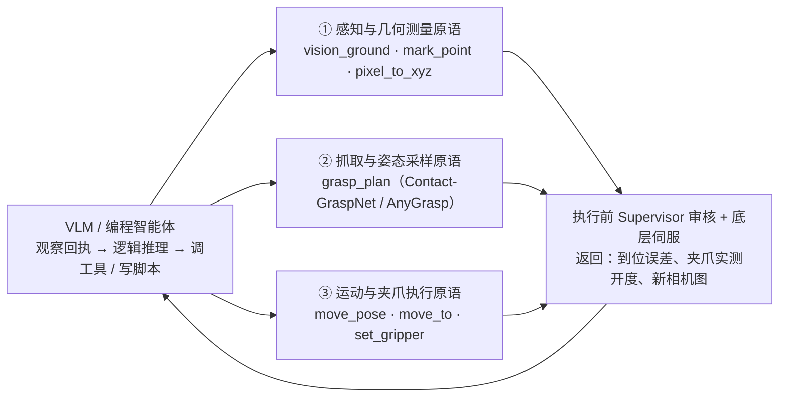

# 路线三：调用动作原语库或编写控制代码（Primitives & Code-as-Policies）

!!! abstract "要点"
    在机器人工程里，针孔深度反投影、点云抓取姿态采样、逆运动学与局部比例伺服本来就有成熟可靠的确定性算法，没必要让语言模型凭肉眼心算。

    第三类控制方式把这些成熟模块事先封装成一套结构化 API（**机器人脚手架 / Harness**），让 VLM 退回到它最擅长的角色——**工具调用智能体（Tool-Use Agent）或编程智能体（Coding Agent）**。模型每一轮要么发出一条 JSON 工具调用，要么写一段 Python 脚本把感知查询、坐标换算与多个运动原语串起来执行，读完环境返回的测量回执与新画面后再决定下一步。

## 0. 原语库（Harness）到底替模型包办了什么

一套典型的机器人原语库通常横跨三层（本站实测过的具体工具清单见 [Agent4Robot：接口与工具箱](../agent4robot/interfaces.md)）：



- **感知测量工具**把“看图猜米数”变成“挑像素查表”：模型只需指出目标在图上的大致区域或像素，工具用深度图与标定矩阵算出精确到毫米的世界坐标（并检查边缘深度跳变）。
- **运动执行原语**把“一步走 2 cm 连发 20 次”变成“闭环走到路点 $(x, y, z, \text{yaw})$”：原语内部以 20–100 Hz 跑伺服控制，走完后如实汇报 `reached: False, position_error_m: 0.038, gripper_opening_m: 0.001`（例如夹爪开度接近 0 说明抓空了，停在 0.04 m 说明夹住了物体）。

在这套分工下，自早期开环的 Code as Policies[^cap] 以来，目前演化出**零样本工具/技能演化**、**多轮纠错轨迹 SFT** 与 **SFT + 在线 RL / 多教师蒸馏**三条子路线。

---

## 1. 零样本工具循环与自进化代码库（Zero-Shot）

不修改基础模型权重，完全靠接口工程、代码执行粒度设计与外部技能库迭代来释放现成大模型的操作能力。

### 1.1 单步 ReAct 工具调用：每走一步都看回执与审核

模型遵循标准的 `观察 → 思考 → 调用 1 个工具 → 读结构化回执` 循环：

- **ORA（Open Robot-Use Agents，UCSD Hao AI Lab）**[^ora]：围绕“零 VLA、零机器人训练”设计了约 20 个精细原语，涵盖分割定位（`vision_ground` / `vision_segment`）、带深度连续性校验的三维标点（`mark_point`）、平行夹爪抓取候选生成（`grasp_plan`）、轨迹预览（`preview_move`）与受控位姿执行（`move_pose`），并在运行时做两件关键事：一是**上下文缓存管理**控制多轮多图开销，二是所有改变物理状态的动作都必须经过信任边界后的 **Supervisor** 做工作空间、过期观测与自碰撞审核。凭借这套严密脚手架，开源轻量模型 **DeepSeek-V4.1-Flash** 在零样本下于抗记忆扰动基准 LIBERO-Pro 上拿到 **81.4%** 成功率（651/800 回合）。
- 同类面向感知增强与紧凑智能体的工具脚手架还包括 **Robo-Harness K1**[^k1]（将三维点云锚点、空间测距与抓取评估统一暴露为可调用感知工具）和 **Guava**[^guava]（设计通用操作工具脚手架，支持将闭源前沿模型含扰动恢复分支的轨迹蒸馏进 4B 端侧模型），以及早期在真实家庭做零样本开放词汇抓放的 **OK-Robot**[^okrobot]。

### 1.2 多步 Python 脚本编排：用一段代码摊薄通信与 Token 开销

单步 ReAct 每移一次手爪、每开合一次夹爪都要把多张高清图重发给大模型思考几千个 Token，一个长任务动辄调用五六十次。改进做法是**让模型单轮直接写一段短 Python 脚本，把数学换算与一串连续原语打包执行**：

```python
# 模型单轮生成的典型短脚本：测坐标 → 算偏移 → 预抓取 → 下降闭合 → 抬起校验
p_handle = robo.pixel_to_xyz("agentview", u=120, v=160)
robo.move_to(p_handle.x, p_handle.y, p_handle.z + 0.10, yaw_deg=90)
res = robo.move_to(p_handle.x, p_handle.y, p_handle.z, yaw_deg=90)
robo.set_gripper("close")
lift = robo.move_to(p_handle.x, p_handle.y, p_handle.z + 0.15, yaw_deg=90)
print("lifted opening:", lift.gripper_opening_m)   # 返回给下一轮模型判断是否抓稳
```

- **CaP-X**[^capx] 构建了横跨 robosuite、LIBERO-PRO 与 BEHAVIOR 的 39 任务基准 CaP-Gym，系统证明：**人工提供的感知与控制原语抽象度越高，代码智能体成功率越高**，一旦剥离高层原语性能便逐级下滑；同时对比前后帧视觉差异与多轮闭环重编排远优于早期 Code as Policies[^cap] 那种“从头到尾一段脚本盲跑到底”的开环写法（ALRM[^alrm] 与 URAI[^urai] 同样验证了“按阶段调工具看反馈”比“一次性写完整回合长程序”成功率高出一倍以上）。
- **PyRUA-Lean**[^pyrua] 则通过交互式代码单元 `python(code)` 允许模型在脚本内部直接写局部重试循环和按需拍照，在 LIBERO-PRO、RoboTwin 2.0 等四个基准上比逐工具调用**提升 14% 成功率，同时减少 65% 的 Token 消耗**（若面对高公差装配，**GenCHiP**[^genchip] 还进一步在代码原语里加入刚度与接触力终止条件）。

### 1.3 免改权重的自进化技能与脚手架库

如果某个复杂动作（比如“拉开带卡扣的微波炉门”或“双臂配合扶稳瓶子拧盖”）模型第一次写脚本失败了，下次遇到同类任务还要从头踩坑吗？**ASPIRE**[^aspire]、**SHAPER**[^shaper] 与 **EvoTER**[^evoter] 在**完全冻结大模型权重**的前提下，把学习过程搬进了外部代码库：

1. **执行并捕获细粒度失败现场**：当代码执行失败时，系统不只返回一个 `False`，而是把碰撞发生时刻的画面、抓取候选点叠加图、末端轨迹偏差与异常栈打包成多模态失败档案。
2. **自动诊断与代码修订**：在 **ASPIRE**[^aspire] 中，智能体对比预期效果与实际物理后果，定位是“接近角度撞门框”还是“抓取深度太浅”，自动修改或新建一个参数化 Python 技能函数（如 `open_hinged_door(handle_pt, hinge_axis)`）；**SHAPER**[^shaper] 更进一步，不仅改技能函数代码，还同时演化**脚手架自身的上下文拼接与状态摘要代码**；**EvoTER**[^evoter] 则拆成“探索者—诊断者—验证者”三角色流水线，只有通过独立验证回合测试的新工具才准许写入持久技能库（仿真成功率从 53.6% 升至 80.4%）。

---

## 2. 多轮智能体代码交互轨迹 SFT（Agentic Trajectory SFT）

### 为什么要做这件事

上面第 1 节在 GPT-6 Astra、Claude 等闭源旗舰模型上表现惊艳，但一旦换成中小尺寸开源 VLM（7B–35B）零样本直接写机器人控制代码，成功率常常跌到 **0%–5%**：常见症状包括编造不存在的函数参数、搞反世界坐标系正负号，尤其致命的是**抓空之后不知道怎么改**——第二轮把一模一样的错误代码再原样发一遍，直到耗尽回合步数。

### RoboUniverse-10K 是怎么一步步训练的

**RoboUniverse-10K**[^robouniverse] 把软件工程里训 Coding Agent（如 SWE-bench 轨迹微调）的范式完整搬到了物理机器人上：

1. **从真实视频自动扩建万级可交互物理环境**：用自动化 Real-to-Sim 管线从真实场景重建三维资产与物理参数，在 Isaac Sim 中生成了 **10,807 个可重置、带自动成功判定的交互式操作环境**，彻底解决了代码智能体缺少多样化练习场的问题。
2. **收集含真实报错与试探恢复的多轮教师轨迹**：让闭源强模型（GPT-6 Astra）在这些环境里真实闭环跑任务，保留完整的 **`写代码 → 执行报错 / 抓空回执 / 新相机图 → 分析原因改写代码 → 最终成功`** 多轮会话，清洗筛选出约 **1.7 万条成功多轮交互轨迹**。
3. **只监督模型回合的多轮 SFT**：冻结视觉编码器（防止过拟合仿真贴图纹理），在 **Qwen3.6-35B-A3B**（MoE 架构，激活参数仅 3B）上做多轮对话 SFT，对仿真器返回的 stdout 文本与图像全部打上 loss mask，只在模型输出的思考与代码 Token 上算交叉熵。

训练后，单臂抓取放置成功率从 **0% 直接拉升至 62.2%**（单臂全任务均分从 2.0% 升至 40.5%，逼近教师模型）。更重要的是，模型从多轮轨迹中学到了人类没有硬编码的**主动物理试探行为**：面对高度不确定的桌面物体时，模型会先写一段短距离下探代码轻触表面测准真实高度，再写代码把目标区域局部裁剪放大看清边缘，最后才下压闭合夹爪。

---

## 3. SFT 冷启动 → 多轮强化学习 / 多教师在线蒸馏（SFT + RL / OPD）

### 到底在解决什么新矛盾

离线轨迹 SFT 有两个天然天花板：第一，存在**暴露偏差**——一旦学生模型自己写出的某一步代码把物体碰歪到了教师轨迹没去过的位置，后面就接不上了；第二，不同机器人基准往往各自配了一套互不兼容的原语库和专精教师，怎么把各家之长合进同一个轻量学生模型里？

### 两条代表性后训练管线

1. **SFT 冷启动 + 多轮在线强化学习（AgenticRoboRL，CaP-X 模式）**[^agenticroborl]
   - **第一阶段（语法与原语破冰 SFT）**：先用强教师在 CaP-X 原语库上的成功代码轨迹对 **9B 开源 VLM** 做轻量 SFT，解决 API 拼写和基础坐标换算问题，确保模型在仿真器里至少能写出可运行代码并偶尔拿到正奖励。
   - **第二阶段（多轮在线 RL）**：通过轻量脚手架适配器接入并行仿真环境，完全不设人工过程奖励，只用回合结束时仿真器的 `0 / 1` 任务成败作为唯一奖励信号做多轮在线策略梯度更新。这迫使模型在自己的失误现场学会补救，将 9B 开源模型在 LIBERO-PRO 上的 CaP-X 代码控制成功率从 **2.7% 提升至 28.5%**。

2. **跨领域 SFT + 多教师在线逆 KL 蒸馏（Robo-MOPD）**[^robomopd]
   假设手头有多个冻结的领域专精教师 $\{\pi^{T_1}, \pi^{T_2}, \dots\}$（例如一个擅长单臂精细原语，另一个擅长 RoboCasa365 家庭复合长程任务），它们使用的工具脚手架互不相同，且长程任务有几十步交互，只靠回合末 1 个成败奖励做在线 RL 归因极慢。Robo-MOPD 分两步走：
   - **跨领域混合 SFT 初始化**：先把各教师轨迹混合做一轮基础 SFT，得到一个能在所有脚手架里合法调用工具的统一初始学生 $\pi_\theta$，保证后续在线采样不会全是语法报错。
   - **学生自己闭环采样 + 专精教师逐 Token 逆 KL 纠偏（On-Policy Distillation）**：训练时，让学生模型 $\pi_\theta$ **亲自在仿真器里多轮执行**；在学生走到的每一个真实状态 $s_t$ 上，请该任务对应的专精教师 $\pi^{T_d}$ 计算下一 Token 的概率分布，最小化学生对教师的**反向 KL 散度** $\mathrm{KL}(\pi_\theta(\cdot \mid s_t) \,\|\, \pi^{T_d}(\cdot \mid s_t))$（数学推导见 [从 SFT 到 Agentic RL](../rl/sft-to-agentic-rl.md)）。
   - **为什么在长程任务上比多域在线 RL 高出 13 个百分点**：因为采样状态来自学生自己，彻底消除了离线 SFT 的暴露偏差；而监督信号又是教师在每个动作 Token 上给出的稠密对数概率差（而不只是 30 步之后的一个 0 或 1），哪一行代码参数写偏了当场就能收到精确梯度纠正。

---

## 小结：原语与代码路线的核心边界

- **为什么它在扰动基准上极稳**：无论是 LIBERO-Pro 换物体颜色还是挪桌面位置，只要 `vision_ground` 和 `pixel_to_xyz` 在当前帧现测三维坐标，代码算出来的抓取位姿天然跟着物体走，完全不存在端到端 VLA“背诵固定轨迹”的问题。
- **它的天花板在哪**：**原语的边界就是智能体的边界**。如果人工写的 `move_to` 只支持夹爪竖直朝下，遇到侧面拉开的抽屉把手模型怎么写代码也拉不开（见本站 [LIBERO 实测失败分析](../agent4robot/case-study.md#5-失败案例都在说明什么)）；如果任务是揉软面团或擦拭曲面，没有哪个现成几何原语能打包这种高频连续接触。要打破原语锁死，要么往下彻底剥离原语（见[路线四](native-stack.md)），要么把底层原语换成学习出来的神经网络策略（见[路线五](dual-system.md)）。

## 参考文献

[^cap]: J. Liang, W. Huang, F. Xia et al. *Code as Policies: Language Model Programs for Embodied Control*. ICRA 2023. [arXiv:2209.07753](https://arxiv.org/abs/2209.07753)
[^ora]: Y. Yang, S. Chen, Z. Wang, J. Gao, H. Zhang. *ORA: Open Robot-Use Agents*. Hao AI Lab (UC San Diego), CoRL 2026 LBR. <https://fastrua.ai/ora/> · [GitHub](https://github.com/fast-rua/ORA)
[^k1]: Z. Li, Y. Zhang, W. Li et al. *Robo-Harness K1: Harnessing Robot-Use Agents via Perception Augmentation*. 2026. [arXiv:2609.29389](https://arxiv.org/abs/2609.29389)
[^guava]: H. Liu, X. Li, S. Yao et al. *Guava: Distilling Frontier VLMs into a Compact Agent through a Robotic Manipulation Harness*. 2026. [arXiv:2606.18363](https://arxiv.org/abs/2606.18363)
[^okrobot]: P. Liu, Y. Orru, J. Vakil, C. Paxton, N. M. M. Shafiullah, L. Pinto. *OK-Robot: What Really Matters in Integrating Open-Knowledge Models for Robotics*. RSS 2024. [arXiv:2401.12202](https://arxiv.org/abs/2401.12202)
[^capx]: M. Fu et al. *CaP-X: A Framework for Benchmarking and Improving Coding Agents for Robot Manipulation*. ICML 2026. [arXiv:2603.22435](https://arxiv.org/abs/2603.22435)
[^alrm]: V. Gaboardi dos Santos, I. Khadraoui, I. Farhat et al. *ALRM: Agentic LLM for Robotic Manipulation*. 2026. [arXiv:2601.19510](https://arxiv.org/abs/2601.19510)
[^urai]: S. Ge, A. Zhou, J. Zeng et al. *Make Code as Policy Great Again: Frontier Agents Write, Call, and Evolve Robot Tools* (URAI). 2026. [arXiv:2609.39018](https://arxiv.org/abs/2609.39018)
[^pyrua]: R. Si, J. Bi, S. Yang et al. *Fewer Tokens, Better Action: GPT-6 Astra Robot Agents with 14% Higher Success Rate but 65% Fewer Tokens* (PyRUA-Lean). 2026. [arXiv:2610.01939](https://arxiv.org/abs/2610.01939)
[^genchip]: K. Burns, A. Jain, K. Go, F. Xia, M. Stark, S. Schaal, K. Hausman. *GenCHiP: Generating Robot Policy Code for High-Precision and Contact-Rich Manipulation Tasks*. IROS 2024. [arXiv:2404.06645](https://arxiv.org/abs/2404.06645)
[^aspire]: R. Lu, Y. Wu, E. Kou et al. *ASPIRE: Agentic /Skills Discovery for Robotics*. NVIDIA GEAR Lab et al., 2026. [arXiv:2607.00272](https://arxiv.org/abs/2607.00272)
[^shaper]: P. Wang, Z. Ma, Y. Chang et al. *Self-Evolving Embodied Agents via Skill-Harness Evolution* (SHAPER). 2026. [arXiv:2608.11350](https://arxiv.org/abs/2608.11350)
[^evoter]: Y. Zhou, Y. Zhou, Y. Wang, H. Li, D. Zhao. *EvoTER: Evolving Embodied Agents via Tool-Use Experience and Reflection*. 2026. [arXiv:2611.27797](https://arxiv.org/abs/2611.27797)
[^robouniverse]: J. Liu, Y. Wang, S. Wang et al. *RoboUniverse-10K: Toward the Scaling Era of Agentic Robotics via Real-to-Sim Environments*. 2026. [arXiv:2611.31002](https://arxiv.org/abs/2611.31002)
[^agenticroborl]: X. Liu, B. Xu, W. Bao, M. Li, W. Bao, C. Chen, Y. Shang. *AgenticRoboRL: Bringing Coding-Agent Post-Training to Agentic Robotics*. 2026. [arXiv:2610.28589](https://arxiv.org/abs/2610.28589)
[^robomopd]: X. Liu, A. Dao, W. Bao et al. *Generalizing Agentic Robotics via Multi-Teacher On-Policy Distillation* (Robo-MOPD). 2026. [arXiv:2611.30997](https://arxiv.org/abs/2611.30997)
