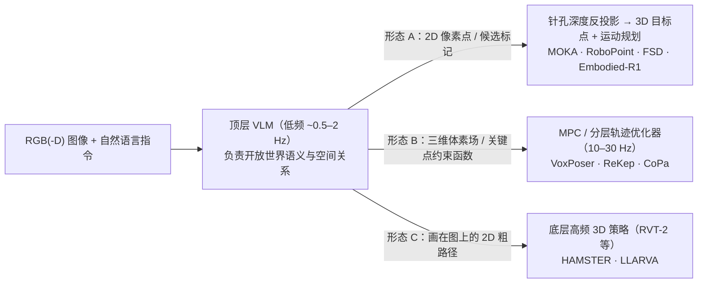

# 路线二：输出空间关键点、2D 轨迹与几何约束（Spatial Keypoints & 2D Paths）

!!! abstract "要点"
    VLM 在海量互联网图文数据上预训练出来，天生擅长**二维图像上的语义定位与部件关系理解**（知道哪一团像素是“壶嘴”、哪一块桌面是“盘子左前方的空位”），但不擅长高频求解三维刚体运动学与无碰撞光滑轨迹。

    第二类控制方式顺着这一能力边界做**显式解耦**：顶层 VLM 只在二维像素平面或三维关键点层给出**目标落点、2D 粗略路径或几何约束方程**；底层则交给深度反投影、模型预测控制（MPC）轨迹优化器，或只在小规模机器人数据上训练过的轻量 3D 策略（如 RVT-2）以 10–30 Hz 高频闭环执行。



---

## 1. 零样本空间可供性与三维约束生成（Zero-Shot）

### 到底在做什么

在不微调任何模型的前提下，怎么把“把茶壶里的水倒进马克杯，别碰到旁边的笔记本电脑”变成平滑的 6-DoF 机械臂轨迹？这一组方法按**几何表达能力从轻到重**分成三步演进：选关键点、写三维势场、写非线性关系约束方程。

### 四个代表工作的具体机制

1. **MOKA（网格选点 + 深度反投影）**[^moka]
   直接让早期 VLM 报 `(u=138, v=162)` 像素坐标常有几十像素偏差。MOKA 先用开放词汇检测与 SAM 分割出场景里的物体，在物体轮廓上均匀采样一批带数字标号的**候选关键点**，同时把整张图打上带行列字母编号的网格（比如 `A1`–`E5`），再把叠加好标记的图喂给 VLM。
   - **VLM 输出什么**：只需做选择题——“抓取点选物体上的 `p3`，提起后的中间路点选网格 `B2`，放置目标选网格 `D4`，接触前手爪沿 `p3 -> p1` 方向接近”。
   - **底层怎么接管**：利用深度相机在所选像素处的深度值做标准针孔反投影（推导见 [Agent4Robot：pixel_to_xyz](../agent4robot/interfaces.md#5-pixel_to_xyz-到底怎么算)），把二维选择直接还原成三维世界坐标路点交给底层控制器执行。

2. **VoxPoser（代码合成三维体素价值图 + 在线避障规划）**[^voxposer]
   只给几个稀疏点，机械臂不知道中间该离旁边的易碎花瓶多远。VoxPoser 把工作空间离散化成 $W \times H \times D$ 的三维体素网格，让大模型写几行简短的 NumPy 代码去填两张三维地图：**可供性吸引图（Affordance Map）**和**避障排斥图（Avoidance Map）**。
   - **VLM 输出什么**：例如对“把抽屉轻轻推上，离花瓶远点”，模型生成代码：调用开放词汇检测拿到把手三维中心 $\mathbf{c}_{\text{handle}}$ 和花瓶中心 $\mathbf{c}_{\text{vase}}$，令吸引场在把手处取极小代价，令花瓶周围 $15\,\mathrm{cm}$ 球域内取高排斥代价，再指定夹爪闭合状态与速度权重。
   - **底层怎么接管**：底层的零阶采样规划器 / MPC 在这张组合三维代价图 $V(\mathbf{x}) \in \R$ 上实时搜索低代价路径；更关键的是，物体检测器在执行过程中以高频持续刷新 $\mathbf{c}_{\text{handle}}$ 的位置——哪怕人类中途伸手把抽屉往外拉了一下，三维价值图会自动跟着平移，底层 MPC 立即在线修正轨迹，无需重新请求大模型。

3. **ReKep（三维关键点非线性关系约束 + 10–30 Hz 实时轨迹优化）**[^rekep]
   体素网格默认把夹爪当成一个三维质点 $(x,y,z)$，很难精确表达**六自由度旋转对齐**（比如倒水时壶嘴与杯口对齐、壶身倾斜 $60^\circ$，或者双臂协同把折叠衣袖翻过来）。ReKep 用 DINOv2 + SAM 从画面提取一组语义三维关键点 $\{\mathbf{k}_1, \dots, \mathbf{k}_K\} \subset \R^3$ 并用点跟踪器实时追踪，让 VLM 直接编写关于这些关键点的 **Python 非线性代价函数**：
   - **VLM 输出什么**：把任务拆成若干阶段，为每一阶段写两类约束函数——**子目标约束** $f_{\text{sub}}(\mathbf{T}_{\text{ee}}, \mathbf{k})$（这一阶段结束时手爪或被抓物体关键点要到哪）和**路径约束** $f_{\text{path}}(\mathbf{T}_{\text{ee}}, \mathbf{k})$（移动全过程必须保持什么姿态，比如“端着满水杯移动时，杯口法向与世界 $+z$ 轴点积必须接近 1 以防洒出”）：
     ```python
     def stage2_path_constraint(end_effector, keypoints):
         cup_axis = keypoints[2] - keypoints[1]          # 杯底指向杯口的向量
         cup_axis = cup_axis / np.linalg.norm(cup_axis)
         return 1.0 - np.dot(cup_axis, np.array([0, 0, 1]))  # 惩罚倾斜（要求 = 0）
     ```
   - **底层怎么接管**：假设刚性抓取后物体关键点随手爪刚体变换 $\mathbf{T}_{\text{ee}} \in \mathrm{SE}(3)$ 一起运动，底层非线性优化器在每个控制周期求解：

     $$
     \min_{\mathbf{T}_{1:H} \in \mathrm{SE}(3)^H} \; f_{\text{sub}}(\mathbf{T}_H, \mathbf{k}) + \sum_{t=1}^{H} \Big( f_{\text{path}}(\mathbf{T}_t, \mathbf{k}) + c_{\text{coll}}(\mathbf{T}_t) + c_{\text{smooth}}(\mathbf{T}_t, \mathbf{T}_{t-1}) \Big)
     $$

     因为关键点是纯三维几何量，优化器能以 **10–30 Hz** 闭环重算整条 6-DoF 轨迹；一旦检测到物体从手里滑脱（某阶段前置约束违反），系统自动退回上一阶段重抓。

4. **CoPa（功能部件粗到细定位 + 部件空间几何约束）**[^copa]
   与 ReKep 互补，专门解决日常工具“抓哪儿”与“怎么用”的问题（如用锤子敲钉子必须抓锤柄、让锤头平面垂直对准钉帽）。它先用粗到细分割找到物体的抓取部件与作用部件，再由 VLM 提出部件轴线、法平面之间的共线或垂直约束，求解出 6-DoF 目标位姿。

---

## 2. 跨领域 2D 视觉轨迹与像素可供性 SFT

### 到底在做什么

零样本方法依赖闭源强模型和多步视觉预处理（SAM + 点跟踪 + 优化器）。能不能训一个开源 VLM，看一眼单张 RGB 图就百发百中地指出目标像素或画出整条运动轨迹？

更重要的是：**训练一个预测 2D 像素点/路径的 VLM，根本不需要昂贵的真机遥操作动作数据**！人类指指点点的问答数据、仿真里低成本合成的空间关系渲染图、甚至无动作标注的视频光流轨迹，全都可以拿来做 SFT 训练集。

### 三个代表工作的具体机制

1. **HAMSTER（顶层 13B VLM 画 2D 粗路径 → 底层轻量 3D 策略 RVT-2 闭环执行）**[^hamster]
   这是把“语义大脑”与“三维小脑”在二维图像平面上做干净切分的代表作：
   - **顶层 VLM 怎么训、输出什么**：收集大量廉价的跨领域视觉数据（仿真轨迹重投影、人类操作视频光流轨迹、空间指点问答，无需与目标真机同构），对 **VILA-1.5-13B** 做 SFT。推理时，模型看当前单张 RGB 图与语言指令，输出一串归一化的二维像素路点与夹爪开合状态，例如 `[(0.52, 0.64, OPEN), (0.50, 0.71, CLOSE), (0.28, 0.55, CLOSE), (0.28, 0.60, OPEN)]`。
   - **高低层怎么拼接**：系统用 Ramer–Douglas–Peucker 算法简化这条折线，**按时间进度渐变涂色，把折线和夹爪开合圆点直接画在原始 RGB 图像上**，然后把这张“画好路线草图的图像”连同深度点云喂给底层高频 3D 策略 **RVT-2**[^rvt2]（一种基于多视角虚拟相机重投影与粗到细局部放大的 3D Transformer 策略，只需几十条真机示范就能学会毫米级三维抓取）。
   - **为什么泛化比端到端 VLA 高出约 20 个百分点**：在端到端 OpenVLA[^openvla] 里，同一套权重既要认出没见过的卡通贴纸和英文指令，又要输出精确到毫米的三维位移，换个背景桌布或换台机械臂就会同时崩盘；而在 HAMSTER 里，底层 RVT-2 根本不看自然语言文字，它的任务退化成了纯粹的三维几何题——**“跟着画面上画好的彩色线条去抓那个三维凸起物”**，一切开放世界语义理解、常识推理和抗背景干扰都由顶层 13B VLM 扛下，换机械臂时也只需重训极轻量的底层 3D 策略，顶层 13B VLM 原封不动直接复用。

2. **RoboPoint 与 FSD（空间关系可供性像素坐标 SFT）**[^robopoint][^fsd]
   针对“把碗放到红盘子左前方的空位上”或“抓马克杯最右侧的把手边缘”这类精细空间关系指令：
   - **RoboPoint**[^robopoint] 用程序化三维场景生成器合成了上百万条“空间关系描述 → 满足几何条件的可操作像素点集”图文问答数据，与通用 VQA 数据混合微调开源 VLM，使其直接输出一组落在目标区域内的 2D 像素坐标 $[(u_1,v_1), \dots]$，再经标定深度图反投影为机械臂三维导航/放置目标点。
   - **FSD（From Seeing to Doing）**[^fsd] 进一步发现直接从图像跳到像素点仍容易在复杂遮挡关系下指错，于是构造了**面向空间关系的视觉思维链（SrCoT）**做多阶段 SFT：要求模型先框出参考物体、显式推理相对方位关系，再同时预测可供性点、可供性框与 2D 视觉运动轨迹，并在推理时通过多次采样的空间自一致性投票过滤离群点。

3. **LLARVA（2D 视觉轨迹与数值动作联合自回归 SFT）**[^llarva]
   如果不想额外部署一个底层 RVT-2，只想训一个单模型怎么办？LLARVA 把 Open X-Embodiment 跨本体数据集里的机械臂末端三维轨迹投影回各自相机平面，生成了 **850 万对“图像—未来 2D 末端像素轨迹”**做大规模指令预训练。下游微调时，模型对每一帧**先自回归写出末端接下来在画面上的 2D 像素坐标序列（充当跨本体的视觉思维桥梁），紧接着再写出 7-DoF 连续动作增量**。因为所有机器人在图像上看起来都是“一个夹爪沿着像素曲线移向目标”，先预测 2D 轨迹大幅加速了少量真机示范下的策略收敛。同类思路在多模态智能体基座 **Magma**[^magma] 中也被推广为 Set-of-Mark（可操作点）与 Trace-of-Mark（未来运动点轨迹）联合预训练。

---

## 3. 空间关键点与指认的强化学习（Spatial Grounding RL）

### 到底在做什么

前面 RoboPoint、HAMSTER 用的是离线交叉熵 SFT。但在空间指认任务里，有一个性质被纯 SFT 浪费了：**“点指得对不对”不是只有唯一标准答案字符串，而是一个连续、可直接计算的几何集合判定**！比如桌面上有一大片空位都能放盘子，SFT 强迫模型去拟合标注员随手点的那唯一一个像素 $(182, 144)$，报出旁边同样合法的 $(185, 140)$ 也会吃交叉熵惩罚。

2025–2026 年的具身推理工作顺势引入**可验证几何奖励强化学习（RLVR / GRPO）**：让模型先输出空间推理链，再输出像素点或 2D 轨迹，直接按几何命中程度打连续分 $r \in [0, 1]$ 更新策略。

### 代表工作怎么设计几何奖励

- **Embodied-R1**[^embodied-r1]：把抓取可供性点、空闲放置点、物体移动起止轨迹全部统一成二维图像上的 **Pointing（指点）** 表征，对 3B 开源 VLM 做两阶段 GRPO 强化微调。奖励函数直接由几何规则算分：对于区域可供性指点，只要预测像素 $(u, v)$ 落在真值分割掩码 $\mathcal{M}$ 内部即得满分，落在外部则按到掩码边界的距离衰减；对于 2D 轨迹预测，则计算预测折线与参考轨迹的离散 Fréchet 距离与终点误差。训好的 3B 模型不碰任何机器人动作数据，直接外挂深度反投影与传统运动规划器，就在真机和仿真多场景零样本操作上大幅超越同尺寸 SFT 模型。
- **RoboRefer**[^roborefer]：针对桌面杂物堆叠、同类物体遮挡（如“最靠后那个白杯子右边的勺子”）的三维指代难题，先在带独立深度编码器的 VLM 上做空间理解 SFT，再引入**度量敏感的强化微调（Metric-Sensitive RFT）**——用反投影后的真实三维米制欧氏距离误差构造连续奖励，倒逼模型真正读懂深度图里的前后遮挡关系。同类结合多阶段 SFT 与空间 RL 微调的通用具身底座还有 **RoboBrain 2.0**[^robobrain2] 与 **Cosmos-Reason1**[^cosmos-reason1]。

---

## 小结：第二条路线的得与失

- **最大红利是“数据脱敏”与“跨本体复用”**：顶层 VLM 输出的是与机械臂动力学无关的像素点、2D 曲线或三维关键点几何关系，因此可以直接吃互联网图文、人类视频与廉价合成图像；底层无论是工业六轴臂配传统规划器，还是实验室七轴臂配 RVT-2，顶层模型都不必重训。
- **固有短板在哪**：第一，高度依赖外部深度相机与手眼标定（深度图在透明玻璃杯、反光金属锅边缘一旦跳变，反投影就会算出偏离二十几厘米的错点）；第二，无论是 2D 粗路径还是三维关键点约束，描述的仍然是**纯运动学轨迹**——当遇到插钥匙、拧紧瓶盖、揉面团这类需要实时感知指尖接触力矩高频微调姿态的任务时，单靠视觉关键点跟踪往往力不从心。

## 参考文献

[^moka]: F. Liu, K. Fang, P. Abbeel, S. Levine. *MOKA: Open-World Robotic Manipulation through Mark-Based Visual Prompting*. RSS 2024. [arXiv:2403.03174](https://arxiv.org/abs/2403.03174)
[^voxposer]: W. Huang, C. Wang, R. Zhang, Y. Li, J. Wu, L. Fei-Fei. *VoxPoser: Composable 3D Value Maps for Robotic Manipulation with Language Models*. CoRL 2023. [arXiv:2307.05973](https://arxiv.org/abs/2307.05973)
[^rekep]: W. Huang, C. Wang, Y. Li, R. Zhang, L. Fei-Fei. *ReKep: Spatio-Temporal Reasoning of Relational Keypoint Constraints for Robotic Manipulation*. CoRL 2024. [arXiv:2409.01652](https://arxiv.org/abs/2409.01652)
[^copa]: H. Huang, F. Lin, Y. Hu, S. Wang, Y. Gao. *CoPa: General Robotic Manipulation through Spatial Constraints of Parts with Foundation Models*. IROS 2024. [arXiv:2403.08248](https://arxiv.org/abs/2403.08248)
[^hamster]: Y. Li, Y. Deng, J. Zhang et al. *HAMSTER: Hierarchical Action Models for Open-World Robot Manipulation*. ICLR 2025. [arXiv:2502.05485](https://arxiv.org/abs/2502.05485)
[^rvt2]: A. Goyal, V. Blukis, J. Xu, Y. Guo, Y.-W. Chao, D. Fox. *RVT-2: Learning Precise Manipulation from Few Demonstrations*. RSS 2024. [arXiv:2406.08545](https://arxiv.org/abs/2406.08545)
[^openvla]: M. J. Kim, K. Pertsch, S. Karamcheti et al. *OpenVLA: An Open-Source Vision-Language-Action Model*. CoRL 2024. [arXiv:2406.09246](https://arxiv.org/abs/2406.09246)
[^robopoint]: W. Yuan, J. Duan, V. Blukis et al. *RoboPoint: A Vision-Language Model for Spatial Affordance Prediction for Robotics*. CoRL 2024. [arXiv:2406.10721](https://arxiv.org/abs/2406.10721)
[^fsd]: Y. Yuan, H. Cui, Y. Chen et al. *From Seeing to Doing: Bridging Reasoning and Decision for Robotic Manipulation* (FSD). ICLR 2026. [arXiv:2505.08548](https://arxiv.org/abs/2505.08548)
[^llarva]: D. Niu, Y. Sharma, G. Biamby et al. *LLARVA: Vision-Action Instruction Tuning Enhances Robot Learning*. CoRL 2024. [arXiv:2406.11815](https://arxiv.org/abs/2406.11815)
[^magma]: J. Yang, R. Tan, Q. Wu et al. *Magma: A Foundation Model for Multimodal AI Agents*. CVPR 2025. [arXiv:2502.13130](https://arxiv.org/abs/2502.13130)
[^embodied-r1]: Y. Yuan, H. Cui, Y. Huang et al. *Embodied-R1: Reinforced Embodied Reasoning for General Robotic Manipulation*. ICLR 2026. [arXiv:2508.13998](https://arxiv.org/abs/2508.13998)
[^roborefer]: E. Zhou, J. An, C. Chi et al. *RoboRefer: Towards Spatial Referring with Reasoning in Vision-Language Models for Robotics*. NeurIPS 2025. [arXiv:2506.04308](https://arxiv.org/abs/2506.04308)
[^robobrain2]: BAAI RoboBrain Team. *RoboBrain 2.0 Technical Report*. 2025. [arXiv:2507.02029](https://arxiv.org/abs/2507.02029)
[^cosmos-reason1]: A. Azzolini, H. Brandon, J. Bai et al. (NVIDIA). *Cosmos-Reason1: From Physical Common Sense To Embodied Reasoning*. 2025. [arXiv:2503.15558](https://arxiv.org/abs/2503.15558)
