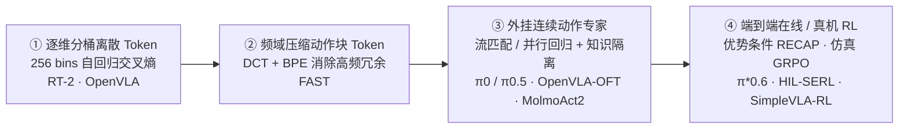
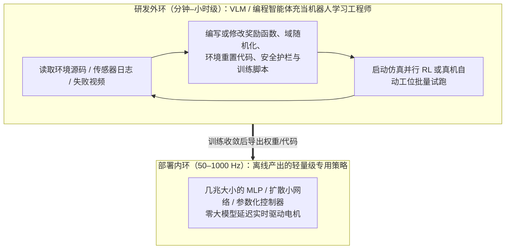

# 路线六：谱系两端的参照——端到端高频 VLA 与环外策略工程

!!! abstract "要点"
    前面[路线一](direct-pose.md)至[路线五](dual-system.md)无论怎么变，VLM 在部署期都保留着某种“在线交互智能体或分层大脑”的身份。为了看清这套分类谱系的完整边界，必须对照位于谱系最右端和最左端的两条参照路线：

    - **谱系下端（6.1 端到端高频 VLA）**：彻底取消实时工具调用与符号推理循环，用大规模遥操作数据（及后续强化学习）把 VLM 本身改造成 **10–100 Hz 闭环电机控制器**；
    - **谱系上端（6.2 环外自动化策略工程）**：彻底把大模型请出机器人的实时运行环，让它充当**自动化机器人学习工程师**——自主编写奖励函数、环境重置逻辑与训练代码，离线产出一个极快的小型专用策略部署上机。

---

## 1. 谱系下端：将 VLM 改造为端到端高频 VLA（SFT、知识隔离与 RL）

端到端 VLA（Vision-Language-Action）的目标非常纯粹：输入多视角图像 $\mathbf{o}_t$、语言指令 $\ell$ 和本体关节状态 $\mathbf{q}_t$，神经网络一次前向直接输出未来 $H$ 步的高频连续控制量 $\mathbf{A}_t = (\mathbf{a}_t, \dots, \mathbf{a}_{t+H-1})$，交由底层伺服以 10–100 Hz 执行。围绕“怎么让原本输出离散文字的语言模型吐出高精度连续控制量”，经历了四步演化：

### 1.1 离散动作词表派：怎么把浮点数塞进语言模型词表？

- **逐维分桶量化（RT-2、OpenVLA）**[^rt2][^openvla]：完全不改 VLM 的网络结构，把末端位姿增量每一维的连续取值范围（归一化到 $[-1, 1]$）均匀或按分位数切成 **256 个桶**，直接借用语言模型词表里使用频率最低的最后 256 个词作为动作 Token（例如 `<bin_000>` 到 `<bin_255>`）。一步 7 维动作就变成一串长度为 7 的“外语单词”，与图文问答数据用完全相同的自回归交叉熵损失训练。
- **为什么高频动作块下逐维分桶会失灵，以及 FAST 怎么修**[^fast]：当任务从慢速桌面抓放变成 50 Hz 双臂灵巧操作（比如 1 秒钟 50 步 × 14 维 = **700 个连续动作数值**）时，相邻两毫秒的关节变化几乎一样——逐维分桶会产生几百个高度重复的相邻 Token，既把自回归解码拖慢十倍，又让模型只学会无脑复制前一个 Token。Physical Intelligence 提出的 **FAST**[^fast] 换了一个信号处理视角：先把 $H \times D$ 的一段连续动作曲线做**离散余弦变换（DCT）**转到频域（光滑机械臂轨迹的能量高度集中在少数几个低频系数上），对频域系数做量化后再用字节对编码（**BPE**）压缩成短短几十个频域动作 Token，使自回归 VLA 在高频灵巧任务上的训练速度提升达 **5 倍**。

### 1.2 连续动作专家派：流匹配与并行解码怎么工作？

离散分桶终究有量化精度损失，且逐 Token 串行解码慢。第二派保留预训练 VLM 处理图像与文字，但在旁边外挂或并行引出一个专门输出连续浮点动作块的**动作专家（Action Expert）**：

- **流匹配（Flow Matching）动作专家（$\pi_0$ / $\pi_{0.5}$）**[^pi0][^pi05]：在 VLM 骨干旁边并排挂一个参数量更小的 Transformer（动作专家），两者通过自注意力共享每一层的 KV 缓存。训练时，把真实动作块 $\mathbf{A}_t \in \R^{H \times D}$ 与高斯噪声 $\boldsymbol{\epsilon} \sim \mathcal{N}(0, I)$ 按插值时间 $\tau \in [0, 1]$ 混合成带噪动作 $\mathbf{A}_t^\tau = \tau \mathbf{A}_t + (1 - \tau)\boldsymbol{\epsilon}$，让动作专家拟合速度场损失：

  $$
  \mathcal{L}_{\text{FM}}(\theta) = \mathbb{E}_{\tau, \boldsymbol{\epsilon}} \Big\| v_\theta(\mathbf{A}_t^\tau, \tau \mid \mathbf{o}_t, \ell) - (\mathbf{A}_t - \boldsymbol{\epsilon}) \Big\|_2^2
  $$

  推理时，VLM 只对当前图像和指令算一次前向缓存好 KV，动作专家从纯高斯噪声出发跑 **10 步欧拉积分**（每次积分只跑轻量动作专家），就能在几十毫秒内生成一段长达 50 步、极其平滑且支持多模态分布（比如绕开障碍既可走左也可走右）的 50 Hz 连续动作轨迹。
- **并行解码与 $L_1$ 连续回归（OpenVLA-OFT）**[^openvla-oft]：证明即便不引流匹配扩散过程，只要把 OpenVLA 原来的逐 Token 因果自回归改成**双向注意力一次并行解码整块动作**，并把离散交叉熵换成连续 MLP 动作头的 **$L_1$ 回归损失**，动作生成吞吐量即可直接暴涨 **26 倍**，LIBERO 平均成功率从 76.5% 跃升至 97.1%。
- **两阶段离散—连续协同微调（MolmoAct2）**[^molmoact2]：AllenAI 在具身推理基座 `Molmo2-ER` 上系统验证了怎么把推理骨干与流匹配动作专家拼在一起最稳——第一阶段先利用离散动作分词器 `OpenFAST` 与空间视觉轨迹数据让 VLM 骨干学会空间动作推理；第二阶段接入通过逐层 KV 缓存读取 VLM 表征的流匹配连续动作专家，并**配合小学习率的 VLM LoRA 端到端协同微调**（消融证明：若第二阶段死死冻住 VLM 只训动作头，复杂接触精度受限；若大步长全量放开 VLM，则会冲垮预训练表征），最终在单次基础推理约 **180 ms** 下实现高可靠双臂真机部署。

### 1.3 纯离线 VLA 的两大顽疾：场景过拟合与“动作—推理冲突”

端到端行为克隆 SFT 虽然局部手感极佳，但有两个结构性软肋：

1. **场景记忆过拟合**：模型拥有几十亿参数，面对几百条同桌面示范轨迹，最省力的拟合方式是记住背景光影与初始像素位置对应的开环动作序列，而不是理解语言指令——这也是为什么 $\pi_{0.5}$ 在原版 LIBERO 上高达 96.85%，换到带位置与物体替换扰动的 LIBERO-PRO 上便跌至约 21%[^liberopro]。
2. **连续动作梯度退化通用推理**：随机初始化的连续流匹配动作头在训练初期会产生大幅度噪声梯度，一旦直接回传进预训练 VLM 骨干，会迅速抹平语言模型原有的语义与逻辑表征：
   - **Knowledge Insulating VLA（知识隔离）**[^ki-vla] 给出了极干净的工程解：在注意力图上直接对“连续动作专家流向 VLM 骨干”的梯度做 **`stop_gradient`（梯度截断）**！VLM 骨干只接收离散 FAST 动作 Token 和图文问答的交叉熵梯度来塑造空间语义表征，连续动作专家则单向读取 VLM 的 KV 特征去拟合高精度流匹配速度场，训练更快且泛化显著提升。
   - **DualVLA**[^dualvla] 则指出了双向退化现象：先训专精动作会损伤通用推理，而事后为了补救推理把多模态思维链数据混回来微调时，冗长发散的推理链又会反过来干扰底层动作生成（导致**动作退化**）。作者通过双层数据裁剪（剔除与当前物理动作无关的冗余推理句）配合“通用推理教师 + 专精动作教师”自适应蒸馏化解这一矛盾（同类解耦探索还有用 MoE 路由隔离问答与控制的 **ChatVLA**[^chatvla]，以及单模型内按需切换显式思考与直出动作的 **OneTwoVLA**[^onetwovla]）。

### 1.4 端到端 VLA 怎么做强化学习（突破示范天花板）

离线模仿永远学不会“怎么从演示者没犯过的错误里爬出来”。2025–2026 年，端到端 VLA 正式迈入强化学习阶段，按动作头类型分成两条技术路径：

- **针对流匹配 VLA 的真机优势条件强化学习（$\pi^*_{0.6}$ / RECAP 与 HIL-SERL）**[^pi06][^hil-serl]：
  流匹配策略通过 10 步微分方程积分生成连续动作，**算不出精确的动作对数概率 $\log \pi_\theta(\mathbf{A}_t \mid \mathbf{o}_t)$**，没法直接套用大模型常用的 PPO 或 GRPO 比率裁剪公式！Physical Intelligence 在 **$\pi^*_{0.6}$**[^pi06] 中提出了 **RECAP**（基于经验与人工纠偏的优势条件策略强化学习）：
  1. 先让基础 VLA 在真机上自主跑大量回合，同时允许人类操作员在快要出错时随时介入接管纠偏（继承自真机高样本效率强化学习框架 **HIL-SERL**[^hil-serl]）；
  2. 用这些混合轨迹训练一个分布式价值网络 $V_\phi(\mathbf{o}_t, \ell)$ 预测“离任务成功还有多少步”，算出每一步的优势值 $A_t$；
  3. 把连续优势值按分位数二值化为文本/条件标签 $I_t = \mathbb{1}[A_t > \epsilon_\ell]$（即标出哪些动作片段是“好于平均水平”的，哪些是“差于平均水平”的），然后**原封不动沿用稳定的流匹配监督损失** $\mathcal{L}_{\text{FM}}\big(v_\theta(\mathbf{A}_t^\tau, \tau \mid \mathbf{o}_t, \ell, I_t)\big)$ 重训 VLA；
  4. 部署上机时，只需固定喂入条件 $I_t = \text{positive}$（类似扩散模型的 Classifier-Free Guidance），就能让意式咖啡制作、叠各色衣物、折纸盒等长程富接触真机任务的**失败率直接减半、作业吞吐量翻倍**。
- **针对离散 / OFT VLA 的仿真在线 RL 与偏好对齐**：当动作输出可以求似然或采样探索时，**SimpleVLA-RL**[^simplevla-rl] 在并行仿真器中仅凭 `0 / 1` 回合结果奖励对 OpenVLA-OFT 做大规模在线 GRPO，显著提升长程与分布外泛化；**VLA-RL**[^vla-rl] 引入 VLM 过程奖励模型配合在线 PPO；**RLVLA**[^rlvla] 与 **iRe-VLA**[^ire-vla]（在线探索与监督回放交替防崩溃）、**FLaRe**[^flare-rl] 及轨迹级偏好对齐 **GRAPE**[^grape] 也各自验证了 RL 对执行鲁棒性的大幅增益。

---

## 2. 谱系上端：环外自动化策略工程（Out-of-Loop Policy Engineering）

现在看谱系的另一个极端：如果任务要求 **500 Hz 力矩级实时响应**（比如五指灵巧手转笔、四足机器人在瑜伽球上走、工业产线高速插针），任何十亿参数的大模型放进实时控制环都会嫌慢。

**环外策略工程**的做法是彻底切开“研发期（外环）”与“运行期（内环）”：

### 2.1 仿真环外：自动写奖励函数、域随机化与三维训练场

在强化学习里，最耗费人类博士生精力的往往不是改 PPO 算法本身，而是**调稠密奖励函数的十几项权重**和**调 Sim-to-Real 域随机化范围**：

- **Eureka**[^eureka]（及同期 **Text2Reward**[^text2reward]）：把仿真环境的原始物理状态源码直接喂给编码大模型，让它一次写出 16 个候选 Python 奖励函数 `compute_reward()`，在 Isaac Gym GPU 仿真器里并行跑完 16 组强化学习，再把每组训练过程中各个奖励分项的变化曲线和最终任务得分拼成文字反馈喂回大模型，迭代进化数轮。完全无需人类调参，Eureka 生成的奖励函数在 83% 的基准任务上超越人类专家手写的奖励，甚至教会了五指灵巧手连续高速转笔。
- **DrEureka**[^dreureka]：把这套进化闭环从“写奖励”扩展到“写物理域随机化配置”——先根据仿真策略的刚度与摩擦敏感度探测安全区间，再由大模型生成质量、摩擦系数、电机延迟与外力扰动的随机化分布代码，使仿真训出的四足策略零样本直接在真实草地乃至充气瑜伽球上稳健行走。
- **RoboGen**[^robogen] 与 **GenSim / GenSim2**[^gensim2]：连仿真任务场景本身也交由大模型环外生成——自动构思新技能、调用三维资产库拼装带铰链关节的家具场景、自己判断该子任务适合调运动规划还是调强化学习求解器，批量产出合成示范轨迹去蒸馏端侧策略。

### 2.2 真机环外：无人值守物理工位上的策略自改进与全栈评测

仿真总有物理失真（比如塑料扎带的剪切断裂力学或紧配合插销的真实卡阻很难精确仿真）。能不能让编程智能体**直接在真实物理机器人旁边通宵改代码做实验**？

- **ENPIRE（真机智能体策略自改进，NVIDIA GEAR / CMU / Berkeley）**[^enpire]：把一整套无人值守真机研发流水线拆成四个闭环模块：
  1. **环境模块（Environment）**：由智能体协助设计物理/程序化**自动重置流程**并用 VLM 看相机画面核验“道具是不是已经摆回原位了”，省去人工捡零件；
  2. **策略改进模块（Policy Improvement）**：编码智能体自主决定采用启发式控制律、行为克隆还是残差强化学习，直接编写控制代码、数据增广逻辑与硬件安全限幅护栏；
  3. **真机运行模块（Rollout）**：在真实机械臂工位上批量执行当前版本的策略，自动收集关节力矩、末端轨迹日志与多视角录像；
  4. **演化模块（Evolution）**：编码智能体阅读上一轮失败录像和异常日志，定位物理卡点（例如“插销下压前偏心 1.5 mm 导致卡边，需增加螺旋搜索阶段”），在 Git 分支树上提交新版代码继续实验。
  靠这套环外自治循环，机器人在无人干预下把高精度插销整理、剪断扎带、推块对准等真机任务自主迭代至最高 **99% 成功率**。
- **RLE-Bench（机器人学习工程师资格评测，Harvard & Georgia Tech）**[^rle-bench]：将这种“环外研发能力”正式确立为独立评测维度——不再考模型单步出什么动作，而是给通用编码智能体一个容器化工作区、有限 GPU 算力和时间预算，横跨**交互控制、策略学习、感知状态估计、机械机构设计**四大真实工程工作流（共 48 道标准化工程题），考察它能不能像人类机器人工程师一样读懂物理问题、写代码调试并交出达标系统。

---

## 小结：两条端点参照路线告诉我们什么

把 6.1（端到端 VLA）和 6.2（环外策略工程）放回全景版图，可以清楚看到它们与中间五类智能体路线的互补关系：

- 当你有**海量跨任务遥操作数据**、追求像人手一样连贯的通用高频接触反应时，往 **6.1（端到端 VLA + 真机 RL）** 走；
- 当你要攻克某几个**极高精度或超高频工业/灵巧难题**、有可自动重置的仿真或真机工位、且部署端算力极其受限时，往 **6.2（环外策略工程）** 走；
- 而在开放多变、需要零样本/少样本快速适应新指令与新工具、且必须兼顾可解释安全把关的日常通用场景中，中间五类**保持显式结构或快慢双系统的控制路线**（特别是路线三的代码原语与路线五的 VLM + VLA 双系统）依然是当前性价比与可靠性最高的甜点区。

## 参考文献

[^rt2]: A. Brohan, N. Brown, J. Carbajal et al. *RT-2: Vision-Language-Action Models Transfer Web Knowledge to Robotic Control*. CoRL 2023. [arXiv:2307.15818](https://arxiv.org/abs/2307.15818)
[^openvla]: M. J. Kim, K. Pertsch, S. Karamcheti et al. *OpenVLA: An Open-Source Vision-Language-Action Model*. CoRL 2024. [arXiv:2406.09246](https://arxiv.org/abs/2406.09246)
[^fast]: K. Pertsch, K. Stachowicz, B. Ichter et al. *FAST: Efficient Action Tokenization for Vision-Language-Action Models*. RSS 2025. [arXiv:2501.09747](https://arxiv.org/abs/2501.09747)
[^pi0]: K. Black, N. Brown, D. Driess et al. *$\pi_0$: A Vision-Language-Action Flow Model for General Robot Control*. RSS 2025. [arXiv:2410.24164](https://arxiv.org/abs/2410.24164)
[^pi05]: Physical Intelligence. *$\pi_{0.5}$: a Vision-Language-Action Model with Open-World Generalization*. 2025. [arXiv:2504.16054](https://arxiv.org/abs/2504.16054)
[^openvla-oft]: M. J. Kim, C. Finn, P. Liang. *Fine-Tuning Vision-Language-Action Models: Optimizing Speed and Success* (OpenVLA-OFT). RSS 2025. [arXiv:2502.19645](https://arxiv.org/abs/2502.19645)
[^molmoact2]: H. Fang, J. Duan, D. Clay et al. *MolmoAct2: Action Reasoning Models for Real-world Deployment*. Allen Institute for AI (Ai2), 2026. [arXiv:2605.02881](https://arxiv.org/abs/2605.02881)
[^liberopro]: X. Zhou et al. *LIBERO-PRO: Towards Robust and Fair Evaluation of Vision-Language-Action Models Beyond Memorization*. 2025. [arXiv:2510.03827](https://arxiv.org/abs/2510.03827)
[^ki-vla]: D. Driess, J. T. Springenberg, B. Ichter et al. *Knowledge Insulating Vision-Language-Action Models: Train Fast, Run Fast, Generalize Better*. NeurIPS 2025. [arXiv:2505.23705](https://arxiv.org/abs/2505.23705)
[^dualvla]: Z. Fang, Z. Liu, J. Liu et al. *DualVLA: Building a Generalizable Embodied Agent via Partial Decoupling of Reasoning and Action*. 2025. [arXiv:2511.22134](https://arxiv.org/abs/2511.22134)
[^chatvla]: Z. Zhou, Y. Zhu, M. Zhu et al. *ChatVLA: Unified Multimodal Understanding and Robot Control with Vision-Language-Action Model*. EMNLP 2025. [arXiv:2502.14420](https://arxiv.org/abs/2502.14420)
[^onetwovla]: F. Lin, R. Nai, Y. Hu, J. You, J. Zhao, Y. Gao. *OneTwoVLA: A Unified Vision-Language-Action Model with Adaptive Reasoning*. 2025. [arXiv:2505.11917](https://arxiv.org/abs/2505.11917)
[^pi06]: Physical Intelligence. *$\pi^*_{0.6}$: a VLA That Learns From Experience*. 2025. [arXiv:2511.14759](https://arxiv.org/abs/2511.14759)
[^hil-serl]: J. Luo, C. Xu, J. Wu, S. Levine. *Precise and Dexterous Robotic Manipulation via Human-in-the-Loop Reinforcement Learning* (HIL-SERL). ICRA 2025. [arXiv:2410.21845](https://arxiv.org/abs/2410.21845)
[^simplevla-rl]: H. Li, Y. Zuo, J. Yu et al. *SimpleVLA-RL: Scaling VLA Training via Reinforcement Learning*. 2025. [arXiv:2509.09674](https://arxiv.org/abs/2509.09674)
[^vla-rl]: G. Lu, W. Guo, C. Zhang et al. *VLA-RL: Towards Masterful and General Robotic Manipulation with Scalable Reinforcement Learning*. 2025. [arXiv:2505.18719](https://arxiv.org/abs/2505.18719)
[^rlvla]: J. Liu, F. Gao, B. Wei et al. *What Can RL Bring to VLA Generalization? An Empirical Study*. NeurIPS 2025. [arXiv:2505.19789](https://arxiv.org/abs/2505.19789)
[^ire-vla]: Y. Guo, J. Zhang, X. Chen et al. *Improving Vision-Language-Action Model with Online Reinforcement Learning* (iRe-VLA). ICRA 2025. [arXiv:2501.16664](https://arxiv.org/abs/2501.16664)
[^flare-rl]: J. Hu, R. Hendrix, A. Farhadi et al. *FLaRe: Achieving Masterful and Adaptive Robot Policies with Large-Scale Reinforcement Learning Fine-Tuning*. ICRA 2025. [arXiv:2409.16578](https://arxiv.org/abs/2409.16578)
[^grape]: Z. Zhang, K. Zheng, Z. Chen et al. *GRAPE: Generalizing Robot Policy via Preference Alignment*. ICRA 2025. [arXiv:2411.19309](https://arxiv.org/abs/2411.19309)
[^eureka]: Y. J. Ma, W. Liang, G. Wang et al. *Eureka: Human-Level Reward Design via Coding Large Language Models*. ICLR 2024. [arXiv:2310.12931](https://arxiv.org/abs/2310.12931)
[^text2reward]: T. Xie, S. Zhao, C. H. Wu et al. *Text2Reward: Reward Shaping with Language Models for Reinforcement Learning*. ICLR 2024. [arXiv:2309.11489](https://arxiv.org/abs/2309.11489)
[^dreureka]: Y. J. Ma, W. Liang, H.-J. Wang et al. *DrEureka: Language Model Guided Sim-To-Real Transfer*. RSS 2024. [arXiv:2406.01967](https://arxiv.org/abs/2406.01967)
[^robogen]: Y. Wang, Z. Xian, F. Chen et al. *RoboGen: Towards Unleashing Infinite Data for Automated Robot Learning via Generative Simulation*. ICML 2024. [arXiv:2311.01455](https://arxiv.org/abs/2311.01455)
[^gensim2]: P. Hua, M. Liu, A. Macaluso et al. *GenSim2: Scaling Robot Data Generation with Multi-modal and Reasoning LLMs*. CoRL 2024. [arXiv:2410.03645](https://arxiv.org/abs/2410.03645)（初版 GenSim 见 [arXiv:2310.01361](https://arxiv.org/abs/2310.01361)）
[^enpire]: W. Xiao, J. Xie, T. Zhang et al. *ENPIRE: Agentic Robot Policy Self-Improvement in the Real World*. CoRL 2026. [arXiv:2606.19980](https://arxiv.org/abs/2606.19980)
[^rle-bench]: H. Ma, C. Gao, R. Qiang, B. Dai, N. Li. *RLE-Bench: A Qualifying Exam for Coding Agents as Robot Learning Engineers*. 2026. [arXiv:2609.34210](https://arxiv.org/abs/2609.34210)
