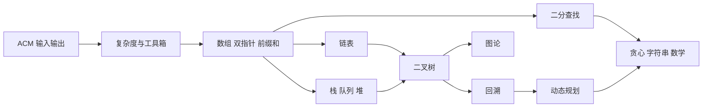

# 算法刷题

面向企业笔试和面试手撕代码的算法教程，全部用 Python。内容按题型组织，每类题型给出思路、模板和若干道例题，例题代码都经过测试。

企业的在线笔试大多用 **ACM 模式**：程序自己从标准输入读数据、向标准输出打印结果，平台按输出逐字比对。面试手撕和力扣用的是**核心代码模式**：只需实现给定签名的函数。两种模式的算法部分没有区别，差别全在输入输出上，所以第一章专门讲 ACM 模式的读写，后面各章的例题以核心代码模式为主，部分例题给出 ACM 写法。

## 学习路线

## 根据数据范围选算法

题目给出的数据范围，基本决定了允许的时间复杂度。评测机上 Python 每秒大约能执行 $10^7$ 次简单操作（C++ 约 $10^8 \sim 10^9$），按这个量级反推：

| $n$ 的范围 | 可接受的复杂度 | 常见算法 |
| --- | --- | --- |
| $n \le 10$ | $O(n!)$、$O(2^n \cdot n)$ | 全排列、暴力回溯 |
| $n \le 20$ | $O(2^n \cdot n)$ | 子集枚举、状态压缩 DP |
| $n \le 500$ | $O(n^3)$ | 区间 DP、Floyd |
| $n \le 5000$ | $O(n^2)$ | 二维 DP、枚举两端 |
| $n \le 10^5 \sim 10^6$ | $O(n \log n)$、$O(n)$ | 排序、二分、堆、双指针、单调栈、前缀和、并查集 |
| $n \le 10^9$ 或更大 | $O(\log n)$、$O(\sqrt n)$ | 二分答案、快速幂、数学公式 |

Python 比 C++ 慢一个数量级左右，处在边界上的题（例如 $n=10^5$ 的 $O(n\log^2 n)$、$n=5000$ 的 $O(n^2)$）要特别注意常数，具体技巧见 [ACM 模式](acm-io.md) 和 [工具箱](toolkit.md)。

## 全部章节

<!-- articles -->
