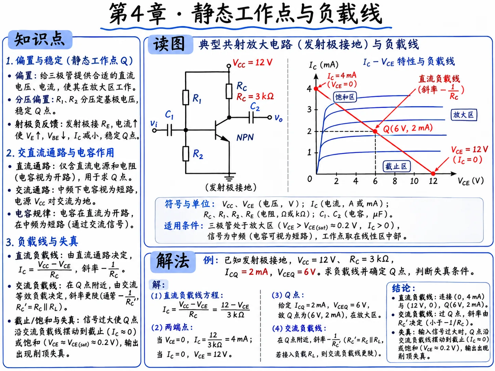
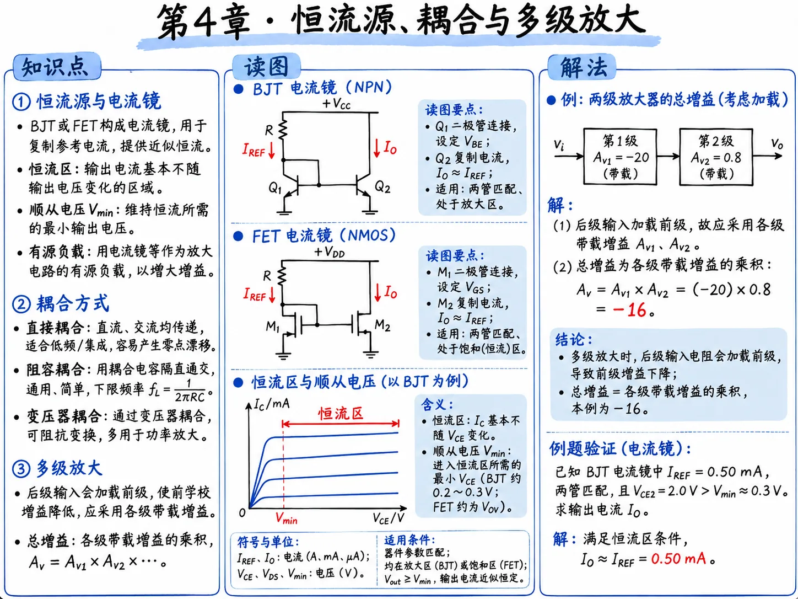
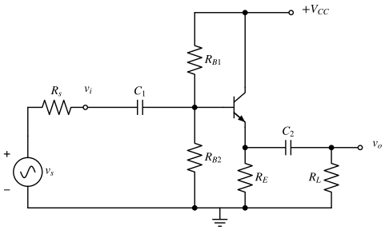

# 基本放大电路

!!! abstract "TL;DR"
    - 分析分两步：**直流通路**（电容开路）求 Q 点，**交流通路**（电容、直流电源短路）用小信号模型求 $A_v$、$R_i$、$R_o$。两步不能混用：Q 点里没有 $r_\pi$，小信号里没有 $0.7\,\mathrm V$。
    - 分压式偏置先把基极网络做**戴维南等效**：$V_{BB}=\dfrac{R_{B2}}{R_{B1}+R_{B2}}V_{CC}$，$R_{BB}=R_{B1}\parallel R_{B2}$；$R_E$ 引入直流负反馈，使 $I_C$ 几乎与 $\beta$ 无关。
    - 交流负载线过 Q 点、斜率 $-1/R_L'$（$R_L'=R_C\parallel R_L$）；最大不失真幅度 $U_{om}=\min\{V_{CEQ}-V_{CE(sat)},\ I_{CQ}R_L'\}$。
    - 三种组态：CE（CS）反相、高增益；CC（CD）增益约 1、$R_i$ 大 $R_o$ 小，作缓冲；CB（CG）同相、$R_i$ 很小、高频好。
    - 多级放大：$A_v=A_{v1}A_{v2}\cdots$，但每级增益都要**带上后级输入电阻**作负载来算。

??? info "本章图卡（AI 生成速览，错误见文末「图卡勘误」）"
    { loading=lazy }
    { loading=lazy }
    { loading=lazy }

晶体管本身的特性曲线与 hybrid-π 模型见 [双极型晶体管与场效应管](transistors.md)；放大器的 $A_v$、$R_i$、$R_o$ 模型与"源电压增益"的概念见 [信号与放大器](signals-amplifiers.md)。

## 1. 直流通路与交流通路

{ .circuit }

放大电路里同时存在直流（偏置）和交流（信号）两种量。在小信号、线性工作的前提下可以**叠加**：总量 $i_C=I_C+i_c$，分别在两张图上求。

| | 直流通路（求 Q 点） | 交流通路（求 $A_v$、$R_i$、$R_o$） |
| --- | --- | --- |
| 耦合电容 $C_1$、$C_2$，旁路电容 $C_E$ | 开路 | 短路（中频） |
| 直流电源 $V_{CC}$ | 保留 | 短路（交流地） |
| 信号源 $v_s$ | 置零 | 保留 |
| 晶体管 | $V_{BE}=0.7\,\mathrm V$，$I_C=\beta I_B$ | 小信号模型 $r_\pi$、$g_m$ |

耦合电容"隔直通交"：直流时把信号源、负载与偏置电路隔开，使 Q 点不受它们影响；中频时容抗可忽略。旁路电容 $C_E$ 只把 $R_E$ 在交流时短路掉，直流时 $R_E$ 仍在。电容在低频时不再能当短路，这引出 [频率响应](frequency-response.md) 中的下限频率 $f_L$。

## 2. 静态工作点：分压式偏置

### 2.1 戴维南化简与 Q 点公式

{ .circuit }

断开基极，从基极向左看 $R_{B1}$、$R_{B2}$ 组成的分压网络，用 [戴维南定理](../notes/circuit-theorems.md) 化成一个电压源串电阻：

$$
V_{BB}=\frac{R_{B2}}{R_{B1}+R_{B2}}V_{CC},\qquad R_{BB}=R_{B1}\parallel R_{B2}.
$$

对"$V_{BB}\to R_{BB}\to$ 发射结 $\to R_E\to$ 地"列 KVL，利用 $I_E=(1+\beta)I_B$：

$$
I_{BQ}=\frac{V_{BB}-V_{BE}}{R_{BB}+(1+\beta)R_E},\quad I_{CQ}=\beta I_{BQ},\quad V_{CEQ}=V_{CC}-I_{CQ}R_C-I_{EQ}R_E\approx V_{CC}-I_{CQ}(R_C+R_E).
$$

最后一定要**检查放大区**：$V_{CEQ}>V_{CE(sat)}$（取 $0.2\sim0.3\,\mathrm V$）。若算出 $V_{CEQ}<V_{CE(sat)}$，说明管子已饱和，$I_C=\beta I_B$ 不再成立，要改用 $V_{CE}=V_{CE(sat)}$ 重算。

**估算法**：若 $(1+\beta)R_E\gg R_{BB}$（工程上取 10 倍以上），基极电流对分压的影响可忽略，$V_B\approx V_{BB}$，

$$
I_{CQ}\approx I_{EQ}\approx\frac{V_{BB}-V_{BE}}{R_E}.
$$

这个结果里**没有 $\beta$**——这正是分压式偏置的价值。

### 2.2 为什么 $R_E$ 能稳定 Q 点

温度升高时 $\beta$ 增大、$V_{BE}$ 减小（约 $-2\,\mathrm{mV/^\circ C}$）、$I_{CBO}$ 增大，都使 $I_C$ 上升。有了 $R_E$ 且 $V_B$ 被分压网络基本固定：

$$
T\uparrow\ \to\ I_C\uparrow\ \to\ V_E=I_ER_E\uparrow\ \to\ V_{BE}=V_B-V_E\downarrow\ \to\ I_B\downarrow\ \to\ I_C\downarrow .
$$

这是**直流电流负反馈**（见 [负反馈放大电路](feedback.md)）。代价是 $R_E$ 在交流时也会降低增益，所以并联旁路电容 $C_E$：直流负反馈保留，交流负反馈去掉。没有 $R_E$ 的"射极接地 + 分压"电路，等效于 $V_{BB}$、$R_{BB}$ 的固定偏置，$I_C=\beta(V_{BB}-0.7)/R_{BB}$ 与 $\beta$ 成正比，**并不稳定**。

??? example "例 1：分压式偏置的 Q 点"
    图中 $V_{CC}=12\,\mathrm V$，$R_{B1}=40\,\mathrm{k\Omega}$，$R_{B2}=10\,\mathrm{k\Omega}$，$R_C=3\,\mathrm{k\Omega}$，$R_E=1\,\mathrm{k\Omega}$，$\beta=100$，$V_{BE}=0.7\,\mathrm V$。用精确法和估算法求 Q 点。

    1. 戴维南等效：$V_{BB}=12\times\dfrac{10}{50}=2.4\,\mathrm V$，$R_{BB}=40\parallel10=8\,\mathrm{k\Omega}$。
    2. 精确法：

        $$
        I_{BQ}=\frac{2.4-0.7}{8+101\times1}\,\mathrm{mA}=15.6\,\mathrm{\mu A},\quad I_{CQ}=1.56\,\mathrm{mA},\quad I_{EQ}=1.575\,\mathrm{mA},
        $$

        $$
        V_{CEQ}=12-1.56\times3-1.575\times1=5.75\,\mathrm V>V_{CE(sat)},\ \text{放大区}.
        $$

    3. 估算法：$I_{CQ}\approx\dfrac{2.4-0.7}{1}=1.7\,\mathrm{mA}$，$V_{CEQ}\approx12-1.7\times4=5.2\,\mathrm V$。

    估算偏大约 9%，因为这里 $(1+\beta)R_E/R_{BB}=101/8\approx12.6$，只是勉强满足"10 倍"。精度要求高时用精确法；判断管子是否在放大区、粗选元件时用估算法就够了。后面各例都用精确值 $I_{CQ}=1.56\,\mathrm{mA}$、$V_{CEQ}=5.75\,\mathrm V$。

## 3. 负载线与最大不失真幅度

{ .circuit }

**直流负载线**：输出回路的 KVL $v_{CE}=V_{CC}-i_C(R_C+R_E)$（$I_E\approx I_C$），在输出特性上是一条斜率 $-1/(R_C+R_E)$ 的直线，与 $i_B=I_{BQ}$ 那条曲线的交点就是 Q。射极接地的电路把 $R_C+R_E$ 换成 $R_C$。

**交流负载线**：加信号后，集电极交流电流流过 $R_C\parallel R_L$（$C_E$、$C_2$ 短路），$v_{ce}=-i_cR_L'$，所以动态工作点沿着一条**过 Q 点**、斜率 $-1/R_L'$ 的直线移动：

$$
v_{CE}-V_{CEQ}=-(i_C-I_{CQ})R_L',\qquad R_L'=R_C\parallel R_L .
$$

它与横轴交于 $V_{CEQ}+I_{CQ}R_L'$。$R_L'<R_C+R_E$，所以交流负载线比直流负载线陡；空载且 $R_E$ 被旁路时两者斜率分别是 $-1/R_C$ 和 $-1/(R_C+R_E)$，仍不重合。

**最大不失真输出幅度**：Q 点向左最多走到饱和（$v_{CE}=V_{CE(sat)}$），向右最多走到截止（$i_C=0$，对应 $v_{CE}=V_{CEQ}+I_{CQ}R_L'$）：

$$
U_{om}=\min\{\,V_{CEQ}-V_{CE(sat)},\ I_{CQ}R_L'\,\}.
$$

两者相等时摆幅最大，Q 点"在交流负载线中点"——注意不是直流负载线中点。

{ .circuit }

| 失真 | 原因 | NPN 共射输出 $v_o$ 的波形 | 改善 |
| --- | --- | --- | --- |
| 截止失真 | Q 点偏低（$I_{CQ}$ 小） | **顶部**削平 | 增大 $I_{CQ}$（减小 $R_{B1}$ 或 $R_E$） |
| 饱和失真 | Q 点偏高（$V_{CEQ}$ 小） | **底部**削平 | 减小 $I_{CQ}$ 或 $R_C$ |

$v_o$ 与 $i_c$ 反相：$i_C$ 在截止时底部被削（不能小于 0），反映到 $v_o$ 上是顶部被削。PNP 管电路的电压极性全反，结论正好相反。

??? example "例 2：图卡例题的负载线与摆幅（更正版）"
    射极接地的共射电路，$V_{CC}=12\,\mathrm V$，$R_C=3\,\mathrm{k\Omega}$，已调好 $I_{CQ}=2\,\mathrm{mA}$、$V_{CEQ}=6\,\mathrm V$，$V_{CE(sat)}=0.2\,\mathrm V$。（1）画直流负载线；（2）空载和接 $R_L=3\,\mathrm{k\Omega}$ 时的最大不失真幅度；（3）接负载时 $I_{CQ}$ 取多少摆幅最大？

    1. 直流负载线 $i_C=\dfrac{12-v_{CE}}{3}$：端点 $(0,\,4\,\mathrm{mA})$ 与 $(12\,\mathrm V,\,0)$；Q 点 $(6\,\mathrm V,\,2\,\mathrm{mA})$ 在线上（$12-2\times3=6$ ✓）。
    2. 空载：交流负载线与直流负载线重合（$R_L'=R_C$），$U_{om}=\min\{6-0.2,\ 2\times3\}=5.8\,\mathrm V$，受饱和限制。
    3. 接 $R_L$：$R_L'=3\parallel3=1.5\,\mathrm{k\Omega}$，交流负载线过 Q、交横轴于 $6+2\times1.5=9\,\mathrm V$，

        $$
        U_{om}=\min\{5.8,\ 2\times1.5\}=3\,\mathrm V,
        $$

        受**截止**限制：信号再大，$v_o$ 先在顶部削平。
    4. 令 $V_{CEQ}-0.2=I_{CQ}R_L'$，并且 $V_{CEQ}=12-3I_{CQ}$：$11.8-3I_{CQ}=1.5I_{CQ}$，$I_{CQ}=2.62\,\mathrm{mA}$，$V_{CEQ}=4.13\,\mathrm V$，此时 $U_{om}=3.93\,\mathrm V$。

??? example "例 3：例 1 电路的交流负载线"
    例 1 电路接 $R_L=6\,\mathrm{k\Omega}$，$C_E$ 旁路，$V_{CE(sat)}=0.2\,\mathrm V$，求最大不失真输出幅度。

    1. $R_L'=3\parallel6=2\,\mathrm{k\Omega}$；交流负载线交横轴于 $5.75+1.56\times2=8.87\,\mathrm V$（见上图）。
    2. 饱和限制 $5.75-0.2=5.55\,\mathrm V$，截止限制 $1.56\times2=3.12\,\mathrm V$。
    3. $U_{om}=3.12\,\mathrm V$（截止先出现）。要加大摆幅应把 Q 点上移（增大 $I_{CQ}$）。

## 4. 小信号模型与共射电路

### 4.1 hybrid-π 模型

在 Q 点附近把晶体管线性化（思路同 [非线性电阻的小信号分析](../extras/nonlinear.md)），中频、忽略 $r_o$ 与基区体电阻 $r_{bb'}$ 时：

$$
g_m=\frac{I_{CQ}}{V_T},\qquad r_\pi=\frac{\beta}{g_m}=\frac{\beta V_T}{I_{CQ}}\approx(1+\beta)\frac{V_T}{I_{EQ}} .
$$

教材常写 $r_{be}=r_{bb'}+(1+\beta)\dfrac{26\,\mathrm{mV}}{I_{EQ}}$，$r_{bb'}$ 给出时要加上（常取 $100\sim300\,\Omega$）；本文例题都取 $r_{bb'}=0$，于是 $r_{be}=r_\pi$。受控源 $g_mv_\pi$ 也可写成 $\beta i_b$，两者等价。

### 4.2 共射（CE）

{ .circuit }

$R_E$ 全部旁路时，射极交流接地，$v_\pi=v_i$：

$$
A_v=\frac{v_o}{v_i}=-g_mR_L'=-\frac{\beta R_L'}{r_\pi},\qquad R_i=R_B\parallel r_\pi,\qquad R_o=R_C ,
$$

其中 $R_B=R_{B1}\parallel R_{B2}$。$R_o$ 的求法：$v_s=0$ 时 $v_\pi=0$，受控电流源开路，从输出端看进去只剩 $R_C$（考虑 $r_o$ 时为 $R_C\parallel r_o$）。

{ .circuit }

$R_E$ 不旁路时，射极节点电压 $v_e=(1+\beta)i_bR_E$，从基极看进去的电阻变成 $r_\pi+(1+\beta)R_E$（**射极电阻折算到基极要乘 $1+\beta$**）：

$$
A_v=-\frac{\beta R_L'}{r_\pi+(1+\beta)R_E}\approx-\frac{R_L'}{R_E},\qquad R_i=R_B\parallel[\,r_\pi+(1+\beta)R_E\,],\qquad R_o=R_C .
$$

增益下降，但变得与 $\beta$、$I_{CQ}$ 几乎无关，$R_i$ 增大、线性范围变宽——这是交流电流串联负反馈的效果。折中做法是把 $R_E$ 分成两段，只旁路下面一段（练习 3）。

!!! warning "源电压增益"
    信号源有内阻 $R_s$ 时，实际关心的是 $A_{vs}=\dfrac{v_o}{v_s}=\dfrac{R_i}{R_s+R_i}A_v$。$R_i$ 小的电路（CE 旁路、CB）在高内阻信号源下会损失很多增益。

??? example "例 4：共射电路的 $A_v$、$R_i$、$R_o$（$R_E$ 旁路与不旁路）"
    例 1 电路，$R_L=6\,\mathrm{k\Omega}$，$R_s=1\,\mathrm{k\Omega}$，$V_T=26\,\mathrm{mV}$。分别求 $C_E$ 接入和断开时的 $A_v$、$R_i$、$R_o$、$A_{vs}$。

    1. 小信号参数：$g_m=\dfrac{1.56}{26}\,\mathrm S=60\,\mathrm{mS}$，$r_\pi=\dfrac{100}{60\,\mathrm{mS}}=1.667\,\mathrm{k\Omega}$；$R_B=8\,\mathrm{k\Omega}$，$R_L'=2\,\mathrm{k\Omega}$。
    2. **$C_E$ 接入**：

        $$
        A_v=-60\times2=-120,\quad R_i=8\parallel1.667=1.38\,\mathrm{k\Omega},\quad R_o=3\,\mathrm{k\Omega},
        $$

        $$
        A_{vs}=\frac{1.38}{1+1.38}\times(-120)=-69.6 .
        $$

    3. **$C_E$ 断开**（$R_E=1\,\mathrm{k\Omega}$ 进入交流通路）：

        $$
        A_v=-\frac{100\times2}{1.667+101\times1}=-1.95\ (\approx-R_L'/R_E=-2),\quad R_i=8\parallel102.7=7.42\,\mathrm{k\Omega},
        $$

        $R_o=3\,\mathrm{k\Omega}$，$A_{vs}=\dfrac{7.42}{8.42}\times(-1.95)=-1.72$。

    旁路电容使增益相差约 60 倍；但不旁路时增益几乎只由电阻比决定，换一只 $\beta=200$ 的管子 $A_v$ 也几乎不变。

## 5. 共集与共基

| 组态 | 输入 / 输出 / 公共端 | $A_v$ | $R_i$ | $R_o$ | 相位 |
| --- | --- | --- | --- | --- | --- |
| CE（$R_E$ 旁路） | b / c / e | $-g_mR_L'$ | $R_B\parallel r_\pi$ | $R_C$ | 反相 |
| CE（$R_E$ 不旁路） | b / c / e | $-\dfrac{\beta R_L'}{r_\pi+(1+\beta)R_E}$ | $R_B\parallel[r_\pi+(1+\beta)R_E]$ | $R_C$ | 反相 |
| CC（射极跟随器） | b / e / c | $\dfrac{(1+\beta)R_E'}{r_\pi+(1+\beta)R_E'}\lesssim1$ | $R_B\parallel[r_\pi+(1+\beta)R_E']$ | $R_E\parallel\dfrac{r_\pi+R_s\parallel R_B}{1+\beta}$ | 同相 |
| CB | e / c / b | $g_mR_L'$ | $R_E\parallel\dfrac{r_\pi}{1+\beta}\approx\dfrac1{g_m}$ | $R_C$ | 同相 |

表中 $R_E'=R_E\parallel R_L$，$R_L'=R_C\parallel R_L$。

{ .circuit }

**共集（射极跟随器）**：集电极交流接地，从射极输出。$v_o=v_i-v_\pi$ 总比 $v_i$ 略小，增益略小于 1 且同相，所以叫"跟随"。它的价值在于**阻抗变换**：输入端看 $R_E'$ 被放大 $1+\beta$ 倍，输出端看信号源内阻被缩小 $1+\beta$ 倍。常用作输入级（不拖累高内阻信号源）、输出级（带重负载）和中间缓冲级。注意 $R_o$ 与信号源内阻有关，$R_i$ 与负载有关——两端是"耦合"的。

{ .circuit }

**共基**：基极经 $C_B$ 交流接地，信号从射极进、集电极出。电压增益与 CE 同大但同相；电流增益 $\alpha\approx1$；输入电阻只有几十欧以下。它没有 CE 中跨接在输入、输出之间的 $C_\mu$ 米勒倍增，高频特性好（见 [频率响应](frequency-response.md#4-高频响应与米勒效应)），常与 CE 组成共射—共基（cascode）电路。

??? example "例 5：同一偏置下三种组态的对比"
    沿用例 1 的管子和偏置（$I_{CQ}=1.56\,\mathrm{mA}$，$g_m=60\,\mathrm{mS}$，$r_\pi=1.667\,\mathrm{k\Omega}$，$R_B=8\,\mathrm{k\Omega}$，$R_E=1\,\mathrm{k\Omega}$）。（1）改成射极跟随器：$R_C=0$，$R_L=1\,\mathrm{k\Omega}$，$R_s=1\,\mathrm{k\Omega}$；（2）改成共基：基极旁路，$R_C=3\,\mathrm{k\Omega}$，$R_L=6\,\mathrm{k\Omega}$，$R_s=50\,\Omega$。分别求 $A_v$、$R_i$、$R_o$。

    $I_{CQ}$ 由基极—射极回路决定，与 $R_C$ 无关，两种接法 Q 点电流不变；跟随器 $V_{CEQ}=12-1.575\times1=10.4\,\mathrm V$。

    **（1）共集**：$R_E'=1\parallel1=0.5\,\mathrm{k\Omega}$，$(1+\beta)R_E'=50.5\,\mathrm{k\Omega}$，

    $$
    A_v=\frac{50.5}{1.667+50.5}=0.968,\qquad R_i=8\parallel52.2=6.94\,\mathrm{k\Omega},
    $$

    $$
    R_o=1\,\mathrm{k\Omega}\parallel\frac{1.667+1\parallel8}{101}=1\,\mathrm{k\Omega}\parallel25.3\,\Omega=24.7\,\Omega .
    $$

    **（2）共基**：$R_L'=2\,\mathrm{k\Omega}$，

    $$
    A_v=g_mR_L'=120,\qquad R_i=1\,\mathrm{k\Omega}\parallel\frac{1667}{101}\,\Omega=16.2\,\Omega,\qquad R_o=3\,\mathrm{k\Omega},
    $$

    即使 $R_s$ 只有 $50\,\Omega$，$A_{vs}=\dfrac{16.2}{50+16.2}\times120=29.4$，也只剩 1/4。共基适合由电流源性质的信号（或前一级的集电极）驱动。

## 6. 场效应管放大电路：CS、CD、CG

{ .circuit }

FET 栅极几乎不取电流，偏置只需分压电阻定 $V_G$，再由源极电阻 $R_S$ 自给负反馈。增强型 NMOS 饱和区 $i_D=K_n(v_{GS}-V_{GS(th)})^2$，小信号 $g_m=2K_n(V_{GSQ}-V_{GS(th)})=2\sqrt{K_nI_{DQ}}$（忽略 $r_o$ 与衬底效应；$K_n$ 即 [晶体管](transistors.md) 一文中的 $K$；开启电压统一写成 $V_{GS(th)}$，以免与热电压 $V_T$ 混淆）。小信号模型就是 BJT 模型令 $r_\pi\to\infty$，所以公式可以直接对照：

| 组态 | $A_v$ | $R_i$ | $R_o$ | 对应 BJT |
| --- | --- | --- | --- | --- |
| CS（$R_S$ 旁路） | $-g_mR_D'$ | $R_{G1}\parallel R_{G2}$ | $R_D$ | CE |
| CS（$R_S$ 不旁路） | $-\dfrac{g_mR_D'}{1+g_mR_S}$ | $R_{G1}\parallel R_{G2}$ | $R_D$ | CE 带 $R_E$ |
| CD（源极跟随器） | $\dfrac{g_mR_S'}{1+g_mR_S'}$ | $R_{G1}\parallel R_{G2}$ | $R_S\parallel\dfrac1{g_m}$ | CC |
| CG | $g_mR_D'$ | $R_S\parallel\dfrac1{g_m}$ | $R_D$ | CB |

$R_D'=R_D\parallel R_L$，$R_S'=R_S\parallel R_L$。FET 的 $g_m$ 一般只有几 mS，比同电流的 BJT（$I_C/V_T$）小一个数量级，所以 CS 增益较低、CD 输出电阻较大（几百欧），但输入电阻可达兆欧。若在分压点与栅极之间串一个大电阻 $R_{G3}$，$R_i=R_{G3}+R_{G1}\parallel R_{G2}$，可进一步提高输入电阻而不改变偏置。

??? example "例 6：共源放大电路"
    $V_{DD}=12\,\mathrm V$，$R_{G1}=2\,\mathrm{M\Omega}$，$R_{G2}=1\,\mathrm{M\Omega}$，$R_S=1\,\mathrm{k\Omega}$，$R_D=5\,\mathrm{k\Omega}$，$R_L=5\,\mathrm{k\Omega}$；NMOS $K_n=1\,\mathrm{mA/V^2}$，$V_{GS(th)}=2\,\mathrm V$。求 Q 点，以及 $C_S$ 接入、断开时的 $A_v$。

    1. $V_G=12\times\dfrac13=4\,\mathrm V$；$V_{GS}=V_G-I_DR_S=4-I_D$（$I_D$ 以 mA 计）。
    2. 联立 $I_D=(V_{GS}-2)^2$：令 $x=V_{GS}-2$，$x+2=4-x^2$，$x^2+x-2=0$，$x=1$ 或 $x=-2$。$x=-2$ 对应 $V_{GS}<V_{GS(th)}$，管子截止，舍去。故 $V_{GSQ}=3\,\mathrm V$，$I_{DQ}=1\,\mathrm{mA}$。
    3. $V_{DSQ}=12-1\times(5+1)=6\,\mathrm V\ge V_{GS}-V_{GS(th)}=1\,\mathrm V$，在饱和区 ✓。
    4. $g_m=2\times1\times1=2\,\mathrm{mS}$，$R_D'=2.5\,\mathrm{k\Omega}$。$C_S$ 接入：$A_v=-2\times2.5=-5$；断开：$A_v=-\dfrac{5}{1+2\times1}=-1.67$。
    5. $R_i=2\parallel1=0.667\,\mathrm{M\Omega}$，$R_o=5\,\mathrm{k\Omega}$。

## 7. 电流源与电流镜

集成电路里大电阻、大电容难做，晶体管却很便宜，所以偏置和负载大量用**电流源**：交流电阻（输出电阻）很大、直流压降不大。

{ .circuit }

**基本电流镜**：$T_1$ 接成二极管（集电极连基极），两管 $V_{BE}$ 相同，匹配时 $I_{C1}=I_{C2}$。$T_1$ 集电极节点 KCL：$I_{REF}=I_{C}+2I_B=I_C(1+2/\beta)$，所以

$$
I_{REF}=\frac{V_{CC}-V_{BE}}{R},\qquad I_O=\frac{I_{REF}}{1+2/\beta}.
$$

两个误差来源：

- **基极电流**：$\beta=100$ 时 $I_O$ 比 $I_{REF}$ 小约 2%。加一只射极跟随器为两基极供电（"带缓冲的电流镜"），误差降到 $2/\beta^2$ 量级（练习 5）。
- **Early 效应**：$T_2$ 的 $V_{CE2}$ 通常大于 $T_1$ 的 $V_{CE1}=V_{BE}$，$I_O\approx\dfrac{I_{REF}}{1+2/\beta}\cdot\dfrac{1+V_{CE2}/V_A}{1+V_{BE}/V_A}$。电流源的输出电阻 $r_o=V_A/I_O$——这就是"恒流"的程度。

输出端要 $V_{CE2}$ 大于饱和压降（约 $0.2\sim0.3\,\mathrm V$，即顺从电压 $V_{min}$）才能恒流。MOS 电流镜同理：$I_O=I_{REF}\dfrac{(W/L)_2}{(W/L)_1}$，没有栅极电流误差，顺从电压是过驱动电压 $V_{GS}-V_{GS(th)}$。

{ .circuit }

**Widlar 电流源**：$T_2$ 射极串 $R_E$，两管 $V_{BE}$ 之差落在 $R_E$ 上。忽略基极电流，由 $I_C=I_Se^{V_{BE}/V_T}$：

$$
I_OR_E=V_{BE1}-V_{BE2}=V_T\ln\frac{I_{REF}}{I_O}.
$$

用不大的电阻就能得到微安级电流，且 $R_E$ 的负反馈使输出电阻比基本镜像高得多。

电流源用作放大管的集电极负载叫**有源负载**：直流压降小，交流电阻 $r_o$ 却有几十到几百千欧，单级增益可达数百至上千，在 [差分放大与集成运放](differential-opamp.md) 中会大量用到。

??? example "例 7：电流镜的误差与 Widlar 电阻（图卡例题更正）"
    （1）匹配电流镜 $I_{REF}=0.5\,\mathrm{mA}$，$\beta=100$，$V_{CE2}=2\,\mathrm V$，$V_A=100\,\mathrm V$，求 $I_O$ 及输出电阻；（2）$I_{REF}=1\,\mathrm{mA}$，要用 Widlar 电流源得到 $I_O=10\,\mathrm{\mu A}$，求 $R_E$。

    1. 只计基极电流：$I_O=\dfrac{0.5}{1+0.02}=0.490\,\mathrm{mA}$（图卡给 $0.50\,\mathrm{mA}$，忽略了 2% 的误差）。
    2. 再计 Early 效应：$I_O=0.490\times\dfrac{1+2/100}{1+0.7/100}=0.497\,\mathrm{mA}$。两个误差方向相反，这里恰好部分抵消。
    3. 输出电阻 $r_o=\dfrac{V_A}{I_O}=\dfrac{100}{0.49}\approx204\,\mathrm{k\Omega}$：$V_{CE2}$ 每变 $1\,\mathrm V$，$I_O$ 变约 $5\,\mathrm{\mu A}$。
    4. Widlar：$R_E=\dfrac{V_T}{I_O}\ln\dfrac{I_{REF}}{I_O}=\dfrac{26\,\mathrm{mV}}{10\,\mathrm{\mu A}}\ln100=11.97\,\mathrm{k\Omega}\approx12\,\mathrm{k\Omega}$。若用基本镜像得到 $10\,\mathrm{\mu A}$，$R$ 要约 $1.4\,\mathrm{M\Omega}$（$V_{CC}=15\,\mathrm V$）。

## 8. 耦合方式与多级放大

| 耦合方式 | 特点 | 应用 |
| --- | --- | --- |
| 阻容耦合 | 各级 Q 点独立、设计简单；不能放大直流和缓变信号，低频由 $f_L=\dfrac1{2\pi(R_{\text{前}}+R_{\text{后}})C}$ 限制，大电容无法集成 | 分立元件交流放大 |
| 直接耦合 | 能放大直流、易集成；各级 Q 点相互牵连，**零点漂移**（温漂）逐级放大，第一级最关键 | 集成运放（第一级用差分电路抑制漂移） |
| 变压器耦合 | 隔直、能做阻抗变换；笨重、频响差、不能集成 | 早期功放、射频 |
| 光电耦合 | 电气隔离 | 隔离放大、数字接口 |

阻容耦合公式中的 $R$ 是电容两端看出去的**全部串联电阻**：输入电容 $C_1$ 为 $R_s+R_i$，输出电容 $C_2$ 为 $R_o+R_L$。

**多级放大的增益**：把每一级看成"输入电阻 $R_{i}$ + 受控源 + 输出电阻 $R_{o}$"的放大器模型，则

$$
A_v=A_{v1}A_{v2}\cdots A_{vn},\qquad R_i=R_{i1},\qquad R_o=R_{on},
$$

其中**第 $k$ 级的负载是第 $k+1$ 级的输入电阻** $R_{i(k+1)}$，$A_{vk}$ 必须带着这个负载算。反过来，射极跟随器这类电路的 $R_o$ 又取决于前一级的输出电阻（作为它的信号源内阻）。分贝表示时总增益为各级 dB 数之和。

??? example "例 8：共射—共集两级放大"
    第一级为例 4 的共射电路（$C_E$ 接入，$R_C=3\,\mathrm{k\Omega}$），第二级为例 5（1）的射极跟随器，负载 $R_L=1\,\mathrm{k\Omega}$，两级阻容耦合。求总 $A_v$ 和输出电阻；并与第一级直接带 $1\,\mathrm{k\Omega}$ 负载比较。（图卡例题 $A_v=(-20)\times0.8=-16$ 是同一方法。）

    1. 第二级输入电阻（带 $1\,\mathrm{k\Omega}$ 负载）：$R_{i2}=6.94\,\mathrm{k\Omega}$，$A_{v2}=0.968$。
    2. 第一级的负载 $R_{L1}'=R_C\parallel R_{i2}=3\parallel6.94=2.09\,\mathrm{k\Omega}$，$A_{v1}=-60\times2.09=-125.6$。
    3. $A_v=A_{v1}A_{v2}=-125.6\times0.968=-121.6$。
    4. 第二级的信号源内阻是第一级 $R_o=R_C=3\,\mathrm{k\Omega}$：

        $$
        R_o=R_E\parallel\frac{r_\pi+R_C\parallel R_B}{1+\beta}=1\,\mathrm{k\Omega}\parallel\frac{1.667+3\parallel8}{101}\,\mathrm{k\Omega}=36.7\,\Omega .
        $$

    5. 不加跟随器、共射级直接带 $1\,\mathrm{k\Omega}$：$A_v=-60\times(3\parallel1)=-45$。

    跟随器本身没有电压增益，却把总增益从 $-45$ 提高到 $-122$——它把重负载与高 $R_o$ 的共射级隔开了。

## 练习

### 1. 概念判断 :material-star::material-star-outline::material-star-outline:

判断下列说法是否正确：

1. 分压式偏置电路去掉 $R_E$（射极直接接地）后，仍能稳定 Q 点。
2. 交流负载线一定比直流负载线陡。
3. NPN 共射电路输出波形底部被削平，是截止失真。
4. 射极跟随器的电压增益小于 1，所以它不能提高整个放大器的电压增益。
5. 计算多级放大器第一级的电压增益时，应该把第二级的输入电阻当作第一级的负载。

??? success "答案"
    1 ✗　2 ✗　3 ✗　4 ✗　5 ✓

??? note "解析"
    1. 没有 $R_E$ 就没有直流负反馈，$I_C=\beta(V_{BB}-0.7)/R_{BB}$ 随 $\beta$ 成比例变化。
    2. 交流负载线斜率 $-1/R_L'$，直流 $-1/(R_C+R_E)$。若 $R_E$ 未旁路，交流时 $c$—$e$ 回路的电阻是 $R_L'+R_E$；空载且 $R_E$ 不旁路时两者重合。"一般更陡"，但不是"一定"。
    3. $v_o$ 与 $i_c$ 反相：底部削平对应 $i_C$ 顶部受限，即饱和失真。
    4. 见例 8：跟随器作缓冲，可使前级的带载增益大幅提高。
    5. 正确，这正是"带载增益"的含义。

### 2. 分压式偏置的稳定性 :material-star::material-star::material-star-outline:

$V_{CC}=15\,\mathrm V$，$R_{B1}=50\,\mathrm{k\Omega}$，$R_{B2}=10\,\mathrm{k\Omega}$，$R_C=5.1\,\mathrm{k\Omega}$，$R_E=1.8\,\mathrm{k\Omega}$，$V_{BE}=0.7\,\mathrm V$。（1）用估算法求 Q 点；（2）$\beta=80$ 时用精确法求 Q 点；（3）$\beta$ 变为 160 时 $I_{CQ}$ 变化百分之几？

??? success "答案"
    （1）$I_{CQ}\approx1.0\,\mathrm{mA}$，$V_{CEQ}\approx8.1\,\mathrm V$；（2）$I_{CQ}=0.934\,\mathrm{mA}$，$V_{CEQ}=8.53\,\mathrm V$；（3）$I_{CQ}=0.966\,\mathrm{mA}$，只增大约 3.4%。

??? note "解析"
    1. $V_{BB}=15\times\dfrac{10}{60}=2.5\,\mathrm V$，$I_E\approx\dfrac{2.5-0.7}{1.8}=1.0\,\mathrm{mA}$，$V_{CE}\approx15-1.0\times(5.1+1.8)=8.1\,\mathrm V$。
    2. $R_{BB}=50\parallel10=8.33\,\mathrm{k\Omega}$，$I_B=\dfrac{1.8}{8.33+81\times1.8}=11.7\,\mathrm{\mu A}$，$I_C=0.934\,\mathrm{mA}$，$V_{CE}=15-0.934\times5.1-0.946\times1.8=8.53\,\mathrm V$。
    3. $I_B=\dfrac{1.8}{8.33+161\times1.8}$，$I_C=160I_B=0.966\,\mathrm{mA}$。$\beta$ 翻倍，$I_C$ 只变 3.4%：$(1+\beta)R_E$ 远大于 $R_{BB}$ 时 $I_C\to(V_{BB}-0.7)/R_E$。

### 3. 射极电阻部分旁路 :material-star::material-star::material-star:

把例 1 电路的 $R_E$ 拆成 $R_{E1}=200\,\Omega$（不旁路）与 $R_{E2}=800\,\Omega$（并 $C_E$）串联，其余同例 4（$R_L=6\,\mathrm{k\Omega}$，$V_{CE(sat)}=0.2\,\mathrm V$）。求 $A_v$、$R_i$ 和最大不失真输出幅度。

??? success "答案"
    $A_v=-9.15$，$R_i=5.86\,\mathrm{k\Omega}$，$U_{om}=3.12\,\mathrm V$。

??? note "解析"
    1. 直流时 $R_{E1}+R_{E2}=1\,\mathrm{k\Omega}$ 不变，Q 点同例 1：$g_m=60\,\mathrm{mS}$，$r_\pi=1.667\,\mathrm{k\Omega}$。
    2. 交流时只有 $R_{E1}$ 在射极：$A_v=-\dfrac{100\times2}{1.667+101\times0.2}=-9.15$，$R_i=8\parallel21.87=5.86\,\mathrm{k\Omega}$。增益介于 $-120$ 和 $-1.95$ 之间，近似 $-R_L'/R_{E1}=-10$。
    3. 交流时 $c$—$e$ 回路电阻为 $R_L'+R_{E1}$，饱和限制下 $v_{ce}$ 最多摆 $5.55\,\mathrm V$，其中落在 $R_L'$ 上的是 $5.55\times\dfrac{2}{2.2}=5.04\,\mathrm V$；截止限制 $I_{CQ}R_L'=3.12\,\mathrm V$。所以 $U_{om}=3.12\,\mathrm V$，仍受截止限制。

### 4. 源极跟随器 :material-star::material-star::material-star-outline:

$V_{DD}=12\,\mathrm V$，栅极分压 $R_{G1}=R_{G2}=1\,\mathrm{M\Omega}$，漏极直接接 $V_{DD}$，$R_S=3\,\mathrm{k\Omega}$，$R_L=3\,\mathrm{k\Omega}$（经电容接源极），$K_n=1\,\mathrm{mA/V^2}$，$V_{GS(th)}=2\,\mathrm V$。求 $I_{DQ}$、$A_v$、$R_i$、$R_o$。

??? success "答案"
    $I_{DQ}=1\,\mathrm{mA}$，$A_v=0.75$，$R_i=500\,\mathrm{k\Omega}$，$R_o=429\,\Omega$。

??? note "解析"
    1. $V_G=6\,\mathrm V$，$V_{GS}=6-3I_D$，与 $I_D=(V_{GS}-2)^2$ 联立：$x=V_{GS}-2$，$3x^2+x-4=0$，取正根 $x=1$，$I_D=1\,\mathrm{mA}$，$V_{GS}=3\,\mathrm V$；$V_{DS}=12-3=9\,\mathrm V$，饱和区。
    2. $g_m=2\,\mathrm{mS}$，$R_S'=1.5\,\mathrm{k\Omega}$，$A_v=\dfrac{2\times1.5}{1+2\times1.5}=0.75$。
    3. $R_i=1\parallel1=0.5\,\mathrm{M\Omega}$；$R_o=3\,\mathrm{k\Omega}\parallel\dfrac{1}{2\,\mathrm{mS}}=3\parallel0.5=0.429\,\mathrm{k\Omega}$。

    与例 5 的射极跟随器（$A_v=0.968$，$R_o=24.7\,\Omega$）相比，源极跟随器增益离 1 更远、输出电阻大得多，原因是 $g_m$ 小；优点是输入电阻高。

### 5. 带缓冲的电流镜 :material-star::material-star::material-star-outline:

$I_{REF}=1\,\mathrm{mA}$，各管匹配，$\beta=50$。（1）基本电流镜的 $I_O$；（2）在 $T_1$ 的"集电极—基极"连线中插入一只射极跟随器 $T_3$（$T_3$ 基极接 $T_1$ 集电极，射极接 $T_1$、$T_2$ 两基极，集电极接 $V_{CC}$），求 $I_O$。

??? success "答案"
    （1）$0.962\,\mathrm{mA}$；（2）$0.9992\,\mathrm{mA}$。

??? note "解析"
    1. $I_O=\dfrac{1}{1+2/50}=0.962\,\mathrm{mA}$，误差 3.8%。
    2. $T_3$ 的射极电流就是两管基极电流 $2I_C/\beta$，它只从 $I_{REF}$ 中取自己的基极电流 $\dfrac{2I_C}{\beta(1+\beta)}$：

        $$
        I_{REF}=I_C+\frac{2I_C}{\beta(1+\beta)}\ \Rightarrow\ I_O=\frac{1}{1+2/2550}=0.9992\,\mathrm{mA},
        $$

        误差从 $2/\beta$ 降到约 $2/\beta^2$。

## 图卡勘误

| 图卡位置 | 原文 | 更正 |
| --- | --- | --- |
| 08 读图电路 | 发射极直接接地，同时知识点称"分压偏置稳定 Q 点""射极负反馈 $R_E$" | 图中没有 $R_E$；射极接地时分压网络只相当于 $V_{BB}$、$R_{BB}$ 的固定偏置，$I_C\propto\beta$，**不能**稳定 Q 点。稳定作用来自 $R_E$ 的直流负反馈（见 2.2 节） |
| 08 知识点 1 | "电流↑使 $V_E$↑，$V_{BE}$↓，$I_C$ 减小" | 应写完整因果链：$T\uparrow\to I_C\uparrow\to V_E\uparrow\to V_{BE}\downarrow\to I_B\downarrow\to I_C\downarrow$，前提是 $V_B$ 被分压网络基本固定 |
| 08 知识点 3 / 结论 | 截止或饱和时"输出出现削顶失真" | NPN 共射：截止失真使 $v_o$ **顶部**削平，饱和失真使 $v_o$ **底部**削平，二者不同 |
| 08 知识点 3 | 交流负载线"在 Q 点附近"，斜率 $-1/R_C'$，$R_C'=R_C\parallel R_L$ | 交流负载线是过 Q 点的整条直线，交横轴于 $V_{CEQ}+I_{CQ}R_L'$；通常记 $R_L'=R_C\parallel R_L$ |
| 08 解法 | 题目要求"判断失真条件"，但 Q 点直接给出、未做任何失真计算 | 应计算 $U_{om}=\min\{V_{CEQ}-V_{CE(sat)},I_{CQ}R_L'\}$：空载 $5.8\,\mathrm V$，$R_L=3\,\mathrm{k\Omega}$ 时 $3\,\mathrm V$（截止限制），见例 2 |
| 08 适用条件 | "工作点取在线性区中部" | 带负载时摆幅最大的 Q 点在**交流**负载线中点（$V_{CEQ}-V_{CE(sat)}=I_{CQ}R_L'$），不是直流负载线中点 |
| 09 例题 | $R_i\approx r_\pi=\beta/g_m$ | 忽略了偏置电阻：$R_i=R_{B1}\parallel R_{B2}\parallel r_\pi$；且题中未给 $\beta$，$R_i$ 无法得出数值 |
| 09 表格 $R_o$ 列 | CE "中"、CB "高"；CS "中"、CG "高" | 带集电极（漏极）电阻时，CE 与 CB 的 $R_o$ 都约等于 $R_C$，CS 与 CG 都约等于 $R_D$；CB/CG 只是从集电极（漏极）看进去的**管子本身**输出电阻更高 |
| 09 表格 CD 行 | $R_o$ "低（约 $10\sim10^2\,\Omega$）" | 源极跟随器 $R_o\approx R_S\parallel(1/g_m)$，MOS 管 $g_m$ 只有几 mS，$R_o$ 一般为几百欧，明显大于射极跟随器 |
| 09 表格 CC 行 | $R_i$ "高（约 $10\,\mathrm{k\Omega}\sim\mathrm{M\Omega}$）" | 管子本身 $r_\pi+(1+\beta)R_E'$ 很大，但整个电路的 $R_i$ 受偏置电阻 $R_{B1}\parallel R_{B2}$ 限制（例 5 只有 $6.94\,\mathrm{k\Omega}$） |
| 10 知识点 3 | "使前学校增益降低" | 错字，应为"使前级增益降低" |
| 10 读图 / 例题 | $I_O\approx I_{REF}$，例题答 $I_O\approx0.50\,\mathrm{mA}$ | 计入基极电流 $I_O=I_{REF}/(1+2/\beta)$，$\beta=100$ 时 $0.490\,\mathrm{mA}$；$V_{CE2}\neq V_{CE1}$ 时还有 Early 效应误差（例 7） |
| 10 读图电路 | $Q_2$（$M_2$）集电极（漏极）直接连到 $V_{CC}$（$V_{DD}$） | 输出支路必须有负载（或被偏置的电路）串在电源与集电极之间，否则 $I_O$ 无处可用、$V_{CE2}$ 被固定为 $V_{CC}$ |
| 10 读图曲线 | "恒流区"画成一族输出特性曲线 | 给定 $I_{REF}$ 的电流镜输出特性只有一条曲线，且在恒流区有斜率 $1/r_o=I_O/V_A$；一族曲线是晶体管本身的输出特性 |
| 10 耦合方式 | 阻容耦合 $f_L=\dfrac1{2\pi RC}$ | $R$ 应是电容两侧的总串联电阻（输入端 $R_s+R_i$，输出端 $R_o+R_L$） |
