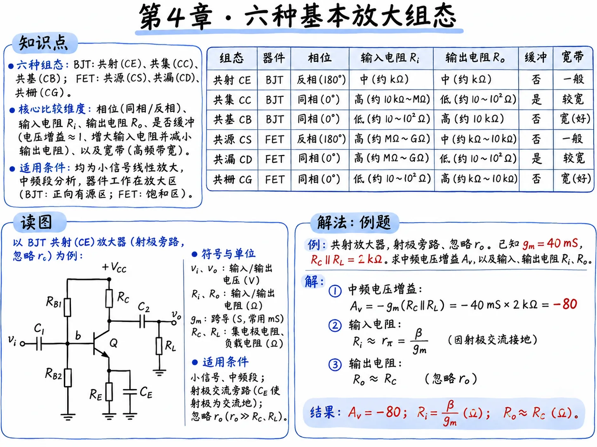
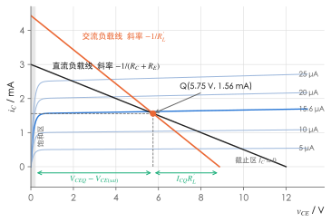
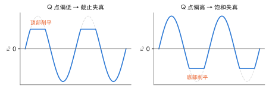

# 基本放大电路

!!! abstract "本章要点"
    - 分析放大电路永远分两步：先用直流通路求静态工作点 Q，再用交流通路求 $A_v$、$R_i$、$R_o$。
    - 分压式偏置加射极电阻 $R_E$，能让 Q 点几乎不随 $\beta$ 和温度变化。
    - Q 点要放在交流负载线中间，偏低会截止失真，偏高会饱和失真。
    - 三种组态各有分工：共射管增益，共集管缓冲，共基管高频。
    - 多级放大的总增益是各级相乘，但每一级都要把后一级的输入电阻当负载来算。

??? info "本章图卡"
    { loading=lazy }
    { loading=lazy }
    { loading=lazy }

晶体管的特性曲线与 hybrid-π 模型见 [双极型晶体管与场效应管](transistors.md)。$A_v$、$R_i$、$R_o$ 和"源电压增益"的含义见 [信号与放大器](signals-amplifiers.md)。

!!! note "知识点清单"
    **组成与通路**

    - [ ] 放大电路的组成原则（各元件的作用）
    - [ ] 直流通路与交流通路的画法

    **静态工作点**

    - [ ] 静态工作点 Q 的含义
    - [ ] 固定偏置电路及其缺点
    - [ ] 分压式偏置：戴维南化简、精确法与估算法、放大区检查
    - [ ] $R_E$ 稳定 Q 点的原理与旁路电容 $C_E$

    **图解法**

    - [ ] 直流负载线
    - [ ] 交流负载线
    - [ ] 最大不失真输出幅度
    - [ ] 截止失真与饱和失真

    **小信号分析**

    - [ ] hybrid-π 小信号模型：$g_m$、$r_\pi$
    - [ ] 求 $A_v$、$R_i$、$R_o$ 的一般步骤
    - [ ] 共射电路（$R_E$ 旁路）
    - [ ] 共射电路（$R_E$ 不旁路）与"射极电阻乘 $1+\beta$"
    - [ ] 源电压增益 $A_{vs}$

    **三种组态**

    - [ ] 如何辨认组态
    - [ ] 共集电路（射极跟随器）
    - [ ] 共基电路与共射—共基（cascode）
    - [ ] 三种组态对比

    **场效应管放大电路**

    - [ ] FET 的偏置与 Q 点
    - [ ] FET 小信号模型与 CS、CD、CG

    **电流源**

    - [ ] 电流源的作用
    - [ ] 基本电流镜及其误差（基极电流、Early 效应、顺从电压）
    - [ ] MOS 电流镜
    - [ ] Widlar 微电流源
    - [ ] 有源负载

    **多级放大**

    - [ ] 四种耦合方式
    - [ ] 零点漂移
    - [ ] 多级放大的增益、输入电阻、输出电阻
    - [ ] 复合管（达林顿管）

## 1. 放大电路的组成与两种通路

### 1.1 组成原则

放大电路用小的输入信号去控制晶体管，把直流电源的能量转换成大的输出信号。晶体管像一个水阀，输入信号拧阀门，水压来自电源。

要让它正常放大，必须同时满足三条：

1. **偏置正确**：BJT 发射结正偏、集电结反偏，管子处在放大区。
2. **信号能进去**：输入信号能加到发射结（或 FET 的栅源之间）。
3. **信号能出来**：放大后的变化能送到负载上。

{ .circuit }

| 元件 | 作用 |
| --- | --- |
| $V_{CC}$ | 提供偏置，也是输出能量的来源 |
| $R_{B1}$、$R_{B2}$ | 分压，给基极一个固定电位 |
| $R_C$ | 把集电极电流的变化变成电压的变化 |
| $R_E$ | 直流负反馈，稳定 Q 点 |
| $C_1$、$C_2$ | 耦合电容，隔直流、通交流 |
| $C_E$ | 旁路电容，交流时把 $R_E$ 短路 |

### 1.2 直流通路与交流通路

电路里同时有直流（偏置）和交流（信号）。小信号时两者可以叠加，总量 $i_C=I_C+i_c$。所以拆成两张图分别算。

电容对直流是断路，对中频交流几乎是短路。理想直流电源两端电压不变，对交流相当于短路到地。

| | 直流通路（求 Q 点） | 交流通路（求 $A_v$、$R_i$、$R_o$） |
| --- | --- | --- |
| 耦合电容 $C_1$、$C_2$，旁路电容 $C_E$ | 开路 | 短路（中频） |
| 直流电源 $V_{CC}$ | 保留 | 短路（交流地） |
| 信号源 $v_s$ | 置零 | 保留 |
| 晶体管 | $V_{BE}=0.7\,\mathrm V$，$I_C=\beta I_B$ | 小信号模型 $r_\pi$、$g_m$ |

1. 画直流通路：电容全部断开，求 Q 点。
2. 由 Q 点算出小信号参数 $g_m$、$r_\pi$。
3. 画交流通路：电容短路、$V_{CC}$ 接地，换上小信号模型，求 $A_v$、$R_i$、$R_o$。

!!! warning "易错"
    - 两步不能混用：Q 点计算里没有 $r_\pi$，小信号计算里没有 $0.7\,\mathrm V$。
    - $C_E$ 只在交流时短路 $R_E$，直流时 $R_E$ 仍然在。
    - 低频时电容不能再当短路，这就是 [频率响应](frequency-response.md) 中下限频率 $f_L$ 的来源。

## 2. 静态工作点

### 2.1 静态工作点 Q

没有输入信号时，管子各极的直流电压和电流叫静态工作点 Q。常用 $I_{BQ}$、$I_{CQ}$、$V_{CEQ}$ 三个数描述。

**为什么需要它**：交流信号有正有负，而 BJT 只能单向导通。先用直流把管子"抬"到放大区的中间，信号才能在 Q 点上下摆动而不被削掉。就像跷跷板要先停在水平位置，两边才都能动。

### 2.2 固定偏置电路

基极经一个电阻 $R_B$ 接到 $V_{CC}$，射极直接接地。这是最简单的偏置。

$$
I_{BQ}=\frac{V_{CC}-V_{BE}}{R_B},\qquad I_{CQ}=\beta I_{BQ},\qquad V_{CEQ}=V_{CC}-I_{CQ}R_C
$$

适用条件：管子在放大区。

**缺点**：$I_B$ 被固定，$I_C=\beta I_B$ 正比于 $\beta$。换一只管子或温度升高，$\beta$ 一变，Q 点就跟着跑。

!!! warning "易错"
    - 分压电阻接到基极、但射极直接接地，仍然是固定偏置（化简后就是 $V_{BB}$ 串 $R_{BB}$），**不能**稳定 Q 点。

### 2.3 分压式偏置

用 $R_{B1}$、$R_{B2}$ 分压固定基极电位，射极串 $R_E$。这是分立放大电路最常用的偏置。

{ .circuit }

从基极往左看，分压网络可以用 [戴维南定理](../notes/circuit-theorems.md) 化成一个电压源 $V_{BB}$ 串一个电阻 $R_{BB}$。然后沿"$V_{BB}\to R_{BB}\to$ 发射结 $\to R_E\to$ 地"列 KVL。

精确法：

$$
\begin{aligned}
&V_{BB}=\frac{R_{B2}}{R_{B1}+R_{B2}}V_{CC},\qquad R_{BB}=R_{B1}\parallel R_{B2},\\
&I_{BQ}=\frac{V_{BB}-V_{BE}}{R_{BB}+(1+\beta)R_E},\qquad I_{CQ}=\beta I_{BQ},\\
&V_{CEQ}=V_{CC}-I_{CQ}R_C-I_{EQ}R_E\approx V_{CC}-I_{CQ}(R_C+R_E)
\end{aligned}
$$

适用条件：管子在放大区，$V_{BE}$ 取 $0.7\,\mathrm V$（硅管）。

其中 $(1+\beta)R_E$ 是射极电阻折算到基极回路的值，因为 $I_E=(1+\beta)I_B$。

估算法：

$$
I_{CQ}\approx I_{EQ}\approx\frac{V_{BB}-V_{BE}}{R_E}
$$

适用条件：$(1+\beta)R_E\gg R_{BB}$，工程上要 10 倍以上。

估算结果里**没有 $\beta$**，这正是分压式偏置的价值。

1. 戴维南化简，求 $V_{BB}$、$R_{BB}$。
2. 用精确式（或估算式）求 $I_{CQ}$。
3. 求 $V_{CEQ}$。
4. 检查放大区：$V_{CEQ}>V_{CE(sat)}$（取 $0.2\sim0.3\,\mathrm V$）。

!!! warning "易错"
    - 若算出 $V_{CEQ}<V_{CE(sat)}$，管子已饱和，$I_C=\beta I_B$ 不再成立，要改用 $V_{CE}=V_{CE(sat)}$ 重算。

??? example "例 1：分压式偏置的 Q 点"
    $V_{CC}=12\,\mathrm V$，$R_{B1}=40\,\mathrm{k\Omega}$，$R_{B2}=10\,\mathrm{k\Omega}$，$R_C=3\,\mathrm{k\Omega}$，$R_E=1\,\mathrm{k\Omega}$，$\beta=100$，$V_{BE}=0.7\,\mathrm V$。用精确法和估算法求 Q 点。

    思路：先戴维南化简，再按两种方法各算一遍。

    1. 化简：$V_{BB}=12\times\dfrac{10}{50}=2.4\,\mathrm V$，$R_{BB}=40\parallel10=8\,\mathrm{k\Omega}$。
    2. 精确法求基极电流：$I_{BQ}=\dfrac{2.4-0.7}{8+101\times1}\,\mathrm{mA}=15.6\,\mathrm{\mu A}$。
    3. 集电极、射极电流：$I_{CQ}=1.56\,\mathrm{mA}$，$I_{EQ}=1.575\,\mathrm{mA}$。
    4. 管压降：$V_{CEQ}=12-1.56\times3-1.575\times1=5.75\,\mathrm V>V_{CE(sat)}$，在放大区。
    5. 估算法：$I_{CQ}\approx\dfrac{2.4-0.7}{1}=1.7\,\mathrm{mA}$，$V_{CEQ}\approx12-1.7\times4=5.2\,\mathrm V$。

    **结论**：精确值 $I_{CQ}=1.56\,\mathrm{mA}$、$V_{CEQ}=5.75\,\mathrm V$；估算偏大约 9%，因为 $(1+\beta)R_E/R_{BB}\approx12.6$，只勉强满足 10 倍。后面各例都用精确值。

### 2.4 $R_E$ 为什么能稳定 Q 点

温度升高时，$\beta$ 变大、$V_{BE}$ 变小（约 $-2\,\mathrm{mV/^\circ C}$）、$I_{CBO}$ 变大，三者都让 $I_C$ 上升。有了 $R_E$，且 $V_B$ 被分压网络固定：

$$
T\uparrow\ \to\ I_C\uparrow\ \to\ V_E=I_ER_E\uparrow\ \to\ V_{BE}=V_B-V_E\downarrow\ \to\ I_B\downarrow\ \to\ I_C\downarrow
$$

适用条件：$V_B$ 基本不变，即分压电流远大于 $I_B$。

这是**直流电流负反馈**（见 [负反馈放大电路](feedback.md)）。$I_C$ 想变大，$R_E$ 就把它拉回来。

**旁路电容 $C_E$**：$R_E$ 在交流时也起负反馈，会把增益压得很低。所以给 $R_E$ 并一个大电容 $C_E$：直流负反馈保留，交流负反馈去掉。

## 3. 图解法：负载线与失真

{ .circuit }

### 3.1 直流负载线

输出回路 KVL 在输出特性曲线上画出的直线。Q 点只能落在这条线上。

$$
v_{CE}=V_{CC}-i_C(R_C+R_E)
$$

适用条件：直流，取 $I_E\approx I_C$；射极接地时把 $R_C+R_E$ 换成 $R_C$。

它的斜率是 $-1/(R_C+R_E)$。它与 $i_B=I_{BQ}$ 那条特性曲线的交点就是 Q。

### 3.2 交流负载线

加信号后，工作点沿着另一条直线来回移动，这条线叫交流负载线。

**为什么和直流负载线不同**：交流时 $C_E$、$C_2$ 短路，集电极电流流过的是 $R_C\parallel R_L$，不再是 $R_C+R_E$。

$$
v_{CE}-V_{CEQ}=-(i_C-I_{CQ})R_L',\qquad R_L'=R_C\parallel R_L
$$

适用条件：$R_E$ 被 $C_E$ 旁路。

其中 $R_L'$ 叫交流负载电阻。这条线**过 Q 点**，斜率 $-1/R_L'$，与横轴交于 $V_{CEQ}+I_{CQ}R_L'$。

!!! warning "易错"
    - 交流负载线一般比直流负载线陡，但不是"一定"。空载且 $R_E$ 不旁路时两者重合。

### 3.3 最大不失真输出幅度

输出电压不削波时能达到的最大峰值，记作 $U_{om}$。

Q 点往左走，最多走到饱和（$v_{CE}=V_{CE(sat)}$）。往右走，最多走到截止（$i_C=0$）。两边哪边先碰壁，哪边就是限制。

$$
U_{om}=\min\{\,V_{CEQ}-V_{CE(sat)},\ I_{CQ}R_L'\,\}
$$

适用条件：$R_E$ 被旁路；左项是饱和限制，右项是截止限制。

两项相等时摆幅最大。这时 Q 点在**交流**负载线的中点，不是直流负载线中点。

??? tip "$R_E$ 只旁路一部分时"
    若射极还有一段 $R_{E1}$ 未被旁路，交流时 c—e 回路的电阻是 $R_L'+R_{E1}$。饱和限制下 $v_{ce}$ 能摆 $V_{CEQ}-V_{CE(sat)}$，但只有 $\dfrac{R_L'}{R_L'+R_{E1}}$ 的部分落在负载上。截止限制仍是 $I_{CQ}R_L'$。见练习 3。

### 3.4 截止失真与饱和失真

{ .circuit }

信号太大或 Q 点不合适时，管子在一部分时间进入截止区或饱和区，输出波形被削平。这是**非线性失真**。

| 失真 | 原因 | NPN 共射输出 $v_o$ | 改善 |
| --- | --- | --- | --- |
| 截止失真 | Q 点偏低（$I_{CQ}$ 小） | **顶部**削平 | 增大 $I_{CQ}$（减小 $R_{B1}$ 或 $R_E$） |
| 饱和失真 | Q 点偏高（$V_{CEQ}$ 小） | **底部**削平 | 减小 $I_{CQ}$ 或 $R_C$ |

**为什么截止是削顶**：$i_C$ 不能小于 0，所以截止时 $i_C$ 的底部被削。共射输出 $v_o$ 与 $i_c$ 反相，于是 $v_o$ 的顶部被削。

!!! warning "易错"
    - 截止失真和饱和失真不是同一种"削顶"，判断时先看是顶还是底。
    - PNP 管电路电压极性全反，结论正好相反。

??? example "例 2：图卡例题的负载线与摆幅（更正版）"
    射极接地的共射电路，$V_{CC}=12\,\mathrm V$，$R_C=3\,\mathrm{k\Omega}$，$I_{CQ}=2\,\mathrm{mA}$，$V_{CEQ}=6\,\mathrm V$，$V_{CE(sat)}=0.2\,\mathrm V$。（1）画直流负载线；（2）求空载和接 $R_L=3\,\mathrm{k\Omega}$ 时的最大不失真幅度；（3）接负载时 $I_{CQ}$ 取多少摆幅最大？

    思路：分别算饱和限制和截止限制，取小者。

    1. 直流负载线 $i_C=\dfrac{12-v_{CE}}{3}$，端点 $(0,\,4\,\mathrm{mA})$ 和 $(12\,\mathrm V,\,0)$。Q 点 $(6\,\mathrm V,\,2\,\mathrm{mA})$ 在线上。
    2. 空载：$R_L'=R_C$，交流、直流负载线重合。$U_{om}=\min\{6-0.2,\ 2\times3\}=5.8\,\mathrm V$，受饱和限制。
    3. 接负载：$R_L'=3\parallel3=1.5\,\mathrm{k\Omega}$，交流负载线交横轴于 $6+2\times1.5=9\,\mathrm V$。
    4. $U_{om}=\min\{5.8,\ 2\times1.5\}=3\,\mathrm V$，受**截止**限制，$v_o$ 先在顶部削平。
    5. 令两项相等：$11.8-3I_{CQ}=1.5I_{CQ}$，得 $I_{CQ}=2.62\,\mathrm{mA}$，$V_{CEQ}=4.13\,\mathrm V$。

    **结论**：空载 $5.8\,\mathrm V$，带载 $3\,\mathrm V$；把 $I_{CQ}$ 调到 $2.62\,\mathrm{mA}$ 时 $U_{om}=3.93\,\mathrm V$ 最大。

??? example "例 3：例 1 电路的交流负载线"
    例 1 电路接 $R_L=6\,\mathrm{k\Omega}$，$C_E$ 旁路，$V_{CE(sat)}=0.2\,\mathrm V$，求最大不失真输出幅度。

    思路：同例 2，比较两个限制。

    1. $R_L'=3\parallel6=2\,\mathrm{k\Omega}$，交流负载线交横轴于 $5.75+1.56\times2=8.87\,\mathrm V$。
    2. 饱和限制：$5.75-0.2=5.55\,\mathrm V$。
    3. 截止限制：$1.56\times2=3.12\,\mathrm V$。

    **结论**：$U_{om}=3.12\,\mathrm V$，截止先出现；要加大摆幅应增大 $I_{CQ}$。

## 4. 小信号模型与共射电路

### 4.1 hybrid-π 小信号模型

信号很小时，管子在 Q 点附近可以看成线性元件。输入端是一个电阻 $r_\pi$，输出端是一个受控电流源 $g_mv_\pi$。思路同 [非线性电阻的小信号分析](../extras/nonlinear.md)。

**为什么参数取决于 Q 点**：$i_C$ 随 $v_{BE}$ 指数变化，曲线在不同 Q 点的斜率不同。$I_{CQ}$ 越大，曲线越陡，$g_m$ 越大。

$$
g_m=\frac{I_{CQ}}{V_T},\qquad r_\pi=\frac{\beta}{g_m}=\frac{\beta V_T}{I_{CQ}}
$$

适用条件：中频、小信号，忽略 $r_o$ 和基区体电阻 $r_{bb'}$。

其中 $g_m$ 是跨导，$r_\pi$ 是 b—e 间的输入电阻，$V_T=26\,\mathrm{mV}$ 是热电压。受控源 $g_mv_\pi$ 也可写成 $\beta i_b$，两者等价。

??? tip "教材里的 $r_{be}$"
    教材常写 $r_{be}=r_{bb'}+(1+\beta)\dfrac{26\,\mathrm{mV}}{I_{EQ}}$。$r_{bb'}$ 是基区体电阻，常取 $100\sim300\,\Omega$，题目给出时要加上。本文例题都取 $r_{bb'}=0$，于是 $r_{be}=r_\pi\approx(1+\beta)V_T/I_{EQ}$。

### 4.2 求 $A_v$、$R_i$、$R_o$ 的步骤

1. 画交流通路，把晶体管换成小信号模型。
2. 求 $A_v=v_o/v_i$：从输入端求出 $v_\pi$（或 $i_b$），再求输出电压。
3. 求 $R_i$：从输入端看进去，$R_i=v_i/i_i$，包含偏置电阻。
4. 求 $R_o$：信号源置零（保留内阻 $R_s$），去掉负载，在输出端加电压 $v_t$、求电流 $i_t$，$R_o=v_t/i_t$。

!!! warning "易错"
    - $R_i$ 要算上偏置电阻 $R_B$，不是只有管子的 $r_\pi$。
    - 求 $R_o$ 时负载 $R_L$ 不算在内。

### 4.3 共射电路：$R_E$ 旁路

{ .circuit }

射极交流接地，信号从基极进、集电极出。这是增益最高的组态。

$v_i\uparrow\to i_c\uparrow\to R_C$ 上压降 $\uparrow\to v_o\downarrow$，所以输出反相。

$$
A_v=-g_mR_L'=-\frac{\beta R_L'}{r_\pi},\qquad R_i=R_B\parallel r_\pi,\qquad R_o=R_C
$$

适用条件：$R_E$ 全部被旁路，忽略 $r_o$。

其中 $R_B=R_{B1}\parallel R_{B2}$，$R_L'=R_C\parallel R_L$。

**$R_o$ 为什么是 $R_C$**：$v_s=0$ 时 $v_\pi=0$，受控电流源相当于开路，从输出端看进去只剩 $R_C$。考虑 $r_o$ 时为 $R_C\parallel r_o$。

### 4.4 共射电路：$R_E$ 不旁路

{ .circuit }

射极电阻 $R_E$ 留在交流通路里。

$R_E$ 中流过的是 $(1+\beta)i_b$，射极电压 $v_e=(1+\beta)i_bR_E$。从基极看，$R_E$ 好像变大了 $1+\beta$ 倍。这条规则叫**射极电阻折算到基极要乘 $1+\beta$**。

$$
A_v=-\frac{\beta R_L'}{r_\pi+(1+\beta)R_E}\approx-\frac{R_L'}{R_E},\qquad R_i=R_B\parallel[\,r_\pi+(1+\beta)R_E\,],\qquad R_o=R_C
$$

适用条件：近似式要求 $(1+\beta)R_E\gg r_\pi$。

**代价与好处**：增益下降很多；但增益几乎只由电阻比决定，与 $\beta$、$I_{CQ}$ 无关。同时 $R_i$ 变大、线性范围变宽。这是交流电流串联负反馈的效果。

折中做法：把 $R_E$ 分两段，只旁路下面一段（练习 3）。

### 4.5 源电压增益

信号源有内阻 $R_s$ 时，真正加到放大器上的只是 $v_s$ 的一部分。从 $v_s$ 到 $v_o$ 的增益叫源电压增益。

$$
A_{vs}=\frac{v_o}{v_s}=\frac{R_i}{R_s+R_i}A_v
$$

适用条件：任何放大器，$R_i$ 为整个电路的输入电阻。

!!! warning "易错"
    - $R_i$ 小的电路（CE 旁路、CB）接高内阻信号源时会损失很多增益。

??? example "例 4：共射电路的 $A_v$、$R_i$、$R_o$（$R_E$ 旁路与不旁路）"
    例 1 电路，$R_L=6\,\mathrm{k\Omega}$，$R_s=1\,\mathrm{k\Omega}$，$V_T=26\,\mathrm{mV}$。分别求 $C_E$ 接入和断开时的 $A_v$、$R_i$、$R_o$、$A_{vs}$。

    思路：先由 Q 点算小信号参数，再套两组公式。

    1. 小信号参数：$g_m=\dfrac{1.56}{26}\,\mathrm S=60\,\mathrm{mS}$，$r_\pi=\dfrac{100}{60\,\mathrm{mS}}=1.667\,\mathrm{k\Omega}$。
    2. 电阻：$R_B=8\,\mathrm{k\Omega}$，$R_L'=3\parallel6=2\,\mathrm{k\Omega}$。
    3. $C_E$ 接入：$A_v=-60\times2=-120$，$R_i=8\parallel1.667=1.38\,\mathrm{k\Omega}$，$R_o=3\,\mathrm{k\Omega}$。
    4. 源电压增益：$A_{vs}=\dfrac{1.38}{1+1.38}\times(-120)=-69.6$。
    5. $C_E$ 断开：$A_v=-\dfrac{100\times2}{1.667+101\times1}=-1.95$（近似 $-R_L'/R_E=-2$）。
    6. 输入电阻：$R_i=8\parallel102.7=7.42\,\mathrm{k\Omega}$，$R_o=3\,\mathrm{k\Omega}$，$A_{vs}=\dfrac{7.42}{8.42}\times(-1.95)=-1.72$。

    **结论**：旁路电容使增益相差约 60 倍；不旁路时增益几乎只由电阻比决定，换 $\beta=200$ 的管子也几乎不变。

## 5. 共集与共基

### 5.1 如何辨认组态

看哪个电极交流接地（公共端），信号从哪进、从哪出。

| 组态 | 输入 | 输出 | 交流接地（公共端） |
| --- | --- | --- | --- |
| 共射 CE | b | c | e |
| 共集 CC | b | e | c |
| 共基 CB | e | c | b |

!!! warning "易错"
    - 集电极接 $V_{CC}$ 也算交流接地，所以射极输出的电路是共集。

### 5.2 共集电路：射极跟随器

{ .circuit }

集电极交流接地，信号从基极进、射极出。输出几乎等于输入，所以叫"跟随器"。

$v_o=v_i-v_\pi$，总比 $v_i$ 小一点点，而且同相。

$$
A_v=\frac{(1+\beta)R_E'}{r_\pi+(1+\beta)R_E'}\lesssim1,\qquad R_i=R_B\parallel[\,r_\pi+(1+\beta)R_E'\,],\qquad R_o=R_E\parallel\frac{r_\pi+R_s\parallel R_B}{1+\beta}
$$

适用条件：中频，忽略 $r_o$。

其中 $R_E'=R_E\parallel R_L$，$R_s$ 是信号源内阻。

**价值是阻抗变换**：从输入端看，$R_E'$ 被放大 $1+\beta$ 倍，输入电阻大。从输出端看，信号源内阻被缩小 $1+\beta$ 倍，输出电阻小。所以它常作输入级、输出级和中间缓冲级。

!!! warning "易错"
    - 跟随器的 $R_o$ 与信号源内阻有关，$R_i$ 与负载有关，两端是耦合的。
    - 电压增益小于 1，不等于它不能提高整个放大器的增益（见例 8）。

### 5.3 共基电路

{ .circuit }

基极经 $C_B$ 交流接地，信号从射极进、集电极出。

$$
A_v=g_mR_L',\qquad R_i=R_E\parallel\frac{r_\pi}{1+\beta}\approx\frac1{g_m},\qquad R_o=R_C
$$

适用条件：中频，忽略 $r_o$。

**特点**：电压增益与 CE 一样大，但同相。电流增益 $\alpha\approx1$。输入电阻只有几十欧以下。

**为什么高频好**：CE 电路中 $C_\mu$ 跨在输入和输出之间，会被米勒效应放大。CB 没有这种跨接，高频特性好（见 [频率响应](frequency-response.md#4-高频响应与米勒效应)）。

**共射—共基（cascode）**：把 CE 和 CB 串起来，CE 提供高输入电阻，CB 提供好的高频特性。

### 5.4 三种组态对比

| 组态 | $A_v$ | $R_i$ | $R_o$ | 相位 | 用途 |
| --- | --- | --- | --- | --- | --- |
| CE（$R_E$ 旁路） | $-g_mR_L'$ | $R_B\parallel r_\pi$ | $R_C$ | 反相 | 电压放大 |
| CE（$R_E$ 不旁路） | $-\dfrac{\beta R_L'}{r_\pi+(1+\beta)R_E}$ | $R_B\parallel[r_\pi+(1+\beta)R_E]$ | $R_C$ | 反相 | 稳定增益 |
| CC | $\dfrac{(1+\beta)R_E'}{r_\pi+(1+\beta)R_E'}\lesssim1$ | $R_B\parallel[r_\pi+(1+\beta)R_E']$ | $R_E\parallel\dfrac{r_\pi+R_s\parallel R_B}{1+\beta}$ | 同相 | 缓冲、输入输出级 |
| CB | $g_mR_L'$ | $\approx\dfrac1{g_m}$ | $R_C$ | 同相 | 高频、cascode |

??? example "例 5：同一偏置下三种组态的对比"
    沿用例 1 的管子和偏置（$I_{CQ}=1.56\,\mathrm{mA}$，$g_m=60\,\mathrm{mS}$，$r_\pi=1.667\,\mathrm{k\Omega}$，$R_B=8\,\mathrm{k\Omega}$，$R_E=1\,\mathrm{k\Omega}$）。（1）改成射极跟随器：$R_C=0$，$R_L=1\,\mathrm{k\Omega}$，$R_s=1\,\mathrm{k\Omega}$；（2）改成共基：基极旁路，$R_C=3\,\mathrm{k\Omega}$，$R_L=6\,\mathrm{k\Omega}$，$R_s=50\,\Omega$。分别求 $A_v$、$R_i$、$R_o$。

    思路：$I_{CQ}$ 由基极—射极回路决定、与 $R_C$ 无关，所以小信号参数不变，直接套表。

    1. Q 点：$I_{CQ}$ 不变；跟随器 $V_{CEQ}=12-1.575\times1=10.4\,\mathrm V$。
    2. 共集：$R_E'=1\parallel1=0.5\,\mathrm{k\Omega}$，$(1+\beta)R_E'=50.5\,\mathrm{k\Omega}$。
    3. 共集增益与输入电阻：$A_v=\dfrac{50.5}{1.667+50.5}=0.968$，$R_i=8\parallel52.2=6.94\,\mathrm{k\Omega}$。
    4. 共集输出电阻：$R_o=1\,\mathrm{k\Omega}\parallel\dfrac{1.667+1\parallel8}{101}\,\mathrm{k\Omega}=1\,\mathrm{k\Omega}\parallel25.3\,\Omega=24.7\,\Omega$。
    5. 共基：$R_L'=2\,\mathrm{k\Omega}$，$A_v=g_mR_L'=120$，$R_o=3\,\mathrm{k\Omega}$。
    6. 共基输入电阻：$R_i=1\,\mathrm{k\Omega}\parallel\dfrac{1667}{101}\,\Omega=16.2\,\Omega$。
    7. 共基源电压增益：$A_{vs}=\dfrac{16.2}{50+16.2}\times120=29.4$。

    **结论**：跟随器 $A_v\approx1$、$R_o$ 只有 $24.7\,\Omega$；共基即使 $R_s=50\,\Omega$ 也只剩约 1/4 增益，适合由电流源性质的信号（或前级集电极）驱动。

## 6. 场效应管放大电路：CS、CD、CG

### 6.1 FET 的偏置与 Q 点

{ .circuit }

FET 栅极几乎不取电流。偏置只要用分压电阻定出 $V_G$，再靠源极电阻 $R_S$ 自给负反馈。

$$
V_{GS}=V_G-I_DR_S,\qquad I_D=K_n\big(V_{GS}-V_{GS(th)}\big)^2
$$

适用条件：增强型 NMOS 工作在饱和区（恒流区）。

其中 $K_n$ 即 [晶体管](transistors.md) 一文中的 $K$，$V_{GS(th)}$ 是开启电压（写成这样以免与热电压 $V_T$ 混淆）。

1. 由分压求 $V_G$。
2. 联立上面两式，解一元二次方程。
3. 舍去 $V_{GS}<V_{GS(th)}$ 的根（那时管子截止）。
4. 检查饱和区：$V_{DS}\ge V_{GS}-V_{GS(th)}$。

### 6.2 FET 小信号模型与三种组态

FET 的小信号模型就是 BJT 模型令 $r_\pi\to\infty$：栅极开路，漏极一个受控电流源 $g_mv_{gs}$。

$$
g_m=2K_n\big(V_{GSQ}-V_{GS(th)}\big)=2\sqrt{K_nI_{DQ}}
$$

适用条件：饱和区，忽略 $r_o$ 与衬底效应。

| 组态 | $A_v$ | $R_i$ | $R_o$ | 对应 BJT |
| --- | --- | --- | --- | --- |
| CS（$R_S$ 旁路） | $-g_mR_D'$ | $R_{G1}\parallel R_{G2}$ | $R_D$ | CE |
| CS（$R_S$ 不旁路） | $-\dfrac{g_mR_D'}{1+g_mR_S}$ | $R_{G1}\parallel R_{G2}$ | $R_D$ | CE 带 $R_E$ |
| CD（源极跟随器） | $\dfrac{g_mR_S'}{1+g_mR_S'}$ | $R_{G1}\parallel R_{G2}$ | $R_S\parallel\dfrac1{g_m}$ | CC |
| CG | $g_mR_D'$ | $R_S\parallel\dfrac1{g_m}$ | $R_D$ | CB |

其中 $R_D'=R_D\parallel R_L$，$R_S'=R_S\parallel R_L$。

**与 BJT 比较**：FET 的 $g_m$ 一般只有几 mS，比同电流 BJT 的 $I_C/V_T$ 小一个数量级。所以 CS 增益较低，CD 输出电阻较大（几百欧）。但输入电阻可达兆欧。

??? tip "进一步提高输入电阻"
    在分压点与栅极之间串一个大电阻 $R_{G3}$，则 $R_i=R_{G3}+R_{G1}\parallel R_{G2}$。$R_{G3}$ 中没有直流电流，不改变偏置。

??? example "例 6：共源放大电路"
    $V_{DD}=12\,\mathrm V$，$R_{G1}=2\,\mathrm{M\Omega}$，$R_{G2}=1\,\mathrm{M\Omega}$，$R_S=1\,\mathrm{k\Omega}$，$R_D=5\,\mathrm{k\Omega}$，$R_L=5\,\mathrm{k\Omega}$；NMOS $K_n=1\,\mathrm{mA/V^2}$，$V_{GS(th)}=2\,\mathrm V$。求 Q 点，以及 $C_S$ 接入、断开时的 $A_v$。

    思路：先联立求 Q 点，再算 $g_m$ 套表。

    1. $V_G=12\times\dfrac13=4\,\mathrm V$，$V_{GS}=4-I_D$（$I_D$ 以 mA 计）。
    2. 令 $x=V_{GS}-2$，由 $I_D=x^2$ 得 $x+2=4-x^2$，即 $x^2+x-2=0$。
    3. $x=1$ 或 $x=-2$；$x=-2$ 时管子截止，舍去。故 $V_{GSQ}=3\,\mathrm V$，$I_{DQ}=1\,\mathrm{mA}$。
    4. $V_{DSQ}=12-1\times(5+1)=6\,\mathrm V\ge1\,\mathrm V$，在饱和区。
    5. $g_m=2\times1\times1=2\,\mathrm{mS}$，$R_D'=2.5\,\mathrm{k\Omega}$。
    6. $C_S$ 接入：$A_v=-2\times2.5=-5$；断开：$A_v=-\dfrac{5}{1+2\times1}=-1.67$。
    7. $R_i=2\parallel1=0.667\,\mathrm{M\Omega}$，$R_o=5\,\mathrm{k\Omega}$。

    **结论**：$I_{DQ}=1\,\mathrm{mA}$，$A_v=-5$（旁路）或 $-1.67$（不旁路）。

## 7. 电流源与电流镜

### 7.1 电流源的作用

电流源两端电压变化时，电流几乎不变。它的直流压降不大，交流电阻（输出电阻）却很大。

**为什么集成电路爱用它**：芯片里大电阻、大电容难做，晶体管却很便宜。所以偏置和负载大量用晶体管电流源代替电阻。

### 7.2 基本电流镜

{ .circuit }

$T_1$ 集电极连基极，接成二极管。$T_2$ 与它共用 $V_{BE}$，两管匹配时集电极电流相同。$T_2$ 像镜子一样"复制"$T_1$ 的电流。

$I_{REF}$ 先流进 $T_1$，建立 $V_{BE}$；同一个 $V_{BE}$ 让 $T_2$ 流过同样的电流。

$$
I_{REF}=\frac{V_{CC}-V_{BE}}{R},\qquad I_O=\frac{I_{REF}}{1+2/\beta}
$$

适用条件：两管匹配，$V_{CE2}$ 足够大，暂不计 Early 效应。

第二式来自 $T_1$ 集电极节点的 KCL：$I_{REF}=I_C+2I_B=I_C(1+2/\beta)$。

### 7.3 电流镜的误差

| 误差来源 | 原因 | 大小 | 改进 |
| --- | --- | --- | --- |
| 基极电流 | 两管基极电流从 $I_{REF}$ 中分走 | $\beta=100$ 时约 2% | 加射极跟随器供基极电流，误差降到约 $2/\beta^2$（练习 5） |
| Early 效应 | $V_{CE2}$ 通常大于 $V_{CE1}=V_{BE}$ | $I_O$ 随 $V_{CE2}$ 缓慢增大 | 用 Widlar、cascode 等提高输出电阻 |

输出电阻表示"恒流"的程度：

$$
r_o=\frac{V_A}{I_O}
$$

适用条件：$V_A$ 为 Early 电压。

**顺从电压**：$T_2$ 必须留在放大区才能恒流，所以输出端需要 $V_{CE2}$ 大于饱和压降（约 $0.2\sim0.3\,\mathrm V$）。这个最小电压叫顺从电压。

??? tip "同时计入两种误差"

    $$
    I_O\approx\frac{I_{REF}}{1+2/\beta}\cdot\frac{1+V_{CE2}/V_A}{1+V_{BE}/V_A}
    $$

    两种误差方向相反，可能部分抵消（例 7）。

### 7.4 MOS 电流镜

结构同 BJT 电流镜，用两只 MOS 管。电流比由两管的宽长比决定。

$$
I_O=I_{REF}\frac{(W/L)_2}{(W/L)_1}
$$

适用条件：两管都在饱和区，忽略沟道长度调制。

MOS 管没有栅极电流，所以没有"基极电流误差"。顺从电压是过驱动电压 $V_{GS}-V_{GS(th)}$。

### 7.5 Widlar 微电流源

{ .circuit }

在基本电流镜的 $T_2$ 射极串一个电阻 $R_E$，用来得到微安级的小电流。

$T_2$ 的 $V_{BE}$ 比 $T_1$ 小一点，差值落在 $R_E$ 上。$V_{BE}$ 小一点，电流就按指数小很多。

$$
I_OR_E=V_{BE1}-V_{BE2}=V_T\ln\frac{I_{REF}}{I_O}
$$

适用条件：忽略基极电流，$I_C=I_Se^{V_{BE}/V_T}$。

**好处**：用不大的电阻就能得到微安级电流。$R_E$ 的负反馈还使输出电阻比基本电流镜高得多。

### 7.6 有源负载

用电流源代替放大管的集电极电阻 $R_C$，叫有源负载。

增益 $\approx g_m\times$ 负载电阻。电阻负载要大就得压降大；电流源直流压降小，交流电阻 $r_o$ 却有几十到几百千欧。单级增益可达数百至上千。这在 [差分放大与集成运放](differential-opamp.md) 中大量用到。

??? example "例 7：电流镜的误差与 Widlar 电阻（图卡例题更正）"
    （1）匹配电流镜 $I_{REF}=0.5\,\mathrm{mA}$，$\beta=100$，$V_{CE2}=2\,\mathrm V$，$V_A=100\,\mathrm V$，求 $I_O$ 及输出电阻；（2）$I_{REF}=1\,\mathrm{mA}$，要用 Widlar 电流源得到 $I_O=10\,\mathrm{\mu A}$，求 $R_E$。

    思路：先算基极电流误差，再乘 Early 修正；Widlar 直接套对数公式。

    1. 只计基极电流：$I_O=\dfrac{0.5}{1+0.02}=0.490\,\mathrm{mA}$（图卡给 $0.50\,\mathrm{mA}$，漏了 2%）。
    2. 再计 Early 效应：$I_O=0.490\times\dfrac{1+2/100}{1+0.7/100}=0.497\,\mathrm{mA}$，两种误差部分抵消。
    3. 输出电阻：$r_o=\dfrac{100}{0.49}\approx204\,\mathrm{k\Omega}$，$V_{CE2}$ 每变 $1\,\mathrm V$，$I_O$ 变约 $5\,\mathrm{\mu A}$。
    4. Widlar：$R_E=\dfrac{26\,\mathrm{mV}}{10\,\mathrm{\mu A}}\ln100=11.97\,\mathrm{k\Omega}\approx12\,\mathrm{k\Omega}$。
    5. 对比：用基本电流镜得到 $10\,\mathrm{\mu A}$，$R$ 要约 $1.4\,\mathrm{M\Omega}$（$V_{CC}=15\,\mathrm V$）。

    **结论**：$I_O\approx0.497\,\mathrm{mA}$，$r_o\approx204\,\mathrm{k\Omega}$；Widlar 只需 $12\,\mathrm{k\Omega}$。

## 8. 耦合方式与多级放大

### 8.1 四种耦合方式

多级放大时，前一级输出接到后一级输入的方式叫耦合。

| 耦合方式 | 优点 | 缺点 | 应用 |
| --- | --- | --- | --- |
| 阻容耦合 | 各级 Q 点独立，设计简单 | 不能放大直流和缓变信号；大电容无法集成 | 分立元件交流放大 |
| 直接耦合 | 能放大直流，易集成 | 各级 Q 点相互牵连；有零点漂移 | 集成运放 |
| 变压器耦合 | 隔直，能做阻抗变换 | 笨重、频响差、不能集成 | 早期功放、射频 |
| 光电耦合 | 电气隔离 | 线性较差 | 隔离放大、数字接口 |

阻容耦合的下限频率：

$$
f_L=\frac1{2\pi(R_{\text{前}}+R_{\text{后}})C}
$$

适用条件：$R_{\text{前}}+R_{\text{后}}$ 是电容两侧看出去的全部串联电阻。

输入电容 $C_1$ 取 $R_s+R_i$，输出电容 $C_2$ 取 $R_o+R_L$。

### 8.2 零点漂移

直接耦合放大器输入为零时，输出仍缓慢变化，叫零点漂移（温漂）。

晶体管参数随温度变化，Q 点慢慢移动。直接耦合时这种变化会被后级一起放大。所以**第一级的漂移最关键**。集成运放的第一级用差分电路来抑制它（见 [差分放大与集成运放](differential-opamp.md)）。

### 8.3 多级放大的增益与电阻

把每一级看成"输入电阻 + 受控源 + 输出电阻"的放大器模型，逐级相连。

$$
A_v=A_{v1}A_{v2}\cdots A_{vn},\qquad R_i=R_{i1},\qquad R_o=R_{on}
$$

适用条件：每个 $A_{vk}$ 都是**带载增益**，即第 $k$ 级以第 $k+1$ 级的输入电阻 $R_{i(k+1)}$ 为负载。

用分贝表示时，总增益为各级 dB 数之和。

1. 从最后一级往前算各级输入电阻 $R_{ik}$。
2. 把 $R_{i(k+1)}$ 当作第 $k$ 级的负载，算 $A_{vk}$。
3. 各级增益相乘。
4. 算 $R_o$ 时，把前一级的输出电阻当作末级的信号源内阻。

!!! warning "易错"
    - 不能直接把各级空载增益相乘。
    - 射极跟随器作末级时，它的 $R_o$ 取决于前一级的 $R_o$。

??? example "例 8：共射—共集两级放大"
    第一级为例 4 的共射电路（$C_E$ 接入，$R_C=3\,\mathrm{k\Omega}$），第二级为例 5（1）的射极跟随器，负载 $R_L=1\,\mathrm{k\Omega}$，两级阻容耦合。求总 $A_v$ 和输出电阻，并与第一级直接带 $1\,\mathrm{k\Omega}$ 负载比较。（图卡例题 $A_v=(-20)\times0.8=-16$ 是同一方法。）

    思路：先求第二级输入电阻，把它当作第一级的负载。

    1. 第二级（带 $1\,\mathrm{k\Omega}$ 负载）：$R_{i2}=6.94\,\mathrm{k\Omega}$，$A_{v2}=0.968$。
    2. 第一级负载：$R_{L1}'=R_C\parallel R_{i2}=3\parallel6.94=2.09\,\mathrm{k\Omega}$，$A_{v1}=-60\times2.09=-125.6$。
    3. 总增益：$A_v=-125.6\times0.968=-121.6$。
    4. 输出电阻：第二级的信号源内阻是 $R_C=3\,\mathrm{k\Omega}$，$R_o=1\,\mathrm{k\Omega}\parallel\dfrac{1.667+3\parallel8}{101}\,\mathrm{k\Omega}=36.7\,\Omega$。
    5. 对比：共射级直接带 $1\,\mathrm{k\Omega}$，$A_v=-60\times(3\parallel1)=-45$。

    **结论**：$A_v=-121.6$，$R_o=36.7\,\Omega$。跟随器本身没有电压增益，却把总增益从 $-45$ 提到 $-122$，因为它隔开了重负载。

### 8.4 复合管（达林顿管）

把两只管子接在一起当一只用。常见接法是 $T_1$ 的射极接 $T_2$ 的基极，两集电极相连。

$T_1$ 的射极电流就是 $T_2$ 的基极电流，电流被放大了两次。

$$
\beta\approx\beta_1\beta_2,\qquad r_\pi=r_{\pi1}+(1+\beta_1)\,r_{\pi2}
$$

适用条件：两管都在放大区；精确值 $\beta=\beta_1+\beta_2+\beta_1\beta_2$。

复合管的类型（NPN 或 PNP）**由第一只管子决定**。它常用于运放中间级和功放输出级。

!!! warning "易错"
    - 组成复合管时，两管电流方向必须一致：$T_1$ 的输出电流要正好是 $T_2$ 需要的基极电流方向。

## 公式速查

| 内容 | 公式 | 条件 |
| --- | --- | --- |
| 固定偏置 | $I_{BQ}=\dfrac{V_{CC}-V_{BE}}{R_B}$，$I_{CQ}=\beta I_{BQ}$ | 放大区；Q 点随 $\beta$ 变 |
| 戴维南化简 | $V_{BB}=\dfrac{R_{B2}}{R_{B1}+R_{B2}}V_{CC}$，$R_{BB}=R_{B1}\parallel R_{B2}$ | 分压式偏置 |
| 分压偏置精确法 | $I_{BQ}=\dfrac{V_{BB}-V_{BE}}{R_{BB}+(1+\beta)R_E}$ | 放大区 |
| 分压偏置估算法 | $I_{CQ}\approx\dfrac{V_{BB}-V_{BE}}{R_E}$ | $(1+\beta)R_E\ge10R_{BB}$ |
| 管压降 | $V_{CEQ}\approx V_{CC}-I_{CQ}(R_C+R_E)$ | 检查 $V_{CEQ}>V_{CE(sat)}$ |
| 交流负载线 | $v_{CE}-V_{CEQ}=-(i_C-I_{CQ})R_L'$ | $R_L'=R_C\parallel R_L$ |
| 最大不失真幅度 | $U_{om}=\min\{V_{CEQ}-V_{CE(sat)},\ I_{CQ}R_L'\}$ | $R_E$ 旁路 |
| 小信号参数 | $g_m=\dfrac{I_{CQ}}{V_T}$，$r_\pi=\dfrac{\beta}{g_m}$ | $V_T=26\,\mathrm{mV}$ |
| CE（旁路） | $A_v=-g_mR_L'$，$R_i=R_B\parallel r_\pi$，$R_o=R_C$ | 忽略 $r_o$ |
| CE（不旁路） | $A_v=-\dfrac{\beta R_L'}{r_\pi+(1+\beta)R_E}\approx-\dfrac{R_L'}{R_E}$ | |
| CC | $A_v\lesssim1$，$R_o=R_E\parallel\dfrac{r_\pi+R_s\parallel R_B}{1+\beta}$ | $R_E'=R_E\parallel R_L$ |
| CB | $A_v=g_mR_L'$，$R_i\approx\dfrac1{g_m}$ | |
| 源电压增益 | $A_{vs}=\dfrac{R_i}{R_s+R_i}A_v$ | |
| MOS 跨导 | $g_m=2K_n(V_{GSQ}-V_{GS(th)})=2\sqrt{K_nI_{DQ}}$ | 饱和区 |
| CS / CD / CG | $-g_mR_D'$ ／ $\dfrac{g_mR_S'}{1+g_mR_S'}$ ／ $g_mR_D'$ | |
| 基本电流镜 | $I_O=\dfrac{I_{REF}}{1+2/\beta}$，$r_o=\dfrac{V_A}{I_O}$ | 两管匹配 |
| MOS 电流镜 | $I_O=I_{REF}\dfrac{(W/L)_2}{(W/L)_1}$ | 饱和区 |
| Widlar | $I_OR_E=V_T\ln\dfrac{I_{REF}}{I_O}$ | 忽略基极电流 |
| 多级放大 | $A_v=\prod A_{vk}$，$R_i=R_{i1}$，$R_o=R_{on}$ | $A_{vk}$ 为带载增益 |
| 复合管 | $\beta\approx\beta_1\beta_2$，$r_\pi=r_{\pi1}+(1+\beta_1)r_{\pi2}$ | |

## 练习

### 1. 概念判断 :material-star::material-star-outline::material-star-outline:

判断下列说法是否正确：

1. 分压式偏置电路去掉 $R_E$（射极直接接地）后，仍能稳定 Q 点。
2. 交流负载线一定比直流负载线陡。
3. NPN 共射电路输出波形底部被削平，是截止失真。
4. 射极跟随器的电压增益小于 1，所以它不能提高整个放大器的电压增益。
5. 计算多级放大器第一级的电压增益时，应该把第二级的输入电阻当作第一级的负载。

??? success "答案"
    1 ✗　2 ✗　3 ✗　4 ✗　5 ✓

??? note "解析"
    1. 没有 $R_E$ 就没有直流负反馈，$I_C=\beta(V_{BB}-0.7)/R_{BB}$ 随 $\beta$ 成比例变化。
    2. 交流斜率 $-1/R_L'$，直流 $-1/(R_C+R_E)$。$R_E$ 未旁路时交流回路电阻是 $R_L'+R_E$；空载时两者重合。所以只是"一般更陡"。
    3. $v_o$ 与 $i_c$ 反相，底部削平对应 $i_C$ 顶部受限，是饱和失真。
    4. 见例 8：跟随器作缓冲，可使前级带载增益大幅提高。
    5. 正确，这就是"带载增益"。

### 2. 分压式偏置的稳定性 :material-star::material-star::material-star-outline:

$V_{CC}=15\,\mathrm V$，$R_{B1}=50\,\mathrm{k\Omega}$，$R_{B2}=10\,\mathrm{k\Omega}$，$R_C=5.1\,\mathrm{k\Omega}$，$R_E=1.8\,\mathrm{k\Omega}$，$V_{BE}=0.7\,\mathrm V$。（1）用估算法求 Q 点；（2）$\beta=80$ 时用精确法求 Q 点；（3）$\beta$ 变为 160 时 $I_{CQ}$ 变化百分之几？

??? success "答案"
    （1）$I_{CQ}\approx1.0\,\mathrm{mA}$，$V_{CEQ}\approx8.1\,\mathrm V$；（2）$I_{CQ}=0.934\,\mathrm{mA}$，$V_{CEQ}=8.53\,\mathrm V$；（3）$I_{CQ}=0.966\,\mathrm{mA}$，只增大约 3.4%。

??? note "解析"
    1. $V_{BB}=15\times\dfrac{10}{60}=2.5\,\mathrm V$。
    2. 估算：$I_E\approx\dfrac{2.5-0.7}{1.8}=1.0\,\mathrm{mA}$，$V_{CE}\approx15-1.0\times6.9=8.1\,\mathrm V$。
    3. 精确：$R_{BB}=50\parallel10=8.33\,\mathrm{k\Omega}$，$I_B=\dfrac{1.8}{8.33+81\times1.8}=11.7\,\mathrm{\mu A}$，$I_C=0.934\,\mathrm{mA}$。
    4. $V_{CE}=15-0.934\times5.1-0.946\times1.8=8.53\,\mathrm V$。
    5. $\beta=160$：$I_B=\dfrac{1.8}{8.33+161\times1.8}$，$I_C=160I_B=0.966\,\mathrm{mA}$。

    $\beta$ 翻倍，$I_C$ 只变 3.4%，因为 $(1+\beta)R_E\gg R_{BB}$ 时 $I_C\to(V_{BB}-0.7)/R_E$。

### 3. 射极电阻部分旁路 :material-star::material-star::material-star:

把例 1 电路的 $R_E$ 拆成 $R_{E1}=200\,\Omega$（不旁路）与 $R_{E2}=800\,\Omega$（并 $C_E$）串联，其余同例 4（$R_L=6\,\mathrm{k\Omega}$，$V_{CE(sat)}=0.2\,\mathrm V$）。求 $A_v$、$R_i$ 和最大不失真输出幅度。

??? success "答案"
    $A_v=-9.15$，$R_i=5.86\,\mathrm{k\Omega}$，$U_{om}=3.12\,\mathrm V$。

??? note "解析"
    1. 直流时 $R_{E1}+R_{E2}=1\,\mathrm{k\Omega}$ 不变，Q 点同例 1：$g_m=60\,\mathrm{mS}$，$r_\pi=1.667\,\mathrm{k\Omega}$。
    2. 交流时射极只有 $R_{E1}$：$A_v=-\dfrac{100\times2}{1.667+101\times0.2}=-9.15$（近似 $-R_L'/R_{E1}=-10$）。
    3. $R_i=8\parallel21.87=5.86\,\mathrm{k\Omega}$。
    4. 饱和限制：$v_{ce}$ 最多摆 $5.55\,\mathrm V$，落在 $R_L'$ 上的是 $5.55\times\dfrac{2}{2.2}=5.04\,\mathrm V$。
    5. 截止限制：$I_{CQ}R_L'=3.12\,\mathrm V$，更小，所以 $U_{om}=3.12\,\mathrm V$。

### 4. 源极跟随器 :material-star::material-star::material-star-outline:

$V_{DD}=12\,\mathrm V$，栅极分压 $R_{G1}=R_{G2}=1\,\mathrm{M\Omega}$，漏极直接接 $V_{DD}$，$R_S=3\,\mathrm{k\Omega}$，$R_L=3\,\mathrm{k\Omega}$（经电容接源极），$K_n=1\,\mathrm{mA/V^2}$，$V_{GS(th)}=2\,\mathrm V$。求 $I_{DQ}$、$A_v$、$R_i$、$R_o$。

??? success "答案"
    $I_{DQ}=1\,\mathrm{mA}$，$A_v=0.75$，$R_i=500\,\mathrm{k\Omega}$，$R_o=429\,\Omega$。

??? note "解析"
    1. $V_G=6\,\mathrm V$，$V_{GS}=6-3I_D$；令 $x=V_{GS}-2$，得 $3x^2+x-4=0$，取正根 $x=1$。
    2. $I_D=1\,\mathrm{mA}$，$V_{GS}=3\,\mathrm V$，$V_{DS}=12-3=9\,\mathrm V$，在饱和区。
    3. $g_m=2\,\mathrm{mS}$，$R_S'=1.5\,\mathrm{k\Omega}$，$A_v=\dfrac{2\times1.5}{1+2\times1.5}=0.75$。
    4. $R_i=1\parallel1=0.5\,\mathrm{M\Omega}$；$R_o=3\,\mathrm{k\Omega}\parallel\dfrac{1}{2\,\mathrm{mS}}=0.429\,\mathrm{k\Omega}$。

    与例 5 的射极跟随器（$A_v=0.968$，$R_o=24.7\,\Omega$）比，源极跟随器 $g_m$ 小，增益离 1 更远、$R_o$ 更大；优点是输入电阻高。

### 5. 带缓冲的电流镜 :material-star::material-star::material-star-outline:

$I_{REF}=1\,\mathrm{mA}$，各管匹配，$\beta=50$。（1）基本电流镜的 $I_O$；（2）在 $T_1$ 的"集电极—基极"连线中插入一只射极跟随器 $T_3$（$T_3$ 基极接 $T_1$ 集电极，射极接 $T_1$、$T_2$ 两基极，集电极接 $V_{CC}$），求 $I_O$。

??? success "答案"
    （1）$0.962\,\mathrm{mA}$；（2）$0.9992\,\mathrm{mA}$。

??? note "解析"
    1. $I_O=\dfrac{1}{1+2/50}=0.962\,\mathrm{mA}$，误差 3.8%。
    2. $T_3$ 射极电流是两管基极电流 $2I_C/\beta$；它只从 $I_{REF}$ 取自己的基极电流 $\dfrac{2I_C}{\beta(1+\beta)}$。
    3. $I_{REF}=I_C+\dfrac{2I_C}{\beta(1+\beta)}$，得 $I_O=\dfrac{1}{1+2/2550}=0.9992\,\mathrm{mA}$。

    误差从 $2/\beta$ 降到约 $2/\beta^2$。

## 图卡勘误

| 图卡位置 | 原文 | 更正 |
| --- | --- | --- |
| 08 读图电路 | 发射极直接接地，却称"分压偏置稳定 Q 点""射极负反馈 $R_E$" | 图中没有 $R_E$，相当于固定偏置，$I_C\propto\beta$，不能稳定 Q 点（见 2.2、2.4 节） |
| 08 知识点 1 | "电流↑使 $V_E$↑，$V_{BE}$↓，$I_C$ 减小" | 完整链：$T\uparrow\to I_C\uparrow\to V_E\uparrow\to V_{BE}\downarrow\to I_B\downarrow\to I_C\downarrow$，前提是 $V_B$ 固定 |
| 08 知识点 3 / 结论 | 截止或饱和时都"削顶" | NPN 共射：截止削**顶部**，饱和削**底部** |
| 08 知识点 3 | 交流负载线"在 Q 点附近"，斜率 $-1/R_C'$ | 是过 Q 点的整条直线，交横轴于 $V_{CEQ}+I_{CQ}R_L'$；通常记 $R_L'=R_C\parallel R_L$ |
| 08 解法 | 要求"判断失真条件"，却没做失真计算 | 应算 $U_{om}$：空载 $5.8\,\mathrm V$，带载 $3\,\mathrm V$（截止限制），见例 2 |
| 08 适用条件 | "工作点取在线性区中部" | 应在**交流**负载线中点，不是直流负载线中点 |
| 09 例题 | $R_i\approx r_\pi=\beta/g_m$ | 应为 $R_B\parallel r_\pi$；且题中没给 $\beta$，算不出数值 |
| 09 表格 $R_o$ 列 | CE "中"、CB "高"；CS "中"、CG "高" | 带 $R_C$（$R_D$）时四者的 $R_o$ 都约等于 $R_C$（$R_D$）；CB/CG 只是管子本身从集电极看进去的电阻更高 |
| 09 表格 CD 行 | $R_o$ "约 $10\sim10^2\,\Omega$" | $R_o\approx R_S\parallel(1/g_m)$，一般几百欧 |
| 09 表格 CC 行 | $R_i$ "约 $10\,\mathrm{k\Omega}\sim\mathrm{M\Omega}$" | 整个电路的 $R_i$ 受 $R_{B1}\parallel R_{B2}$ 限制（例 5 只有 $6.94\,\mathrm{k\Omega}$） |
| 10 知识点 3 | "使前学校增益降低" | 错字，应为"前级" |
| 10 读图 / 例题 | $I_O\approx I_{REF}=0.50\,\mathrm{mA}$ | $I_O=I_{REF}/(1+2/\beta)=0.490\,\mathrm{mA}$，另有 Early 误差（例 7） |
| 10 读图电路 | $Q_2$（$M_2$）集电极（漏极）直接接电源 | 输出支路必须串负载，否则 $I_O$ 无处可用 |
| 10 读图曲线 | "恒流区"画成一族曲线 | 电流镜输出特性只有一条曲线，恒流区斜率 $1/r_o=I_O/V_A$ |
| 10 耦合方式 | $f_L=\dfrac1{2\pi RC}$ | $R$ 是电容两侧的总串联电阻（$R_s+R_i$ 或 $R_o+R_L$） |
