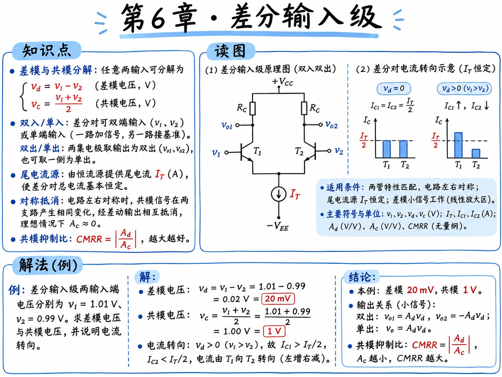
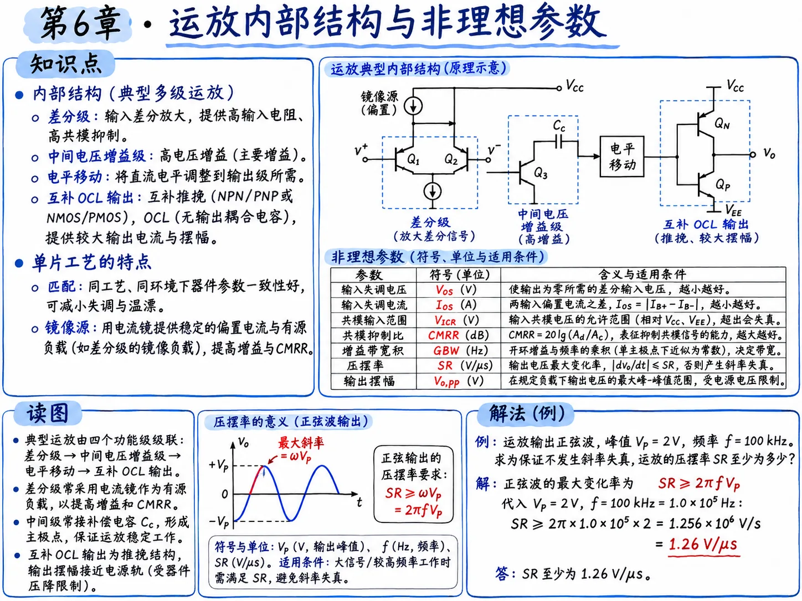
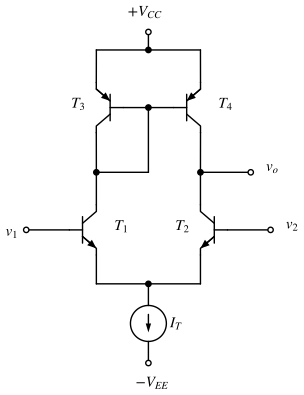

# 差分放大与集成运放

!!! abstract "本章要点"
    - 任意两路输入都能拆成差模 $v_d=v_1-v_2$ 和共模 $v_c=(v_1+v_2)/2$ 两部分。
    - 差分电路放大差模、抑制共模，而温漂和干扰都表现为共模。
    - 用半电路分析：差模时射极是交流地，共模时尾电阻变成 $2R_{EE}$。
    - 用电流源作尾、电流镜作负载，能得到很高的增益和 CMRR。
    - 集成运放 = 差分输入级 + 中间增益级 + 输出级 + 偏置电路，非理想参数描述它离理想多远。

??? info "本章图卡"
    { loading=lazy }
    { loading=lazy }

本文用到的共射小信号分析、电流镜见 [基本放大电路](basic-amplifiers.md)。理想运放的分析方法（虚短、虚断）见 [含理想运放的电路](../extras/opamp.md)。

!!! note "知识点清单"
    **差分思想**

    - [ ] 零点漂移及其原因
    - [ ] 差模信号与共模信号的分解
    - [ ] 差模增益、共模增益与共模抑制比 CMRR

    **长尾差分对**

    - [ ] 静态工作点
    - [ ] 大信号传输特性（$\tanh$ 曲线、线性范围）
    - [ ] 差模半电路：双端与单端输出
    - [ ] 共模半电路：$2R_{EE}$ 与单端 CMRR
    - [ ] 四种输入输出接法（含单端输入）
    - [ ] 电流源尾

    **有源负载**

    - [ ] 电流镜负载的差分级

    **集成运放**

    - [ ] 内部四部分结构
    - [ ] 集成电路的工艺特点
    - [ ] 非理想参数一览
    - [ ] 失调电压、偏置电流引起的输出误差与平衡电阻
    - [ ] 增益带宽积 GBW（小信号带宽）
    - [ ] 压摆率 SR 与全功率带宽（大信号带宽）

## 1. 零点漂移与差分思想

### 1.1 零点漂移

直接耦合放大器输入为零时，输出仍会缓慢变化，叫零点漂移（温漂）。

晶体管参数随温度变化（$V_{BE}$ 约 $-2\,\mathrm{mV/^\circ C}$、$\beta$ 增大），Q 点慢慢移动。第一级的漂移会被后面各级一起放大，所以**第一级最关键**。

**对策**：用两只特性相同的管子对称连接。温度变化对两管的影响相同，两个输出端同时变化，取两者之差就抵消了。这就是差分电路。

### 1.2 差模与共模

两路输入 $v_1$、$v_2$ 中，两者"不同的部分"叫差模，"相同的部分"叫共模。

$$
v_d=v_1-v_2,\qquad v_c=\frac{v_1+v_2}{2}\quad\Longleftrightarrow\quad v_1=v_c+\frac{v_d}{2},\ \ v_2=v_c-\frac{v_d}{2}
$$

适用条件：任意两路输入都可以这样分解。

其中 $v_d$ 是差模输入，$v_c$ 是共模输入。

有用信号常加在两端之间，是差模。温漂、电源纹波、长导线上的感应干扰在两路中基本相同，是共模。

### 1.3 差模增益、共模增益与 CMRR

线性电路的输出是两部分的叠加：

$$
v_o=A_dv_d+A_cv_c,\qquad \mathrm{CMRR}=\left|\frac{A_d}{A_c}\right|,\qquad \mathrm{CMRR_{dB}}=20\lg\left|\frac{A_d}{A_c}\right|
$$

适用条件：小信号、线性工作。

其中 $A_d$ 是差模增益，$A_c$ 是共模增益，CMRR 是**共模抑制比**，越大越好。

!!! warning "易错"
    - CMRR 大不等于共模项可以忽略。共模输入比差模大很多时，共模项仍可能占输出的相当一部分（练习 2）。

## 2. 长尾差分对：静态与大信号特性

{ .circuit }

### 2.1 静态工作点

两管射极接在一起，经尾电阻 $R_{EE}$ 接负电源 $-V_{EE}$。$R_{EE}$ 像一条"长尾巴"，所以叫长尾式。

$v_1=v_2=0$ 时两基极接地，射极电位约 $-0.7\,\mathrm V$。尾电流由 $R_{EE}$ 两端电压决定，两管平分。

$$
I_{EE}=\frac{V_{EE}-V_{BE}}{R_{EE}},\qquad I_{C1}=I_{C2}\approx\frac{I_{EE}}{2},\qquad V_{C1}=V_{C2}=V_{CC}-\frac{I_{EE}}{2}R_C
$$

适用条件：两管对称，基极直流电位为 0，忽略基极电流。

??? tip "基极经电阻接地时"
    若基极经电阻 $R_B$ 接地，基极电流会在 $R_B$ 上产生压降，射极电位略低于 $-0.7\,\mathrm V$。$\beta$ 较大时通常可略。

### 2.2 大信号传输特性

差模输入较大时，两管电流随 $v_d$ 变化的完整曲线。

尾电流总量固定为 $I_{EE}$，$v_d$ 只决定它在两管之间怎么分。$v_d>0$ 时尾电流**从 $T_2$ 转向 $T_1$**：$i_{C1}$ 增大、$i_{C2}$ 减小，左集电极电压下降、右集电极电压上升。

$$
i_{C1}=\frac{I_{EE}}{1+e^{-v_d/V_T}},\qquad i_{C1}-i_{C2}=I_{EE}\tanh\frac{v_d}{2V_T}
$$

适用条件：两管匹配，$\alpha\approx1$。

推导：由 $i_C=I_Se^{v_{BE}/V_T}$ 得 $i_{C1}/i_{C2}=e^{v_d/V_T}$，再用 $i_{C1}+i_{C2}=I_{EE}$。

{ .circuit }

| $\vert v_d\vert$ 范围 | 工作状态 |
| --- | --- |
| $\lesssim V_T\approx26\,\mathrm{mV}$ | 近似线性，斜率 $\dfrac{\mathrm di_{C1}}{\mathrm dv_d}=\dfrac{I_{EE}}{4V_T}=\dfrac{g_m}{2}$ |
| $>4V_T\approx100\,\mathrm{mV}$ | 电流几乎全部流过一只管子，成了电流开关 |

开关特性使差分对能限幅，也常用作比较器的输入级。

??? tip "展宽线性范围"
    两射极各串一个电阻 $R_e$（射极负反馈）可以展宽线性范围，代价是增益下降。

## 3. 小信号分析：半电路法

电路完全对称时，差模、共模分别只画一只管子的"半电路"来算，比列整个电路快得多。

{ .circuit }

### 3.1 差模半电路

$v_1=+v_d/2$，$v_2=-v_d/2$。一管电流增加多少，另一管就减少多少，流过 $R_{EE}$ 的交流电流为零。所以射极是**交流地**，半电路就是射极接地的共射放大器。

$$
v_{c1}=-\frac{g_mR_C}{2}v_d,\qquad v_{c2}=+\frac{g_mR_C}{2}v_d
$$

适用条件：电路对称，$|v_d|\ll2V_T$。

| 输出方式 | 差模增益 | 输出电阻 |
| --- | --- | --- |
| 双端（$v_{c1}-v_{c2}$） | $A_d=-g_mR_C$ | $2R_C$ |
| 单端，从 $T_1$ 集电极取 | $A_{d1}=-\dfrac{g_mR_C}{2}$（反相） | $R_C$ |
| 单端，从 $T_2$ 集电极取 | $A_{d2}=+\dfrac{g_mR_C}{2}$（同相） | $R_C$ |

差模输入电阻：

$$
R_{id}=2r_\pi
$$

适用条件：信号从两基极之间看进去，两只 $r_\pi$ 串联。

**两集电极间接负载 $R_L$**：$R_L$ 的中点电位不变，是差模交流地。半电路的负载变成 $R_C\parallel\dfrac{R_L}{2}$。

!!! warning "易错"
    - 单端输出的差模增益只有双端的一半。
    - $R_L$ 跨接时，每个半电路只分到 $R_L/2$。

### 3.2 共模半电路

$v_1=v_2=v_c$。两管电流同增同减，$R_{EE}$ 中流过 $2i_e$。对每只管子来说，相当于射极接了 $2R_{EE}$。

$$
A_{c1}=-\frac{\beta R_C}{r_\pi+(1+\beta)\,2R_{EE}}\approx-\frac{R_C}{2R_{EE}}\ \ (\text{单端}),\qquad A_c=0\ \ (\text{双端，理想对称})
$$

适用条件：近似式要求 $(1+\beta)2R_{EE}\gg r_\pi$。

单端输出的共模抑制比：

$$
\mathrm{CMRR}=\frac{g_mR_C/2}{R_C/(2R_{EE})}=g_mR_{EE}
$$

适用条件：单端输出，用近似式。

!!! warning "易错"
    - 共模增益为零只对**双端**输出成立。单端输出时共模信号并没有被抵消。
    - $R_{EE}$ 只影响共模，不影响差模增益。

### 3.3 四种输入输出接法

输入可以双端（两基极都加信号）或单端（一端接地），输出也可以双端或单端，共四种接法。

**单端输入怎么算**：$v_1=v_i$，$v_2=0$，分解后 $v_d=v_i$，$v_c=v_i/2$。差模部分与双端输入完全一样，只是多了一个共模分量。

| 接法 | 差模增益 | 共模影响 |
| --- | --- | --- |
| 双端输入、双端输出 | $-g_mR_C$ | 理想为 0 |
| 双端输入、单端输出 | $\mp\dfrac{g_mR_C}{2}$ | 有 $A_{c1}v_c$ 项 |
| 单端输入、双端输出 | $-g_mR_C$ | 理想为 0 |
| 单端输入、单端输出 | $\mp\dfrac{g_mR_C}{2}$ | 有 $A_{c1}\cdot\dfrac{v_i}{2}$ 项 |

**结论**：差模增益只由输出方式决定，与输入方式无关。

### 3.4 电流源尾

单端 CMRR $=g_mR_{EE}$，要提高就要加大 $R_{EE}$。但大电阻上直流压降太大，电源不够用。

**做法**：用电流源代替 $R_{EE}$。电流源的直流压降只需零点几伏，交流电阻却是它的输出电阻 $r_o$（几百千欧以上）。CMRR 随之升到约 $g_mr_o$。

| 量 | 双端输出 | 单端输出 |
| --- | --- | --- |
| 差模增益 | $-g_mR_C$（或 $-g_m(R_C\parallel\frac{R_L}{2})$） | $\mp\dfrac{g_mR_C}{2}$ |
| 共模增益 | 理想为 0（实际由失配决定） | $\approx-\dfrac{R_C}{2R_{EE}}$ |
| 差模输入电阻 | $2r_\pi$ | $2r_\pi$ |
| 输出电阻 | $2R_C$ | $R_C$ |

??? example "例 1：长尾差分对的静态与增益"
    $V_{CC}=V_{EE}=12\,\mathrm V$，$R_C=10\,\mathrm{k\Omega}$，$R_{EE}=11.3\,\mathrm{k\Omega}$，$\beta=100$，两基极直接接信号源（直流电位 0）。求 Q 点、$A_d$（双端）、$A_{d1}$、$R_{id}$、$A_{c1}$ 与单端 CMRR。

    思路：先求 Q 点和小信号参数，再分别用差模、共模半电路。

    1. Q 点：$I_{EE}=\dfrac{12-0.7}{11.3}=1\,\mathrm{mA}$，$I_C\approx0.5\,\mathrm{mA}$，$V_C=12-0.5\times10=7\,\mathrm V$。
    2. 小信号参数：$g_m=\dfrac{0.5}{26}\,\mathrm S=19.23\,\mathrm{mS}$，$r_\pi=\dfrac{100}{19.23\,\mathrm{mS}}=5.2\,\mathrm{k\Omega}$。
    3. 差模：$A_d=-19.23\times10=-192.3$，$A_{d1}=-96.2$，$R_{id}=10.4\,\mathrm{k\Omega}$。
    4. 共模：$A_{c1}=-\dfrac{100\times10}{5.2+101\times22.6}=-0.437$（近似 $-\dfrac{10}{22.6}=-0.442$）。
    5. $\mathrm{CMRR}=\dfrac{96.2}{0.437}=220$，即 $46.8\,\mathrm{dB}$。
    6. 换成电流源尾（$I_{EE}=1\,\mathrm{mA}$，$r_o=1\,\mathrm{M\Omega}$）：$A_{c1}=-\dfrac{1000}{5.2+101\times2000}=-0.00495$。

    **结论**：电阻尾时 CMRR 为 $46.8\,\mathrm{dB}$；电流源尾时升到 $1.94\times10^4$（$85.8\,\mathrm{dB}$），约为 $g_mr_o$。

??? example "例 2：两路输入的分解与输出（图卡例题）"
    例 1 电路，$v_1=1.01\,\mathrm V$，$v_2=0.99\,\mathrm V$。求 $v_d$、$v_c$、电流转向，单端输出 $v_{c1}$ 的变化量和双端输出电压。

    思路：先分解，再用 $v_o=A_dv_d+A_cv_c$。

    1. 分解：$v_d=20\,\mathrm{mV}$，$v_c=1\,\mathrm V$。
    2. 转向：$v_d>0$，尾电流由 $T_2$ 转向 $T_1$，$I_{C1}>I_{EE}/2>I_{C2}$。
    3. 单端：$\Delta v_{C1}=-96.2\times0.02-0.437\times1=-1.92-0.44=-2.36\,\mathrm V$。
    4. 双端：$v_{od}=-192.3\times0.02=-3.85\,\mathrm V$，共模项理想为零。

    **结论**：单端 $-2.36\,\mathrm V$，其中共模项占约 19%；双端 $-3.85\,\mathrm V$。

    核对：（a）共模 $1\,\mathrm V$ 使 $I_{EE}=\dfrac{12+1-0.7}{11.3}=1.088\,\mathrm{mA}$，每管 $I_C$ 增 $0.044\,\mathrm{mA}$，$V_{C1}$ 降 $0.44\,\mathrm V$，与 $A_{c1}v_c$ 一致。（b）$v_d=20\,\mathrm{mV}$ 与 $V_T$ 相当，按 $\tanh$ 每管电流变化 $0.183\,\mathrm{mA}$，比线性值 $0.192\,\mathrm{mA}$ 小约 5%，小信号公式已是近似。

## 4. 有源负载

{ .circuit }

集成运放的输入级用 PNP 电流镜 $T_3$、$T_4$ 代替两只 $R_C$ 作负载，从一侧单端输出。

$$
T_1\ \text{电流}+\Delta i\ \to\ \text{镜像使}\ T_4\ \text{多供}\ \Delta i;\quad T_2\ \text{电流}-\Delta i\ \to\ \text{输出节点净得}\ 2\Delta i=g_mv_d
$$

这个电流流入 $r_{o2}\parallel r_{o4}$：

$$
A_d=\frac{v_o}{v_d}=g_m\,(r_{o2}\parallel r_{o4})
$$

适用条件：后级输入电阻远大于 $r_{o2}\parallel r_{o4}$。

其中 $r_{o2}$、$r_{o4}$ 是 $T_2$、$T_4$ 的输出电阻。

**好处**：

- 单端输出得到了双端输出的增益：两管的电流变化都送到了输出端。
- 负载是晶体管的 $r_o$（几百千欧），单级增益可达上千。
- 共模输入时两管电流同向变化，镜像把它们抵消，单端输出也有很高的 CMRR。

输出与 $v_1$ 同相，所以 $v_1$ 是同相输入端，$v_2$ 是反相输入端。

??? example "例 3：有源负载差分级的增益"
    上图中 $I_T=200\,\mathrm{\mu A}$，所有管子 $V_A=100\,\mathrm V$，$\beta=100$。求差模增益。

    思路：求 $g_m$ 和两只 $r_o$ 的并联。

    1. 每管 $I_C=100\,\mathrm{\mu A}$，$g_m=\dfrac{0.1}{26}\,\mathrm S=3.85\,\mathrm{mS}$。
    2. $r_{o2}=r_{o4}=\dfrac{100\,\mathrm V}{0.1\,\mathrm{mA}}=1\,\mathrm{M\Omega}$，并联 $500\,\mathrm{k\Omega}$。
    3. $A_d=3.85\,\mathrm{mS}\times500\,\mathrm{k\Omega}=1923$，即 $65.7\,\mathrm{dB}$。

    **结论**：$A_d\approx1923$（四管节点方程数值解 $1922.8$）。后级必须有远大于 $500\,\mathrm{k\Omega}$ 的输入电阻，所以第二级常用射极跟随器或达林顿管隔离。

## 5. 集成运放的内部结构

### 5.1 四个组成部分

{ .circuit }

| 部分 | 典型电路 | 作用 |
| --- | --- | --- |
| 输入级 | 差分对 + 电流源尾 + 有源负载（BJT、JFET 或 MOS 输入） | 高输入电阻、高 CMRR、低失调与温漂 |
| 中间级 | 共射（共源）放大，常用复合管 + 有源负载；接米勒补偿电容 $C_c$ | 提供主要电压增益；$C_c$ 形成主导极点，保证闭环稳定（见 [负反馈放大电路](feedback.md)） |
| 输出级 | 互补对称推挽（OCL），用二极管或 $V_{BE}$ 倍增电路偏置成甲乙类 | 低输出电阻、大输出电流；偏置用于消除交越失真（见 [功率放大与直流电源](power.md)） |
| 偏置电路 | 电流镜、Widlar 微电流源 | 为各级提供稳定的工作电流 |

### 5.2 集成电路的工艺特点

| 特点 | 电路上的对策 |
| --- | --- |
| 相邻元件参数**匹配**好，但绝对精度差 | 多用差分对、电流镜等靠匹配工作的电路 |
| 大电阻难做 | 用晶体管电流源代替电阻（有源负载） |
| 大电容难做 | 用直接耦合代替电容耦合 |
| 直接耦合使各级直流电平逐级升高 | 用 PNP 管或稳压支路做电平移动，使输入为零时输出也为零 |

## 6. 非理想参数

### 6.1 参数一览

| 参数 | 定义 | 对电路的影响 |
| --- | --- | --- |
| 开环差模增益 $A_{od}$ | 低频开环电压增益，$10^4\sim10^7$ | 闭环增益误差 $\approx1/(A_{od}F)$ |
| 输入失调电压 $U_{IO}$ | 使输出为零需在输入端加的补偿电压，几十微伏至几毫伏 | 输出直流误差 $\approx(1+R_f/R_1)U_{IO}$ |
| 输入偏置电流 $I_{IB}$ | 两输入端静态电流的平均值 $\dfrac{I_{B+}+I_{B-}}{2}$ | 在外接电阻上产生误差电压 |
| 输入失调电流 $I_{IO}$ | $\vert I_{B+}-I_{B-}\vert$，约为 $I_{IB}$ 的 1/10 | 加平衡电阻后剩下的误差 $\approx I_{IO}R_f$ |
| 温漂 $\mathrm dU_{IO}/\mathrm dT$ | $U_{IO}$ 随温度的变化率 | 无法用调零消除 |
| 共模抑制比 CMRR | $20\lg\vert A_{od}/A_{oc}\vert$，$70\sim120\,\mathrm{dB}$ | 同相、差分电路中共模输入引起误差 |
| 共模输入范围 $U_{ICM}$ | 保证线性工作的输入共模电压范围 | 超出后输入级饱和或截止 |
| 增益带宽积 GBW | 主导极点以上 $\vert A_{od}\vert\cdot f$ 近似为常数，也叫单位增益带宽 $f_T$ | 闭环带宽 $\approx\dfrac{\mathrm{GBW}}{1+R_f/R_1}$ |
| 压摆率 SR | 输出电压的最大变化率，常用 $\mathrm{V/\mu s}$ | 超过时出现斜率失真 |
| 输出电阻、输出摆幅 | 开环输出电阻几十欧；摆幅比电源低 $1\sim2\,\mathrm V$（轨到轨运放可接近电源） | 带负载能力、最大输出幅度 |

理想运放就是把这些参数理想化：$A_{od}\to\infty$、输入电阻 $\to\infty$、输出电阻 $\to0$、$U_{IO}=I_{IB}=0$、带宽无穷大。

### 6.2 失调与偏置电流引起的输出误差

{ .circuit }

输入为零时，实际运放输出不为零。原因是输入级不完全对称（失调电压），以及输入端要取一点偏置电流。

**模型**：实际运放 = 理想运放 + 同相端串联 $U_{IO}$ + 两输入端流入 $I_{B+}$、$I_{B-}$。

$$
U_O=\Big(1+\frac{R_f}{R_1}\Big)\big(U_{IO}-I_{B+}R_p\big)+I_{B-}R_f
$$

适用条件：输入信号置零；$R_p$ 是同相端对地的电阻。

**平衡电阻**：取 $R_p=R_1\parallel R_f$，两个偏置电流的影响大部分抵消：

$$
|U_O|\le\Big(1+\frac{R_f}{R_1}\Big)|U_{IO}|+I_{IO}R_f
$$

适用条件：$R_p=R_1\parallel R_f$。

偏置电流误差从 $I_{IB}R_f$ 降到 $I_{IO}R_f$。

1. 算噪声增益 $1+R_f/R_1$，乘 $U_{IO}$。
2. 没有平衡电阻时，加 $I_{B-}R_f$（最坏取 $I_{IB}+I_{IO}/2$）。
3. 有平衡电阻时，改加 $I_{IO}R_f$。
4. 两项同号相加，得最坏误差。

!!! warning "易错"
    - 失调电压的系数是"噪声增益" $1+R_f/R_1$，反相放大器也一样，不是 $R_f/R_1$。

??? tip "平衡电阻公式的推导"
    对反相端列 KCL，同相端电位为 $U_{IO}-I_{B+}R_p$，得上面第一式。代入 $R_p=R_1\parallel R_f$ 时 $\big(1+\frac{R_f}{R_1}\big)R_p=R_f$，于是 $U_O=\big(1+\frac{R_f}{R_1}\big)U_{IO}+R_f(I_{B-}-I_{B+})$。

??? example "例 4：反相放大器的输出失调"
    反相放大器 $R_1=10\,\mathrm{k\Omega}$，$R_f=100\,\mathrm{k\Omega}$，运放 $U_{IO}=2\,\mathrm{mV}$，$I_{IB}=80\,\mathrm{nA}$，$I_{IO}=20\,\mathrm{nA}$。求输入接地时输出误差的最大值：（1）同相端直接接地；（2）同相端接平衡电阻 $R_p$。

    思路：失调项乘噪声增益 11，再加偏置电流项。

    1. 失调项：$11\times2\,\mathrm{mV}=22\,\mathrm{mV}$。
    2. $R_p=0$：最坏 $I_{B-}=I_{IB}+I_{IO}/2=90\,\mathrm{nA}$，$U_O=22+90\,\mathrm{nA}\times100\,\mathrm{k\Omega}=22+9=31\,\mathrm{mV}$。
    3. $R_p=10\parallel100=9.09\,\mathrm{k\Omega}$：$|U_O|\le22+20\,\mathrm{nA}\times100\,\mathrm{k\Omega}=24\,\mathrm{mV}$。

    **结论**：$31\,\mathrm{mV}$ 降到 $24\,\mathrm{mV}$。剩下的主要是 $U_{IO}$ 项，要靠调零或选低失调运放；交流耦合电路通常不必管。

### 6.3 增益带宽积 GBW

运放开环频响近似单极点，主导极点以上增益与频率成反比，两者乘积是常数。

$$
A(jf)=\frac{A_{od}}{1+jf/f_H},\qquad \mathrm{GBW}=A_{od}f_H,\qquad f_{Hf}\approx\frac{\mathrm{GBW}}{1+R_f/R_1}
$$

适用条件：单极点；$f_{Hf}$ 是加负反馈后的闭环带宽，这是**小信号**带宽。

其中 $f_H$ 是开环 $-3\,\mathrm{dB}$ 频率，$1+R_f/R_1=1/F$（$F$ 为反馈系数）。

!!! warning "易错"
    - 反相放大器的闭环带宽也用 $1+R_f/R_1$ 去除，不是闭环增益 $R_f/R_1$。

### 6.4 压摆率 SR 与全功率带宽

压摆率是输出电压能变化的最快速度，是**大信号**限制。

中间级的补偿电容 $C_c$ 只能由有限的电流充电，$\mathrm{SR}=I_{max}/C_c$。

正弦 $v_o=U_{om}\sin\omega t$ 的最大斜率出现在**过零处**，等于 $\omega U_{om}$。

$$
\omega U_{om}\le\mathrm{SR}\quad\Longleftrightarrow\quad f\le f_p=\frac{\mathrm{SR}}{2\pi U_{om}}
$$

适用条件：正弦输出；$f_p$ 叫全功率带宽。

{ .circuit }

超过后输出变成三角波状，频率越高、幅度越大越严重。

1. 由 GBW 求小信号带宽 $f_{Hf}$。
2. 由 SR 和输出幅度求 $f_p$。
3. 实际可用带宽取两者中较小者。

!!! warning "易错"
    - 斜率失真与频率和幅度都有关。降低输出幅度也能避免它。

??? example "例 5：压摆率与全功率带宽（含图卡例题）"
    （1）运放输出峰值 $2\,\mathrm V$、频率 $100\,\mathrm{kHz}$ 的正弦，SR 至少要多少？（2）某运放 $\mathrm{SR}=0.5\,\mathrm{V/\mu s}$，输出峰值 $10\,\mathrm V$ 时全功率带宽是多少？（3）该运放 $\mathrm{GBW}=1\,\mathrm{MHz}$，接成增益 10 的同相放大器，要输出 $20\,\mathrm{kHz}$、峰值 $5\,\mathrm V$ 的正弦，能否做到？

    思路：小信号看 GBW，大信号看 SR，两个都要满足。

    1. $\mathrm{SR}\ge2\pi\times10^5\times2=1.26\times10^6\,\mathrm{V/s}=1.26\,\mathrm{V/\mu s}$。
    2. $f_p=\dfrac{0.5\times10^6}{2\pi\times10}=7.96\,\mathrm{kHz}$。
    3. 小信号带宽 $\dfrac{1\,\mathrm{MHz}}{10}=100\,\mathrm{kHz}>20\,\mathrm{kHz}$，没问题。
    4. 需要的变化率 $2\pi\times2\times10^4\times5=0.628\,\mathrm{V/\mu s}>0.5\,\mathrm{V/\mu s}$，会斜率失真。
    5. $20\,\mathrm{kHz}$ 下不失真的最大峰值：$\dfrac{0.5\times10^6}{2\pi\times2\times10^4}=3.98\,\mathrm V$。

    **结论**：（1）$1.26\,\mathrm{V/\mu s}$；（2）$7.96\,\mathrm{kHz}$；（3）做不到，受 SR 限制，峰值最多 $3.98\,\mathrm V$。

## 公式速查

| 内容 | 公式 | 条件 |
| --- | --- | --- |
| 差模、共模 | $v_d=v_1-v_2$，$v_c=\dfrac{v_1+v_2}{2}$ | |
| 输出叠加 | $v_o=A_dv_d+A_cv_c$ | 线性 |
| CMRR | $20\lg\vert A_d/A_c\vert$ | |
| 静态 | $I_{EE}=\dfrac{V_{EE}-V_{BE}}{R_{EE}}$，$I_C=\dfrac{I_{EE}}2$ | 对称 |
| 大信号 | $i_{C1}-i_{C2}=I_{EE}\tanh\dfrac{v_d}{2V_T}$ | 线性范围 $\vert v_d\vert\lesssim V_T$ |
| 差模增益 | 双端 $-g_mR_C$，单端 $\mp\dfrac{g_mR_C}{2}$ | 负载跨接时 $R_C\to R_C\parallel\frac{R_L}{2}$ |
| 差模输入电阻 | $R_{id}=2r_\pi$ | |
| 单端共模增益 | $A_{c1}\approx-\dfrac{R_C}{2R_{EE}}$ | 双端理想为 0 |
| 单端 CMRR | $g_mR_{EE}$（电流源尾约 $g_mr_o$） | |
| 有源负载 | $A_d=g_m(r_{o2}\parallel r_{o4})$ | |
| 失调输出误差 | $\vert U_O\vert\le(1+\frac{R_f}{R_1})\vert U_{IO}\vert+I_{IO}R_f$ | $R_p=R_1\parallel R_f$ |
| 闭环带宽 | $f_{Hf}\approx\dfrac{\mathrm{GBW}}{1+R_f/R_1}$ | 单极点 |
| 全功率带宽 | $f_p=\dfrac{\mathrm{SR}}{2\pi U_{om}}$ | 正弦 |

## 练习

### 1. 概念判断 :material-star::material-star-outline::material-star-outline:

判断下列说法是否正确：

1. 差分放大电路单端输出时，共模增益为零。
2. 长尾差分对中加大 $R_{EE}$ 可以提高共模抑制比，但不改变差模增益。
3. $v_d>0$ 时，$T_1$ 集电极电位升高。
4. 有源负载差分级单端输出的差模增益约等于电阻负载双端输出时的差模增益（负载电阻相同时）。
5. 运放的压摆率限制只与输出信号的频率有关，与幅度无关。

??? success "答案"
    1 ✗　2 ✓　3 ✗　4 ✓　5 ✗

??? note "解析"
    1. 单端 $A_{c1}\approx-R_C/(2R_{EE})$；只有双端输出且完全对称时才抵消。
    2. 差模半电路中射极是交流地，$R_{EE}$ 不出现；共模半电路中它变成 $2R_{EE}$。
    3. $i_{C1}$ 增大，$v_{C1}=V_{CC}-i_{C1}R_C$ 下降。
    4. 电流镜把 $T_1$ 的电流变化搬到输出端，单端得到 $g_m\times$ 负载电阻，与双端 $g_mR_C$ 形式相同。
    5. 不失真条件 $2\pi fU_{om}\le\mathrm{SR}$，频率和幅度都有关。

### 2. 差模共模分解 :material-star::material-star-outline::material-star-outline:

差分放大器单端输出的 $A_{d1}=-50$，$A_{c1}=-0.05$。输入 $v_1=2.005\,\mathrm V$，$v_2=1.995\,\mathrm V$。求 $v_d$、$v_c$、输出变化量 $\Delta v_{o1}$ 和 CMRR（dB）。

??? success "答案"
    $v_d=10\,\mathrm{mV}$，$v_c=2\,\mathrm V$，$\Delta v_{o1}=-0.6\,\mathrm V$，$\mathrm{CMRR}=60\,\mathrm{dB}$。

??? note "解析"
    1. $v_d=10\,\mathrm{mV}$，$v_c=2\,\mathrm V$。
    2. $\Delta v_{o1}=-50\times0.01+(-0.05)\times2=-0.5-0.1=-0.6\,\mathrm V$。
    3. $\mathrm{CMRR}=20\lg\dfrac{50}{0.05}=60\,\mathrm{dB}$。

    共模信号是差模的 200 倍，即使 CMRR 有 1000，共模项仍贡献了 1/6 的输出。

### 3. 电流源尾的差分对 :material-star::material-star::material-star-outline:

$V_{CC}=V_{EE}=15\,\mathrm V$，$R_C=15\,\mathrm{k\Omega}$，尾电流源 $I_T=0.4\,\mathrm{mA}$、输出电阻 $500\,\mathrm{k\Omega}$，$\beta=150$，两集电极之间接 $R_L=30\,\mathrm{k\Omega}$。求 $V_C$、双端差模增益、$R_{id}$ 和单端共模增益 $A_{c1}$。

??? success "答案"
    $V_C=12\,\mathrm V$，$A_d=-57.7$，$R_{id}=39\,\mathrm{k\Omega}$，$A_{c1}=-0.0149$。

??? note "解析"
    1. $I_C=0.2\,\mathrm{mA}$，$V_C=15-0.2\times15=12\,\mathrm V$。
    2. $g_m=7.69\,\mathrm{mS}$，$r_\pi=\dfrac{150}{7.69\,\mathrm{mS}}=19.5\,\mathrm{k\Omega}$。
    3. 差模：$R_L$ 中点是交流地，半电路负载 $15\parallel15=7.5\,\mathrm{k\Omega}$，$A_d=-7.69\times7.5=-57.7$。
    4. $R_{id}=2r_\pi=39\,\mathrm{k\Omega}$。
    5. 共模：两集电极电位相同，$R_L$ 中无电流；$A_{c1}=-\dfrac{150\times15}{19.5+151\times1000}=-0.0149\approx-\dfrac{R_C}{2r_o}$。

### 4. 同相放大器的输出失调 :material-star::material-star::material-star-outline:

同相放大器 $R_1=1\,\mathrm{k\Omega}$，$R_f=99\,\mathrm{k\Omega}$，运放 $U_{IO}=1\,\mathrm{mV}$，$I_{IB}=100\,\mathrm{nA}$，$I_{IO}=10\,\mathrm{nA}$。信号源内阻可忽略。求输出失调的最大值：（1）同相端串平衡电阻 $R_p=R_1\parallel R_f$；（2）不加 $R_p$。

??? success "答案"
    （1）约 $101\,\mathrm{mV}$；（2）约 $110\,\mathrm{mV}$。

??? note "解析"
    1. 噪声增益 $1+99=100$，失调项 $100\,\mathrm{mV}$。
    2. 有 $R_p=0.99\,\mathrm{k\Omega}$：$|U_O|\le100+10\,\mathrm{nA}\times99\,\mathrm{k\Omega}=101\,\mathrm{mV}$。
    3. 无 $R_p$：$|U_O|\le100+105\,\mathrm{nA}\times99\,\mathrm{k\Omega}=110\,\mathrm{mV}$。

    高增益时 $U_{IO}$ 项占绝对优势，平衡电阻作用不大，应调零或选低失调运放。

### 5. 小信号带宽与大信号带宽 :material-star::material-star::material-star:

运放 $A_{od}=2\times10^5$，$\mathrm{GBW}=1\,\mathrm{MHz}$，$\mathrm{SR}=0.5\,\mathrm{V/\mu s}$。（1）开环 $-3\,\mathrm{dB}$ 频率；（2）接成增益 $-10$ 的反相放大器，闭环带宽是多少？（3）要求输出峰值 $2\,\mathrm V$ 的正弦不失真，最高频率是多少？实际可用带宽由谁决定？

??? success "答案"
    （1）$5\,\mathrm{Hz}$；（2）$90.9\,\mathrm{kHz}$；（3）$39.8\,\mathrm{kHz}$，由 SR 决定。

??? note "解析"
    1. $f_H=\mathrm{GBW}/A_{od}=5\,\mathrm{Hz}$，开环带宽极窄，必须加负反馈使用。
    2. 反相放大器 $F=\dfrac{R_1}{R_1+R_f}$，闭环带宽 $\dfrac{1\,\mathrm{MHz}}{1+10}=90.9\,\mathrm{kHz}$，不是 $100\,\mathrm{kHz}$。
    3. $f_p=\dfrac{0.5\times10^6}{2\pi\times2}=39.8\,\mathrm{kHz}<90.9\,\mathrm{kHz}$，受 SR 限制。
    4. 只有输出幅度小于 $\dfrac{0.5\times10^6}{2\pi\times90.9\times10^3}\approx0.88\,\mathrm V$ 时，才轮到 GBW 起限制作用。

## 图卡勘误

| 图卡位置 | 原文 | 更正 |
| --- | --- | --- |
| 13 解法 | "电流由 $T_1$ 向 $T_2$ 转向（左增右减）" | 方向写反：$v_d>0$ 时**由 $T_2$ 转向 $T_1$**（"左增右减"是对的） |
| 13 结论 | "双出：$v_{o1}=A_dv_d$，$v_{o2}=-A_dv_d$" | $v_{o1}=-\dfrac{g_mR_C}{2}v_d$，$v_{o2}=+\dfrac{g_mR_C}{2}v_d$；双端 $A_d=-g_mR_C$ |
| 13 结论 | "单出：$v_o=A_dv_d$" | 单端增益只有双端一半，且含共模项 $A_{c1}v_c$ |
| 13 知识点 | "理想情况下 $A_c\approx0$" | 只对**双端**输出成立；单端 $A_{c1}\approx-R_C/(2R_{EE})$ |
| 13 例题 | 把 $v_d=20\,\mathrm{mV}$ 当小信号 | 它与 $V_T$ 相当，按 $\tanh$ 比线性值小约 5% |
| 14 读图（压摆率） | 最大斜率箭头指向波峰附近 | 波峰处斜率为零，最大斜率在**过零处** |
| 14 内部结构图 | $Q_1$、$Q_2$ 上端连在一起并直接接 $V_{CC}$（镜像源被短接），下端也连在一起接尾电流源，没有引线接到 $Q_3$ 基极 | 两管对应端全部短接，差模信号无处输出；应以电流镜作有源负载，从一侧集电极单端取出送 $Q_3$（见第 4 节图） |
| 14 内部结构图 | 互补输出管基极直接相连、无偏置 | 那是乙类，有交越失真；实际偏置成甲乙类 |
| 14 参数表 | GBW"决定带宽" | 闭环带宽 $\approx\mathrm{GBW}/(1+R_f/R_1)$，反相放大器也一样 |
