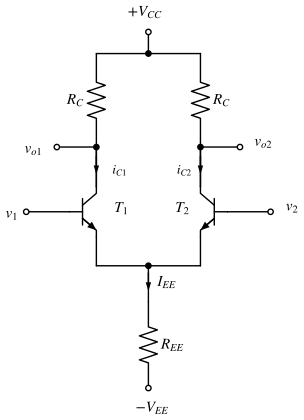
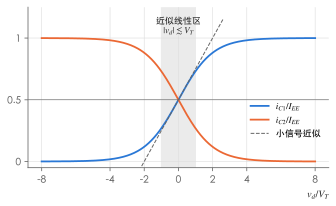
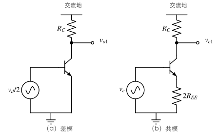
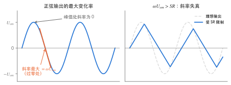

# 差分放大与集成运放

!!! abstract "TL;DR"
    - 任意两路输入可分解为**差模** $v_d=v_1-v_2$ 与**共模** $v_c=\dfrac{v_1+v_2}{2}$；差分电路放大 $v_d$、抑制 $v_c$，而温漂、电源波动都表现为共模信号。
    - 差模：两管射极为交流地，单管半电路就是共射放大器。双端输出 $A_d=-g_mR_C$，单端输出减半；$R_{id}=2r_\pi$。
    - 共模：尾电阻在半电路中变成 $2R_{EE}$，单端 $A_{c1}\approx-\dfrac{R_C}{2R_{EE}}$，$\mathrm{CMRR}\approx g_mR_{EE}$。用电流源作尾、双端输出可使 CMRR 极大。
    - 差分对是大信号非线性的：$i_{C1}-i_{C2}=I_{EE}\tanh\dfrac{v_d}{2V_T}$，只有 $|v_d|\lesssim V_T$ 时才近似线性。
    - 集成运放 = 差分输入级 + 中间增益级（带补偿电容）+ 互补输出级 + 电流源偏置；用 $U_{IO}$、$I_{IB}$、$I_{IO}$、GBW、SR 等参数描述它离理想有多远。

??? info "本章图卡（AI 生成速览，错误见文末「图卡勘误」）"
    { loading=lazy }
    { loading=lazy }

本文用到的共射小信号分析、电流镜见 [基本放大电路](basic-amplifiers.md)；理想运放的分析方法见 [含理想运放的电路](../extras/opamp.md)。

## 1. 零点漂移与差分思想

直接耦合放大器能放大直流，但输入为零时输出也会缓慢变化，叫**零点漂移**（温漂）。原因是晶体管参数随温度变化（$V_{BE}$ 约 $-2\,\mathrm{mV/^\circ C}$、$\beta$ 增大），第一级的漂移被后面各级一起放大，所以第一级最关键。

差分电路用两只特性相同的管子对称连接：温度变化对两管的影响相同，在两个输出端产生相同的变化，取两者之差即可抵消。把两路输入写成

$$
v_d=v_1-v_2,\qquad v_c=\frac{v_1+v_2}{2}\quad\Longleftrightarrow\quad v_1=v_c+\frac{v_d}{2},\ \ v_2=v_c-\frac{v_d}{2},
$$

线性电路中输出就是两部分的叠加：$v_o=A_dv_d+A_cv_c$。**共模抑制比**

$$
\mathrm{CMRR}=\left|\frac{A_d}{A_c}\right|,\qquad \mathrm{CMRR_{dB}}=20\lg\left|\frac{A_d}{A_c}\right|,
$$

越大越好。漂移、电源纹波、长导线上的感应干扰在两路输入中基本相同，都属于共模信号。

## 2. 长尾差分对：静态与大信号特性

{ .circuit }

**静态**（$v_1=v_2=0$）：两基极接地，射极电位 $-0.7\,\mathrm V$，

$$
I_{EE}=\frac{V_{EE}-V_{BE}}{R_{EE}},\qquad I_{C1}=I_{C2}\approx\frac{I_{EE}}{2},\qquad V_{C1}=V_{C2}=V_{CC}-\frac{I_{EE}}{2}R_C .
$$

若基极经电阻 $R_B$ 接地，还要计入基极电流在 $R_B$ 上的压降（$\beta$ 较大时通常可略）。

**大信号传输特性**：两管 $v_{BE}$ 之差就是 $v_d$，由 $i_C=I_Se^{v_{BE}/V_T}$ 得 $i_{C1}/i_{C2}=e^{v_d/V_T}$，又 $i_{C1}+i_{C2}=I_{EE}$（$\alpha\approx1$）：

$$
i_{C1}=\frac{I_{EE}}{1+e^{-v_d/V_T}},\qquad i_{C1}-i_{C2}=I_{EE}\tanh\frac{v_d}{2V_T}.
$$

{ .circuit }

- $v_d>0$ 时尾电流**从 $T_2$ 转向 $T_1$**：$i_{C1}$ 增大、$i_{C2}$ 减小，左集电极电压下降、右集电极电压上升；总电流始终是 $I_{EE}$。
- $|v_d|\lesssim V_T\approx26\,\mathrm{mV}$ 时近似线性，斜率 $\dfrac{\mathrm di_{C1}}{\mathrm dv_d}=\dfrac{I_{EE}}{4V_T}=\dfrac{g_m}{2}$；$|v_d|>4V_T\approx100\,\mathrm{mV}$ 时电流几乎全部流过一只管子——差分对成了电流开关，这也是它能限幅、用作比较器输入级的原因。
- 两射极各串电阻 $R_e$（射极负反馈）可以展宽线性范围，代价是增益下降。

## 3. 小信号分析：半电路法

电路完全对称时，差模、共模分别用**半电路**分析，比列整个电路的方程快得多。

{ .circuit }

**差模**（$v_1=+v_d/2$，$v_2=-v_d/2$）：一管电流增加多少，另一管就减少多少，流过 $R_{EE}$ 的交流电流为零，射极是**交流地**。半电路就是射极接地的共射放大器：

$$
v_{c1}=-\frac{g_mR_C}{2}v_d,\qquad v_{c2}=+\frac{g_mR_C}{2}v_d,
$$

$$
A_d=\frac{v_{c1}-v_{c2}}{v_d}=-g_mR_C\ (\text{双端}),\qquad A_{d1}=-\frac{g_mR_C}{2}\ (\text{单端，从}\ T_1\ \text{集电极取}),
$$

$$
R_{id}=2r_\pi,\qquad R_{od}=2R_C\ (\text{双端}).
$$

两集电极间接负载 $R_L$ 时，$R_L$ 的中点是差模交流地，半电路的负载为 $R_C\parallel\dfrac{R_L}{2}$。从 $T_2$ 集电极单端输出时同相：$A_{d2}=+\dfrac{g_mR_C}{2}$。

**共模**（$v_1=v_2=v_c$）：两管电流同增同减，$R_{EE}$ 中流过 $2i_e$，相当于每只管子射极接 $2R_{EE}$：

$$
A_{c1}=-\frac{\beta R_C}{r_\pi+(1+\beta)\,2R_{EE}}\approx-\frac{R_C}{2R_{EE}}\ (\text{单端}),\qquad A_c=0\ (\text{双端，理想对称}).
$$

单端输出的共模抑制比 $\mathrm{CMRR}=\dfrac{g_mR_C/2}{R_C/(2R_{EE})}=g_mR_{EE}$。要提高它就要加大 $R_{EE}$，但大电阻上直流压降太大——于是用**电流源**代替 $R_{EE}$：直流只需零点几伏，交流电阻却是 $r_o$（几百千欧以上）。

| | 双端输出 | 单端输出 |
| --- | --- | --- |
| 差模增益 | $-g_mR_C$（或 $-g_m(R_C\parallel\frac{R_L}{2})$） | $\mp\dfrac{g_mR_C}{2}$ |
| 共模增益 | 理想为 0（实际由失配决定） | $\approx-\dfrac{R_C}{2R_{EE}}$ |
| 差模输入电阻 | $2r_\pi$ | $2r_\pi$ |
| 输出电阻 | $2R_C$ | $R_C$ |

??? example "例 1：长尾差分对的静态与增益"
    图中 $V_{CC}=V_{EE}=12\,\mathrm V$，$R_C=10\,\mathrm{k\Omega}$，$R_{EE}=11.3\,\mathrm{k\Omega}$，$\beta=100$，两基极直接接信号源（直流电位 0）。求 Q 点、$A_d$（双端）、$A_{d1}$、$R_{id}$、$A_{c1}$ 与单端 CMRR。

    1. $I_{EE}=\dfrac{12-0.7}{11.3}=1\,\mathrm{mA}$，$I_C\approx0.5\,\mathrm{mA}$，$V_C=12-0.5\times10=7\,\mathrm V$。
    2. $g_m=\dfrac{0.5}{26}\,\mathrm S=19.23\,\mathrm{mS}$，$r_\pi=\dfrac{100}{19.23\,\mathrm{mS}}=5.2\,\mathrm{k\Omega}$。
    3. 差模：$A_d=-19.23\times10=-192.3$，$A_{d1}=-96.2$，$R_{id}=10.4\,\mathrm{k\Omega}$。
    4. 共模：$A_{c1}=-\dfrac{100\times10}{5.2+101\times22.6}=-0.437$（近似式 $-\dfrac{10}{22.6}=-0.442$）。
    5. $\mathrm{CMRR}=\dfrac{96.2}{0.437}=220$，即 $46.8\,\mathrm{dB}$。

    把 $R_{EE}$ 换成 $I_{EE}=1\,\mathrm{mA}$、输出电阻 $r_o=1\,\mathrm{M\Omega}$ 的电流源：$A_{c1}=-\dfrac{1000}{5.2+101\times2000}=-0.00495$，CMRR 升到 $1.94\times10^4$（$85.8\,\mathrm{dB}$），约为 $g_mr_o$。

??? example "例 2：两路输入的分解与输出（图卡例题）"
    例 1 电路，$v_1=1.01\,\mathrm V$，$v_2=0.99\,\mathrm V$。求 $v_d$、$v_c$、电流转向，单端输出 $v_{c1}$ 的变化量和双端输出电压。

    1. $v_d=1.01-0.99=20\,\mathrm{mV}$，$v_c=\dfrac{1.01+0.99}{2}=1\,\mathrm V$。
    2. $v_d>0$：尾电流由 $T_2$ 转向 $T_1$，$I_{C1}>I_{EE}/2>I_{C2}$。
    3. 单端：$\Delta v_{C1}=A_{d1}v_d+A_{c1}v_c=-96.2\times0.02-0.437\times1=-1.92-0.44=-2.36\,\mathrm V$。共模项占了约 19%——单端输出时共模信号并没有被"抵消"。
    4. 双端：$v_{od}=A_dv_d=-192.3\times0.02=-3.85\,\mathrm V$，共模项理想情况下为零。

    核对：（a）共模 $1\,\mathrm V$ 使 $I_{EE}$ 变为 $\dfrac{12+1-0.7}{11.3}=1.088\,\mathrm{mA}$，每管 $I_C$ 增大 $0.044\,\mathrm{mA}$，$V_{C1}$ 下降 $0.44\,\mathrm V$，与 $A_{c1}v_c$ 一致。（b）$v_d=20\,\mathrm{mV}$ 与 $V_T$ 相当，按 $\tanh$ 计算每管电流变化 $\dfrac{I_{EE}}2\tanh\dfrac{v_d}{2V_T}=0.183\,\mathrm{mA}$，比线性值 $\dfrac{g_m}{2}v_d=0.192\,\mathrm{mA}$ 小约 5%——小信号公式在这里已是近似。

## 4. 有源负载

{ .circuit }

集成运放的输入级用 PNP 电流镜 $T_3$、$T_4$ 作负载。差模输入时 $T_1$ 电流增加 $\Delta i$，经镜像使 $T_4$ 也向输出端多供出 $\Delta i$；同时 $T_2$ 电流减少 $\Delta i$。输出节点得到 $2\Delta i=g_mv_d$ 的电流，流入 $r_{o2}\parallel r_{o4}$：

$$
A_d=\frac{v_o}{v_d}=g_m\,(r_{o2}\parallel r_{o4}),
$$

相当于**单端输出得到了双端输出的增益**，而且负载电阻是晶体管的 $r_o$（几百千欧），单级增益可达上千。输出与 $v_1$ 同相：$v_1$ 是同相输入端，$v_2$ 是反相输入端。共模输入时两管电流同向变化，镜像把它们抵消，单端输出也有很高的 CMRR。

??? example "例 3：有源负载差分级的增益"
    上图中 $I_T=200\,\mathrm{\mu A}$，所有管子 $V_A=100\,\mathrm V$，$\beta=100$。求差模增益。

    1. 每管 $I_C=100\,\mathrm{\mu A}$，$g_m=\dfrac{0.1}{26}\,\mathrm S=3.85\,\mathrm{mS}$。
    2. $r_{o2}=r_{o4}=\dfrac{100\,\mathrm V}{0.1\,\mathrm{mA}}=1\,\mathrm{M\Omega}$，并联 $500\,\mathrm{k\Omega}$。
    3. $A_d=3.85\,\mathrm{mS}\times500\,\mathrm{k\Omega}=1923$，即 $65.7\,\mathrm{dB}$。

    对四只管子（含 $r_o$）列节点方程数值求解，得 $1922.8$，与公式一致。实际上这个增益要求后级输入电阻远大于 $500\,\mathrm{k\Omega}$，所以第二级常用射极跟随器或达林顿管来隔离。

## 5. 集成运放的内部结构

{ .circuit }

| 部分 | 典型电路 | 作用 |
| --- | --- | --- |
| 输入级 | 差分对 + 电流源尾 + 有源负载（BJT、JFET 或 MOS 输入） | 高输入电阻、高 CMRR、低失调与温漂 |
| 中间级 | 共射（共源）放大，常用复合管 + 有源负载；接米勒补偿电容 $C_c$ | 提供主要电压增益；$C_c$ 形成主导极点，保证闭环稳定（见 [负反馈放大电路](feedback.md)） |
| 输出级 | 互补对称推挽（OCL），用二极管或 $V_{BE}$ 倍增电路偏置成甲乙类 | 低输出电阻、输出电流大、摆幅接近电源；偏置用于消除交越失真（见 [功率放大与直流电源](power.md)） |
| 偏置电路 | 电流镜、Widlar 微电流源 | 为各级提供稳定的工作电流 |

单片集成的特点：相邻元件参数**匹配**好（适合差分、镜像），但绝对精度差；大电阻、大电容难做，所以用晶体管代替电阻（有源负载）、用直接耦合代替电容耦合。电平移动（用 PNP 管或稳压支路）使输入为零时输出也为零。

## 6. 非理想参数

| 参数 | 定义 | 对电路的影响 |
| --- | --- | --- |
| 开环差模增益 $A_{od}$ | 低频开环电压增益，$10^4\sim10^7$ | 闭环增益误差 $\approx1/(A_{od}F)$ |
| 输入失调电压 $U_{IO}$ | 使输出为零需在输入端加的补偿电压，几十微伏至几毫伏 | 输出出现直流误差 $\approx(1+R_f/R_1)U_{IO}$ |
| 输入偏置电流 $I_{IB}$ | 两输入端静态电流的平均值 $\dfrac{I_{B+}+I_{B-}}{2}$ | 流过外接电阻产生误差电压；用平衡电阻 $R_p$ 抵消 |
| 输入失调电流 $I_{IO}$ | $\vert I_{B+}-I_{B-}\vert$，约为 $I_{IB}$ 的 1/10 | 加平衡电阻后剩下的误差 $\approx I_{IO}R_f$ |
| 温漂 $\mathrm dU_{IO}/\mathrm dT$ | $U_{IO}$ 随温度的变化率 | 无法用调零消除 |
| 共模抑制比 CMRR | $20\lg\vert A_{od}/A_{oc}\vert$，$70\sim120\,\mathrm{dB}$ | 同相、差分电路中共模输入引起的误差 |
| 共模输入范围 $U_{ICM}$ | 保证线性工作的输入共模电压范围 | 超出后输入级饱和或截止 |
| 增益带宽积 GBW（单位增益带宽 $f_T$） | 主导极点以上 $\vert A_{od}\vert\cdot f$ 近似为常数 | 闭环带宽 $f_H\approx\dfrac{\mathrm{GBW}}{1+R_f/R_1}$ |
| 压摆率 SR | 闭环大信号时输出电压的最大变化率，常用 $\mathrm{V/\mu s}$ | 输出 $\vert\mathrm dv_o/\mathrm dt\vert$ 超过 SR 时出现斜率失真 |
| 输出电阻、输出摆幅 | 开环输出电阻几十欧；摆幅比电源低 $1\sim2\,\mathrm V$（轨到轨运放可接近电源） | 带负载能力、最大输出幅度 |

### 6.1 失调与偏置电流引起的输出误差

{ .circuit }

把实际运放看成"理想运放 + 同相端串联 $U_{IO}$ + 两输入端流入 $I_{B+}$、$I_{B-}$"，输入信号置零，对反相端列 KCL（同相端电位 $U_{IO}-I_{B+}R_p$）：

$$
U_O=\Big(1+\frac{R_f}{R_1}\Big)\big(U_{IO}-I_{B+}R_p\big)+I_{B-}R_f .
$$

取 $R_p=R_1\parallel R_f$ 时 $\big(1+\frac{R_f}{R_1}\big)R_p=R_f$，

$$
U_O=\Big(1+\frac{R_f}{R_1}\Big)U_{IO}+R_f\,(I_{B-}-I_{B+}),\qquad |U_O|\le\Big(1+\frac{R_f}{R_1}\Big)|U_{IO}|+I_{IO}R_f .
$$

偏置电流误差从 $I_{IB}R_f$ 降到 $I_{IO}R_f$。注意失调电压的系数是"噪声增益" $1+R_f/R_1$，反相放大器也一样（不是 $R_f/R_1$）。

??? example "例 4：反相放大器的输出失调"
    反相放大器 $R_1=10\,\mathrm{k\Omega}$，$R_f=100\,\mathrm{k\Omega}$，运放 $U_{IO}=2\,\mathrm{mV}$，$I_{IB}=80\,\mathrm{nA}$，$I_{IO}=20\,\mathrm{nA}$。求输入接地时输出误差的最大值：（1）同相端直接接地；（2）同相端接平衡电阻 $R_p$。

    1. $R_p=0$：$U_O=11U_{IO}+I_{B-}R_f$。最坏情况两项同号、$I_{B-}=I_{IB}+I_{IO}/2=90\,\mathrm{nA}$：$22+9=31\,\mathrm{mV}$。
    2. $R_p=10\parallel100=9.09\,\mathrm{k\Omega}$：$|U_O|\le22+20\,\mathrm{nA}\times100\,\mathrm{k\Omega}=22+2=24\,\mathrm{mV}$。

    剩下的主要是 $U_{IO}$ 项，要靠调零端或选低失调运放解决；放大直流小信号时要考虑它，交流耦合电路通常不必。

### 6.2 增益带宽积与压摆率

运放开环频响近似为单极点：$A(jf)=\dfrac{A_{od}}{1+jf/f_H}$，$f\gg f_H$ 时 $|A|f\approx A_{od}f_H=\mathrm{GBW}$。负反馈后闭环带宽 $f_{Hf}\approx\dfrac{\mathrm{GBW}}{1+R_f/R_1}$——这是**小信号**带宽。

压摆率是**大信号**限制：中间级的补偿电容 $C_c$ 只能由有限电流充电，$\mathrm{SR}=I_{max}/C_c$。正弦输出 $v_o=U_{om}\sin\omega t$ 的最大变化率出现在**过零处**，等于 $\omega U_{om}$，所以不失真条件是

$$
\omega U_{om}\le\mathrm{SR}\quad\Longleftrightarrow\quad f\le f_p=\frac{\mathrm{SR}}{2\pi U_{om}}\ (\text{全功率带宽}).
$$

{ .circuit }

超过后输出变成三角波状，且频率越高、幅度越大越严重。实际可用带宽取 GBW 决定的 $f_{Hf}$ 与 SR 决定的 $f_p$ 中较小者。

??? example "例 5：压摆率与全功率带宽（含图卡例题）"
    （1）运放输出峰值 $2\,\mathrm V$、频率 $100\,\mathrm{kHz}$ 的正弦，SR 至少要多少？（2）某运放 $\mathrm{SR}=0.5\,\mathrm{V/\mu s}$，输出峰值 $10\,\mathrm V$ 时全功率带宽是多少？（3）该运放 $\mathrm{GBW}=1\,\mathrm{MHz}$，接成增益 10 的同相放大器，要输出 $20\,\mathrm{kHz}$、峰值 $5\,\mathrm V$ 的正弦，能否做到？

    1. $\mathrm{SR}\ge2\pi fU_{om}=2\pi\times10^5\times2=1.26\times10^6\,\mathrm{V/s}=1.26\,\mathrm{V/\mu s}$。
    2. $f_p=\dfrac{0.5\times10^6}{2\pi\times10}=7.96\,\mathrm{kHz}$。
    3. 小信号带宽 $\dfrac{1\,\mathrm{MHz}}{10}=100\,\mathrm{kHz}>20\,\mathrm{kHz}$，没问题；但需要的变化率 $2\pi\times2\times10^4\times5=0.628\,\mathrm{V/\mu s}>0.5\,\mathrm{V/\mu s}$，会出现斜率失真。$20\,\mathrm{kHz}$ 下不失真的最大峰值为 $\dfrac{0.5\times10^6}{2\pi\times2\times10^4}=3.98\,\mathrm V$。

## 练习

### 1. 概念判断 :material-star::material-star-outline::material-star-outline:

判断下列说法是否正确：

1. 差分放大电路单端输出时，共模增益为零。
2. 长尾差分对中加大 $R_{EE}$ 可以提高共模抑制比，但不改变差模增益。
3. $v_d>0$ 时，$T_1$ 集电极电位升高。
4. 有源负载差分级单端输出的差模增益约等于电阻负载双端输出时的差模增益（负载电阻相同时）。
5. 运放的压摆率限制只与输出信号的频率有关，与幅度无关。

??? success "答案"
    1 ✗　2 ✓　3 ✗　4 ✓　5 ✗

??? note "解析"
    1. 单端 $A_{c1}\approx-R_C/(2R_{EE})$，只有双端输出且完全对称时共模输出才抵消。
    2. 差模半电路中射极是交流地，$R_{EE}$ 不出现；共模半电路中它变成 $2R_{EE}$。
    3. $v_d>0$ 时 $i_{C1}$ 增大，$v_{C1}=V_{CC}-i_{C1}R_C$ 下降。
    4. 电流镜把 $T_1$ 的电流变化"搬"到输出端，单端输出得到 $g_m\times$ 负载电阻，与双端输出 $g_mR_C$ 形式相同。
    5. 不失真条件是 $2\pi fU_{om}\le\mathrm{SR}$，频率和幅度都有关。

### 2. 差模共模分解 :material-star::material-star-outline::material-star-outline:

差分放大器单端输出的 $A_{d1}=-50$，$A_{c1}=-0.05$。输入 $v_1=2.005\,\mathrm V$，$v_2=1.995\,\mathrm V$。求 $v_d$、$v_c$、输出变化量 $\Delta v_{o1}$ 和 CMRR（dB）。

??? success "答案"
    $v_d=10\,\mathrm{mV}$，$v_c=2\,\mathrm V$，$\Delta v_{o1}=-0.6\,\mathrm V$，$\mathrm{CMRR}=60\,\mathrm{dB}$。

??? note "解析"
    $\Delta v_{o1}=-50\times0.01+(-0.05)\times2=-0.5-0.1=-0.6\,\mathrm V$。共模信号是差模的 200 倍，即使 CMRR 有 1000，共模项仍贡献了 1/6 的输出。$\mathrm{CMRR}=20\lg\dfrac{50}{0.05}=60\,\mathrm{dB}$。

### 3. 电流源尾的差分对 :material-star::material-star::material-star-outline:

$V_{CC}=V_{EE}=15\,\mathrm V$，$R_C=15\,\mathrm{k\Omega}$，尾电流源 $I_T=0.4\,\mathrm{mA}$、输出电阻 $500\,\mathrm{k\Omega}$，$\beta=150$，两集电极之间接 $R_L=30\,\mathrm{k\Omega}$。求 $V_C$、双端差模增益、$R_{id}$ 和单端共模增益 $A_{c1}$。

??? success "答案"
    $V_C=12\,\mathrm V$，$A_d=-57.7$，$R_{id}=39\,\mathrm{k\Omega}$，$A_{c1}=-0.0149$。

??? note "解析"
    1. $I_C=0.2\,\mathrm{mA}$，$V_C=15-0.2\times15=12\,\mathrm V$；$g_m=7.69\,\mathrm{mS}$，$r_\pi=\dfrac{150}{7.69\,\mathrm{mS}}=19.5\,\mathrm{k\Omega}$。
    2. 差模：$R_L$ 中点是交流地，半电路负载 $15\parallel15=7.5\,\mathrm{k\Omega}$，$A_d=-7.69\times7.5=-57.7$；$R_{id}=2r_\pi=39\,\mathrm{k\Omega}$。
    3. 共模：两集电极电位相同，$R_L$ 中无电流；$A_{c1}=-\dfrac{150\times15}{19.5+151\times1000}=-0.0149\approx-\dfrac{R_C}{2r_o}$。

### 4. 同相放大器的输出失调 :material-star::material-star::material-star-outline:

同相放大器 $R_1=1\,\mathrm{k\Omega}$，$R_f=99\,\mathrm{k\Omega}$，运放 $U_{IO}=1\,\mathrm{mV}$，$I_{IB}=100\,\mathrm{nA}$，$I_{IO}=10\,\mathrm{nA}$。信号源内阻可忽略。求输出失调的最大值：（1）同相端串平衡电阻 $R_p=R_1\parallel R_f$；（2）不加 $R_p$。

??? success "答案"
    （1）约 $101\,\mathrm{mV}$；（2）约 $110\,\mathrm{mV}$。

??? note "解析"
    1. $R_p=0.99\,\mathrm{k\Omega}$：$|U_O|\le100\times1\,\mathrm{mV}+10\,\mathrm{nA}\times99\,\mathrm{k\Omega}=100+0.99=101\,\mathrm{mV}$。
    2. $R_p=0$：$|U_O|\le100+105\,\mathrm{nA}\times99\,\mathrm{k\Omega}=100+10.4=110\,\mathrm{mV}$。

    高增益时 $U_{IO}$ 项占绝对优势，平衡电阻作用不大；此时应调零或选低失调运放。

### 5. 小信号带宽与大信号带宽 :material-star::material-star::material-star:

运放 $A_{od}=2\times10^5$，$\mathrm{GBW}=1\,\mathrm{MHz}$，$\mathrm{SR}=0.5\,\mathrm{V/\mu s}$。（1）开环 $-3\,\mathrm{dB}$ 频率；（2）接成增益 $-10$ 的反相放大器，闭环带宽是多少？（3）要求输出峰值 $2\,\mathrm V$ 的正弦不失真，最高频率是多少？实际可用带宽由谁决定？

??? success "答案"
    （1）$5\,\mathrm{Hz}$；（2）$90.9\,\mathrm{kHz}$；（3）$39.8\,\mathrm{kHz}$，由 SR 决定。

??? note "解析"
    1. $f_H=\mathrm{GBW}/A_{od}=10^6/(2\times10^5)=5\,\mathrm{Hz}$——开环带宽极窄，必须加负反馈使用。
    2. 反相放大器的反馈系数 $F=\dfrac{R_1}{R_1+R_f}$，闭环带宽 $\mathrm{GBW}\cdot F=\dfrac{1\,\mathrm{MHz}}{1+10}=90.9\,\mathrm{kHz}$，不是 $100\,\mathrm{kHz}$。
    3. $f_p=\dfrac{0.5\times10^6}{2\pi\times2}=39.8\,\mathrm{kHz}<90.9\,\mathrm{kHz}$：峰值 $2\,\mathrm V$ 时可用带宽受 SR 限制；只有输出幅度小于 $\dfrac{0.5\times10^6}{2\pi\times90.9\times10^3}\approx0.88\,\mathrm V$ 时，才轮到 GBW 起限制作用。

## 图卡勘误

| 图卡位置 | 原文 | 更正 |
| --- | --- | --- |
| 13 解法 | "电流由 $T_1$ 向 $T_2$ 转向（左增右减）" | 方向写反：$v_d>0$ 时尾电流**由 $T_2$ 转向 $T_1$**（括号里的"左增右减"是对的） |
| 13 结论 | "双出：$v_{o1}=A_dv_d$，$v_{o2}=-A_dv_d$" | 从集电极取输出时 $v_{o1}=-\dfrac{g_mR_C}{2}v_d$，$v_{o2}=+\dfrac{g_mR_C}{2}v_d$；"双端输出"指 $v_{od}=v_{o1}-v_{o2}=-g_mR_Cv_d$，$A_d=-g_mR_C$。左管输入升高，左集电极电压下降 |
| 13 结论 | "单出：$v_o=A_dv_d$" | 单端差模增益只有双端的一半（$A_{d1}=A_d/2$），且单端输出还含共模项 $A_{c1}v_c$ |
| 13 知识点 | "对称抵消……理想情况下 $A_c\approx0$" | 只对**双端**输出成立；单端输出 $A_{c1}\approx-R_C/(2R_{EE})$，要靠大 $R_{EE}$ 或电流源尾减小 |
| 13 例题 | 把 $v_d=20\,\mathrm{mV}$ 当作差模小信号 | $20\,\mathrm{mV}$ 与 $V_T=26\,\mathrm{mV}$ 相当，按 $\tanh$ 特性电流变化比线性值小约 5%；小信号近似要求 $\vert v_d\vert\ll2V_T$ |
| 14 读图（压摆率） | "最大斜率 $=\omega V_p$"的箭头指向波峰附近 | 正弦在波峰处斜率为零，最大斜率 $\omega V_p$ 出现在**过零处** |
| 14 内部结构图 | $Q_1$、$Q_2$ 集电极连在同一节点上，由一个电流源供电 | 两集电极短接就没有差模输出；应接电流镜有源负载，从一侧集电极取单端输出送中间级 |
| 14 内部结构图 | 互补输出管 $Q_N$、$Q_P$ 基极直接相连、无偏置 | 这样是乙类工作，有交越失真；实际运放用二极管或 $V_{BE}$ 倍增电路把输出级偏置成甲乙类 |
| 14 参数表 | GBW"开环增益与频率的乘积（单主极点下近似为常数），决定带宽" | 只在主导极点频率以上近似为常数；闭环带宽 $\approx\mathrm{GBW}/(1+R_f/R_1)$，反相放大器也用 $1+R_f/R_1$，而不是闭环增益 $R_f/R_1$ |
