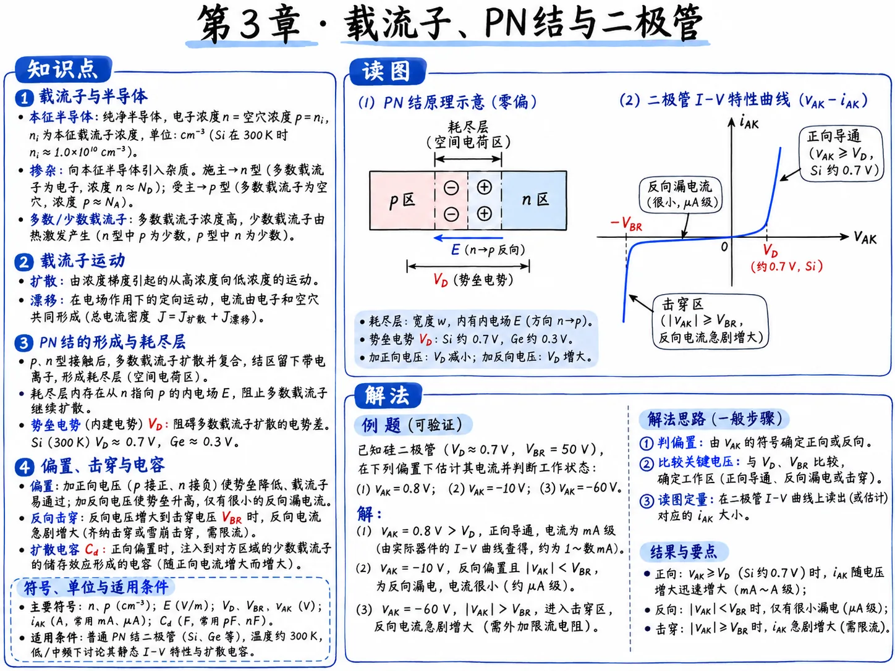
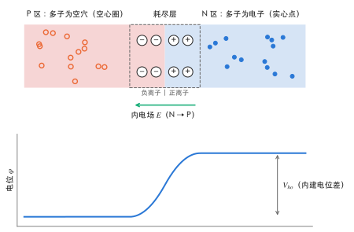
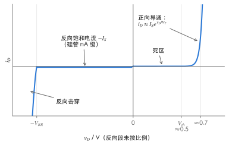
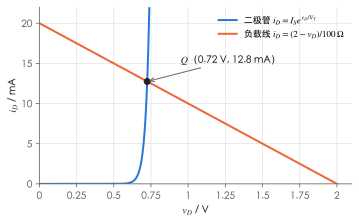

# 半导体与二极管

!!! abstract "TL;DR"
    - 杂质半导体中多子浓度由掺杂决定（N 型 $n\approx N_D$），少子由热激发产生（$p=n_i^2/N_D$），对温度敏感——这是半导体器件温漂的根源。
    - PN 结：多子扩散留下离子形成**耗尽层**和内电场，**内建电位差** $V_{ho}$ 阻止进一步扩散。正偏势垒降低、电流随电压**指数**增大；反偏只有极小的反向饱和电流；反压过大发生**击穿**。
    - 二极管方程 $i_D=I_S\big(e^{v_D/V_T}-1\big)$：电流每增 10 倍，压降只增约 $60\,\mathrm{mV}$；温度每升 $1^\circ\mathrm C$，压降约降 $2\,\mathrm{mV}$。
    - 电路分析用分段模型：**理想**（$V_D=0$）、**恒压降**（硅 $0.7\,\mathrm V$）、**折线**；交流小信号用 $r_d=V_T/I_D$。多个二极管时**先假设状态、再验证**。
    - 稳压管工作在反向击穿区，要串限流电阻并满足 $I_{Z\min}\le I_Z\le I_{ZM}$。

??? info "本章图卡（AI 生成速览，错误见文末「图卡勘误」）"
    { loading=lazy }
    { loading=lazy }

## 1. 半导体与载流子

| 概念 | 要点 |
| --- | --- |
| 本征半导体 | 纯净晶体，电子与空穴成对产生，$n=p=n_i$；硅在 $300\,\mathrm K$ 时 $n_i\approx1.5\times10^{10}\,\mathrm{cm^{-3}}$（较新的数据为 $1.0\times10^{10}$），温度升高 $n_i$ 迅速增大 |
| N 型 | 掺五价**施主**（磷），多子为电子，$n\approx N_D$ |
| P 型 | 掺三价**受主**（硼），多子为空穴，$p\approx N_A$ |
| 质量作用定律 | 热平衡时 $np=n_i^2$，所以少子浓度 $p=n_i^2/N_D$ 极小，且随温度剧烈变化 |
| 扩散运动 | 由浓度差引起，形成扩散电流 |
| 漂移运动 | 由电场引起，形成漂移电流；电子与空穴的漂移电流方向相同，相加 |

杂质半导体整体仍是**电中性**的：N 型中电子多，但施主离子带等量正电荷。

## 2. PN 结

{ .circuit }

**形成**：P、N 区接触后，多子向对方扩散并复合，交界处留下不能移动的离子（P 侧负离子、N 侧正离子），形成**耗尽层**（空间电荷区）和由 N 指向 P 的内电场。内电场阻碍多子扩散、促进少子漂移，最终两者动态平衡，净电流为零。

**内建电位差**（势垒高度）

$$
V_{ho}=V_T\ln\frac{N_AN_D}{n_i^2},
$$

硅约 $0.6\sim0.8\,\mathrm V$，锗约 $0.2\sim0.4\,\mathrm V$，随掺杂浓度变化。它**不能**用电压表在二极管两端测到（金属—半导体接触电位把它抵消了），也不等于后面所说的导通压降 $0.7\,\mathrm V$——两者数值接近，概念不同。

**单向导电性**：

- **正偏**（P 接高电位）：势垒降为 $V_{ho}-v_D$，耗尽层变窄，多子扩散电流按指数增大；
- **反偏**：势垒升为 $V_{ho}+|v_D|$，耗尽层变宽，只剩少子漂移形成的**反向饱和电流** $I_S$，基本与反压无关，但随温度约每 $10^\circ\mathrm C$ 翻一倍。

**结电容**（高频时并联在结上，限制开关速度和高频响应）：

| | 势垒电容 $C_B$（$C_T$） | 扩散电容 $C_D$ |
| --- | --- | --- |
| 来源 | 耗尽层宽度随电压变化，离子电荷量变化 | 正偏时注入对方区域的少子存储电荷 |
| 主导偏置 | **反偏** | **正偏** |
| 规律 | 反压越大，耗尽层越宽，$C_B$ 越小（变容二极管） | 正向电流越大，$C_D$ 越大 |

**反向击穿**：

| | 齐纳击穿 | 雪崩击穿 |
| --- | --- | --- |
| 条件 | 高掺杂、耗尽层很薄 | 低掺杂、耗尽层较宽 |
| 机理 | 强电场直接把价电子拉出（场致激发） | 载流子被加速后碰撞电离，倍增 |
| 击穿电压 | 较低（硅约 $4\,\mathrm V$ 以下） | 较高（约 $7\,\mathrm V$ 以上） |
| 温度系数 | 负 | 正 |

$4\sim7\,\mathrm V$ 之间两种机理并存，温度系数可接近零，所以约 $5\sim6\,\mathrm V$ 的稳压管温度稳定性最好。击穿本身是**可逆**的（电击穿），只要限流使功耗不超标；过热导致的热击穿才会烧坏器件。

??? example "例：少子浓度与内建电位差"
    硅 PN 结 $N_A=10^{17}\,\mathrm{cm^{-3}}$，$N_D=10^{16}\,\mathrm{cm^{-3}}$，$n_i=1.5\times10^{10}\,\mathrm{cm^{-3}}$，$V_T=26\,\mathrm{mV}$。求 N 区少子浓度和 $V_{ho}$。

    1. N 区多子 $n\approx N_D=10^{16}$，少子 $p=\dfrac{n_i^2}{N_D}=\dfrac{2.25\times10^{20}}{10^{16}}=2.25\times10^4\,\mathrm{cm^{-3}}$，比多子少 12 个数量级。
    2. $V_{ho}=0.026\ln\dfrac{10^{17}\times10^{16}}{2.25\times10^{20}}=0.026\times29.1\approx0.76\,\mathrm V$。

## 3. 二极管的伏安特性

{ .circuit }

$$
i_D=I_S\big(e^{v_D/(nV_T)}-1\big),\qquad V_T=\frac{kT}{q}\approx26\,\mathrm{mV}\ (300\,\mathrm K),
$$

$n=1\sim2$ 为发射系数，教材中一般取 $n=1$。要点：

- **死区**：正向电压小于开启电压 $V_{th}$（硅约 $0.5\,\mathrm V$，锗约 $0.1\,\mathrm V$）时电流很小；导通后压降硅约 $0.6\sim0.8\,\mathrm V$，锗约 $0.2\sim0.3\,\mathrm V$。
- **指数规律**：$v_D\gg V_T$ 时 $i_D\approx I_Se^{v_D/V_T}$，电流变 10 倍，电压变 $V_T\ln10\approx60\,\mathrm{mV}$。所以"导通后压降近似不变"，但反过来，**压降略有变化电流就变很多**：不能把一个电压源直接加在导通的二极管两端，电流必须由外电路（电阻）限定。
- **反向**：电流约为 $-I_S$。硅管实测反向电流在 nA 级（以表面漏电和耗尽层产生电流为主，比理论 $I_S$ 大），锗管在 $\mu\mathrm A$ 级。
- **温度**：$I_S$ 约每 $10^\circ\mathrm C$ 翻倍；电流一定时 $v_D$ 约 $-2\,\mathrm{mV/^\circ C}$。
- **主要参数**：最大整流电流 $I_F$、最高反向工作电压 $V_R$（一般取击穿电压的一半）、反向电流 $I_R$、最高工作频率 $f_M$。

??? example "例：指数特性有多「陡」"
    某硅管 $0.7\,\mathrm V$ 时电流 $1\,\mathrm{mA}$。（1）$0.8\,\mathrm V$ 时电流约多少？（2）电流从 $1\,\mathrm{mA}$ 增到 $10\,\mathrm{mA}$，压降增加多少？

    1. $\dfrac{i_2}{i_1}=e^{(0.8-0.7)/0.026}=e^{3.85}\approx46.8$，$i\approx47\,\mathrm{mA}$——电压只多 $0.1\,\mathrm V$，电流就增大近 50 倍。
    2. $\Delta v=0.026\ln10\approx60\,\mathrm{mV}$，即 $0.76\,\mathrm V$。

    反推 $I_S=1\,\mathrm{mA}/e^{0.7/0.026}\approx2\times10^{-15}\,\mathrm A$，这就是理论上的反向饱和电流量级。

## 4. 二极管模型与分析方法

{ .circuit }

| 模型 | 导通时 | 截止时 | 适用 |
| --- | --- | --- | --- |
| 理想 | 短路，$V_D=0$ | 开路 | 电源电压远大于 $0.7\,\mathrm V$；逻辑判断 |
| 恒压降 | 电压源 $V_{D(on)}$（硅 $0.7\,\mathrm V$、锗 $0.2\,\mathrm V$） | 开路 | 直流估算的**默认模型** |
| 折线 | $V_{th}$ 串电阻 $r_D$ | 开路 | 电流变化范围大、要求更精确时 |
| 小信号 | 动态电阻 $r_d=\dfrac{V_T}{I_D}$ | — | 已知 $Q$ 点，叠加小交流信号时 |

$r_d$ 来自 $\dfrac{\mathrm di_D}{\mathrm dv_D}=\dfrac{I_S e^{V_D/V_T}}{V_T}\approx\dfrac{I_D}{V_T}$，即 [非线性电阻的小信号分析](../extras/nonlinear.md) 里的"$Q$ 点切线"。$I_D=1\,\mathrm{mA}$ 时 $r_d=26\,\Omega$。

**分析步骤**（假设—验证，与 [理想二极管](../notes/analysis-methods.md#5-理想二极管先假设再验证) 相同）：

1. 断开二极管，求其两端开路电压（复杂网络先做 [戴维南等效](../notes/circuit-theorems.md)）；阳极高于阴极超过 $V_{D(on)}$ 则导通。
2. 按假设代入模型求解。
3. 验证：导通管电流须为正（阳极流向阴极），截止管电压须小于 $V_{D(on)}$。不符则改假设重算。
4. 多个二极管共阳（或共阴）时，**阳极电位最高、阴极电位最低**的那只承受最大正向电压，先导通；它导通后把节点电压钳住，其余可能被反偏截止。

**图解法**：二极管以外的线性部分化成戴维南电路 $(V_{th},R_{th})$，负载线 $i_D=\dfrac{V_{th}-v_D}{R_{th}}$ 与伏安特性的交点就是 $Q$ 点。

{ .circuit }

??? example "例：三种模型的比较"
    $2\,\mathrm V$ 电源经 $R=100\,\Omega$ 给硅二极管正向供电，$I_S=10^{-14}\,\mathrm A$。分别用理想模型、恒压降模型、指数模型求电流。

    1. 理想：$I=2/100=20\,\mathrm{mA}$。
    2. 恒压降：$I=(2-0.7)/100=13\,\mathrm{mA}$。
    3. 指数：联立 $I=\dfrac{2-v_D}{100}$ 与 $v_D=V_T\ln\dfrac{I}{I_S}$，迭代（或用上图负载线）得 $v_D\approx0.725\,\mathrm V$，$I\approx12.75\,\mathrm{mA}$。

    恒压降模型误差约 $2\%$；理想模型误差 $57\%$，因为电源只有 $2\,\mathrm V$，与 $0.7\,\mathrm V$ 不是"远大于"的关系。电源换成 $5\,\mathrm V$、$R=1\,\mathrm{k\Omega}$ 时，指数模型给出 $4.30\,\mathrm{mA}$，恒压降 $4.3\,\mathrm{mA}$，几乎一样。

??? example "例：判断工作状态（图卡 04 例的改写）"
    硅二极管 $V_{BR}=50\,\mathrm V$，与 $R=10\,\mathrm{k\Omega}$ 串联后接电源 $V_S$（正极接电阻一端，电阻另一端接阳极，阴极接电源负极）。$V_S$ 分别为 $5\,\mathrm V$、$-10\,\mathrm V$、$-60\,\mathrm V$，求二极管电压与电流。

    1. $V_S=5\,\mathrm V$：正偏导通，$v_D\approx0.7\,\mathrm V$，$I=\dfrac{5-0.7}{10}=0.43\,\mathrm{mA}$。
    2. $V_S=-10\,\mathrm V$：反偏且 $10\,\mathrm V<V_{BR}$，截止，电流为 nA 级反向电流，电阻上几乎无压降，$v_D\approx-10\,\mathrm V$。
    3. $V_S=-60\,\mathrm V$：若仍截止则 $v_D=-60\,\mathrm V$，超过 $V_{BR}$，矛盾；所以击穿，$v_D\approx-50\,\mathrm V$，反向电流 $\dfrac{60-50}{10}=1\,\mathrm{mA}$，由电阻限定。

??? example "例：两个二极管谁先导通"
    { .circuit }

    $V_1=0$，$V_2=3\,\mathrm V$，硅管 $V_{D(on)}=0.7\,\mathrm V$。求 $V_O$ 及各管状态。

    1. 断开两管：节点 O 经 $R$ 接 $+10\,\mathrm V$，两管阳极电位相同，阴极 $V_1=0$ 更低，所以 $D_1$ 承受的正向电压更大，先导通。
    2. $D_1$ 导通：$V_O=0+0.7=0.7\,\mathrm V$，$I=\dfrac{10-0.7}{2}=4.65\,\mathrm{mA}>0$ ✓。
    3. 验证 $D_2$：$V_O-V_2=0.7-3=-2.3\,\mathrm V$，反偏截止 ✓。

    只要有一个输入为低电平，输出就是低电平——这是二极管"与门"。

??? example "例：小信号——电源纹波在二极管上的分量"
    直流 $5\,\mathrm V$ 上叠加幅值 $0.1\,\mathrm V$ 的纹波，经 $R=4.3\,\mathrm{k\Omega}$ 接硅二极管。求二极管电压的交流分量。

    1. **直流**（恒压降）：$I_D=\dfrac{5-0.7}{4.3}=1\,\mathrm{mA}$。
    2. **交流**：$r_d=\dfrac{26\,\mathrm{mV}}{1\,\mathrm{mA}}=26\,\Omega$，小信号电路是 $R$ 与 $r_d$ 分压：
        $$
        v_d=0.1\times\frac{26}{4300+26}\approx0.60\,\mathrm{mV}.
        $$
    3. 纹波从 $100\,\mathrm{mV}$ 降到 $0.6\,\mathrm{mV}$：正向二极管可以当作简单的低压稳压元件。

## 5. 应用电路

### 整流

利用单向导电性把交流变为单向脉动电流。半波整流：二极管与负载串联，只有正半周导通。全波、桥式整流和电容滤波见 [功率放大与直流电源](power.md)。

### 限幅（削波）

{ .circuit }

$v_i<V_{REF}+V_{D(on)}$ 时 $D$ 截止，$R$ 中无电流，$v_o=v_i$；$v_i$ 超过该值后 $D$ 导通，$v_o$ 被钳在 $V_{REF}+V_{D(on)}$。二极管反接（阴极接输出）并配负参考电压可削负半周，两路并联即双向限幅。

??? example "例：上限幅"
    电路如上，$v_i=5\sin\omega t\ \mathrm V$，硅管恒压降模型。

    1. 阈值 $V_{REF}+0.7=2.7\,\mathrm V$：$v_i\le2.7\,\mathrm V$ 时 $v_o=v_i$；$v_i>2.7\,\mathrm V$ 时 $v_o=2.7\,\mathrm V$。
    2. 削顶区间 $5\sin\theta>2.7\Rightarrow\theta\in(32.7^\circ,147.3^\circ)$，约占周期的 $32\%$。
    3. 削顶期间 $R$ 上电流 $\dfrac{v_i-2.7}{1\,\mathrm{k\Omega}}$，峰值 $2.3\,\mathrm{mA}$。

    { .circuit }

### 稳压管稳压电路

{ .circuit }

稳压管**反接**（阴极接高电位）工作在击穿区，两端电压 $\approx V_Z$，动态电阻 $r_z=\Delta V_Z/\Delta I_Z$ 很小（几欧到几十欧）。电路方程：

$$
I_R=\frac{V_I-V_Z}{R},\qquad I_L=\frac{V_Z}{R_L},\qquad I_Z=I_R-I_L .
$$

**设计条件**：在 $V_I$ 和 $R_L$ 的整个变化范围内 $I_{Z\min}\le I_Z\le I_{ZM}$（$I_{ZM}=P_{ZM}/V_Z$）。

- 最坏的"不够稳"情况：$V_{I\min}$ 且 $I_{L\max}$ → 确定 $R$ 的**上限**；
- 最坏的"过功耗"情况：$V_{I\max}$ 且 $I_{L\min}$（常为空载）→ 确定 $R$ 的**下限**。

判断稳压管是否击穿：先把它断开，求其两端开路电压，大于 $V_Z$ 才击穿。$R$ 必不可少——没有限流电阻，击穿后电流只受电源内阻限制，稳压管会烧毁。

??? example "例：稳压管电流与负载（图卡 05 例的扩展）"
    $V_I=13\,\mathrm V$，$R=2\,\mathrm{k\Omega}$，$V_Z=5\,\mathrm V$，$I_{Z\min}=1\,\mathrm{mA}$，忽略 $r_z$。求（1）空载；（2）$R_L=2.5\,\mathrm{k\Omega}$；（3）$R_L=1\,\mathrm{k\Omega}$ 时的 $V_O$、$I_Z$；（4）保证稳压的最小 $R_L$。

    1. 空载：开路电压 $13\,\mathrm V>5\,\mathrm V$，击穿。$I_Z=\dfrac{13-5}{2}=4\,\mathrm{mA}$，$P_Z=5\times4=20\,\mathrm{mW}$。
    2. $R_L=2.5\,\mathrm{k\Omega}$：开路电压 $13\times\dfrac{2.5}{4.5}=7.2\,\mathrm V>5$，击穿。$I_L=2\,\mathrm{mA}$，$I_Z=4-2=2\,\mathrm{mA}\ge I_{Z\min}$ ✓。
    3. $R_L=1\,\mathrm{k\Omega}$：开路电压 $13\times\dfrac13\approx4.33\,\mathrm V<5\,\mathrm V$，**不击穿**，$I_Z=0$，$V_O=4.33\,\mathrm V$——已失去稳压作用。（若硬套 $I_Z=4-5=-1\,\mathrm{mA}<0$，正说明假设不成立。）
    4. $I_Z=4-I_L\ge1\Rightarrow I_L\le3\,\mathrm{mA}\Rightarrow R_L\ge\dfrac{5}{3}\approx1.67\,\mathrm{k\Omega}$。

## 6. 特殊二极管

| 器件 | 工作状态 | 特性 | 应用 |
| --- | --- | --- | --- |
| 稳压管 | 反向击穿 | $V_Z$ 从约 $2\,\mathrm V$ 到上百伏 | 稳压、限幅、基准 |
| 发光二极管 LED | 正偏 | $V_F\approx1.8\sim3.3\,\mathrm V$（随颜色升高），电流 mA 级，必须串限流电阻 | 指示、显示、照明、光耦 |
| 光电二极管 | **反偏** | 光生电流与光照强度成正比（$\mu\mathrm A$ 级） | 光检测、光通信 |
| 肖特基二极管 | 正偏 | 金属—半导体结，多子导电，$V_F\approx0.2\sim0.4\,\mathrm V$，几乎无少子存储，开关快；反向漏电较大、耐压较低 | 高频整流、开关电源续流 |
| 变容二极管 | **反偏** | 势垒电容随反压增大而减小（pF 级） | 调谐、压控振荡器、调频 |

## 练习

### 1. 概念判断 :material-star::material-star-outline::material-star-outline:

1. N 型半导体中电子多于空穴，所以带负电。
2. 硅二极管的内建电位差约 $0.7\,\mathrm V$，所以用电压表可在不通电的二极管两端测到 $0.7\,\mathrm V$。
3. 二极管反向电流随温度升高而增大。
4. 稳压管稳压电路中，限流电阻可以省去。
5. 反偏时 PN 结的结电容以扩散电容为主。

??? success "答案"
    1 ✗　2 ✗　3 ✓　4 ✗　5 ✗

??? note "解析"
    1. 施主离子带等量正电荷，整体电中性。
    2. 内建电位差被两端金属—半导体接触电位抵消，外部测不到；$0.7\,\mathrm V$ 是有正向电流时的压降。
    3. 反向电流由少子形成，少子浓度 $\propto n_i^2$，随温度迅速增大（约每 $10^\circ\mathrm C$ 翻倍）。
    4. 击穿区电流对电压极其敏感，没有电阻限流会烧坏稳压管；$R$ 还承担 $V_I$ 与 $V_Z$ 的差值。
    5. 反偏以势垒电容为主；扩散电容来自正偏时的少子存储。

### 2. LED 限流电阻 :material-star::material-star-outline::material-star-outline:

用 $5\,\mathrm V$ 电源点亮红色 LED，$V_F=2.0\,\mathrm V$，要求 $I_F=10\,\mathrm{mA}$。求限流电阻及其功耗。

??? success "答案"
    $R=300\,\Omega$，$P_R=30\,\mathrm{mW}$。

??? note "解析"
    $R=\dfrac{5-2.0}{10\,\mathrm{mA}}=300\,\Omega$，$P_R=(5-2)\times10\,\mathrm{mA}=30\,\mathrm{mW}$（选 $1/8\,\mathrm W$ 电阻即可）。电源电压与 $V_F$ 接近时（例如 $3.3\,\mathrm V$ 驱动 $V_F=3.0\,\mathrm V$ 的蓝光 LED），$V_F$ 的个体差异会使电流变化很大，宜改用恒流驱动。

### 3. 两个二极管 :material-star::material-star::material-star-outline:

电路同"两个二极管谁先导通"例题（$+10\,\mathrm V$、$R=2\,\mathrm{k\Omega}$，硅管）。求：（1）$V_1=5\,\mathrm V$、$V_2=3\,\mathrm V$；（2）$V_1=V_2=0$ 时的 $V_O$ 和各管电流。

??? success "答案"
    （1）$D_2$ 导通、$D_1$ 截止，$V_O=3.7\,\mathrm V$，$I_{D2}=3.15\,\mathrm{mA}$；（2）两管都导通，$V_O=0.7\,\mathrm V$，各 $2.325\,\mathrm{mA}$。

??? note "解析"
    1. 阴极电位较低的 $D_2$ 先导通：$V_O=3+0.7=3.7\,\mathrm V$，$I=\dfrac{10-3.7}{2}=3.15\,\mathrm{mA}$；$D_1$ 两端 $3.7-5=-1.3\,\mathrm V$，截止。若误假设 $D_1$ 导通，$V_O=5.7\,\mathrm V$，则 $D_2$ 两端 $2.7\,\mathrm V>0.7\,\mathrm V$，矛盾。
    2. 两管对称，同时导通：$V_O=0.7\,\mathrm V$，总电流 $\dfrac{10-0.7}{2}=4.65\,\mathrm{mA}$，各分一半。

### 4. 稳压电路的限流电阻 :material-star::material-star::material-star:

稳压管 $V_Z=6\,\mathrm V$，$I_{Z\min}=1\,\mathrm{mA}$，$I_{ZM}=25\,\mathrm{mA}$；负载 $R_L=1.2\,\mathrm{k\Omega}$ 固定；输入 $V_I$ 在 $10\sim14\,\mathrm V$ 之间变化。求限流电阻 $R$ 的取值范围。

??? success "答案"
    $267\,\Omega\le R\le667\,\Omega$。

??? note "解析"
    $I_L=6/1.2=5\,\mathrm{mA}$。

    1. $V_I=10\,\mathrm V$ 时 $I_Z$ 最小，要求 $\dfrac{10-6}{R}-5\ge1\Rightarrow R\le\dfrac{4}{6}\,\mathrm{k\Omega}\approx667\,\Omega$。
    2. $V_I=14\,\mathrm V$ 时 $I_Z$ 最大，要求 $\dfrac{14-6}{R}-5\le25\Rightarrow R\ge\dfrac{8}{30}\,\mathrm{k\Omega}\approx267\,\Omega$。

    若负载还可能断开，第 2 步的 $I_L$ 要取 0，下限变为 $8/25=320\,\Omega$。

### 5. 温度与动态电阻 :material-star::material-star-outline::material-star-outline:

某硅管在 $25^\circ\mathrm C$、$2\,\mathrm{mA}$ 时 $V_D=0.65\,\mathrm V$。（1）电流不变，$75^\circ\mathrm C$ 时 $V_D$ 约多少？（2）$25^\circ\mathrm C$ 时该点的 $r_d$？（3）电流增至 $20\,\mathrm{mA}$ 时 $V_D$ 约多少？

??? success "答案"
    （1）$0.55\,\mathrm V$；（2）$13\,\Omega$；（3）约 $0.71\,\mathrm V$。

??? note "解析"
    1. $0.65-0.002\times50=0.55\,\mathrm V$。
    2. $r_d=26\,\mathrm{mV}/2\,\mathrm{mA}=13\,\Omega$。
    3. 电流 10 倍，压降增约 $60\,\mathrm{mV}$：$0.65+0.06\approx0.71\,\mathrm V$。

## 图卡勘误

| 图卡位置 | 原文 | 更正 |
| --- | --- | --- |
| 04 知识点 3、读图 (1) | 势垒电势 $V_D$：Si 约 $0.7\,\mathrm V$，Ge $0.3\,\mathrm V$；I–V 曲线又用同一个 $V_D$ 表示正向导通电压 | 内建电位差（$V_{ho}=V_T\ln\frac{N_AN_D}{n_i^2}$，硅 $0.6\sim0.8\,\mathrm V$，随掺杂而变）与导通压降是两个概念，不应共用符号；内建电位差外部测不到 |
| 04 读图 (1) 要点 | 加正向电压 $V_D$ 减小，加反向电压 $V_D$ 增大 | $V_{ho}$ 是材料常数；变化的是势垒高度 $V_{ho}\mp\lvert v_D\rvert$ |
| 04 读图 (2) | 正向导通条件 $V_{AK}\ge V_D$（约 $0.7\,\mathrm V$） | 开启电压 $V_{th}$ 硅约 $0.5\,\mathrm V$；$0.7\,\mathrm V$ 是正常导通时的典型压降，二者之间电流按指数增长，没有明确门限 |
| 04 读图 (2)、例 (2)、结果与要点 | 反向漏电流"$\mu\mathrm A$ 级" | 硅管为 nA 级，锗管才是 $\mu\mathrm A$ 级 |
| 04 知识点 4 | 结电容只讲扩散电容 | 还有势垒电容，反偏时以它为主（变容二极管即利用它） |
| 04 知识点 4 | 反向击穿"齐纳击穿或雪崩击穿" | 应区分：齐纳击穿发生在高掺杂、低击穿电压（硅约 $4\,\mathrm V$ 以下），负温度系数；雪崩击穿发生在低掺杂、高击穿电压（约 $7\,\mathrm V$ 以上），正温度系数 |
| 04 例 (1) | $V_{AK}=0.8\,\mathrm V$，电流"约 $1\sim$ 数 mA" | 若 $0.7\,\mathrm V$ 对应 $1\,\mathrm{mA}$，则 $0.8\,\mathrm V$ 对应约 $47\,\mathrm{mA}$；且不应把电压源直接加在二极管上，电流应由外电路限定 |
| 04 例 (3) | 直接对二极管加 $V_{AK}=-60\,\mathrm V$ | 击穿后 $\lvert V_{AK}\rvert$ 被钳在约 $V_{BR}$，不可能是 $60\,\mathrm V$；必须串限流电阻，见第 4 节改写的例题 |
| 05 知识点 2 | 负载线 $I_D=V_{th}-V_D/R_{th}$ | 缺括号：$I_D=(V_{th}-V_D)/R_{th}$ |
| 05 读图 2 | 标题"稳压管反向稳压与负载线"，纵轴标 $I_Z$ 而曲线画在第三象限 | 图中没有负载线；按 $I_Z$ 为正的反向电流画时曲线应在第一象限，按 $(v_D,i_D)$ 画时纵轴应标 $i_D$ |
| 05 读图 3 | "正向限幅（$v_o\le V_{DO}$）"，而图中画的是阴极接输出的**稳压管** | 该电路正半周 $v_o\le V_Z$（击穿），负半周 $v_o\ge-0.7\,\mathrm V$（正向导通）；要得到 $v_o\le0.7\,\mathrm V$，应画普通二极管且阳极接输出 |
| 05 例题④ | 验证"$I_Z>0$，假设成立" | 应验证 $I_Z\ge I_{Z\min}$ 且 $P_Z\le P_{ZM}$；带负载时要先用开路电压判断是否击穿 |
| 05 知识点 1 | 微变模型只给 $r_d=\Delta V_D/\Delta I_D$ | 应给出可计算的 $r_d=V_T/I_D$（$1\,\mathrm{mA}$ 时 $26\,\Omega$） |
