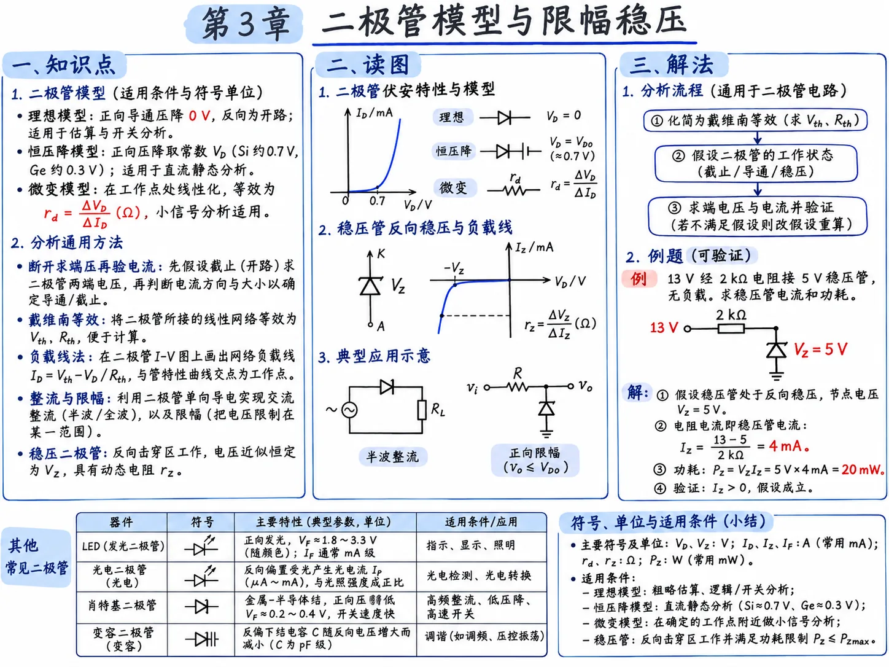
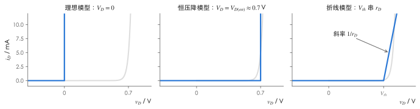
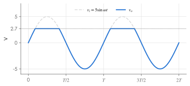

# 半导体与二极管

!!! abstract "本章要点"
    - 杂质半导体里，多子由掺杂决定，少子由热激发产生；少子对温度很敏感，这是器件温漂的根源。
    - PN 结的核心是单向导电：正偏时电流按指数增大，反偏时只有极小的反向饱和电流。
    - 二极管电流每增大 10 倍，压降只增约 $60\,\mathrm{mV}$；温度每升 $1^\circ\mathrm C$，压降约降 $2\,\mathrm{mV}$。
    - 直流估算默认用恒压降模型（硅 $0.7\,\mathrm V$）；有多个二极管时先假设状态，再验证。
    - 稳压管工作在反向击穿区，必须串限流电阻，并保证 $I_{Z\min}\le I_Z\le I_{ZM}$。

??? info "本章图卡"
    { loading=lazy }
    { loading=lazy }

!!! note "知识点清单"
    **半导体**

    - [ ] 半导体是什么：硅、锗，四价，共价键
    - [ ] 本征半导体：本征激发、电子—空穴对、复合
    - [ ] 空穴为什么能导电
    - [ ] N 型与 P 型半导体：施主、受主
    - [ ] 多子与少子、质量作用定律 $np=n_i^2$
    - [ ] 杂质半导体整体电中性
    - [ ] 扩散运动与漂移运动

    **PN 结**

    - [ ] PN 结的形成：耗尽层、内电场、动态平衡
    - [ ] 内建电位差 $V_{ho}$，及它与导通压降的区别
    - [ ] 单向导电性：正偏与反偏
    - [ ] 结电容：势垒电容与扩散电容
    - [ ] 反向击穿：齐纳击穿与雪崩击穿，电击穿与热击穿

    **二极管特性**

    - [ ] 二极管的结构与符号
    - [ ] 伏安特性方程与热电压 $V_T$
    - [ ] 死区、开启电压与导通压降
    - [ ] 指数规律：每 10 倍电流约 $60\,\mathrm{mV}$
    - [ ] 反向特性
    - [ ] 温度特性
    - [ ] 主要参数

    **模型与分析方法**

    - [ ] 理想、恒压降、折线三种分段线性模型
    - [ ] 小信号模型：动态电阻 $r_d=V_T/I_D$
    - [ ] "假设—验证"分析步骤
    - [ ] 多个二极管谁先导通
    - [ ] 图解法：负载线与 Q 点

    **应用与特殊二极管**

    - [ ] 整流
    - [ ] 限幅（削波）
    - [ ] 稳压管与稳压电路设计
    - [ ] 特殊二极管：LED、光电二极管、肖特基二极管、变容二极管

## 1. 半导体与载流子

### 1.1 半导体

导电能力介于导体和绝缘体之间的材料，最常用的是硅（Si）和锗（Ge）。

硅、锗都是四价元素。每个原子用最外层 4 个电子，和相邻原子组成**共价键**。电子被束缚在键里，所以纯净的半导体在低温下几乎不导电。

半导体有用，是因为它的导电能力能被**掺杂、温度、光照**大幅改变。

### 1.2 本征半导体

纯净、结构完整的半导体晶体叫本征半导体。

- 受热时，少数价电子获得能量，挣脱共价键成为**自由电子**。
- 它原来的位置留下一个空位，叫**空穴**。电子和空穴成对出现，这叫**本征激发**。
- 自由电子遇到空穴又会填进去，叫**复合**。激发和复合达到平衡时，载流子浓度不变。

$$
n=p=n_i
$$

适用条件：本征半导体、热平衡。其中 $n$、$p$ 是电子和空穴浓度，$n_i$ 是本征载流子浓度。硅在 $300\,\mathrm K$ 时 $n_i\approx1.5\times10^{10}\,\mathrm{cm^{-3}}$。

**$n_i$ 随温度升高迅速增大**，这是半导体器件对温度敏感的根本原因。

??? tip "$n_i$ 的取值"
    教材常用 $1.5\times10^{10}\,\mathrm{cm^{-3}}$。较新的测量值约为 $1.0\times10^{10}\,\mathrm{cm^{-3}}$。做题按题目给的值即可。

### 1.3 空穴导电

空穴可以看成一个带正电的载流子。

邻近的价电子跳进空穴，原来的位置又出现新空穴。宏观上看，就像一个正电荷在反方向移动。

所以半导体里有**两种载流子**：自由电子和空穴。

### 1.4 N 型与 P 型半导体

在本征半导体里掺入少量杂质，导电能力会增大成千上万倍，这叫杂质半导体。

| 类型 | 掺入 | 杂质名称 | 多子 | 少子 | 多子浓度 |
| --- | --- | --- | --- | --- | --- |
| N 型 | 五价元素（磷） | 施主 | 电子 | 空穴 | $n\approx N_D$ |
| P 型 | 三价元素（硼） | 受主 | 空穴 | 电子 | $p\approx N_A$ |

其中 $N_D$、$N_A$ 是施主、受主的掺杂浓度。

记法：五价比硅多一个电子，"施"出电子 → N 型；三价少一个电子，"受"进电子、留下空穴 → P 型。

### 1.5 多子与少子

数量多的叫多数载流子（多子），数量少的叫少数载流子（少子）。

**为什么少子很少**：多子太多，少子一出现就很容易被复合掉。

质量作用定律：

$$
np=n_i^2
$$

适用条件：热平衡。由此 N 型中的少子浓度 $p=n_i^2/N_D$，P 型中 $n=n_i^2/N_A$。

结论：

- 多子浓度由**掺杂**决定，基本不随温度变。
- 少子浓度由**热激发**决定，正比于 $n_i^2$，随温度剧烈变化。

!!! warning "易错"
    - 杂质半导体整体是**电中性**的。N 型中电子多，但施主离子带等量正电荷，所以不带负电。

### 1.6 扩散运动与漂移运动

载流子的定向运动有两种：

| | 扩散运动 | 漂移运动 |
| --- | --- | --- |
| 动力 | 浓度差，从浓处往淡处走 | 电场力 |
| 形成 | 扩散电流 | 漂移电流 |
| 在 PN 结中 | 多子越过交界面 | 少子被内电场拉过交界面 |

电子与空穴的漂移方向相反，但带电符号也相反，所以两者形成的电流**方向相同、相加**。

??? example "例 1：少子浓度与内建电位差"
    硅 PN 结 $N_A=10^{17}\,\mathrm{cm^{-3}}$，$N_D=10^{16}\,\mathrm{cm^{-3}}$，$n_i=1.5\times10^{10}\,\mathrm{cm^{-3}}$，$V_T=26\,\mathrm{mV}$。求 N 区少子浓度和 $V_{ho}$。

    **思路**：少子用 $np=n_i^2$；内建电位差用 2.2 节公式。

    1. N 区多子 $n\approx N_D=10^{16}\,\mathrm{cm^{-3}}$。
    2. 少子 $p=\dfrac{n_i^2}{N_D}=\dfrac{2.25\times10^{20}}{10^{16}}=2.25\times10^4\,\mathrm{cm^{-3}}$，比多子少 12 个数量级。
    3. $V_{ho}=0.026\ln\dfrac{10^{17}\times10^{16}}{2.25\times10^{20}}=0.026\times29.1\approx0.76\,\mathrm V$。

    **结论**：少子约 $2.25\times10^4\,\mathrm{cm^{-3}}$，$V_{ho}\approx0.76\,\mathrm V$。

## 2. PN 结

### 2.1 PN 结的形成

{ .circuit }

同一块半导体，一边做成 P 型，一边做成 N 型，交界处就形成 PN 结。

多子扩散 → 在交界处复合 → 留下不能移动的离子（P 侧负离子，N 侧正离子）→ 形成**耗尽层**（空间电荷区）和由 N 指向 P 的**内电场** → 内电场阻碍多子扩散、帮助少子漂移 → 扩散与漂移达到**动态平衡**，净电流为零。

耗尽层里几乎没有可移动的载流子，所以它像一层"绝缘带"。

### 2.2 内建电位差

耗尽层两侧的电位差，也叫势垒高度。它是多子扩散要翻越的"小山坡"。

$$
V_{ho}=V_T\ln\frac{N_AN_D}{n_i^2}
$$

适用条件：热平衡、无外加电压。其中 $V_T\approx26\,\mathrm{mV}$ 是热电压（见 3.2 节）。硅约 $0.6\sim0.8\,\mathrm V$，锗约 $0.2\sim0.4\,\mathrm V$，随掺杂浓度变化。

!!! warning "易错"
    - 内建电位差**不能**用电压表在二极管两端测到。两端金属—半导体接触电位把它抵消了。
    - 它和导通压降 $0.7\,\mathrm V$ 数值接近，但**概念不同**，不要用同一个符号。

### 2.3 单向导电性

PN 结正向容易导电，反向几乎不导电，像一个只能单向开的水阀。

| | 正偏（P 接高电位） | 反偏（N 接高电位） |
| --- | --- | --- |
| 势垒高度 | 降为 $V_{ho}-v_D$ | 升为 $V_{ho}+\lvert v_D\rvert$ |
| 耗尽层 | 变窄 | 变宽 |
| 电流 | 多子扩散，随电压**指数**增大 | 只剩少子漂移，即反向饱和电流 $I_S$ |

- 正偏：外电场抵消内电场 → 山坡变低 → 大量多子翻过去 → 电流大。
- 反偏：外电场加强内电场 → 山坡变高 → 多子过不去，只有很少的少子被拉过来 → 电流极小。

反向饱和电流 $I_S$ 基本与反压大小无关，但**随温度约每 $10^\circ\mathrm C$ 翻一倍**，因为它来自少子。

### 2.4 结电容

PN 结上的电荷会随电压变化，表现得像一个电容。高频时它并联在结上，限制开关速度和高频响应。

| | 势垒电容 $C_B$（$C_T$） | 扩散电容 $C_D$ |
| --- | --- | --- |
| 来源 | 耗尽层宽度随电压变，离子电荷量跟着变 | 正偏时注入对方区域的少子存储电荷 |
| 主导偏置 | **反偏** | **正偏** |
| 规律 | 反压越大，耗尽层越宽，$C_B$ 越小 | 正向电流越大，$C_D$ 越大 |
| 应用 | 变容二极管 | 决定二极管关断时的恢复时间 |

### 2.5 反向击穿

反向电压增大到某一值 $V_{BR}$ 时，反向电流突然急剧增大，这叫反向击穿。

| | 齐纳击穿 | 雪崩击穿 |
| --- | --- | --- |
| 条件 | 高掺杂，耗尽层很薄 | 低掺杂，耗尽层较宽 |
| 机理 | 强电场直接把价电子拉出共价键 | 载流子被加速，撞出新的电子—空穴对，连锁倍增 |
| 击穿电压 | 较低（硅约 $4\,\mathrm V$ 以下） | 较高（约 $7\,\mathrm V$ 以上） |
| 温度系数 | 负 | 正 |

**击穿不一定损坏器件**：

- **电击穿**是可逆的。只要外电路限流、功耗不超标，撤掉反压后就恢复。稳压管正是利用它。
- **热击穿**是功耗过大、结温过高造成的，会烧坏器件。

??? tip "为什么 5～6 V 稳压管温度稳定性最好"
    $4\sim7\,\mathrm V$ 之间，两种击穿机理并存。齐纳击穿的负温度系数和雪崩击穿的正温度系数互相抵消，所以约 $5\sim6\,\mathrm V$ 的稳压管温度系数接近零。

## 3. 二极管的伏安特性

### 3.1 结构与符号

一个 PN 结加上引线和管壳，就是二极管。P 区引出的电极叫**阳极**（A），N 区引出的叫**阴极**（K）。

符号是一个三角加一道竖线，三角箭头指向正向电流的方向：从阳极流向阴极。

### 3.2 伏安特性方程

{ .circuit }

$$
i_D=I_S\big(e^{v_D/V_T}-1\big),\qquad V_T=\frac{kT}{q}\approx26\,\mathrm{mV}
$$

适用条件：未击穿；$V_T$ 取 $300\,\mathrm K$ 时的值。其中 $i_D$、$v_D$ 是二极管电流和电压，$I_S$ 是反向饱和电流，$k$ 是玻尔兹曼常数，$q$ 是电子电荷，$T$ 是热力学温度。

??? tip "发射系数 $n$"
    更一般的写法是 $i_D=I_S\big(e^{v_D/(nV_T)}-1\big)$，$n=1\sim2$ 叫发射系数。教材中一般取 $n=1$。

### 3.3 死区、开启电压与导通压降

正向电压很小时，电流几乎为零，这一段叫**死区**。电流开始明显增大时的电压叫**开启电压** $V_{th}$。

| 材料 | 开启电压 $V_{th}$ | 正常导通压降 |
| --- | --- | --- |
| 硅 | 约 $0.5\,\mathrm V$ | $0.6\sim0.8\,\mathrm V$（常取 $0.7\,\mathrm V$） |
| 锗 | 约 $0.1\,\mathrm V$ | $0.2\sim0.3\,\mathrm V$（常取 $0.2\,\mathrm V$） |

!!! warning "易错"
    - $0.5\,\mathrm V$ 和 $0.7\,\mathrm V$ 之间电流按指数增长，**没有一个明确的门槛**。$0.7\,\mathrm V$ 只是正常导通时的典型值。

### 3.4 指数规律

导通后，电流对电压极其敏感。

$v_D\gg V_T$ 时 $i_D\approx I_Se^{v_D/V_T}$，所以

$$
\Delta v_D=V_T\ln\frac{i_2}{i_1},\qquad \text{电流变 10 倍时 }\Delta v_D\approx60\,\mathrm{mV}
$$

适用条件：正向导通、同一温度。

**两面看**：

- 电流变化很大，压降变化很小 → "导通后压降近似不变"，这就是恒压降模型的依据。
- 反过来，**压降稍一变化，电流就变很多**。

!!! warning "易错"
    - 不能把一个电压源直接加在导通的二极管两端。电流必须由外电路（比如电阻）限定。

??? example "例 2：指数特性有多「陡」"
    某硅管 $0.7\,\mathrm V$ 时电流 $1\,\mathrm{mA}$。（1）$0.8\,\mathrm V$ 时电流约多少？（2）电流从 $1\,\mathrm{mA}$ 增到 $10\,\mathrm{mA}$，压降增加多少？

    **思路**：两点电流之比为 $e^{\Delta v/V_T}$。

    1. $\dfrac{i_2}{i_1}=e^{(0.8-0.7)/0.026}=e^{3.85}\approx46.8$，所以 $i\approx47\,\mathrm{mA}$。
    2. $\Delta v=0.026\ln10\approx60\,\mathrm{mV}$，压降变为 $0.76\,\mathrm V$。
    3. 反推 $I_S=1\,\mathrm{mA}/e^{0.7/0.026}\approx2\times10^{-15}\,\mathrm A$，这就是理论反向饱和电流的量级。

    **结论**：电压只多 $0.1\,\mathrm V$，电流就增大近 50 倍。

### 3.5 反向特性

反偏且未击穿时，电流约为 $-I_S$，几乎不随反压变化。

| 材料 | 实测反向电流 |
| --- | --- |
| 硅 | nA 级 |
| 锗 | $\mu\mathrm A$ 级 |

反压超过 $V_{BR}$ 就击穿（见 2.5 节）。

??? tip "实测反向电流为什么比 $I_S$ 大"
    硅管的实测反向电流主要来自表面漏电和耗尽层内的产生电流，比理论 $I_S$（约 $10^{-15}\,\mathrm A$ 量级）大好几个数量级，但仍在 nA 级。

### 3.6 温度特性

温度升高，正向特性左移，反向电流增大。

| 量 | 随温度的变化 |
| --- | --- |
| 反向饱和电流 $I_S$ | 约每 $10^\circ\mathrm C$ 翻一倍 |
| 正向压降 $v_D$（电流一定） | 约 $-2\,\mathrm{mV/^\circ C}$ |

温度↑ → $n_i$↑ → 少子↑ → $I_S$↑ → 同样电流所需压降↓。

### 3.7 主要参数

| 参数 | 含义 |
| --- | --- |
| 最大整流电流 $I_F$ | 长期允许通过的最大正向平均电流 |
| 最高反向工作电压 $V_R$ | 一般取击穿电压的一半 |
| 反向电流 $I_R$ | 未击穿时的反向电流，越小越好 |
| 最高工作频率 $f_M$ | 由结电容决定 |

## 4. 二极管模型与分析方法

### 4.1 三种分段线性模型

指数方程手算太麻烦，就用几段直线近似伏安特性。

{ .circuit }

| 模型 | 导通时 | 截止时 | 适用 |
| --- | --- | --- | --- |
| 理想 | 短路，$V_D=0$ | 开路 | 电源电压远大于 $0.7\,\mathrm V$；逻辑判断 |
| 恒压降 | 电压源 $V_{D(on)}$（硅 $0.7\,\mathrm V$，锗 $0.2\,\mathrm V$） | 开路 | 直流估算的**默认模型** |
| 折线 | $V_{th}$ 串电阻 $r_D$ | 开路 | 电流变化范围大、要求更准时 |

**怎么选**：电源电压比 $0.7\,\mathrm V$ 大得多时，理想模型就够；否则用恒压降模型。

??? example "例 3：三种模型的比较"
    $2\,\mathrm V$ 电源经 $R=100\,\Omega$ 给硅二极管正向供电，$I_S=10^{-14}\,\mathrm A$。分别用理想模型、恒压降模型、指数模型求电流。

    **思路**：前两种直接 KVL；指数模型要联立 KVL 与二极管方程。

    1. 理想：$I=2/100=20\,\mathrm{mA}$。
    2. 恒压降：$I=(2-0.7)/100=13\,\mathrm{mA}$。
    3. 指数：联立 $I=\dfrac{2-v_D}{100}$ 与 $v_D=V_T\ln\dfrac{I}{I_S}$，迭代得 $v_D\approx0.725\,\mathrm V$，$I\approx12.75\,\mathrm{mA}$（也可用 4.5 节负载线图读出）。
    4. 误差：恒压降约 $2\%$；理想 $57\%$，因为 $2\,\mathrm V$ 与 $0.7\,\mathrm V$ 不是"远大于"。

    **结论**：恒压降模型够准。若电源换成 $5\,\mathrm V$、$R=1\,\mathrm{k\Omega}$，指数模型 $4.30\,\mathrm{mA}$，恒压降 $4.3\,\mathrm{mA}$，几乎一样。

### 4.2 小信号模型

二极管已经有一个直流工作点 Q，再叠加一个很小的交流信号。对这个小信号，二极管就像一个电阻，叫**动态电阻** $r_d$。

在 Q 点附近，把指数曲线用它的**切线**代替。切线斜率的倒数就是 $r_d$。

$$
r_d=\frac{V_T}{I_D}
$$

适用条件：已知直流电流 $I_D$，交流电压幅值远小于 $V_T$。例如 $I_D=1\,\mathrm{mA}$ 时 $r_d=26\,\Omega$。

1. 先用恒压降模型求直流电流 $I_D$。
2. 算 $r_d=V_T/I_D$。
3. 画交流通路：直流电源置零，二极管换成 $r_d$，求交流量。

??? tip "$r_d$ 的推导"

    $$
    \frac{\mathrm di_D}{\mathrm dv_D}\Big|_Q=\frac{I_S e^{V_D/V_T}}{V_T}\approx\frac{I_D}{V_T},
    $$

    取倒数即得 $r_d$。这和 [非线性电阻的小信号分析](../extras/nonlinear.md) 里的"$Q$ 点切线"是同一个方法。折线模型里的 $r_D$ 是大范围的平均斜率，和 $r_d$ 不是一回事。

??? example "例 4：小信号——电源纹波在二极管上的分量"
    直流 $5\,\mathrm V$ 上叠加幅值 $0.1\,\mathrm V$ 的纹波，经 $R=4.3\,\mathrm{k\Omega}$ 接硅二极管。求二极管电压的交流分量。

    **思路**：先直流求 $I_D$，再交流用 $r_d$ 分压。

    1. 直流：$I_D=\dfrac{5-0.7}{4.3}=1\,\mathrm{mA}$。
    2. 动态电阻：$r_d=\dfrac{26\,\mathrm{mV}}{1\,\mathrm{mA}}=26\,\Omega$。
    3. 交流：$R$ 与 $r_d$ 分压，

        $$
        v_d=0.1\times\frac{26}{4300+26}\approx0.60\,\mathrm{mV}.
        $$

    **结论**：纹波从 $100\,\mathrm{mV}$ 降到 $0.6\,\mathrm{mV}$。正向二极管可以当简单的低压稳压元件用。

### 4.3 "假设—验证"分析法

先猜二极管是通还是断，按猜的算，再检查结果是否自洽。和 [理想二极管](../notes/analysis-methods.md#5-理想二极管先假设再验证) 的方法相同。

1. 断开二极管，求它两端的开路电压。复杂网络先做 [戴维南等效](../notes/circuit-theorems.md)。阳极比阴极高出 $V_{D(on)}$ 以上，就假设导通。
2. 按假设代入模型求解。
3. 验证：导通管的电流必须为正（从阳极流向阴极）；截止管两端电压必须小于 $V_{D(on)}$。
4. 不符合就换假设，重算。

??? example "例 5：判断工作状态（图卡 04 例的改写）"
    硅二极管 $V_{BR}=50\,\mathrm V$，与 $R=10\,\mathrm{k\Omega}$ 串联后接电源 $V_S$（电源正极接电阻，电阻另一端接阳极，阴极接电源负极）。$V_S$ 分别为 $5\,\mathrm V$、$-10\,\mathrm V$、$-60\,\mathrm V$，求二极管电压与电流。

    **思路**：按 $V_S$ 的正负和大小，分别假设导通、截止、击穿，再验证。

    1. $V_S=5\,\mathrm V$：正偏导通，$v_D\approx0.7\,\mathrm V$，$I=\dfrac{5-0.7}{10}=0.43\,\mathrm{mA}$。
    2. $V_S=-10\,\mathrm V$：反偏，$10\,\mathrm V<V_{BR}$，截止。电流只有 nA 级，电阻上几乎无压降，$v_D\approx-10\,\mathrm V$。
    3. $V_S=-60\,\mathrm V$：若仍截止，则 $v_D=-60\,\mathrm V$，超过 $V_{BR}$，矛盾。所以击穿，$v_D\approx-50\,\mathrm V$。
    4. 击穿电流由电阻限定：$\dfrac{60-50}{10}=1\,\mathrm{mA}$。

    **结论**：三种情况分别是导通 $0.43\,\mathrm{mA}$、截止、击穿 $1\,\mathrm{mA}$。

### 4.4 多个二极管谁先导通

几个二极管接在同一个节点上时，承受正向电压最大的那只先导通。

它一导通，就把公共节点的电压"钳"住。其余二极管可能因此变成反偏而截止。

1. 断开所有二极管，求各管两端的开路电压。
2. 共阳极接法：**阴极电位最低**的先导通。共阴极接法：**阳极电位最高**的先导通。
3. 让它导通，求出公共节点电压。
4. 用这个电压验证其余各管是否截止。

??? example "例 6：两个二极管谁先导通"
    { .circuit }

    $V_1=0$，$V_2=3\,\mathrm V$，硅管 $V_{D(on)}=0.7\,\mathrm V$。求 $V_O$ 及各管状态。

    **思路**：共阳极，阴极电位低的先导通。

    1. 断开两管：节点 O 经 $R$ 接 $+10\,\mathrm V$，两管阳极电位相同。$D_1$ 阴极 $V_1=0$ 更低，所以 $D_1$ 先导通。
    2. $D_1$ 导通：$V_O=0+0.7=0.7\,\mathrm V$，$I=\dfrac{10-0.7}{2}=4.65\,\mathrm{mA}>0$ ✓。
    3. 验证 $D_2$：$V_O-V_2=0.7-3=-2.3\,\mathrm V$，反偏截止 ✓。

    **结论**：$V_O=0.7\,\mathrm V$，$D_1$ 导通、$D_2$ 截止。只要有一个输入为低，输出就为低——这是二极管"与门"。

### 4.5 图解法：负载线

把二极管以外的线性部分化成戴维南电路（开路电压 $V_{oc}$、等效电阻 $R_{eq}$），在伏安特性图上画一条直线。直线与曲线的交点就是工作点 Q。

负载线：

$$
i_D=\frac{V_{oc}-v_D}{R_{eq}}
$$

适用条件：二极管以外的电路是线性的。

{ .circuit }

1. 令 $i_D=0$，得横轴截点 $v_D=V_{oc}$。
2. 令 $v_D=0$，得纵轴截点 $i_D=V_{oc}/R_{eq}$。
3. 连线，读出与伏安特性的交点。

## 5. 应用电路

### 5.1 整流

利用单向导电性，把交流变成单向脉动的电流。

最简单的是**半波整流**：二极管与负载串联，只有正半周导通，负半周截止。全波、桥式整流和电容滤波见 [功率放大与直流电源](power.md)。

### 5.2 限幅（削波）

把输入信号超过某个电平的部分削掉，输出不超过这个电平。

{ .circuit }

- $v_i<V_{REF}+V_{D(on)}$：$D$ 截止，$R$ 中无电流，$v_o=v_i$。
- $v_i$ 超过 $V_{REF}+V_{D(on)}$：$D$ 导通，$v_o$ 被钳在 $V_{REF}+V_{D(on)}$。

**变形**：

- 二极管反接（阴极接输出），配负参考电压，可以削负半周。
- 两路并联，就是双向限幅。

??? example "例 7：上限幅"
    电路如上，$v_i=5\sin\omega t\ \mathrm V$，硅管恒压降模型。

    **思路**：先求限幅阈值，再求超过阈值的相位区间。

    1. 阈值 $V_{REF}+0.7=2.7\,\mathrm V$。$v_i\le2.7\,\mathrm V$ 时 $v_o=v_i$；$v_i>2.7\,\mathrm V$ 时 $v_o=2.7\,\mathrm V$。
    2. 削顶区间：$5\sin\theta>2.7\Rightarrow\theta\in(32.7^\circ,147.3^\circ)$，约占周期的 $32\%$。
    3. 削顶期间 $R$ 上电流 $\dfrac{v_i-2.7}{1\,\mathrm{k\Omega}}$，峰值 $2.3\,\mathrm{mA}$。

    { .circuit }

    **结论**：输出最高 $2.7\,\mathrm V$，约 32% 的时间被削顶。

### 5.3 稳压管稳压电路

{ .circuit }

稳压管是专门工作在反向击穿区的二极管。击穿后电流变化很大，两端电压却几乎不变，约等于稳定电压 $V_Z$。

稳压管**反接**（阴极接高电位），与负载并联，再串一个限流电阻 $R$。

$V_I$↑ 或负载电流↓ → 多出来的电流全流进稳压管（$I_Z$↑）→ $V_Z$ 几乎不变 → $V_O$ 稳定。

$$
I_R=\frac{V_I-V_Z}{R},\qquad I_L=\frac{V_Z}{R_L},\qquad I_Z=I_R-I_L
$$

适用条件：稳压管已击穿；忽略动态电阻 $r_z=\Delta V_Z/\Delta I_Z$（一般几欧到几十欧）。

**设计条件**：在 $V_I$ 和 $R_L$ 的整个变化范围内，

$$
I_{Z\min}\le I_Z\le I_{ZM},\qquad I_{ZM}=\frac{P_{ZM}}{V_Z}
$$

适用条件：$P_{ZM}$ 是稳压管最大允许功耗。

1. 先判断是否击穿：断开稳压管，求两端开路电压，大于 $V_Z$ 才击穿。
2. 击穿后按上面三式求 $I_Z$。
3. 最坏的"电流不够"：$V_{I\min}$ 且 $I_{L\max}$ → 定出 $R$ 的**上限**。
4. 最坏的"功耗过大"：$V_{I\max}$ 且 $I_{L\min}$（常为空载）→ 定出 $R$ 的**下限**。

!!! warning "易错"
    - 限流电阻 $R$ **必不可少**。没有它，击穿后电流只受电源内阻限制，稳压管会烧毁。
    - 带负载时不能直接用 $I_Z=I_R-I_L$，要先用开路电压判断是否击穿。算出 $I_Z<0$ 就说明没击穿。

??? example "例 8：稳压管电流与负载（图卡 05 例的扩展）"
    $V_I=13\,\mathrm V$，$R=2\,\mathrm{k\Omega}$，$V_Z=5\,\mathrm V$，$I_{Z\min}=1\,\mathrm{mA}$，忽略 $r_z$。求（1）空载；（2）$R_L=2.5\,\mathrm{k\Omega}$；（3）$R_L=1\,\mathrm{k\Omega}$ 时的 $V_O$、$I_Z$；（4）保证稳压的最小 $R_L$。

    **思路**：每种负载先看开路电压是否大于 $V_Z$，再算 $I_Z$。

    1. 空载：开路电压 $13\,\mathrm V>5\,\mathrm V$，击穿。$I_Z=\dfrac{13-5}{2}=4\,\mathrm{mA}$，$P_Z=5\times4=20\,\mathrm{mW}$。
    2. $R_L=2.5\,\mathrm{k\Omega}$：开路电压 $13\times\dfrac{2.5}{4.5}=7.2\,\mathrm V>5\,\mathrm V$，击穿。$I_L=2\,\mathrm{mA}$，$I_Z=4-2=2\,\mathrm{mA}\ge I_{Z\min}$ ✓。
    3. $R_L=1\,\mathrm{k\Omega}$：开路电压 $13\times\dfrac13\approx4.33\,\mathrm V<5\,\mathrm V$，**不击穿**。$I_Z=0$，$V_O=4.33\,\mathrm V$，失去稳压作用。硬套公式得 $I_Z=4-5=-1\,\mathrm{mA}<0$，也说明假设不成立。
    4. 最小负载：$I_Z=4-I_L\ge1\Rightarrow I_L\le3\,\mathrm{mA}\Rightarrow R_L\ge\dfrac{5}{3}\approx1.67\,\mathrm{k\Omega}$。

    **结论**：$R_L\ge1.67\,\mathrm{k\Omega}$ 才能稳压；$1\,\mathrm{k\Omega}$ 时输出只有 $4.33\,\mathrm V$。

## 6. 特殊二极管

| 器件 | 工作状态 | 特性 | 应用 |
| --- | --- | --- | --- |
| 稳压管 | 反向击穿 | $V_Z$ 从约 $2\,\mathrm V$ 到上百伏 | 稳压、限幅、基准 |
| 发光二极管 LED | 正偏 | $V_F\approx1.8\sim3.3\,\mathrm V$（随颜色升高），电流 mA 级 | 指示、显示、照明、光耦 |
| 光电二极管 | **反偏** | 光生电流与光照强度成正比（$\mu\mathrm A$ 级） | 光检测、光通信 |
| 肖特基二极管 | 正偏 | 金属—半导体结，$V_F\approx0.2\sim0.4\,\mathrm V$，开关快 | 高频整流、开关电源续流 |
| 变容二极管 | **反偏** | 势垒电容随反压增大而减小（pF 级） | 调谐、压控振荡器、调频 |

!!! warning "易错"
    - LED 也是二极管，必须串限流电阻，不能直接接电源。
    - 光电二极管和变容二极管都工作在**反偏**，不是正偏。

??? tip "肖特基二极管为什么快"
    肖特基二极管靠多子导电，几乎没有少子存储，所以没有扩散电容带来的反向恢复时间。代价是反向漏电较大、耐压较低。

## 公式速查

| 内容 | 公式 | 条件 |
| --- | --- | --- |
| 本征载流子 | $n=p=n_i$ | 本征、热平衡 |
| 质量作用定律 | $np=n_i^2$；N 型少子 $p=n_i^2/N_D$ | 热平衡 |
| 内建电位差 | $V_{ho}=V_T\ln\dfrac{N_AN_D}{n_i^2}$ | 无外加电压 |
| 伏安特性 | $i_D=I_S\big(e^{v_D/V_T}-1\big)$ | 未击穿 |
| 热电压 | $V_T=kT/q\approx26\,\mathrm{mV}$ | $300\,\mathrm K$ |
| 指数规律 | $\Delta v_D=V_T\ln(i_2/i_1)$，10 倍约 $60\,\mathrm{mV}$ | 正向导通 |
| 温度系数 | $v_D$：$-2\,\mathrm{mV/^\circ C}$；$I_S$：每 $10^\circ\mathrm C$ 翻倍 | 电流一定 |
| 恒压降模型 | 硅 $0.7\,\mathrm V$，锗 $0.2\,\mathrm V$ | 直流估算 |
| 动态电阻 | $r_d=V_T/I_D$ | 小信号 |
| 负载线 | $i_D=(V_{oc}-v_D)/R_{eq}$ | 外电路线性 |
| 稳压电路 | $I_Z=\dfrac{V_I-V_Z}{R}-\dfrac{V_Z}{R_L}$ | 已击穿 |
| 稳压条件 | $I_{Z\min}\le I_Z\le I_{ZM}=P_{ZM}/V_Z$ | 全部工况 |

## 练习

### 1. 概念判断 :material-star::material-star-outline::material-star-outline:

1. N 型半导体中电子多于空穴，所以带负电。
2. 硅二极管的内建电位差约 $0.7\,\mathrm V$，所以用电压表可在不通电的二极管两端测到 $0.7\,\mathrm V$。
3. 二极管反向电流随温度升高而增大。
4. 稳压管稳压电路中，限流电阻可以省去。
5. 反偏时 PN 结的结电容以扩散电容为主。

??? success "答案"
    1 ✗　2 ✗　3 ✓　4 ✗　5 ✗

??? note "解析"
    1. 施主离子带等量正电荷，整体电中性。
    2. 内建电位差被两端的金属—半导体接触电位抵消，外部测不到。$0.7\,\mathrm V$ 是有正向电流时的压降。
    3. 反向电流来自少子，少子浓度正比于 $n_i^2$，随温度迅速增大（约每 $10^\circ\mathrm C$ 翻倍）。
    4. 击穿区电流对电压极其敏感，没有电阻限流会烧坏稳压管。$R$ 还要承担 $V_I$ 与 $V_Z$ 的差值。
    5. 反偏以势垒电容为主。扩散电容来自正偏时的少子存储。

### 2. LED 限流电阻 :material-star::material-star-outline::material-star-outline:

用 $5\,\mathrm V$ 电源点亮红色 LED，$V_F=2.0\,\mathrm V$，要求 $I_F=10\,\mathrm{mA}$。求限流电阻及其功耗。

??? success "答案"
    $R=300\,\Omega$，$P_R=30\,\mathrm{mW}$。

??? note "解析"
    1. $R=\dfrac{5-2.0}{10\,\mathrm{mA}}=300\,\Omega$。
    2. $P_R=(5-2)\times10\,\mathrm{mA}=30\,\mathrm{mW}$，选 $1/8\,\mathrm W$ 电阻即可。
    3. 注意：电源电压与 $V_F$ 很接近时（如 $3.3\,\mathrm V$ 驱动 $V_F=3.0\,\mathrm V$ 的蓝光 LED），$V_F$ 的个体差异会让电流变化很大，宜改用恒流驱动。

### 3. 两个二极管 :material-star::material-star::material-star-outline:

电路同例 6（$+10\,\mathrm V$、$R=2\,\mathrm{k\Omega}$，硅管）。求：（1）$V_1=5\,\mathrm V$、$V_2=3\,\mathrm V$；（2）$V_1=V_2=0$ 时的 $V_O$ 和各管电流。

??? success "答案"
    （1）$D_2$ 导通、$D_1$ 截止，$V_O=3.7\,\mathrm V$，$I_{D2}=3.15\,\mathrm{mA}$；（2）两管都导通，$V_O=0.7\,\mathrm V$，各 $2.325\,\mathrm{mA}$。

??? note "解析"
    1. 阴极电位较低的 $D_2$ 先导通：$V_O=3+0.7=3.7\,\mathrm V$，$I=\dfrac{10-3.7}{2}=3.15\,\mathrm{mA}$。
    2. 验证 $D_1$：两端 $3.7-5=-1.3\,\mathrm V$，截止。
    3. 若误假设 $D_1$ 导通，$V_O=5.7\,\mathrm V$，则 $D_2$ 两端 $2.7\,\mathrm V>0.7\,\mathrm V$，矛盾。
    4. 第（2）问两管对称，同时导通：$V_O=0.7\,\mathrm V$，总电流 $\dfrac{10-0.7}{2}=4.65\,\mathrm{mA}$，各分一半。

### 4. 稳压电路的限流电阻 :material-star::material-star::material-star:

稳压管 $V_Z=6\,\mathrm V$，$I_{Z\min}=1\,\mathrm{mA}$，$I_{ZM}=25\,\mathrm{mA}$；负载 $R_L=1.2\,\mathrm{k\Omega}$ 固定；输入 $V_I$ 在 $10\sim14\,\mathrm V$ 之间变化。求限流电阻 $R$ 的取值范围。

??? success "答案"
    $267\,\Omega\le R\le667\,\Omega$。

??? note "解析"
    1. 负载电流 $I_L=6/1.2=5\,\mathrm{mA}$。
    2. $V_I=10\,\mathrm V$ 时 $I_Z$ 最小：$\dfrac{10-6}{R}-5\ge1\Rightarrow R\le\dfrac{4}{6}\,\mathrm{k\Omega}\approx667\,\Omega$。
    3. $V_I=14\,\mathrm V$ 时 $I_Z$ 最大：$\dfrac{14-6}{R}-5\le25\Rightarrow R\ge\dfrac{8}{30}\,\mathrm{k\Omega}\approx267\,\Omega$。
    4. 若负载还可能断开，第 3 步的 $I_L$ 要取 0，下限变为 $8/25=320\,\Omega$。

### 5. 温度与动态电阻 :material-star::material-star-outline::material-star-outline:

某硅管在 $25^\circ\mathrm C$、$2\,\mathrm{mA}$ 时 $V_D=0.65\,\mathrm V$。（1）电流不变，$75^\circ\mathrm C$ 时 $V_D$ 约多少？（2）$25^\circ\mathrm C$ 时该点的 $r_d$？（3）电流增至 $20\,\mathrm{mA}$ 时 $V_D$ 约多少？

??? success "答案"
    （1）$0.55\,\mathrm V$；（2）$13\,\Omega$；（3）约 $0.71\,\mathrm V$。

??? note "解析"
    1. $0.65-0.002\times50=0.55\,\mathrm V$。
    2. $r_d=26\,\mathrm{mV}/2\,\mathrm{mA}=13\,\Omega$。
    3. 电流变 10 倍，压降增约 $60\,\mathrm{mV}$：$0.65+0.06\approx0.71\,\mathrm V$。

## 图卡勘误

| 图卡位置 | 原文 | 更正 |
| --- | --- | --- |
| 04 知识点 3、读图 (1) | 势垒电势 $V_D$ 与正向导通电压共用符号 $V_D$ | 内建电位差 $V_{ho}$ 与导通压降是两回事，应分开写；$V_{ho}$ 外部测不到 |
| 04 读图 (1) 要点 | 加正向电压 $V_D$ 减小，加反向电压 $V_D$ 增大 | $V_{ho}$ 不变，变的是势垒高度 $V_{ho}\mp\lvert v_D\rvert$ |
| 04 读图 (2) | 正向导通条件 $V_{AK}\ge V_D$（约 $0.7\,\mathrm V$） | 硅管开启电压约 $0.5\,\mathrm V$；$0.7\,\mathrm V$ 是典型导通压降，中间没有明确门槛 |
| 04 读图 (2)、例 (2)、结果与要点 | 反向漏电流"$\mu\mathrm A$ 级" | 硅管是 nA 级，锗管才是 $\mu\mathrm A$ 级 |
| 04 知识点 4 | 结电容只讲扩散电容 | 还有势垒电容，反偏时以它为主 |
| 04 知识点 4 | 反向击穿"齐纳击穿或雪崩击穿" | 两者要区分：齐纳低压、负温度系数；雪崩高压、正温度系数 |
| 04 例 (1) | $V_{AK}=0.8\,\mathrm V$，电流"约 $1\sim$ 数 mA" | 若 $0.7\,\mathrm V$ 对应 $1\,\mathrm{mA}$，$0.8\,\mathrm V$ 约 $47\,\mathrm{mA}$；且电流应由外电路限定 |
| 04 例 (3) | 直接对二极管加 $V_{AK}=-60\,\mathrm V$ | 击穿后反压被钳在约 $V_{BR}$；必须串限流电阻，见例 5 |
| 05 知识点 2 | 负载线 $I_D=V_{th}-V_D/R_{th}$ | 缺括号，应为 $I_D=(V_{th}-V_D)/R_{th}$（$V_{th}$ 此处指戴维南电压） |
| 05 读图 2 | 标题"稳压管反向稳压与负载线"，纵轴标 $I_Z$ 而曲线画在第三象限 | 图中没有负载线；纵轴标 $I_Z$ 时曲线应在第一象限 |
| 05 读图 3 | "正向限幅（$v_o\le V_{DO}$）"，图中却是阴极接输出的稳压管 | 该电路正半周 $v_o\le V_Z$，负半周 $v_o\ge-0.7\,\mathrm V$；要 $v_o\le0.7\,\mathrm V$ 应画普通二极管、阳极接输出 |
| 05 例题④ | 验证"$I_Z>0$，假设成立" | 应验证 $I_Z\ge I_{Z\min}$ 且 $P_Z\le P_{ZM}$；带负载时先判断是否击穿 |
| 05 知识点 1 | 微变模型只给 $r_d=\Delta V_D/\Delta I_D$ | 应给出可计算的 $r_d=V_T/I_D$（$1\,\mathrm{mA}$ 时 $26\,\Omega$） |
