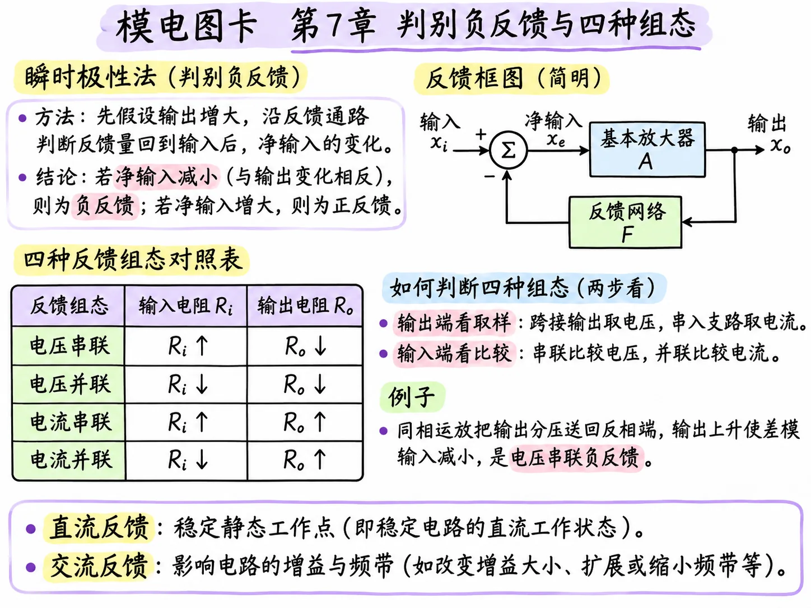
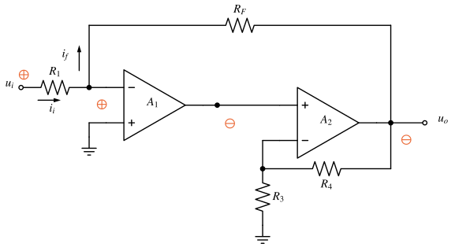
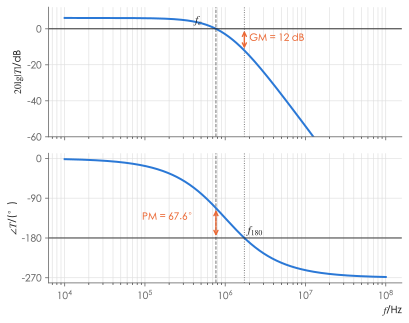

# 负反馈放大电路

!!! abstract "本章要点"
    - 反馈就是把输出的一部分送回输入端；削弱净输入的是负反馈。
    - 闭环增益 $A_f=\dfrac{A}{1+AF}$，反馈很深时 $A_f\approx 1/F$，几乎只由反馈网络决定。
    - 判正负用瞬时极性法，判组态看两头：输出端用输出短路法，输入端看是否接同一节点。
    - 负反馈用降低增益换来增益稳定、带宽展宽、失真减小，并按组态改变输入、输出电阻。
    - 反馈太深可能自激；设计时要求相位裕度 $\ge45^\circ$，不够就做主极点补偿。

??? info "本章图卡"
    { loading=lazy }
    { loading=lazy }

!!! note "知识点清单"
    **基本概念**

    - [ ] 什么是反馈；开环与闭环
    - [ ] 正反馈与负反馈
    - [ ] 直流反馈与交流反馈
    - [ ] 本级反馈与级间反馈
    - [ ] 反馈框图与闭环增益 $A_f=A/(1+AF)$
    - [ ] 环路增益与反馈深度
    - [ ] 深度负反馈：$A_f\approx1/F$ 与"虚短、虚断"

    **判别方法**

    - [ ] 判断有无反馈
    - [ ] 瞬时极性法判断正负反馈
    - [ ] 多级环路：反相次数决定正负

    **四种组态**

    - [ ] 电压反馈与电流反馈（输出短路法）
    - [ ] 串联反馈与并联反馈（输入节点法）
    - [ ] 四种组态的 $A$、$F$ 含义与量纲
    - [ ] 信号源内阻对串联、并联反馈的影响
    - [ ] 深度负反馈下估算闭环增益

    **负反馈对性能的影响**

    - [ ] 提高增益稳定性
    - [ ] 展宽通频带
    - [ ] 减小非线性失真
    - [ ] 抑制环内噪声和干扰
    - [ ] 改变输入电阻
    - [ ] 改变输出电阻
    - [ ] 引入负反馈的一般原则

    **稳定性**

    - [ ] 自激振荡的原因与条件
    - [ ] 稳定判据：相位裕度 PM 与增益裕度 GM
    - [ ] 反馈越深越容易自激
    - [ ] 主极点补偿与米勒电容

## 1. 反馈框图与闭环增益

### 1.1 什么是反馈

把输出量的一部分，经过一个网络送回输入端，和输入量合在一起控制放大器，这就叫反馈。
送回信号的那个网络叫**反馈网络**。没有反馈时叫开环，有反馈时叫闭环。

淋浴调水温就是一个负反馈：手（反馈网络）感受水温（输出），太烫就往冷的方向拧（削弱输入）。

### 1.2 反馈的分类

| 分类依据 | 类别 | 判别 / 作用 |
| --- | --- | --- |
| 对净输入的影响 | 负反馈 | 净输入被削弱；放大电路里几乎都用它 |
| | 正反馈 | 净输入被加强；用于振荡器、滞回比较器 |
| 存在于哪个通路 | 直流反馈 | 只在直流通路里存在，作用是**稳定静态工作点** |
| | 交流反馈 | 存在于交流通路，影响增益、带宽、输入输出电阻 |
| 反馈的范围 | 本级反馈 | 只在一级内部，如共射级的 $R_E$ |
| | 级间反馈 | 从后级输出送回前级输入，跨越多级 |
| 输出端取样 | 电压 / 电流反馈 | 见第 3 节 |
| 输入端比较 | 串联 / 并联反馈 | 见第 3 节 |

!!! warning "易错"
    - 发射极电阻 $R_E$ 并了大旁路电容：交流被短路，只剩直流负反馈。
    - 一个电路可以同时有直流反馈和交流反馈，要分别画直流通路、交流通路去看。

### 1.3 框图与闭环增益

{ .circuit }

任何反馈放大电路都可以画成上面的框图。放大器 $A$ 放大净输入，反馈网络 $F$ 取出一部分输出送回去，在输入端相减。

输入 $x_i$ 被反馈 $x_f$ 抵掉一部分，放大器真正"看到"的只是差值 $x_{id}$。输出越大，抵掉越多，所以输出会被"拉住"。

$$
x_{id}=x_i-x_f,\quad x_o=A\,x_{id},\quad x_f=F\,x_o
\ \Rightarrow\
A_f=\frac{x_o}{x_i}=\frac{A}{1+AF}
$$

适用条件：$A$、$F$ 是同一频率下的值；$x$ 可以是电压也可以是电流。

其中：

| 符号 | 名称 | 含义 |
| --- | --- | --- |
| $A$ | 开环增益 | 基本放大电路的增益（已计入反馈网络的负载效应） |
| $F$ | 反馈系数 | $F=x_f/x_o$ |
| $A_f$ | 闭环增益 | 引入反馈后的总增益 |
| $T=AF$ | 环路增益 | 信号绕环一周被放大的倍数 |
| $1+AF$ | 反馈深度 | 描述反馈强弱 |

**反馈深度怎么看**：

| $\lvert 1+AF\rvert$ | 结论 |
| --- | --- |
| $>1$ | 负反馈，$\lvert A_f\rvert<\lvert A\rvert$ |
| $<1$ | 正反馈，$\lvert A_f\rvert>\lvert A\rvert$ |
| $=0$ | $A_f\to\infty$，没有输入也有输出：**自激振荡** |

### 1.4 深度负反馈

环路增益很大（$|AF|\gg1$）的负反馈叫深度负反馈。

分母里的 1 可以忽略，$A$ 被约掉。放大器参数怎么变，闭环增益都基本不变。

$$
A_f\approx\frac1F
\quad\Longleftrightarrow\quad
x_f\approx x_i,\ \ x_{id}\approx0
$$

适用条件：负反馈，且 $|AF|\gg1$（通常十倍以上）。

**净输入近似为零**就是运放电路"虚短、虚断"的来源：串联反馈时 $u_{id}\approx0$（虚短），并联反馈时 $i_{id}\approx0$（虚断）。

??? example "例 1：图卡的闭环增益计算"
    $A=1000$，$F=0.1$。求 $A_f$；若 $A$ 降到 $800$，$A_f$ 变多少？

    思路：直接代公式，再和 $1/F$ 比较。

    1. $AF=100$，$A_f=\dfrac{1000}{1+100}=\dfrac{1000}{101}\approx9.90$。
    2. 深度负反馈估算 $1/F=10$，误差约 $1\%$，正好是 $1/(1+AF)$ 的量级。
    3. $A$ 降到 $800$（$-20\%$）：$A_f=\dfrac{800}{81}\approx9.877$，只变了 $-0.247\%$。

    **结论**：$A$ 变 $20\%$，$A_f$ 只变约 $0.25\%$。精确关系见第 4.1 节的"补充"。

## 2. 判别反馈的有无与正负：瞬时极性法

### 2.1 判断有无反馈

看输出回路和输入回路之间有没有元件把它们连起来。有这样的通路（反馈通路），就有反馈。

!!! warning "易错"
    - 只连到地的元件不算反馈通路；必须一端连输出侧、一端连输入侧。
    - 运放本身输出接到自己的反相端（跟随器），也是反馈。

### 2.2 瞬时极性法判正负

假设输入在某一瞬间往上走（记 $\oplus$），沿环路一路推下去，看反馈回来的信号是帮倒忙（负反馈）还是帮忙（正反馈）。

1. 设输入端某瞬时对地极性为 $\oplus$。
2. 逐级标出各点极性（见下表）。
3. 经反馈网络得到反馈信号的极性。纯电阻网络不改变极性。
4. 看**净输入**：串联比较看 $u_{id}=u_i-u_f$，并联比较看 $i_{id}=i_i-i_f$。净输入减小是负反馈，增大是正反馈。

| 器件 / 接法 | 输入→输出极性 |
| --- | --- |
| 运放：同相端 → 输出 | 同相 |
| 运放：反相端 → 输出 | 反相 |
| BJT 共射：$b\to c$ | 反相 |
| BJT 共射/共集：$b\to e$ | 同相 |
| 电阻、电容分压 | 不变（中频） |

**运放速记**：输入和反馈接不同输入端时，两者同极性为负反馈；接同一输入端时，两者反极性为负反馈。

### 2.3 多级环路：数反相次数

每一级反相都会把极性翻一次。绕环一周，翻转次数决定反馈回来是"顶回去"还是"推一把"。

反馈接回第一级的反相端时，环内（包括第一级）应总共反相奇数次，才是负反馈。

!!! warning "易错"
    - 极性看的是**净输入**，不是"反馈信号本身是正是负"。
    - 估算闭环增益前先确认是**负**反馈；$A_f\approx1/F$ 对正反馈毫无意义。

具体例子见第 3 节末的例 2、例 3。

## 3. 四种组态与深度负反馈估算

### 3.1 电压反馈与电流反馈：输出短路法

反馈信号取自输出电压，叫电压反馈；取自输出电流，叫电流反馈。
电压反馈稳定 $u_o$，电流反馈稳定 $i_o$。

输出短路法：

1. 假想把负载短路，令 $u_o=0$。
2. 反馈信号随之消失 → 电压反馈。
3. 反馈信号仍然存在 → 电流反馈。

!!! warning "易错"
    - "反馈元件直接接在输出端就是电压反馈"不可靠。电流串联电路里，反馈电阻 $R$ 不接输出端；但把 $R_L$ 短路后，电流仍流过 $R$，所以是电流反馈。

### 3.2 串联反馈与并联反馈：输入节点法

在输入端，反馈信号与输入信号以**电压**相减，叫串联反馈；以**电流**相减，叫并联反馈。

1. 看输入信号和反馈信号接到放大器的哪个节点。
2. 接**不同**节点（如运放两个输入端、BJT 的基极和发射极）→ 串联。
3. 接**同一**节点 → 并联。

### 3.3 四种组态一览

| 组态 | 比较量 | $A$ 的含义 | $F$ 的含义 | 稳定 | $R_{if}$ | $R_{of}$ | 宜配信号源 |
| --- | --- | --- | --- | --- | --- | --- | --- |
| 电压串联 | $u$ | $A_u=u_o/u_{id}$（无量纲） | $F_u=u_f/u_o$ | $u_o$ | $(1+AF)R_i$ ↑ | $R_o/(1+AF)$ ↓ | 低内阻电压源 |
| 电压并联 | $i$ | $A_r=u_o/i_{id}$（$\Omega$） | $F_g=i_f/u_o$（S） | $u_o$ | $R_i/(1+AF)$ ↓ | ↓ | 高内阻（电流源） |
| 电流串联 | $u$ | $A_g=i_o/u_{id}$（S） | $F_r=u_f/i_o$（$\Omega$） | $i_o$ | ↑ | $(1+AF)R_o$ ↑ | 低内阻电压源 |
| 电流并联 | $i$ | $A_i=i_o/i_{id}$（无量纲） | $F_i=i_f/i_o$ | $i_o$ | ↓ | ↑ | 高内阻（电流源） |

记法：**串联增大 $R_i$，并联减小 $R_i$；电压减小 $R_o$，电流增大 $R_o$。**

### 3.4 信号源内阻的影响

- 串联反馈在回路里比较电压。信号源内阻越小，$u_i$ 越"硬"，$u_f$ 越能有效抵消，反馈效果越好。
- 并联反馈在节点比较电流。信号源内阻越大，越像电流源，$i_f$ 越能分走电流，反馈效果越好。

!!! warning "易错"
    - 并联反馈接内阻为零的电压源：$i_i$ 完全由 $u_s$ 决定，$i_f$ 改变不了净输入，反馈失效。

### 3.5 深度负反馈下估算闭环增益

1. 判断确为负反馈，并确定组态。
2. 求反馈系数 $F$（按组态取 $u_f/u_o$、$i_f/u_o$ 等）。
3. 写出 $A_f\approx1/F$。
4. 换算成电压增益：并联型用 $i_i\approx u_s/R_s$（$R_s$ 为信号源内阻或输入电阻）；电流型用 $u_o=i_oR_L$。

也可以直接用"净输入为零"：串联型令 $u_i\approx u_f$，并联型令 $i_i\approx i_f$，常常更快。

四种组态的典型运放电路：

=== "电压串联"

    { .circuit }

    $F_u=\dfrac{u_f}{u_o}=\dfrac{R_1}{R_1+R_f}$，$A_{uf}\approx\dfrac1{F_u}=1+\dfrac{R_f}{R_1}$。

    $R_1=10\,\mathrm{k\Omega}$、$R_f=90\,\mathrm{k\Omega}$ 时 $A_{uf}\approx10$。运放 $A=10^5$ 时精确值为 $10/(1+10^{-4})$。

=== "电压并联"

    { .circuit }

    反相端虚地，$i_f=\dfrac{0-u_o}{R_f}$，$F_g=-\dfrac1{R_f}$，$A_{rf}=\dfrac{u_o}{i_i}\approx-R_f$。

    再用 $i_i=u_s/R_1$：$A_{usf}\approx-\dfrac{R_f}{R_1}$。$R_1=10\,\mathrm{k\Omega}$、$R_f=100\,\mathrm{k\Omega}$ 时，$A_{rf}\approx-100\,\mathrm{k\Omega}$，$A_{usf}\approx-10$。

=== "电流串联"

    { .circuit }

    $R_L$ 跨接在输出与反相端之间，$i_o$ 全部流过 $R$。所以 $u_f=i_oR$，$F_r=R$，$A_{gf}=\dfrac{i_o}{u_i}\approx\dfrac1R$。

    $i_o=u_i/R$，与 $R_L$ 无关，这是一个**压控电流源**。$R=1\,\mathrm{k\Omega}$、$u_i=2\,\mathrm V$ 时 $i_o=2\,\mathrm{mA}$。

=== "电流并联"

    { .circuit }

    反相端虚地，$u_M=-i_fR_F$。$M$ 点 KCL：$i_o+i_f=u_M/R$，得 $i_f=-\dfrac{R}{R+R_F}\,i_o$。

    所以 $F_i=-\dfrac{R}{R+R_F}$，$A_{if}=\dfrac{i_o}{i_i}\approx-\Big(1+\dfrac{R_F}{R}\Big)$。

    $R_1=R=10\,\mathrm{k\Omega}$、$R_F=90\,\mathrm{k\Omega}$、$u_s=1\,\mathrm V$：$i_i=0.1\,\mathrm{mA}$，$i_o\approx-1\,\mathrm{mA}$（与图示方向相反），与 $R_L$ 无关。

!!! warning "易错"
    - 四种组态中只有电压串联、电流并联的 $A$、$F$ 无量纲；另两种是互阻、互导。
    - 求出 $A_f$ 后要看题目问的是哪种增益，必要时换算成电压增益。

??? example "例 2：共射放大电路中的 $R_E$"
    { .circuit }

    $\beta=100$，$r_\pi=1.5\,\mathrm{k\Omega}$，$R_C=R_L=4\,\mathrm{k\Omega}$，$R_E=0.5\,\mathrm{k\Omega}$（无旁路电容）。判断反馈类型，求 $A_u$。

    思路：先判正负和组态，再分别用精确公式和深度负反馈估算。

    1. **极性**：基极 $\oplus$ → 发射极 $\oplus$（跟随）→ $u_{be}=u_b-u_e$ 被削弱，是负反馈。
    2. **输出端**：令 $u_o=0$（$R_L$ 短路），$i_e$ 仍流过 $R_E$，反馈仍在 → 电流反馈。
    3. **输入端**：输入接基极，反馈电压在发射极，不同节点 → 串联。所以是电流串联负反馈，稳定 $i_c$。
    4. **精确值**：$R_L'=R_C\parallel R_L=2\,\mathrm{k\Omega}$，

        $$
        A_u=-\frac{\beta R_L'}{r_\pi+(1+\beta)R_E}=-\frac{200}{1.5+50.5}\approx-3.85
        $$

    5. **估算**：$(1+\beta)R_E\gg r_\pi$，令 $u_i\approx u_f=i_eR_E$，又 $u_o=-i_cR_L'$，得 $A_u\approx-\dfrac{R_L'}{R_E}=-4$，误差约 $4\%$。

    **结论**：电流串联负反馈，$A_u\approx-3.85$（估算 $-4$）。若 $R_E$ 并上大电容，交流负反馈消失，增益回到 $-\beta R_L'/r_\pi$。

??? example "例 3：两级运放的级间反馈"
    { .circuit }

    $R_1=10\,\mathrm{k\Omega}$，$R_F=100\,\mathrm{k\Omega}$，$R_3=R_4=10\,\mathrm{k\Omega}$。判断 $R_F$ 引入的反馈，估算 $A_{uf}$。

    思路：瞬时极性绕环一周，再用"净输入电流为零"。

    1. **极性**：$u_i\oplus$ → $A_1$ 反相端 $\oplus$ → $u_{o1}\ominus$ → $A_2$ 同相放大，$u_o\ominus$ → 经 $R_F$ 回到 $A_1$ 反相端。
    2. 输入与反馈在同一节点，极性相反。$i_f$ 由节点流向 $u_o$ 而增大，$i_{id}=i_i-i_f$ 减小，是负反馈。
    3. **组态**：令 $u_o=0$，$R_F$ 右端接地，反馈消失 → 电压反馈；同一节点 → 并联。即电压并联负反馈。
    4. **估算**：环内有两级开环增益，反馈很深。$A_1$ 反相端虚地，$i_i\approx i_f$：

        $$
        \frac{u_i}{R_1}\approx\frac{0-u_o}{R_F}\ \Rightarrow\ A_{uf}\approx-\frac{R_F}{R_1}=-10
        $$

    **结论**：电压并联负反馈，$A_{uf}\approx-10$。$A_2$ 的增益 $1+R_4/R_3=2$ 只影响环路增益，不出现在结果里。若把 $A_2$ 改成反相放大器，环内反相次数变为偶数，变成正反馈，电路饱和。

## 4. 负反馈对放大电路性能的影响

总的规律：**负反馈用增益换性能**。增益降为原来的 $1/(1+AF)$，各项性能改善的倍数也大致是 $(1+AF)$。

| 性能 | 结论 | 成立条件 |
| --- | --- | --- |
| 增益稳定性 | 相对变化缩小为 $1/(1+AF)$ | $F$ 由稳定的无源元件构成 |
| 带宽 | 上限频率升高、下限频率降低 $(1+A_0F)$ 倍 | 开环为单极点特性 |
| 非线性失真 | 环内失真减小约 $1/(1+AF)$ | 加大输入，使输出幅度与开环时相同 |
| 噪声与干扰 | 只抑制环内产生的 | 与输入一同进来的无法区分 |
| 输入电阻 | 串联增大，并联减小 | — |
| 输出电阻 | 电压减小，电流增大 | — |

### 4.1 提高增益稳定性

$A_f\approx1/F$，而 $F$ 由电阻等稳定元件决定。$A$ 随温度、换管子变化，对 $A_f$ 影响很小。

$$
\frac{\mathrm dA_f}{A_f}=\frac{1}{1+AF}\cdot\frac{\mathrm dA}{A}
$$

适用条件：$A$ 变化很小（微分关系）；$F$ 本身稳定。

??? tip "$A$ 变化较大时的精确关系"
    $A$ 从 $A_1$ 变到 $A_2$ 时，精确的相对变化为

    $$
    \frac{\Delta A_f}{A_{f1}}=\frac{\Delta A/A_1}{1+A_2F}
    $$

    例 1 中 $A$ 从 $1000$ 降到 $800$：$\dfrac{-0.2}{81}=-0.247\%$。用微分式估算得 $\dfrac{-0.2}{101}\approx-0.198\%$，偏小。变化越大，微分式越不准（练习 2 也会遇到）。

### 4.2 展宽通频带

高频时 $A$ 下降，反馈信号跟着减小，净输入反而变大，把增益"补"回来一些。于是增益下降的拐点被推后。

$$
f_{Hf}=(1+A_0F)f_H,\qquad f_{Lf}=\frac{f_L}{1+A_0F},\qquad A_f f_{Hf}=A_0f_H
$$

适用条件：开环为单极点（低频端单零极点）特性；$A_0$ 为中频开环增益。

其中 $f_H$、$f_L$ 为开环上、下限频率。最后一式说明**增益带宽积不变**：增益降多少倍，带宽就宽多少倍。

### 4.3 减小非线性失真

放大器把正弦放成"上大下小"。反馈把这个畸变送回输入，净输入变成"上小下大"，预先补偿了畸变。

!!! warning "易错"
    - 比较时要把输入加大到使输出幅度与开环时相同，否则"失真减小"是因为信号变小了。
    - 输入信号本身带的失真，负反馈无法纠正。

### 4.4 抑制噪声和干扰

负反馈只能抑制**环内**产生的噪声和干扰，减小约 $1/(1+AF)$。

随输入信号一起进来的噪声，与信号被同等对待、同等衰减，所以**信噪比不会因反馈提高**。

### 4.5 改变输入电阻

| 输入端 | 结果 | 原因 |
| --- | --- | --- |
| 串联反馈 | $R_{if}=(1+AF)R_i$，增大 | $u_f$ 抵消了大部分 $u_i$，同样的 $u_i$ 只流过很小的电流 |
| 并联反馈 | $R_{if}=R_i/(1+AF)$，减小 | $i_f$ 分走大部分输入电流，输入端像被"拉低" |

适用条件：公式中 $A$ 取对应组态、对应负载条件下的开环增益。

### 4.6 改变输出电阻

| 输出端 | 结果 | 原因 |
| --- | --- | --- |
| 电压反馈 | $R_{of}=R_o/(1+AF)$，减小 | 负载变化时反馈"盯住"$u_o$ 不变，像一个理想电压源 |
| 电流反馈 | $R_{of}=(1+AF)R_o$，增大 | 负载变化时反馈"盯住"$i_o$ 不变，像一个理想电流源 |

适用条件：求 $R_{of}$ 时，电压反馈用负载开路时的 $A$，电流反馈用负载短路时的 $A$。

??? example "例 4：同相放大器的带宽与输入、输出电阻"
    运放 $A_0=10^5$，开环 $f_H=10\,\mathrm{Hz}$（单极点），差模输入电阻 $R_{id}=2\,\mathrm{M\Omega}$，输出电阻 $R_o=75\,\Omega$。接成 $F=0.01$ 的同相放大器（如 $R_1=1\,\mathrm{k\Omega}$、$R_f=99\,\mathrm{k\Omega}$）。

    思路：先算反馈深度，各项指标都按它缩放。

    1. 反馈深度 $1+A_0F=1001$。
    2. 闭环增益 $A_f=\dfrac{10^5}{1001}\approx99.9$。
    3. 带宽 $f_{Hf}=10\times1001=10.01\,\mathrm{kHz}$；增益带宽积 $99.9\times10.01\,\mathrm{kHz}\approx1\,\mathrm{MHz}=A_0f_H$。
    4. 电压串联：$R_{if}\approx1001\times2\,\mathrm{M\Omega}\approx2\,\mathrm{G\Omega}$，$R_{of}\approx\dfrac{75}{1001}\approx0.075\,\Omega$。

    **结论**：增益降到约 $100$，换来 $10\,\mathrm{kHz}$ 带宽、$2\,\mathrm{G\Omega}$ 输入电阻、$0.075\,\Omega$ 输出电阻。用完整运放模型（$R_{id}$、$Au_d$ 串 $R_o$）列节点方程，得 $R_{if}=2.001\,\mathrm{G\Omega}$、$R_{of}=0.0750\,\Omega$，与估算一致。

### 4.7 引入负反馈的一般原则

按"要什么"选反馈。

1. 要稳定静态工作点 → 引入**直流**负反馈；要改善动态性能 → 引入**交流**负反馈。
2. 要稳定输出电压、减小 $R_o$（带负载能力强）→ **电压**反馈；要稳定输出电流、增大 $R_o$ → **电流**反馈。
3. 要增大 $R_i$（少从信号源取电流）→ **串联**反馈；要减小 $R_i$ → **并联**反馈。
4. 再对照信号源：内阻小的电压源配串联，内阻大的电流源配并联。

| 需求 | 选用组态 |
| --- | --- |
| 电压放大（高 $R_i$、低 $R_o$） | 电压串联 |
| 电流→电压（跨阻放大） | 电压并联 |
| 电压→电流（压控电流源） | 电流串联 |
| 电流放大 | 电流并联 |

## 5. 负反馈的稳定性

### 5.1 自激振荡的原因与条件

负反馈放大器没有输入也自己输出某一频率的信号，叫自激振荡。

中频时环路增益 $T=AF$ 是正实数，是负反馈。频率升高后，每个极点最多再附加 $-90^\circ$ 相移。某个频率 $f_{180}$ 处若附加相移达到 $-180^\circ$，"相减"就变成了"相加"：

附加相移 $-180^\circ$ → 负反馈变正反馈 → 此时若 $|T|\ge1$ → 信号绕环一圈不衰减 → 自激。

把 $A$、$F$ 换成频率函数：

$$
A_f(j\omega)=\frac{A(j\omega)}{1+T(j\omega)},\qquad
\text{自激条件：}\ T(j\omega)=-1
$$

适用条件：$T=AF$，中频时为负反馈。等价于 $|T|=1$ 且附加相移 $=-180^\circ$。

- 单极点、两极点的 $T$，附加相移达不到 $-180^\circ$，理论上不会自激（两极点时裕度可能很小）。
- **三个及以上极点**才可能自激。

### 5.2 稳定判据：相位裕度与增益裕度

在环路增益 $T$ 的波特图上看两个频率。

- 增益交越频率 $f_c$：$|T|=1$（$0\,\mathrm{dB}$）处。
- 相位交越频率 $f_{180}$：$\angle T=-180^\circ$ 处。

$f_c$ 处相移还没到 $-180^\circ$，电路就稳定。离 $-180^\circ$ 还差多少，就是"裕度"。

$$
\mathrm{PM}=180^\circ+\angle T(jf_c),\qquad
\mathrm{GM}=-20\lg|T(jf_{180})|\ \ (\mathrm{dB})
$$

适用条件：最小相位系统，$|T|$ 随频率单调下降（一般放大器满足）。

工程要求：**$\mathrm{PM}\ge45^\circ$，$\mathrm{GM}\ge10\,\mathrm{dB}$**。

### 5.3 反馈越深越容易自激

$F$ 越大 → $|T|=|AF|$ 整条曲线上移 → $f_c$ 右移到相移更大的地方 → PM 变小。

所以闭环增益越低越难稳定，电压跟随器（$F=1$）是最难稳定的情形。

!!! warning "易错"
    - "增益稳定"和"不自激"是两回事。$F$ 越大，增益越稳，但越容易自激。

??? example "例 5：三个相同极点的放大器"
    $A(jf)=\dfrac{10^4}{(1+jf/f_p)^3}$，$f_p=1\,\mathrm{MHz}$，$F$ 与频率无关。

    思路：先找 $f_{180}$ 处的 $|A|$，它决定 $F$ 的上限。

    1. **$f_{180}$**：每个极点相移 $60^\circ$ 时总相移 $-180^\circ$，$f_{180}=\sqrt3f_p\approx1.73\,\mathrm{MHz}$。
    2. 此处 $|A|=\dfrac{10^4}{(\sqrt{1+3})^3}=\dfrac{10^4}{8}=1250$（$61.9\,\mathrm{dB}$）。
    3. **稳定条件**：$|T(f_{180})|=1250F<1$，即 $F<8\times10^{-4}$。想做 $A_f\approx100$（$F=0.01$）时 $|T(f_{180})|=12.5>1$，自激。
    4. **取 $F=2\times10^{-4}$**（$A_f=10^4/3\approx3333$）：$f_c$ 满足 $(1+x^2)^{3/2}=2$，$x=f_c/f_p=\sqrt{2^{2/3}-1}\approx0.766$。
    5. 裕度：

        $$
        \mathrm{PM}=180^\circ-3\arctan0.766\approx67.6^\circ,\qquad \mathrm{GM}=-20\lg(1250\times2\times10^{-4})=20\lg4\approx12\,\mathrm{dB}
        $$

    6. 要 $\mathrm{GM}\ge10\,\mathrm{dB}$，需 $F\le\dfrac{1}{1250\sqrt{10}}\approx2.5\times10^{-4}$。

    { .circuit }

    **结论**：只求不自激时闭环增益要大于约 $1100$（$F<8\times10^{-4}$）；再留 $10\,\mathrm{dB}$ 增益裕度，闭环增益要在约 $2800$ 以上。不补偿就不能当低增益放大器用。

### 5.4 主极点补偿

人为在放大器里加一个频率很低的极点（主极点），让 $|A|$ 在第二个极点到来之前就降到 $0\,\mathrm{dB}$。

$|A|$ 穿过 $0\,\mathrm{dB}$ 时，只有主极点贡献了约 $-90^\circ$，第二个极点才刚开始起作用，总相移约 $-135^\circ$，PM 约 $45^\circ$。

要求单位增益（$F=1$）稳定时，把第一个极点压到

$$
f_{p1}'\approx\frac{f_{p2}}{A_0}
$$

适用条件：$f_{p2}$ 为原第二个极点，$A_0$ 为开环直流增益；补偿后 $\mathrm{PM}\approx45^\circ$。

做法是在高增益中间级跨接**米勒电容** $C_c$。

1. 米勒效应使等效输入电容变为 $(1+|A_2|)C_c$，小电容就能形成很低的主极点。
2. 同时把输出端极点推向高频，叫**极点分离**。
3. 代价：开环带宽变窄，压摆率受 $C_c$ 限制（见 [差分放大与集成运放](differential-opamp.md)）。

??? example "例 6：主极点补偿"
    运放 $A_0=10^4$，极点 $1\,\mathrm{MHz}$、$10\,\mathrm{MHz}$、$100\,\mathrm{MHz}$，接成电压跟随器（$F=1$）。

    思路：比较补偿前后 $f_c$ 处的相位裕度。

    1. **补偿前**：数值求得 $f_c\approx208\,\mathrm{MHz}$，$\angle T(f_c)\approx-241^\circ$，$\mathrm{PM}\approx-61^\circ$，必然自激。
    2. **补偿**：把第一个极点压到 $f_{p1}'=\dfrac{10\,\mathrm{MHz}}{10^4}=1\,\mathrm{kHz}$。
    3. **补偿后**：$f_c\approx7.8\,\mathrm{MHz}$。它略低于 $f_{p2}$，因为 $f_{p2}$ 处 $|A|$ 已比 $0\,\mathrm{dB}$ 低约 $3\,\mathrm{dB}$。
    4. 相位裕度：

        $$
        \mathrm{PM}=180^\circ-\arctan\frac{7.8}{0.001}-\arctan\frac{7.8}{10}-\arctan\frac{7.8}{100}\approx47^\circ
        $$

    { .circuit }

    **结论**：补偿后 PM 约 $47^\circ$，单位增益带宽约 $7.8\,\mathrm{MHz}$，但开环 $-3\,\mathrm{dB}$ 带宽只剩 $1\,\mathrm{kHz}$。通用运放开环带宽只有几赫兹到几十赫兹，原因就在这里。

## 公式速查

| 内容 | 公式 | 条件 |
| --- | --- | --- |
| 闭环增益 | $A_f=\dfrac{A}{1+AF}$ | 同频率下的 $A$、$F$ |
| 深度负反馈 | $A_f\approx\dfrac1F$，$x_i\approx x_f$ | 负反馈，$\lvert AF\rvert\gg1$ |
| 增益稳定性 | $\dfrac{\mathrm dA_f}{A_f}=\dfrac{1}{1+AF}\dfrac{\mathrm dA}{A}$ | $A$ 变化小 |
| 带宽 | $f_{Hf}=(1+A_0F)f_H$，$f_{Lf}=\dfrac{f_L}{1+A_0F}$ | 单极点 |
| 增益带宽积 | $A_ff_{Hf}=A_0f_H$ | 单极点 |
| 串联 / 并联输入电阻 | $R_{if}=(1+AF)R_i$ / $R_{if}=\dfrac{R_i}{1+AF}$ | $A$ 取对应开环条件 |
| 电压 / 电流输出电阻 | $R_{of}=\dfrac{R_o}{1+AF}$ / $R_{of}=(1+AF)R_o$ | 负载开路 / 短路时的 $A$ |
| 同相放大（电压串联） | $A_{uf}\approx1+\dfrac{R_f}{R_1}$ | 深度负反馈 |
| 反相放大（电压并联） | $A_{usf}\approx-\dfrac{R_f}{R_1}$ | 深度负反馈 |
| 压控电流源（电流串联） | $i_o=\dfrac{u_i}{R}$ | 运放不饱和 |
| 共射 $R_E$（电流串联） | $A_u\approx-\dfrac{R_L'}{R_E}$ | $(1+\beta)R_E\gg r_\pi$ |
| 自激条件 | $T(j\omega)=AF=-1$ | 中频为负反馈 |
| 相位裕度 | $\mathrm{PM}=180^\circ+\angle T(jf_c)$ | 要求 $\ge45^\circ$ |
| 增益裕度 | $\mathrm{GM}=-20\lg\lvert T(jf_{180})\rvert$ | 要求 $\ge10\,\mathrm{dB}$ |
| 主极点补偿 | $f_{p1}'\approx\dfrac{f_{p2}}{A_0}$ | 单位增益稳定，PM 约 $45^\circ$ |

## 练习

### 1. 概念判断 :material-star::material-star-outline::material-star-outline:

1. 负反馈能减小放大电路的一切失真和噪声。
2. 电压负反馈稳定输出电压，因而使输出电阻减小。
3. 并联负反馈的信号源内阻越小，反馈效果越好。
4. 反馈越深（$F$ 越大），放大器越稳定、越不易自激。
5. 发射极电阻并联了足够大的旁路电容后，只存在直流负反馈。

??? success "答案"
    1 ✗　2 ✓　3 ✗　4 ✗　5 ✓

??? note "解析"
    1. 只能减小**环内**产生的失真和噪声，而且要加大输入来维持输出。随输入一起进来的无能为力。
    2. 电压反馈"盯住"$u_o$，负载变化时 $u_o$ 基本不变，相当于 $R_o$ 减小为 $R_o/(1+AF)$。
    3. 相反。内阻为零时 $i_i$ 完全由 $u_s$ 决定，$i_f$ 改变不了净输入，反馈失效。应配高内阻信号源。
    4. "增益稳定"与"不自激"是两回事。$F$ 越大，$f_c$ 越高，相位裕度越小，越容易自激。
    5. 旁路电容对交流短路，交流通路里没有 $R_E$；直流通路里 $R_E$ 仍在，稳定 Q 点。

### 2. 按增益稳定性要求设计 $A$ 与 $F$ :material-star::material-star-outline::material-star-outline:

要求闭环增益 $A_f=20$，并且当开环增益 $A$ 变化 $\pm10\%$ 时 $A_f$ 的变化不超过 $\pm0.1\%$（按微分关系估算）。求 $A$ 至少多大，$F$ 取多少。

??? success "答案"
    $A=2000$，$F=0.0495$。

??? note "解析"
    1. 由 $\dfrac{\mathrm dA_f}{A_f}=\dfrac{1}{1+AF}\dfrac{\mathrm dA}{A}$：$\dfrac{10\%}{1+AF}\le0.1\%$，得 $1+AF\ge100$。
    2. $A_f=\dfrac{A}{1+AF}=20$，所以 $A=20\times100=2000$。
    3. $F=\dfrac{99}{2000}=0.0495$。
    4. 校核：$A$ 降到 $1800$ 时 $A_f=\dfrac{1800}{1+89.1}\approx19.978$，变化 $-0.11\%$。略超 $0.1\%$，因为微分关系只对小变化精确，实际设计要留余量。

### 3. 压控电流源 :material-star::material-star::material-star-outline:

在电流串联图（$R_L$ 跨接在运放输出端与反相端之间）中，$R=1\,\mathrm{k\Omega}$，$u_i=2\,\mathrm V$，运放输出饱和电压 $\pm12\,\mathrm V$。求 $F$、$A_{gf}$、$i_o$，以及保证线性工作的 $R_L$ 最大值。

??? success "答案"
    $F_r=1\,\mathrm{k\Omega}$，$A_{gf}=1\,\mathrm{mS}$，$i_o=2\,\mathrm{mA}$，$R_L\le5\,\mathrm{k\Omega}$。

??? note "解析"
    1. 虚断，$i_o$ 全部流过 $R$：$u_f=i_oR$，$F_r=u_f/i_o=R=1\,\mathrm{k\Omega}$。
    2. $A_{gf}\approx1/F_r=1\,\mathrm{mS}$。
    3. 虚短 $u_-=u_i$，所以 $i_o=u_i/R=2\,\mathrm{mA}$。
    4. 输出电压 $u_o=i_o(R_L+R)\le12\,\mathrm V$，得 $R_L\le\dfrac{12}{2\times10^{-3}}-1\,\mathrm{k\Omega}=5\,\mathrm{k\Omega}$。超过后运放饱和，"恒流"失效。

### 4. 环内反相次数与反馈极性 :material-star::material-star::material-star-outline:

在例 3 的两级电路中，把 $A_2$ 换成增益为 $-2$ 的反相放大器，其余不变。（1）$R_F$ 引入什么反馈？（2）若希望保留级间电压并联负反馈，最简单的改法是什么？

??? success "答案"
    （1）正反馈；（2）让环内反相次数为奇数，例如 $A_2$ 恢复为同相放大（或再加一级反相器）。

??? note "解析"
    1. $u_i\oplus$ → $u_{o1}\ominus$ → $u_o\oplus$（$A_2$ 反相）→ 经 $R_F$ 回到 $A_1$ 反相端。
    2. 与输入同一节点、同极性：$i_f$ 流**入**节点，净输入被加强，是正反馈。
    3. 把运放 $A_1$ 的开环增益记作 $A$，则 $u_o=2Au_-$。对 $A_1$ 反相端列 KCL 得 $A_{uf}=\dfrac{20A}{11-2A}$。$A>5.5$ 时分母为负，没有稳定的线性工作点，输出饱和。
    4. 改法：反馈接回反相端时，绕环一周应反相奇数次。$A_1$ 已反相一次，所以后级应为同相。

### 5. 闭环增益太低会自激 :material-star::material-star::material-star:

放大器 $A(jf)=\dfrac{10^3}{(1+jf/10^6)^3}$。（1）接成 $F=0.1$ 的反馈放大器能否稳定？（2）在不补偿的前提下，能稳定工作的闭环增益最小约为多少？

??? success "答案"
    （1）不稳定，$|T(f_{180})|=12.5$；（2）$F<0.008$，$A_f>111$。

??? note "解析"
    1. 三个相同极点，$f_{180}=\sqrt3\,\mathrm{MHz}$，$|A(f_{180})|=10^3/8=125$。
    2. $|T|=125\times0.1=12.5>1$，自激。
    3. 稳定要求 $125F<1$，即 $F<0.008$。
    4. 对应 $A_f=\dfrac{10^3}{1+10^3\times0.008}=\dfrac{1000}{9}\approx111$。若再留 $10\,\mathrm{dB}$ 增益裕度，闭环增益还要更高；想做低增益放大器就必须补偿。

## 图卡勘误

| 图卡位置 | 原文 | 更正 |
| --- | --- | --- |
| 卡 15「瞬时极性法」 | 先假设输出增大，……若净输入减小（与输出变化相反）则为负反馈 | 教材做法是设**输入端**瞬时极性，推到输出再回到输入。要比较的是**净输入**是否被削弱 |
| 卡 15「如何判断四种组态」 | 跨接输出取电压，串入支路取电流 | 只是经验说法。可靠方法是**输出短路法**：令 $u_o=0$，反馈消失为电压反馈，仍在为电流反馈 |
| 卡 15 底部 | 直流反馈：稳定静态工作点；交流反馈：……扩展或缩小频带 | 应为直流**负**反馈稳定 Q 点；交流**负**反馈展宽频带、降低增益，不会"缩小频带" |
| 卡 16「1. 闭环增益」及符号表 | $A$、$F$、$A_f$ 均为无量纲 | 只有电压串联、电流并联无量纲。电压并联的 $A$ 为互阻、$F$ 为互导，电流串联反之 |
| 卡 16「3. 反馈对性能的影响」 | 噪声：对放大器自身产生的噪声有效 | 只对**环内**噪声有效。负反馈同样衰减信号，不能提高输入端信噪比 |
| 卡 16「4. 带宽」 | $BW_f\approx(1+AF)BW_o$ | 需注明：开环为**单极点**，$A$ 取中频值 $A_0$；多极点时只是近似 |
| 卡 16 符号说明 | 适用条件：负反馈（取反向反馈） | "取反向反馈"不是术语。条件应为：中频为负反馈，且 PM、GM 足够 |
| 卡 16 其余 | $A_f=1000/101\approx9.90$、PM/GM 定义、主极点补偿 | 正确 |
