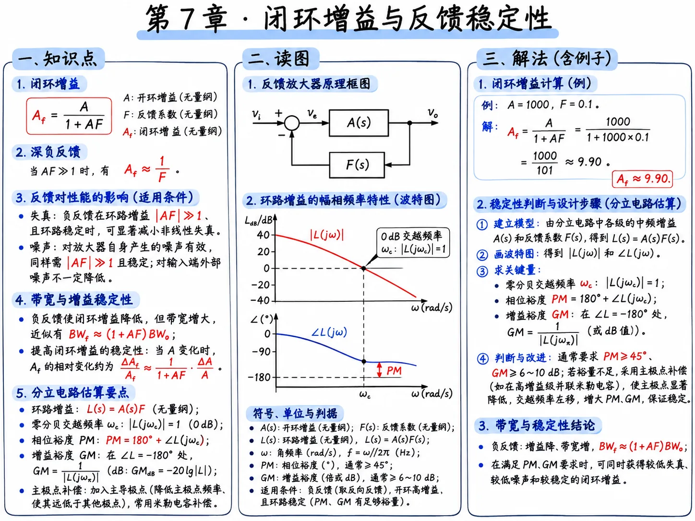
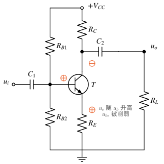
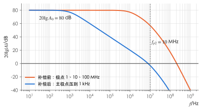

# 负反馈放大电路

!!! abstract "TL;DR"
    - 闭环增益 $A_f=\dfrac{A}{1+AF}$；**深度负反馈**（$|AF|\gg1$）时 $A_f\approx\dfrac1F$，与放大器本身几乎无关。
    - 判正负用**瞬时极性法**：设输入 $\oplus$，逐级推到输出，再经反馈网络回到输入端，看**净输入**是被削弱（负反馈）还是被加强（正反馈）。
    - 判组态两步：输出端**令 $u_o=0$**，反馈消失为电压反馈、仍在为电流反馈；输入端反馈与输入**接同一节点为并联、接不同节点为串联**。
    - 负反馈以牺牲增益（降为 $1/(1+AF)$）换来增益稳定、带宽展宽、失真减小；串联使 $R_i$ 增大、并联使 $R_i$ 减小，电压反馈使 $R_o$ 减小、电流反馈使 $R_o$ 增大。
    - 环路增益 $T=AF$ 的相移达到 $-180^\circ$ 时 $|T|$ 若仍 $\ge1$ 就会自激；常用**相位裕度 $\mathrm{PM}\ge45^\circ$**、增益裕度 $\mathrm{GM}\ge10\,\mathrm{dB}$ 作为设计指标，不足时用主极点（米勒电容）补偿。

??? info "本章图卡（AI 生成速览，错误见文末「图卡勘误」）"
    { loading=lazy }
    { loading=lazy }

## 1. 反馈框图与闭环增益

{ .circuit }

把输出量 $x_o$ 的一部分经反馈网络送回输入端，与输入量比较。约定（$x$ 可以是电压或电流）：

$$
x_{id}=x_i-x_f,\qquad x_o=A\,x_{id},\qquad x_f=F\,x_o
\ \Rightarrow\
A_f=\frac{x_o}{x_i}=\frac{A}{1+AF}.
$$

| 量 | 名称 | 说明 |
| --- | --- | --- |
| $A$ | 开环增益 | 基本放大电路（考虑了反馈网络的负载效应）的增益 |
| $F$ | 反馈系数 | $x_f/x_o$ |
| $T=AF$ | 环路增益 | 信号绕环一周的增益 |
| $1+AF$ | 反馈深度 | $>1$ 为负反馈，$<1$ 为正反馈，$=0$ 时自激 |

- **深度负反馈**：$|AF|\gg1$ 时 $A_f\approx 1/F$，等价于 $x_{id}\approx0$、$x_i\approx x_f$——这正是运放电路"虚短、虚断"的来源。
- **直流反馈**只在直流通路中存在（如被旁路电容短接的 $R_E$），作用是稳定静态工作点；**交流反馈**存在于交流通路中，影响增益、带宽、输入输出电阻。两者都存在时分别分析。

??? example "例：图卡的闭环增益计算"
    $A=1000$，$F=0.1$。

    1. $AF=100$，$A_f=\dfrac{1000}{1+100}=\dfrac{1000}{101}\approx9.90$。
    2. 深度负反馈估算 $1/F=10$，误差约 $1\%$（就是 $1/(1+AF)$ 的量级）。
    3. 若 $A$ 因温度降到 $800$（$-20\%$）：$A_f=\dfrac{800}{81}\approx9.877$，只变了 $-0.247\%$。精确关系是 $\dfrac{\Delta A_f}{A_{f1}}=\dfrac{\Delta A/A_1}{1+A_2F}=\dfrac{-0.2}{81}$；微小变化时近似为 $\dfrac{\mathrm dA_f}{A_f}=\dfrac{1}{1+AF}\dfrac{\mathrm dA}{A}$。

## 2. 判别反馈的有无与正负：瞬时极性法

**有无**：输出与输入回路之间是否存在连接元件（反馈通路）。**正负**按以下步骤：

1. 设输入信号某瞬时对地极性为 $\oplus$；
2. 逐级标出各点极性：运放同相端→输出同相、反相端→输出反相；BJT 共射 $b\to c$ 反相、$b\to e$ 同相；
3. 经反馈网络（纯电阻不改变极性）得到反馈信号的极性；
4. 看**净输入**：串联比较看 $u_{id}=u_i-u_f$ 是否减小，并联比较看 $i_{id}=i_i-i_f$ 是否减小；减小为负反馈。

对运放有一条速记：**输入、反馈接不同输入端时，两者同极性为负反馈；接同一输入端时，两者反极性为负反馈。**

??? example "例 1：共射放大电路中的 $R_E$"
    { .circuit }

    $\beta=100$，$r_\pi=1.5\,\mathrm{k\Omega}$，$R_C=R_L=4\,\mathrm{k\Omega}$，$R_E=0.5\,\mathrm{k\Omega}$（无旁路电容）。

    1. **极性**：基极 $\oplus$ → 发射极 $\oplus$（跟随）→ $u_{be}=u_b-u_e$ 被削弱：**负反馈**。
    2. **组态**：令 $u_o=0$（$R_L$ 短路），$i_e$ 仍流过 $R_E$，反馈仍在 → 电流反馈；输入接基极、反馈电压出现在发射极，不同节点 → 串联。所以是**电流串联负反馈**，稳定的是 $i_c$。
    3. **精确值**：$R_L'=R_C\parallel R_L=2\,\mathrm{k\Omega}$，

        $$
        A_u=-\frac{\beta R_L'}{r_\pi+(1+\beta)R_E}=-\frac{200}{1.5+50.5}\approx-3.85 .
        $$

    4. **深度负反馈估算**：$(1+\beta)R_E\gg r_\pi$ 时 $u_i\approx u_f=i_eR_E$，$u_o=-i_cR_L'$，故 $A_u\approx-\dfrac{R_L'}{R_E}=-4$，误差约 $4\%$。

    $R_E$ 若并上大电容，交流负反馈消失（只剩稳定 Q 点的直流负反馈），增益回到 $-\beta R_L'/r_\pi$。

??? example "例 2：两级运放的级间反馈"
    { .circuit }

    $R_1=10\,\mathrm{k\Omega}$，$R_F=100\,\mathrm{k\Omega}$，$R_3=R_4=10\,\mathrm{k\Omega}$，判断 $R_F$ 引入的反馈并估算 $A_{uf}$。

    1. **极性**：$u_i\oplus$ → $A_1$ 反相端 $\oplus$ → $u_{o1}\ominus$ → $A_2$ 同相放大，$u_o\ominus$ → 经 $R_F$ 回到 $A_1$ 反相端。输入与反馈在**同一节点**，极性相反：$i_f$ 由节点流向 $u_o$ 而增大，$i_{id}=i_i-i_f$ 减小，**负反馈**。
    2. **组态**：令 $u_o=0$，$R_F$ 右端接地，不再含输出信息 → 电压反馈；同一节点 → 并联。**电压并联负反馈**。
    3. **估算**：环路含两级开环增益，反馈很深。$A_1$ 反相端虚地，$i_i\approx i_f$：

        $$
        \frac{u_i}{R_1}\approx\frac{0-u_o}{R_F}\ \Rightarrow\ A_{uf}\approx-\frac{R_F}{R_1}=-10 .
        $$

        （$A_2$ 的增益 $1+R_4/R_3=2$ 只影响环路增益，不出现在结果里。）

    若把 $A_2$ 改成反相放大器，$u_o$ 变为 $\oplus$，$i_f$ 改为流入节点，净输入被加强——变成**正反馈**，电路会饱和。多级环路的正负取决于环内反相的次数。

## 3. 四种组态与深度负反馈估算

| 组态 | 比较量 | $A$ 的含义 | $F$ 的含义 | 稳定 | $R_{if}$ | $R_{of}$ | 宜配信号源 |
| --- | --- | --- | --- | --- | --- | --- | --- |
| 电压串联 | $u$ | $A_u=u_o/u_{id}$（无量纲） | $F_u=u_f/u_o$ | $u_o$ | $(1+AF)R_i$ ↑ | $R_o/(1+AF)$ ↓ | 低内阻电压源 |
| 电压并联 | $i$ | $A_r=u_o/i_{id}$（$\Omega$） | $F_g=i_f/u_o$（S） | $u_o$ | $R_i/(1+AF)$ ↓ | ↓ | 高内阻（电流源） |
| 电流串联 | $u$ | $A_g=i_o/u_{id}$（S） | $F_r=u_f/i_o$（$\Omega$） | $i_o$ | ↑ | $(1+AF)R_o$ ↑ | 低内阻电压源 |
| 电流并联 | $i$ | $A_i=i_o/i_{id}$（无量纲） | $F_i=i_f/i_o$ | $i_o$ | ↓ | ↑ | 高内阻（电流源） |

- **串联**：反馈以电压形式与输入串在同一回路里比较，信号源内阻越小越有效；**并联**：反馈电流与输入电流在节点汇合，信号源内阻越大越有效（内阻为零时 $i_i$ 不受 $i_f$ 影响，反馈失效）。
- 深度负反馈下 $A_f\approx1/F$，然后换算成电压增益：并联型用 $i_i\approx u_s/R_s$（$R_s$ 为信号源内阻或输入电阻），电流型用 $u_o=i_oR_L$。

=== "电压串联"

    { .circuit }

    $F_u=\dfrac{u_f}{u_o}=\dfrac{R_1}{R_1+R_f}$，$A_{uf}\approx\dfrac1{F_u}=1+\dfrac{R_f}{R_1}$。
    $R_1=10\,\mathrm{k\Omega}$、$R_f=90\,\mathrm{k\Omega}$ 时 $A_{uf}\approx10$；运放 $A=10^5$ 时精确值 $10/(1+10^{-4})$。

=== "电压并联"

    { .circuit }

    虚地，$i_f=\dfrac{0-u_o}{R_f}$，$F_g=-\dfrac1{R_f}$，$A_{rf}=\dfrac{u_o}{i_i}\approx-R_f$；
    再用 $i_i=u_s/R_1$：$A_{usf}\approx-\dfrac{R_f}{R_1}$。$R_1=10\,\mathrm{k\Omega}$、$R_f=100\,\mathrm{k\Omega}$ 时 $A_{rf}\approx-100\,\mathrm{k\Omega}$、$A_{usf}\approx-10$。

=== "电流串联"

    { .circuit }

    $R_L$ 跨接在输出与反相端之间，$i_o$ 全部流过 $R$：$u_f=i_oR$，$F_r=R$，$A_{gf}=\dfrac{i_o}{u_i}\approx\dfrac1R$。
    $i_o=u_i/R$ 与 $R_L$ 无关——这是一个**压控电流源**。$R=1\,\mathrm{k\Omega}$、$u_i=2\,\mathrm V$ 时 $i_o=2\,\mathrm{mA}$。

=== "电流并联"

    { .circuit }

    反相端虚地，$u_M=-i_fR_F$；$M$ 点 KCL $i_o+i_f=u_M/R$，得 $i_f=-\dfrac{R}{R+R_F}\,i_o$，
    $F_i=-\dfrac{R}{R+R_F}$，$A_{if}=\dfrac{i_o}{i_i}\approx-\Big(1+\dfrac{R_F}{R}\Big)$。
    $R_1=R=10\,\mathrm{k\Omega}$、$R_F=90\,\mathrm{k\Omega}$、$u_s=1\,\mathrm V$：$i_i=0.1\,\mathrm{mA}$，$i_o\approx-1\,\mathrm{mA}$（与图示方向相反），与 $R_L$ 无关。

!!! warning "常见误判"
    - "跨接在输出端就是电压反馈"不可靠，要用**输出短路法**：电流串联图中反馈电阻 $R$ 并不直接接在输出端，但把负载 $R_L$ 短路（负载上的输出电压为零）后，运放输出电流仍流过 $R$ 产生 $u_f$，反馈仍在，所以是电流反馈。
    - 估算闭环增益前先确认是**负**反馈；$A_f\approx1/F$ 对正反馈毫无意义。

## 4. 负反馈对放大电路性能的影响

| 性能 | 结论 | 成立条件 |
| --- | --- | --- |
| 增益稳定性 | $\dfrac{\mathrm dA_f}{A_f}=\dfrac1{1+AF}\dfrac{\mathrm dA}{A}$ | $F$ 由稳定的无源元件构成 |
| 带宽 | $f_{Hf}=(1+A_0F)f_H$，$f_{Lf}=f_L/(1+A_0F)$；增益带宽积不变 | $A$ 为单极点（低频端单零极点）特性 |
| 非线性失真 | 环内产生的失真减小为约 $1/(1+AF)$ | 输入信号幅度相应加大到使输出相同 |
| 噪声与干扰 | 只能抑制**环内**产生的噪声；与输入信号一同进入的噪声无法区分，信噪比不会因反馈提高 | — |
| 输入、输出电阻 | 见第 3 节表格 | 公式中的 $A$ 取对应的开环条件（$R_{of}$ 用负载开路或短路时的 $A$） |

??? example "例：同相放大器的带宽与输入、输出电阻"
    运放 $A_0=10^5$，开环 $f_H=10\,\mathrm{Hz}$（单极点），差模输入电阻 $R_{id}=2\,\mathrm{M\Omega}$，输出电阻 $R_o=75\,\Omega$。

    1. 接成 $F=0.01$ 的同相放大器（如 $R_1=1\,\mathrm{k\Omega}$、$R_f=99\,\mathrm{k\Omega}$），$1+A_0F=1001$。
    2. 闭环增益 $A_f=\dfrac{10^5}{1001}\approx99.9$；带宽 $f_{Hf}=10\times1001=10.01\,\mathrm{kHz}$；增益带宽积 $99.9\times10.01\,\mathrm{kHz}\approx1\,\mathrm{MHz}=A_0f_H$。
    3. 电压串联：$R_{if}\approx1001\times2\,\mathrm{M\Omega}\approx2\,\mathrm{G\Omega}$，$R_{of}\approx\dfrac{75}{1001}\approx0.075\,\Omega$。
    4. 按完整的运放模型（$R_{id}$、$A u_d$ 串 $R_o$）列节点方程求得 $R_{if}=2.001\,\mathrm{G\Omega}$、$R_{of}=0.0750\,\Omega$，与估算一致。

## 5. 负反馈的稳定性

把 $A$、$F$ 换成频率函数：$A_f(j\omega)=\dfrac{A(j\omega)}{1+T(j\omega)}$，$T=AF$。中频时 $T$ 为正实数（负反馈）；频率升高后每个极点附加至多 $-90^\circ$ 的相移，若某频率 $f_{180}$ 处 $\angle T=-180^\circ$，负反馈就变成了正反馈，此时 $|T|\ge1$ 则 $1+T=0$ 可以成立——**自激振荡**。

- 单极点、两极点的 $T$ 相移不超过 $-180^\circ$，理论上不会自激（但两极点时裕度可能很小）；**三个及以上极点**才可能自激。
- 判据（$T$ 的波特图）：增益交越频率 $f_c$（$|T|=1$）处 $\angle T>-180^\circ$ 则稳定。

$$
\mathrm{PM}=180^\circ+\angle T(jf_c),\qquad
\mathrm{GM}=-20\lg|T(jf_{180})|\ \ (\mathrm{dB}).
$$

工程上要求 $\mathrm{PM}\ge45^\circ$、$\mathrm{GM}\ge10\,\mathrm{dB}$。$F$ 越大（闭环增益越低、反馈越深）$|T|$ 越大，越容易自激——**电压跟随器（$F=1$）是最难稳定的情形**。

??? example "例：三个相同极点的放大器"
    $A(jf)=\dfrac{10^4}{(1+jf/f_p)^3}$，$f_p=1\,\mathrm{MHz}$，$F$ 与频率无关。

    1. **$f_{180}$**：每个极点相移 $60^\circ$ 时总相移 $-180^\circ$，$f_{180}=\sqrt3f_p\approx1.73\,\mathrm{MHz}$；此处 $|A|=\dfrac{10^4}{(\sqrt{1+3})^3}=\dfrac{10^4}{8}=1250$（$61.9\,\mathrm{dB}$）。
    2. **稳定条件**：$|T(f_{180})|=1250F<1$，即 $F<8\times10^{-4}$。想做 $A_f\approx100$（$F=0.01$）：$|T(f_{180})|=12.5>1$，**自激**。
    3. **$F=2\times10^{-4}$**（$A_f=\dfrac{10^4}{3}\approx3333$）：$f_c$ 满足 $(1+x^2)^{3/2}=2$，$x=f_c/f_p=\sqrt{2^{2/3}-1}\approx0.766$；

        $$
        \mathrm{PM}=180^\circ-3\arctan0.766\approx67.6^\circ,\qquad \mathrm{GM}=-20\lg(1250\times2\times10^{-4})=20\lg4\approx12\,\mathrm{dB}.
        $$

    { .circuit }

    要 $\mathrm{GM}\ge10\,\mathrm{dB}$，需 $F\le\dfrac{1}{1250\sqrt{10}}\approx2.5\times10^{-4}$，即这个放大器只能做闭环增益约 $2800$ 以上的放大器——不补偿就没法用作低增益放大器。

**主极点（频率）补偿**：在某一级（通常是高增益中间级）引入一个频率很低的极点，使 $|A|$ 在到达第二个极点之前就以 $-20\,\mathrm{dB/dec}$ 降到 $0\,\mathrm{dB}$。若要求单位增益（$F=1$）稳定，把第一个极点压到

$$
f_{p1}'\approx\frac{f_{p2}}{A_0},
$$

使 $|A|$ 恰在 $f_{p2}$ 附近穿越 $0\,\mathrm{dB}$，$\mathrm{PM}\approx45^\circ$。实际做法是在中间级跨接**米勒电容** $C_c$：等效输入电容 $(1+|A_2|)C_c$ 很大，小电容就能形成很低的主极点，同时把输出端极点推向高频（极点分离）。代价是开环带宽变窄、压摆率受 $C_c$ 限制（见 [差分放大与集成运放](differential-opamp.md)）。

??? example "例：主极点补偿"
    运放 $A_0=10^4$，极点 $1\,\mathrm{MHz}$、$10\,\mathrm{MHz}$、$100\,\mathrm{MHz}$，接成电压跟随器（$F=1$）。

    1. **补偿前**：数值求得 $f_c\approx208\,\mathrm{MHz}$，$\angle T(f_c)\approx-241^\circ$，$\mathrm{PM}\approx-61^\circ$，必然自激。
    2. **补偿**：把第一个极点压到 $f_{p1}'=\dfrac{10\,\mathrm{MHz}}{10^4}=1\,\mathrm{kHz}$。
    3. **补偿后**：$f_c\approx7.8\,\mathrm{MHz}$（略低于 $f_{p2}$，因为 $f_{p2}$ 处 $|A|$ 已低于 $0\,\mathrm{dB}$ 约 $3\,\mathrm{dB}$），

        $$
        \mathrm{PM}=180^\circ-\arctan\frac{7.8}{0.001}-\arctan\frac{7.8}{10}-\arctan\frac{7.8}{100}\approx47^\circ .
        $$

    { .circuit }

    单位增益带宽约 $7.8\,\mathrm{MHz}$，开环 $-3\,\mathrm{dB}$ 带宽只剩 $1\,\mathrm{kHz}$——通用运放开环带宽只有几赫兹到几十赫兹，原因就在这里。

## 练习

### 1. 概念判断 :material-star::material-star-outline::material-star-outline:

1. 负反馈能减小放大电路的一切失真和噪声。
2. 电压负反馈稳定输出电压，因而使输出电阻减小。
3. 并联负反馈的信号源内阻越小，反馈效果越好。
4. 反馈越深（$F$ 越大），放大器越稳定、越不易自激。
5. 发射极电阻并联了足够大的旁路电容后，只存在直流负反馈。

??? success "答案"
    1 ✗　2 ✓　3 ✗　4 ✗　5 ✓

??? note "解析"
    1. 只能减小**环内**产生的失真和噪声，且要靠加大输入来维持输出；随输入信号一起进来的失真和噪声无能为力。
    2. 电压反馈"盯住"$u_o$，负载变化时 $u_o$ 基本不变，相当于输出电阻减小为 $R_o/(1+AF)$。
    3. 相反：内阻为零时输入电流完全由 $u_s$ 决定，$i_f$ 无法改变净输入，并联反馈失效；应配高内阻信号源。
    4. "增益稳定"与"不自激"是两回事：$F$ 越大，环路增益越大，$f_c$ 越高，相位裕度越小，越容易自激。
    5. 旁路电容对交流短路，交流通路中没有 $R_E$；直流通路中 $R_E$ 仍在，稳定静态工作点。

### 2. 按增益稳定性要求设计 $A$ 与 $F$ :material-star::material-star-outline::material-star-outline:

要求闭环增益 $A_f=20$，并且当开环增益 $A$ 变化 $\pm10\%$ 时 $A_f$ 的变化不超过 $\pm0.1\%$（按微分关系估算）。求 $A$ 至少多大，$F$ 取多少。

??? success "答案"
    $A=2000$，$F=0.0495$。

??? note "解析"
    1. $\dfrac{\mathrm dA_f}{A_f}=\dfrac{1}{1+AF}\dfrac{\mathrm dA}{A}$：$\dfrac{10\%}{1+AF}\le0.1\%\Rightarrow1+AF\ge100$。
    2. $A_f=\dfrac{A}{1+AF}=20\Rightarrow A=20\times100=2000$，$F=\dfrac{99}{2000}=0.0495$。
    3. 校核：$A$ 降到 $1800$ 时 $A_f=\dfrac{1800}{1+89.1}\approx19.978$，变化 $-0.11\%$。比 $0.1\%$ 略大，因为微分关系只对小变化精确；要严格满足需留一点余量。

### 3. 压控电流源 :material-star::material-star::material-star-outline:

在电流串联图（$R_L$ 跨接在运放输出端与反相端之间）中，$R=1\,\mathrm{k\Omega}$，$u_i=2\,\mathrm V$，运放输出饱和电压 $\pm12\,\mathrm V$。求 $F$、$A_{gf}$、$i_o$，以及保证线性工作的 $R_L$ 最大值。

??? success "答案"
    $F_r=1\,\mathrm{k\Omega}$，$A_{gf}=1\,\mathrm{mS}$，$i_o=2\,\mathrm{mA}$，$R_L\le5\,\mathrm{k\Omega}$。

??? note "解析"
    1. 虚断，$i_o$ 全部流过 $R$：$u_f=i_oR$，$F_r=u_f/i_o=R=1\,\mathrm{k\Omega}$；$A_{gf}\approx1/F_r=1\,\mathrm{mS}$。
    2. 虚短 $u_-=u_i$，$i_o=u_i/R=2\,\mathrm{mA}$。
    3. 输出电压 $u_o=i_o(R_L+R)\le12\,\mathrm V\Rightarrow R_L\le\dfrac{12}{2\times10^{-3}}-1\,\mathrm{k\Omega}=5\,\mathrm{k\Omega}$。超过后运放饱和，"恒流"失效。

### 4. 环内反相次数与反馈极性 :material-star::material-star::material-star-outline:

在例 2 的两级电路中，把 $A_2$ 换成增益为 $-2$ 的反相放大器，其余不变。（1）$R_F$ 引入什么反馈？（2）若希望保留级间电压并联负反馈，最简单的改法是什么？

??? success "答案"
    （1）正反馈；（2）让环内反相次数为奇数，例如 $A_2$ 恢复为同相放大（或再加一级反相器）。

??? note "解析"
    1. $u_i\oplus$ → $u_{o1}\ominus$ → $u_o\oplus$（$A_2$ 反相）→ 经 $R_F$ 回到 $A_1$ 反相端，与输入同一节点、同极性：$i_f$ 流**入**节点，净输入被加强。列方程可得闭环增益的分母为 $11(0.18A_1-1)$，$A_1$ 较大时变号，电路进入饱和。
    2. 反馈接回反相端时，从该端出发绕环一周应总共反相奇数次（$A_1$ 本身已反相一次），所以后级应为同相。

### 5. 闭环增益太低会自激 :material-star::material-star::material-star:

放大器 $A(jf)=\dfrac{10^3}{(1+jf/10^6)^3}$。（1）接成 $F=0.1$ 的反馈放大器能否稳定？（2）在不补偿的前提下，能稳定工作的闭环增益最小约为多少？

??? success "答案"
    （1）不稳定，$|T(f_{180})|=12.5$；（2）$F<0.008$，$A_f>111$。

??? note "解析"
    1. 三个相同极点，$f_{180}=\sqrt3\,\mathrm{MHz}$，$|A(f_{180})|=10^3/8=125$，$|T|=125\times0.1=12.5>1$，自激。
    2. 稳定要求 $125F<1$，$F<0.008$，对应 $A_f=\dfrac{10^3}{1+10^3\times0.008}=\dfrac{1000}{9}\approx111$。实际还要留 $10\,\mathrm{dB}$ 增益裕度，闭环增益还要更高；想做低增益放大器就必须做频率补偿。

## 图卡勘误

| 图卡位置 | 原文 | 更正 |
| --- | --- | --- |
| 卡 15「瞬时极性法」 | 先假设输出增大，……若净输入减小（与输出变化相反）则为负反馈 | 教材做法是**设输入端某瞬时极性**，逐级推到输出再经反馈网络回到输入；按输出出发也可，但"与输出变化相反"表述含糊，应明确比较的是**净输入**（$u_{id}$ 或 $i_{id}$）是否被削弱 |
| 卡 15「如何判断四种组态」 | 跨接输出取电压，串入支路取电流 | 只是经验说法，可靠的方法是**输出短路法**：令 $u_o=0$ 后反馈消失为电压反馈，仍存在为电流反馈（例如 V–I 变换中反馈电阻不直接接输出端，却是电流反馈） |
| 卡 15 底部 | 直流反馈：稳定静态工作点；交流反馈：……扩展或缩小频带 | 应为直流**负**反馈稳定 Q 点；交流**负**反馈展宽频带、降低增益，"缩小频带"不属于负反馈的效果 |
| 卡 16「1. 闭环增益」及符号表 | $A$、$F$、$A_f$ 均为无量纲 | 只有电压串联、电流并联两种组态是无量纲的；电压并联的 $A$ 为互阻（$\Omega$）、$F$ 为互导（S），电流串联反之（见第 3 节表） |
| 卡 16「3. 反馈对性能的影响」 | 噪声：对放大器自身产生的噪声有效 | 只对**环内**、且在输入端之后产生的噪声和干扰有效；负反馈同等地衰减信号，不能提高输入端的信噪比 |
| 卡 16「4. 带宽」 | $BW_f\approx(1+AF)BW_o$ | 需注明条件：开环为**单极点**特性，$A$ 取中频值 $A_0$；多极点时只是近似 |
| 卡 16 符号说明 | 适用条件：负反馈（取反向反馈） | "取反向反馈"不是术语；条件应是：中频时为负反馈且环路满足稳定性（PM、GM 足够） |
| 卡 16 其余 | $A_f=1000/101\approx9.90$、PM/GM 定义、主极点补偿 | 正确 |
