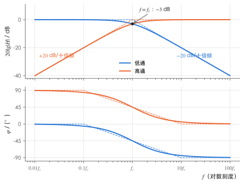
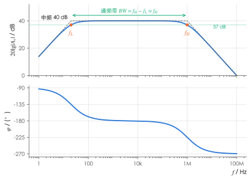

# 频率响应

!!! abstract "本章要点"
    - 放大器的增益随频率变化：中频平坦，低频和高频都会下降。
    - 低频下降来自耦合、旁路电容，转折点叫 $f_L$；高频下降来自晶体管结电容，转折点叫 $f_H$。
    - 每个电容的转折频率都是 $f=1/(2\pi R_{eq}C)$，关键是求对 $R_{eq}$。
    - 米勒效应把跨在输入、输出之间的小电容放大 $1-A_v$ 倍，是共射电路 $f_H$ 低的主因。
    - 级联越多带宽越窄；时域里 $f_H$ 决定上升时间，$f_L$ 决定平顶降落。

??? info "本章图卡"
    { loading=lazy }
    { loading=lazy }

正弦稳态、相量与传递函数的基础见 [频率响应与滤波](../notes/nonsinusoidal.md#4-频率响应与滤波) 和 [拉普拉斯变换](../extras/laplace.md)。本文电路参数沿用 [基本放大电路](basic-amplifiers.md) 例 1、例 4。

!!! note "知识点清单"
    **基本概念**

    - [ ] 幅频特性与相频特性
    - [ ] 中频增益、下限与上限截止频率、通频带
    - [ ] 增益带宽积
    - [ ] 频率失真（线性失真）
    - [ ] 分贝表示

    **一阶电路与波特图**

    - [ ] 一阶 RC 低通与高通
    - [ ] 波特图的折线画法与误差

    **低频段**

    - [ ] 放大电路的完整频率特性表达式
    - [ ] 短路时间常数法求 $f_L$
    - [ ] 主导极点与多极点估算

    **高频段**

    - [ ] 晶体管高频模型：$C_\pi$、$C_\mu$
    - [ ] $f_\beta$ 与特征频率 $f_T$
    - [ ] 米勒定理
    - [ ] 米勒效应与 $f_H$ 估算
    - [ ] 增益与带宽的矛盾，共基与 cascode

    **多级与时域**

    - [ ] 多级放大的 $f_L$、$f_H$
    - [ ] 上升时间
    - [ ] 平顶降落

## 1. 基本概念

### 1.1 幅频特性与相频特性

放大器对不同频率的正弦信号，放大倍数和相移都不一样。增益是频率的复函数：

$$
\dot A_v(jf)=|A_v(f)|\angle\varphi(f)
$$

适用条件：线性放大器，正弦稳态。

其中 $|A_v(f)|$ 叫**幅频特性**，$\varphi(f)$ 叫相频特性。

**为什么会随频率变**：电容的容抗 $1/(2\pi fC)$ 随频率变。低频时串在信号通路上的电容"堵"信号，高频时并在通路上的电容"漏"信号。

### 1.2 中频增益、截止频率与通频带

| 术语 | 定义 |
| --- | --- |
| 中频增益 $A_{vm}$ | 电容影响都可忽略的频段内的增益：耦合、旁路电容短路，结电容开路 |
| 下限截止频率 $f_L$ | 低频端 $\vert A_v\vert$ 降到 $\vert A_{vm}\vert/\sqrt2$ 的频率 |
| 上限截止频率 $f_H$ | 高频端 $\vert A_v\vert$ 降到 $\vert A_{vm}\vert/\sqrt2$ 的频率 |
| 通频带 $BW$ | $f_H-f_L$；通常 $f_H\gg f_L$，$BW\approx f_H$ |

降到 $1/\sqrt2$ 就是下降 $3\,\mathrm{dB}$，所以 $f_L$、$f_H$ 也叫 $-3\,\mathrm{dB}$ 频率。

!!! warning "易错"
    - $0.707$ 是相对中频值的比例。只有中频增益为 1 的无源 RC，截止处才是 $\vert H\vert=0.707$。

### 1.3 增益带宽积

中频增益与带宽的乘积。

$$
\mathrm{GBW}=|A_{vm}|\cdot BW
$$

适用条件：单（主导）极点系统，此时它基本是常数。

**意义**：增益和带宽不能同时要。增益做大，带宽就变窄。

### 1.4 频率失真

信号里不同频率成分被放大的倍数不同（幅度失真），或相移不与频率成正比（相位失真），输出波形就变了样。

**它是线性失真**：只改变各频率成分的幅值和相位，不产生新的频率成分。截止、饱和失真才会产生新频率，那是非线性失真。

### 1.5 分贝表示

$$
A_v(\mathrm{dB})=20\lg|A_v|
$$

适用条件：电压（电流）比；功率比用 $10\lg$。

| 倍数 | 1 | $\sqrt2$ | 10 | 100 | $1/\sqrt2$ |
| --- | --- | --- | --- | --- | --- |
| dB | 0 | 3 | 20 | 40 | $-3$ |

好处：级联时 dB 数相加；"下降 $3\,\mathrm{dB}$"对应幅值乘 $0.707$、功率减半。

## 2. 一阶 RC 电路与波特图

### 2.1 一阶低通与高通

{ .circuit }

一个 R 一个 C 组成的电路。输出取自电容是低通（让低频过），取自电阻是高通（让高频过）。

低通中，频率越高，电容越像短路，输出越小。高通中，频率越低，电容越像断路，输出越小。

$$
f_c=\frac1{2\pi RC},\qquad H_L=\frac{1}{1+j\,f/f_c},\qquad H_H=\frac{j\,f/f_c}{1+j\,f/f_c}=\frac{1}{1-j\,f_c/f}
$$

适用条件：空载（输出端不接负载）。

其中 $f_c$ 是转折频率，$H_L$、$H_H$ 分别是低通、高通的传递函数。

| | 低通 $\vert H_L\vert$ / $\varphi_L$ | 高通 $\vert H_H\vert$ / $\varphi_H$ |
| --- | --- | --- |
| 一般式 | $\dfrac{1}{\sqrt{1+(f/f_c)^2}}$ ／ $-\arctan\dfrac f{f_c}$ | $\dfrac{f/f_c}{\sqrt{1+(f/f_c)^2}}$ ／ $90^\circ-\arctan\dfrac f{f_c}$ |
| $f\ll f_c$ | $\approx1$（0 dB）／ $\approx0^\circ$ | $\approx f/f_c$（$+20\,\mathrm{dB/dec}$）／ $\approx+90^\circ$ |
| $f=f_c$ | $0.707$（$-3\,\mathrm{dB}$）／ $-45^\circ$ | $0.707$（$-3\,\mathrm{dB}$）／ $+45^\circ$ |
| $f\gg f_c$ | $\approx f_c/f$（$-20\,\mathrm{dB/dec}$）／ $\approx-90^\circ$ | $\approx1$ ／ $\approx0^\circ$ |

### 2.2 波特图

{ .circuit }

横轴用对数频率，纵轴用 dB（幅频）和度（相频）画出的频率特性图。用对数坐标后，曲线可以用几段直线近似。

1. 幅频画折线：转折频率两侧各一条直线，斜率相差 $20\,\mathrm{dB/dec}$（dec 即十倍频）。
2. 相频画三段折线：$0.1f_c$ 以下、$10f_c$ 以上为常数，中间线性变化 $90^\circ$，$f_c$ 处为 $\pm45^\circ$。
3. 多个因子相乘时，dB 与相位都相加：每过一个极点，斜率减 $20\,\mathrm{dB/dec}$、相位再滞后 $90^\circ$；每过一个零点则相反。

| 折线的误差 | 位置 | 大小 |
| --- | --- | --- |
| 幅频 | 转折点 | $3\,\mathrm{dB}$（最大） |
| 幅频 | 离转折点一个十倍频 | $0.04\,\mathrm{dB}$ |
| 相频 | $0.1f_c$ 和 $10f_c$ | $5.7^\circ$（最大） |

??? example "例 1：一阶 RC 的转折频率与典型值（图卡例题）"
    $R=1\,\mathrm{k\Omega}$，$C=0.1\,\mathrm{\mu F}$。求 $f_c$，以及低通、高通在 $0.1f_c$、$f_c$、$10f_c$ 处的幅值与相位。

    思路：先求 $f_c$，再令 $x=f/f_c$ 代入公式。

    1. $f_c=\dfrac{1}{2\pi\times10^3\times10^{-7}}=1.59\,\mathrm{kHz}$。
    2. 公式：$|H_L|_{\mathrm{dB}}=-10\lg(1+x^2)$，$|H_H|_{\mathrm{dB}}=20\lg x-10\lg(1+x^2)$。
    3. 逐点计算：

        | $f$ | 低通 dB | $\varphi_L$ | 高通 dB | $\varphi_H$ |
        | --- | --- | --- | --- | --- |
        | $0.1f_c$ | $-0.04$ | $-5.7^\circ$ | $-20.04$ | $+84.3^\circ$ |
        | $f_c$ | $-3.01$ | $-45^\circ$ | $-3.01$ | $+45^\circ$ |
        | $10f_c$ | $-20.04$ | $-84.3^\circ$ | $-0.04$ | $+5.7^\circ$ |

    **结论**：$f_c=1.59\,\mathrm{kHz}$；低通、高通互补，同一频率下 dB 数之和为 $20\lg\dfrac{x}{1+x^2}$，相位差恒为 $90^\circ$。

## 3. 放大电路的频率响应与低频段

### 3.1 完整频率特性

单管共射电路（含耦合、旁路电容）的增益可以写成"中频增益 × 低频因子 × 高频因子"：

$$
\dot A_v=\frac{A_{vm}}{\big(1-j\,\dfrac{f_L}{f}\big)\big(1+j\,\dfrac{f}{f_H}\big)}
$$

适用条件：低频、高频各有一个主导极点。

低频因子是高通型，高频因子是低通型。

**相位**：共射电路 $A_{vm}<0$，中频相位 $-180^\circ$。低频段相位**超前**（最多 $+90^\circ$），高频段相位滞后（最多 $-90^\circ$）。

{ .circuit }

??? example "例 2：读放大器的波特图"
    $\dot A_v=\dfrac{-100}{(1-j\,20/f)(1+j\,f/10^6)}$（$f$ 以 Hz 计）。求中频增益、$f_L$、$f_H$、$BW$，以及 $2\,\mathrm{Hz}$、$20\,\mathrm{Hz}$、$1\,\mathrm{kHz}$、$1\,\mathrm{MHz}$、$10\,\mathrm{MHz}$ 处的增益（dB）与相位。

    思路：对照标准式读出参数，再逐点代入。

    1. 读参数：$A_{vm}=-100$，即 $40\,\mathrm{dB}$、$-180^\circ$；$f_L=20\,\mathrm{Hz}$，$f_H=1\,\mathrm{MHz}$，$BW\approx1\,\mathrm{MHz}$。
    2. 相位公式：$\varphi=-180^\circ+\arctan\dfrac{20}{f}-\arctan\dfrac{f}{10^6}$。
    3. 逐点计算：

        | $f$ | $2\,\mathrm{Hz}$ | $20\,\mathrm{Hz}$ | $1\,\mathrm{kHz}$ | $1\,\mathrm{MHz}$ | $10\,\mathrm{MHz}$ |
        | --- | --- | --- | --- | --- | --- |
        | $20\lg\vert A_v\vert$ | $19.96\,\mathrm{dB}$ | $37.0\,\mathrm{dB}$ | $40.0\,\mathrm{dB}$ | $37.0\,\mathrm{dB}$ | $19.96\,\mathrm{dB}$ |
        | $\varphi$ | $-95.7^\circ$ | $-135^\circ$ | $-178.9^\circ$ | $-225^\circ$ | $-264.3^\circ$ |

    4. 渐近线核对：$f_L$ 以下、$f_H$ 以上一个十倍频都降 $20\,\mathrm{dB}$。

    **结论**：$40\,\mathrm{dB}$、$f_L=20\,\mathrm{Hz}$、$f_H=1\,\mathrm{MHz}$；截止频率处正好低 $3\,\mathrm{dB}$、相位偏 $45^\circ$。

### 3.2 低频段：短路时间常数法

低频段结电容可视为开路，影响增益的是 $C_1$、$C_2$、$C_E$。每只电容单独算一个转折频率。

**为什么能逐个算**：考虑某一只电容时，其余大电容在它的转折频率附近容抗很小，可以当短路。

$$
f_{Lk}=\frac1{2\pi R_{eq,k}C_k}
$$

适用条件：$R_{eq,k}$ 是其余电容短路后，从 $C_k$ 两端看进去的电阻。

| 电容 | 看进去的电阻 $R_{eq}$ |
| --- | --- |
| 输入耦合 $C_1$ | $R_s+R_i$，$R_i=R_B\parallel r_\pi$ |
| 输出耦合 $C_2$ | $R_o+R_L=R_C+R_L$ |
| 射极旁路 $C_E$ | $R_E\parallel\dfrac{r_\pi+R_s\parallel R_B}{1+\beta}$ |

$C_E$ 那一行：从射极看进去，基极回路的电阻要除以 $1+\beta$。

1. 对每只电容，把其他电容短路，求 $R_{eq}$。
2. 算出各自的 $f_{Lk}$。
3. 合成 $f_L$（见 3.3）。

!!! warning "易错"
    - $C_E$ 看到的电阻最小，同样容量下它决定 $f_L$。所以旁路电容通常要取几十到几百微法。

### 3.3 主导极点与多极点估算

若某个转折频率远离其他的，整体的截止频率就近似等于它，这个极点叫主导极点。

$$
f_L\approx\max_k f_{Lk}\ \ (\text{主导极点}),\qquad f_L\approx1.1\sqrt{f_{L1}^2+f_{L2}^2+\cdots}\ \ (\text{一般})
$$

适用条件：主导极点要求比其余大 4 倍以上；否则用右边的估算式。

??? example "例 3：共射电路的下限频率"
    [基本放大电路](basic-amplifiers.md) 例 4 电路（$R_s=1\,\mathrm{k\Omega}$，$R_B=8\,\mathrm{k\Omega}$，$r_\pi=1.667\,\mathrm{k\Omega}$，$\beta=100$，$R_C=3\,\mathrm{k\Omega}$，$R_L=6\,\mathrm{k\Omega}$，$R_E=1\,\mathrm{k\Omega}$），$C_1=C_2=10\,\mathrm{\mu F}$，$C_E=100\,\mathrm{\mu F}$。估算 $f_L$。

    { .circuit }

    思路：三只电容各求 $R_{eq}$ 和转折频率，再找主导极点。

    1. $C_1$：$R_{eq}=1+8\parallel1.667=2.38\,\mathrm{k\Omega}$，$f_{L1}=\dfrac{1}{2\pi\times2380\times10^{-5}}=6.69\,\mathrm{Hz}$。
    2. $C_2$：$R_{eq}=3+6=9\,\mathrm{k\Omega}$，$f_{L2}=1.77\,\mathrm{Hz}$。
    3. $C_E$：$\dfrac{1.667+1\parallel8}{101}\,\mathrm{k\Omega}=25.3\,\Omega$，与 $R_E$ 并联得 $24.7\,\Omega$。
    4. $f_{LE}=\dfrac{1}{2\pi\times24.7\times10^{-4}}=64.5\,\mathrm{Hz}$，比 $f_{L1}$ 大近 10 倍，是主导极点。
    5. 估算式：$1.1\sqrt{64.5^2+6.69^2+1.77^2}=71.3\,\mathrm{Hz}$。

    **结论**：$f_L\approx64.5\sim71.3\,\mathrm{Hz}$；整体电路数值求解得 $69.5\,\mathrm{Hz}$，误差都在 10% 以内。要降低 $f_L$，最有效的是加大 $C_E$。

## 4. 高频响应与米勒效应

### 4.1 晶体管的高频模型

{ .circuit }

高频时要在 hybrid-π 模型里加两个结电容。

| 电容 | 位置 | 来源 | 典型值 |
| --- | --- | --- | --- |
| $C_\pi$ | b—e 之间 | 发射结正偏，以扩散电容为主 | 几十 pF |
| $C_\mu$ | b—c 之间 | 集电结反偏，势垒电容 | 几 pF |

FET 对应的是 $C_{gs}$ 和 $C_{gd}$。

### 4.2 $f_\beta$ 与特征频率 $f_T$

频率升高时，$C_\pi$ 分走基极电流，管子的电流放大系数 $\beta$ 下降。$f_\beta$ 是 $|\beta|$ 下降 $3\,\mathrm{dB}$ 的频率；**特征频率** $f_T$ 是 $|\beta|$ 降到 1 的频率。

$$
f_\beta=\frac{1}{2\pi r_\pi(C_\pi+C_\mu)},\qquad f_T\approx\beta_0f_\beta=\frac{g_m}{2\pi(C_\pi+C_\mu)}
$$

适用条件：$\beta_0$ 为低频 $\beta$；$f_\beta<f<f_T$ 时 $|\beta|\cdot f\approx f_T$。

手册通常给 $f_T$ 和 $C_\mu$（$C_{ob}$），由第二式反推 $C_\pi$。

### 4.3 米勒定理

跨接在两个节点之间的阻抗，可以等效成两个分别接地的阻抗。这样电路就拆成了输入、输出两个独立回路。

$$
Z_1=\frac{Z}{1-A},\qquad Z_2=\frac{Z}{1-1/A}
$$

适用条件：$A=v_2/v_1$ 是两节点的电压比。

对电容即 $C_1=C(1-A)$、$C_2=C(1-1/A)$。

$v_1$ 升高 1 V 时，若 $v_2$ 反向降低 100 V，电容两端电压变了 101 V，充电电流是普通接地电容的 101 倍。从输入端看，就像接了一个 101 倍大的电容。

!!! warning "易错"
    - 米勒定理对任意 $A$ 成立。$A$ 为大负数时电容被倍增；跟随器 $A\approx+1$ 时 $C(1-A)\approx0$，跨接电容几乎被消掉。

### 4.4 米勒效应与 $f_H$ 估算

共射电路 b 到 c 的增益 $A=-g_mR_L'$ 是大负数，$C_\mu$ 折算到输入端被放大成 $C_M$，这就是**米勒效应**。

$$
C_M=C_\mu(1+g_mR_L'),\qquad C_{in}=C_\pi+C_M,\qquad f_H\approx\frac{1}{2\pi R'C_{in}}
$$

适用条件：$R'=R_s\parallel R_B\parallel r_\pi$（$r_{bb'}=0$）；输出端极点远高于输入端极点。

其中 $C_M$ 是米勒电容，$C_{in}$ 是输入端总电容，$R'$ 是从 $C_{in}$ 两端看进去的电阻。

{ .circuit }

1. 由 $f_T$、$C_\mu$ 求 $C_\pi$。
2. 算 $A=-g_mR_L'$ 和 $C_M=C_\mu(1-A)$。
3. 求 $R'$，得输入端极点 $f_H$。
4. 核对输出端极点 $\dfrac{1}{2\pi R_L'C_\mu}$ 是否高得多。

!!! warning "易错"
    - 输入端总电容要加上 $C_\pi$（FET 为 $C_{gs}$），不能只算米勒部分。
    - $A$ 是 b 到 c（栅到漏）的增益，不是源电压增益。

??? tip "米勒近似的适用范围"
    推导用的是中频增益 $A=-g_mR_L'$，忽略了 $C_\mu$ 引起的增益随频率下降和前馈通路。所以它只适合估算**主导极点**。在 $f_H$ 附近已经足够准确（例 4 误差约 2%）。

### 4.5 增益与带宽的矛盾；共基与 cascode

$$
R_L'\uparrow\ \to\ |A_{vm}|\uparrow\ \to\ C_M\uparrow\ \to\ f_H\downarrow
$$

增益带宽积大致不变。

**共基为什么高频好**：共基电路输入端没有跨接电容，$C_\mu$ 只接在输出与交流地之间，没有米勒倍增，$f_H$ 可接近 $f_T$ 量级。共射—共基（cascode）就是让 CE 级只带很小的负载（CB 的输入电阻 $\approx1/g_m$），从而压低米勒倍增。

??? example "例 4：共射电路的上限频率"
    同例 3 电路，晶体管 $f_T=300\,\mathrm{MHz}$，$C_\mu=2\,\mathrm{pF}$（$g_m=60\,\mathrm{mS}$，$r_\pi=1.667\,\mathrm{k\Omega}$，$R_L'=2\,\mathrm{k\Omega}$）。用米勒近似估算 $f_H$。

    思路：按 4.4 的四步走。

    1. $C_\pi+C_\mu=\dfrac{0.06}{2\pi\times3\times10^8}=31.8\,\mathrm{pF}$，$C_\pi=29.8\,\mathrm{pF}$；$f_\beta=\dfrac{f_T}{\beta}=3\,\mathrm{MHz}$。
    2. $A=-g_mR_L'=-120$，$C_M=2\times121=242\,\mathrm{pF}$，$C_{in}=29.8+242=271.8\,\mathrm{pF}$。
    3. $R'=1\parallel8\parallel1.667\,\mathrm{k\Omega}=580\,\Omega$，$f_H\approx\dfrac{1}{2\pi\times580\times271.8\times10^{-12}}=1.01\,\mathrm{MHz}$。
    4. 输出端极点 $\dfrac{1}{2\pi\times2\,\mathrm{k\Omega}\times2.02\,\mathrm{pF}}=39.5\,\mathrm{MHz}$，可忽略。

    **结论**：$f_H\approx1.01\,\mathrm{MHz}$（精确解 $0.988\,\mathrm{MHz}$）。$C_\mu$ 只有 $2\,\mathrm{pF}$，折算后却是 $C_\pi$ 的 8 倍。中频 $|A_{vsm}|=69.6$，增益带宽积约 $69\,\mathrm{MHz}$，远小于 $f_T$。

??? example "例 5：米勒电容、阶跃响应与 $f_H$（图卡例题）"
    （1）某 FET 放大器 $C_{gd}=2\,\mathrm{pF}$，栅—漏电压增益 $A_v=-50$，求米勒电容；（2）若输出是一阶响应、$\tau=10\,\mathrm{ns}$，求阶跃输入下 $t=\tau$ 时的输出、上升时间和 $f_H$。

    思路：米勒电容直接套公式；时域部分用一阶响应 $1-e^{-t/\tau}$。

    1. $C_M=C_{gd}(1-A_v)=2\times51=102\,\mathrm{pF}$；输入端总电容还要加 $C_{gs}$。
    2. $v_o(t)=V_\infty(1-e^{-t/\tau})$，$t=\tau$ 时 $v_o=0.632V_\infty$。
    3. 到 $10\%$ 用时 $0.105\tau$，到 $90\%$ 用时 $2.303\tau$，$t_r=\tau\ln9=2.2\tau=22\,\mathrm{ns}$。
    4. $f_H=\dfrac{1}{2\pi\tau}=15.9\,\mathrm{MHz}$；用 $t_r$ 算：$\dfrac{0.35}{22\,\mathrm{ns}}=15.9\,\mathrm{MHz}$，一致。

    **结论**：$C_M=102\,\mathrm{pF}$，$t_r=22\,\mathrm{ns}$，$f_H=15.9\,\mathrm{MHz}$。

## 5. 多级放大的频率响应

$n$ 级级联时，总增益是各级相乘，dB 和相位逐级相加。

**为什么带宽变窄**：在某一级的 $f_{Hk}$ 处，这一级已经降了 $3\,\mathrm{dB}$，其他级也各降了一点。所以总的 $-3\,\mathrm{dB}$ 点来得更早。

$$
f_L>\max_k f_{Lk},\qquad f_H<\min_k f_{Hk}
$$

**$n$ 级完全相同**：由 $\big[1+(f_H/f_{H1})^2\big]^n=2$ 得

$$
f_H=f_{H1}\sqrt{2^{1/n}-1},\qquad f_L=\frac{f_{L1}}{\sqrt{2^{1/n}-1}}
$$

适用条件：各级相同，每级是一阶的 $f_{H1}$、$f_{L1}$。

| 级数 $n$ | 1 | 2 | 3 | 4 |
| --- | --- | --- | --- | --- |
| $\sqrt{2^{1/n}-1}$ | 1 | 0.644 | 0.510 | 0.435 |

{ .circuit }

**各级不同**：

$$
\frac{1}{f_H}\approx1.1\sqrt{\sum_k\frac{1}{f_{Hk}^2}},\qquad f_L\approx1.1\sqrt{\sum_kf_{Lk}^2}
$$

适用条件：工程估算；若某级 $f_H$ 比其余小 4 倍以上，总 $f_H$ 就近似等于它。

??? example "例 6：两级与三级相同放大器的带宽"
    每级 $f_{L1}=20\,\mathrm{Hz}$、$f_{H1}=1\,\mathrm{MHz}$，求两级、三级级联后的 $f_L$、$f_H$。

    思路：查表得缩减因子，$f_H$ 乘、$f_L$ 除。

    1. 两级：因子 $0.644$，$f_H=0.644\,\mathrm{MHz}$，$f_L=\dfrac{20}{0.644}=31.1\,\mathrm{Hz}$。
    2. 三级：因子 $0.510$，$f_H=0.510\,\mathrm{MHz}$，$f_L=39.2\,\mathrm{Hz}$。

    **结论**：增益逐级相乘，带宽却越来越窄。要兼顾两者，通常靠**负反馈**用增益换带宽（见 [负反馈放大电路](feedback.md)）。

## 6. 阶跃响应

频域的 $f_H$、$f_L$ 在时域对应脉冲波形的两种失真。

{ .circuit }

### 6.1 上升时间

输入一个跳变，输出从终值的 $10\%$ 升到 $90\%$ 所用的时间 $t_r$。它反映高频响应。

高频段就像一个 RC 低通，输出要靠电容充电才能跟上跳变。$f_H$ 越高，充电越快。

$$
\tau=\frac{1}{2\pi f_H},\qquad t_r=\tau\ln9\approx2.2\tau=\frac{0.35}{f_H}
$$

适用条件：单（主导）极点系统。

??? tip "多级系统的上升时间"
    多级系统可估算 $t_r\approx\sqrt{\sum t_{rk}^2}$。$t_r\cdot f_H\approx0.35$ 严格只对单极点成立。

### 6.2 平顶降落

输入一个宽度 $t_p$ 的矩形脉冲，输出的平顶部分慢慢往下掉。下降的比例 $\delta$ 叫平顶降落，它反映低频响应。

耦合电容不能传直流。平顶期间电容慢慢充电，加到下一级的电压就慢慢变小。

$$
\tau_L=\frac{1}{2\pi f_L},\qquad \delta=1-e^{-t_p/\tau_L}\approx\frac{t_p}{\tau_L}=2\pi f_Lt_p
$$

适用条件：近似式要求 $t_p\ll\tau_L$。

脉冲结束后输出会出现反向"下冲"，面积与平顶期间相等，因为输出平均值必须为零。

这两种失真与 [一阶电路的三要素法](../notes/dynamic-circuits.md) 是同一件事：$f_H$ 对应充电快慢，$f_L$ 对应耦合电容放电快慢。

??? example "例 7：用频响估算脉冲失真"
    某放大器 $f_L=10\,\mathrm{Hz}$，$f_H=1\,\mathrm{MHz}$，输入宽 $1\,\mathrm{ms}$ 的矩形脉冲。求上升时间和平顶降落。

    思路：$f_H$ 管上升时间，$f_L$ 管平顶降落。

    1. $t_r=\dfrac{0.35}{10^6}\,\mathrm s=0.35\,\mathrm{\mu s}$。
    2. $\delta\approx2\pi\times10\times10^{-3}=6.28\%$；精确值 $1-e^{-0.0628}=6.09\%$。
    3. 若要 $\delta<1\%$：$f_L<\dfrac{0.01}{2\pi\times10^{-3}}=1.6\,\mathrm{Hz}$。

    **结论**：$t_r=0.35\,\mathrm{\mu s}$，$\delta\approx6\%$。脉冲越宽，对低频响应要求越高；直接耦合放大器 $f_L=0$，没有平顶降落。

## 公式速查

| 内容 | 公式 | 条件 |
| --- | --- | --- |
| 分贝 | $20\lg\vert A_v\vert$ | 电压比 |
| 一阶转折频率 | $f_c=\dfrac1{2\pi RC}$ | |
| 一阶低通 | $H_L=\dfrac{1}{1+jf/f_c}$ | $f_c$ 处 $-3\,\mathrm{dB}$、$-45^\circ$ |
| 一阶高通 | $H_H=\dfrac{1}{1-jf_c/f}$ | $f_c$ 处 $-3\,\mathrm{dB}$、$+45^\circ$ |
| 完整频率特性 | $\dot A_v=\dfrac{A_{vm}}{(1-jf_L/f)(1+jf/f_H)}$ | 主导极点近似 |
| 各电容转折频率 | $f_k=\dfrac1{2\pi R_{eq,k}C_k}$ | 其余电容按中频处理 |
| $C_E$ 看到的电阻 | $R_E\parallel\dfrac{r_\pi+R_s\parallel R_B}{1+\beta}$ | |
| 多极点合成 | $f_L\approx1.1\sqrt{\sum f_{Lk}^2}$，$\dfrac1{f_H}\approx1.1\sqrt{\sum\dfrac1{f_{Hk}^2}}$ | 无主导极点时 |
| $f_\beta$、$f_T$ | $f_\beta=\dfrac{1}{2\pi r_\pi(C_\pi+C_\mu)}$，$f_T=\dfrac{g_m}{2\pi(C_\pi+C_\mu)}$ | |
| 米勒定理 | $C_1=C(1-A)$，$C_2=C(1-1/A)$ | $A=v_2/v_1$ |
| 共射 $f_H$ | $f_H\approx\dfrac1{2\pi R'(C_\pi+C_\mu(1+g_mR_L'))}$ | $R'=R_s\parallel R_B\parallel r_\pi$ |
| $n$ 级相同 | $f_H=f_{H1}\sqrt{2^{1/n}-1}$，$f_L=\dfrac{f_{L1}}{\sqrt{2^{1/n}-1}}$ | |
| 上升时间 | $t_r=2.2\tau=\dfrac{0.35}{f_H}$ | 单极点 |
| 平顶降落 | $\delta\approx2\pi f_Lt_p$ | $t_p\ll\tau_L$ |

## 练习

### 1. 概念判断 :material-star::material-star-outline::material-star-outline:

判断下列说法是否正确：

1. 放大器的 $f_H$ 主要由耦合电容决定。
2. 一阶低通在 $f=10f_c$ 处的实际增益比渐近线低 $3\,\mathrm{dB}$。
3. 共射电路中，集电结电容 $C_\mu$ 虽然很小，对 $f_H$ 的影响却往往大于 $C_\pi$。
4. 两级相同放大器级联，总上限频率等于单级的上限频率。
5. 频率失真会在输出中产生输入里没有的频率成分。

??? success "答案"
    1 ✗　2 ✗　3 ✓　4 ✗　5 ✗

??? note "解析"
    1. 耦合、旁路电容决定 $f_L$；$f_H$ 由结电容（及分布电容）决定。
    2. $3\,\mathrm{dB}$ 误差在转折点；$10f_c$ 处只有 $0.04\,\mathrm{dB}$。
    3. 米勒效应把 $C_\mu$ 放大 $1+g_mR_L'$ 倍（例 4 中是 121 倍）。
    4. 总 $f_H=0.644f_{H1}$。
    5. 频率失真是线性失真，不产生新频率；产生新频率的是非线性失真。

### 2. RC 低通 :material-star::material-star-outline::material-star-outline:

$R=2\,\mathrm{k\Omega}$，$C=10\,\mathrm{nF}$ 组成低通电路。求：（1）$f_c$；（2）$100\,\mathrm{kHz}$ 处的增益（dB）；（3）相移为 $-30^\circ$ 的频率。

??? success "答案"
    （1）$7.96\,\mathrm{kHz}$；（2）$-22.0\,\mathrm{dB}$；（3）$4.59\,\mathrm{kHz}$。

??? note "解析"
    1. $f_c=\dfrac{1}{2\pi\times2\times10^3\times10^{-8}}=7.96\,\mathrm{kHz}$。
    2. $f/f_c=12.57$，$-10\lg(1+12.57^2)=-22.0\,\mathrm{dB}$；渐近线给 $-21.98\,\mathrm{dB}$，几乎一样。
    3. $\arctan(f/f_c)=30^\circ$，$f=f_c\tan30^\circ=4.59\,\mathrm{kHz}$。

### 3. 由传递函数画波特图 :material-star::material-star::material-star-outline:

$$
\dot A_v=\frac{100\,(j f/50)}{(1+j f/50)(1+j f/(2\times10^5))(1+j f/(2\times10^6))}.
$$

（1）中频增益（dB）和各转折频率；（2）用渐近线求 $20\,\mathrm{MHz}$ 处的增益；（3）$f_H$ 比 $200\,\mathrm{kHz}$ 低多少？

??? success "答案"
    （1）$40\,\mathrm{dB}$；$50\,\mathrm{Hz}$（低频）、$200\,\mathrm{kHz}$、$2\,\mathrm{MHz}$；（2）约 $-20\,\mathrm{dB}$；（3）$f_H\approx198\,\mathrm{kHz}$，只低 1%。

??? note "解析"
    1. 中频时分子分母的 $jf/50$ 约掉，$A_{vm}=100$，即 $40\,\mathrm{dB}$；$f_L=50\,\mathrm{Hz}$。
    2. $200\,\mathrm{kHz}\sim2\,\mathrm{MHz}$ 斜率 $-20\,\mathrm{dB/dec}$，降到 $20\,\mathrm{dB}$。
    3. $2\sim20\,\mathrm{MHz}$ 斜率 $-40\,\mathrm{dB/dec}$，再降 $40\,\mathrm{dB}$，得 $-20\,\mathrm{dB}$（精确 $-20.04\,\mathrm{dB}$）。
    4. 第二个极点高 10 倍，在 $200\,\mathrm{kHz}$ 处只多贡献约 $0.04\,\mathrm{dB}$，数值解 $f_H=198\,\mathrm{kHz}$。

    相距 4 倍以上时可按主导极点处理。

### 4. 共源电路的米勒效应 :material-star::material-star::material-star-outline:

共源放大器 $g_m=2\,\mathrm{mS}$，$R_D\parallel R_L=5\,\mathrm{k\Omega}$，$C_{gs}=4\,\mathrm{pF}$，$C_{gd}=1\,\mathrm{pF}$，栅极偏置电阻很大可忽略。信号源内阻 $R_{sig}=100\,\mathrm{k\Omega}$。（1）估算 $f_H$；（2）$R_{sig}$ 换成 $10\,\mathrm{k\Omega}$ 呢？（3）输出端极点在哪？

??? success "答案"
    （1）$106\,\mathrm{kHz}$；（2）$1.06\,\mathrm{MHz}$；（3）$28.9\,\mathrm{MHz}$。

??? note "解析"
    1. $A=-g_mR_D'=-10$，$C_{in}=4+1\times11=15\,\mathrm{pF}$。
    2. $f_H=\dfrac{1}{2\pi\times10^5\times15\times10^{-12}}=106\,\mathrm{kHz}$。
    3. $f_H$ 与 $R_{sig}$ 成反比：$1.06\,\mathrm{MHz}$。FET 常接高内阻信号源，这时输入端极点特别低。
    4. 输出端：$C_{gd}(1-1/A)=1.1\,\mathrm{pF}$，$\dfrac{1}{2\pi\times5\times10^3\times1.1\times10^{-12}}=28.9\,\mathrm{MHz}$。

### 5. 三级放大器 :material-star::material-star::material-star:

三级相同放大器，每级中频增益 $-20$、$f_{L1}=50\,\mathrm{Hz}$、$f_{H1}=200\,\mathrm{kHz}$。求总中频增益（倍数与 dB）、$f_L$、$f_H$，以及阶跃响应的上升时间。

??? success "答案"
    $-8000$（$78.1\,\mathrm{dB}$）；$f_L=98.1\,\mathrm{Hz}$；$f_H=102\,\mathrm{kHz}$；$t_r\approx3.43\,\mathrm{\mu s}$。

??? note "解析"
    1. $(-20)^3=-8000$，$20\lg8000=78.1\,\mathrm{dB}$（$=3\times26.0\,\mathrm{dB}$）；三次反相，总相位仍为 $-180^\circ$。
    2. 因子 $0.510$：$f_H=0.510\times200=102\,\mathrm{kHz}$，$f_L=50/0.510=98.1\,\mathrm{Hz}$。
    3. $t_r\approx\dfrac{0.35}{f_H}=3.43\,\mathrm{\mu s}$（把级联近似为单极点）。

## 图卡勘误

| 图卡位置 | 原文 | 更正 |
| --- | --- | --- |
| 11 知识点 1 | 截止频率处"$\vert H\vert=\dfrac{1}{\sqrt2}\approx0.707$" | 应相对中频值：$\vert A(f_c)\vert=\vert A_{vm}\vert/\sqrt2$ |
| 11 知识点 3 / 解法 3 | 暗示多级总带宽由各级 $f_c$ 直接决定 | 总 $-3\,\mathrm{dB}$ 点比任一级都窄：两级相同时 $f_H=0.644f_{H1}$（见第 5 节） |
| 12 读图（阶跃曲线） | $2.2\tau$ 处对齐 $0.9V_\infty$ | 到 $0.9V_\infty$ 是 $2.3\tau$；$t_r=2.2\tau$ 是 $10\%$ 到 $90\%$ 的**间隔** |
| 12 知识点 / 例题 | "$C_{in}\approx C_{gd}(1-A_v)=102\,\mathrm{pF}$" | 这只是米勒部分；总电容 $C_{in}=C_{gs}+C_{gd}(1-A_v)$ |
| 12 知识点 | "米勒效应（$A_v<0$）" | 米勒定理对任意 $A_v$ 成立；$A_v\approx+1$ 时跨接电容几乎被消除 |
