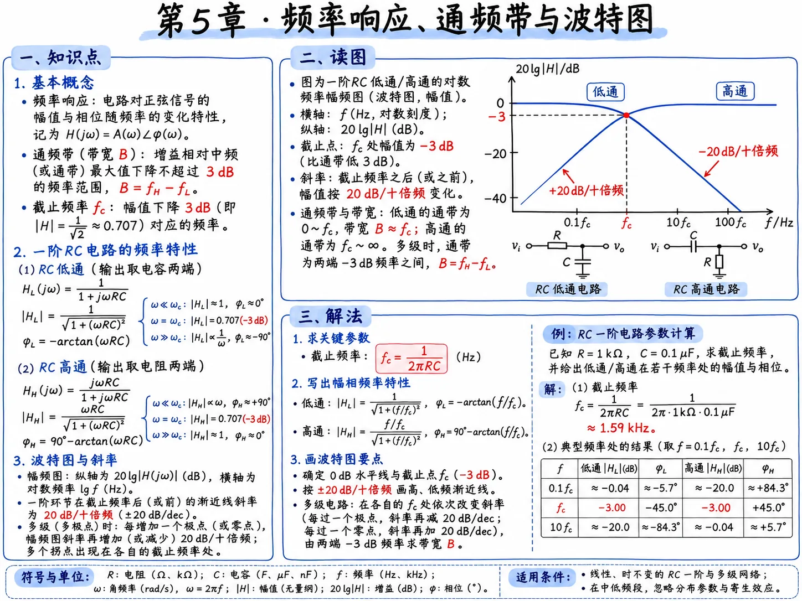
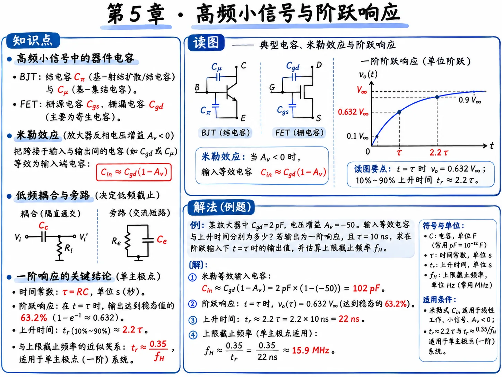
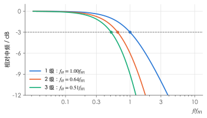
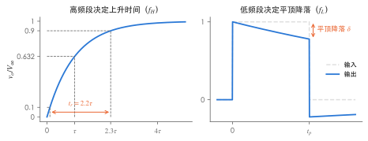

# 频率响应

!!! abstract "TL;DR"
    - 放大器增益随频率变化：中频段平坦；低频段因**耦合、旁路电容**下降，转折点 $f_L$；高频段因**晶体管结电容**下降，转折点 $f_H$。通频带 $BW=f_H-f_L\approx f_H$。
    - 一阶环节的波特图：转折频率处实际值比渐近线低 $3\,\mathrm{dB}$、相移 $\pm45^\circ$；离转折点一个十倍频，幅值斜率 $\pm20\,\mathrm{dB/dec}$，相位误差 $5.7^\circ$。
    - 每个电容的转折频率 $f=\dfrac{1}{2\pi R_{eq}C}$，$R_{eq}$ 是**其他电容按中频处理后**从该电容两端看进去的电阻。$f_L$ 由最大的那个决定，$f_H$ 由最小的那个决定。
    - 米勒效应：跨接在反相放大器输入、输出之间的 $C_\mu$（$C_{gd}$）折算到输入端变成 $C_\mu(1-A_v)$，是共射/共源电路 $f_H$ 低的主要原因。
    - 时域对应：$t_r\approx2.2\tau=\dfrac{0.35}{f_H}$；脉冲平顶降落 $\delta\approx2\pi f_Lt_p$。多级级联后 $f_H$ 变低、$f_L$ 变高。

??? info "本章图卡（AI 生成速览，错误见文末「图卡勘误」）"
    { loading=lazy }
    { loading=lazy }

正弦稳态、相量与传递函数的基础见 [频率响应与滤波](../notes/nonsinusoidal.md#4-频率响应与滤波) 和 [拉普拉斯变换](../extras/laplace.md)；本文的电路参数沿用 [基本放大电路](basic-amplifiers.md) 例 1、例 4。

## 1. 基本概念

放大器对正弦信号的增益是频率的复函数：

$$
\dot A_v(jf)=|A_v(f)|\angle\varphi(f),
$$

$|A_v(f)|$ 叫**幅频特性**，$\varphi(f)$ 叫**相频特性**。

| 术语 | 定义 |
| --- | --- |
| 中频增益 $A_{vm}$ | 电容影响都可忽略的频段内的增益（耦合、旁路电容短路，结电容开路） |
| 下限 / 上限截止频率 $f_L$、$f_H$ | $\vert A_v\vert$ 降到 $\vert A_{vm}\vert/\sqrt2$（下降 $3\,\mathrm{dB}$）时的频率 |
| 通频带 $BW$ | $f_H-f_L$；通常 $f_H\gg f_L$，$BW\approx f_H$ |
| 增益带宽积 | $\vert A_{vm}\vert\cdot BW$，对单极点系统基本是常数 |
| 频率失真 | 幅频不平坦（幅度失真）或相频不是线性（相位失真）造成的波形失真；它是**线性**失真，不产生新的频率成分 |

用分贝表示增益：$20\lg|A_v|$（dB）。级联时 dB 数相加；"下降 $3\,\mathrm{dB}$"对应幅值乘 $0.707$、功率减半。

## 2. 一阶 RC 电路与波特图

{ .circuit }

两种一阶电路的转折频率都是 $f_c=\dfrac1{2\pi RC}$：

$$
\text{低通：}\ H_L=\frac{1}{1+j\,f/f_c},\qquad \text{高通：}\ H_H=\frac{j\,f/f_c}{1+j\,f/f_c}=\frac{1}{1-j\,f_c/f}.
$$

| | 低通 $\vert H_L\vert$ / $\varphi_L$ | 高通 $\vert H_H\vert$ / $\varphi_H$ |
| --- | --- | --- |
| 一般式 | $\dfrac{1}{\sqrt{1+(f/f_c)^2}}$ ／ $-\arctan\dfrac f{f_c}$ | $\dfrac{f/f_c}{\sqrt{1+(f/f_c)^2}}$ ／ $90^\circ-\arctan\dfrac f{f_c}$ |
| $f\ll f_c$ | $\approx1$（0 dB）／ $\approx0^\circ$ | $\approx f/f_c$（$+20\,\mathrm{dB/dec}$）／ $\approx+90^\circ$ |
| $f=f_c$ | $0.707$（$-3\,\mathrm{dB}$）／ $-45^\circ$ | $0.707$（$-3\,\mathrm{dB}$）／ $+45^\circ$ |
| $f\gg f_c$ | $\approx f_c/f$（$-20\,\mathrm{dB/dec}$）／ $\approx-90^\circ$ | $\approx1$ ／ $\approx0^\circ$ |

{ .circuit }

**波特图**（对数频率横轴）的画法：

1. **幅频**用折线近似：转折频率以下、以上各是一条直线，斜率差 $20\,\mathrm{dB/dec}$；最大误差在转折点，为 $3\,\mathrm{dB}$。
2. **相频**用三段折线：$0.1f_c$ 以下、$10f_c$ 以上为常数，中间两个十倍频内线性变化 $90^\circ$，$f_c$ 处为 $\pm45^\circ$；最大误差 $5.7^\circ$。
3. 多个极点、零点相乘时，dB 与相位都**相加**：每经过一个极点斜率减 $20\,\mathrm{dB/dec}$、相位再滞后 $90^\circ$；每经过一个零点则相反。

??? example "例 1：一阶 RC 的转折频率与典型值（图卡例题）"
    $R=1\,\mathrm{k\Omega}$，$C=0.1\,\mathrm{\mu F}$。求 $f_c$，以及低通、高通在 $0.1f_c$、$f_c$、$10f_c$ 处的幅值与相位。

    1. $f_c=\dfrac{1}{2\pi\times10^3\times10^{-7}}=1.59\,\mathrm{kHz}$。
    2. 令 $x=f/f_c$，$|H_L|_{\mathrm{dB}}=-10\lg(1+x^2)$，$|H_H|_{\mathrm{dB}}=20\lg x-10\lg(1+x^2)$：

        | $f$ | 低通 dB | $\varphi_L$ | 高通 dB | $\varphi_H$ |
        | --- | --- | --- | --- | --- |
        | $0.1f_c$ | $-0.04$ | $-5.7^\circ$ | $-20.04$ | $+84.3^\circ$ |
        | $f_c$ | $-3.01$ | $-45^\circ$ | $-3.01$ | $+45^\circ$ |
        | $10f_c$ | $-20.04$ | $-84.3^\circ$ | $-0.04$ | $+5.7^\circ$ |

    3. 低通和高通"互补"：同一频率下两者 dB 数之和等于 $20\lg\dfrac{x}{1+x^2}$，相位差恒为 $90^\circ$。

## 3. 放大电路的频率响应与低频段

单管共射电路（含耦合、旁路电容）在主导极点近似下可写成：

$$
\dot A_v=\frac{A_{vm}}{\big(1-j\,\dfrac{f_L}{f}\big)\big(1+j\,\dfrac{f}{f_H}\big)} .
$$

低频因子是高通型，高频因子是低通型。共射电路 $A_{vm}<0$，中频相位 $-180^\circ$；低频段相位**超前**（最多 $+90^\circ$），高频段相位**滞后**（最多 $-90^\circ$）。

{ .circuit }

??? example "例 2：读放大器的波特图"
    $\dot A_v=\dfrac{-100}{(1-j\,20/f)(1+j\,f/10^6)}$（$f$ 以 Hz 计）。求中频增益、$f_L$、$f_H$、$BW$，以及 $2\,\mathrm{Hz}$、$20\,\mathrm{Hz}$、$1\,\mathrm{kHz}$、$1\,\mathrm{MHz}$、$10\,\mathrm{MHz}$ 处的增益（dB）与相位。

    1. $A_{vm}=-100$，即 $40\,\mathrm{dB}$、$-180^\circ$；$f_L=20\,\mathrm{Hz}$，$f_H=1\,\mathrm{MHz}$，$BW\approx1\,\mathrm{MHz}$。
    2. 相位 $\varphi=-180^\circ+\arctan\dfrac{20}{f}-\arctan\dfrac{f}{10^6}$。逐点计算：

        | $f$ | $2\,\mathrm{Hz}$ | $20\,\mathrm{Hz}$ | $1\,\mathrm{kHz}$ | $1\,\mathrm{MHz}$ | $10\,\mathrm{MHz}$ |
        | --- | --- | --- | --- | --- | --- |
        | $20\lg\vert A_v\vert$ | $19.96\,\mathrm{dB}$ | $37.0\,\mathrm{dB}$ | $40.0\,\mathrm{dB}$ | $37.0\,\mathrm{dB}$ | $19.96\,\mathrm{dB}$ |
        | $\varphi$ | $-95.7^\circ$ | $-135^\circ$ | $-178.9^\circ$ | $-225^\circ$ | $-264.3^\circ$ |

    3. 渐近线读法：$f_L$ 以下一个十倍频降 $20\,\mathrm{dB}$（$2\,\mathrm{Hz}$ 处约 $20\,\mathrm{dB}$），$f_H$ 以上一个十倍频也降 $20\,\mathrm{dB}$。

### 3.1 低频段：短路时间常数法

低频段结电容可视为开路，影响增益的是 $C_1$、$C_2$、$C_E$。逐个考虑：**其余电容按中频处理（短路）**，求从该电容两端看进去的等效电阻 $R_{eq}$，得各自的转折频率 $f_{Lk}=\dfrac1{2\pi R_{eq,k}C_k}$。

| 电容 | 看进去的电阻 $R_{eq}$ |
| --- | --- |
| 输入耦合 $C_1$ | $R_s+R_i$，$R_i=R_B\parallel r_\pi$ |
| 输出耦合 $C_2$ | $R_o+R_L=R_C+R_L$ |
| 射极旁路 $C_E$ | $R_E\parallel\dfrac{r_\pi+R_s\parallel R_B}{1+\beta}$（从射极看进去，基极回路电阻要除以 $1+\beta$） |

若某个 $f_{Lk}$ 比其余大 4 倍以上，它就是**主导极点**，$f_L\approx f_{Lk}$；否则用估算式 $f_L\approx1.1\sqrt{f_{L1}^2+f_{L2}^2+\cdots}$。$C_E$ 看到的电阻最小，所以同样容量下它决定 $f_L$，这就是旁路电容通常要取几十到几百微法的原因。

??? example "例 3：共射电路的下限频率"
    [基本放大电路](basic-amplifiers.md) 例 4 电路（$R_s=1\,\mathrm{k\Omega}$，$R_B=8\,\mathrm{k\Omega}$，$r_\pi=1.667\,\mathrm{k\Omega}$，$\beta=100$，$R_C=3\,\mathrm{k\Omega}$，$R_L=6\,\mathrm{k\Omega}$，$R_E=1\,\mathrm{k\Omega}$），$C_1=C_2=10\,\mathrm{\mu F}$，$C_E=100\,\mathrm{\mu F}$。估算 $f_L$。

    { .circuit }

    1. $C_1$：$R_{eq}=1+8\parallel1.667=2.38\,\mathrm{k\Omega}$，$f_{L1}=\dfrac{1}{2\pi\times2380\times10^{-5}}=6.69\,\mathrm{Hz}$。
    2. $C_2$：$R_{eq}=3+6=9\,\mathrm{k\Omega}$，$f_{L2}=1.77\,\mathrm{Hz}$。
    3. $C_E$：$\dfrac{1.667+1\parallel8}{101}\,\mathrm{k\Omega}=25.3\,\Omega$，与 $R_E$ 并联得 $24.7\,\Omega$，$f_{LE}=\dfrac{1}{2\pi\times24.7\times10^{-4}}=64.5\,\mathrm{Hz}$。
    4. $f_{LE}$ 比 $f_{L1}$ 大近 10 倍，是主导极点：$f_L\approx64.5\,\mathrm{Hz}$；估算式给 $1.1\sqrt{64.5^2+6.69^2+1.77^2}=71.3\,\mathrm{Hz}$。

    对整个电路（三只电容同时存在）列节点方程逐频求解，实际 $f_L=69.5\,\mathrm{Hz}$，两种估算的误差都在 10% 以内。要降低 $f_L$，最有效的是加大 $C_E$。

## 4. 高频响应与米勒效应

### 4.1 晶体管的高频模型

{ .circuit }

高频时要计入发射结电容 $C_\pi$（正偏，以扩散电容为主，几十皮法）和集电结电容 $C_\mu$（反偏势垒电容，几皮法）；FET 对应 $C_{gs}$ 和 $C_{gd}$。两个描述 BJT 高频能力的参数：

$$
f_\beta=\frac{1}{2\pi r_\pi(C_\pi+C_\mu)},\qquad f_T\approx\beta_0f_\beta=\frac{g_m}{2\pi(C_\pi+C_\mu)} .
$$

$f_\beta$ 是 $|\beta(jf)|$ 下降 3 dB 的频率，**特征频率** $f_T$ 是 $|\beta|$ 降到 1 的频率，手册通常给 $f_T$ 和 $C_\mu$（$C_{ob}$），由它们反推 $C_\pi$。

### 4.2 米勒定理

跨接在两节点之间的阻抗 $Z$，若两节点电压之比为 $A=v_2/v_1$，可以等效成两个对地阻抗：

$$
Z_1=\frac{Z}{1-A},\qquad Z_2=\frac{Z}{1-1/A}.
$$

对电容即 $C_1=C(1-A)$、$C_2=C(1-1/A)$。共射电路 $A=-g_mR_L'$ 为大的负数，所以 $C_\mu$ 在输入端被放大成

$$
C_M=C_\mu(1+g_mR_L'),\qquad C_{in}=C_\pi+C_M,
$$

输出端约为 $C_\mu$。这就是**米勒效应**。它对任意 $A$ 都成立：$A$ 为大负数时电容被倍增；跟随器 $A\approx+1$ 时 $C(1-A)\approx0$，跨接电容几乎被"自举"消掉。

{ .circuit }

米勒等效后输入、输出两个回路分开，各是一个一阶 RC：

$$
f_H\approx\frac{1}{2\pi R'C_{in}},\qquad R'=R_s\parallel R_B\parallel r_\pi\quad(r_{bb'}=0);
$$

输出端极点 $\dfrac{1}{2\pi R_L'C_\mu}$ 通常高得多，可忽略。

!!! warning "米勒近似的适用范围"
    推导中用的是中频增益 $A=-g_mR_L'$，忽略了 $C_\mu$ 引起的增益随频率下降和前馈通路，所以只适合估算**主导极点**；$f_H$ 附近已经足够准确（见例 4 的对比）。

**增益与带宽的矛盾**：$R_L'$ 增大使 $|A_{vm}|$ 增大，同时 $C_M$ 增大、$f_H$ 降低，增益带宽积大致不变。共基电路的输入端没有跨接电容，$C_\mu$ 只接在输出与交流地之间，没有米勒倍增，$f_H$ 可接近 $f_T$ 量级——这是共射—共基（cascode）结构的出发点。

??? example "例 4：共射电路的上限频率"
    同例 3 电路，晶体管 $f_T=300\,\mathrm{MHz}$，$C_\mu=2\,\mathrm{pF}$（$g_m=60\,\mathrm{mS}$，$r_\pi=1.667\,\mathrm{k\Omega}$，$R_L'=2\,\mathrm{k\Omega}$）。用米勒近似估算 $f_H$。

    1. $C_\pi+C_\mu=\dfrac{g_m}{2\pi f_T}=\dfrac{0.06}{2\pi\times3\times10^8}=31.8\,\mathrm{pF}$，$C_\pi=29.8\,\mathrm{pF}$；$f_\beta=\dfrac{f_T}{\beta}=3\,\mathrm{MHz}$。
    2. $b$ 到 $c$ 的增益 $A=-g_mR_L'=-120$，$C_M=2\times(1+120)=242\,\mathrm{pF}$，$C_{in}=29.8+242=271.8\,\mathrm{pF}$。$C_\mu$ 只有 $2\,\mathrm{pF}$，折算后却是 $C_\pi$ 的 8 倍。
    3. $R'=1\parallel8\parallel1.667\,\mathrm{k\Omega}=580\,\Omega$，

        $$
        f_H\approx\frac{1}{2\pi\times580\times271.8\times10^{-12}}=1.01\,\mathrm{MHz}.
        $$

    4. 输出端极点 $\dfrac{1}{2\pi\times2\,\mathrm{k\Omega}\times2.02\,\mathrm{pF}}=39.5\,\mathrm{MHz}$，远高于 $f_H$，可忽略。

    直接对含 $C_\pi$、$C_\mu$ 的电路列节点方程求解，实际 $f_H=0.988\,\mathrm{MHz}$，米勒估算误差约 2%。中频源电压增益 $|A_{vsm}|=69.6$，增益带宽积约 $69\,\mathrm{MHz}$，远小于 $f_T$。

??? example "例 5：米勒电容、阶跃响应与 $f_H$（图卡例题）"
    （1）某 FET 放大器 $C_{gd}=2\,\mathrm{pF}$，栅—漏电压增益 $A_v=-50$，求 $C_{gd}$ 折算到输入端的米勒电容；（2）若输出是一阶响应、$\tau=10\,\mathrm{ns}$，求阶跃输入下 $t=\tau$ 时的输出、上升时间和 $f_H$。

    1. $C_M=C_{gd}(1-A_v)=2\times51=102\,\mathrm{pF}$。注意输入端总电容还要加上 $C_{gs}$：$C_{in}=C_{gs}+102\,\mathrm{pF}$。
    2. $v_o(t)=V_\infty(1-e^{-t/\tau})$，$t=\tau$ 时 $v_o=0.632V_\infty$。
    3. $v_o$ 到 $10\%$ 的时刻 $\tau\ln\frac{10}{9}=0.105\tau$，到 $90\%$ 的时刻 $\tau\ln10=2.303\tau$，$t_r=\tau\ln9=2.2\tau=22\,\mathrm{ns}$。
    4. $f_H=\dfrac{1}{2\pi\tau}=15.9\,\mathrm{MHz}$；用 $t_r$ 表示即 $f_H=\dfrac{2.2}{2\pi t_r}=\dfrac{0.35}{t_r}=\dfrac{0.35}{22\,\mathrm{ns}}=15.9\,\mathrm{MHz}$，两式一致。

## 5. 多级放大的频率响应

$n$ 级级联：$\dot A_v=\dot A_{v1}\dot A_{v2}\cdots\dot A_{vn}$，dB 和相位逐级相加。在每级的 $f_{Hk}$ 处，该级已经降了 $3\,\mathrm{dB}$，其他级也略有下降，所以总的 $-3\,\mathrm{dB}$ 点**比任何一级都窄**：

$$
f_L>\max_k f_{Lk},\qquad f_H<\min_k f_{Hk}.
$$

$n$ 级完全相同（每级 $f_{H1}$、$f_{L1}$）时，由 $\big[1+(f_H/f_{H1})^2\big]^n=2$ 得

$$
f_H=f_{H1}\sqrt{2^{1/n}-1},\qquad f_L=\frac{f_{L1}}{\sqrt{2^{1/n}-1}} .
$$

| 级数 $n$ | 1 | 2 | 3 | 4 |
| --- | --- | --- | --- | --- |
| $\sqrt{2^{1/n}-1}$ | 1 | 0.644 | 0.510 | 0.435 |

{ .circuit }

各级不同时，工程估算 $\dfrac{1}{f_H}\approx1.1\sqrt{\sum_k\dfrac{1}{f_{Hk}^2}}$，$f_L\approx1.1\sqrt{\sum_kf_{Lk}^2}$；若某一级的 $f_H$ 比其余小 4 倍以上，总 $f_H$ 就近似等于它。

??? example "例 6：两级与三级相同放大器的带宽"
    每级 $f_{L1}=20\,\mathrm{Hz}$、$f_{H1}=1\,\mathrm{MHz}$，求两级、三级级联后的 $f_L$、$f_H$。

    1. 两级：$\sqrt{2^{1/2}-1}=0.644$，$f_H=0.644\,\mathrm{MHz}$，$f_L=\dfrac{20}{0.644}=31.1\,\mathrm{Hz}$。
    2. 三级：$\sqrt{2^{1/3}-1}=0.510$，$f_H=0.510\,\mathrm{MHz}$，$f_L=39.2\,\mathrm{Hz}$。

    增益是逐级相乘的，带宽却越来越窄。要在多级放大器中同时得到高增益和宽频带，通常靠**负反馈**用增益换带宽（见 [负反馈放大电路](feedback.md)）。

## 6. 阶跃响应

频域的 $f_H$、$f_L$ 在时域对应脉冲波形的两种失真：

{ .circuit }

- **上升时间**（高频段）：单极点低通 $\tau=\dfrac{1}{2\pi f_H}$，输出从 $10\%$ 升到 $90\%$ 用时

    $$
    t_r=\tau\ln9\approx2.2\tau=\frac{0.35}{f_H}.
    $$

    $t_r\cdot f_H\approx0.35$ 只对单（主导）极点系统成立；多级系统 $t_r\approx\sqrt{\sum t_{rk}^2}$（估算）。

- **平顶降落**（低频段）：单极点高通 $\tau_L=\dfrac{1}{2\pi f_L}$，宽度 $t_p$ 的矩形脉冲在平顶期间按 $e^{-t/\tau_L}$ 下降，

    $$
    \delta=1-e^{-t_p/\tau_L}\approx\frac{t_p}{\tau_L}=2\pi f_Lt_p\qquad(t_p\ll\tau_L).
    $$

    脉冲结束后输出出现反向"下冲"，面积与平顶期间的面积相等（耦合电容不传直流，输出平均值为零）。

这两种失真和 [一阶电路的三要素法](../notes/dynamic-circuits.md) 是同一件事：$f_H$ 对应 RC 充电的快慢，$f_L$ 对应耦合电容放电的快慢。

??? example "例 7：用频响估算脉冲失真"
    某放大器 $f_L=10\,\mathrm{Hz}$，$f_H=1\,\mathrm{MHz}$，输入宽 $1\,\mathrm{ms}$ 的矩形脉冲。求上升时间和平顶降落。

    1. $t_r=\dfrac{0.35}{10^6}\,\mathrm s=0.35\,\mathrm{\mu s}$。
    2. $\delta\approx2\pi\times10\times10^{-3}=6.28\%$；精确值 $1-e^{-0.0628}=6.09\%$。

    要求 $\delta<1\%$，需 $f_L<\dfrac{0.01}{2\pi\times10^{-3}}=1.6\,\mathrm{Hz}$——脉冲越宽，对低频响应要求越高；直接耦合放大器 $f_L=0$，没有平顶降落。

## 练习

### 1. 概念判断 :material-star::material-star-outline::material-star-outline:

判断下列说法是否正确：

1. 放大器的 $f_H$ 主要由耦合电容决定。
2. 一阶低通在 $f=10f_c$ 处的实际增益比渐近线低 $3\,\mathrm{dB}$。
3. 共射电路中，集电结电容 $C_\mu$ 虽然很小，对 $f_H$ 的影响却往往大于 $C_\pi$。
4. 两级相同放大器级联，总上限频率等于单级的上限频率。
5. 频率失真会在输出中产生输入里没有的频率成分。

??? success "答案"
    1 ✗　2 ✗　3 ✓　4 ✗　5 ✗

??? note "解析"
    1. 耦合、旁路电容决定 $f_L$；$f_H$ 由晶体管结电容（及分布电容）决定。
    2. $3\,\mathrm{dB}$ 误差在转折点处；$10f_c$ 处误差只有 $0.04\,\mathrm{dB}$。
    3. 米勒效应把 $C_\mu$ 放大 $1+g_mR_L'$ 倍（例 4 中是 121 倍）。
    4. 总 $f_H=0.644f_{H1}$。
    5. 频率失真是线性失真，只改变各频率成分的幅值和相位；产生新频率成分的是非线性失真（如截止、饱和失真）。

### 2. RC 低通 :material-star::material-star-outline::material-star-outline:

$R=2\,\mathrm{k\Omega}$，$C=10\,\mathrm{nF}$ 组成低通电路。求：（1）$f_c$；（2）$100\,\mathrm{kHz}$ 处的增益（dB）；（3）相移为 $-30^\circ$ 的频率。

??? success "答案"
    （1）$7.96\,\mathrm{kHz}$；（2）$-22.0\,\mathrm{dB}$；（3）$4.59\,\mathrm{kHz}$。

??? note "解析"
    1. $f_c=\dfrac{1}{2\pi\times2\times10^3\times10^{-8}}=7.96\,\mathrm{kHz}$。
    2. $f/f_c=12.57$，$-10\lg(1+12.57^2)=-22.0\,\mathrm{dB}$（渐近线估计 $-20\lg12.57=-21.98\,\mathrm{dB}$，几乎一样）。
    3. $\arctan(f/f_c)=30^\circ$，$f=f_c\tan30^\circ=4.59\,\mathrm{kHz}$。

### 3. 由传递函数画波特图 :material-star::material-star::material-star-outline:

$$
\dot A_v=\frac{100\,(j f/50)}{(1+j f/50)(1+j f/(2\times10^5))(1+j f/(2\times10^6))}.
$$

（1）中频增益（dB）和各转折频率；（2）用渐近线求 $20\,\mathrm{MHz}$ 处的增益；（3）$f_H$ 比 $200\,\mathrm{kHz}$ 低多少？

??? success "答案"
    （1）$40\,\mathrm{dB}$；$50\,\mathrm{Hz}$（低频）、$200\,\mathrm{kHz}$、$2\,\mathrm{MHz}$；（2）约 $-20\,\mathrm{dB}$；（3）$f_H\approx198\,\mathrm{kHz}$，只低 1%。

??? note "解析"
    1. 中频（$50\,\mathrm{Hz}\ll f\ll200\,\mathrm{kHz}$）分子分母中 $jf/50$ 约掉，$A_{vm}=100$，即 $40\,\mathrm{dB}$；$f_L=50\,\mathrm{Hz}$。
    2. 渐近线：$200\,\mathrm{kHz}\sim2\,\mathrm{MHz}$ 斜率 $-20\,\mathrm{dB/dec}$，降到 $20\,\mathrm{dB}$；$2\sim20\,\mathrm{MHz}$ 斜率 $-40\,\mathrm{dB/dec}$，再降 $40\,\mathrm{dB}$，得 $-20\,\mathrm{dB}$（精确值 $-20.04\,\mathrm{dB}$）。
    3. 第二个极点比第一个高 10 倍，在 $200\,\mathrm{kHz}$ 处只再贡献约 $0.04\,\mathrm{dB}$ 的衰减，数值求解 $f_H=198\,\mathrm{kHz}$。相距 4 倍以上时可以按主导极点处理。

### 4. 共源电路的米勒效应 :material-star::material-star::material-star-outline:

共源放大器 $g_m=2\,\mathrm{mS}$，$R_D\parallel R_L=5\,\mathrm{k\Omega}$，$C_{gs}=4\,\mathrm{pF}$，$C_{gd}=1\,\mathrm{pF}$，栅极偏置电阻很大可忽略。信号源内阻 $R_{sig}=100\,\mathrm{k\Omega}$。（1）估算 $f_H$；（2）$R_{sig}$ 换成 $10\,\mathrm{k\Omega}$ 呢？（3）输出端极点在哪？

??? success "答案"
    （1）$106\,\mathrm{kHz}$；（2）$1.06\,\mathrm{MHz}$；（3）$28.9\,\mathrm{MHz}$。

??? note "解析"
    1. $A=-g_mR_D'=-10$，$C_{in}=C_{gs}+C_{gd}(1-A)=4+11=15\,\mathrm{pF}$，$f_H=\dfrac{1}{2\pi\times10^5\times15\times10^{-12}}=106\,\mathrm{kHz}$。
    2. $f_H$ 与 $R_{sig}$ 成反比：$1.06\,\mathrm{MHz}$。FET 输入电阻高，常被用于高内阻信号源，这时输入端极点特别低。
    3. $C_{gd}(1-1/A)=1.1\,\mathrm{pF}$，$\dfrac{1}{2\pi\times5\times10^3\times1.1\times10^{-12}}=28.9\,\mathrm{MHz}$，远高于输入端极点。

### 5. 三级放大器 :material-star::material-star::material-star:

三级相同放大器，每级中频增益 $-20$、$f_{L1}=50\,\mathrm{Hz}$、$f_{H1}=200\,\mathrm{kHz}$。求总中频增益（倍数与 dB）、$f_L$、$f_H$，以及阶跃响应的上升时间。

??? success "答案"
    $-8000$（$78.1\,\mathrm{dB}$）；$f_L=98.1\,\mathrm{Hz}$；$f_H=102\,\mathrm{kHz}$；$t_r\approx3.43\,\mathrm{\mu s}$。

??? note "解析"
    1. $(-20)^3=-8000$，$20\lg8000=78.1\,\mathrm{dB}$（$=3\times26.0\,\mathrm{dB}$）；三次反相，总相位仍为 $-180^\circ$（模 $360^\circ$）。
    2. $\sqrt{2^{1/3}-1}=0.510$：$f_H=0.510\times200=102\,\mathrm{kHz}$，$f_L=50/0.510=98.1\,\mathrm{Hz}$。
    3. $t_r\approx\dfrac{0.35}{f_H}=3.43\,\mathrm{\mu s}$（把级联系统近似为单极点，作估算）。

## 图卡勘误

| 图卡位置 | 原文 | 更正 |
| --- | --- | --- |
| 11 知识点 1 | 截止频率处"$\vert H\vert=\dfrac{1}{\sqrt2}\approx0.707$" | 应是相对中频值：$\vert A(f_c)\vert=\vert A_{vm}\vert/\sqrt2$；只有中频增益为 1 的无源 RC 才是 $\vert H\vert=0.707$ |
| 11 知识点 3 / 解法 3 | 多级电路"多个拐点出现在各自的截止频率处""由两端 −3 dB 频率求带宽"，暗示总带宽由各级 $f_c$ 直接决定 | 渐近线的拐点确在各级转折频率处，但总的 $-3\,\mathrm{dB}$ 点比任一级都窄：$n$ 级相同时 $f_H=f_{H1}\sqrt{2^{1/n}-1}$（两级 $0.644f_{H1}$），各级不同时 $1/f_H\approx1.1\sqrt{\sum1/f_{Hk}^2}$ |
| 12 读图（阶跃曲线） | 横轴 $2.2\tau$ 处对齐 $0.9V_\infty$ | 达到 $0.9V_\infty$ 的时刻是 $2.3\tau$（$\tau\ln10$）；$t_r=2.2\tau$ 是从 $0.1V_\infty$（$0.105\tau$）到 $0.9V_\infty$ 的**间隔** |
| 12 知识点 / 例题 | "输入等效电容 $C_{in}\approx C_{gd}(1-A_v)=102\,\mathrm{pF}$" | 这只是 $C_{gd}$ 的米勒折算部分；输入端总电容 $C_{in}=C_{gs}+C_{gd}(1-A_v)$（BJT 为 $C_\pi+C_\mu(1-A_v)$），且 $A_v$ 指栅极到漏极的增益 |
| 12 知识点 | "米勒效应（放大器反相电压增益 $A_v<0$）" | 米勒定理对任意 $A_v$ 成立；$A_v$ 为大的负数时电容被倍增，$A_v\approx+1$（跟随器）时跨接电容反而几乎被消除 |
