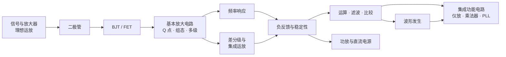

# 模拟电子技术

「电路与模拟电子技术」中模电部分的学习笔记，章节顺序对应《集成电子技术基础教程（第 4 版）》上册 11 章：从信号与放大器模型出发，经过半导体器件、基本放大电路与频率响应，到集成运放、负反馈及其应用，最后是功率电路与常用集成功能电路。

写法与 [电路](../index.md) 部分相同：先给结论，再给带完整解答的例题（点开折叠框查看），所有数值都用脚本独立验算过。每篇开头附一张该章的**知识点图卡**（AI 生成的一页速览）；图卡里的错误和不严谨之处，在文中「图卡勘误」里逐条改正，**以正文为准**。

!!! note "约定"
    - 大写字母 + 大写下标表示直流量（$I_C$、$V_{CE}$），小写字母 + 小写下标表示交流小信号（$i_c$、$v_{ce}$），小写 + 大写下标表示总瞬时值（$i_C=I_C+i_c$）。
    - 室温热电压 $V_T\approx26\,\mathrm{mV}$；硅管导通压降取 $0.7\,\mathrm V$，锗管 $0.2\sim0.3\,\mathrm V$。
    - 运放电路沿用 [含理想运放的电路](../extras/opamp.md) 的"虚短、虚断 + 节点法"，那里推过的基本电路这里不再重复推导。

## 学习路线

!!! tip "和电路理论的衔接"
    模电里反复用到的电路工具：[戴维南等效](../notes/circuit-theorems.md)（偏置电路、负载线）、[受控源](../notes/analysis-methods.md#含受控源)（小信号模型）、[一阶电路三要素](../notes/dynamic-circuits.md)（阶跃响应、积分器、多谐振荡器）、[频率响应与滤波](../notes/nonsinusoidal.md#4-频率响应与滤波)、[非线性电阻的小信号分析](../extras/nonlinear.md)（微变等效电路的来源）。

<!-- articles -->
