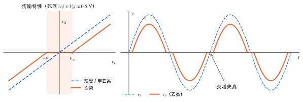
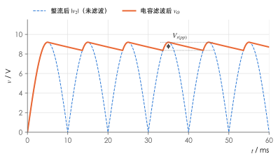

# 功率放大与直流电源

!!! abstract "TL;DR"
    - 功放关心的是**输出功率、效率、管耗**，不再是电压增益；乙类互补推挽理想效率 $\pi/4\approx78.5\%$，但**效率随输出幅度变化**：$\eta=\dfrac{\pi}{4}\dfrac{U_{om}}{V_{CC}}$。
    - OCL 三个公式：$P_o=\dfrac{U_{om}^2}{2R_L}$，$P_V=\dfrac{2V_{CC}U_{om}}{\pi R_L}$，每管 $P_{T1}=\dfrac{P_V-P_o}{2}$；单管最大管耗出现在 $U_{om}=2V_{CC}/\pi$，约为 $0.2P_{om}$。
    - 乙类有交越失真，加一点静态偏置（两只二极管或 $V_{BE}$ 倍增器）成为甲乙类即可消除。
    - 直流电源 = 变压 → 整流 → 滤波 → 稳压。桥式整流 $V_{O(AV)}=0.9V_2$，电容滤波后约 $1.2V_2$，纹波 $V_{r(pp)}\approx I_L/(f_rC)$。
    - 线性稳压（稳压管、串联型、78xx/LM317）靠调整管"吃掉"压差，热耗 $P=(V_I-V_O)I_O$，效率约 $V_O/V_I$。

??? info "本章图卡（AI 生成速览，错误见文末「图卡勘误」）"
    { loading=lazy }

    { loading=lazy }

## 1. 功率放大电路的特点与分类

功放是多级放大器的**末级**，要在允许失真下向负载（扬声器、电机）送出尽量大的功率。它工作在大信号状态，小信号模型不再适用，只能用图解法和功率计算；同时要关心**效率**（电源功率有多少到了负载）和**管耗**（其余变成功率管的热）。

按一个信号周期内管子导通的角度（**导通角** $\theta$）分类：

| 类别 | 导通角 | 静态电流 | 理想最高效率 | 特点 |
| --- | --- | --- | --- | --- |
| 甲类（A） | $360^\circ$ | 大 | $25\%$（电阻负载）/ $50\%$（变压器耦合） | 失真小，静态功耗大 |
| 乙类（B） | $180^\circ$ | $0$ | $78.5\%$ | 需两管推挽，有交越失真 |
| 甲乙类（AB） | 略大于 $180^\circ$ | 很小 | 接近 $78.5\%$ | 实际功放的主流 |
| 丙类（C） | $<180^\circ$ | $0$ | 更高 | 只用于谐振负载的高频功放 |

甲类效率低的原因：无论有没有信号，电源都要持续提供静态电流 $I_{CQ}$。降低 $I_{CQ}$（乙类）就要用两只管子各管半周，即**互补推挽**。

## 2. 乙类互补推挽 OCL：功率、效率与管耗

{ .circuit }

$T_1$（NPN）、$T_2$（PNP）参数对称，都接成射极跟随器，双电源 $\pm V_{CC}$，静态时输出端电位为 $0$，负载可以直接接上，不需要输出电容——**OCL**（output capacitorless）。先去掉 $D_1$、$D_2$（两管基极直接相连）分析乙类：$v_i>0$ 时 $T_1$ 导通、$T_2$ 截止，电流 $+V_{CC}\to T_1\to R_L$；$v_i<0$ 时反过来。射随器电压增益约为 1，所以 $v_o\approx v_i$，功放靠的是**电流放大**。

设输出 $v_o=U_{om}\sin\omega t$（$U_{om}$ 为峰值），每管集电极电流为半个正弦波，峰值 $U_{om}/R_L$：

$$
P_o=\frac{U_o^2}{R_L}=\frac{U_{om}^2}{2R_L},\qquad
P_V=2\cdot\frac{1}{2\pi}\int_0^{\pi}V_{CC}\frac{U_{om}}{R_L}\sin\theta\,\mathrm d\theta=\frac{2V_{CC}U_{om}}{\pi R_L},
$$

$$
\eta=\frac{P_o}{P_V}=\frac{\pi}{4}\frac{U_{om}}{V_{CC}},\qquad
P_{T1}=P_{T2}=\frac{P_V-P_o}{2}=\frac{1}{R_L}\Big(\frac{V_{CC}U_{om}}{\pi}-\frac{U_{om}^2}{4}\Big).
$$

$U_{om}$ 最大可达 $V_{CC}-V_{CES}$；忽略饱和压降时 $U_{om}=V_{CC}$，得到**最大输出功率** $P_{om}=\dfrac{V_{CC}^2}{2R_L}$ 与理想最高效率 $\eta_{max}=\pi/4\approx78.5\%$。

{ .circuit }

!!! warning "最大管耗不在满输出时"
    $P_{T1}$ 对 $U_{om}$ 求导令其为零：$U_{om}=\dfrac{2V_{CC}}{\pi}\approx0.64V_{CC}$ 时

    $$
    P_{T1max}=\frac{V_{CC}^2}{\pi^2R_L}=\frac{2}{\pi^2}P_{om}\approx0.2P_{om}.
    $$

    满输出时每管管耗反而只有 $\dfrac{(4-\pi)V_{CC}^2}{4\pi R_L}\approx0.137P_{om}$。**效率公式 $\pi/4$ 只在 $U_{om}=V_{CC}$ 时成立**，不能拿它去算任意幅度下的电源功率。

**选管条件**（OCL，按理想 $P_{om}=V_{CC}^2/(2R_L)$）：

| 参数 | 要求 | 理由 |
| --- | --- | --- |
| $P_{CM}$ | $\ge0.2P_{om}$ | 单管最大管耗 |
| $\lvert V_{(BR)CEO}\rvert$ | $\ge2V_{CC}$ | 一管导通到饱和时，另一管 $c$–$e$ 间承受约 $2V_{CC}$ |
| $I_{CM}$ | $\ge V_{CC}/R_L$ | 集电极电流峰值 |

??? example "例：OCL 的功率、效率与管耗（图卡例题更正）"
    乙类 OCL，$\pm V_{CC}=\pm12\,\mathrm V$，$R_L=8\,\Omega$，输出正弦峰值 $U_{om}=8\,\mathrm V$。求 $P_o$、$P_V$、$\eta$、每管管耗；并求该电路的 $P_{om}$ 与单管最大管耗。

    1. 有效值 $U_o=8/\sqrt2=5.66\,\mathrm V$，$P_o=\dfrac{U_{om}^2}{2R_L}=\dfrac{64}{16}=4.0\,\mathrm W$。
    2. $P_V=\dfrac{2V_{CC}U_{om}}{\pi R_L}=\dfrac{2\times12\times8}{8\pi}=7.64\,\mathrm W$。
    3. $\eta=\dfrac{4.0}{7.64}=52.4\%$（$=\dfrac{\pi}{4}\times\dfrac{8}{12}$），**不是** $78.5\%$。
    4. 每管 $P_{T1}=\dfrac{7.64-4.0}{2}=1.82\,\mathrm W$。
    5. $P_{om}=\dfrac{12^2}{2\times8}=9\,\mathrm W$；$P_{T1max}=\dfrac{12^2}{8\pi^2}=1.82\,\mathrm W$。本例 $U_{om}=8\,\mathrm V$ 恰好接近 $2V_{CC}/\pi=7.64\,\mathrm V$，所以管耗几乎就是最大值。

    图卡按 $P_{in}=P_o/\eta_{max}=5.09\,\mathrm W$ 算出每管 $0.545\,\mathrm W$，低估了三倍多——按它选管会烧管。

## 3. 交越失真与甲乙类偏置

硅管 $v_{BE}$ 小于约 $0.5\,\mathrm V$ 时几乎不导通。乙类电路在 $|v_i|$ 很小的区间内两管都截止，输出在过零处出现"台阶"——**交越失真**：

{ .circuit }

办法是给两管加一个略大于死区的静态偏置，让它们在静态时就**微导通**（甲乙类）。§2 图中 $R_1$、$D_1$、$D_2$、$R_2$ 从 $+V_{CC}$ 到 $-V_{CC}$ 流过偏置电流，$D_1$、$D_2$ 的正向压降（约 $2\times0.7\,\mathrm V$）加在两管基极之间，正好抵消两个发射结的开启电压。二极管动态电阻很小，交流上两基极近似同电位，$v_i$ 同时驱动两管。二极管还与功率管同为 PN 结，温度升高时 $V_D$ 与 $V_{BE}$ 同步下降，起一定的温度补偿作用。

另一常用偏置是 **$V_{BE}$ 倍增器**：一只晶体管的 $b$–$e$ 间并 $R_2$、$c$–$b$ 间接 $R_1$，忽略基极电流时 $V_{CE}=V_{BE}\big(1+R_1/R_2\big)$，调 $R_1/R_2$ 即可连续调节偏置电压。

!!! note "偏置的代价"
    静态电流越大，交越失真越小，但静态功耗越大、效率越低。甲乙类的静态电流一般只有几毫安到几十毫安，功率计算仍按乙类公式近似。

## 4. OTL、复合管与集成功放

**OTL**（output transformerless，单电源）：去掉 $-V_{CC}$，静态时调偏置使输出点 $A$ 的电位为 $V_{CC}/2$，经大电容 $C$ 接负载。正半周 $T_1$ 导通、给 $C$ 充电；负半周 $T_2$ 导通，$C$ 上约 $V_{CC}/2$ 的电压充当负电源。

{ .circuit }

OTL 的所有公式把 OCL 中的 $V_{CC}$ 换成 $V_{CC}/2$：$P_{om}=\dfrac{(V_{CC}/2)^2}{2R_L}$，$\lvert V_{(BR)CEO}\rvert\ge V_{CC}$，$I_{CM}\ge\dfrac{V_{CC}}{2R_L}$。输出电容与 $R_L$ 构成高通，下限频率 $f_L=\dfrac{1}{2\pi R_LC}$。

??? example "例：OTL 的最大输出功率与输出电容"
    单电源 $V_{CC}=24\,\mathrm V$，$R_L=8\,\Omega$，忽略 $V_{CES}$。求 $P_{om}$；要求 $f_L\le20\,\mathrm{Hz}$，$C$ 至少多大？

    1. $P_{om}=\dfrac{(24/2)^2}{2\times8}=9\,\mathrm W$——与 $\pm12\,\mathrm V$ 的 OCL 相同。
    2. $C\ge\dfrac{1}{2\pi f_LR_L}=\dfrac{1}{2\pi\times20\times8}=995\,\mu\mathrm F$，取 $2200\,\mu\mathrm F/25\,\mathrm V$ 的电解电容留余量。

**复合管（达林顿）**：两管级联，等效 $\beta\approx\beta_1\beta_2$（精确为 $\beta_1+\beta_2+\beta_1\beta_2$），类型（NPN 或 PNP）由**第一只管**决定。用小功率互补管推动大功率同型管，可以解决大功率 PNP 管难以与 NPN 管配对的问题（准互补）——这就是图卡说的"扩流"。

**集成功放**：LM386（低压小功率，增益 20～200 可调）、TDA2030（OCL/OTL 均可，十几瓦）等，内部就是上面的推挽输出级加前置、偏置和过热/短路保护，外接少量元件即可。

## 5. 功率管的散热与安全工作区

功率管允许的管耗由**结温**限制。热量从管芯经外壳、绝缘垫片、散热器到空气，类似电流流过串联电阻（热阻，单位 $^\circ\mathrm C/\mathrm W$）：

$$
T_j=T_a+P_T\big(R_{\theta jc}+R_{\theta cs}+R_{\theta sa}\big)\le T_{jM}.
$$

由此求出所需散热器热阻 $R_{\theta sa}\le\dfrac{T_{jM}-T_a}{P_T}-R_{\theta jc}-R_{\theta cs}$。手册的 $P_{CM}$ 是"管壳温度保持 $25^\circ\mathrm C$"（无限大散热器）下的值，实际可用功率要按热阻降额。

除 $P_{CM}$、$I_{CM}$、$V_{(BR)CEO}$ 三条边界外，BJT 在高电压、大电流同时出现时还会**二次击穿**，四条边界围成**安全工作区（SOA）**，$(v_{CE},i_C)$ 的工作轨迹必须全程在其内。

??? example "例：选管与散热器"
    OCL，$\pm V_{CC}=\pm15\,\mathrm V$，$R_L=8\,\Omega$，$V_{CES}=1\,\mathrm V$。（1）求 $P_{om}$ 与此时的效率；（2）给出选管条件；（3）功率管 $T_{jM}=150^\circ\mathrm C$，$R_{\theta jc}=3^\circ\mathrm C/\mathrm W$，垫片 $R_{\theta cs}=0.5^\circ\mathrm C/\mathrm W$，环境最高 $45^\circ\mathrm C$，散热器热阻应不大于多少？

    1. $U_{om}=15-1=14\,\mathrm V$，$P_{om}=\dfrac{14^2}{16}=12.25\,\mathrm W$，$\eta=\dfrac{\pi}{4}\times\dfrac{14}{15}=73.3\%$。
    2. $P_{CM}\ge\dfrac{V_{CC}^2}{\pi^2R_L}=2.85\,\mathrm W$（按 $0.2\times\dfrac{15^2}{16}=2.81\,\mathrm W$ 估算也可）；$\lvert V_{(BR)CEO}\rvert\ge30\,\mathrm V$；$I_{CM}\ge\dfrac{15}{8}=1.875\,\mathrm A$。
    3. 按最坏管耗 $2.85\,\mathrm W$：$R_{\theta sa}\le\dfrac{150-45}{2.85}-3-0.5=33.3^\circ\mathrm C/\mathrm W$。

## 6. 直流电源：整流

电子电路需要的直流电源由四部分组成：**电源变压器**（降压、隔离）→ **整流**（交流变单向脉动）→ **滤波**（滤去交流分量）→ **稳压**（抗电网波动和负载变化）。

设变压器次级电压 $v_2=\sqrt2V_2\sin\omega t$（$V_2$ 为有效值），二极管理想：

| | 半波 | 全波（中心抽头） | 桥式 |
| --- | --- | --- | --- |
| 二极管数 | 1 | 2 | 4 |
| 输出平均值 $V_{O(AV)}$ | $0.45V_2$ | $0.9V_2$ | $0.9V_2$ |
| 每管平均电流 $I_{D(AV)}$ | $I_O$ | $I_O/2$ | $I_O/2$ |
| 每管最高反向电压 $V_{RM}$ | $\sqrt2V_2$ | $2\sqrt2V_2$ | $\sqrt2V_2$ |
| 纹波基波频率 $f_r$ | $f$ | $2f$ | $2f$ |
| 电容滤波后 $V_O$（估算） | $\approx V_2$ | $\approx1.2V_2$ | $\approx1.2V_2$ |

其中 $0.45=\sqrt2/\pi$、$0.9=2\sqrt2/\pi$，即半个/整个正弦绝对值的平均。桥式电路每半周有**两只**二极管串联导通，实际峰值要减 $2\times0.7\,\mathrm V$；选二极管时取 $I_F>1.1I_{D(AV)}$、$V_R>1.1V_{RM}$ 并留余量。

{ .circuit }

$v_2$ 正半周（上正下负）电流路径 $D_1\to R_L\to D_3$，负半周 $D_2\to R_L\to D_4$，流过 $R_L$ 的方向始终相同。

## 7. 电容滤波

整流输出端并联大电容 $C$：二极管只在 $v_2$ 接近峰值的短时间内导通给 $C$ 充电，其余时间 $C$ 向负载放电，输出成为带锯齿纹波的直流：

{ .circuit }

- 放电近似为恒流 $I_L$，持续约一个纹波周期 $1/f_r$，所以 **纹波峰峰值** $V_{r(pp)}\approx\dfrac{I_L}{f_rC}$（偏保守，实际充电也占一点时间）。
- 工程上取 $R_LC\ge(3\sim5)\dfrac T2$（$T$ 为电网周期），此时全波 $V_O\approx1.2V_2$；空载时 $V_O=\sqrt2V_2$。
- 二极管导通角很小，**冲击电流**大，上电瞬间更大；电容耐压要高于 $\sqrt2V_2$（并考虑电网 $+10\%$）。
- 电容滤波适合小电流负载；大电流时用电感滤波或 $LC$、$\pi$ 型滤波。

??? example "例：桥式整流 + 电容滤波 + 7805（图卡例题补全）"
    桥式整流，$50\,\mathrm{Hz}$，变压器次级有效值 $V_2=7.5\,\mathrm V$，负载电流 $I_L=0.1\,\mathrm A$，$C=1000\,\mu\mathrm F$，二极管压降 $0.7\,\mathrm V$。求纹波峰峰值，判断能否接 7805，并估算 7805 的热耗。

    1. 峰值：$V_{peak}=\sqrt2\times7.5-2\times0.7=9.21\,\mathrm V$（桥式两管串联导通）。
    2. 纹波：$f_r=2f=100\,\mathrm{Hz}$，$V_{r(pp)}\approx\dfrac{0.1}{100\times1000\times10^{-6}}=1.0\,\mathrm V$；谷值 $\approx8.21\,\mathrm V$。（数值仿真得约 $0.86\,\mathrm V$，估算式偏保守。）
    3. 7805 压差约 $2\,\mathrm V$，要求输入始终 $\ge7\,\mathrm V$：谷值 $8.21\,\mathrm V$ 满足，余量 $1.2\,\mathrm V$。
    4. 若电网电压低 $10\%$：$V_{peak}=0.9\times\sqrt2\times7.5-1.4=8.15\,\mathrm V$，谷值 $7.15\,\mathrm V$，刚好够——这就是设计时要按**最低电网电压、最大负载电流**校核的原因。
    5. 热耗：平均输入 $\approx V_{peak}-V_{r(pp)}/2=8.71\,\mathrm V$，$P=(8.71-5)\times0.1=0.37\,\mathrm W$，TO-220 封装不加散热器即可。

## 8. 稳压管稳压电路

{ .circuit }

稳压管工作在反向击穿区，$I_Z$ 在 $I_{Zmin}\sim I_{ZM}$ 之间变化时 $V_Z$ 基本不变。限流电阻 $R$ 把 $V_I$ 的波动和 $I_L$ 的变化都转化为 $I_Z$ 的变化：$I_Z=\dfrac{V_I-V_Z}{R}-I_L$。$R$ 必须同时满足两种极端：

$$
\frac{V_{Imax}-V_Z}{I_{ZM}+I_{Lmin}}\le R\le\frac{V_{Imin}-V_Z}{I_{Zmin}+I_{Lmax}} .
$$

左边防止"$V_I$ 最高、负载最轻"时稳压管过流，右边保证"$V_I$ 最低、负载最重"时仍有 $I_{Zmin}$。若算出的下限大于上限，说明稳压管或输入电压选得不合适。

??? example "例：选限流电阻"
    $V_I=12\,\mathrm V\pm10\%$，$V_Z=6\,\mathrm V$，$I_{Zmin}=5\,\mathrm{mA}$，$I_{ZM}=45\,\mathrm{mA}$，负载电流 $0\sim20\,\mathrm{mA}$。选 $R$ 并校核。

    1. 上限：$R\le\dfrac{10.8-6}{(5+20)\times10^{-3}}=192\,\Omega$。
    2. 下限：$R\ge\dfrac{13.2-6}{(45+0)\times10^{-3}}=160\,\Omega$。
    3. 取标称值 $R=180\,\Omega$。校核：最坏轻载 $I_Z=\dfrac{7.2}{180}=40\,\mathrm{mA}<45\,\mathrm{mA}$；最坏重载 $I_Z=\dfrac{4.8}{180}-20=6.7\,\mathrm{mA}>5\,\mathrm{mA}$。
    4. $R$ 最大功耗 $\dfrac{7.2^2}{180}=0.29\,\mathrm W$，选 $0.5\,\mathrm W$ 电阻；稳压管最大功耗 $6\times0.04=0.24\,\mathrm W$。

## 9. 串联型线性稳压电路

稳压管电路输出电流小、调节范围窄。**串联型稳压**把一只调整管 $T$ 串在输入与输出之间，用负反馈控制它的管压降：

{ .circuit }

- **基准**：$R$、$D_Z$ 提供 $V_{REF}$；**取样**：$R_1$、$R_2$ 分压；**误差放大**：运放比较两者；**调整管**：射极跟随输出。
- 运放引入的是电压串联负反馈（$T$ 是射随器，同相）：若 $V_O$ 升高 → 反相端升高 → 运放输出下降 → $V_{BE}$ 减小 → $V_O$ 回落。
- 虚短 $\dfrac{R_2}{R_1+R_2}V_O=V_{REF}$，

$$
V_O=\Big(1+\frac{R_1}{R_2}\Big)V_{REF}.
$$

- 调整管工作在放大区，要求 $V_I\ge V_{Omax}+(2\sim3)\,\mathrm V$；管耗 $P_T=(V_I-V_O)I_O$，效率约 $V_O/V_I$。输出短路时 $P_T=V_II_O$ 急剧增大，实用电路必须加限流保护。

??? example "例：串联稳压电路的输出电压与调整管功耗"
    $V_{REF}=6\,\mathrm V$，$R_1=3\,\mathrm{k\Omega}$，$R_2=2\,\mathrm{k\Omega}$，$V_I=22\,\mathrm V$，$I_O\le0.5\,\mathrm A$。求 $V_O$、调整管最大功耗与效率。

    1. $V_O=(1+3/2)\times6=15\,\mathrm V$。
    2. $V_I-V_O=7\,\mathrm V>3\,\mathrm V$，调整管在放大区；$P_T=7\times0.5=3.5\,\mathrm W$，需要散热器。
    3. 效率 $\approx15/22=68\%$；若 $V_I$ 再高，多出的压差全部变成调整管的热。

## 10. 三端集成稳压器

把基准、误差放大、调整管、限流和过热保护集成在一起，只有输入、输出、公共端（调整端）三个引脚：

- **78xx / 79xx**：固定正 / 负输出，$xx$ 为电压值（7805 为 $+5\,\mathrm V$，7912 为 $-12\,\mathrm V$）。最小压差约 $2\,\mathrm V$；输入端接 $0.33\,\mu\mathrm F$ 防自激（离滤波电容较远时），输出端接 $0.1\,\mu\mathrm F$ 改善瞬态响应。
- **LM317**（正）/ **LM337**（负）：可调输出，OUT 与 ADJ 间保持 $V_{REF}=1.25\,\mathrm V$，ADJ 端电流 $I_{ADJ}\approx50\,\mu\mathrm A$：

{ .circuit }

$$
V_O=1.25\Big(1+\frac{R_2}{R_1}\Big)+I_{ADJ}R_2\approx1.25\Big(1+\frac{R_2}{R_1}\Big)\ \mathrm V .
$$

$R_1$ 常取 $240\,\Omega$，使 $R_1$ 中电流 $1.25/240\approx5\,\mathrm{mA}$ 满足 LM317 的最小负载电流。ADJ 端**只接** $R_1$、$R_2$ 的连接点，不能接地（接地就成了固定 $1.25\,\mathrm V$）。

??? example "例：LM317 输出 12 V"
    $R_1=240\,\Omega$，求 $V_O=12\,\mathrm V$ 时的 $R_2$，并估计 $I_{ADJ}$ 带来的误差；若用 $2.0\,\mathrm{k\Omega}$ 标称电阻，输出是多少？

    1. 忽略 $I_{ADJ}$：$R_2=R_1\Big(\dfrac{V_O}{1.25}-1\Big)=240\times8.6=2064\,\Omega$。
    2. 计入 $I_{ADJ}=50\,\mu\mathrm A$：多出 $50\times10^{-6}\times2064=0.10\,\mathrm V$，$V_O\approx12.10\,\mathrm V$，误差不到 $1\%$。
    3. $R_2=2.0\,\mathrm{k\Omega}$：$V_O=1.25\times(1+2000/240)+0.1=11.77\,\mathrm V$。需要精确值时用电位器微调。

!!! tip "线性稳压的效率瓶颈"
    所有线性稳压器的效率都不超过 $V_O/V_I$。输入输出压差大、电流大时，改用开关稳压（见 [集成功能电路](special-ics.md#6-开关稳压buck-电路)），效率可达 $80\%\sim95\%$。

## 练习

### 1. 概念判断 :material-star::material-star-outline::material-star-outline:

判断下列说法是否正确：

1. 乙类互补推挽功放的效率总是 $78.5\%$。
2. 乙类 OCL 输出功率最大时，功率管的管耗也最大。
3. 甲乙类偏置是为了消除交越失真。
4. 桥式整流中每只二极管承受的最高反向电压为 $2\sqrt2V_2$。
5. 线性稳压器的输入电压越高越好，稳压效果越好、效率也越高。

??? success "答案"
    1 ✗　2 ✗　3 ✓　4 ✗　5 ✗

??? note "解析"
    1. $\eta=\dfrac{\pi}{4}\dfrac{U_{om}}{V_{CC}}$，$78.5\%$ 只是 $U_{om}=V_{CC}$ 时的理想上限。
    2. 单管最大管耗出现在 $U_{om}=2V_{CC}/\pi$，约 $0.2P_{om}$；满输出时只有约 $0.137P_{om}$。
    3. 静态时两管微导通，跳过发射结死区。
    4. 桥式为 $\sqrt2V_2$；$2\sqrt2V_2$ 是中心抽头全波整流。
    5. 压差越大，调整管热耗 $(V_I-V_O)I_O$ 越大，效率 $V_O/V_I$ 越低。只要保证最小压差即可。

### 2. OCL 功放计算 :material-star::material-star::material-star-outline:

OCL，$\pm V_{CC}=\pm18\,\mathrm V$，$R_L=8\,\Omega$，$V_{CES}=2\,\mathrm V$。求最大不失真输出时的 $P_{om}$、$P_V$、$\eta$、每管管耗，以及选管所需的 $P_{CM}$、$\lvert V_{(BR)CEO}\rvert$、$I_{CM}$。

??? success "答案"
    $P_{om}=16\,\mathrm W$，$P_V=22.9\,\mathrm W$，$\eta=69.8\%$，每管 $3.46\,\mathrm W$；$P_{CM}\ge4.1\,\mathrm W$，$\lvert V_{(BR)CEO}\rvert\ge36\,\mathrm V$，$I_{CM}\ge2.25\,\mathrm A$。

??? note "解析"
    1. $U_{om}=18-2=16\,\mathrm V$，$P_{om}=\dfrac{16^2}{16}=16\,\mathrm W$。
    2. $P_V=\dfrac{2\times18\times16}{8\pi}=22.9\,\mathrm W$，$\eta=\dfrac{16}{22.9}=69.8\%$。
    3. 每管 $\dfrac{22.9-16}{2}=3.46\,\mathrm W$。
    4. 选管按最坏情况：$P_{CM}\ge\dfrac{18^2}{8\pi^2}=4.1\,\mathrm W$（比满输出时的 $3.46\,\mathrm W$ 大）；$\lvert V_{(BR)CEO}\rvert\ge2\times18=36\,\mathrm V$；$I_{CM}\ge18/8=2.25\,\mathrm A$。

### 3. 桥式整流电容滤波 :material-star::material-star-outline::material-star-outline:

桥式整流电容滤波，$V_2=15\,\mathrm V$，$f=50\,\mathrm{Hz}$，$R_L=100\,\Omega$。（1）估算 $V_O$、$I_O$、每管平均电流和最高反向电压；（2）按 $R_LC\ge5T/2$ 选 $C$；（3）取 $C=1000\,\mu\mathrm F$，估算纹波峰峰值；（4）若 $D_1$ 开路，$V_O$ 约为多少？

??? success "答案"
    （1）$18\,\mathrm V$、$0.18\,\mathrm A$、$90\,\mathrm{mA}$、$21.2\,\mathrm V$；（2）$C\ge500\,\mu\mathrm F$；（3）约 $1.8\,\mathrm V$；（4）约 $15\,\mathrm V$。

??? note "解析"
    1. $V_O\approx1.2V_2=18\,\mathrm V$，$I_O=18/100=0.18\,\mathrm A$，$I_{D(AV)}=I_O/2=90\,\mathrm{mA}$，$V_{RM}=\sqrt2\times15=21.2\,\mathrm V$。
    2. $C\ge\dfrac{5T}{2R_L}=\dfrac{5\times0.02}{2\times100}=500\,\mu\mathrm F$。
    3. $V_{r(pp)}\approx\dfrac{0.18}{100\times10^{-3}}=1.8\,\mathrm V$。
    4. 一只管开路，电路变成半波整流电容滤波，$V_O\approx V_2=15\,\mathrm V$，纹波频率降为 $50\,\mathrm{Hz}$、纹波加倍。

### 4. 7805 的散热 :material-star::material-star::material-star-outline:

7805 输入 $12\,\mathrm V$，输出电流 $1\,\mathrm A$。手册：$T_{jM}=125^\circ\mathrm C$，$R_{\theta jc}=5^\circ\mathrm C/\mathrm W$，不加散热器时 $R_{\theta ja}=65^\circ\mathrm C/\mathrm W$。环境 $40^\circ\mathrm C$，垫片 $0.5^\circ\mathrm C/\mathrm W$。（1）能否不加散热器？（2）散热器热阻上限是多少？

??? success "答案"
    （1）不能；（2）$R_{\theta sa}\le6.6^\circ\mathrm C/\mathrm W$。

??? note "解析"
    1. $P=(12-5)\times1=7\,\mathrm W$。不加散热器 $T_j=40+7\times65=495^\circ\mathrm C$，远超 $125^\circ\mathrm C$（实际芯片会过热保护关断）。
    2. $R_{\theta sa}\le\dfrac{125-40}{7}-5-0.5=6.6^\circ\mathrm C/\mathrm W$。更好的办法是降低输入电压（如 $8\,\mathrm V$），热耗降到 $3\,\mathrm W$。

### 5. LM317 的调节范围 :material-star::material-star-outline::material-star-outline:

LM317 电路中 $R_1=240\,\Omega$，$R_2$ 为 $0\sim5\,\mathrm{k\Omega}$ 电位器。求输出电压范围（忽略 $I_{ADJ}$），并估计输入电压至少要多高（压差按 $3\,\mathrm V$）。

??? success "答案"
    $1.25\sim27.3\,\mathrm V$；$V_I\ge30.3\,\mathrm V$。

??? note "解析"
    1. $R_2=0$：$V_O=1.25\,\mathrm V$；$R_2=5\,\mathrm{k\Omega}$：$V_O=1.25\times(1+5000/240)=27.3\,\mathrm V$（计入 $I_{ADJ}$ 约 $27.5\,\mathrm V$）。
    2. $V_I\ge27.3+3=30.3\,\mathrm V$。注意输出调低时压差很大，调整管热耗 $(V_I-V_O)I_O$ 也随之增大。

## 图卡勘误

| 图卡位置 | 原文 | 更正 |
| --- | --- | --- |
| 卡 22 例题②③ | $P_{in}=P_o/\eta_{max}=4.0/(\pi/4)\approx5.09\,\mathrm W$，$P_D=(5.09-4.0)/2\approx0.545\,\mathrm W$ | $\pi/4$ 只在 $U_{om}=V_{CC}$ 时成立；图卡没有给 $V_{CC}$，$P_{in}$ 无法求。应由 $P_V=\dfrac{2V_{CC}U_{om}}{\pi R_L}$ 计算：取 $\pm12\,\mathrm V$ 时 $P_V=7.64\,\mathrm W$，$\eta=52.4\%$，每管 $1.82\,\mathrm W$（见 §2 例题） |
| 卡 22 结果与说明 | "$\eta_{max}\approx78.5\%$；$P_{in}\approx5.09\,\mathrm W$" 并列为结果 | $78.5\%$ 是理想上限，不是本例效率；本例效率随 $U_{om}/V_{CC}$ 而定 |
| 卡 22 管耗 | 只给 $P_D=(P_{in}-P_o)/2$ | 选管要用**最大**管耗：$U_{om}=2V_{CC}/\pi$ 时 $P_{T1max}=V_{CC}^2/(\pi^2R_L)\approx0.2P_{om}$，不在满输出时 |
| 卡 22 读图(1) | $D_1$、$D_2$ 直接连在两管基极之间，无偏置电阻 / 电流源 | 二极管需要偏置电流才能提供约 $1.4\,\mathrm V$ 的偏置：应从 $+V_{CC}$ 经 $R_1$（或恒流源 / 推动级）到 $-V_{CC}$ 形成通路（见 §2 图） |
| 卡 22 解法④ | SOA 校核"$U_C$ 与 $I_C$ 的组合" | 应为管压降 $v_{CE}$ 与 $i_C$；SOA 边界还包括二次击穿限 |
| 卡 22 知识点 1 | 只列甲、乙、甲乙类 | 甲类最高效率 $25\%$（电阻负载）/ $50\%$（变压器耦合）未提，是"为什么用乙类"的理由 |
| 卡 23 例题 | "$V_{peak}\approx9\,\mathrm V$" 无来由 | 需给出变压器次级电压，并扣除桥式两管压降 $2\times0.7\,\mathrm V$；如 $V_2=7.5\,\mathrm V$ 时 $V_{peak}=9.21\,\mathrm V$ |
| 卡 23 例题(2) | "可满足 7805 的输入要求（临界可用）" | 还应按电网 $-10\%$ 校核：谷值降到约 $7.15\,\mathrm V$，余量几乎为零 |
| 卡 23 读图④ | $V_{in}$ 与 $V_{ref}$ 同时以"+"送入求和点，取样也为"+" | 误差放大器比较的是 $V_{ref}$ 与取样电压（取样应为"−"，构成负反馈）；$V_{in}$ 只给调整管供电，不进比较环节 |
| 卡 23 读图⑤(b) | LM317 的 ADJ 端连线同时接地 | ADJ 只接 $R_1$、$R_2$ 连接点；接地会使 $R_2$ 被短路，输出固定为 $1.25\,\mathrm V$ |
| 卡 23 纹波公式 | $V_{r(pp)}\approx I_L/(f_rC)$ 未注明偏差方向 | 这是放电持续整个纹波周期的保守估计，实际纹波略小（本例仿真约 $0.86\,\mathrm V$） |
