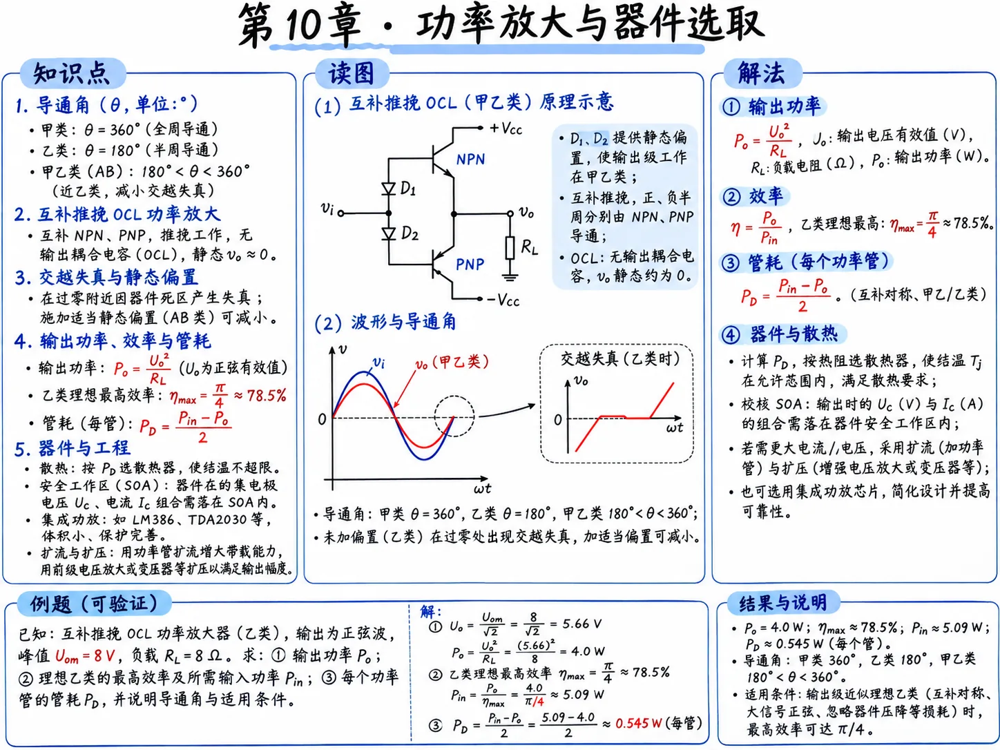
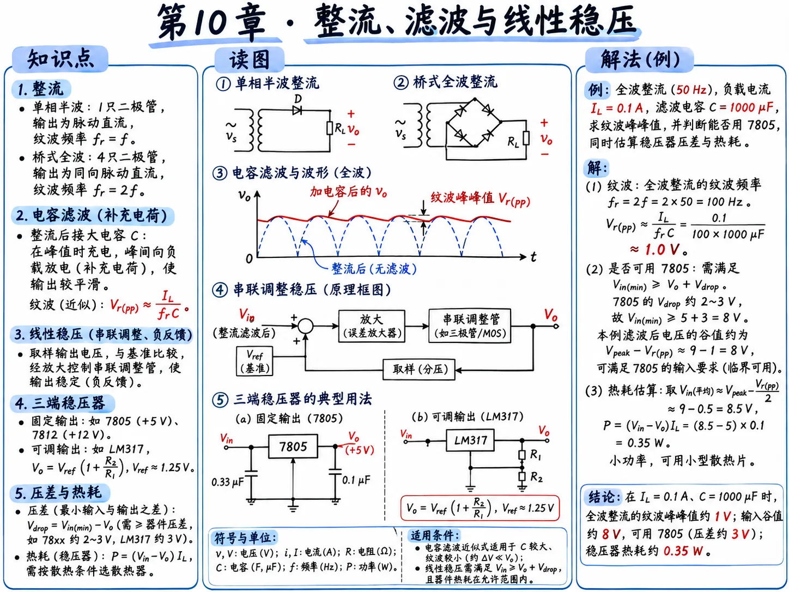
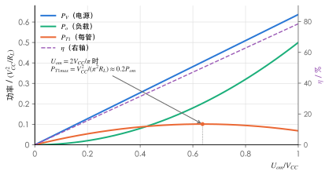
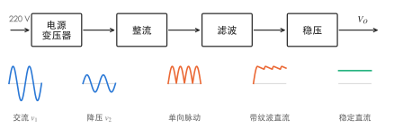
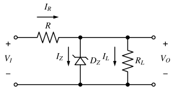
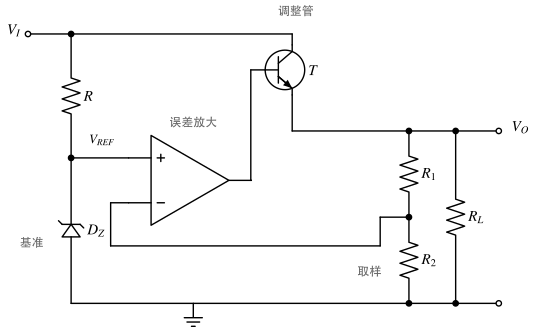
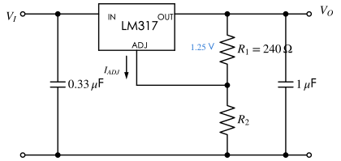

# 功率放大与直流电源

!!! abstract "本章要点"
    - 功放关心的是输出功率、效率和管耗，不再是电压增益。
    - 乙类互补推挽的效率随输出幅度变化：$\eta=\dfrac{\pi}{4}\dfrac{U_{om}}{V_{CC}}$，最高 $78.5\%$。
    - 单管最大管耗不在满输出时，而在 $U_{om}\approx0.64V_{CC}$ 处，约为 $0.2P_{om}$。
    - 乙类有交越失真，给两管加一点静态偏置（甲乙类）即可消除。
    - 直流电源 = 变压 → 整流 → 滤波 → 稳压；线性稳压的效率不超过 $V_O/V_I$。

??? info "本章图卡"
    { loading=lazy }

    { loading=lazy }

!!! note "知识点清单"
    **功率放大**

    - [ ] 功放的特点：大信号、要功率、要效率、管耗与散热
    - [ ] 导通角与甲类、乙类、甲乙类、丙类
    - [ ] 甲类效率低的原因
    - [ ] 乙类互补推挽 OCL 的工作原理
    - [ ] 输出功率 $P_o$ 与最大输出功率 $P_{om}$
    - [ ] 电源功率 $P_V$ 与效率 $\eta$
    - [ ] 管耗 $P_T$ 与单管最大管耗
    - [ ] 功率管的选取：$P_{CM}$、$V_{(BR)CEO}$、$I_{CM}$
    - [ ] 交越失真的成因
    - [ ] 甲乙类偏置：二极管偏置与 $V_{BE}$ 倍增器
    - [ ] OTL 单电源功放与输出电容
    - [ ] 复合管（达林顿）与准互补
    - [ ] 集成功放（LM386、TDA2030）
    - [ ] 热阻与散热器选择
    - [ ] 安全工作区（SOA）与二次击穿

    **直流电源**

    - [ ] 直流电源的四个组成部分
    - [ ] 半波整流
    - [ ] 桥式整流（及中心抽头全波）与整流二极管的选取
    - [ ] 电容滤波：原理、$V_O$ 估算、纹波、冲击电流
    - [ ] 稳压电路的指标：稳压系数与输出电阻
    - [ ] 稳压管稳压电路与限流电阻的选取
    - [ ] 串联型线性稳压：组成、稳压过程、输出电压
    - [ ] 调整管的压差、功耗与限流保护
    - [ ] 三端稳压器 78xx/79xx 与压差
    - [ ] 可调三端稳压器 LM317
    - [ ] 线性稳压的效率瓶颈

## 1. 功率放大电路的特点与分类

### 1.1 功放要解决什么问题

功率放大电路（功放）是多级放大器的末级。它的任务是把足够大的功率送给负载，比如扬声器、电机。

前面学的电压放大器处理的是小信号，关心的是电压增益。功放处理的是大信号，关心的是另外几件事：

| 关心的量 | 含义 |
| --- | --- |
| 输出功率 $P_o$ | 在允许失真下，能送给负载多大功率 |
| 效率 $\eta$ | 电源给出的功率里，有多少到了负载 |
| 管耗 $P_T$ | 其余的功率变成功率管的热 |
| 非线性失真 | 大信号下管子特性不再是直线 |

大信号下小信号模型不再适用，功放只能用图解法和功率计算来分析。

### 1.2 导通角与功放的分类

一个信号周期内管子导通的角度，叫导通角 $\theta$。按导通角，功放分为四类：

| 类别 | 导通角 | 静态电流 | 理想最高效率 | 特点 |
| --- | --- | --- | --- | --- |
| 甲类（A） | $360^\circ$ | 大 | $25\%$（电阻负载）/ $50\%$（变压器耦合） | 失真小，静态功耗大 |
| 乙类（B） | $180^\circ$ | $0$ | $78.5\%$ | 需两管推挽，有交越失真 |
| 甲乙类（AB） | 略大于 $180^\circ$ | 很小 | 接近 $78.5\%$ | 实际功放的主流 |
| 丙类（C） | $<180^\circ$ | $0$ | 更高 | 只用于谐振负载的高频功放 |

### 1.3 甲类为什么效率低

甲类管子一直导通。没有信号时，电源也在持续提供静态电流 $I_{CQ}$，这部分功率全变成热。

想提高效率，就要把静态电流降到零（乙类）。但一只管子只能导通半个周期，于是用两只管子各管半周，这就是互补推挽。

## 2. 乙类互补推挽 OCL：功率、效率与管耗

### 2.1 电路怎么工作

{ .circuit }

$T_1$（NPN）和 $T_2$（PNP）参数对称，都接成射极跟随器，用双电源 $\pm V_{CC}$。静态时输出端电位为 $0$，负载可以直接接上，不需要输出电容。这种电路叫 **OCL**（output capacitorless，无输出电容）。

先把 $D_1$、$D_2$ 看成短路（两管基极直接相连），这就是乙类。

- $v_i>0$：$T_1$ 导通、$T_2$ 截止，电流 $+V_{CC}\to T_1\to R_L\to$ 地；
- $v_i<0$：$T_2$ 导通、$T_1$ 截止，电流 地 $\to R_L\to T_2\to-V_{CC}$。

两管轮流导通（一推一挽），合起来就是完整的正弦波。射随器电压增益约为 1，$v_o\approx v_i$，功放靠的是电流放大，不是电压放大。

### 2.2 输出功率

负载上得到的交流平均功率。

设输出 $v_o=U_{om}\sin\omega t$，

$$
P_o=\frac{U_o^2}{R_L}=\frac{U_{om}^2}{2R_L}.
$$

适用条件：输出为不失真正弦波。

其中 $U_{om}$ 为输出电压峰值，$U_o=U_{om}/\sqrt2$ 为有效值。

$U_{om}$ 最大只能到 $V_{CC}-V_{CES}$（$V_{CES}$ 为饱和压降）。忽略 $V_{CES}$ 时 $U_{om}=V_{CC}$，得到**最大输出功率**

$$
P_{om}=\frac{V_{CC}^2}{2R_L}.
$$

适用条件：OCL，忽略饱和压降。

### 2.3 电源功率与效率

电源功率 $P_V$ 是两路电源一共送出的平均功率。效率 $\eta=P_o/P_V$。

每管的集电极电流是半个正弦波，峰值 $U_{om}/R_L$。电源电压 $V_{CC}$ 不变，所以电源功率正比于电流的平均值，也就正比于 $U_{om}$。而 $P_o$ 正比于 $U_{om}^2$。于是输出越大，效率越高。

$$
P_V=\frac{2V_{CC}U_{om}}{\pi R_L},\qquad
\eta=\frac{P_o}{P_V}=\frac{\pi}{4}\frac{U_{om}}{V_{CC}}.
$$

适用条件：乙类 OCL，正弦输出。

$U_{om}=V_{CC}$ 时得到理想最高效率 $\eta_{max}=\pi/4\approx78.5\%$。

!!! warning "易错"
    - $78.5\%$ 只是 $U_{om}=V_{CC}$ 时的上限。其他幅度下效率更低，不能用 $P_V=P_o/78.5\%$ 去算电源功率。

### 2.4 管耗与单管最大管耗

电源功率中没有送到负载的部分，全部消耗在两只管子上，叫管耗。两管对称，各占一半。

$$
P_{T1}=P_{T2}=\frac{P_V-P_o}{2}=\frac{1}{R_L}\Big(\frac{V_{CC}U_{om}}{\pi}-\frac{U_{om}^2}{4}\Big).
$$

适用条件：乙类 OCL，正弦输出。

{ .circuit }

$P_{T1}$ 是 $U_{om}$ 的二次函数，开口向下。没信号时管子不导通，管耗为零。满输出时大部分功率到了负载，管耗也不大。**最大管耗出现在中间**：

$$
U_{om}=\frac{2V_{CC}}{\pi}\approx0.64V_{CC}\ \text{时},\qquad
P_{T1max}=\frac{V_{CC}^2}{\pi^2R_L}=\frac{2}{\pi^2}P_{om}\approx0.2P_{om}.
$$

适用条件：乙类 OCL，理想 $P_{om}=V_{CC}^2/(2R_L)$。

!!! warning "易错"
    - 最大管耗不在满输出时。满输出时每管只有约 $0.137P_{om}$。
    - 选管要按最大管耗 $0.2P_{om}$，不能按满输出时的管耗。

??? tip "三个公式的积分推导"
    $T_1$ 只在正半周导通，$i_{C1}=\dfrac{U_{om}}{R_L}\sin\theta$（$0\le\theta\le\pi$）。

    两路电源的平均功率：

    $$
    P_V=2\cdot\frac{1}{2\pi}\int_0^{\pi}V_{CC}\frac{U_{om}}{R_L}\sin\theta\,\mathrm d\theta=\frac{2V_{CC}U_{om}}{\pi R_L}.
    $$

    $T_1$ 的管耗等于管压降乘电流再取平均：

    $$
    P_{T1}=\frac{1}{2\pi}\int_0^{\pi}\big(V_{CC}-U_{om}\sin\theta\big)\frac{U_{om}}{R_L}\sin\theta\,\mathrm d\theta
    =\frac{1}{R_L}\Big(\frac{V_{CC}U_{om}}{\pi}-\frac{U_{om}^2}{4}\Big).
    $$

    令 $\dfrac{\mathrm dP_{T1}}{\mathrm dU_{om}}=0$，得 $U_{om}=2V_{CC}/\pi$。

    满输出 $U_{om}=V_{CC}$ 时，$P_{T1}=\dfrac{(4-\pi)V_{CC}^2}{4\pi R_L}\approx0.137P_{om}$。

### 2.5 功率管的选取

选管要看三个极限参数，都按最坏情况取。

| 参数 | 要求（OCL） | 理由 |
| --- | --- | --- |
| $P_{CM}$ | $\ge0.2P_{om}$ | 单管最大管耗 |
| $\lvert V_{(BR)CEO}\rvert$ | $\ge2V_{CC}$ | 一管饱和导通时，另一管 $c$–$e$ 间承受约 $2V_{CC}$ |
| $I_{CM}$ | $\ge V_{CC}/R_L$ | 集电极电流峰值 |

其中 $P_{CM}$ 为集电极最大允许功耗，$V_{(BR)CEO}$ 为基极开路时 $c$–$e$ 击穿电压，$I_{CM}$ 为集电极最大允许电流。

1. 算 $P_{om}=V_{CC}^2/(2R_L)$；
2. $P_{CM}\ge0.2P_{om}$（或直接 $V_{CC}^2/(\pi^2R_L)$）；
3. $\lvert V_{(BR)CEO}\rvert\ge2V_{CC}$，$I_{CM}\ge V_{CC}/R_L$；
4. 再留一定余量。

??? example "例 1：OCL 的功率、效率与管耗（图卡例题更正）"
    乙类 OCL，$\pm V_{CC}=\pm12\,\mathrm V$，$R_L=8\,\Omega$，输出正弦峰值 $U_{om}=8\,\mathrm V$。求 $P_o$、$P_V$、$\eta$、每管管耗；并求该电路的 $P_{om}$ 与单管最大管耗。

    思路：三个公式依次代入，效率不能用 $78.5\%$。

    1. 输出功率：$P_o=\dfrac{U_{om}^2}{2R_L}=\dfrac{64}{16}=4.0\,\mathrm W$（有效值 $U_o=5.66\,\mathrm V$）。
    2. 电源功率：$P_V=\dfrac{2\times12\times8}{8\pi}=7.64\,\mathrm W$。
    3. 效率：$\eta=\dfrac{4.0}{7.64}=52.4\%$，也等于 $\dfrac{\pi}{4}\times\dfrac{8}{12}$。
    4. 每管管耗：$P_{T1}=\dfrac{7.64-4.0}{2}=1.82\,\mathrm W$。
    5. 最大输出功率：$P_{om}=\dfrac{12^2}{2\times8}=9\,\mathrm W$。
    6. 单管最大管耗：$P_{T1max}=\dfrac{12^2}{8\pi^2}=1.82\,\mathrm W$。

    **结论**：$\eta=52.4\%$，不是 $78.5\%$；本例 $U_{om}=8\,\mathrm V$ 接近 $2V_{CC}/\pi=7.64\,\mathrm V$，管耗几乎就是最大值 $1.82\,\mathrm W$。

    图卡按 $P_{in}=P_o/\eta_{max}=5.09\,\mathrm W$ 算出每管 $0.545\,\mathrm W$，低估了三倍多，按它选管会烧管。

## 3. 交越失真与甲乙类偏置

### 3.1 交越失真

乙类输出波形在过零处出现的“台阶”，叫交越失真。

硅管 $v_{BE}$ 小于约 $0.5\,\mathrm V$ 时几乎不导通（死区）。

$|v_i|$ 很小 → 两管 $v_{BE}$ 都在死区 → 两管都截止 → $v_o=0$ → 过零处出现台阶。

{ .circuit }

### 3.2 二极管偏置：变成甲乙类

给两管加一个略大于死区的静态偏置，让它们静态时就**微导通**。这样导通角略大于 $180^\circ$，叫甲乙类。

偏置电路的工作过程（见 §2 图）：

- $R_1$、$D_1$、$D_2$、$R_2$ 从 $+V_{CC}$ 到 $-V_{CC}$ 流过偏置电流；
- $D_1$、$D_2$ 的正向压降约 $2\times0.7\,\mathrm V$，加在两管基极之间，正好抵消两个发射结的开启电压；
- 二极管动态电阻很小，交流上两基极近似同电位，$v_i$ 同时驱动两管；
- 二极管和功率管都是 PN 结。温度升高时 $V_D$ 与 $V_{BE}$ 一起下降，有温度补偿作用。

!!! warning "易错"
    - 二极管必须有偏置电流通路（$R_1$、$R_2$ 或恒流源），否则提供不了 $1.4\,\mathrm V$ 偏置。
    - 静态电流越大，交越失真越小，但静态功耗越大、效率越低。

甲乙类静态电流一般只有几毫安到几十毫安，功率计算仍按乙类公式近似。

### 3.3 $V_{BE}$ 倍增器

另一种常用偏置，可连续调节偏置电压。一只晶体管的 $b$–$e$ 间并 $R_2$，$c$–$b$ 间接 $R_1$。

$$
V_{CE}=V_{BE}\Big(1+\frac{R_1}{R_2}\Big).
$$

适用条件：忽略该管基极电流。

$R_2$ 上的电压被 $V_{BE}$ 钳住，电流 $V_{BE}/R_2$ 同样流过 $R_1$。调 $R_1/R_2$ 就能调偏置电压。

## 4. OTL、复合管与集成功放

### 4.1 OTL：单电源功放

OTL（output transformerless，无输出变压器）去掉了 $-V_{CC}$，只用单电源。静态时输出点 $A$ 的电位调到 $V_{CC}/2$，再经大电容 $C$ 接负载。

{ .circuit }

- 正半周：$T_1$ 导通，给 $C$ 充电，电流流过 $R_L$；
- 负半周：$T_2$ 导通，$C$ 上约 $V_{CC}/2$ 的电压充当负电源。

把 OCL 所有公式里的 $V_{CC}$ 换成 $V_{CC}/2$。

| 量 | OTL 公式 |
| --- | --- |
| 最大输出功率 | $P_{om}=\dfrac{(V_{CC}/2)^2}{2R_L}$ |
| 耐压 | $\lvert V_{(BR)CEO}\rvert\ge V_{CC}$ |
| 电流 | $I_{CM}\ge\dfrac{V_{CC}}{2R_L}$ |
| 下限频率 | $f_L=\dfrac{1}{2\pi R_LC}$ |

适用条件：静态时 $A$ 点为 $V_{CC}/2$，$C$ 足够大，忽略饱和压降。

输出电容与 $R_L$ 构成高通，所以 $C$ 决定低频响应。

??? example "例 2：OTL 的最大输出功率与输出电容"
    单电源 $V_{CC}=24\,\mathrm V$，$R_L=8\,\Omega$，忽略 $V_{CES}$。求 $P_{om}$；要求 $f_L\le20\,\mathrm{Hz}$，$C$ 至少多大？

    思路：$V_{CC}$ 换成 $V_{CC}/2$；电容按高通下限频率算。

    1. $P_{om}=\dfrac{(24/2)^2}{2\times8}=9\,\mathrm W$，与 $\pm12\,\mathrm V$ 的 OCL 相同。
    2. $C\ge\dfrac{1}{2\pi f_LR_L}=\dfrac{1}{2\pi\times20\times8}=995\,\mu\mathrm F$。

    **结论**：$P_{om}=9\,\mathrm W$；取 $2200\,\mu\mathrm F/25\,\mathrm V$ 的电解电容留余量。

### 4.2 复合管（达林顿）

两只管子级联，当成一只管子用，电流放大系数大大提高。

$$
\beta\approx\beta_1\beta_2 .
$$

适用条件：$\beta_1$、$\beta_2\gg1$。

**要点**：

- 复合管的类型（NPN 或 PNP）由第一只管决定；
- 大功率 PNP 管很难与 NPN 管配对。可用小功率互补管推动两只同型大功率管，叫**准互补**；
- 用功率管提高带载电流，就是图卡说的“扩流”。

??? tip "精确的复合管 β"
    第一管发射极电流 $(1+\beta_1)i_B$ 全部作为第二管基极电流：

    $$
    i_C=\beta_1i_B+\beta_2(1+\beta_1)i_B\ \Rightarrow\ \beta=\beta_1+\beta_2+\beta_1\beta_2 .
    $$

### 4.3 集成功放

把推挽输出级、前置放大、偏置和过热/短路保护做在一块芯片里，外接少量元件即可使用。

| 型号 | 特点 |
| --- | --- |
| LM386 | 低压小功率，增益 20～200 可调 |
| TDA2030 | 可接成 OCL 或 OTL，输出十几瓦 |

## 5. 功率管的散热与安全工作区

### 5.1 热阻与散热器

功率管能承受多大管耗，由**结温**决定。热量从管芯经外壳、绝缘垫片、散热器传到空气。每一段阻碍传热的程度叫热阻，单位 $^\circ\mathrm C/\mathrm W$。

热流像电流，温差像电压，热阻像串联电阻。管耗越大、热阻越大，结温升得越高。

$$
T_j=T_a+P_T\big(R_{\theta jc}+R_{\theta cs}+R_{\theta sa}\big)\le T_{jM}.
$$

适用条件：稳态热平衡。

其中 $T_j$ 结温，$T_a$ 环境温度，$T_{jM}$ 最高允许结温；$R_{\theta jc}$ 结到外壳、$R_{\theta cs}$ 外壳到散热器（垫片）、$R_{\theta sa}$ 散热器到空气的热阻。

1. 按最坏情况算管耗 $P_T$；
2. 求散热器热阻上限 $R_{\theta sa}\le\dfrac{T_{jM}-T_a}{P_T}-R_{\theta jc}-R_{\theta cs}$；
3. 选热阻不大于此值的散热器。

!!! warning "易错"
    - 手册上的 $P_{CM}$ 是管壳温度保持 $25^\circ\mathrm C$ 时的值（相当于无限大散热器），实际要按热阻降额。

### 5.2 安全工作区（SOA）

BJT 能安全工作的 $(v_{CE},i_C)$ 区域。它由四条边界围成：

- $I_{CM}$（最大电流）；
- $P_{CM}$（最大功耗）；
- $V_{(BR)CEO}$（击穿电压）；
- **二次击穿**限：高电压、大电流同时出现时，管子局部过热而损坏。

工作轨迹必须全程落在 SOA 内。

??? example "例 3：选管与散热器"
    OCL，$\pm V_{CC}=\pm15\,\mathrm V$，$R_L=8\,\Omega$，$V_{CES}=1\,\mathrm V$。（1）求 $P_{om}$ 与此时的效率；（2）给出选管条件；（3）功率管 $T_{jM}=150^\circ\mathrm C$，$R_{\theta jc}=3^\circ\mathrm C/\mathrm W$，垫片 $R_{\theta cs}=0.5^\circ\mathrm C/\mathrm W$，环境最高 $45^\circ\mathrm C$，散热器热阻应不大于多少？

    思路：先扣饱和压降求功率，再按最大管耗选管和散热器。

    1. $U_{om}=15-1=14\,\mathrm V$，$P_{om}=\dfrac{14^2}{16}=12.25\,\mathrm W$。
    2. 效率：$\eta=\dfrac{\pi}{4}\times\dfrac{14}{15}=73.3\%$。
    3. $P_{CM}\ge\dfrac{V_{CC}^2}{\pi^2R_L}=2.85\,\mathrm W$（按 $0.2\times\dfrac{15^2}{16}=2.81\,\mathrm W$ 估算也可）。
    4. $\lvert V_{(BR)CEO}\rvert\ge30\,\mathrm V$，$I_{CM}\ge\dfrac{15}{8}=1.875\,\mathrm A$。
    5. 散热器：$R_{\theta sa}\le\dfrac{150-45}{2.85}-3-0.5=33.3^\circ\mathrm C/\mathrm W$。

    **结论**：$P_{om}=12.25\,\mathrm W$，$\eta=73.3\%$；$P_{CM}\ge2.85\,\mathrm W$、$30\,\mathrm V$、$1.875\,\mathrm A$；散热器热阻 $\le33.3^\circ\mathrm C/\mathrm W$。

## 6. 直流电源：整流

### 6.1 直流电源的组成

把 $220\,\mathrm V$ 交流电变成稳定直流电，要经过四步：

{ .circuit }

| 环节 | 作用 |
| --- | --- |
| 电源变压器 | 降压，并与电网隔离 |
| 整流 | 交流变成单向脉动电压 |
| 滤波 | 滤去交流分量，变平滑 |
| 稳压 | 抵抗电网波动和负载变化 |

下面都设变压器次级电压 $v_2=\sqrt2V_2\sin\omega t$，$V_2$ 为有效值，二极管理想。

### 6.2 半波整流

只用 1 只二极管。$v_2$ 正半周导通，负半周截止，负载上只剩正半周。

$$
V_{O(AV)}=\frac{\sqrt2}{\pi}V_2\approx0.45V_2 .
$$

适用条件：电阻负载，无滤波，二极管理想。

半波整流浪费了一半波形，纹波频率等于电网频率 $f$，只用于小电流场合。

### 6.3 桥式整流

{ .circuit }

4 只二极管接成电桥，正、负半周都有电流流过负载，而且方向相同。

- $v_2$ 正半周（上正下负）：电流路径 $D_1\to R_L\to D_3$；
- $v_2$ 负半周：电流路径 $D_2\to R_L\to D_4$。

每半周有两只二极管串联导通。负载上每个周期得到两个半波，即全波。

$$
V_{O(AV)}=\frac{2\sqrt2}{\pi}V_2\approx0.9V_2 .
$$

适用条件：电阻负载，无滤波，二极管理想。

三种整流电路对比：

| | 半波 | 全波（中心抽头） | 桥式 |
| --- | --- | --- | --- |
| 二极管数 | 1 | 2 | 4 |
| 输出平均值 $V_{O(AV)}$ | $0.45V_2$ | $0.9V_2$ | $0.9V_2$ |
| 每管平均电流 $I_{D(AV)}$ | $I_O$ | $I_O/2$ | $I_O/2$ |
| 每管最高反向电压 $V_{RM}$ | $\sqrt2V_2$ | $2\sqrt2V_2$ | $\sqrt2V_2$ |
| 纹波基波频率 $f_r$ | $f$ | $2f$ | $2f$ |
| 电容滤波后 $V_O$（估算） | $\approx V_2$ | $\approx1.2V_2$ | $\approx1.2V_2$ |

选整流二极管：

1. 求每管平均电流 $I_{D(AV)}$ 和最高反向电压 $V_{RM}$（查上表）；
2. 选管：$I_F>1.1I_{D(AV)}$，$V_R>1.1V_{RM}$，再留余量。

!!! warning "易错"
    - 桥式每管反向电压是 $\sqrt2V_2$；$2\sqrt2V_2$ 是中心抽头全波。
    - 考虑实际压降时，桥式峰值要减 $2\times0.7\,\mathrm V$（两管串联）。

??? tip "0.45 和 0.9 从哪来"
    $0.45=\sqrt2/\pi$ 是半个正弦在一整个周期上的平均；$0.9=2\sqrt2/\pi$ 是正弦绝对值的平均：

    $$
    \frac{1}{\pi}\int_0^{\pi}\sqrt2V_2\sin\omega t\,\mathrm d(\omega t)=\frac{2\sqrt2}{\pi}V_2 .
    $$

## 7. 电容滤波

### 7.1 工作原理

在整流输出端并联一只大电容 $C$，把脉动电压变平滑。

- $v_2$ 接近峰值时，二极管短暂导通，给 $C$ 充电；
- 其余时间二极管截止，$C$ 向负载放电，电压缓慢下降。

输出变成带锯齿形纹波的直流：

{ .circuit }

### 7.2 输出电压与纹波

纹波是输出电压中残留的交流起伏，用峰峰值 $V_{r(pp)}$ 表示。

放电近似为恒流 $I_L$，持续约一个纹波周期 $1/f_r$。电容放掉的电荷 $I_L/f_r$ 除以 $C$，就是电压下降量。

| 量 | 公式 | 条件 |
| --- | --- | --- |
| 纹波峰峰值 | $V_{r(pp)}\approx\dfrac{I_L}{f_rC}$ | $C$ 较大，纹波小 |
| 输出电压（全波/桥式） | $V_O\approx1.2V_2$ | $R_LC\ge(3\sim5)\dfrac T2$ |
| 输出电压（空载） | $V_O=\sqrt2V_2$ | $R_L\to\infty$ |

其中 $I_L$ 为负载电流，$f_r$ 为纹波频率（桥式为 $2f$），$T$ 为电网周期。

纹波公式偏保守，因为实际充电也占一点时间。

1. 按 $R_LC\ge(3\sim5)T/2$ 选 $C$；
2. 估 $V_O\approx1.2V_2$；
3. 用 $V_{r(pp)}\approx I_L/(f_rC)$ 校核纹波；
4. 电容耐压高于 $\sqrt2V_2$，并考虑电网 $+10\%$。

### 7.3 冲击电流与适用范围

二极管只在很短时间内导通，却要补足整个周期放掉的电荷，所以导通时电流很大，叫**冲击电流**。上电瞬间电容是空的，冲击电流更大。

!!! warning "易错"
    - 电容滤波只适合小电流负载。大电流时用电感滤波，或 $LC$、$\pi$ 型滤波。
    - 一只整流管开路，桥式变成半波：$V_O$ 降到约 $V_2$，纹波频率减半、纹波加倍。

??? example "例 4：桥式整流 + 电容滤波 + 7805（图卡例题补全）"
    桥式整流，$50\,\mathrm{Hz}$，变压器次级有效值 $V_2=7.5\,\mathrm V$，负载电流 $I_L=0.1\,\mathrm A$，$C=1000\,\mu\mathrm F$，二极管压降 $0.7\,\mathrm V$。求纹波峰峰值，判断能否接 7805，并估算 7805 的热耗。

    思路：先求峰值和纹波，得到谷值；谷值要高于 $5\,\mathrm V+$ 压差。

    1. 峰值：$V_{peak}=\sqrt2\times7.5-2\times0.7=9.21\,\mathrm V$（桥式两管串联导通）。
    2. 纹波：$f_r=2f=100\,\mathrm{Hz}$，$V_{r(pp)}\approx\dfrac{0.1}{100\times1000\times10^{-6}}=1.0\,\mathrm V$，谷值 $\approx8.21\,\mathrm V$。数值仿真约 $0.86\,\mathrm V$，估算式偏保守。
    3. 判断：7805 压差约 $2\,\mathrm V$，输入要始终 $\ge7\,\mathrm V$。谷值 $8.21\,\mathrm V$ 满足，余量 $1.2\,\mathrm V$。
    4. 电网低 $10\%$：$V_{peak}=0.9\times\sqrt2\times7.5-1.4=8.15\,\mathrm V$，谷值 $7.15\,\mathrm V$，刚好够。
    5. 热耗：平均输入 $\approx V_{peak}-V_{r(pp)}/2=8.71\,\mathrm V$，$P=(8.71-5)\times0.1=0.37\,\mathrm W$。

    **结论**：纹波约 $1\,\mathrm V$，可以接 7805，但电网 $-10\%$ 时余量几乎为零；热耗 $0.37\,\mathrm W$，TO-220 不加散热器即可。设计时要按**最低电网电压、最大负载电流**校核。

## 8. 稳压管稳压电路

### 8.1 稳压电路的指标

衡量稳压效果的两个常用指标。

| 指标 | 定义 | 含义 |
| --- | --- | --- |
| 稳压系数 $S_r$ | $S_r=\dfrac{\Delta V_O/V_O}{\Delta V_I/V_I}\Big\vert_{R_L\text{ 不变}}$ | 抗电网波动的能力，越小越好 |
| 输出电阻 $R_o$ | $R_o=\left\lvert\dfrac{\Delta V_O}{\Delta I_O}\right\rvert_{V_I\text{ 不变}}$ | 抗负载变化的能力，越小越好 |

此外还关心纹波抑制能力、温度系数和效率。

### 8.2 稳压原理

{ .circuit }

稳压管工作在反向击穿区。$I_Z$ 在 $I_{Zmin}\sim I_{ZM}$ 之间变化时，$V_Z$ 基本不变。限流电阻 $R$ 把输入和负载的变化都“吸收”掉。

$V_I$ 升高时，

$V_I\uparrow\to V_O$ 略升 $\to I_Z$ 大增 $\to$ $R$ 上压降 $\uparrow\to V_O$ 拉回。

负载电流增大时，$I_Z$ 相应减小，总电流和 $R$ 上压降基本不变。

$$
I_Z=\frac{V_I-V_Z}{R}-I_L .
$$

适用条件：稳压管处于击穿区，$V_O\approx V_Z$。

### 8.3 选限流电阻

$R$ 要同时满足两种极端情况，让 $I_Z$ 始终在 $I_{Zmin}\sim I_{ZM}$ 之间。

$$
\frac{V_{Imax}-V_Z}{I_{ZM}+I_{Lmin}}\le R\le\frac{V_{Imin}-V_Z}{I_{Zmin}+I_{Lmax}} .
$$

适用条件：已知 $V_I$ 和 $I_L$ 的变化范围。

1. 上限：“$V_I$ 最低、负载最重”时仍有 $I_{Zmin}$；
2. 下限：“$V_I$ 最高、负载最轻”时不超过 $I_{ZM}$；
3. 在两者之间取标称值，再校核两种极端下的 $I_Z$；
4. 算 $R$ 和稳压管的功耗。

!!! warning "易错"
    - 若算出的下限大于上限，说明稳压管或输入电压选得不合适，要换器件。

??? example "例 5：选限流电阻"
    $V_I=12\,\mathrm V\pm10\%$，$V_Z=6\,\mathrm V$，$I_{Zmin}=5\,\mathrm{mA}$，$I_{ZM}=45\,\mathrm{mA}$，负载电流 $0\sim20\,\mathrm{mA}$。选 $R$ 并校核。

    思路：按两种极端求 $R$ 的上下限，取中间的标称值。

    1. 上限：$R\le\dfrac{10.8-6}{(5+20)\times10^{-3}}=192\,\Omega$。
    2. 下限：$R\ge\dfrac{13.2-6}{(45+0)\times10^{-3}}=160\,\Omega$。
    3. 取 $R=180\,\Omega$。轻载最坏：$I_Z=\dfrac{7.2}{180}=40\,\mathrm{mA}<45\,\mathrm{mA}$。
    4. 重载最坏：$I_Z=\dfrac{4.8}{180}-20=6.7\,\mathrm{mA}>5\,\mathrm{mA}$。
    5. 功耗：$R$ 最大 $\dfrac{7.2^2}{180}=0.29\,\mathrm W$；稳压管最大 $6\times0.04=0.24\,\mathrm W$。

    **结论**：$R=180\,\Omega/0.5\,\mathrm W$。

## 9. 串联型线性稳压电路

### 9.1 组成与稳压过程

稳压管电路输出电流小、电压不能调。串联型稳压在输入和输出之间串一只**调整管** $T$，用负反馈控制它的管压降。

{ .circuit }

| 部分 | 元件 | 作用 |
| --- | --- | --- |
| 基准 | $R$、$D_Z$ | 提供稳定的 $V_{REF}$ |
| 取样 | $R_1$、$R_2$ | 把 $V_O$ 分压送去比较 |
| 误差放大 | 运放 | 比较取样电压与 $V_{REF}$ |
| 调整管 | $T$（射极跟随） | 按运放输出调节管压降 |

运放引入的是电压串联负反馈。

$V_O\uparrow\to$ 反相端电压 $\uparrow\to$ 运放输出 $\downarrow\to V_{BE}\downarrow\to V_O\downarrow$。

### 9.2 输出电压

由虚短 $\dfrac{R_2}{R_1+R_2}V_O=V_{REF}$，

$$
V_O=\Big(1+\frac{R_1}{R_2}\Big)V_{REF}.
$$

适用条件：调整管在放大区，运放工作在线性区。

其中 $R_1$ 为取样电阻上段（接 $V_O$），$R_2$ 为下段（接地）。

这和同相放大器的公式完全一样：$V_{REF}$ 相当于输入，调整管只是扩大了输出电流。

### 9.3 压差、功耗与保护

调整管要工作在放大区，输入至少比输出高 $2\sim3\,\mathrm V$。多出的压差全部变成调整管的热。

$$
P_T=(V_I-V_O)I_O,\qquad \eta\approx\frac{V_O}{V_I}.
$$

适用条件：忽略基准和取样支路的电流。

!!! warning "易错"
    - 输入电压不是越高越好。压差越大，热耗越大，效率越低。
    - 输出短路时 $P_T=V_II_O$ 急剧增大，实用电路必须加限流保护。

??? example "例 6：串联稳压电路的输出电压与调整管功耗"
    $V_{REF}=6\,\mathrm V$，$R_1=3\,\mathrm{k\Omega}$，$R_2=2\,\mathrm{k\Omega}$，$V_I=22\,\mathrm V$，$I_O\le0.5\,\mathrm A$。求 $V_O$、调整管最大功耗与效率。

    思路：用同相放大公式求 $V_O$，压差乘电流得功耗。

    1. $V_O=(1+3/2)\times6=15\,\mathrm V$。
    2. 压差 $V_I-V_O=7\,\mathrm V>3\,\mathrm V$，调整管在放大区。
    3. $P_T=7\times0.5=3.5\,\mathrm W$，需要散热器。
    4. 效率 $\approx15/22=68\%$。

    **结论**：$V_O=15\,\mathrm V$，$P_T=3.5\,\mathrm W$，$\eta\approx68\%$；$V_I$ 再高，多出的压差全变成热。

## 10. 三端集成稳压器

把基准、误差放大、调整管、限流和过热保护做成一块芯片。只有三个引脚：输入、输出、公共端（或调整端）。

### 10.1 固定输出：78xx / 79xx

78xx 输出固定正电压，79xx 输出固定负电压，$xx$ 就是电压值。例如 7805 为 $+5\,\mathrm V$，7912 为 $-12\,\mathrm V$。

**要点**：

- **压差**：输入至少比输出高约 $2\sim3\,\mathrm V$（最小压差约 $2\,\mathrm V$）；
- 输入端接 $0.33\,\mu\mathrm F$：离滤波电容较远时防止自激；
- 输出端接 $0.1\,\mu\mathrm F$：改善瞬态响应；
- 热耗 $P=(V_I-V_O)I_O$，大电流时要加散热器。

### 10.2 可调输出：LM317

LM317（正）/ LM337（负）是可调稳压器。它始终让 OUT 与 ADJ 之间保持 $V_{REF}=1.25\,\mathrm V$。

{ .circuit }

$R_1$ 上固定 $1.25\,\mathrm V$，电流 $1.25/R_1$ 同样流过 $R_2$。$R_2$ 越大，$V_O$ 越高。

$$
V_O\approx1.25\Big(1+\frac{R_2}{R_1}\Big)\ \mathrm V .
$$

适用条件：忽略 ADJ 端电流 $I_{ADJ}\approx50\,\mu\mathrm A$。

1. $R_1$ 常取 $240\,\Omega$，电流约 $5\,\mathrm{mA}$，满足 LM317 的最小负载电流；
2. 由 $R_2=R_1\Big(\dfrac{V_O}{1.25}-1\Big)$ 求 $R_2$；
3. 输入电压 $\ge V_{Omax}+$ 压差（约 $3\,\mathrm V$）。

!!! warning "易错"
    - ADJ 端只接 $R_1$、$R_2$ 的连接点，不能接地。接地就成了固定 $1.25\,\mathrm V$。

??? tip "计入 I_ADJ 的精确式"
    $I_{ADJ}$ 也流过 $R_2$，多出 $I_{ADJ}R_2$：

    $$
    V_O=1.25\Big(1+\frac{R_2}{R_1}\Big)+I_{ADJ}R_2 .
    $$

    $R_2$ 为几 $\mathrm{k\Omega}$ 时，这一项约 $0.1\,\mathrm V$，误差不到 $1\%$。

??? example "例 7：LM317 输出 12 V"
    $R_1=240\,\Omega$，求 $V_O=12\,\mathrm V$ 时的 $R_2$，并估计 $I_{ADJ}$ 带来的误差；若用 $2.0\,\mathrm{k\Omega}$ 标称电阻，输出是多少？

    思路：先忽略 $I_{ADJ}$ 求 $R_2$，再把 $I_{ADJ}R_2$ 加回去。

    1. $R_2=R_1\Big(\dfrac{V_O}{1.25}-1\Big)=240\times8.6=2064\,\Omega$。
    2. 计入 $I_{ADJ}=50\,\mu\mathrm A$：多出 $50\times10^{-6}\times2064=0.10\,\mathrm V$，$V_O\approx12.10\,\mathrm V$。
    3. $R_2=2.0\,\mathrm{k\Omega}$：$V_O=1.25\times(1+2000/240)+0.1=11.77\,\mathrm V$。

    **结论**：$R_2\approx2.06\,\mathrm{k\Omega}$，$I_{ADJ}$ 误差不到 $1\%$；要精确值时用电位器微调。

### 10.3 线性稳压的效率瓶颈

所有线性稳压器（稳压管、串联型、三端稳压器）都靠调整元件“吃掉”压差，效率不超过 $V_O/V_I$。

压差大、电流大时，改用开关稳压（见 [集成功能电路](special-ics.md#6-开关稳压buck-电路)），效率可达 $80\%\sim95\%$。

## 公式速查

| 内容 | 公式 | 条件 |
| --- | --- | --- |
| 输出功率 | $P_o=\dfrac{U_{om}^2}{2R_L}$ | 正弦输出 |
| 最大输出功率（OCL） | $P_{om}=\dfrac{V_{CC}^2}{2R_L}$ | 忽略 $V_{CES}$ |
| 电源功率 | $P_V=\dfrac{2V_{CC}U_{om}}{\pi R_L}$ | 乙类 OCL |
| 效率 | $\eta=\dfrac{\pi}{4}\dfrac{U_{om}}{V_{CC}}$，最高 $78.5\%$ | 乙类 OCL |
| 每管管耗 | $P_{T1}=\dfrac{P_V-P_o}{2}$ | 两管对称 |
| 单管最大管耗 | $P_{T1max}=\dfrac{V_{CC}^2}{\pi^2R_L}\approx0.2P_{om}$ | $U_{om}=2V_{CC}/\pi$ |
| 选管（OCL） | $P_{CM}\ge0.2P_{om}$，$\lvert V_{(BR)CEO}\rvert\ge2V_{CC}$，$I_{CM}\ge V_{CC}/R_L$ | 乙类 OCL |
| $V_{BE}$ 倍增器 | $V_{CE}=V_{BE}(1+R_1/R_2)$ | 忽略基极电流 |
| OTL | OCL 公式中 $V_{CC}\to V_{CC}/2$；$f_L=\dfrac{1}{2\pi R_LC}$ | 单电源 |
| 复合管 | $\beta\approx\beta_1\beta_2$ | 类型由第一管决定 |
| 结温 | $T_j=T_a+P_T(R_{\theta jc}+R_{\theta cs}+R_{\theta sa})\le T_{jM}$ | 稳态 |
| 半波整流 | $V_{O(AV)}=0.45V_2$ | 无滤波 |
| 桥式整流 | $V_{O(AV)}=0.9V_2$，$V_{RM}=\sqrt2V_2$，$I_{D(AV)}=I_O/2$ | 无滤波 |
| 电容滤波 | $V_O\approx1.2V_2$；空载 $\sqrt2V_2$ | 全波，$R_LC\ge(3\sim5)T/2$ |
| 纹波 | $V_{r(pp)}\approx\dfrac{I_L}{f_rC}$ | 偏保守估计 |
| 限流电阻 | $\dfrac{V_{Imax}-V_Z}{I_{ZM}+I_{Lmin}}\le R\le\dfrac{V_{Imin}-V_Z}{I_{Zmin}+I_{Lmax}}$ | 稳压管稳压 |
| 串联型稳压 | $V_O=\Big(1+\dfrac{R_1}{R_2}\Big)V_{REF}$ | 调整管在放大区 |
| 调整管功耗 | $P_T=(V_I-V_O)I_O$，$\eta\approx V_O/V_I$ | 线性稳压 |
| LM317 | $V_O\approx1.25\Big(1+\dfrac{R_2}{R_1}\Big)\,\mathrm V$ | 忽略 $I_{ADJ}$ |

## 练习

### 1. 概念判断 :material-star::material-star-outline::material-star-outline:

判断下列说法是否正确：

1. 乙类互补推挽功放的效率总是 $78.5\%$。
2. 乙类 OCL 输出功率最大时，功率管的管耗也最大。
3. 甲乙类偏置是为了消除交越失真。
4. 桥式整流中每只二极管承受的最高反向电压为 $2\sqrt2V_2$。
5. 线性稳压器的输入电压越高越好，稳压效果越好、效率也越高。

??? success "答案"
    1 ✗　2 ✗　3 ✓　4 ✗　5 ✗

??? note "解析"
    1. $\eta=\dfrac{\pi}{4}\dfrac{U_{om}}{V_{CC}}$。$78.5\%$ 只是 $U_{om}=V_{CC}$ 时的上限。
    2. 单管最大管耗在 $U_{om}=2V_{CC}/\pi$ 处，约 $0.2P_{om}$。满输出时只有约 $0.137P_{om}$。
    3. 静态时两管微导通，跳过发射结死区。
    4. 桥式为 $\sqrt2V_2$。$2\sqrt2V_2$ 是中心抽头全波整流。
    5. 压差越大，热耗 $(V_I-V_O)I_O$ 越大，效率 $V_O/V_I$ 越低。保证最小压差即可。

### 2. OCL 功放计算 :material-star::material-star::material-star-outline:

OCL，$\pm V_{CC}=\pm18\,\mathrm V$，$R_L=8\,\Omega$，$V_{CES}=2\,\mathrm V$。求最大不失真输出时的 $P_{om}$、$P_V$、$\eta$、每管管耗，以及选管所需的 $P_{CM}$、$\lvert V_{(BR)CEO}\rvert$、$I_{CM}$。

??? success "答案"
    $P_{om}=16\,\mathrm W$，$P_V=22.9\,\mathrm W$，$\eta=69.8\%$，每管 $3.46\,\mathrm W$；$P_{CM}\ge4.1\,\mathrm W$，$\lvert V_{(BR)CEO}\rvert\ge36\,\mathrm V$，$I_{CM}\ge2.25\,\mathrm A$。

??? note "解析"
    1. $U_{om}=18-2=16\,\mathrm V$，$P_{om}=\dfrac{16^2}{16}=16\,\mathrm W$。
    2. $P_V=\dfrac{2\times18\times16}{8\pi}=22.9\,\mathrm W$。
    3. $\eta=\dfrac{16}{22.9}=69.8\%$。
    4. 每管 $\dfrac{22.9-16}{2}=3.46\,\mathrm W$。
    5. 选管按最坏情况：$P_{CM}\ge\dfrac{18^2}{8\pi^2}=4.1\,\mathrm W$，比满输出时的 $3.46\,\mathrm W$ 大。
    6. $\lvert V_{(BR)CEO}\rvert\ge2\times18=36\,\mathrm V$；$I_{CM}\ge18/8=2.25\,\mathrm A$。

### 3. 桥式整流电容滤波 :material-star::material-star-outline::material-star-outline:

桥式整流电容滤波，$V_2=15\,\mathrm V$，$f=50\,\mathrm{Hz}$，$R_L=100\,\Omega$。（1）估算 $V_O$、$I_O$、每管平均电流和最高反向电压；（2）按 $R_LC\ge5T/2$ 选 $C$；（3）取 $C=1000\,\mu\mathrm F$，估算纹波峰峰值；（4）若 $D_1$ 开路，$V_O$ 约为多少？

??? success "答案"
    （1）$18\,\mathrm V$、$0.18\,\mathrm A$、$90\,\mathrm{mA}$、$21.2\,\mathrm V$；（2）$C\ge500\,\mu\mathrm F$；（3）约 $1.8\,\mathrm V$；（4）约 $15\,\mathrm V$。

??? note "解析"
    1. $V_O\approx1.2V_2=18\,\mathrm V$，$I_O=18/100=0.18\,\mathrm A$。
    2. $I_{D(AV)}=I_O/2=90\,\mathrm{mA}$，$V_{RM}=\sqrt2\times15=21.2\,\mathrm V$。
    3. $C\ge\dfrac{5T}{2R_L}=\dfrac{5\times0.02}{2\times100}=500\,\mu\mathrm F$。
    4. $V_{r(pp)}\approx\dfrac{0.18}{100\times10^{-3}}=1.8\,\mathrm V$。
    5. 一只管开路，变成半波整流电容滤波：$V_O\approx V_2=15\,\mathrm V$，纹波频率降为 $50\,\mathrm{Hz}$，纹波加倍。

### 4. 7805 的散热 :material-star::material-star::material-star-outline:

7805 输入 $12\,\mathrm V$，输出电流 $1\,\mathrm A$。手册：$T_{jM}=125^\circ\mathrm C$，$R_{\theta jc}=5^\circ\mathrm C/\mathrm W$，不加散热器时 $R_{\theta ja}=65^\circ\mathrm C/\mathrm W$。环境 $40^\circ\mathrm C$，垫片 $0.5^\circ\mathrm C/\mathrm W$。（1）能否不加散热器？（2）散热器热阻上限是多少？

??? success "答案"
    （1）不能；（2）$R_{\theta sa}\le6.6^\circ\mathrm C/\mathrm W$。

??? note "解析"
    1. 热耗 $P=(12-5)\times1=7\,\mathrm W$。
    2. 不加散热器：$T_j=40+7\times65=495^\circ\mathrm C$，远超 $125^\circ\mathrm C$。实际芯片会过热保护关断。
    3. 散热器：$R_{\theta sa}\le\dfrac{125-40}{7}-5-0.5=6.6^\circ\mathrm C/\mathrm W$。
    4. 更好的办法是降低输入电压（如 $8\,\mathrm V$），热耗降到 $3\,\mathrm W$。

### 5. LM317 的调节范围 :material-star::material-star-outline::material-star-outline:

LM317 电路中 $R_1=240\,\Omega$，$R_2$ 为 $0\sim5\,\mathrm{k\Omega}$ 电位器。求输出电压范围（忽略 $I_{ADJ}$），并估计输入电压至少要多高（压差按 $3\,\mathrm V$）。

??? success "答案"
    $1.25\sim27.3\,\mathrm V$；$V_I\ge30.3\,\mathrm V$。

??? note "解析"
    1. $R_2=0$：$V_O=1.25\,\mathrm V$。
    2. $R_2=5\,\mathrm{k\Omega}$：$V_O=1.25\times(1+5000/240)=27.3\,\mathrm V$（计入 $I_{ADJ}$ 约 $27.5\,\mathrm V$）。
    3. $V_I\ge27.3+3=30.3\,\mathrm V$。
    4. 注意：输出调低时压差很大，热耗 $(V_I-V_O)I_O$ 也随之增大。

## 图卡勘误

| 图卡位置 | 原文 | 更正 |
| --- | --- | --- |
| 卡 22 例题②③ | $P_{in}=P_o/\eta_{max}=4.0/(\pi/4)\approx5.09\,\mathrm W$，$P_D=(5.09-4.0)/2\approx0.545\,\mathrm W$ | $\pi/4$ 只在 $U_{om}=V_{CC}$ 时成立。应由 $P_V=\dfrac{2V_{CC}U_{om}}{\pi R_L}$ 计算；取 $\pm12\,\mathrm V$ 时每管 $1.82\,\mathrm W$（见例 1） |
| 卡 22 结果与说明 | "$\eta_{max}\approx78.5\%$；$P_{in}\approx5.09\,\mathrm W$" 并列为结果 | $78.5\%$ 是理想上限，不是本例效率 |
| 卡 22 管耗 | 只给 $P_D=(P_{in}-P_o)/2$ | 选管要用最大管耗 $\approx0.2P_{om}$，出现在 $U_{om}=2V_{CC}/\pi$ |
| 卡 22 读图(1) | $D_1$、$D_2$ 直接连在两管基极之间，无偏置电阻 / 电流源 | 二极管需要偏置电流通路（$R_1$、$R_2$ 或恒流源），见 §2 图 |
| 卡 22 解法④ | SOA 校核"$U_C$ 与 $I_C$ 的组合" | 应为 $v_{CE}$ 与 $i_C$；边界还包括二次击穿 |
| 卡 22 知识点 1 | 只列甲、乙、甲乙类 | 缺甲类最高效率 $25\%$ / $50\%$，这是改用乙类的理由 |
| 卡 23 例题 | "$V_{peak}\approx9\,\mathrm V$" 无来由 | 应由 $V_2$ 算出并扣两管压降；$V_2=7.5\,\mathrm V$ 时为 $9.21\,\mathrm V$ |
| 卡 23 例题(2) | "可满足 7805 的输入要求（临界可用）" | 还应按电网 $-10\%$ 校核：谷值约 $7.15\,\mathrm V$，余量几乎为零 |
| 卡 23 读图④ | $V_{in}$ 与 $V_{ref}$ 同时以"+"送入求和点，取样也为"+" | 应比较 $V_{ref}$ 与取样电压（取样为"−"）；$V_{in}$ 只给调整管供电 |
| 卡 23 读图⑤(b) | LM317 的 ADJ 端连线同时接地 | ADJ 只接 $R_1$、$R_2$ 连接点；接地则输出固定 $1.25\,\mathrm V$ |
| 卡 23 纹波公式 | $V_{r(pp)}\approx I_L/(f_rC)$ 未注明偏差方向 | 这是保守估计，实际略小（例 4 仿真约 $0.86\,\mathrm V$） |
