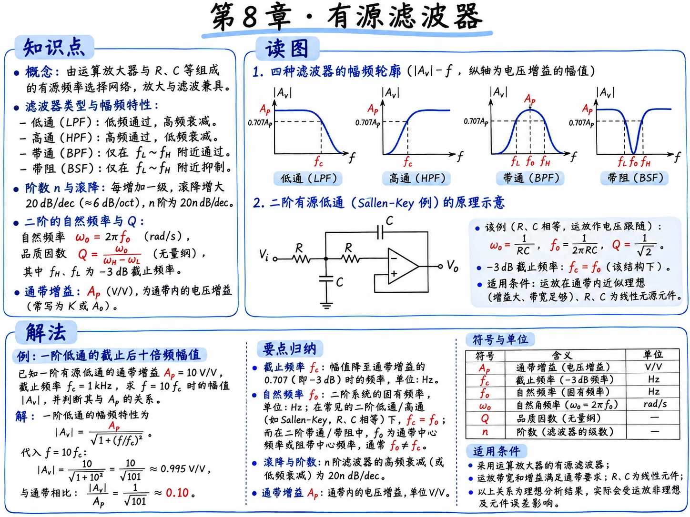
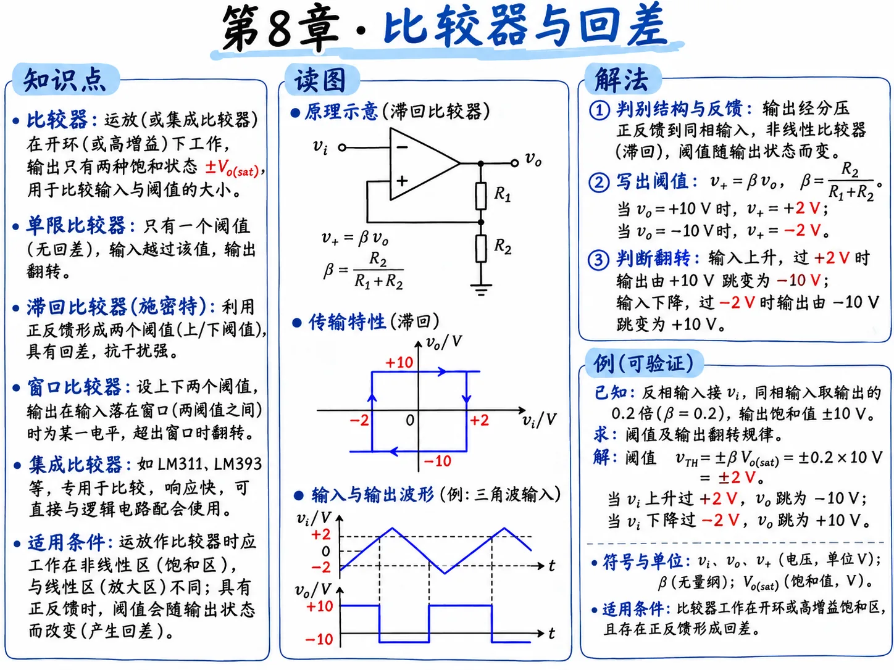
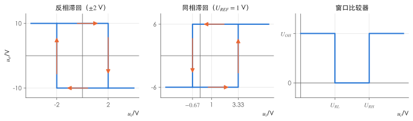

# 信号运算与处理

!!! abstract "本章要点"
    - 运放有负反馈时工作在线性区，用"虚短、虚断"分析；开环或正反馈时工作在非线性区，就是比较器。
    - 对数、指数运算利用 PN 结电流随电压指数变化，只对单一极性输入有效。
    - 把二极管放进运放的反馈环，就能整流毫伏级小信号（精密整流）。
    - 二阶 Sallen–Key 低通的 $Q$ 由增益 $K$ 决定；$Q=0.707$ 时为 Butterworth，$f_c=f_0$。
    - 比较器先令 $u_+=u_-$ 求门限，再判输出；滞回比较器有两个门限，抗干扰。

??? info "本章图卡（AI 生成速览，错误见文末「图卡勘误」）"
    { loading=lazy }
    { loading=lazy }
    { loading=lazy }

!!! note "知识点清单"
    **运放的两种工作状态与基本运算**

    - [ ] 线性区与非线性区：怎么判断，各用什么分析方法
    - [ ] 比例、加减、积分、微分电路（回顾）
    - [ ] 积分器的直流漂移与并联电阻 $R_f$
    - [ ] 微分器的高频噪声与输入串联电阻
    - [ ] 同相端平衡电阻
    - [ ] 三运放仪用放大器的增益

    **对数与指数运算**

    - [ ] 对数运算电路
    - [ ] 指数运算电路
    - [ ] 用对数、指数实现乘除
    - [ ] 温度影响与补偿

    **精密整流**

    - [ ] 普通二极管整流的死区
    - [ ] 精密半波整流
    - [ ] 精密全波整流（绝对值电路）

    **电流–电压与电压–电流变换**

    - [ ] I–V 变换（跨阻放大器）
    - [ ] V–I 变换：负载浮地
    - [ ] V–I 变换：负载接地（Howland 电流源）

    **有源滤波器**

    - [ ] 低通、高通、带通、带阻四种类型
    - [ ] 主要指标：$A_p$、$f_c$、$f_0$、$Q$、阶数
    - [ ] 有源滤波器的优点与限制
    - [ ] 一阶低通与一阶高通
    - [ ] 二阶 Sallen–Key 低通：$f_0$、$Q$ 与 $K$
    - [ ] $Q$ 对幅频特性的影响；$f_c$ 与 $f_0$ 的关系
    - [ ] 二阶 Sallen–Key 高通
    - [ ] Butterworth 特性与高阶滤波器
    - [ ] 带通与带阻滤波器

    **电压比较器**

    - [ ] 比较器的特点与分析步骤
    - [ ] 单门限比较器（含过零比较器）
    - [ ] 反相滞回比较器
    - [ ] 同相滞回比较器
    - [ ] 窗口比较器

## 1. 基本运算电路（回顾）

### 1.1 线性区与非线性区

**是什么**：运放开环增益极大，只有加了负反馈，输出才能停在电源之间的某个值上（线性区）。不加反馈或加正反馈，输出就被推到饱和（非线性区）。

| 状态 | 怎么判断 | 输出 | 分析方法 |
| --- | --- | --- | --- |
| 线性区 | 有负反馈 | 连续变化 | 虚短 $u_+=u_-$、虚断 $i_+=i_-=0$ |
| 非线性区 | 开环或正反馈 | 只有 $+U_{OM}$、$-U_{OM}$ 两种 | 虚断仍成立；虚短不成立，只在翻转瞬间 $u_+=u_-$ |

其中 $U_{OM}$ 是运放饱和输出电压，比电源低 $1\sim2\,\mathrm V$；输出端接稳压管时为 $\pm U_Z$。

本章第 2–5 节是线性应用，第 6 节是非线性应用。

### 1.2 基本运算电路的实用要点

反相/同相比例、加法、减法、积分、微分电路的推导见 [含理想运放的电路](../extras/opamp.md#2-七种基本电路)，三运放仪用放大器的推导见 [集成功能电路](special-ics.md)。这里只补实际使用中的要点。

| 电路 | 关系式 | 实用注意 |
| --- | --- | --- |
| 反相积分 | $u_o=u_o(0)-\dfrac1{RC}\displaystyle\int_0^tu_i\,\mathrm dt$ | 失调也被积分，输出慢慢漂到饱和。电容并 $R_f$（约 $10R$ 以上），把直流增益限为 $-R_f/R$ |
| 反相微分 | $u_o=-RC\dfrac{\mathrm du_i}{\mathrm dt}$ | 增益随频率升高，放大高频噪声，易自激。输入电容串小电阻 $R_1$，限制高频增益 |
| 同相端平衡电阻 | $R_p=R_1\parallel R_f$ | 两输入端对地直流电阻相等，抵消偏置电流引起的误差 |
| 三运放仪用放大器 | $A_v=\Big(1+\dfrac{2R}{R_G}\Big)\dfrac{R_4}{R_3}$ | 调一个 $R_G$ 就能改增益；差分级 $R_4=R_3$ 时总增益为 $1+2R/R_G$ |

??? example "例 1：图卡的积分器"
    反相积分器 $RC=10\,\mathrm{ms}$，$u_o(0)=0$，输入为幅值 $1\,\mathrm V$、持续 $2\,\mathrm{ms}$ 的矩形脉冲。求 $u_o$。

    思路：输入恒定时，输出是斜线。

    1. 斜率 $\dfrac{\mathrm du_o}{\mathrm dt}=-\dfrac{u_i}{RC}=-\dfrac{1}{10\,\mathrm{ms}}=-0.1\,\mathrm{V/ms}$。
    2. $2\,\mathrm{ms}$ 内 $\Delta u_o=-0.1\times2=-0.2\,\mathrm V$。
    3. 脉冲结束后 $u_i=0$，电容无放电通路，理想积分器保持不变。

    **结论**：$u_o$ 线性降到 $-0.2\,\mathrm V$ 后保持。若并有 $R_f$，则以 $\tau=R_fC$ 指数回零。

## 2. 对数与指数运算

**基础**：PN 结（或晶体管发射结）正偏时，电流随电压指数增长：

$$
i\approx I_Se^{u/V_T}
$$

适用条件：正偏，且 $u$ 比 $V_T$ 大几倍以上。其中 $I_S$ 为反向饱和电流，$V_T\approx26\,\mathrm{mV}$ 为热电压。

把这个元件放进运放的反馈支路，就得到对数（反函数）；放在输入支路，就得到指数。

### 2.1 对数运算

{ .circuit }

**是什么**：输出电压正比于输入电压的对数。输入变化 10 倍，输出只变约 $60\,\mathrm{mV}$，能把很宽的信号范围压缩到很小的电压范围。

**为什么**：反相端虚地、基极接地，所以 $u_{BE}=-u_o$。$R$ 中电流全部流入集电极：

$i_C=\dfrac{u_i}{R}=I_Se^{u_{BE}/V_T}$ → 两边取对数 → $u_{BE}=V_T\ln\dfrac{u_i}{I_SR}$。

**公式**：

$$
u_o=-V_T\ln\frac{u_i}{I_SR}
$$

适用条件：$u_i>0$（晶体管正偏）。

??? tip "深入一点：用晶体管还是二极管"
    反馈元件也可用二极管，但二极管电流满足 $i=I_Se^{u/(nV_T)}$，$n=1\sim2$，公式中 $V_T$ 要换成 $nV_T$，且 $n$ 不够稳定。晶体管集电极电流严格服从指数律（$n\approx1$），动态范围更大，所以实用电路多用晶体管。

### 2.2 指数运算

{ .circuit }

**是什么**：把二极管（或晶体管）移到输入端，$R$ 放到反馈支路，输出正比于 $e^{u_i}$。

**为什么**：二极管电流 $i_D=I_Se^{u_i/V_T}$，虚断使它全部流过 $R$，输出 $u_o=-Ri_D$。

**公式**：

$$
u_o=-RI_Se^{u_i/V_T}
$$

适用条件：$u_i>0$。

### 2.3 用对数、指数做乘除

**怎么用**：

1. 两路输入分别取对数：$\ln x$、$\ln y$。
2. 用加法器相加（除法用减法器相减）：$\ln x+\ln y=\ln(xy)$。
3. 再取指数，得 $xy$。

这就是"对数—加法—指数"乘法器。集成模拟乘法器见 [集成功能电路](special-ics.md)。

### 2.4 温度影响与补偿

**为什么**：公式里的 $V_T$ 和 $I_S$ 都随温度变化。

- $V_T\propto T$（绝对温度）。
- $I_S$ 每升高 $10^\circ\mathrm C$ 约增大一倍，影响更大。

**怎么补偿**：用一对特性相同的对管，让两个 $I_S$ 相除抵消；再用热敏电阻补偿 $V_T$。

??? example "例 2：对数放大器的输出"
    $I_S=10^{-14}\,\mathrm A$，$R=10\,\mathrm{k\Omega}$。求 $u_i=1\,\mathrm V$ 时的 $u_o$，以及 $u_i$ 每增大 10 倍 $u_o$ 的变化。

    思路：直接代对数公式；变化量只与 $V_T$ 有关。

    1. $i_C=u_i/R=100\,\mu\mathrm A$。
    2. $u_o=-0.026\ln\dfrac{10^{-4}}{10^{-14}}=-0.026\times23.03\approx-0.599\,\mathrm V$。
    3. 输入增大 10 倍：$\Delta u_o=-V_T\ln10\approx-59.9\,\mathrm{mV}$。
    4. 对比指数电路（同参数、$u_i=0.6\,\mathrm V$）：$u_o=-10^4\times10^{-14}\times e^{0.6/0.026}\approx-1.05\,\mathrm V$。

    **结论**：$u_o\approx-0.599\,\mathrm V$；每十倍频程输出只变约 $60\,\mathrm{mV}$。

## 3. 精密整流（绝对值电路）

### 3.1 普通整流的死区

**是什么**：二极管要约 $0.7\,\mathrm V$ 才导通。小于它的信号根本整不出来，这段叫**死区**。

### 3.2 精密整流的原理

**为什么**：把二极管放进运放的反馈环。

输入稍有变化 → 运放输出被放大 $A$ 倍 → 自动多出一个 $U_D$ 把二极管"推开" → 二极管压降被反馈"吸收"。

等效死区缩小为 $U_D/A$。$A=10^5$ 时只有约 $7\,\mu\mathrm V$。

### 3.3 精密全波整流电路

{ .circuit }

**是什么**：$A_1$ 做精密半波整流，$A_2$ 做反相加法，合起来输出 $|u_i|$。

**$A_1$ 精密半波**：

| $u_i$ | $A_1$ 输出 | 二极管 | $u_{o1}$ |
| --- | --- | --- | --- |
| $>0$ | 负 | $D_2$ 通、$D_1$ 止 | 经 $R$、$D_2$ 构成反相比例，$u_{o1}=-u_i$ |
| $<0$ | 正 | $D_1$ 通（反相端钳在虚地）、$D_2$ 止 | $R$ 中无电流，$u_{o1}=0$ |

$u_i>0$ 时，运放输出端比 $u_{o1}$ 再低约 $0.7\,\mathrm V$，这正是二极管压降被"吸收"的地方。

**$A_2$ 反相加法**：$u_i$ 经 $R$、$u_{o1}$ 经 $R/2$ 输入，

$$
u_o=-\Big(\frac{R}{R}u_i+\frac{R}{R/2}u_{o1}\Big)=-(u_i+2u_{o1})
$$

适用条件：运放工作在线性区，二极管压降对结果无影响。

| $u_i$ | $u_{o1}$ | $u_o$ |
| --- | --- | --- |
| $>0$ | $-u_i$ | $-(u_i-2u_i)=u_i$ |
| $<0$ | $0$ | $-u_i$ |

所以 **$u_o=|u_i|$**，与二极管压降无关。

{ .circuit }

!!! warning "易错"
    - $u_{o1}$ 取自二极管 $D_2$ 与 $R$ 的连接点，不是运放 $A_1$ 的输出端。
    - 加法器中 $u_{o1}$ 那一路电阻是 $R/2$，权重为 2，这是全波的关键。

## 4. 电流–电压与电压–电流变换

### 4.1 I–V 变换（跨阻放大器）

**是什么**：把电流信号（光电二极管、电流输出型传感器）变成电压。电流源直接接反相端，$R_f$ 跨接到输出。

**公式**：

$$
u_o=-i_sR_f
$$

适用条件：运放线性区。其中 $i_s$ 为输入电流。

**优点**：反相端虚地，传感器两端电压恒为零，不受负载影响。

### 4.2 V–I 变换：负载浮地

**是什么**：负载接在反馈支路里，即 [负反馈](feedback.md#3-四种组态与深度负反馈估算) 中的电流串联电路。

**公式**：$i_L=\dfrac{u_i}{R}$，与 $R_L$ 无关。适用条件：运放不饱和；负载两端都不接地。

### 4.3 V–I 变换：负载接地（Howland 电流源）

{ .circuit }

**是什么**：负载一端接地时，用 Howland 电流源。负反馈和正反馈同时存在，电阻比匹配时两者对 $u_L$ 的作用恰好抵消。

**为什么**：虚短 $u_-=u_+=u_L$，又 $u_-=\dfrac{R_1}{R_1+R_2}u_o$，故 $u_o=\Big(1+\dfrac{R_2}{R_1}\Big)u_L$。同相端 KCL：

$$
i_L=\frac{u_i-u_L}{R_3}+\frac{u_o-u_L}{R_4}=\frac{u_i-u_L}{R_3}+\frac{R_2}{R_1R_4}u_L
$$

取 $\dfrac{R_2}{R_1}=\dfrac{R_4}{R_3}$，含 $u_L$ 的两项抵消。

**公式**：

$$
i_L=\frac{u_i}{R_3}
$$

适用条件：$R_2/R_1=R_4/R_3$，运放不饱和。

!!! warning "易错"
    - 电阻比不匹配时，输出电阻变成有限值，$i_L$ 会随 $R_L$ 变化。四个电阻要精密匹配。

??? example "例 3：光电流检测与接地负载电流源"
    （1）光电二极管电流 $5\,\mu\mathrm A$，$R_f=200\,\mathrm{k\Omega}$，求 $u_o$。（2）Howland 电路四个电阻均为 $10\,\mathrm{k\Omega}$，$u_i=1\,\mathrm V$，运放饱和电压 $\pm12\,\mathrm V$，求 $i_L$ 和 $R_L$ 的最大值。

    思路：（1）代跨阻公式；（2）$i_L$ 恒定，$R_L$ 受运放输出摆幅限制。

    1. $u_o=-5\times10^{-6}\times2\times10^5=-1\,\mathrm V$。
    2. $i_L=1\,\mathrm V/10\,\mathrm{k\Omega}=0.1\,\mathrm{mA}$。
    3. 电阻全相等时 $u_o=2u_L=2i_LR_L\le12\,\mathrm V$，得 $R_L\le60\,\mathrm{k\Omega}$。

    **结论**：$u_o=-1\,\mathrm V$；$i_L=0.1\,\mathrm{mA}$，$R_L\le60\,\mathrm{k\Omega}$。

## 5. 有源滤波器

### 5.1 类型与指标

**是什么**：滤波器让某一频段的信号通过（通带），把其余频段衰减掉（阻带）。

| 类型 | 通过 | 阻止 |
| --- | --- | --- |
| 低通 LPF | $f<f_c$ | 高频 |
| 高通 HPF | $f>f_c$ | 低频 |
| 带通 BPF | $f_L<f<f_H$ | 两侧 |
| 带阻 BEF | 两侧 | $f_L<f<f_H$ 附近 |

无源滤波器的定义与分析见 [频率响应与滤波](../notes/nonsinusoidal.md#4-频率响应与滤波)。

**主要指标**：

| 指标 | 含义 |
| --- | --- |
| 通带增益 $A_p$ | 通带内的电压增益 |
| 截止频率 $f_c$ | $\lvert A\rvert$ 降到 $A_p/\sqrt2$（$-3\,\mathrm{dB}$）的频率；带通有 $f_L$、$f_H$ |
| 特征频率 $f_0$ | 二阶节的自然频率，$\omega_0=2\pi f_0$，**一般不等于** $f_c$ |
| 品质因数 $Q$ | 低通/高通中描述 $f_0$ 附近有没有峰；带通、带阻中 $Q=f_0/(f_H-f_L)$ |
| 阶数 $n$ | 阻带衰减斜率为 $20n\,\mathrm{dB/dec}$ |

**有源的优点与限制**：

- 优点：输出电阻近似为零，级联时互不影响；还能提供增益；不用电感。
- 限制：受运放带宽限制，工作频率应远低于运放的单位增益带宽。

### 5.2 一阶滤波器

{ .circuit }

**是什么**：一个 RC 低通接到同相放大器的输入端。RC 负责滤波，运放负责隔离和放大。

**公式**：

$$
A(j\omega)=\frac{A_p}{1+j\,f/f_c},\qquad A_p=1+\frac{R_f}{R_1},\qquad f_c=\frac{1}{2\pi RC}
$$

适用条件：运放理想；$f$ 远低于运放带宽。

- 阻带衰减只有 $20\,\mathrm{dB/dec}$，过渡带很宽。
- 把 $R$、$C$ 对调得一阶高通：$A=\dfrac{A_p}{1-j\,f_c/f}$。
- 反相型一阶低通（$R_f$ 并 $C$）见 [有损积分器](../extras/opamp.md#4-含运放的动态电路)。

??? example "例 4：图卡的一阶低通"
    $A_p=10$，$f_c=1\,\mathrm{kHz}$，求 $f=10f_c$ 时的 $|A|$。

    思路：代一阶幅频公式。

    1. $|A|=\dfrac{10}{\sqrt{1+10^2}}=\dfrac{10}{\sqrt{101}}\approx0.995$。
    2. $\dfrac{|A|}{A_p}\approx0.0995$，即 $-20\,\mathrm{dB}$。

    **结论**：十倍频处衰减 $20\,\mathrm{dB}$，与一阶 $-20\,\mathrm{dB/dec}$ 的斜率一致。

### 5.3 二阶 Sallen–Key 低通

{ .circuit }

**是什么**：两节 RC 加一个同相放大器，阻带衰减达到 $40\,\mathrm{dB/dec}$。也叫压控电压源型二阶滤波器。

**结构**：

- $R_1$、$R_2$ 串联到同相端。
- $C_2$ 接在**同相端**对地。
- $C_1$ 从两电阻的连接点 $a$ 接到**输出端**。
- 运放接成增益 $K=1+R_b/R_a$ 的同相放大器。

**为什么**：$C_1$ 把输出送回 $a$ 点，在 $f_0$ 附近引入适量正反馈，把那一段的增益"托"起来。$K$ 越大，正反馈越强，$Q$ 越高。

**公式**（对节点 $a$、同相端列 KCL，与 $u_o=Ku_+$ 联立）：

$$
A(s)=\frac{K\omega_0^2}{s^2+\dfrac{\omega_0}{Q}s+\omega_0^2},\qquad
\omega_0=\frac{1}{\sqrt{R_1R_2C_1C_2}},\qquad
Q=\frac{\sqrt{R_1R_2C_1C_2}}{(R_1+R_2)C_2+(1-K)R_1C_1}
$$

适用条件：运放理想。

**两种常用取法**：

| 取法 | $f_0$ | $Q$ | 得到 $Q=0.707$ 的方法 |
| --- | --- | --- | --- |
| 等 $R$ 等 $C$ | $\dfrac1{2\pi RC}$ | $\dfrac1{3-K}$ | $K=3-\sqrt2\approx1.586$ |
| 单位增益 $K=1$、等 $R$ | $\dfrac{1}{2\pi R\sqrt{C_1C_2}}$ | $\dfrac12\sqrt{\dfrac{C_1}{C_2}}$ | $C_1=2C_2$ |

等 $R$ 等 $C$ 时：$K=1$ 得 $Q=0.5$；$K\ge3$ 时极点进入右半平面，电路**自激**。

!!! warning "易错"
    - 等值元件、跟随器接法的 Sallen–Key，$Q=0.5$，不是 $0.707$。
    - $K$ 不能 $\ge3$，否则滤波器变成振荡器。

### 5.4 $Q$ 对幅频特性的影响

**是什么**：$Q$ 决定 $f_0$ 附近曲线的形状。

| $Q$ | 幅频特性 | $f_c$ 与 $f_0$ |
| --- | --- | --- |
| $0.5$ | 平缓下降，拐弯早 | $f_c\approx0.644f_0$ |
| $0.707$ | 最平坦，无峰（Butterworth） | $f_c=f_0$ |
| $>0.707$ | $f_0$ 附近出现峰，$Q$ 大时峰值约为 $Q$ 倍 | — |

{ .circuit }

??? tip "深入一点：$Q=0.5$ 时为什么 $f_c\approx0.644f_0$"
    $Q=0.5$ 时分母是完全平方，$|A|=\dfrac{K}{1+(f/f_0)^2}$。令 $|A|=K/\sqrt2$，得 $1+(f/f_0)^2=\sqrt2$，即 $(f/f_0)^2=\sqrt2-1$，$f_c=\sqrt{\sqrt2-1}\,f_0\approx0.644f_0$。

??? example "例 5：图卡 Sallen–Key 电路的真实特性与 Butterworth 设计"
    图卡参数：$R=10\,\mathrm{k\Omega}$、$C=10\,\mathrm{nF}$，运放接跟随器（$K=1$）。求真实的 $f_0$、$Q$、$f_c$，并改成 Butterworth。

    思路：等值元件用 $Q=1/(3-K)$；要 $Q=0.707$ 就调 $K$ 或调电容比。

    1. **图卡参数**：$f_0=\dfrac{1}{2\pi\times10^4\times10^{-8}}\approx1591.5\,\mathrm{Hz}$，$Q=\dfrac{1}{3-1}=0.5$，$f_c=0.644f_0\approx1024\,\mathrm{Hz}$。
    2. **改为 Butterworth、保持等值元件**：$K=3-\sqrt2\approx1.586$，取 $R_a=10\,\mathrm{k\Omega}$、$R_b=5.86\,\mathrm{k\Omega}$。此时 $f_c=f_0=1591.5\,\mathrm{Hz}$，通带增益 $1.586$（$4\,\mathrm{dB}$）。
    3. **设计 $f_0=1\,\mathrm{kHz}$**，$C=10\,\mathrm{nF}$：$R=\dfrac1{2\pi f_0C}\approx15.9\,\mathrm{k\Omega}$，$K=1.586$。
    4. **若要单位增益**：取 $C_2=10\,\mathrm{nF}$、$C_1=20\,\mathrm{nF}$，$R=\dfrac{1}{2\pi f_0\sqrt{C_1C_2}}\approx11.25\,\mathrm{k\Omega}$，$Q=\frac12\sqrt2=0.707$。

    **结论**：图卡电路 $Q=0.5$、$f_c\approx1024\,\mathrm{Hz}$，不是 Butterworth；改 $K=1.586$ 或 $C_1=2C_2$ 才是。

### 5.5 二阶 Sallen–Key 高通

**是什么**：把低通中 $R$ 与 $C$ 的位置对调，就得到二阶高通。

**公式**：$Q$ 的形式相同；等 $R$ 等 $C$ 时仍为 $Q=\dfrac1{3-K}$，$f_0=\dfrac1{2\pi RC}$。适用条件：运放理想。

### 5.6 Butterworth 与高阶滤波器

**是什么**：Butterworth（最大平坦）滤波器通带最平、无峰，$f_c$ 处恰为 $-3\,\mathrm{dB}$。

**公式**：

$$
|A|=\frac{A_p}{\sqrt{1+(f/f_c)^{2n}}}
$$

适用条件：$n$ 阶 Butterworth 低通。

**怎么做高阶**：

1. 用若干二阶节级联；奇数阶再加一个一阶节。
2. 各节的 $f_0$ 都等于 $f_c$。
3. 各节的 $Q$ 按下表取，不能都取 $0.707$。

| 阶数 | 各节 $Q$ |
| --- | --- |
| 2 | $0.707$ |
| 3 | 一阶节 + $1.0$ |
| 4 | $0.541$、$1.307$ |

!!! warning "易错"
    - 两个 $Q=0.707$ 的节直接级联，不是 4 阶 Butterworth：$f_c$ 处衰减 $6\,\mathrm{dB}$，不是 $3\,\mathrm{dB}$。

### 5.7 带通与带阻

**带通**：低通（截止 $f_H$）与高通（截止 $f_L$）级联，要求 $f_L<f_H$。

$$
f_0=\sqrt{f_Lf_H},\qquad Q=\frac{f_0}{f_H-f_L}
$$

适用条件：带通、带阻滤波器。其中 $f_H-f_L$ 为通带（或阻带）宽度。

**带阻**：低通与高通的输出**相加**，要求 $f_H<f_L$；也可用双 T 网络。

$Q$ 较高的窄带滤波器常用单个二阶带通节（多重反馈型），其中心频率处增益与 $Q$ 有关。

## 6. 电压比较器

### 6.1 比较器的特点与分析步骤

**是什么**：比较两个电压的大小，输出高或低两种电平。它是模拟信号到"开关量"的接口。

**特点**：

- 运放开环或带正反馈，工作在非线性区。
- 输出只有 $\pm U_{OM}$，或稳压管限定的 $\pm U_Z$。
- 虚断仍成立；虚短不成立，只在翻转瞬间 $u_+=u_-$。

**传输特性**：$u_o$ 随 $u_i$ 变化的曲线。它由三要素确定：输出高、低电平，门限电压 $U_T$，以及 $u_i$ 越过门限时的跳变方向。

**怎么用**：

1. 找出 $u_+$、$u_-$ 各接什么。
2. 令 $u_+=u_-$ 求门限 $U_T$。滞回时 $u_+$ 含 $u_o$，要代入两种输出状态各求一次。
3. 判断 $u_i$ 在门限两侧时输出是高还是低。
4. 画传输特性。

| 类型 | 门限 | 特点 |
| --- | --- | --- |
| 单门限 | $U_T=U_{REF}$ | 灵敏；但 $u_i$ 在门限附近有噪声时输出反复跳变 |
| 滞回（施密特） | 两个门限 $U_{T+}\ne U_{T-}$ | 噪声小于回差就不误翻转；代价是灵敏度降低 |
| 窗口 | 两个门限 $U_{RL}$、$U_{RH}$ | 判断 $u_i$ 是否落在两者之间 |

### 6.2 单门限比较器

**是什么**：$u_i$ 接一个输入端，参考电压 $U_{REF}$ 接另一端，没有反馈。$U_{REF}=0$ 时叫**过零比较器**。

**公式**：$U_T=U_{REF}$。适用条件：开环，无正反馈。

- $u_i$ 接反相端：$u_i>U_{REF}$ 时输出低，$u_i<U_{REF}$ 时输出高。
- $u_i$ 接同相端：方向相反。

### 6.3 滞回比较器的思路

**是什么**：在单门限比较器上加正反馈，门限随输出状态改变，形成两个门限。两门限之差叫**回差** $\Delta U=U_{T+}-U_{T-}$。

**为什么能抗干扰**：输出一翻转，门限马上"躲开"到另一边。

$u_i$ 刚越过门限 → 输出翻转 → 正反馈使门限移到另一侧 → 噪声小于 $\Delta U$ 时 $u_i$ 回不到新门限 → 不会来回跳。

打个比方：家里的恒温器。$20^\circ\mathrm C$ 开暖气，$22^\circ\mathrm C$ 才关，避免在 $21^\circ\mathrm C$ 附近频繁开关。

=== "反相滞回"

    { .circuit }

    $u_i$ 接反相端。同相端由 $U_{REF}$ 与 $u_o=\pm U_Z$ 经 $R_1$、$R_F$ 叠加：

    $$
    u_+=\frac{R_FU_{REF}+R_1u_o}{R_1+R_F}\ \Rightarrow\
    U_{T\pm}=\frac{R_FU_{REF}\pm R_1U_Z}{R_1+R_F},\qquad \Delta U=\frac{2R_1U_Z}{R_1+R_F}
    $$

    适用条件：输出为 $\pm U_Z$。

    翻转过程：

    1. $u_i$ 很小时 $u_o=+U_Z$，门限为 $U_{T+}$。
    2. $u_i$ 上升过 $U_{T+}$，$u_o$ 跳到 $-U_Z$，门限随之降为 $U_{T-}$。
    3. $u_i$ 下降过 $U_{T-}$，才跳回 $+U_Z$。

    $U_{REF}=0$ 时门限关于原点对称：$\pm\beta U_Z$，$\beta=\dfrac{R_1}{R_1+R_F}$。

=== "同相滞回"

    { .circuit }

    $u_i$ 经 $R_1$ 接同相端，$R_2$ 接输出，反相端接 $U_{REF}$。$u_+=\dfrac{R_2u_i+R_1u_o}{R_1+R_2}=U_{REF}$ 时翻转：

    $$
    U_{T}=\Big(1+\frac{R_1}{R_2}\Big)U_{REF}-\frac{R_1}{R_2}u_o,\qquad
    \Delta U=\frac{2R_1}{R_2}U_Z
    $$

    适用条件：输出为 $\pm U_Z$。

    - $u_o=-U_Z$ 时门限为 $U_{T+}$：$u_i$ 上升过它，输出由低跳高。
    - $u_o=+U_Z$ 时门限为 $U_{T-}$：$u_i$ 下降过它，输出由高跳低。

=== "窗口比较器"

    { .circuit }

    两个比较器加二极管"或"门：

    1. $u_i>U_{RH}$：$A_1$ 输出高，$D_1$ 导通。
    2. $u_i<U_{RL}$：$A_2$ 输出高，$D_2$ 导通。
    3. 两者都输出低：二极管截止，$R$ 把 $u_o$ 拉到 $0$。

    所以窗口内 $u_o=0$，窗口外 $u_o\approx U_{OH}-U_D$。

{ .circuit }

!!! warning "易错"
    - 反相滞回：$u_i$ **增大**过上门限时，输出由**高跳低**。同相滞回相反。
    - 回差只取决于电阻和 $U_Z$；$U_{REF}$ 只平移滞回中心，不改回差。
    - 正反馈只是滞回比较器的条件；单门限、窗口比较器没有正反馈。

??? example "例 6：图卡的反相滞回比较器"
    反相端接 $u_i$，同相端取输出的 $0.2$ 倍（$\beta=0.2$，$U_{REF}=0$），输出 $\pm10\,\mathrm V$。求门限并画传输特性。

    思路：两种输出状态各求一次 $u_+$。

    1. 门限 $U_{T\pm}=\pm\beta\cdot10=\pm2\,\mathrm V$，回差 $4\,\mathrm V$。
    2. $u_o=+10\,\mathrm V$ 时 $u_+=+2\,\mathrm V$：$u_i$ **上升**过 $+2\,\mathrm V$，$u_o$ 跳为 $-10\,\mathrm V$。
    3. $u_o=-10\,\mathrm V$ 时 $u_+=-2\,\mathrm V$：$u_i$ **下降**过 $-2\,\mathrm V$，$u_o$ 跳回 $+10\,\mathrm V$。
    4. 传输特性（上图左）：$u_i<-2\,\mathrm V$ 一定输出 $+10\,\mathrm V$；$u_i>2\,\mathrm V$ 一定输出 $-10\,\mathrm V$；中间取决于来路。

    **结论**：门限 $\pm2\,\mathrm V$。图卡把高电平画成延伸到 $u_i>2\,\mathrm V$ 一侧，是错的。

??? example "例 7：带参考电压的反相滞回比较器"
    $U_{REF}=3\,\mathrm V$，$R_1=10\,\mathrm{k\Omega}$，$R_F=40\,\mathrm{k\Omega}$，$U_Z=6\,\mathrm V$。求门限和回差。

    思路：代反相滞回公式。

    1. $U_{T+}=\dfrac{40\times3+10\times6}{50}=3.6\,\mathrm V$。
    2. $U_{T-}=\dfrac{40\times3-10\times6}{50}=1.2\,\mathrm V$。
    3. $\Delta U=3.6-1.2=2.4\,\mathrm V$。
    4. 滞回中心 $\dfrac{R_F}{R_1+R_F}U_{REF}=2.4\,\mathrm V$。

    **结论**：门限 $3.6\,\mathrm V$ 和 $1.2\,\mathrm V$，回差 $2.4\,\mathrm V$。参考电压只把中心移到 $2.4\,\mathrm V$。

## 公式速查

| 内容 | 公式 | 条件 |
| --- | --- | --- |
| 反相积分 | $u_o=u_o(0)-\dfrac1{RC}\displaystyle\int_0^tu_i\,\mathrm dt$ | 线性区 |
| 反相微分 | $u_o=-RC\dfrac{\mathrm du_i}{\mathrm dt}$ | 线性区 |
| 三运放仪放 | $A_v=\Big(1+\dfrac{2R}{R_G}\Big)\dfrac{R_4}{R_3}$ | 电阻对称 |
| 对数运算 | $u_o=-V_T\ln\dfrac{u_i}{I_SR}$ | $u_i>0$ |
| 指数运算 | $u_o=-RI_Se^{u_i/V_T}$ | $u_i>0$ |
| 精密全波整流 | $u_o=-(u_i+2u_{o1})=\lvert u_i\rvert$ | 运放线性区 |
| I–V 变换 | $u_o=-i_sR_f$ | 线性区 |
| V–I（浮地） | $i_L=\dfrac{u_i}{R}$ | 运放不饱和 |
| Howland | $i_L=\dfrac{u_i}{R_3}$ | $R_2/R_1=R_4/R_3$ |
| 一阶低通 | $A=\dfrac{A_p}{1+jf/f_c}$，$f_c=\dfrac1{2\pi RC}$ | — |
| Sallen–Key 低通 | $\omega_0=\dfrac{1}{\sqrt{R_1R_2C_1C_2}}$ | — |
| 等 $R$ 等 $C$ | $Q=\dfrac{1}{3-K}$ | $K<3$ |
| 单位增益、等 $R$ | $Q=\dfrac12\sqrt{\dfrac{C_1}{C_2}}$ | $K=1$ |
| $Q=0.5$ 的截止频率 | $f_c\approx0.644f_0$ | 二阶低通 |
| Butterworth | $\lvert A\rvert=\dfrac{A_p}{\sqrt{1+(f/f_c)^{2n}}}$ | $Q$ 按表取 |
| 带通 | $f_0=\sqrt{f_Lf_H}$，$Q=\dfrac{f_0}{f_H-f_L}$ | 带通 / 带阻 |
| 反相滞回 | $U_{T\pm}=\dfrac{R_FU_{REF}\pm R_1U_Z}{R_1+R_F}$，$\Delta U=\dfrac{2R_1U_Z}{R_1+R_F}$ | 输出 $\pm U_Z$ |
| 同相滞回 | $U_T=\Big(1+\dfrac{R_1}{R_2}\Big)U_{REF}-\dfrac{R_1}{R_2}u_o$，$\Delta U=\dfrac{2R_1}{R_2}U_Z$ | 输出 $\pm U_Z$ |

## 练习

### 1. 概念判断 :material-star::material-star-outline::material-star-outline:

1. 比较器中的运放一定工作在非线性区，所以虚短、虚断都不能用。
2. 等值元件的单位增益 Sallen–Key 低通，$-3\,\mathrm{dB}$ 截止频率等于 $\dfrac1{2\pi RC}$。
3. 精密整流电路中，二极管压降对输出几乎没有影响。
4. 滞回比较器的回差越大，抗干扰能力越强，但检测灵敏度越低。
5. 对数运算电路对正、负输入都能工作。

??? success "答案"
    1 ✗　2 ✗　3 ✓　4 ✓　5 ✗

??? note "解析"
    1. 虚短不成立，但**虚断**仍成立，正是用它求 $u_+$ 的。翻转瞬间 $u_+=u_-$ 用来求门限。
    2. 该电路 $Q=0.5$，$f_c\approx0.644f_0$。只有 $Q=0.707$ 时 $f_c=f_0$。
    3. 二极管在反馈环内，运放输出自动多出一个 $U_D$，等效死区只有 $U_D/A$。
    4. 噪声小于回差就不会误翻转；但输入要越过更远的门限才翻转。
    5. 晶体管（二极管）必须正偏，图示电路只适用于 $u_i>0$。

### 2. 对数放大器的输出范围 :material-star::material-star-outline::material-star-outline:

对数放大器参数同第 2 节例题。$u_i$ 从 $0.1\,\mathrm V$ 变到 $10\,\mathrm V$，$u_o$ 变化多少？

??? success "答案"
    $\Delta u_o\approx-0.120\,\mathrm V$（约 $-120\,\mathrm{mV}$）。

??? note "解析"
    1. 变化量只与比值有关：$\Delta u_o=-V_T\ln\dfrac{10}{0.1}$。
    2. $=-0.026\ln100=-0.026\times4.605\approx-0.120\,\mathrm V$。
    3. 输入变化 100 倍（$40\,\mathrm{dB}$），输出只变 $0.12\,\mathrm V$。

### 3. Sallen–Key 低通 :material-star::material-star::material-star-outline:

等值元件 Sallen–Key 低通，$R=22\,\mathrm{k\Omega}$，$C=10\,\mathrm{nF}$。（1）接成单位增益时求 $f_0$、$Q$、$f_c$；（2）要得到 Butterworth 特性，$R_b/R_a$ 取多少？此时 $f_c$ 与通带增益为多少？（3）若误把 $R_b/R_a$ 调到 $2.2$，会怎样？

??? success "答案"
    （1）$f_0\approx723\,\mathrm{Hz}$，$Q=0.5$，$f_c\approx466\,\mathrm{Hz}$；（2）$R_b/R_a=0.586$，$f_c=723\,\mathrm{Hz}$，$A_p=1.586$；（3）$K=3.2>3$，电路自激振荡。

??? note "解析"
    1. $f_0=\dfrac{1}{2\pi\times22\times10^3\times10^{-8}}\approx723.4\,\mathrm{Hz}$；$Q=\dfrac{1}{3-1}=0.5$。
    2. $f_c=\sqrt{\sqrt2-1}\,f_0\approx0.644\times723.4\approx465.6\,\mathrm{Hz}$。
    3. $Q=\dfrac1{3-K}=\dfrac1{\sqrt2}$，得 $K=3-\sqrt2\approx1.586$，$R_b/R_a=K-1=0.586$；此时 $f_c=f_0$。
    4. $K=3.2$ 时分母 $s$ 项系数 $(3-K)\omega_0<0$，极点在右半平面，成了振荡器。

### 4. 同相滞回比较器 :material-star::material-star::material-star-outline:

同相滞回比较器中 $R_1=10\,\mathrm{k\Omega}$（接 $u_i$），$R_2=30\,\mathrm{k\Omega}$（接输出），反相端接 $U_{REF}=1\,\mathrm V$，输出 $\pm U_Z=\pm6\,\mathrm V$。求两个门限和回差，并说明 $u_i$ 从 $-5\,\mathrm V$ 缓慢升到 $+5\,\mathrm V$ 再降回的过程中输出如何变化。

??? success "答案"
    $U_{T+}\approx3.33\,\mathrm V$，$U_{T-}\approx-0.67\,\mathrm V$，$\Delta U=4\,\mathrm V$。

??? note "解析"
    1. $U_T=\Big(1+\dfrac{R_1}{R_2}\Big)U_{REF}-\dfrac{R_1}{R_2}u_o=\dfrac43-\dfrac13u_o$。
    2. $u_o=-6\,\mathrm V$：$U_{T+}=\dfrac43+2\approx3.33\,\mathrm V$。
    3. $u_o=+6\,\mathrm V$：$U_{T-}=\dfrac43-2\approx-0.67\,\mathrm V$；$\Delta U=\dfrac{2R_1}{R_2}U_Z=4\,\mathrm V$。
    4. $u_i=-5\,\mathrm V$ 时 $u_+<U_{REF}$，$u_o=-6\,\mathrm V$；升到 $3.33\,\mathrm V$ 跳到 $+6\,\mathrm V$；回降到 $-0.67\,\mathrm V$ 才跳回 $-6\,\mathrm V$（见传输特性中图）。

### 5. 精密全波整流的工作状态 :material-star::material-star::material-star-outline:

在第 3 节的绝对值电路中，分别求 $u_i=-0.3\,\mathrm V$ 和 $u_i=0.5\,\mathrm V$ 时的 $u_{o1}$、$u_o$，并指出 $D_1$、$D_2$ 的状态。

??? success "答案"
    $u_i=-0.3\,\mathrm V$：$D_1$ 通、$D_2$ 止，$u_{o1}=0$，$u_o=0.3\,\mathrm V$；$u_i=0.5\,\mathrm V$：$D_1$ 止、$D_2$ 通，$u_{o1}=-0.5\,\mathrm V$，$u_o=0.5\,\mathrm V$。

??? note "解析"
    1. $u_i<0$：电流从反相端流向 $u_i$。$A_1$ 输出升高，$D_1$ 导通提供该电流，反相端仍为虚地。
    2. 此时 $D_2$ 反偏，$R$ 中无电流，$u_{o1}=0$；$u_o=-(-0.3+0)=0.3\,\mathrm V$。
    3. $u_i>0$：$A_1$ 输出变负，$D_2$ 导通，$u_{o1}=-u_i=-0.5\,\mathrm V$（$A_1$ 输出端约 $-1.2\,\mathrm V$）。
    4. $u_o=-(0.5-1.0)=0.5\,\mathrm V$。

## 图卡勘误

| 图卡位置 | 原文 | 更正 |
| --- | --- | --- |
| 卡 17「仪用放大器」 | 典型增益 $A_v=1+\dfrac{2R}{R_G}$ | 这只是第一级增益。总增益 $A_v=\Big(1+\dfrac{2R}{R_G}\Big)\dfrac{R_4}{R_3}$，$R_4=R_3$ 时才等于前者 |
| 卡 17「对数与指数」 | $u_o=-nU_T\ln\dfrac{u_i}{I_SR}$，$u_o=-I_SRe^{u_i/(nU_T)}$ | 公式对（$U_T$ 即本站 $V_T$）。须注明 $u_i>0$；晶体管 $n\approx1$，二极管 $n=1\sim2$；$I_S$、$V_T$ 都随温度变，需补偿 |
| 卡 17「积分与微分」 | 适用：输入变化较慢、带宽内工作 | 微分器的问题是高频噪声大、易自激，输入串小电阻；积分器的问题是直流漂移，并 $R_f$ |
| 卡 18「二阶的自然频率与 Q」 | $Q=\dfrac{\omega_0}{\omega_H-\omega_L}$，$f_H$、$f_L$ 为 $-3\,\mathrm{dB}$ 截止频率 | 只适用于**带通/带阻**。低通/高通的 $Q$ 由分母 $s^2+\frac{\omega_0}{Q}s+\omega_0^2$ 定义 |
| 卡 18「阶数与滚降」 | 每增加一级，滚降增大 $20\,\mathrm{dB/dec}$ | 应为每增加**一阶**；一个二阶节增加 $40\,\mathrm{dB/dec}$ |
| 卡 18 Sallen–Key 电路图 | 接地电容 $C$ 接在两电阻之间；信号接反相端，输出接回同相端 | $C_2$ 应接**同相端**对地，$C_1$ 从两电阻中点接输出；信号进同相端，运放接跟随器。图中是正反馈，不能工作 |
| 卡 18 Sallen–Key 参数 | 等 $R$ 等 $C$、跟随器：$Q=\dfrac1{\sqrt2}$，$f_c=f_0$ | 实为 $Q=0.5$，$f_c\approx0.644f_0$。要 $Q=0.707$ 需 $K=1.586$ 或 $C_1=2C_2$ |
| 卡 18「要点归纳」 | 常见的二阶低通/高通（如 Sallen–Key，R、C 相等）下 $f_c=f_0$ | 只在 $Q=0.707$（Butterworth）时成立 |
| 卡 19 传输特性图 | 高电平 $+10\,\mathrm V$ 的水平线延伸到 $u_i>+2\,\mathrm V$ 一侧 | 反相滞回中 $u_i>+2\,\mathrm V$ 时输出必为 $-10\,\mathrm V$。高电平线应向左（$u_i<-2\,\mathrm V$）延伸 |
| 卡 19「适用条件」 | 比较器工作在开环或高增益饱和区，且存在正反馈形成回差 | 正反馈只是滞回比较器的条件；单门限、窗口比较器没有 |
| 卡 19 其余 | 阈值 $\pm\beta U_{o(sat)}=\pm2\,\mathrm V$ 及翻转规律 | 正确 |
| 卡 17 积分器例、卡 18 一阶低通例 | $-0.2\,\mathrm V$；$0.995$、$0.10$ | 正确 |
