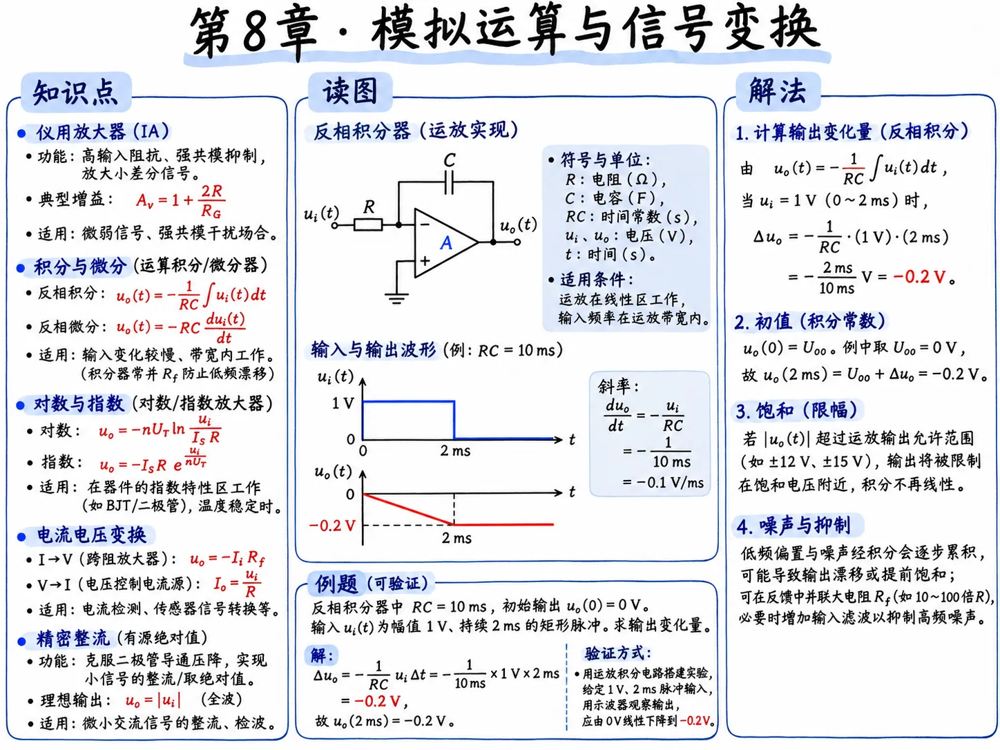
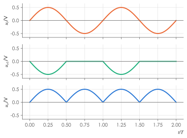
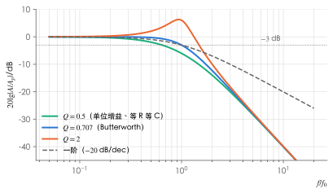

# 信号运算与处理

!!! abstract "TL;DR"
    - 运放有**负反馈**时工作在线性区，用"虚短、虚断"分析运算电路和有源滤波器；**开环或正反馈**时工作在非线性区，输出只有 $\pm U_{OM}$（或稳压管限定的 $\pm U_Z$）两种状态——这就是比较器。
    - 对数/指数运算利用 PN 结的指数特性：$u_o=-V_T\ln\dfrac{u_i}{I_SR}$、$u_o=-RI_Se^{u_i/V_T}$，只对单一极性输入有效，且受温度影响。
    - 把二极管放进运放的反馈环，死区从 $0.7\,\mathrm V$ 缩小到 $0.7\,\mathrm V/A$，得到**精密整流**；半波整流 + 加法器得到 $u_o=|u_i|$。
    - 二阶 Sallen–Key 低通（等 $R$ 等 $C$）：$f_0=\dfrac1{2\pi RC}$，$Q=\dfrac1{3-K}$。单位增益时 $Q=0.5$、$f_c\approx0.644f_0$；**Butterworth** 要 $Q=0.707$，即 $K=3-\sqrt2\approx1.586$。
    - 比较器先求门限（令 $u_+=u_-$），再定输出状态。滞回比较器有两个门限，回差 $\Delta U$ 抗干扰；反相滞回 $u_i$ 增大过上门限时输出由高跳低。

??? info "本章图卡（AI 生成速览，错误见文末「图卡勘误」）"
    { loading=lazy }
    { loading=lazy }
    { loading=lazy }

## 1. 基本运算电路（回顾）

反相/同相比例、加法、减法、积分、微分电路的推导见 [含理想运放的电路](../extras/opamp.md#2-七种基本电路)，三运放仪用放大器见 [集成功能电路](special-ics.md)。这里只补充实际使用中的要点：

| 电路 | 关系式 | 实用注意 |
| --- | --- | --- |
| 反相积分 | $u_o=u_o(0)-\dfrac1{RC}\displaystyle\int_0^tu_i\,\mathrm dt$ | 失调电压、偏置电流也被积分，输出慢慢漂到饱和；电容两端并联 $R_f$（约 $10R$ 以上）限制直流增益为 $-R_f/R$ |
| 反相微分 | $u_o=-RC\dfrac{\mathrm du_i}{\mathrm dt}$ | 增益随频率升高，高频噪声被放大且易自激；输入电容串一个小电阻 $R_1$，限制高频增益 |
| 同相端平衡电阻 | $R_p=R_1\parallel R_f$ | 使两输入端对地直流电阻相等，抵消偏置电流引起的误差 |

??? example "例：图卡的积分器"
    反相积分器 $RC=10\,\mathrm{ms}$，$u_o(0)=0$，输入为幅值 $1\,\mathrm V$、持续 $2\,\mathrm{ms}$ 的矩形脉冲。

    1. 斜率 $\dfrac{\mathrm du_o}{\mathrm dt}=-\dfrac{u_i}{RC}=-\dfrac{1}{10\,\mathrm{ms}}=-0.1\,\mathrm{V/ms}$。
    2. $\Delta u_o=-0.1\times2=-0.2\,\mathrm V$，$u_o(2\,\mathrm{ms})=-0.2\,\mathrm V$；脉冲结束后 $u_i=0$，理想积分器保持 $-0.2\,\mathrm V$（电容无放电通路）。若并有 $R_f$，则以 $\tau=R_fC$ 指数回零。

## 2. 对数与指数运算

PN 结（或晶体管发射结）正偏时 $i\approx I_Se^{u/V_T}$，$V_T\approx26\,\mathrm{mV}$。

=== "对数运算"

    { .circuit }

    反相端虚地，基极接地，所以 $u_{BE}=0-u_o$；$R$ 中电流全部流入集电极：$i_C=\dfrac{u_i}{R}=I_Se^{u_{BE}/V_T}$，

    $$
    u_o=-u_{BE}=-V_T\ln\frac{u_i}{I_SR}\qquad(u_i>0).
    $$

    用晶体管（集电极电流严格服从指数律，$n\approx1$）比用二极管（$n=1\sim2$，公式中 $V_T$ 换为 $nV_T$）动态范围大。

=== "指数运算"

    { .circuit }

    二极管接在输入端：$i_D=I_Se^{u_i/V_T}$ 全部流过 $R$，

    $$
    u_o=-Ri_D=-RI_Se^{u_i/V_T}\qquad(u_i>0).
    $$

- **乘除法**：$\ln x+\ln y$ 再取指数得 $xy$，即"对数—加法—指数"三级组成乘法器（集成模拟乘法器见 [集成功能电路](special-ics.md)）。
- **温度**：$V_T\propto T$，$I_S$ 每升高 $10^\circ\mathrm C$ 约增大一倍；实用电路用对管抵消 $I_S$，再用热敏电阻补偿 $V_T$。

??? example "例：对数放大器的输出"
    $I_S=10^{-14}\,\mathrm A$，$R=10\,\mathrm{k\Omega}$，求 $u_i=1\,\mathrm V$ 时的 $u_o$，以及 $u_i$ 每增大 10 倍 $u_o$ 的变化。

    1. $i_C=u_i/R=100\,\mu\mathrm A$，$u_o=-0.026\ln\dfrac{10^{-4}}{10^{-14}}=-0.026\times23.03\approx-0.599\,\mathrm V$。
    2. $\Delta u_o=-V_T\ln10\approx-59.9\,\mathrm{mV}$：每十倍频程输出只变化约 $60\,\mathrm{mV}$，所以对数放大器能把很宽的动态范围压缩到很小的电压范围。
    3. 指数电路同参数、$u_i=0.6\,\mathrm V$：$u_o=-10^4\times10^{-14}\times e^{0.6/0.026}\approx-1.05\,\mathrm V$。

## 3. 精密整流（绝对值电路）

普通二极管整流有约 $0.7\,\mathrm V$ 死区，小于它的信号整不出来。把二极管放进运放反馈环：运放输出自动多出一个 $U_D$ 去"推开"二极管，等效死区只有 $U_D/A$（$A=10^5$ 时约 $7\,\mu\mathrm V$）。

{ .circuit }

**$A_1$（半波）**：

- $u_i>0$：$A_1$ 输出为负，$D_2$ 导通、$D_1$ 截止，经 $R$、$D_2$ 构成反相比例：$u_{o1}=-u_i$（运放输出端比 $u_{o1}$ 再低 $0.7\,\mathrm V$，二极管压降被反馈"吸收"）；
- $u_i<0$：$A_1$ 输出为正，$D_1$ 导通把反相端钳在虚地，$D_2$ 截止，$R$ 中无电流：$u_{o1}=0$。

**$A_2$（反相加法）**：$u_o=-\Big(\dfrac{R}{R}u_i+\dfrac{R}{R/2}u_{o1}\Big)=-(u_i+2u_{o1})$。

| $u_i$ | $u_{o1}$ | $u_o$ |
| --- | --- | --- |
| $>0$ | $-u_i$ | $-(u_i-2u_i)=u_i$ |
| $<0$ | $0$ | $-u_i$ |

所以 $u_o=|u_i|$，与二极管压降无关。

{ .circuit }

## 4. 电流–电压与电压–电流变换

- **I–V（跨阻放大器）**：电流信号（光电二极管、电流输出型传感器）直接接反相端，$R_f$ 跨接，$u_o=-i_sR_f$；反相端虚地，传感器两端电压恒为零，不受负载影响。
- **V–I，负载浮地**：负载接在反馈支路中（[负反馈](feedback.md#3-四种组态与深度负反馈估算) 中的电流串联电路），$i_L=u_i/R$。
- **V–I，负载接地（Howland 电流源）**：

{ .circuit }

虚短 $u_-=u_+=u_L$，$u_-=\dfrac{R_1}{R_1+R_2}u_o$，故 $u_o=\Big(1+\dfrac{R_2}{R_1}\Big)u_L$。同相端 KCL：

$$
i_L=\frac{u_i-u_L}{R_3}+\frac{u_o-u_L}{R_4}=\frac{u_i-u_L}{R_3}+\frac{R_2}{R_1R_4}u_L .
$$

取 $\dfrac{R_2}{R_1}=\dfrac{R_4}{R_3}$，含 $u_L$ 的两项抵消：$i_L=\dfrac{u_i}{R_3}$，与 $R_L$ 无关。电阻比不匹配时输出电阻变为有限值，所以四个电阻要精密匹配。

??? example "例：光电流检测与接地负载电流源"
    1. 光电二极管电流 $5\,\mu\mathrm A$，$R_f=200\,\mathrm{k\Omega}$：$u_o=-5\times10^{-6}\times2\times10^5=-1\,\mathrm V$。
    2. Howland 电路四个电阻均为 $10\,\mathrm{k\Omega}$，$u_i=1\,\mathrm V$，运放饱和电压 $\pm12\,\mathrm V$：$i_L=1\,\mathrm V/10\,\mathrm{k\Omega}=0.1\,\mathrm{mA}$。$u_o=2u_L=2i_LR_L\le12\,\mathrm V$，故 $R_L\le60\,\mathrm{k\Omega}$。

## 5. 有源滤波器

### 5.1 类型与指标

| 指标 | 含义 |
| --- | --- |
| 通带增益 $A_p$ | 通带内的电压增益 |
| 截止频率 $f_c$ | $\lvert A\rvert$ 降到 $A_p/\sqrt2$（$-3\,\mathrm{dB}$）的频率；带通有 $f_L$、$f_H$ |
| 特征频率 $f_0$ | 二阶节的自然频率 $\omega_0=2\pi f_0$，**一般不等于** $f_c$ |
| 品质因数 $Q$ | 二阶低通/高通中描述 $f_0$ 附近的阻尼：$Q$ 大则有峰；带通、带阻中 $Q=f_0/(f_H-f_L)$ |
| 阶数 $n$ | 阻带内每增加一阶，衰减斜率增加 $20\,\mathrm{dB/dec}$；$n$ 阶为 $20n\,\mathrm{dB/dec}$ |

低通（LPF）、高通（HPF）、带通（BPF）、带阻（BEF）的定义与无源滤波器相同（见 [频率响应与滤波](../notes/nonsinusoidal.md#4-频率响应与滤波)）。有源的好处：输出电阻近似为零，级联不相互影响，还能提供增益；限制是运放带宽——滤波器的工作频率应远低于运放的单位增益带宽。

### 5.2 一阶滤波器

{ .circuit }

$$
A(j\omega)=\frac{A_p}{1+j\,f/f_c},\qquad A_p=1+\frac{R_f}{R_1},\qquad f_c=\frac{1}{2\pi RC}.
$$

阻带衰减只有 $20\,\mathrm{dB/dec}$。把 $R$、$C$ 对调得一阶高通 $A=\dfrac{A_p}{1-j\,f_c/f}$。反相型一阶低通（$R_f$ 并 $C$）见 [有损积分器](../extras/opamp.md#4-含运放的动态电路)。

??? example "例：图卡的一阶低通"
    $A_p=10$，$f_c=1\,\mathrm{kHz}$，求 $f=10f_c$ 时的 $|A|$。

    $$
    |A|=\frac{10}{\sqrt{1+10^2}}=\frac{10}{\sqrt{101}}\approx0.995,\qquad\frac{|A|}{A_p}\approx0.0995\ (-20\,\mathrm{dB}).
    $$

    十倍频处衰减 $20\,\mathrm{dB}$，与一阶 $-20\,\mathrm{dB/dec}$ 的斜率一致。

### 5.3 二阶 Sallen–Key 低通

{ .circuit }

结构要点：$R_1$、$R_2$ 串联到同相端；$C_2$ 接在**同相端**对地；$C_1$ 从两电阻的连接点 $a$ 接到**输出端**（在 $f_0$ 附近引入适量正反馈以提高 $Q$）；运放接成增益 $K=1+R_b/R_a$ 的同相放大器。

对节点 $a$、同相端列 KCL，与 $u_o=Ku_+$ 联立：

$$
A(s)=\frac{K\omega_0^2}{s^2+\dfrac{\omega_0}{Q}s+\omega_0^2},\qquad
\omega_0=\frac{1}{\sqrt{R_1R_2C_1C_2}},\qquad
Q=\frac{\sqrt{R_1R_2C_1C_2}}{(R_1+R_2)C_2+(1-K)R_1C_1}.
$$

两种常用取法：

- **等 $R$ 等 $C$**：$\omega_0=\dfrac1{RC}$，$Q=\dfrac{1}{3-K}$。$K=1$ 时 $Q=0.5$；$K=3-\sqrt2\approx1.586$ 时 $Q=0.707$；$K\ge3$ 时极点进入右半平面，电路**自激**。
- **单位增益（$K=1$）、等 $R$**：$Q=\dfrac12\sqrt{\dfrac{C_1}{C_2}}$，取 $C_1=2C_2$ 得 $Q=0.707$。

$Q=0.5$ 时 $|A|=\dfrac{K}{1+(f/f_0)^2}$，$-3\,\mathrm{dB}$ 点在 $(f/f_0)^2=\sqrt2-1$，即 $f_c\approx0.644f_0$；只有 $Q=0.707$ 时 $f_c=f_0$。$Q>0.707$ 时幅频特性在 $f_0$ 附近出现峰（$Q$ 较大时峰值约为 $Q$ 倍）。

{ .circuit }

把 $R$ 与 $C$ 位置对调得二阶 Sallen–Key 高通，$Q$ 的表达式形式相同（等 $R$ 等 $C$ 时仍为 $1/(3-K)$）。

??? example "例：图卡 Sallen–Key 电路的真实特性与 Butterworth 设计"
    1. **图卡参数**：$R=10\,\mathrm{k\Omega}$、$C=10\,\mathrm{nF}$、运放接跟随器（$K=1$）。$f_0=\dfrac{1}{2\pi\times10^4\times10^{-8}}\approx1591.5\,\mathrm{Hz}$，$Q=\dfrac{1}{3-1}=0.5$（不是 $1/\sqrt2$），$f_c=0.644f_0\approx1024\,\mathrm{Hz}$（不等于 $f_0$）。
    2. **改为 Butterworth、保持等值元件**：$K=3-\sqrt2\approx1.586$，取 $R_a=10\,\mathrm{k\Omega}$、$R_b=5.86\,\mathrm{k\Omega}$。此时 $f_c=f_0=1591.5\,\mathrm{Hz}$，通带增益 $1.586$（$4\,\mathrm{dB}$）。
    3. **设计 $f_0=1\,\mathrm{kHz}$**，$C=10\,\mathrm{nF}$：$R=\dfrac1{2\pi f_0C}\approx15.9\,\mathrm{k\Omega}$，$K=1.586$。
    4. **若要单位增益**：取 $C_2=10\,\mathrm{nF}$、$C_1=20\,\mathrm{nF}$，$R=\dfrac{1}{2\pi f_0\sqrt{C_1C_2}}\approx11.25\,\mathrm{k\Omega}$，$Q=\frac12\sqrt2=0.707$。

### 5.4 Butterworth 与高阶滤波器

Butterworth（最大平坦）低通 $|A|=\dfrac{A_p}{\sqrt{1+(f/f_c)^{2n}}}$：通带最平、无峰，$f_c$ 处恰为 $-3\,\mathrm{dB}$。$n$ 阶由若干二阶节（奇数阶再加一个一阶节）级联而成，各节 $f_0$ 都等于 $f_c$，$Q$ 不同：

| 阶数 | 各节 $Q$ |
| --- | --- |
| 2 | $0.707$ |
| 3 | 一阶节 + $1.0$ |
| 4 | $0.541$、$1.307$ |

两个 $Q=0.707$ 的节直接级联得到的不是 4 阶 Butterworth（$f_c$ 处衰减 $6\,\mathrm{dB}$）。

**带通与带阻**：带通可由低通（$f_H$）与高通（$f_L<f_H$）级联得到，$Q=\dfrac{f_0}{f_H-f_L}$，$f_0=\sqrt{f_Lf_H}$；带阻可由低通与高通的输出相加得到（$f_H<f_L$），或用双 T 网络。$Q$ 较高的窄带滤波器常用单个二阶带通节（多重反馈型），其中心频率处增益与 $Q$ 有关。

## 6. 电压比较器

**分析步骤**：（1）找出 $u_+$、$u_-$ 各接什么；（2）令 $u_+=u_-$ 求门限 $U_T$（滞回时 $u_+$ 含 $u_o$，代入两种输出状态各求一次）；（3）判断 $u_i$ 在门限两侧时输出高还是低；（4）画传输特性。输出电平由运放饱和电压 $\pm U_{OM}$（比电源低 $1\sim2\,\mathrm V$）或输出端稳压管 $\pm U_Z$ 决定。

| 类型 | 门限 | 特点 |
| --- | --- | --- |
| 单门限 | $u_i$ 接一端，$U_{REF}$ 接另一端，$U_T=U_{REF}$（过零比较器 $U_{REF}=0$） | 灵敏，但 $u_i$ 在门限附近有噪声时输出反复跳变 |
| 滞回（施密特） | 正反馈使 $U_{T+}\ne U_{T-}$，回差 $\Delta U=U_{T+}-U_{T-}$ | 噪声幅度小于 $\Delta U$ 时不会误翻转；代价是灵敏度降低 |
| 窗口 | 两个比较器 + 二极管"或" | 判断 $u_i$ 是否落在 $(U_{RL},U_{RH})$ 内 |

=== "反相滞回"

    { .circuit }

    $u_i$ 接反相端。同相端由 $U_{REF}$ 与 $u_o=\pm U_Z$ 经 $R_1$、$R_F$ 叠加：

    $$
    u_+=\frac{R_FU_{REF}+R_1u_o}{R_1+R_F}\ \Rightarrow\
    U_{T\pm}=\frac{R_FU_{REF}\pm R_1U_Z}{R_1+R_F},\qquad \Delta U=\frac{2R_1U_Z}{R_1+R_F}.
    $$

    $u_i$ 很小时 $u_o=+U_Z$，门限为 $U_{T+}$；$u_i$ 上升过 $U_{T+}$，$u_o$ 跳到 $-U_Z$，门限随之降为 $U_{T-}$；$u_i$ 下降过 $U_{T-}$ 才跳回。$U_{REF}=0$ 时门限关于原点对称，$\pm\beta U_Z$，$\beta=\dfrac{R_1}{R_1+R_F}$。

=== "同相滞回"

    { .circuit }

    $u_i$ 经 $R_1$ 接同相端，$R_2$ 接输出，反相端接 $U_{REF}$。$u_+=\dfrac{R_2u_i+R_1u_o}{R_1+R_2}=U_{REF}$ 时翻转：

    $$
    U_{T}=\Big(1+\frac{R_1}{R_2}\Big)U_{REF}-\frac{R_1}{R_2}u_o,\qquad
    \Delta U=\frac{2R_1}{R_2}U_Z .
    $$

    $u_o=-U_Z$ 时门限为 $U_{T+}$（$u_i$ 上升过它，输出由低跳高）；$u_o=+U_Z$ 时门限为 $U_{T-}$。

=== "窗口比较器"

    { .circuit }

    $u_i>U_{RH}$ 时 $A_1$ 输出高、$D_1$ 导通；$u_i<U_{RL}$ 时 $A_2$ 输出高、$D_2$ 导通；两者都输出低时二极管截止，$R$ 把 $u_o$ 拉到 $0$。所以 $u_i$ 在窗口内 $u_o=0$，窗口外 $u_o\approx U_{OH}-U_D$。

{ .circuit }

??? example "例 1：图卡的反相滞回比较器"
    反相端接 $u_i$，同相端取输出的 $0.2$ 倍（$\beta=0.2$，$U_{REF}=0$），输出 $\pm10\,\mathrm V$。

    1. 门限 $U_{T\pm}=\pm\beta\cdot10=\pm2\,\mathrm V$，回差 $4\,\mathrm V$。
    2. $u_o=+10\,\mathrm V$ 时 $u_+=+2\,\mathrm V$：$u_i$ **上升**过 $+2\,\mathrm V$，$u_o$ 跳为 $-10\,\mathrm V$。
    3. $u_o=-10\,\mathrm V$ 时 $u_+=-2\,\mathrm V$：$u_i$ **下降**过 $-2\,\mathrm V$，$u_o$ 跳回 $+10\,\mathrm V$。
    4. 传输特性（上图左）：$u_i<-2\,\mathrm V$ 一定输出 $+10\,\mathrm V$，$u_i>2\,\mathrm V$ 一定输出 $-10\,\mathrm V$，中间取决于来路。图卡把高电平画成延伸到 $u_i>2\,\mathrm V$ 一侧，是错的。

??? example "例 2：带参考电压的反相滞回比较器"
    $U_{REF}=3\,\mathrm V$，$R_1=10\,\mathrm{k\Omega}$，$R_F=40\,\mathrm{k\Omega}$，$U_Z=6\,\mathrm V$。

    $$
    U_{T+}=\frac{40\times3+10\times6}{50}=3.6\,\mathrm V,\qquad
    U_{T-}=\frac{40\times3-10\times6}{50}=1.2\,\mathrm V,\qquad\Delta U=2.4\,\mathrm V .
    $$

    参考电压使滞回中心移到 $\dfrac{R_F}{R_1+R_F}U_{REF}=2.4\,\mathrm V$，回差只取决于 $R_1$、$R_F$、$U_Z$。

## 练习

### 1. 概念判断 :material-star::material-star-outline::material-star-outline:

1. 比较器中的运放一定工作在非线性区，所以虚短、虚断都不能用。
2. 等值元件的单位增益 Sallen–Key 低通，$-3\,\mathrm{dB}$ 截止频率等于 $\dfrac1{2\pi RC}$。
3. 精密整流电路中，二极管压降对输出几乎没有影响。
4. 滞回比较器的回差越大，抗干扰能力越强，但检测灵敏度越低。
5. 对数运算电路对正、负输入都能工作。

??? success "答案"
    1 ✗　2 ✗　3 ✓　4 ✓　5 ✗

??? note "解析"
    1. 虚短不成立（$u_+\ne u_-$，输出饱和），但**虚断**仍成立，正是用它求 $u_+$ 的；翻转瞬间 $u_+=u_-$ 用来求门限。
    2. 该电路 $Q=0.5$，$f_c\approx0.644f_0$；只有 $Q=0.707$ 时 $f_c=f_0$。
    3. 二极管在反馈环内，运放输出自动多出一个 $U_D$，等效死区为 $U_D/A$。
    4. 噪声幅度小于回差就不会引起误翻转；但输入必须越过更远的门限才翻转。
    5. 晶体管（二极管）必须正偏，图示电路只适用于 $u_i>0$。

### 2. 对数放大器的输出范围 :material-star::material-star-outline::material-star-outline:

对数放大器参数同第 2 节例题。$u_i$ 从 $0.1\,\mathrm V$ 变到 $10\,\mathrm V$，$u_o$ 变化多少？

??? success "答案"
    $\Delta u_o\approx-0.120\,\mathrm V$（约 $-120\,\mathrm{mV}$）。

??? note "解析"
    $\Delta u_o=-V_T\ln\dfrac{10}{0.1}=-0.026\ln100=-0.026\times4.605\approx-0.120\,\mathrm V$。输入变化 100 倍（$40\,\mathrm{dB}$），输出只变化 $0.12\,\mathrm V$。

### 3. Sallen–Key 低通 :material-star::material-star::material-star-outline:

等值元件 Sallen–Key 低通，$R=22\,\mathrm{k\Omega}$，$C=10\,\mathrm{nF}$。（1）接成单位增益时求 $f_0$、$Q$、$f_c$；（2）要得到 Butterworth 特性，$R_b/R_a$ 取多少？此时 $f_c$ 与通带增益为多少？（3）若误把 $R_b/R_a$ 调到 $2.2$，会怎样？

??? success "答案"
    （1）$f_0\approx723\,\mathrm{Hz}$，$Q=0.5$，$f_c\approx466\,\mathrm{Hz}$；（2）$R_b/R_a=0.586$，$f_c=723\,\mathrm{Hz}$，$A_p=1.586$；（3）$K=3.2>3$，电路自激振荡。

??? note "解析"
    1. $f_0=\dfrac{1}{2\pi\times22\times10^3\times10^{-8}}\approx723.4\,\mathrm{Hz}$；$Q=\dfrac{1}{3-1}=0.5$；$f_c=\sqrt{\sqrt2-1}\,f_0\approx0.644\times723.4\approx465.6\,\mathrm{Hz}$。
    2. $Q=\dfrac1{3-K}=\dfrac1{\sqrt2}\Rightarrow K=3-\sqrt2\approx1.586$，$R_b/R_a=K-1=0.586$；Butterworth 时 $f_c=f_0$。
    3. $K=3.2$ 时分母 $s$ 项系数 $\dfrac{\omega_0}{Q}=(3-K)\omega_0<0$，极点在右半平面，不再是滤波器而是振荡器。

### 4. 同相滞回比较器 :material-star::material-star::material-star-outline:

同相滞回比较器中 $R_1=10\,\mathrm{k\Omega}$（接 $u_i$），$R_2=30\,\mathrm{k\Omega}$（接输出），反相端接 $U_{REF}=1\,\mathrm V$，输出 $\pm U_Z=\pm6\,\mathrm V$。求两个门限和回差，并说明 $u_i$ 从 $-5\,\mathrm V$ 缓慢升到 $+5\,\mathrm V$ 再降回的过程中输出如何变化。

??? success "答案"
    $U_{T+}\approx3.33\,\mathrm V$，$U_{T-}\approx-0.67\,\mathrm V$，$\Delta U=4\,\mathrm V$。

??? note "解析"
    1. $U_T=\Big(1+\dfrac{R_1}{R_2}\Big)U_{REF}-\dfrac{R_1}{R_2}u_o=\dfrac43-\dfrac13u_o$。
    2. $u_o=-6\,\mathrm V$：$U_{T+}=\dfrac43+2\approx3.33\,\mathrm V$；$u_o=+6\,\mathrm V$：$U_{T-}=\dfrac43-2\approx-0.67\,\mathrm V$；$\Delta U=\dfrac{2R_1}{R_2}U_Z=4\,\mathrm V$。
    3. $u_i=-5\,\mathrm V$ 时 $u_+<U_{REF}$，$u_o=-6\,\mathrm V$；上升到 $3.33\,\mathrm V$ 时跳到 $+6\,\mathrm V$；回降时要降到 $-0.67\,\mathrm V$ 才跳回 $-6\,\mathrm V$（见传输特性中图）。

### 5. 精密全波整流的工作状态 :material-star::material-star::material-star-outline:

在第 3 节的绝对值电路中，分别求 $u_i=-0.3\,\mathrm V$ 和 $u_i=0.5\,\mathrm V$ 时的 $u_{o1}$、$u_o$，并指出 $D_1$、$D_2$ 的状态。

??? success "答案"
    $u_i=-0.3\,\mathrm V$：$D_1$ 通、$D_2$ 止，$u_{o1}=0$，$u_o=0.3\,\mathrm V$；$u_i=0.5\,\mathrm V$：$D_1$ 止、$D_2$ 通，$u_{o1}=-0.5\,\mathrm V$，$u_o=0.5\,\mathrm V$。

??? note "解析"
    1. $u_i<0$：电流从反相端流向 $u_i$，$A_1$ 输出升高使 $D_1$ 导通提供该电流，反相端仍为虚地；$D_2$ 反偏，$R$ 中无电流，$u_{o1}=0$。$u_o=-(-0.3+0)=0.3\,\mathrm V$。
    2. $u_i>0$：$A_1$ 输出变负，$D_2$ 导通，$u_{o1}=-u_i=-0.5\,\mathrm V$（$A_1$ 输出端约 $-1.2\,\mathrm V$）；$u_o=-(0.5-1.0)=0.5\,\mathrm V$。

## 图卡勘误

| 图卡位置 | 原文 | 更正 |
| --- | --- | --- |
| 卡 17「仪用放大器」 | 典型增益 $A_v=1+\dfrac{2R}{R_G}$ | 这是三运放仪放第一级的增益，差分级增益为 1 时才是总增益；一般 $A_v=\Big(1+\dfrac{2R}{R_G}\Big)\dfrac{R_4}{R_3}$ |
| 卡 17「对数与指数」 | $u_o=-nU_T\ln\dfrac{u_i}{I_SR}$，$u_o=-I_SRe^{u_i/(nU_T)}$ | 图卡用 $U_T$ 表示热电压（本站记作 $V_T$）；公式本身对，但须注明 $u_i>0$（PN 结正偏）；用晶体管时 $n\approx1$，用二极管时 $n=1\sim2$；"温度稳定时"应说明 $I_S$、$U_T$ 都随温度变化，实用电路需补偿 |
| 卡 17「积分与微分」 | 适用：输入变化较慢、带宽内工作 | 微分器的主要问题是高频增益大、噪声放大、易自激，实用时输入串小电阻；积分器的问题是直流漂移，并 $R_f$ 解决 |
| 卡 18「二阶的自然频率与 Q」 | $Q=\dfrac{\omega_0}{\omega_H-\omega_L}$，其中 $f_H$、$f_L$ 为 $-3\,\mathrm{dB}$ 截止频率 | 这个定义只适用于**带通/带阻**；二阶低通/高通的 $Q$ 由传递函数分母 $s^2+\frac{\omega_0}{Q}s+\omega_0^2$ 定义 |
| 卡 18「阶数与滚降」 | 每增加一级，滚降增大 $20\,\mathrm{dB/dec}$ | 应为每增加**一阶**；一个二阶节增加 $40\,\mathrm{dB/dec}$ |
| 卡 18 Sallen–Key 电路图 | 接地电容 $C$ 接在两电阻之间；信号接反相端，输出接回同相端 | 接地电容 $C_2$ 应接在**同相端**；反馈电容 $C_1$ 从两电阻中点接到输出；信号进同相端，运放接成跟随器（输出接反相端）。图中接法是正反馈，不能工作 |
| 卡 18 Sallen–Key 参数 | 等 $R$ 等 $C$、跟随器：$Q=\dfrac1{\sqrt2}$，$f_c=f_0$ | $Q=\dfrac12$，$f_c\approx0.644f_0$；要 $Q=0.707$ 需 $K=1.586$（等值元件）或 $C_1=2C_2$（单位增益） |
| 卡 18「要点归纳」 | 常见的二阶低通/高通（如 Sallen–Key，R、C 相等）下 $f_c=f_0$ | 只在 $Q=0.707$（Butterworth）时成立 |
| 卡 19 传输特性图 | 高电平 $+10\,\mathrm V$ 的水平线延伸到 $u_i>+2\,\mathrm V$ 一侧 | 反相滞回中 $u_i>+2\,\mathrm V$ 时输出必为 $-10\,\mathrm V$；高电平线应向 $u_i<-2\,\mathrm V$ 一侧延伸，低电平线向 $u_i>+2\,\mathrm V$ 一侧延伸 |
| 卡 19「适用条件」 | 比较器工作在开环或高增益饱和区，且存在正反馈形成回差 | 正反馈只是滞回比较器的条件；单门限、窗口比较器没有正反馈 |
| 卡 19 其余 | 阈值 $\pm\beta U_{o(sat)}=\pm2\,\mathrm V$ 及翻转规律 | 正确 |
| 卡 17 积分器例、卡 18 一阶低通例 | $-0.2\,\mathrm V$；$0.995$、$0.10$ | 正确 |
