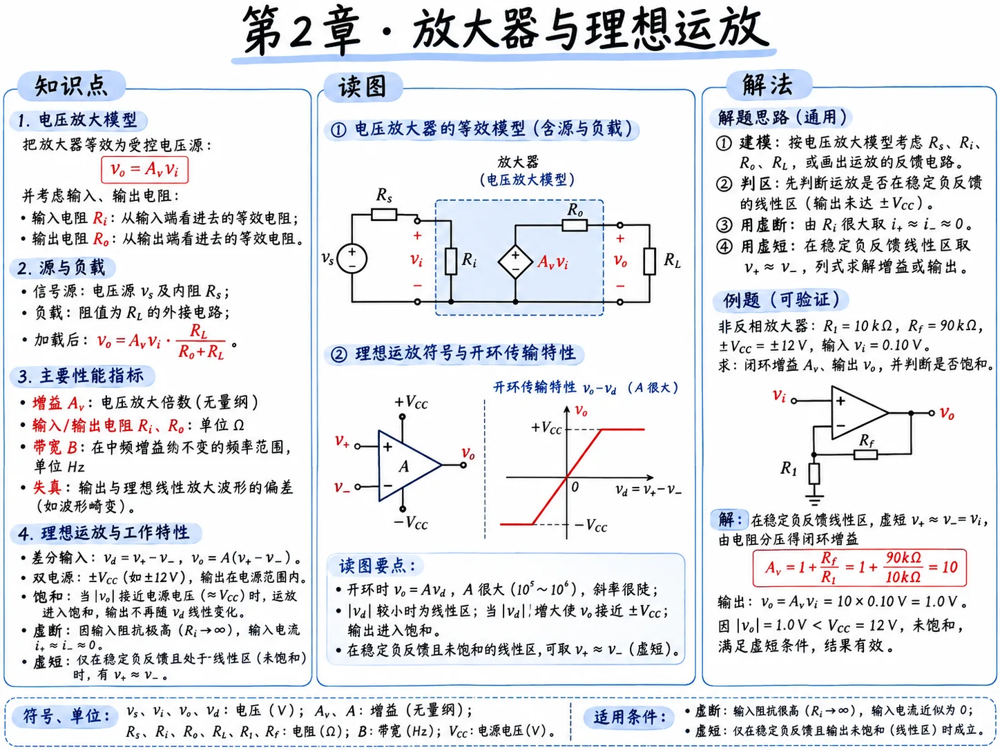
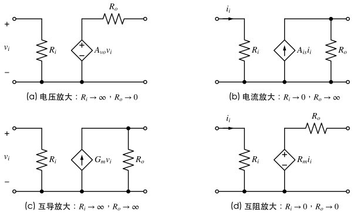
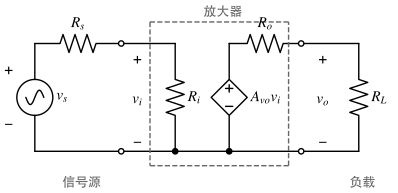
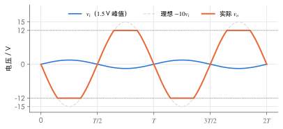

# 信号与放大器

!!! abstract "TL;DR"
    - 信号按"时间是否离散、幅值是否离散"分为**模拟量、离散时间信号、数字量**；采样要满足 $f_s>2f_{max}$，否则高频分量**混叠**成低频，事后无法分辨，所以 ADC 前必须加抗混叠低通。
    - 放大器对外只看三个参数：输入电阻 $R_i$、输出电阻 $R_o$ 和一个受控源。按输入输出是电压还是电流分为**电压、电流、互导、互阻**四种模型，四者可以互相换算。
    - 源内阻和负载会"吃掉"增益：$\dfrac{v_o}{v_s}=\dfrac{R_i}{R_s+R_i}\,A_{vo}\,\dfrac{R_L}{R_o+R_L}$。电压放大器希望 $R_i\gg R_s$、$R_o\ll R_L$。
    - 增益常用分贝：$20\lg|A_v|$（电压、电流）、$10\lg A_p$（功率）；级联时分贝相加。
    - 运放按虚短、虚断算出 $v_o$ 后，**必须检查 $|v_o|<V_{OM}$**（$V_{OM}$ 是最大输出电压，比电源电压低 $1\sim2\,\mathrm V$）；超出就是饱和，虚短不再成立。

??? info "本章图卡（AI 生成速览，错误见文末「图卡勘误」）"
    { loading=lazy }
    { loading=lazy }
    { loading=lazy }

## 1. 模拟信号与数字信号

### 三类信号

{ .circuit }

| 类型 | 时间 | 幅值 | 例子 |
| --- | --- | --- | --- |
| 模拟量 $v(t)$ | 连续 | 连续 | 麦克风输出电压 |
| 离散时间信号 $v[n]=v(nT_s)$ | 离散 | 连续 | 采样保持电路的输出 |
| 数字量 $\hat v[n]$ | 离散 | 离散（$N$ bit 编码） | ADC 输出的二进制数 |

采样周期 $T_s$、采样率 $f_s=1/T_s$。从声音到数字再回到声音的典型流程：

模拟电路在这条链中负责两头：前端把微弱的传感器信号放大、滤波到适合 ADC 的范围，后端把 DAC 的阶梯波平滑后驱动负载。

### 采样定理与混叠

**采样定理**：信号是带限的（$|f|>f_{max}$ 处频谱为零），且 $f_s>2f_{max}$，则可由采样值无失真地恢复原信号。$2f_{max}$ 称为奈奎斯特速率。

若不满足，频率为 $f$ 的分量采样后与频率 $|f-kf_s|$（$k$ 取整数，使结果落在 $0\sim f_s/2$）的分量**样本完全相同**，这就是混叠：

{ .circuit }

混叠一旦发生，数字域无法分辨，只能在采样**之前**用模拟低通（抗混叠滤波器）把 $f_s/2$ 以上的分量滤掉。实际滤波器有过渡带，所以 $f_s$ 通常取 $(2.2\sim2.5)f_{max}$，例如音频 $f_{max}=20\,\mathrm{kHz}$、CD 取 $f_s=44.1\,\mathrm{kHz}$。

### 量化与数据率

$N$ 位 ADC 把满量程 $V_{FS}$ 分成 $2^N$ 级，**量化步距**（1 LSB）

$$
\Delta=\frac{V_{FS}}{2^N},\qquad |\text{量化误差}|\le\frac{\Delta}{2}\ (\text{四舍五入量化}).
$$

对满量程正弦，量化噪声功率约 $\Delta^2/12$，信号量化噪声比 $\mathrm{SQNR}\approx6.02N+1.76\,\mathrm{dB}$：每多 1 位约好 $6\,\mathrm{dB}$。

**数据率** $R=f_s\times N\times(\text{通道数})$，单位 bit/s。

??? example "例：数据率、混叠与量化步距"
    1. （图卡例）$8\,\mathrm{kHz}\times16\,\mathrm{bit}$ 单声道：$R=8000\times16\times1=128\,000\,\mathrm{bit/s}=128\,\mathrm{kbit/s}$。
    2. CD 音质：$44.1\,\mathrm{kHz}$、$16\,\mathrm{bit}$、双声道，$R=44100\times16\times2=1\,411\,200\,\mathrm{bit/s}\approx1.41\,\mathrm{Mbit/s}$；每分钟 $1411200\times60/8\approx10.58\times10^6$ 字节，约 $10.6\,\mathrm{MB}$。
    3. 以 $f_s=8\,\mathrm{kHz}$ 采样 $7\,\mathrm{kHz}$ 正弦：$|7-8|=1\,\mathrm{kHz}$，听起来是 $1\,\mathrm{kHz}$ 的音（上图）。
    4. 12 位 ADC、量程 $0\sim5\,\mathrm V$：$\Delta=5/4096\approx1.22\,\mathrm{mV}$，最大量化误差 $\pm0.61\,\mathrm{mV}$，$\mathrm{SQNR}\approx6.02\times12+1.76\approx74\,\mathrm{dB}$。

## 2. 放大器的四种模型

放大器内部再复杂，对外都可以用**输入电阻 + 受控源 + 输出电阻**表示（输入端口看进去是 $R_i$，输出端口是戴维南或诺顿等效）。按输入、输出取电压还是电流，有四种：

{ .circuit }

| 模型 | 增益（开路/短路定义） | 单位 | 理想时 |
| --- | --- | --- | --- |
| 电压放大 | $A_{vo}=\dfrac{v_o}{v_i}\Big\vert_{R_L=\infty}$ | 无量纲 | $R_i\to\infty$，$R_o\to0$ |
| 电流放大 | $A_{is}=\dfrac{i_o}{i_i}\Big\vert_{R_L=0}$ | 无量纲 | $R_i\to0$，$R_o\to\infty$ |
| 互导放大 | $G_m=\dfrac{i_o}{v_i}\Big\vert_{R_L=0}$ | S | $R_i\to\infty$，$R_o\to\infty$ |
| 互阻放大 | $R_m=\dfrac{v_o}{i_i}\Big\vert_{R_L=\infty}$ | $\Omega$ | $R_i\to0$，$R_o\to0$ |

"理想"的规律：**取电压的端口要电阻大（并联测电压不分流），取电流的端口要电阻小（串联测电流不分压）**；输出端为电压时要 $R_o$ 小（戴维南源），为电流时要 $R_o$ 大（诺顿源）。

四种模型只是同一个二端口的不同画法，可以互换：由 $v_i=i_iR_i$ 和戴维南—诺顿变换 $i_{sc}=v_{oc}/R_o$，

$$
R_m=A_{vo}R_i,\qquad G_m=\frac{A_{vo}}{R_o},\qquad A_{is}=\frac{A_{vo}R_i}{R_o}.
$$

选哪种只看方便：信号源内阻小、负载大时用电压模型；后面 [晶体管小信号模型](transistors.md#5-bjt-小信号模型) 的 $g_mv_\pi$ 就是互导模型。负反馈的四种组态（[负反馈放大电路](feedback.md)）正好分别把放大器改造成这四种理想放大器。

## 3. 源与负载的加载效应

{ .circuit }

输入回路、输出回路各是一个分压：

$$
v_i=\frac{R_i}{R_s+R_i}v_s,\qquad v_o=A_{vo}v_i\frac{R_L}{R_o+R_L},
$$

$$
A_{vs}=\frac{v_o}{v_s}=\underbrace{\frac{R_i}{R_s+R_i}}_{\text{输入分压}}\cdot A_{vo}\cdot\underbrace{\frac{R_L}{R_o+R_L}}_{\text{输出分压}} .
$$

注意区分三个增益：开路电压增益 $A_{vo}$（器件参数）、带负载电压增益 $A_v=v_o/v_i$、源电压增益 $A_{vs}=v_o/v_s$。$A_{vs}\le A_v\le A_{vo}$。

**多级级联**：后一级的 $R_i$ 就是前一级的负载，前一级的 $R_o$ 就是后一级的源内阻，逐级乘分压系数即可。级间分压使总增益**小于**各级开路增益之积，而且级的排列顺序会影响总增益——高 $R_i$ 的级放前面、低 $R_o$ 的级放最后（这正是 [跟随器](../extras/opamp.md) 和后面射极跟随器作缓冲级的原因）。

**测量 $R_i$、$R_o$**（实验常用）：

- $R_o$：测开路输出 $v_{oc}$ 和接已知 $R_L$ 时的 $v_{oL}$，$R_o=\Big(\dfrac{v_{oc}}{v_{oL}}-1\Big)R_L$；
- $R_i$：输入端串入已知电阻 $R$，比较串入前后的输出（输出与 $v_i$ 成正比），$\dfrac{R_i}{R+R_i}=\dfrac{v_o'}{v_o}$。

??? example "例：带源与负载的电压放大器"
    $R_s=2\,\mathrm{k\Omega}$，$R_i=8\,\mathrm{k\Omega}$，$A_{vo}=100$，$R_o=1\,\mathrm{k\Omega}$，$R_L=4\,\mathrm{k\Omega}$，$v_s$ 峰值 $10\,\mathrm{mV}$。求 $A_v$、$A_{vs}$、电流增益 $A_i=i_o/i_i$、功率增益 $A_p$ 及输出峰值。

    1. 输入分压 $\dfrac{8}{2+8}=0.8$，输出分压 $\dfrac{4}{1+4}=0.8$。
    2. $A_v=\dfrac{v_o}{v_i}=100\times0.8=80$；$A_{vs}=0.8\times100\times0.8=64$，即 $20\lg64\approx36.1\,\mathrm{dB}$。
    3. $i_i=v_i/R_i$，$i_o=v_o/R_L$，$A_i=A_v\dfrac{R_i}{R_L}=80\times\dfrac84=160$。
    4. $A_p=\dfrac{v_oi_o}{v_ii_i}=A_vA_i=12\,800$，即 $10\lg12800\approx41.1\,\mathrm{dB}$。
    5. 输出峰值 $64\times10\,\mathrm{mV}=0.64\,\mathrm V$。

    开路增益是 100，接上源和负载后只剩 64：两头各损失 20%。

??? example "例：两级级联与排列顺序"
    $R_s=1\,\mathrm{k\Omega}$，$R_L=1\,\mathrm{k\Omega}$。A 级：$R_i=9\,\mathrm{k\Omega}$，$A_{vo}=20$，$R_o=2\,\mathrm{k\Omega}$；B 级：$R_i=8\,\mathrm{k\Omega}$，$A_{vo}=50$，$R_o=1\,\mathrm{k\Omega}$。比较 A→B 与 B→A 两种接法的 $A_{vs}$。

    1. **A→B**：
        $$
        A_{vs}=\frac{9}{1+9}\times20\times\frac{8}{2+8}\times50\times\frac{1}{1+1}=0.9\times20\times0.8\times50\times0.5=360\ (51.1\,\mathrm{dB}).
        $$
    2. **B→A**：
        $$
        A_{vs}=\frac{8}{1+8}\times50\times\frac{9}{1+9}\times20\times\frac{1}{2+1}\approx266.7 .
        $$
    3. 开路增益之积都是 $1000$，差别全在分压：B 的 $R_o=1\,\mathrm{k\Omega}$ 更小，放在最后驱动 $1\,\mathrm{k\Omega}$ 负载损失少。

## 4. 增益的分贝表示

$$
A_v(\mathrm{dB})=20\lg|A_v|,\qquad A_i(\mathrm{dB})=20\lg|A_i|,\qquad A_p(\mathrm{dB})=10\lg A_p .
$$

电压用 20 而功率用 10，是因为 $P\propto V^2$：输入、输出电阻相等时两种算法给出同一个分贝数。

| 倍数 | $\sqrt2$ | 2 | 10 | 100 | 1000 | $1/\sqrt2$ | 1/2 |
| --- | --- | --- | --- | --- | --- | --- | --- |
| dB | 3 | 6 | 20 | 40 | 60 | $-3$ | $-6$ |

级联总增益是各级（带载）增益之积，取对数后**分贝相加**，这是用分贝的主要好处；另一个好处是 [波特图](frequency-response.md) 的折线近似。

### 带宽与失真

- **带宽**：增益从中频值下降 $3\,\mathrm{dB}$（降为 $1/\sqrt2$）的上、下限频率 $f_H$、$f_L$ 之间，$BW=f_H-f_L$。频率特性详见 [频率响应](frequency-response.md)。
- **线性失真**（频率失真）：不同频率分量的增益或相移不同，波形变形但不产生新频率。
- **非线性失真**：器件特性弯曲或饱和、截止造成削波，输出出现**新的谐波分量**（参见 [非正弦周期电路](../notes/nonsinusoidal.md)）。下面运放的饱和就是一例。

## 5. 运放：模型、线性区与饱和检查

### 模型与传输特性

{ .circuit }

运放是差分输入的电压放大器：$u_o=A(u_+-u_-)=Au_d$，$A\sim10^5\sim10^6$，$R_{id}$ 为兆欧以上，$R_o$ 为几十欧。输出受电源限制：最大输出电压 $V_{OM}$（也写作 $U_{OM}$、$\pm U_{sat}$）**比电源电压低**，普通双极型运放约低 $1\sim2\,\mathrm V$，"轨到轨"运放可接近电源。

开环时线性区极窄：$|u_d|\le V_{OM}/A$，$V_{OM}=12\,\mathrm V$、$A=10^5$ 时只有 $120\,\mu\mathrm V$。所以运放要当放大器用必须加**负反馈**；开环或正反馈时输出只停在 $\pm V_{OM}$，这就是 [比较器](signal-processing.md) 的工作方式。

| 条件 | 结论 | 何时成立 |
| --- | --- | --- |
| 虚断 | $i_+=i_-\approx0$ | $R_{id}$ 极大，线性区、饱和区都成立 |
| 虚短 | $u_+\approx u_-$ | 有负反馈**且**输出未饱和（$\lvert u_o\rvert<V_{OM}$） |

### 基本电路速查

推导见 [含理想运放的电路](../extras/opamp.md)，这里只列结论：

| 电路 | 输出 | 输入电阻 |
| --- | --- | --- |
| 反相比例 | $u_o=-\dfrac{R_f}{R_1}u_i$ | $R_1$ |
| 同相比例 | $u_o=\Big(1+\dfrac{R_f}{R_1}\Big)u_i$ | $\infty$ |
| 电压跟随 | $u_o=u_i$ | $\infty$ |
| 反相加法 | $u_o=-R_f\sum\limits_k\dfrac{u_k}{R_k}$ | 第 $k$ 路为 $R_k$ |
| 差分（$R_3/R_2=R_f/R_1$） | $u_o=\dfrac{R_f}{R_1}(u_2-u_1)$ | — |
| 积分 | $u_o=-\dfrac1{RC}\displaystyle\int u_i\,\mathrm dt$ | $R$ |

用 [第 2 节](#2-放大器的四种模型) 的语言：同相比例接近理想电压放大器（$R_i\to\infty$、$R_o\to0$），反相比例的输入端是虚地，$R_i=R_1$ 有限。

### 饱和检查（解题必做的最后一步）

1. 判断有无负反馈（输出经元件接回**反相**端）；
2. 按虚短、虚断解出 $u_o$；
3. 检查 $|u_o|<V_{OM}$：成立则结果有效；不成立则 $u_o=\pm V_{OM}$（符号与理想结果相同），此时 $u_+\ne u_-$，要用 $u_o=\pm V_{OM}$ 和虚断重新求各节点电压；
4. 正弦输入时检查**峰值**，含直流偏置时检查"直流 + 峰值"。

??? example "例：同相放大器（图卡 02 例）"
    { .circuit }

    $v_i=0.10\,\mathrm V$，电源 $\pm12\,\mathrm V$，设 $V_{OM}=11\,\mathrm V$。

    1. 负反馈：$R_f$ 接回反相端 ✓，按线性区计算。
    2. $A_v=1+\dfrac{R_f}{R_1}=1+\dfrac{90}{10}=10$，$v_o=10\times0.10=1.0\,\mathrm V$。
    3. $|v_o|=1.0\,\mathrm V<V_{OM}=11\,\mathrm V$，未饱和，结果有效。
    4. 不失真的最大输入 $|v_i|_{max}=V_{OM}/A_v=1.1\,\mathrm V$。

??? example "例：反相放大器与饱和后的节点电压（图卡 03 例）"
    { .circuit }

    电源 $\pm15\,\mathrm V$，设 $V_{OM}=13\,\mathrm V$。（1）$v_i=0.2\,\mathrm V$；（2）$v_i=5\,\mathrm V$。分别求 $v_o$ 和反相端电压 $u_-$。

    1. $A_v=-\dfrac{30}{10}=-3$，$v_o=-3\times0.2=-0.6\,\mathrm V$，$|v_o|<13\,\mathrm V$，有效；$u_-=0$（虚地）。
    2. 按线性算 $v_o=-15\,\mathrm V$，超出 $-13\,\mathrm V$，运放负饱和：$v_o=-13\,\mathrm V$。
    3. 饱和后虚短失效，但虚断仍成立：$R_1$、$R_f$ 串联电流相同，
        $$
        \frac{5-u_-}{10}=\frac{u_--(-13)}{30}\ \Rightarrow\ u_-=\frac{5\times30+(-13)\times10}{40}=0.5\,\mathrm V\ne0 .
        $$
    4. 线性区的输入范围 $|v_i|\le13/3\approx4.33\,\mathrm V$。

??? example "例：正弦输入的削波"
    反相放大 $A_v=-10$，$V_{OM}=12\,\mathrm V$，$v_i=1.5\sin\omega t\ \mathrm V$。

    1. 理想输出峰值 $15\,\mathrm V>12\,\mathrm V$，波形被削顶：
        { .circuit }
    2. 削波区间：$15|\sin\theta|>12\Rightarrow|\sin\theta|>0.8$，$\theta\in(53.13^\circ,126.87^\circ)$ 及负半周对应区间，每半周削去 $73.74^\circ$，合计约占周期的 $41\%$。
    3. 不削波的最大输入幅值 $12/10=1.2\,\mathrm V$。削波产生奇次谐波，属于非线性失真。

## 练习

### 1. 概念判断 :material-star::material-star-outline::material-star-outline:

判断下列说法是否正确：

1. 只要 $f_s>2f$，就能保证频率为 $f$ 的有用信号采样后不受混叠影响，无需抗混叠滤波器。
2. 互导放大器的理想输入电阻和输出电阻都为无穷大。
3. 两级放大器的总电压增益等于两级开路电压增益之积。
4. 电压增益 $40\,\mathrm{dB}$ 表示放大 100 倍。
5. 运放的输出电压最大可以达到电源电压。

??? success "答案"
    1 ✗　2 ✓　3 ✗　4 ✓　5 ✗

??? note "解析"
    1. 信号中可能还有高于 $f_s/2$ 的噪声或谐波，它们会混叠到有用频带内；必须在采样前把 $f_s/2$ 以上的分量滤掉。
    2. 输入取电压（$R_i\to\infty$），输出为电流（诺顿源，$R_o\to\infty$）。
    3. 还要乘上级间和两端的分压系数：$\dfrac{R_{i1}}{R_s+R_{i1}}\cdot\dfrac{R_{i2}}{R_{o1}+R_{i2}}\cdot\dfrac{R_L}{R_{o2}+R_L}$。
    4. $20\lg100=40\,\mathrm{dB}$。
    5. 输出级晶体管要留压降，$V_{OM}$ 一般比电源低 $1\sim2\,\mathrm V$；只有轨到轨运放能接近电源电压。

### 2. 音频的采样 :material-star::material-star-outline::material-star-outline:

（1）$74$ 分钟 CD（$44.1\,\mathrm{kHz}$、16 bit、双声道）的原始数据量约多少 MB？（2）若采样前没有抗混叠滤波器，信号中混有 $25\,\mathrm{kHz}$ 的干扰，它采样后表现为多少频率？会不会被听到？

??? success "答案"
    （1）约 $783\,\mathrm{MB}$；（2）$19.1\,\mathrm{kHz}$，落在可听频带内。

??? note "解析"
    1. $R=44100\times16\times2=1\,411\,200\,\mathrm{bit/s}$，$74\times60\,\mathrm s$ 共 $1411200\times4440/8\approx7.83\times10^8$ 字节。
    2. $|25-44.1|=19.1\,\mathrm{kHz}<f_s/2=22.05\,\mathrm{kHz}$。原本听不见的 $25\,\mathrm{kHz}$ 干扰变成了 $19.1\,\mathrm{kHz}$ 的可听音，事后无法滤除。

### 3. 测量输入、输出电阻 :material-star::material-star::material-star-outline:

某电压放大器输出端开路时输出 $2\,\mathrm V$，接 $3\,\mathrm{k\Omega}$ 负载后降为 $1.5\,\mathrm V$。去掉负载后，在信号源（内阻可忽略）与放大器输入端之间串入 $10\,\mathrm{k\Omega}$ 电阻，开路输出降为 $1.6\,\mathrm V$。求 $R_o$、$R_i$。

??? success "答案"
    $R_o=1\,\mathrm{k\Omega}$，$R_i=40\,\mathrm{k\Omega}$。

??? note "解析"
    1. 输出分压：$1.5=2\times\dfrac{3}{R_o+3}\Rightarrow R_o=\Big(\dfrac{2}{1.5}-1\Big)\times3=1\,\mathrm{k\Omega}$。
    2. 开路输出与 $v_i$ 成正比，$v_i$ 降为原来的 $1.6/2=0.8$：$\dfrac{R_i}{10+R_i}=0.8\Rightarrow R_i=40\,\mathrm{k\Omega}$。

### 4. 分贝级联 :material-star::material-star-outline::material-star-outline:

三级放大器各级带载电压增益依次为 $20\,\mathrm{dB}$、$26\,\mathrm{dB}$、$-6\,\mathrm{dB}$（末级是衰减网络）。求总增益的分贝数和倍数；输入 $5\,\mathrm{mV}$ 时输出多大？

??? success "答案"
    $40\,\mathrm{dB}$，100 倍；$0.5\,\mathrm V$。

??? note "解析"
    分贝直接相加 $20+26-6=40\,\mathrm{dB}$，$10^{40/20}=100$（逐级为 $10\times19.95\times0.501\approx100$）。$5\,\mathrm{mV}\times100=0.5\,\mathrm V$。

### 5. 含直流偏置的饱和检查 :material-star::material-star::material-star-outline:

同相放大器 $R_1=10\,\mathrm{k\Omega}$、$R_f=100\,\mathrm{k\Omega}$，电源 $\pm12\,\mathrm V$，$V_{OM}=11\,\mathrm V$。输入 $v_i=0.3+0.8\sin\omega t\ \mathrm V$。（1）输出是否失真？（2）保持 $0.3\,\mathrm V$ 直流分量不变，正弦幅值最大多少？（3）若用隔直电容去掉直流分量呢？

??? success "答案"
    （1）正半周削顶；（2）$0.7\,\mathrm V$；（3）$1.0\,\mathrm V$。

??? note "解析"
    1. $A_v=1+100/10=11$，理想输出 $3.3+8.8\sin\omega t$：最大 $12.1\,\mathrm V>11\,\mathrm V$，最小 $-5.5\,\mathrm V$。只有正峰被削。
    2. $11(0.3+V_m)\le11\Rightarrow V_m\le0.7\,\mathrm V$。
    3. $11V_m\le11\Rightarrow V_m\le1.0\,\mathrm V$。直流偏置占用了一侧的输出余量——这也是后面放大电路要把静态工作点设在中间的原因。

## 图卡勘误

| 图卡位置 | 原文 | 更正 |
| --- | --- | --- |
| 01 知识点·适用条件 | 采样率满足 $f_s>2f_{max}$ 即可 | 这是理想带限信号、理想重建下的理论下限；实际抗混叠滤波器有过渡带，$f_s$ 常取 $(2.2\sim2.5)f_{max}$ |
| 01 读图·数字量 | 只标出量化步距 $\Delta$ | 应补充 $\Delta=V_{FS}/2^N$、量化误差 $\le\Delta/2$；量化是不可逆的信息损失（采样在满足采样定理时可逆） |
| 02 知识点 1、2 | 同一个 $A_v$ 既表示 $v_o=A_vv_i$ 的器件参数，又出现在"加载后 $v_o=A_vv_i\dfrac{R_L}{R_o+R_L}$"中 | 受控源系数应写成开路电压增益 $A_{vo}$；带载增益 $A_v=A_{vo}\dfrac{R_L}{R_o+R_L}$，源增益还要再乘 $\dfrac{R_i}{R_s+R_i}$ |
| 02 知识点 3 | 带宽：中频增益"约不变"的频率范围 | 定义为增益下降 $3\,\mathrm{dB}$ 的上下限频率之差 $BW=f_H-f_L$ |
| 02 知识点 4、读图② | 开环特性饱和在 $\pm V_{CC}$；"$\lvert v_o\rvert$ 接近电源电压时饱和" | 饱和值是最大输出电压 $\pm V_{OM}$，一般比电源低 $1\sim2\,\mathrm V$；且线性区只有微伏级，图中斜坡画得过宽 |
| 02 解法②、例题 | 用"输出未达 $\pm V_{CC}$""$\lvert v_o\rvert<V_{CC}=12\,\mathrm V$"判断未饱和 | 应与 $V_{OM}$（例如 $11\,\mathrm V$）比较；本例 $1\,\mathrm V$ 结论不变 |
| 02 知识点 | 只讲电压放大模型 | 教材还有电流、互导、互阻三种模型，见第 2 节 |
| 03 符号单位与适用条件② | 线性工作区：$V_-<V_o<V_+$ | 无意义（$V_\pm$ 是输入端电位）；应为 $-V_{OM}<V_o<+V_{OM}$ |
| 03 例③ | 电源 $\pm15\,\mathrm V$ 时线性范围为 $-15\,\mathrm V<V_o<+15\,\mathrm V$ | 输出达不到电源电压，线性范围约 $\pm(13\sim14)\,\mathrm V$；本例 $-0.6\,\mathrm V$ 结论不变 |
| 03 知识点、读图 | 反相放大的输入电阻记为 $R_{in}$，同相放大的 $R_g$ 称"下拉电阻" | $R_{in}$ 易与"输入电阻"混淆，通常写 $R_1$；$R_g$（$R_1$）是与 $R_f$ 组成反馈分压的接地电阻，不是数字电路意义上的下拉电阻 |
