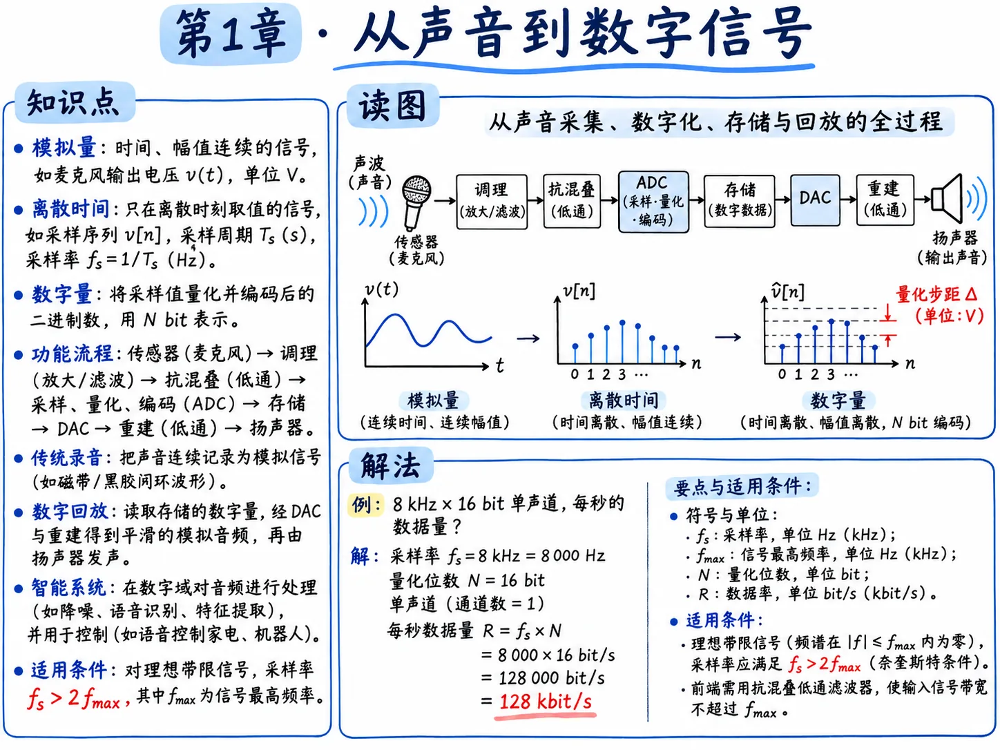
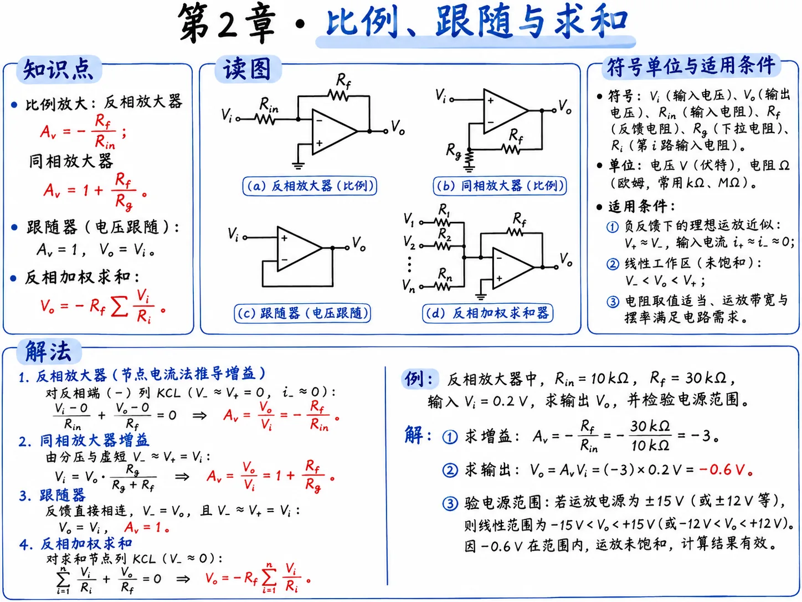
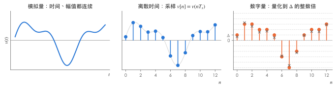
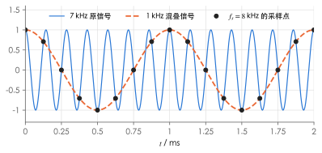
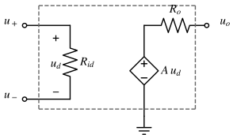
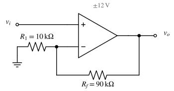
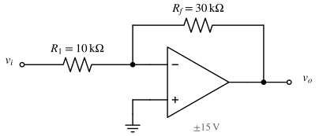

# 信号与放大器

!!! abstract "本章要点"
    - 信号分三类：模拟量、离散时间信号、数字量，区别在于时间和幅值是否离散。
    - 采样率要大于信号最高频率的两倍（$f_s>2f_{max}$），否则高频会混叠成低频，事后无法分辨。
    - 任何放大器对外都只看三样东西：输入电阻、输出电阻和一个受控源。
    - 信号源内阻和负载会"吃掉"一部分增益，所以电压放大器要输入电阻大、输出电阻小。
    - 运放用虚短、虚断算完后，一定要检查输出是否超过最大输出电压 $V_{OM}$。

??? info "本章图卡"
    { loading=lazy }
    { loading=lazy }
    { loading=lazy }

!!! note "知识点清单"
    **信号**

    - [ ] 电信号是什么：传感器把物理量变成电压或电流
    - [ ] 三类信号：模拟量、离散时间信号、数字量
    - [ ] 模拟—数字—模拟信号链，模拟电路负责哪两头
    - [ ] 采样定理与奈奎斯特速率
    - [ ] 混叠：现象、频率怎么算、为什么要抗混叠滤波
    - [ ] 量化步距、量化误差、每位约 6 dB
    - [ ] 数据率 = 采样率 × 位数 × 通道数

    **放大器**

    - [ ] 放大的本质：用小信号控制直流电源的能量
    - [ ] 放大器的性能指标：增益、输入电阻、输出电阻、带宽、失真
    - [ ] 四种放大器模型及各自的理想条件
    - [ ] 四种模型之间的换算
    - [ ] 加载效应：开路增益、带载增益、源增益的区别
    - [ ] 电流增益与功率增益
    - [ ] 多级级联与级的排列顺序
    - [ ] 实验测量输入电阻和输出电阻
    - [ ] 增益的分贝表示，级联时分贝相加
    - [ ] 带宽（$-3\,\mathrm{dB}$ 频率）
    - [ ] 线性失真与非线性失真

    **运放**

    - [ ] 运放的符号、端子与等效电路
    - [ ] 理想运放的条件
    - [ ] 电压传输特性：线性区、饱和区与 $V_{OM}$
    - [ ] 虚短、虚断及其成立条件
    - [ ] 基本运算电路的结论
    - [ ] 饱和检查的步骤

## 1. 模拟信号与数字信号

### 1.1 电信号

信号是信息的载体。声音、温度、压力这些物理量，先由传感器变成随时间变化的电压或电流，这就是电信号。

模拟电子技术研究的，就是怎样把这些电信号**放大、滤波、变换**，让后面的电路或设备能用。

### 1.2 三类信号

{ .circuit }

按"时间是否离散、幅值是否离散"分成三类。

| 类型 | 时间 | 幅值 | 例子 |
| --- | --- | --- | --- |
| 模拟量 $v(t)$ | 连续 | 连续 | 麦克风输出电压 |
| 离散时间信号 $v[n]=v(nT_s)$ | 离散 | 连续 | 采样保持电路的输出 |
| 数字量 $\hat v[n]$ | 离散 | 离散（$N$ bit 编码） | ADC 输出的二进制数 |

其中 $T_s$ 是采样周期，采样率 $f_s=1/T_s$。

- 模拟量 → 离散时间信号：**采样**（每隔 $T_s$ 取一个值）。
- 离散时间信号 → 数字量：**量化**和编码（把幅值归到有限个台阶上，再写成二进制）。

### 1.3 信号链：模拟电路管两头

从声音到数字、再回到声音的典型流程：

模拟电路负责两头：

- **前端**：把微弱的传感器信号放大、滤波，调到适合 ADC 的范围。
- **后端**：把 DAC 输出的阶梯波平滑，再经功放驱动负载。

### 1.4 采样定理

只要采得够快，采样值就能完整代表原信号。

$$
f_s>2f_{max}
$$

适用条件：信号带限，即高于 $f_{max}$ 的频率分量为零。其中 $f_{max}$ 是信号的最高频率；$2f_{max}$ 叫**奈奎斯特速率**。

一个周期里至少要采到两个点，才能把这个频率"认"出来。采得再少，就会认错，这就是下面的混叠。

### 1.5 混叠

采样太慢时，高频信号的采样点和某个低频信号的采样点完全一样，看起来就像一个低频信号。

{ .circuit }

频率 $f$ 的分量采样后，表现为

$$
f_{alias}=|f-kf_s|
$$

适用条件：$k$ 取整数，使结果落在 $0\sim f_s/2$ 之间。

1. 看 $f$ 是否大于 $f_s/2$；不大于就没有混叠。
2. 大于时，减去最接近的 $kf_s$，取绝对值。

**为什么要抗混叠滤波**：混叠后，数字域里两种频率的样本一模一样，**事后无法分辨**。只能在采样**之前**用模拟低通，把 $f_s/2$ 以上的分量滤掉。

!!! warning "易错"
    - 有用信号满足 $f_s>2f$ 还不够。信号里混着的高频噪声、谐波同样会混叠进来，所以抗混叠滤波器不能省。
    - 实际滤波器有过渡带，$f_s$ 通常取 $(2.2\sim2.5)f_{max}$。例如音频 $f_{max}=20\,\mathrm{kHz}$，CD 取 $f_s=44.1\,\mathrm{kHz}$。

### 1.6 量化

$N$ 位 ADC 把满量程 $V_{FS}$ 切成 $2^N$ 个台阶。每个台阶的高度叫**量化步距**，也叫 1 LSB。

**为什么有误差**：真实幅值落在两个台阶之间时，只能归到最近的那一个。这个误差最多半个台阶，而且**丢掉的信息找不回来**。

$$
\Delta=\frac{V_{FS}}{2^N},\qquad |\text{量化误差}|\le\frac{\Delta}{2}
$$

适用条件：四舍五入量化。其中 $\Delta$ 是量化步距，$N$ 是位数。

??? tip "信号量化噪声比"
    对满量程正弦输入，量化噪声功率约为 $\Delta^2/12$。由此得信号量化噪声比

    $$
    \mathrm{SQNR}\approx6.02N+1.76\,\mathrm{dB}.
    $$

    记法：每多 1 位，SQNR 约好 $6\,\mathrm{dB}$。

### 1.7 数据率

每秒钟产生多少位数据。

$$
R=f_s\times N\times(\text{通道数})
$$

适用条件：未压缩的原始数据。单位 bit/s，除以 8 得字节/秒。

??? example "例 1：数据率、混叠与量化步距"
    **思路**：四个小问分别套数据率、混叠频率、量化步距公式。

    1. （图卡例）$8\,\mathrm{kHz}\times16\,\mathrm{bit}$ 单声道：$R=8000\times16\times1=128\,000\,\mathrm{bit/s}=128\,\mathrm{kbit/s}$。
    2. CD 音质 $44.1\,\mathrm{kHz}$、$16\,\mathrm{bit}$、双声道：$R=44100\times16\times2=1\,411\,200\,\mathrm{bit/s}\approx1.41\,\mathrm{Mbit/s}$。每分钟 $1411200\times60/8\approx10.58\times10^6$ 字节，约 $10.6\,\mathrm{MB}$。
    3. 以 $f_s=8\,\mathrm{kHz}$ 采样 $7\,\mathrm{kHz}$ 正弦：$|7-8|=1\,\mathrm{kHz}$，听起来是 $1\,\mathrm{kHz}$ 的音（见上图）。
    4. 12 位 ADC、量程 $0\sim5\,\mathrm V$：$\Delta=5/4096\approx1.22\,\mathrm{mV}$，最大量化误差 $\pm0.61\,\mathrm{mV}$，$\mathrm{SQNR}\approx6.02\times12+1.76\approx74\,\mathrm{dB}$。

    **结论**：CD 约 $1.41\,\mathrm{Mbit/s}$；$7\,\mathrm{kHz}$ 混叠成 $1\,\mathrm{kHz}$；12 位 5 V ADC 的步距约 $1.22\,\mathrm{mV}$。

## 2. 放大器的四种模型

### 2.1 放大的本质

放大器让输出信号的功率大于输入信号的功率。

多出来的能量**来自直流电源**，不是凭空产生的。输入信号像水阀的把手，轻轻一拧，就控制了水管（直流电源）里大股水流的变化。

所以放大器一定要有直流电源，而且必须有能"受控"的器件（晶体管、场效应管）。

### 2.2 放大器的性能指标

| 指标 | 含义 | 本章位置 |
| --- | --- | --- |
| 增益 | 输出与输入之比：电压增益、电流增益、互导、互阻、功率增益 | 2.3、3.2 |
| 输入电阻 $R_i$ | 从输入端看进去的电阻，决定它从信号源"取"多少信号 | 2.3、3.1 |
| 输出电阻 $R_o$ | 从输出端看进去的电阻，决定带负载能力 | 2.3、3.1 |
| 带宽 $BW$ | 增益基本不变的频率范围 | 4.2 |
| 失真 | 输出波形与输入波形形状不同 | 4.3 |

### 2.3 四种放大器模型

放大器内部再复杂，对外都能画成"**输入电阻 + 受控源 + 输出电阻**"。按输入、输出取电压还是电流，有四种画法。

{ .circuit }

| 模型 | 增益定义 | 单位 | 理想时 |
| --- | --- | --- | --- |
| 电压放大 | $A_{vo}=\dfrac{v_o}{v_i}\Big\vert_{R_L=\infty}$ | 无量纲 | $R_i\to\infty$，$R_o\to0$ |
| 电流放大 | $A_{is}=\dfrac{i_o}{i_i}\Big\vert_{R_L=0}$ | 无量纲 | $R_i\to0$，$R_o\to\infty$ |
| 互导放大 | $G_m=\dfrac{i_o}{v_i}\Big\vert_{R_L=0}$ | S | $R_i\to\infty$，$R_o\to\infty$ |
| 互阻放大 | $R_m=\dfrac{v_o}{i_i}\Big\vert_{R_L=\infty}$ | $\Omega$ | $R_i\to0$，$R_o\to0$ |

输出为电压的增益在负载开路时定义，输出为电流的增益在负载短路时定义。

**为什么理想条件是这样**：**取电压的端口电阻要大，取电流的端口电阻要小**。

- 输入取电压：$R_i$ 大，才不会从信号源分走电流、拉低电压。像电压表。
- 输入取电流：$R_i$ 小，才不会在回路里分走电压。像电流表。
- 输出给电压：$R_o$ 小，像理想电压源（戴维南等效）。
- 输出给电流：$R_o$ 大，像理想电流源（诺顿等效）。

### 2.4 四种模型的换算

四种模型只是同一个放大器的不同画法，可以互换。

$$
R_m=A_{vo}R_i,\qquad G_m=\frac{A_{vo}}{R_o},\qquad A_{is}=\frac{A_{vo}R_i}{R_o}
$$

适用条件：同一个放大器、同一组 $R_i$、$R_o$。推导只用到 $v_i=i_iR_i$ 和戴维南—诺顿变换 $i_{sc}=v_{oc}/R_o$。

**怎么选**：哪种算起来方便就用哪种。

- 信号源内阻小、负载大时，用电压模型。
- 后面 [晶体管小信号模型](transistors.md#5-bjt-小信号模型) 里的 $g_mv_\pi$，就是互导模型。
- 负反馈的四种组态（[负反馈放大电路](feedback.md)），正好把放大器分别改造成这四种理想放大器。

## 3. 源与负载的加载效应

### 3.1 加载效应与三个增益

{ .circuit }

放大器接上信号源和负载后，实际增益比开路增益小。这叫加载效应。

输入回路是 $R_s$ 与 $R_i$ 的分压，输出回路是 $R_o$ 与 $R_L$ 的分压。两头各损失一点。

$$
A_{vs}=\frac{v_o}{v_s}=\underbrace{\frac{R_i}{R_s+R_i}}_{\text{输入分压}}\cdot A_{vo}\cdot\underbrace{\frac{R_L}{R_o+R_L}}_{\text{输出分压}}
$$

适用条件：电压放大器模型，低频（各电阻都是纯电阻）。其中 $v_s$、$R_s$ 是信号源电压和内阻，$R_L$ 是负载。

要分清三个增益：

| 增益 | 定义 | 含义 |
| --- | --- | --- |
| 开路电压增益 $A_{vo}$ | $v_o/v_i$，$R_L=\infty$ | 放大器自身的参数 |
| 带载电压增益 $A_v$ | $v_o/v_i=A_{vo}\dfrac{R_L}{R_o+R_L}$ | 接了负载后 |
| 源电压增益 $A_{vs}$ | $v_o/v_s$ | 再算上信号源内阻 |

三者满足 $A_{vs}\le A_v\le A_{vo}$。所以电压放大器希望 **$R_i\gg R_s$、$R_o\ll R_L$**。

### 3.2 电流增益与功率增益

电流增益是输出电流与输入电流之比，功率增益是输出功率与输入功率之比。

$$
A_i=\frac{i_o}{i_i}=A_v\frac{R_i}{R_L},\qquad A_p=\frac{v_oi_o}{v_ii_i}=A_vA_i
$$

适用条件：$i_i=v_i/R_i$，$i_o=v_o/R_L$，纯电阻负载。

??? example "例 2：带源与负载的电压放大器"
    $R_s=2\,\mathrm{k\Omega}$，$R_i=8\,\mathrm{k\Omega}$，$A_{vo}=100$，$R_o=1\,\mathrm{k\Omega}$，$R_L=4\,\mathrm{k\Omega}$，$v_s$ 峰值 $10\,\mathrm{mV}$。求 $A_v$、$A_{vs}$、$A_i$、$A_p$ 及输出峰值。

    **思路**：先算两个分压系数，再逐个相乘。

    1. 输入分压 $\dfrac{8}{2+8}=0.8$，输出分压 $\dfrac{4}{1+4}=0.8$。
    2. 带载增益 $A_v=100\times0.8=80$。
    3. 源增益 $A_{vs}=0.8\times100\times0.8=64$，即 $20\lg64\approx36.1\,\mathrm{dB}$。
    4. 电流增益 $A_i=A_v\dfrac{R_i}{R_L}=80\times\dfrac84=160$。
    5. 功率增益 $A_p=A_vA_i=12\,800$，即 $10\lg12800\approx41.1\,\mathrm{dB}$。
    6. 输出峰值 $64\times10\,\mathrm{mV}=0.64\,\mathrm V$。

    **结论**：开路增益 100，接上源和负载后只剩 64，两头各损失 20%。

### 3.3 多级级联

几个放大器首尾相接。

后一级的 $R_i$ 就是前一级的负载；前一级的 $R_o$ 就是后一级的源内阻。

1. 从信号源开始，写出每个"前级 $R_o$（或 $R_s$）— 后级 $R_i$（或 $R_L$）"的分压系数。
2. 把所有分压系数和各级开路增益乘起来。

!!! warning "易错"
    - 总增益**不等于**各级开路增益之积，还要乘上所有级间分压。
    - 级的顺序会影响总增益：$R_i$ 高的级放前面，$R_o$ 低的级放最后。这就是 [跟随器](../extras/opamp.md) 和射极跟随器常做缓冲级的原因。

??? example "例 3：两级级联与排列顺序"
    $R_s=1\,\mathrm{k\Omega}$，$R_L=1\,\mathrm{k\Omega}$。A 级：$R_i=9\,\mathrm{k\Omega}$，$A_{vo}=20$，$R_o=2\,\mathrm{k\Omega}$；B 级：$R_i=8\,\mathrm{k\Omega}$，$A_{vo}=50$，$R_o=1\,\mathrm{k\Omega}$。比较 A→B 与 B→A 两种接法的 $A_{vs}$。

    **思路**：两种顺序分别写出三个分压系数，乘上 $20\times50$。

    1. **A→B**：

        $$
        A_{vs}=\frac{9}{1+9}\times20\times\frac{8}{2+8}\times50\times\frac{1}{1+1}=360\ (51.1\,\mathrm{dB}).
        $$

    2. **B→A**：

        $$
        A_{vs}=\frac{8}{1+8}\times50\times\frac{9}{1+9}\times20\times\frac{1}{2+1}\approx266.7 .
        $$

    3. 两种接法的开路增益之积都是 $1000$，差别全在分压。

    **结论**：A→B 更好，因为 B 的 $R_o=1\,\mathrm{k\Omega}$ 更小，放在最后驱动 $1\,\mathrm{k\Omega}$ 负载损失少。

### 3.4 测量输入电阻和输出电阻

实验中不能直接拿万用表量 $R_i$、$R_o$，而是利用分压关系间接算出。

1. 测 $R_o$：先测开路输出 $v_{oc}$，再接已知 $R_L$ 测 $v_{oL}$，则

    $$
    R_o=\Big(\frac{v_{oc}}{v_{oL}}-1\Big)R_L .
    $$

2. 测 $R_i$：在输入端串入已知电阻 $R$，比较串入前后的输出 $v_o$、$v_o'$。输出与 $v_i$ 成正比，所以

    $$
    \frac{R_i}{R+R_i}=\frac{v_o'}{v_o}.
    $$

适用条件：放大器工作在线性区，测量时信号源电压不变。

## 4. 分贝、带宽与失真

### 4.1 增益的分贝表示

把增益取对数，单位是分贝（dB）。

$$
A_v(\mathrm{dB})=20\lg|A_v|,\qquad A_i(\mathrm{dB})=20\lg|A_i|,\qquad A_p(\mathrm{dB})=10\lg A_p
$$

适用条件：电压、电流用 20，功率用 10。

**为什么 20 和 10 不同**：功率与电压的平方成正比，$P\propto V^2$。所以输入、输出电阻相等时，两种算法给出同一个分贝数。

**常用值**（建议背下）：

| 倍数 | $\sqrt2$ | 2 | 10 | 100 | 1000 | $1/\sqrt2$ | 1/2 |
| --- | --- | --- | --- | --- | --- | --- | --- |
| dB | 3 | 6 | 20 | 40 | 60 | $-3$ | $-6$ |

**为什么用分贝**：级联总增益是各级（带载）增益之积，取对数后**变成相加**。另一个好处是 [波特图](frequency-response.md) 可以画成折线。

### 4.2 带宽

增益从中频值下降 $3\,\mathrm{dB}$（降到 $1/\sqrt2\approx0.707$ 倍）时的两个频率，叫下限频率 $f_L$ 和上限频率 $f_H$。

$$
BW=f_H-f_L
$$

适用条件：带通型放大器；直接耦合放大器 $f_L=0$，$BW=f_H$。频率特性详见 [频率响应](frequency-response.md)。

### 4.3 线性失真与非线性失真

输出波形的形状和输入不一样，就叫失真。分两类：

| | 线性失真（频率失真） | 非线性失真 |
| --- | --- | --- |
| 原因 | 不同频率的增益或相移不同 | 器件特性弯曲，或饱和、截止造成削波 |
| 是否产生新频率 | 否 | 是，出现新的谐波 |
| 例子 | 方波经带宽不够的放大器变圆 | 运放输出被削顶（见例 6） |

谐波的分析见 [非正弦周期电路](../notes/nonsinusoidal.md)。

## 5. 运放：模型、线性区与饱和检查

### 5.1 运放的端子与等效电路

{ .circuit }

运放是一个差分输入的电压放大器。它有同相输入端 $u_+$、反相输入端 $u_-$、一个输出端，以及正负电源端。

$$
u_o=A(u_+-u_-)=Au_d
$$

适用条件：线性区。其中 $A$ 是开环电压增益（约 $10^5\sim10^6$），$u_d$ 是差模输入电压。实际运放的差模输入电阻 $R_{id}$ 在兆欧以上，输出电阻 $R_o$ 为几十欧。

### 5.2 理想运放

把实际运放的参数推到极限，就是理想运放。

| 参数 | 理想值 |
| --- | --- |
| 开环增益 $A$ | $\infty$ |
| 差模输入电阻 $R_{id}$ | $\infty$ |
| 输出电阻 $R_o$ | 0 |
| 带宽 | $\infty$ |

实际运放已经很接近，所以手算时一般按理想运放处理。

### 5.3 电压传输特性：线性区与饱和区

输出不可能无限大。它被限制在最大输出电压 $\pm V_{OM}$ 之内，到了就"顶住"不动，这叫饱和。

线性区极窄。

$$
|u_d|\le\frac{V_{OM}}{A}
$$

适用条件：开环。例如 $V_{OM}=12\,\mathrm V$、$A=10^5$，线性区只有 $120\,\mu\mathrm V$。

所以：

- 要当放大器用，必须加**负反馈**，把 $u_d$ 压到微伏级。
- 开环或正反馈时，输出只停在 $\pm V_{OM}$。这就是 [比较器](signal-processing.md) 的工作方式。

!!! warning "易错"
    - $V_{OM}$ **比电源电压低**。普通运放约低 $1\sim2\,\mathrm V$，只有"轨到轨"运放能接近电源。
    - $V_{OM}$ 在不同教材里也写作 $U_{OM}$、$\pm U_{sat}$，是同一个量。

### 5.4 虚短与虚断

- **虚断**：两个输入端几乎不取电流，$i_+=i_-\approx0$。
- **虚短**：两个输入端电位几乎相等，$u_+\approx u_-$。

$R_{id}$ 极大，所以电流几乎为零；$A$ 极大而输出有限，所以 $u_d=u_o/A$ 几乎为零。

| 条件 | 结论 | 何时成立 |
| --- | --- | --- |
| 虚断 | $i_+=i_-\approx0$ | 线性区、饱和区**都成立** |
| 虚短 | $u_+\approx u_-$ | 有负反馈，**且**输出未饱和 |

!!! warning "易错"
    - 虚短不是真短路，不能在两输入端之间画一根导线去算电流。
    - 饱和后虚短失效，但虚断还在。

### 5.5 基本运算电路

推导见 [含理想运放的电路](../extras/opamp.md)，这里只列结论：

| 电路 | 输出 | 输入电阻 |
| --- | --- | --- |
| 反相比例 | $u_o=-\dfrac{R_f}{R_1}u_i$ | $R_1$ |
| 同相比例 | $u_o=\Big(1+\dfrac{R_f}{R_1}\Big)u_i$ | $\infty$ |
| 电压跟随 | $u_o=u_i$ | $\infty$ |
| 反相加法 | $u_o=-R_f\sum\limits_k\dfrac{u_k}{R_k}$ | 第 $k$ 路为 $R_k$ |
| 差分（$R_3/R_2=R_f/R_1$） | $u_o=\dfrac{R_f}{R_1}(u_2-u_1)$ | — |
| 积分 | $u_o=-\dfrac1{RC}\displaystyle\int u_i\,\mathrm dt$ | $R$ |

适用条件：理想运放、线性区。

用 [第 2 节](#2-放大器的四种模型) 的语言看：同相比例接近理想电压放大器（$R_i\to\infty$、$R_o\to0$）；反相比例的反相端是虚地，输入电阻只有 $R_1$。

### 5.6 饱和检查（解题必做的最后一步）

1. 判断有无负反馈：输出经元件接回**反相**端。
2. 按虚短、虚断解出 $u_o$。
3. 检查 $|u_o|<V_{OM}$。成立，结果有效。
4. 不成立，则 $u_o=\pm V_{OM}$，符号与理想结果相同。此时 $u_+\ne u_-$，要用 $u_o=\pm V_{OM}$ 和虚断重新求各节点电压。

!!! warning "易错"
    - 正弦输入要用**峰值**检查。
    - 含直流偏置时，要检查"直流 + 峰值"。

??? example "例 4：同相放大器（图卡 02 例）"
    { .circuit }

    $v_i=0.10\,\mathrm V$，电源 $\pm12\,\mathrm V$，设 $V_{OM}=11\,\mathrm V$。

    **思路**：确认负反馈 → 用同相比例公式 → 饱和检查。

    1. $R_f$ 接回反相端，有负反馈，按线性区计算。
    2. $A_v=1+\dfrac{R_f}{R_1}=1+\dfrac{90}{10}=10$。
    3. $v_o=10\times0.10=1.0\,\mathrm V$。
    4. $|v_o|=1.0\,\mathrm V<V_{OM}=11\,\mathrm V$，未饱和。
    5. 不失真的最大输入 $|v_i|_{max}=V_{OM}/A_v=1.1\,\mathrm V$。

    **结论**：$v_o=1.0\,\mathrm V$，有效；输入不超过 $1.1\,\mathrm V$ 就不会饱和。

??? example "例 5：反相放大器与饱和后的节点电压（图卡 03 例）"
    { .circuit }

    电源 $\pm15\,\mathrm V$，设 $V_{OM}=13\,\mathrm V$。（1）$v_i=0.2\,\mathrm V$；（2）$v_i=5\,\mathrm V$。分别求 $v_o$ 和反相端电压 $u_-$。

    **思路**：先按线性算，超出 $V_{OM}$ 就改用 $\pm V_{OM}$ 加虚断重算。

    1. $A_v=-\dfrac{30}{10}=-3$。$v_i=0.2\,\mathrm V$ 时 $v_o=-0.6\,\mathrm V$，未饱和；$u_-=0$（虚地）。
    2. $v_i=5\,\mathrm V$ 时按线性算 $v_o=-15\,\mathrm V$，超出 $-13\,\mathrm V$，所以负饱和，$v_o=-13\,\mathrm V$。
    3. 饱和后虚短失效，虚断仍成立，$R_1$、$R_f$ 中电流相同：

        $$
        \frac{5-u_-}{10}=\frac{u_--(-13)}{30}\ \Rightarrow\ u_-=\frac{5\times30+(-13)\times10}{40}=0.5\,\mathrm V .
        $$

    4. 线性区的输入范围 $|v_i|\le13/3\approx4.33\,\mathrm V$。

    **结论**：（1）$v_o=-0.6\,\mathrm V$，$u_-=0$；（2）$v_o=-13\,\mathrm V$，$u_-=0.5\,\mathrm V\ne0$。

??? example "例 6：正弦输入的削波"
    反相放大 $A_v=-10$，$V_{OM}=12\,\mathrm V$，$v_i=1.5\sin\omega t\ \mathrm V$。

    **思路**：比较理想输出峰值和 $V_{OM}$，再求超出的相位区间。

    1. 理想输出峰值 $15\,\mathrm V>12\,\mathrm V$，波形被削顶：
        { .circuit }
    2. 削波区间：$15|\sin\theta|>12\Rightarrow|\sin\theta|>0.8$，即 $\theta\in(53.13^\circ,126.87^\circ)$ 及负半周对应区间。
    3. 每半周削去 $73.74^\circ$，合计约占周期的 $41\%$。
    4. 不削波的最大输入幅值 $12/10=1.2\,\mathrm V$。

    **结论**：约 41% 的时间被削波，产生奇次谐波，属于非线性失真。

## 公式速查

| 内容 | 公式 | 条件 |
| --- | --- | --- |
| 采样定理 | $f_s>2f_{max}$ | 带限信号；实际取 $(2.2\sim2.5)f_{max}$ |
| 混叠频率 | $f_{alias}=\lvert f-kf_s\rvert$ | 结果落在 $0\sim f_s/2$ |
| 量化步距 | $\Delta=V_{FS}/2^N$，误差 $\le\Delta/2$ | 四舍五入量化 |
| SQNR | $\approx6.02N+1.76\,\mathrm{dB}$ | 满量程正弦 |
| 数据率 | $R=f_s\times N\times$ 通道数 | 未压缩 |
| 模型换算 | $R_m=A_{vo}R_i$，$G_m=A_{vo}/R_o$，$A_{is}=A_{vo}R_i/R_o$ | 同一放大器 |
| 源电压增益 | $A_{vs}=\dfrac{R_i}{R_s+R_i}A_{vo}\dfrac{R_L}{R_o+R_L}$ | 电压放大器模型 |
| 电流、功率增益 | $A_i=A_vR_i/R_L$，$A_p=A_vA_i$ | 纯电阻负载 |
| 测 $R_o$ | $R_o=(v_{oc}/v_{oL}-1)R_L$ | 线性区 |
| 测 $R_i$ | $R_i/(R+R_i)=v_o'/v_o$ | 串入已知 $R$ |
| 分贝 | $20\lg\lvert A_v\rvert$，$10\lg A_p$ | 级联时相加 |
| 带宽 | $BW=f_H-f_L$ | $-3\,\mathrm{dB}$ 频率 |
| 运放线性区（开环） | $\lvert u_d\rvert\le V_{OM}/A$ | 开环 |
| 反相 / 同相比例 | $-R_f/R_1$；$1+R_f/R_1$ | 负反馈，$\lvert u_o\rvert<V_{OM}$ |

## 练习

### 1. 概念判断 :material-star::material-star-outline::material-star-outline:

判断下列说法是否正确：

1. 只要 $f_s>2f$，就能保证频率为 $f$ 的有用信号采样后不受混叠影响，无需抗混叠滤波器。
2. 互导放大器的理想输入电阻和输出电阻都为无穷大。
3. 两级放大器的总电压增益等于两级开路电压增益之积。
4. 电压增益 $40\,\mathrm{dB}$ 表示放大 100 倍。
5. 运放的输出电压最大可以达到电源电压。

??? success "答案"
    1 ✗　2 ✓　3 ✗　4 ✓　5 ✗

??? note "解析"
    1. 信号里可能还有高于 $f_s/2$ 的噪声或谐波，它们会混叠进有用频带。采样前必须滤掉。
    2. 输入取电压，$R_i\to\infty$；输出为电流（诺顿源），$R_o\to\infty$。
    3. 还要乘上级间和两端的分压系数：$\dfrac{R_{i1}}{R_s+R_{i1}}\cdot\dfrac{R_{i2}}{R_{o1}+R_{i2}}\cdot\dfrac{R_L}{R_{o2}+R_L}$。
    4. $20\lg100=40\,\mathrm{dB}$。
    5. 输出级要留压降，$V_{OM}$ 一般比电源低 $1\sim2\,\mathrm V$。只有轨到轨运放能接近电源。

### 2. 音频的采样 :material-star::material-star-outline::material-star-outline:

（1）$74$ 分钟 CD（$44.1\,\mathrm{kHz}$、16 bit、双声道）的原始数据量约多少 MB？（2）若采样前没有抗混叠滤波器，信号中混有 $25\,\mathrm{kHz}$ 的干扰，它采样后表现为多少频率？会不会被听到？

??? success "答案"
    （1）约 $783\,\mathrm{MB}$；（2）$19.1\,\mathrm{kHz}$，落在可听频带内。

??? note "解析"
    1. $R=44100\times16\times2=1\,411\,200\,\mathrm{bit/s}$。$74$ 分钟 $=4440\,\mathrm s$，共 $1411200\times4440/8\approx7.83\times10^8$ 字节。
    2. $|25-44.1|=19.1\,\mathrm{kHz}<f_s/2=22.05\,\mathrm{kHz}$。
    3. 原本听不见的 $25\,\mathrm{kHz}$ 干扰，变成了 $19.1\,\mathrm{kHz}$ 的可听音，事后无法滤除。

### 3. 测量输入、输出电阻 :material-star::material-star::material-star-outline:

某电压放大器输出端开路时输出 $2\,\mathrm V$，接 $3\,\mathrm{k\Omega}$ 负载后降为 $1.5\,\mathrm V$。去掉负载后，在信号源（内阻可忽略）与放大器输入端之间串入 $10\,\mathrm{k\Omega}$ 电阻，开路输出降为 $1.6\,\mathrm V$。求 $R_o$、$R_i$。

??? success "答案"
    $R_o=1\,\mathrm{k\Omega}$，$R_i=40\,\mathrm{k\Omega}$。

??? note "解析"
    1. 输出分压：$R_o=\Big(\dfrac{2}{1.5}-1\Big)\times3=1\,\mathrm{k\Omega}$。
    2. 开路输出与 $v_i$ 成正比，$v_i$ 降为原来的 $1.6/2=0.8$。
    3. $\dfrac{R_i}{10+R_i}=0.8\Rightarrow R_i=40\,\mathrm{k\Omega}$。

### 4. 分贝级联 :material-star::material-star-outline::material-star-outline:

三级放大器各级带载电压增益依次为 $20\,\mathrm{dB}$、$26\,\mathrm{dB}$、$-6\,\mathrm{dB}$（末级是衰减网络）。求总增益的分贝数和倍数；输入 $5\,\mathrm{mV}$ 时输出多大？

??? success "答案"
    $40\,\mathrm{dB}$，100 倍；$0.5\,\mathrm V$。

??? note "解析"
    1. 分贝直接相加：$20+26-6=40\,\mathrm{dB}$。
    2. 倍数 $10^{40/20}=100$。逐级核对：$10\times19.95\times0.501\approx100$。
    3. 输出 $5\,\mathrm{mV}\times100=0.5\,\mathrm V$。

### 5. 含直流偏置的饱和检查 :material-star::material-star::material-star-outline:

同相放大器 $R_1=10\,\mathrm{k\Omega}$、$R_f=100\,\mathrm{k\Omega}$，电源 $\pm12\,\mathrm V$，$V_{OM}=11\,\mathrm V$。输入 $v_i=0.3+0.8\sin\omega t\ \mathrm V$。（1）输出是否失真？（2）保持 $0.3\,\mathrm V$ 直流分量不变，正弦幅值最大多少？（3）若用隔直电容去掉直流分量呢？

??? success "答案"
    （1）正半周削顶；（2）$0.7\,\mathrm V$；（3）$1.0\,\mathrm V$。

??? note "解析"
    1. $A_v=1+100/10=11$，理想输出 $3.3+8.8\sin\omega t$。最大 $12.1\,\mathrm V>11\,\mathrm V$，最小 $-5.5\,\mathrm V$，只有正峰被削。
    2. $11(0.3+V_m)\le11\Rightarrow V_m\le0.7\,\mathrm V$。
    3. $11V_m\le11\Rightarrow V_m\le1.0\,\mathrm V$。
    4. 直流偏置占用了一侧的输出余量。这也是后面放大电路要把静态工作点设在中间的原因。

## 图卡勘误

| 图卡位置 | 原文 | 更正 |
| --- | --- | --- |
| 01 知识点·适用条件 | 采样率满足 $f_s>2f_{max}$ 即可 | 这只是理论下限；实际 $f_s$ 常取 $(2.2\sim2.5)f_{max}$ |
| 01 读图·数字量 | 只标出量化步距 $\Delta$ | 补充 $\Delta=V_{FS}/2^N$、误差 $\le\Delta/2$；量化损失的信息不可恢复 |
| 02 知识点 1、2 | 同一个 $A_v$ 既当器件参数，又出现在加载公式里 | 受控源系数应写开路增益 $A_{vo}$；带载增益 $A_v=A_{vo}\dfrac{R_L}{R_o+R_L}$ |
| 02 知识点 3 | 带宽：中频增益"约不变"的频率范围 | 带宽是 $-3\,\mathrm{dB}$ 上下限频率之差，$BW=f_H-f_L$ |
| 02 知识点 4、读图② | 开环特性饱和在 $\pm V_{CC}$ | 饱和值是 $\pm V_{OM}$，比电源低 $1\sim2\,\mathrm V$；线性区只有微伏级，图中斜坡画得太宽 |
| 02 解法②、例题 | 用 $\lvert v_o\rvert<V_{CC}=12\,\mathrm V$ 判断未饱和 | 应与 $V_{OM}$（如 $11\,\mathrm V$）比较；本例结论不变 |
| 02 知识点 | 只讲电压放大模型 | 还有电流、互导、互阻三种模型，见第 2 节 |
| 03 符号单位与适用条件② | 线性工作区：$V_-<V_o<V_+$ | 应为 $-V_{OM}<V_o<+V_{OM}$ |
| 03 例③ | 电源 $\pm15\,\mathrm V$ 时线性范围为 $\pm15\,\mathrm V$ | 输出达不到电源电压，约 $\pm(13\sim14)\,\mathrm V$；本例结论不变 |
| 03 知识点、读图 | 反相放大输入电阻记 $R_{in}$；同相放大的 $R_g$ 叫"下拉电阻" | 通常写 $R_1$，避免与"输入电阻"混淆；它是反馈分压的接地电阻，不是下拉电阻 |
