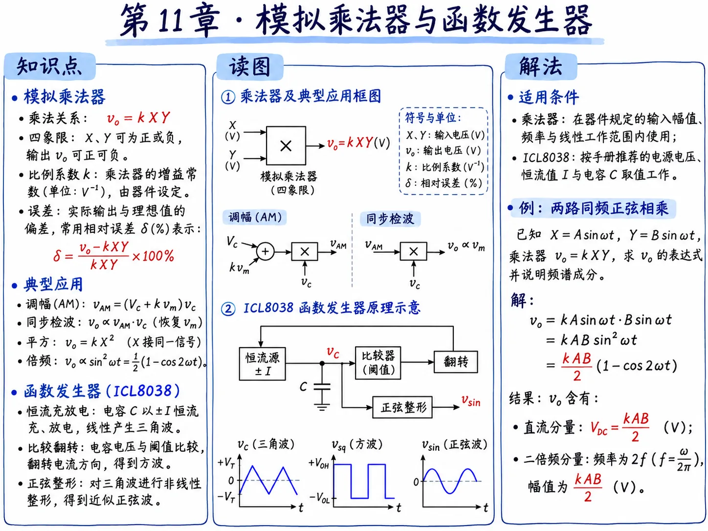
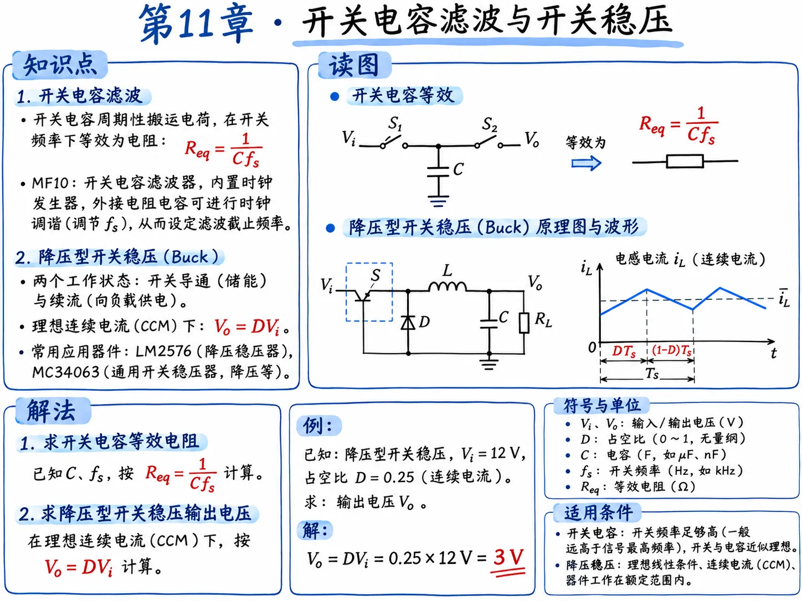
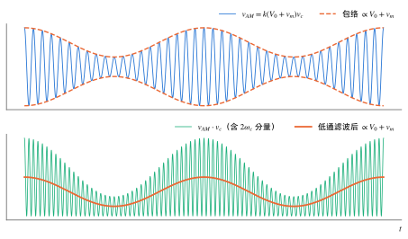

# 集成功能电路

!!! abstract "本章要点"
    - 三运放仪放的第一级只放大差模、共模增益为 1，所以输入电阻极高、CMRR 很高。
    - 模拟乘法器 $v_O=kv_Xv_Y$ 可直接做平方、调幅、检波；放进运放反馈支路就能做除法和开方。
    - ICL8038 用恒流源给电容充放电，同时输出三角波、方波和正弦波。
    - 开关电容等效为电阻 $R_{eq}=1/(Cf_s)$；Buck 电路在电感电流连续时 $V_O=DV_I$。
    - 锁相环是相位负反馈，锁定时 $f_o=Nf_r$，改变 $N$ 就能合成频率。

??? info "本章图卡（AI 生成速览，错误见文末「图卡勘误」）"
    { loading=lazy }

    { loading=lazy }

    { loading=lazy }

    { loading=lazy }

!!! note "知识点清单"
    **仪用与隔离放大**

    - [ ] 为什么需要仪用放大器
    - [ ] 三运放仪放的结构与增益公式
    - [ ] 第一级：差模增益 $1+2R/R_G$，共模增益 1
    - [ ] 仪放的输入电阻与 CMRR
    - [ ] 集成仪放、REF 端与可编程增益放大器（PGA）
    - [ ] 共模电压对输入、输出范围的限制
    - [ ] 隔离放大器的用途与三种隔离方式
    - [ ] 光耦隔离的反馈线性化

    **模拟乘法器与函数发生器**

    - [ ] 乘法器的定义、比例系数 $k$ 与象限
    - [ ] 变跨导乘法器原理
    - [ ] 平方与倍频
    - [ ] 调幅与调制度
    - [ ] 同步检波与鉴相
    - [ ] 除法电路与开方电路
    - [ ] 乘法器反馈电路的工作条件（负反馈极性）
    - [ ] ICL8038 的组成与工作原理
    - [ ] ICL8038 的频率、占空比与压控

    **开关电容与开关稳压**

    - [ ] 开关电容等效电阻
    - [ ] 开关电容积分器
    - [ ] 开关电容滤波器的优点与代价（MF10）
    - [ ] 开关稳压与线性稳压的区别
    - [ ] Buck 电路的两种工作状态
    - [ ] 伏秒平衡与 $V_O=DV_I$
    - [ ] 电感电流纹波、峰值电流与输出电压纹波
    - [ ] 连续导电模式（CCM）与断续模式（DCM）
    - [ ] PWM 稳压控制、Boost 与 Buck-Boost

    **锁相环**

    - [ ] 锁相环的四个组成部分
    - [ ] 锁定条件：频率相等、相位差为常数
    - [ ] 捕捉带与同步带
    - [ ] 锁相频率合成

## 1. 仪用放大器

### 1.1 为什么需要仪用放大器

**是什么**：仪用放大器（INA）是专门放大微弱差模信号的高精度放大器。

**为什么**：传感器（电桥、热电偶、生物电极）的输出有三个特点：

- 有用信号是**毫伏级的差模信号**；
- 它叠加在较大的共模电压上；
- 信号源内阻可能不小。

普通差分放大电路（[运放减法器](../extras/opamp.md#2-七种基本电路)）输入电阻有限，CMRR 又受电阻匹配限制，做不好这件事。

### 1.2 三运放结构与增益

{ .circuit }

**是什么**：两只同相放大器（$A_1$、$A_2$）组成第一级，一个差分放大电路（$A_3$）组成第二级。

**公式**：

$$
v_O=\Big(1+\frac{2R}{R_G}\Big)\frac{R_4}{R_3}\,(v_{I2}-v_{I1}).
$$

适用条件：运放理想，差分级电阻匹配，按上图接法（$v_{O1}$ 接 $A_3$ 反相端）。

其中 $R_G$ 为增益电阻，$R$ 为第一级两只反馈电阻，$R_3$、$R_4$ 为差分级电阻。

**怎么用**（推导，虚短 + 虚断）：

1. 虚短：$A_1$、$A_2$ 反相端电位分别为 $v_{I1}$、$v_{I2}$，$R_G$ 中电流 $i=\dfrac{v_{I1}-v_{I2}}{R_G}$；
2. 虚断：$i$ 同样流过两只 $R$，所以 $v_{O1}-v_{O2}=(R+R_G+R)\,i=\Big(1+\dfrac{2R}{R_G}\Big)(v_{I1}-v_{I2})$；
3. $A_3$ 是差分放大：$v_O=\dfrac{R_4}{R_3}(v_{O2}-v_{O1})$，代入即得上式。

### 1.3 第一级：只放大差模

**物理图像**：若两输入相等 $v_{I1}=v_{I2}=v_{IC}$（纯共模），

$R_G$ 两端电压为 0 → $i=0$ → 两只 $R$ 上无压降 → $v_{O1}=v_{O2}=v_{IC}$。

所以第一级**差模增益 $1+2R/R_G$，共模增益 1**。共模原样通过，差模被放大。

### 1.4 输入电阻与 CMRR

**是什么**：

- **输入电阻**：两个输入端都是运放同相端，输入电阻可达 $10^9\,\Omega$ 以上，几乎不从传感器取电流。
- **CMRR**（共模抑制比）：差模增益与共模增益之比，$\mathrm{CMRR}=\left\lvert A_d/A_c\right\rvert$，常用 dB 表示。

**物理图像**：$R_3$、$R_4$ 不匹配时，差分级会产生共模增益 $A_c$。但第一级已把差模放大了 $G_1$ 倍，共模却没变。于是总 CMRR 也提高了 $G_1$ 倍。

**公式**：

$$
\mathrm{CMRR}\approx G_1\times\mathrm{CMRR}_{A_3}.
$$

适用条件：第一级运放理想，CMRR 主要由差分级电阻失配决定。

其中 $G_1=1+2R/R_G$ 为第一级差模增益，$\mathrm{CMRR}_{A_3}$ 为差分级自身的共模抑制比。

### 1.5 集成仪放与可编程增益

**是什么**：集成仪放（AD620、INA128 等）把除 $R_G$ 外的电阻做在片内并激光修调，只用一只外接 $R_G$ 设增益，不影响对称性。例如 AD620：

$$
G=1+\frac{49.4\,\mathrm{k\Omega}}{R_G}.
$$

适用条件：AD620 手册给定的片内电阻值。

**要点**：

- **可编程增益**：用模拟开关切换不同 $R_G$，或直接用数字控制的**可编程增益放大器（PGA）**，按量程换挡；
- **REF 端**：就是 $A_3$ 同相端下方那只 $R_4$ 的接地端。接一个电压，输出就整体平移这个电压。

### 1.6 共模电压的范围限制

**物理图像**：共模电压原样出现在 $v_{O1}$、$v_{O2}$ 上，差模摆幅再叠加上去。

!!! warning "易错"
    - 共模电压加上差模摆幅，不能超出运放的输入、输出电压范围。使用仪放时这一点常被忽略。
    - 输出极性看接法：按上图是 $v_{I2}-v_{I1}$，交换 $A_3$ 两输入才是 $v_{I1}-v_{I2}$。

??? example "例 1：仪放的增益与 $R_G$（图卡例题）"
    三运放仪放，$R_3=R_4$，$R=10\,\mathrm{k\Omega}$，要求 $G=100$，差模输入 $10\,\mathrm{mV}$，REF 接地。求 $R_G$ 与输出。

    思路：差分级增益为 1，第一级增益就是总增益。

    1. $1+\dfrac{2R}{R_G}=100\Rightarrow R_G=\dfrac{2R}{99}=\dfrac{20\,\mathrm{k\Omega}}{99}=202\,\Omega$。
    2. $|v_O|=100\times10\,\mathrm{mV}=1\,\mathrm V$。
    3. 极性：$v_{I2}-v_{I1}=10\,\mathrm{mV}$ 时 $v_O=+1\,\mathrm V$；$v_{I1}-v_{I2}=10\,\mathrm{mV}$ 时 $v_O=-1\,\mathrm V$。

    **结论**：$R_G=202\,\Omega$，$|v_O|=1\,\mathrm V$，符号由接法决定。

??? example "例 2：共模电压经过第一级时发生了什么"
    $R=25\,\mathrm{k\Omega}$，$R_G=1\,\mathrm{k\Omega}$，$R_3=10\,\mathrm{k\Omega}$，$R_4=20\,\mathrm{k\Omega}$，$v_{I1}=2.010\,\mathrm V$，$v_{I2}=2.000\,\mathrm V$。求 $v_{O1}$、$v_{O2}$、$v_O$。

    思路：先求 $R_G$ 中电流，再求两只 $R$ 上的压降。

    1. $i=\dfrac{2.010-2.000}{1\,\mathrm{k\Omega}}=10\,\mu\mathrm A$。
    2. $v_{O1}=v_{I1}+Ri=2.010+0.25=2.260\,\mathrm V$。
    3. $v_{O2}=v_{I2}-Ri=2.000-0.25=1.750\,\mathrm V$。
    4. $v_O=\dfrac{20}{10}(1.750-2.260)=-1.02\,\mathrm V$，总增益 $51\times2=102$。

    **结论**：$v_{O1}$、$v_{O2}$ 的平均值仍是 $2.005\,\mathrm V$——共模原样通过，差模放大 51 倍。

## 2. 隔离放大器

### 2.1 用途与隔离方式

**是什么**：输入侧和输出侧**没有电气连接**的放大器。信号靠磁、光或电容耦合穿过隔离栅。两侧各自独立供电，常用隔离 DC-DC。

**为什么**：两种场合必须用它：

- 信号端与后级之间有很高的共模电压（几百到几千伏）；
- 人身安全要求切断地线回路，如医疗仪器。

| 方式 | 原理 | 特点 |
| --- | --- | --- |
| 变压器隔离 | 先把信号**调制**到高频载波（调幅或调频），经变压器传送，再**解调** | 精度、线性好；直流和低频必须先调制，否则过不了变压器 |
| 光电隔离 | LED → 光电管 | 结构简单、隔离电压高；光耦本身线性差、温漂大，需要**反馈线性化** |
| 电容隔离 | 高频调制后经片内小电容耦合 | 速度快、集成度高 |

### 2.2 光耦的反馈线性化

**是什么**：用一只 LED 同时照射两只匹配的光电二极管 PD1、PD2，借负反馈消掉 LED 的非线性。

**物理图像**：

- 输入侧运放驱动 LED，PD1 在它的反馈回路里，于是 PD1 电流被强制等于 $v_I/R_1$；
- PD2 受同一只 LED 照射，电流按固定比例 $K\approx1$ 跟随 PD1；
- 输出侧运放把 PD2 电流转为电压。

**公式**：

$$
v_O\approx K\frac{R_2}{R_1}v_I .
$$

适用条件：两只光电二极管匹配，运放理想。

其中 $K$ 为 PD2 与 PD1 的电流比，$R_1$ 为输入电阻，$R_2$ 为输出侧转换电阻。

增益只取决于 $K$ 和电阻比，与 LED 特性无关。

## 3. 模拟乘法器及其应用

### 3.1 乘法器是什么

**是什么**：输出正比于两个输入电压之积的电路。

**公式**：

$$
v_O=kv_Xv_Y .
$$

适用条件：输入在乘法器允许的范围和象限内。

其中 $k$ 为比例系数，常取 $0.1\,\mathrm V^{-1}$，使输入 $\pm10\,\mathrm V$ 时输出不超过 $\pm10\,\mathrm V$。

按允许的输入极性，分为单象限、二象限、四象限乘法器。四象限就是两个输入都可正可负。

### 3.2 变跨导原理

**物理图像**：[差分对](differential-opamp.md) 的差模增益正比于 $g_m$，而 $g_m=\dfrac{I_{EE}}{2V_T}$ 正比于尾电流。

$v_Y\uparrow\to$ 尾电流 $I_{EE}\uparrow\to g_m\uparrow\to$ 对 $v_X$ 的增益 $\uparrow$。

所以输出 $\propto g_mv_X\propto v_Xv_Y$。这要求 $|v_X|\ll V_T$（$V_T\approx26\,\mathrm{mV}$）。

??? tip "深入一点：Gilbert 单元"
    实用四象限乘法器（MC1496、AD633）用两组交叉耦合差分对，叫 Gilbert 单元，并加输入线性化电路扩大 $v_X$ 的范围。

### 3.3 直接应用：平方、调幅、检波、鉴相

| 应用 | 接法 | 结果 |
| --- | --- | --- |
| 平方 / 倍频 | $v_X=v_Y=U_m\sin\omega t$ | $\dfrac{kU_m^2}{2}(1-\cos2\omega t)$；隔去直流得 $2\omega$ |
| 调幅（AM） | $v_X=V_0+v_m$（直流加调制信号），$v_Y=v_c$（载波） | $v_{AM}=k(V_0+v_m)v_c$，包络随 $v_m$ 变化 |
| 同步检波 | $v_{AM}$ 与同频同相的本地载波相乘，**再低通** | 低通输出 $\propto(V_0+v_m)\cos\varphi$ |
| 鉴相 | 两路同频信号相乘后低通 | $\propto\cos\varphi$，用于锁相环 |

**要点**：

- **平方 / 倍频**：$\sin^2\omega t=\dfrac{1-\cos2\omega t}{2}$。乘积里有直流和 $2\omega$，原频率 $\omega$ 没有了。
- **调幅**：载波的幅度随调制信号变化。调制度 $m=V_m/V_0$，$V_m$ 为调制信号幅值。$m\le1$ 时包络不失真。
- **同步检波**：调幅波再乘一次同频同相的载波，得到“调制信号 + $2\omega_c$ 分量”，低通滤掉 $2\omega_c$ 即恢复调制信号。
- **鉴相**：两路同频信号相乘后取直流，直流 $\propto\cos\varphi$，反映相位差。

{ .circuit }

!!! warning "易错"
    - 同步检波必须**再低通**；而且本地载波要同频同相，相位差 $90^\circ$ 时输出为零。
    - 倍频输出要先隔直，乘积里含直流 $kU_m^2/2$。

??? example "例 3：两路同频正弦相乘（图卡例题）"
    $v_X=A\sin\omega t$，$v_Y=B\sin\omega t$，$v_O=kv_Xv_Y$，求 $v_O$ 及其频谱成分。

    思路：用 $\sin^2\omega t=(1-\cos2\omega t)/2$ 展开。

    1. $v_O=kAB\sin^2\omega t=\dfrac{kAB}{2}-\dfrac{kAB}{2}\cos2\omega t$。
    2. 成分：直流 $kAB/2$，频率 $2f$、幅值 $kAB/2$ 的二次谐波；频率 $f$ 的分量为零。
    3. 若两路有相位差 $\varphi$：直流分量变为 $\dfrac{kAB}{2}\cos\varphi$。

    **结论**：隔直后得倍频输出；直流分量随 $\cos\varphi$ 变化，这就是乘法器鉴相的原理。

??? example "例 4：调幅与同步检波"
    $k=0.1\,\mathrm V^{-1}$，$v_X=5+2.5\cos(2\pi\times10^3t)\ \mathrm V$，$v_Y=2\cos(2\pi\times10^5t)\ \mathrm V$。（1）求调幅波的调制度和各频率分量；（2）用另一只同样的乘法器乘以本地载波 $2\cos(2\pi\times10^5t)$ 再低通，输出是什么？本地载波相位差 $60^\circ$ 时呢？

    思路：先展开调幅波，再相乘、用低通去掉 $2\omega_c$ 分量。

    1. $v_{AM}=0.1\times(5+2.5\cos\Omega t)\times2\cos\omega_ct=(1+0.5\cos\Omega t)\cos\omega_ct$，调制度 $m=2.5/5=0.5$。
    2. 频谱：$100\,\mathrm{kHz}$ 载波幅值 $1\,\mathrm V$；$99\,\mathrm{kHz}$、$101\,\mathrm{kHz}$ 两个边频各 $0.25\,\mathrm V$。
    3. 检波：$0.1\,v_{AM}\cdot2\cos\omega_ct=0.1(1+0.5\cos\Omega t)(1+\cos2\omega_ct)$。
    4. 低通去掉 $2\omega_c$ 附近分量：$0.1+0.05\cos\Omega t\ \mathrm V$，隔直后恢复调制信号。
    5. 相位差 $60^\circ$：乘以 $\cos60^\circ$，得 $0.05+0.025\cos\Omega t\ \mathrm V$。

    **结论**：$m=0.5$；同步检波输出 $\propto\cos\varphi$，$90^\circ$ 时为零，所以本地载波必须**同频同相**（“同步”的含义）。

### 3.4 除法电路

{ .circuit }

**是什么**：把乘法器放在运放的反馈支路里，运放“逼”乘法器输出去抵消输入，就得到除法。

**物理图像**：运放反相端虚地。乘法器输出 $kv_Ov_Y$ 经 $R_2$ 送回反相端，它的电流必须与 $v_X/R_1$ 抵消。

**公式**：由反相端 KCL $\dfrac{v_X}{R_1}+\dfrac{kv_Ov_Y}{R_2}=0$，

$$
v_O=-\frac{R_2}{R_1}\cdot\frac{v_X}{kv_Y}.
$$

适用条件：$v_Y>0$（保证负反馈），输出不饱和。

### 3.5 开方电路

**是什么**：把乘法器两输入都接 $v_O$（平方器），放进反馈支路。

**公式**：由 $\dfrac{v_I}{R_1}+\dfrac{kv_O^2}{R_2}=0$，

$$
v_O=\sqrt{-\frac{R_2}{kR_1}v_I}.
$$

适用条件：$v_I<0$，$v_O>0$（保证负反馈）。

### 3.6 反馈极性决定能否工作

**物理图像**：反馈支路的“增益”是 $kv_Y$（除法）或 $2kv_O$（开方）。只有它为正，整个环路才是负反馈。

!!! warning "易错"
    - 除法电路要求 $v_Y>0$；$v_Y<0$ 时变成正反馈，输出锁在饱和值。
    - 开方电路要求 $v_O>0$，常在输出端串二极管，防止进入负输出的正反馈锁死。
    - $v_Y\to0$ 时公式给出 $v_O\to\infty$，实际运放会饱和。

??? example "例 5：除法与开方"
    $k=0.1\,\mathrm V^{-1}$，$R_1=R_2$。（1）除法电路 $v_X=2\,\mathrm V$、$v_Y=4\,\mathrm V$；（2）开方电路 $v_I=-3.6\,\mathrm V$。

    思路：代公式，再用乘法器输出校核 KCL。

    1. 除法：$v_O=-\dfrac{2}{0.1\times4}=-5\,\mathrm V$。
    2. 校核：乘法器输出 $0.1\times(-5)\times4=-2\,\mathrm V$，与 $v_X$ 等值反号。
    3. 开方：$v_O=\sqrt{\dfrac{3.6}{0.1}}=6\,\mathrm V$。
    4. 校核：$0.1\times6^2=3.6\,\mathrm V$。

    **结论**：除法 $-5\,\mathrm V$，开方 $6\,\mathrm V$。

## 4. 函数发生器 ICL8038

### 4.1 组成与工作原理

**是什么**：ICL8038 是一块同时产生三角波、方波和正弦波的芯片，频率从不到 $1\,\mathrm{Hz}$ 到数百 $\mathrm{kHz}$。

原理与 [方波—三角波发生器](waveform-generators.md) 相同，只是积分器换成了**恒流源对电容充放电**。

**物理图像**：

1. 恒流源 $I_A$ 给外接电容 $C$ 充电，$v_C$ 线性上升；
2. $v_C$ 升到上阈值 $\frac23V_{CC}$，比较器使触发器翻转，接通 $2I_B$ 的放电电流源；
3. 净电流 $I_A-2I_B$。取 $I_A=I_B=I$，净电流为 $-I$，$v_C$ 线性下降；
4. $v_C$ 降到下阈值 $\frac13V_{CC}$，触发器再翻转，回到充电。

三种输出：

| 输出 | 来源 |
| --- | --- |
| 三角波 | 电容电压 $v_C$，在 $\frac13V_{CC}\sim\frac23V_{CC}$ 之间 |
| 方波 | 触发器输出（集电极开路，需上拉电阻） |
| 正弦波 | 三角波经内部二极管—电阻折线网络**整形**，失真约 $1\%$ |

{ .circuit }

### 4.2 频率、占空比与压控

**是什么**：内部电流 $I_A\approx\dfrac{0.2V_{CC}}{R_A}$，$I_B\approx\dfrac{0.2V_{CC}}{R_B}$。$R_A=R_B=R$ 时上升、下降时间相等。

**物理图像**：电容要改变 $V_{CC}/3$ 的电压，所需时间 $=C\times\Delta V/I$。电流和阈值都正比于 $V_{CC}$，所以频率与电源电压无关。

**公式**：

$$
t_1=t_2=\frac{C\cdot V_{CC}/3}{0.2V_{CC}/R}=\frac53RC,\qquad f=\frac{1}{t_1+t_2}=\frac{0.3}{RC}.
$$

适用条件：$R_A=R_B=R$。

**要点**：

- $R_A\neq R_B$：充、放电时间不等，可调占空比，三角波变成锯齿波；
- 第 8 脚（调频电压输入）改变内部电流，芯片就成为压控振荡器。

??? tip "深入一点：0.3/(RC) 与手册的 0.33/(RC)"
    手册中的工程估算式写作 $f\approx0.33/(RC)$，与 $0.3/(RC)$ 相差约 $10\%$。差别来自内部电流系数的近似，实际频率以调试为准。

## 5. 开关电容电路

### 5.1 开关电容等效电阻

{ .circuit }

**是什么**：一只电容加两个轮流闭合的开关，在时钟频率足够高时，效果就像一只电阻。

**物理图像**：像用一只小桶来回搬水。

- $\varphi_1$：$S_1$ 闭合，$C$ 充到 $v_1$；
- $\varphi_2$：$S_2$ 闭合，$C$ 放到 $v_2$；
- 每个周期从左向右搬运电荷 $\Delta Q=C(v_1-v_2)$。

搬得越勤（$f_s$ 越高）、桶越大（$C$ 越大），平均电流越大，等效电阻越小。

**公式**：

$$
i=\frac{\Delta Q}{T_s}=Cf_s(v_1-v_2)\ \Rightarrow\ R_{eq}=\frac{1}{Cf_s}.
$$

适用条件：$f_s$ 远高于信号频率；两开关由两相**不重叠**时钟控制。

其中 $f_s$ 为时钟频率，$T_s=1/f_s$。

!!! warning "易错"
    - $S_1$、$S_2$ 绝不能同时闭合，任何时刻最多一个闭合。

### 5.2 开关电容积分器

**是什么**：把 RC 积分器的输入电阻换成开关电容。

{ .circuit }

**公式**：

$$
\tau=R_{eq}C_2=\frac{C_2}{C_1f_s}.
$$

适用条件：同 5.1。

其中 $C_1$ 为开关电容，$C_2$ 为积分电容。

### 5.3 优点与代价

**为什么要用开关电容**：

- 集成电路里做不出精确的大电阻；电阻、电容的绝对值误差都在 $\pm20\%$ 左右；
- 但**电容之比**可以做到 $0.1\%$，时钟 $f_s$ 来自晶振，也很精确；
- 于是时间常数、截止频率由“电容比 × 时钟频率”决定，精确且可程控。改 $f_s$ 就能平移整个频率特性。

**MF10**：用开关电容积分器组成状态变量滤波器的通用芯片。中心频率 $f_0=f_{CLK}/100$ 或 $f_{CLK}/50$（引脚选择）。它没有片内振荡器，时钟要外加；外接电阻设置 $Q$、增益和滤波类型。

!!! warning "易错"
    - 开关电容电路是**采样**系统：输入要先经抗混叠低通，信号频率远低于 $f_s/2$。
    - 输出含时钟频率的阶梯和馈通，常需再加一级平滑滤波。

??? example "例 6：开关电容的等效电阻与积分器"
    $C_1=1\,\mathrm{pF}$，$f_s=100\,\mathrm{kHz}$，$C_2=10\,\mathrm{pF}$。求 $R_{eq}$、积分时间常数和积分器的单位增益频率；若用 MF10 并取 $f_{CLK}=100\,\mathrm{kHz}$，中心频率可以是多少？

    思路：直接代 $R_{eq}=1/(Cf_s)$ 和 $\tau=C_2/(C_1f_s)$。

    1. $R_{eq}=\dfrac{1}{10^{-12}\times10^5}=10\,\mathrm{M\Omega}$。
    2. $\tau=\dfrac{10}{1\times10^5}=0.1\,\mathrm{ms}$，单位增益频率 $\dfrac{1}{2\pi\tau}=1.59\,\mathrm{kHz}$。
    3. 逐周期看：每周期 $v_O$ 下降 $\dfrac{C_1}{C_2}v_I=0.1v_I$；$1\,\mathrm{ms}$（100 个周期）后 $v_O=-10v_I$，与 $-v_It/\tau$ 一致。
    4. MF10：$f_0=10^5/100=1\,\mathrm{kHz}$ 或 $10^5/50=2\,\mathrm{kHz}$。

    **结论**：片上用 $1\,\mathrm{pF}$ 电容就“做出”了 $10\,\mathrm{M\Omega}$ 电阻；$\tau=0.1\,\mathrm{ms}$。

## 6. 开关稳压：Buck 电路

### 6.1 开关稳压与线性稳压

**是什么**：[线性稳压](power.md#9-串联型线性稳压电路) 的调整管工作在放大区，压差全部变成热。**开关稳压**让功率管只工作在两种状态：饱和导通或截止。

**为什么效率高**：导通时管压降很小，截止时电流为零，两种状态下管耗都很小。效率可达 $80\%\sim95\%$。

最基本的开关稳压是降压型，叫 Buck 电路：

{ .circuit }

### 6.2 两种工作状态

**物理图像**：

| 状态 | 时间 | 开关节点 $v_X$ | 电感电压 $v_L$ | 电感电流 $i_L$ |
| --- | --- | --- | --- | --- |
| $S$ 导通 | $0<t<DT_s$ | $V_I$（二极管截止） | $V_I-V_O>0$ | 线性上升，电感储能 |
| $S$ 断开 | $DT_s<t<T_s$ | $\approx0$（二极管续流） | $-V_O$ | 线性下降，电感放能 |

$S$ 断开时电感电流不能突变，只能经二极管 $D$ 继续流，叫**续流**。

其中 $D=t_{on}/T_s$ 为占空比，$T_s$ 为开关周期。

### 6.3 伏秒平衡与输出电压

**是什么**：稳态时电感电流每周期回到原值，所以电感电压一个周期的平均值为零，叫**伏秒平衡**。

**公式**：

$$
(V_I-V_O)DT_s=V_O(1-D)T_s\ \Rightarrow\ V_O=DV_I .
$$

适用条件：稳态，电感电流连续（CCM），元件理想。

**物理图像**：$v_X$ 是高度 $V_I$、占空比 $D$ 的方波，平均值就是 $DV_I$。$LC$ 是一个低通，把方波的平均值滤出来。

{ .circuit }

### 6.4 纹波与峰值电流

| 量 | 公式（CCM） | 用途 |
| --- | --- | --- |
| 电感电流纹波 | $\Delta I_L=\dfrac{(V_I-V_O)D}{Lf_s}=\dfrac{V_O(1-D)}{Lf_s}$ | 选电感 |
| 电感电流峰值 | $I_{Lpk}=I_O+\Delta I_L/2$ | 选开关管、电感饱和电流 |
| 输出电压纹波 | $\Delta V_O\approx\dfrac{\Delta I_L}{8f_sC}$ | 选电容（忽略 ESR） |

其中 $L$ 为电感，$C$ 为输出电容，$f_s$ 为开关频率，$I_O$ 为负载电流。

**怎么用**（选 $L$、$C$）：

1. 由 $D=V_O/V_I$ 求占空比；
2. 由允许的 $\Delta I_L$ 求 $L\ge\dfrac{V_O(1-D)}{f_s\Delta I_L}$；
3. 由允许的 $\Delta V_O$ 求 $C\ge\dfrac{\Delta I_L}{8f_s\Delta V_O}$。

??? tip "深入一点：ΔV_O 公式的来历"
    电感电流的交流分量（三角波）全部流进电容。它的正半部分在半个周期内给电容充入电荷：

    $$
    \Delta Q=\frac12\cdot\frac{T_s}{2}\cdot\frac{\Delta I_L}{2}=\frac{\Delta I_LT_s}{8},\qquad \Delta V_O=\frac{\Delta Q}{C}=\frac{\Delta I_L}{8f_sC}.
    $$

    实际电解电容的 ESR 往往比容量更关键，纹波常由 $\Delta I_L\cdot\mathrm{ESR}$ 决定。

### 6.5 连续导电模式（CCM）与断续模式（DCM）

**是什么**：电感电流始终大于零，叫连续导电模式（CCM）。负载太轻时，$i_L$ 在一个周期内降到零，叫断续模式（DCM）。

**公式**：

$$
I_O>\frac{\Delta I_L}{2}\quad(\text{CCM 条件}).
$$

适用条件：Buck 电路。

$\Delta I_L$ 只与 $V_I$、$V_O$、$L$、$f_s$ 有关，与负载无关。所以负载电流降到 $\Delta I_L/2$ 以下就进入 DCM。

!!! warning "易错"
    - $V_O=DV_I$ 只在 CCM 时成立。轻载进入 DCM 后，同样的 $D$ 下 $V_O$ 会升高。

### 6.6 PWM 稳压控制与其他拓扑

**是什么**：实际开关稳压器（LM2576、MC34063 等）加上了负反馈：

取样电阻 + 基准 + 误差放大 → 误差电压与锯齿波比较 → 产生 PWM 信号 → 控制开关管。

$V_O\uparrow\to$ 误差电压 $\downarrow\to D\downarrow\to V_O\downarrow$。原理仍是负反馈稳压，只是调节的是占空比。

另外两种基本拓扑：

| 拓扑 | 输出电压（CCM） | 特点 |
| --- | --- | --- |
| 降压 Buck | $V_O=DV_I$ | $V_O<V_I$ |
| 升压 Boost | $V_O=\dfrac{V_I}{1-D}$ | $V_O>V_I$ |
| 升降压 Buck-Boost | $V_O=-\dfrac{D}{1-D}V_I$ | 极性相反，可升可降 |

??? example "例 7：Buck 的输出电压与纹波（图卡例题扩展）"
    $V_I=12\,\mathrm V$，$D=0.25$，CCM。（1）求 $V_O$；（2）若 $L=100\,\mu\mathrm H$，$f_s=50\,\mathrm{kHz}$，$C=100\,\mu\mathrm F$，$I_O=1\,\mathrm A$，求 $\Delta I_L$、$I_{Lpk}$、$\Delta V_O$，并求保持 CCM 的最大负载电阻；（3）与线性稳压比较效率。

    思路：先用 $V_O=DV_I$，再依次代纹波公式，最后看 CCM 边界。

    1. $V_O=0.25\times12=3\,\mathrm V$。
    2. $\Delta I_L=\dfrac{3\times(1-0.25)}{100\times10^{-6}\times5\times10^4}=0.45\,\mathrm A$，$I_{Lpk}=1+0.225=1.225\,\mathrm A$。
    3. $\Delta V_O=\dfrac{0.45}{8\times5\times10^4\times10^{-4}}=11.25\,\mathrm{mV}$（理想开关仿真 $11.3\,\mathrm{mV}$）。
    4. CCM 要求 $I_O>0.225\,\mathrm A$，即 $R_L<3/0.225=13.3\,\Omega$。
    5. 效率：线性稳压从 $12\,\mathrm V$ 降到 $3\,\mathrm V$ 不超过 $25\%$；理想 Buck 为 $100\%$。

    **结论**：$V_O=3\,\mathrm V$，$\Delta I_L=0.45\,\mathrm A$，$\Delta V_O\approx11\,\mathrm{mV}$，$R_L<13.3\,\Omega$ 保持 CCM；实际 Buck 的损耗来自开关管导通压降、开关过程和二极管压降。

??? example "例 8：选电感和电容"
    $V_I=24\,\mathrm V$，$V_O=5\,\mathrm V$，$I_O=2\,\mathrm A$，$f_s=100\,\mathrm{kHz}$。要求 $\Delta I_L\le30\%I_O$，$\Delta V_O\le50\,\mathrm{mV}$，求 $L$、$C$ 的最小值。

    思路：按 6.4 的三步选 $L$、$C$。

    1. $D=5/24=0.208$，$\Delta I_L\le0.6\,\mathrm A$。
    2. $L\ge\dfrac{5\times0.792}{10^5\times0.6}=66\,\mu\mathrm H$，取标称 $68\,\mu\mathrm H$（此时 $\Delta I_L=0.58\,\mathrm A$）。
    3. $C\ge\dfrac{0.6}{8\times10^5\times0.05}=15\,\mu\mathrm F$。

    **结论**：$L\ge66\,\mu\mathrm H$，$C\ge15\,\mu\mathrm F$；因 ESR，电容实际常选得大得多或用低 ESR 电容。

## 7. 锁相环

### 7.1 组成

{ .circuit }

**是什么**：锁相环（PLL）是一个**相位负反馈**系统。它让输出信号的频率和相位“锁住”参考信号。

| 部分 | 作用 |
| --- | --- |
| 鉴相器 PD | 输出 $u_d$ 反映两输入的相位差 $\varphi_e$ |
| 环路滤波器 LF | 低通，滤去 $u_d$ 中的高频分量，得控制电压 $u_c$；决定环路动态 |
| 压控振荡器 VCO | $f_o=f_0+K_vu_c$ |
| 分频器 $\div N$ | 把 $f_o/N$ 送回鉴相器 |

其中 $f_0$ 为 VCO 自由振荡频率，$K_v$ 为 VCO 压控灵敏度。

乘法器型鉴相器 $u_d=K_d\sin\varphi_e$，只在 $\varphi_e$ 小时近似线性；数字鉴频鉴相器在 $\pm2\pi$ 内线性。

### 7.2 锁定条件

**物理图像**：

$f_o/N\ne f_r\to\varphi_e$ 不断变化 $\to u_c$ 变化 $\to$ VCO 频率被拉向 $Nf_r$。

最终两路频率相等，$\varphi_e$ 停在一个**常数**上。正是这个常数相位差，产生了维持 $f_o$ 所需的控制电压 $u_c$。

**公式**：

$$
f_o=Nf_r,\qquad \varphi_o-N\varphi_r=\text{常数}.
$$

适用条件：环路已锁定。

!!! warning "易错"
    - 锁定只要求**频率相等**、相位差为常数，相位差不一定为零。

### 7.3 捕捉带与同步带

**是什么**：

- **捕捉带**：环路从失锁状态能自行进入锁定的最大初始频差；
- **同步带**（跟踪带）：已经锁定后，输入频率缓慢变化而仍能保持锁定的范围。

同步带 $\ge$ 捕捉带：已锁定的环路能跟踪更大的频偏。

### 7.4 锁相频率合成

**是什么**：用一个晶振合成一系列精确频率。

**怎么用**：

1. 晶振经 $\div M$ 得参考 $f_r=f_{xtal}/M$，它就是频率步进；
2. 改变可编程分频比 $N$，输出 $f_o=Nf_r$；
3. 输出频率的稳定度与晶振相同。

CD4046 是常用的 CMOS 锁相环，片内有两种鉴相器和 VCO，外接 $R$、$C$ 和环路滤波器。

??? example "例 9：频率合成"
    （1）参考频率 $f_r=100\,\mathrm{kHz}$，$N=10$，求锁定后的输出频率（图卡例题）。（2）用 $10\,\mathrm{MHz}$ 晶振合成 $88\sim108\,\mathrm{MHz}$ 的调频广播本振，步进 $25\,\mathrm{kHz}$，参考分频比 $M$ 和 $N$ 的范围各是多少？

    思路：步进等于 $f_r$，$N=f_o/f_r$。

    1. $f_o=Nf_r=10\times100\,\mathrm{kHz}=1\,\mathrm{MHz}$。
    2. $M=\dfrac{10\,\mathrm{MHz}}{25\,\mathrm{kHz}}=400$。
    3. $N=\dfrac{88\,\mathrm{MHz}}{25\,\mathrm{kHz}}\sim\dfrac{108\,\mathrm{MHz}}{25\,\mathrm{kHz}}=3520\sim4320$。

    **结论**：（1）$1\,\mathrm{MHz}$；（2）$M=400$，$N=3520\sim4320$。

??? example "例 10：锁定时的相位误差与同步带"
    $N=1$，VCO 自由振荡频率 $f_0=900\,\mathrm{kHz}$，$K_v=50\,\mathrm{kHz/V}$；乘法器型鉴相器 $u_d=K_d\sin\varphi_e$，$K_d=1\,\mathrm V$；环路滤波器直流增益 $A_F=4$。输入 $f_r=1\,\mathrm{MHz}$，求锁定时的 $u_c$ 与 $\varphi_e$，以及同步带。

    思路：锁定时 VCO 要偏离 $f_0$，所需 $u_c$ 由相位差提供。

    1. $u_c=\dfrac{1000-900}{50}=2\,\mathrm V$。
    2. $u_c=A_FK_d\sin\varphi_e\Rightarrow\sin\varphi_e=\dfrac{2}{4}=0.5$，$\varphi_e=30^\circ$。
    3. $|u_c|\le A_FK_d=4\,\mathrm V$，VCO 可被拉动 $\pm50\times4=\pm200\,\mathrm{kHz}$。

    **结论**：$\varphi_e=30^\circ$——频率相等，相位并不相等；同步带 $700\sim1100\,\mathrm{kHz}$。

## 公式速查

| 内容 | 公式 | 条件 |
| --- | --- | --- |
| 三运放仪放 | $v_O=\Big(1+\dfrac{2R}{R_G}\Big)\dfrac{R_4}{R_3}(v_{I2}-v_{I1})$ | 按图接法，电阻匹配 |
| 仪放第一级 | 差模增益 $1+2R/R_G$，共模增益 1 | 运放理想 |
| 仪放 CMRR | $\mathrm{CMRR}\approx G_1\times\mathrm{CMRR}_{A_3}$ | 失配主要在差分级 |
| AD620 增益 | $G=1+\dfrac{49.4\,\mathrm{k\Omega}}{R_G}$ | 手册值 |
| 光耦线性化 | $v_O\approx K\dfrac{R_2}{R_1}v_I$ | 光电二极管匹配 |
| 乘法器 | $v_O=kv_Xv_Y$ | 输入在允许范围 |
| 平方 | $\dfrac{kU_m^2}{2}(1-\cos2\omega t)$ | 同频同相正弦 |
| 调幅 | $v_{AM}=k(V_0+v_m)v_c$，$m=V_m/V_0$ | $m\le1$ |
| 同步检波 / 鉴相 | 低通输出 $\propto\cos\varphi$ | 乘后低通 |
| 除法 | $v_O=-\dfrac{R_2}{R_1}\dfrac{v_X}{kv_Y}$ | $v_Y>0$ |
| 开方 | $v_O=\sqrt{-\dfrac{R_2}{kR_1}v_I}$ | $v_I<0$，$v_O>0$ |
| ICL8038 | $f=\dfrac{0.3}{RC}$（手册 $\approx0.33/(RC)$） | $R_A=R_B=R$ |
| 开关电容 | $R_{eq}=\dfrac{1}{Cf_s}$ | $f_s\gg$ 信号频率 |
| SC 积分器 | $\tau=\dfrac{C_2}{C_1f_s}$ | 同上 |
| MF10 | $f_0=f_{CLK}/100$ 或 $f_{CLK}/50$ | 外加时钟 |
| Buck 输出 | $V_O=DV_I$ | CCM |
| 电感纹波 | $\Delta I_L=\dfrac{V_O(1-D)}{Lf_s}$ | CCM |
| 电感峰值 | $I_{Lpk}=I_O+\Delta I_L/2$ | CCM |
| 输出纹波 | $\Delta V_O\approx\dfrac{\Delta I_L}{8f_sC}$ | 忽略 ESR |
| CCM 条件 | $I_O>\Delta I_L/2$ | Buck |
| Boost / Buck-Boost | $V_O=\dfrac{V_I}{1-D}$ / $V_O=-\dfrac{D}{1-D}V_I$ | CCM |
| VCO | $f_o=f_0+K_vu_c$ | 线性范围 |
| 锁定 | $f_o=Nf_r$，相位差为常数 | 已锁定 |
| 频率合成 | $f_r=f_{xtal}/M$，$f_o=Nf_r$ | 步进 $=f_r$ |

## 练习

### 1. 概念判断 :material-star::material-star-outline::material-star-outline:

判断下列说法是否正确：

1. 三运放仪放的第一级对共模信号也有 $1+2R/R_G$ 倍的放大。
2. 乘法器做同步检波时，只要本地载波与调幅波同频即可，相位无关。
3. 开关电容等效电阻 $R_{eq}=1/(Cf_s)$ 要求时钟频率远高于信号频率。
4. Buck 电路在任何负载下都有 $V_O=DV_I$。
5. 锁相环锁定后，输出与参考信号（经分频后）的相位差为零。

??? success "答案"
    1 ✗　2 ✗　3 ✓　4 ✗　5 ✗

??? note "解析"
    1. 共模输入时 $R_G$ 中无电流，第一级共模增益为 1。
    2. 检波输出 $\propto\cos\varphi$，相位差 $90^\circ$ 时为零，必须同频同相。
    3. 推导假设一个时钟周期内 $v_1$、$v_2$ 不变，即采样足够快。
    4. 只在 CCM 时成立；轻载进入 DCM 后 $V_O$ 会升高。
    5. 锁定只要求频率相等、相位差为常数；这个常数相位差产生了控制电压。

### 2. 仪放的共模抑制 :material-star::material-star::material-star:

三运放仪放，第一级 $R=24.75\,\mathrm{k\Omega}$，$R_G=500\,\Omega$；差分级 $R_3=R_4=10\,\mathrm{k\Omega}$，但同相端那只 $R_4$ 偏大 $1\%$。输入共模电压 $5\,\mathrm V$。求：（1）差模增益；（2）差分级共模增益与整体 CMRR（dB）；（3）共模电压引起的输出误差；（4）若去掉第一级、只用差分级，CMRR 是多少？

??? success "答案"
    （1）100；（2）$A_c\approx0.0050$，CMRR $\approx2.0\times10^4$（$86\,\mathrm{dB}$）；（3）约 $25\,\mathrm{mV}$；（4）约 $46\,\mathrm{dB}$。

??? note "解析"
    1. 差模增益：$1+\dfrac{2\times24.75}{0.5}=100$，差分级增益 1，总增益 100。
    2. 共模 $v_{IC}$ 原样通过第一级。差分级 $v_+=\dfrac{1.01}{2.01}v_{IC}$，$v_O=2v_+-v_{IC}$。
    3. $A_c=\dfrac{2.02}{2.01}-1=0.004975$，$\mathrm{CMRR}=\dfrac{100}{0.004975}=2.01\times10^4$，即 $86.1\,\mathrm{dB}$。
    4. 输出误差：$5\times0.004975=24.9\,\mathrm{mV}$。
    5. 只用差分级：$\mathrm{CMRR}=1/0.004975=201$，即 $46.1\,\mathrm{dB}$。第一级把 CMRR 提高了 100 倍（$40\,\mathrm{dB}$）。

### 3. 除法电路的工作范围 :material-star::material-star::material-star-outline:

除法电路（§3.4 图）$k=0.1\,\mathrm V^{-1}$，$R_1=R_2$，运放饱和电压 $\pm13\,\mathrm V$，$v_X=1\,\mathrm V$。分别求 $v_Y=2\,\mathrm V$、$0.5\,\mathrm V$、$-2\,\mathrm V$ 时的 $v_O$。

??? success "答案"
    $-5\,\mathrm V$；饱和于约 $-13\,\mathrm V$；电路不能正常工作（正反馈，输出锁在饱和值）。

??? note "解析"
    1. $v_Y=2\,\mathrm V$：$v_O=-\dfrac{1}{0.1\times2}=-5\,\mathrm V$。
    2. $v_Y=0.5\,\mathrm V$：公式给出 $-20\,\mathrm V$，超出 $\pm13\,\mathrm V$，运放负饱和，输出约 $-13\,\mathrm V$。
    3. $v_Y=-2\,\mathrm V$：反馈支路增益 $kv_Y<0$，变成正反馈，输出停在某一饱和值，公式结果 $+5\,\mathrm V$ 不会出现。

### 4. Buck 电路计算 :material-star::material-star::material-star-outline:

$V_I=12\,\mathrm V$，$V_O=5\,\mathrm V$，$f_s=200\,\mathrm{kHz}$，$L=22\,\mu\mathrm H$，$C=47\,\mu\mathrm F$，$R_L=5\,\Omega$。求占空比、$\Delta I_L$、$I_{Lpk}$、$\Delta V_O$；负载电阻增大到多少时进入断续模式？

??? success "答案"
    $D=0.417$，$\Delta I_L=0.663\,\mathrm A$，$I_{Lpk}=1.33\,\mathrm A$，$\Delta V_O=8.8\,\mathrm{mV}$；$R_L>15.1\,\Omega$ 时进入 DCM。

??? note "解析"
    1. $D=5/12=0.417$，$I_O=5/5=1\,\mathrm A$。
    2. $\Delta I_L=\dfrac{5\times(1-0.417)}{22\times10^{-6}\times2\times10^5}=0.663\,\mathrm A$。
    3. $I_{Lpk}=1+0.331=1.33\,\mathrm A$。
    4. $\Delta V_O=\dfrac{0.663}{8\times2\times10^5\times47\times10^{-6}}=8.8\,\mathrm{mV}$。
    5. CCM 边界 $I_O=\Delta I_L/2=0.331\,\mathrm A$（$\Delta I_L$ 与负载无关），$R_L=5/0.331=15.1\,\Omega$。

### 5. 锁相频率合成器 :material-star::material-star-outline::material-star-outline:

用 $4\,\mathrm{MHz}$ 晶振做 $430\sim440\,\mathrm{MHz}$ 的频率合成器，信道间隔 $12.5\,\mathrm{kHz}$。求参考分频比 $M$、可编程分频比 $N$ 的范围和信道数。

??? success "答案"
    $M=320$，$N=34400\sim35200$，共 801 个信道。

??? note "解析"
    1. 步进等于参考频率：$f_r=12.5\,\mathrm{kHz}$，$M=4\,\mathrm{MHz}/12.5\,\mathrm{kHz}=320$。
    2. $N=430\,\mathrm{MHz}/12.5\,\mathrm{kHz}=34400$ 到 $440\,\mathrm{MHz}/12.5\,\mathrm{kHz}=35200$。
    3. 信道数 $35200-34400+1=801$。
    4. 实际电路在 VCO 后先加高速前置分频器，再接可编程分频器。

## 图卡勘误

| 图卡位置 | 原文 | 更正 |
| --- | --- | --- |
| 卡 24 读图(1) | $A_2$ 两个输入端都标"+" | 接 $R_G$、$R$ 的一端应为反相端"−"，$V_2$ 接同相端"+" |
| 卡 24 读图(1) 总增益 | $V_o=G\cdot S+V_{ref}$，$S=V_1-V_2$ | 按图应为 $V_o=G(V_2-V_1)+V_{ref}$；例题输出按图为 $-1\,\mathrm V$ |
| 卡 24 知识点 1 | 等效输入阻抗"常可达 MΩ 量级" | 输入端是运放同相端，通常在 $10^9\,\Omega$ 以上 |
| 卡 25 知识点 / 读图 AM | $v_{AM}=(V_c+kv_m)v_c$，框图把 $V_c$ 与 $kv_m$ 相加再乘 $v_c$ | 应为 $v_{AM}=k(V_0+v_m)v_c$：$V_0$ 是直流，$v_c$ 是载波，不能用同一符号 |
| 卡 25 同步检波 | $v_o\propto v_{AM}\cdot v_c$（恢复 $v_m$） | 乘积含 $2\omega_c$，必须再低通；本地载波须同频同相 |
| 卡 25 倍频 | $v_o\propto\sin^2\omega t$ 即倍频 | 乘积还含直流 $kAB/2$，需隔直 |
| 卡 25 读图② ICL8038 | 一个"比较器（阈值）"加"翻转" | 内部是两个比较器（$\frac23V_{CC}$、$\frac13V_{CC}$）加触发器；放电用 $2I$ 电流源 |
| 卡 25 读图② 波形 | 三角波标 $\pm V_T$、关于 0 对称；方波标 $+V_{OH}$、$-V_{OL}$ | 单电源时三角波在 $\frac13V_{CC}\sim\frac23V_{CC}$；$V_T$ 与热电压冲突；低电平不应写 $-V_{OL}$ |
| 卡 26 知识点 1 | MF10"内置时钟发生器，外接电阻电容进行时钟调谐（调节 $f_s$）" | MF10 无片内振荡器，需外加时钟；外接电阻设定 $Q$、增益和滤波方式 |
| 卡 26 读图（开关电容） | 未说明 $S_1$、$S_2$ 的控制方式 | 须由两相不重叠时钟驱动，不能同时闭合；$f_s$ 远高于信号频率 |
| 卡 26 适用条件 | 降压稳压"理想线性条件" | Buck 是开关电路；理想条件应为元件无损、CCM、纹波小 |
| 卡 27 读图波形 | 参考 $f_r$ 与输出 $f_o$ 画成同频，同时写 $f_o=N\cdot f_r$、例题 $N=10$ | 与 $f_r$ 同频、相位差恒定的是分频后的 $f_o/N$ |
| 卡 27 鉴相器 | 输出"与相位差 $\varphi_e$ 成比例" | 乘法器型 $u_d=K_d\sin\varphi_e$，只在 $\varphi_e$ 小时近似成比例 |
| 卡 27 捕获与保持 | "捕获 / 保持" | 教材术语为捕捉带与同步带（跟踪带），同步带 $\ge$ 捕捉带 |
