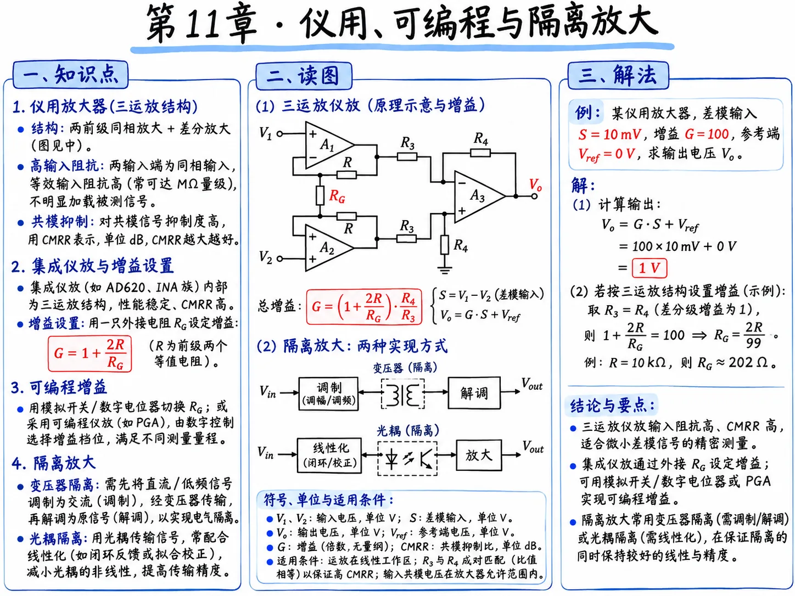
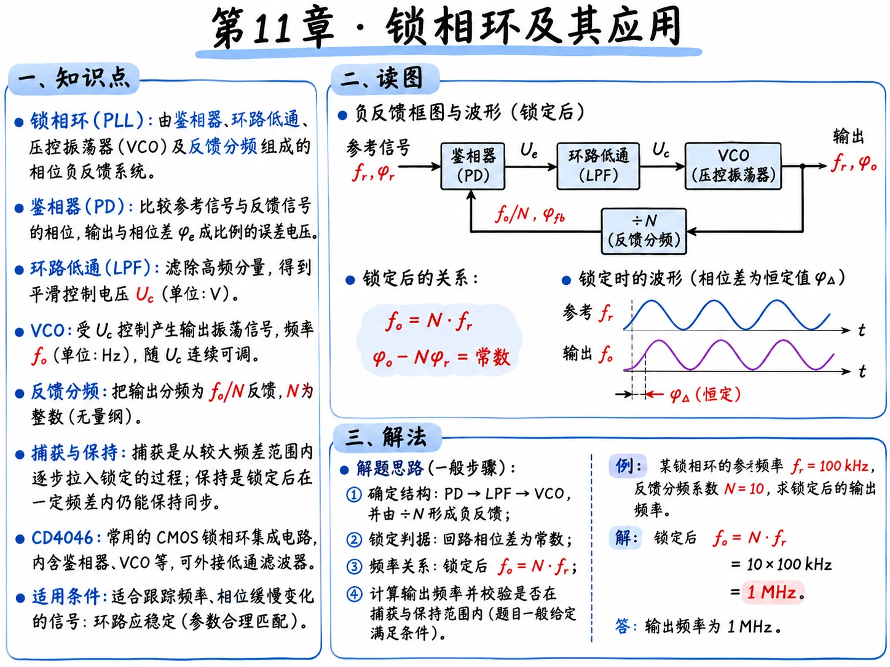
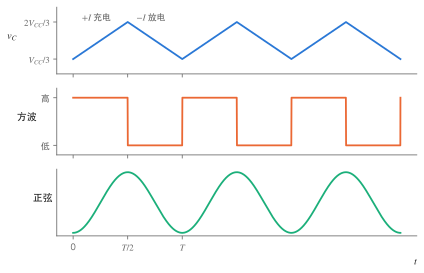
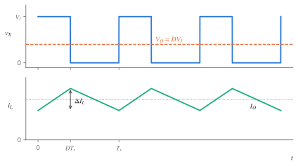

# 集成功能电路

!!! abstract "TL;DR"
    - **三运放仪放**：$v_O=\Big(1+\dfrac{2R}{R_G}\Big)\dfrac{R_4}{R_3}(v_{I2}-v_{I1})$；第一级只放大差模、共模增益为 1，所以总 CMRR 比单个差分电路高得多。
    - **模拟乘法器** $v_O=kv_Xv_Y$：直接用于调幅、同步检波（再加低通）、平方 / 倍频；放进运放的反馈支路就得到除法和开方。
    - **ICL8038**：恒流 $\pm I$ 给电容充放电 + 两个比较器翻转，同时得到三角波、方波和（整形后的）正弦波。
    - **开关电容**：$R_{eq}=\dfrac{1}{Cf_s}$，滤波器的时间常数取决于**电容比和时钟频率**；**Buck**：伏秒平衡给出 $V_O=DV_I$，$\Delta I_L=\dfrac{V_O(1-D)}{Lf_s}$，$\Delta V_O=\dfrac{\Delta I_L}{8f_sC}$。
    - **锁相环**：锁定时 $f_o=Nf_r$、相位差为常数（不一定为零）；改变 $N$ 即可按 $f_r$ 步进合成频率。

??? info "本章图卡（AI 生成速览，错误见文末「图卡勘误」）"
    { loading=lazy }

    { loading=lazy }

    { loading=lazy }

    { loading=lazy }

## 1. 仪用放大器

传感器（电桥、热电偶、生物电极）输出的往往是**叠加在较大共模电压上的毫伏级差模信号**，信号源内阻还可能不小。普通差分放大电路（[运放减法器](../extras/opamp.md#2-七种基本电路)）输入电阻有限、CMRR 受电阻匹配限制，于是有**仪用放大器**（INA）：

{ .circuit }

**推导**（虚短 + 虚断）：

1. $A_1$、$A_2$ 的反相端电位分别为 $v_{I1}$、$v_{I2}$，所以 $R_G$ 中电流 $i=\dfrac{v_{I1}-v_{I2}}{R_G}$；虚断，它同样流过两个 $R$：

    $$
    v_{O1}-v_{O2}=(R+R_G+R)\,i=\Big(1+\frac{2R}{R_G}\Big)(v_{I1}-v_{I2}).
    $$

2. 若 $v_{I1}=v_{I2}=v_{IC}$（纯共模），$i=0$，$v_{O1}=v_{O2}=v_{IC}$：**第一级差模增益 $1+2R/R_G$，共模增益 1**。
3. $A_3$ 是差分放大电路，$v_{O1}$ 接反相端，所以

$$
v_O=\frac{R_4}{R_3}(v_{O2}-v_{O1})=\Big(1+\frac{2R}{R_G}\Big)\frac{R_4}{R_3}\,(v_{I2}-v_{I1}).
$$

要点：

- **输入电阻极高**：两个输入端都是运放同相端，可达 $10^9\,\Omega$ 以上。
- **用一只 $R_G$ 调增益**，且不影响对称性；集成仪放（AD620、INA128 等）把其余电阻做在片内并激光修调，如 AD620 的 $G=1+\dfrac{49.4\,\mathrm{k\Omega}}{R_G}$。用模拟开关切换不同 $R_G$，或直接用数字控制的**可编程增益放大器（PGA）**，就能按量程换挡。
- **CMRR**：差分级 $R_4/R_3$ 两边不匹配时会产生共模增益 $A_c$；由于第一级已把差模放大了 $G_1$ 倍而共模不变，总 $\mathrm{CMRR}\approx G_1\times\mathrm{CMRR}_{A_3}$。
- 集成仪放的 REF 端就是 $A_3$ 同相端下方 $R_4$ 的接地端，接一个电压即可平移输出。

??? example "例：仪放的增益与 $R_G$（图卡例题）"
    三运放仪放，$R_3=R_4$，$R=10\,\mathrm{k\Omega}$，要求 $G=100$，差模输入 $10\,\mathrm{mV}$，REF 接地。求 $R_G$ 与输出。

    1. $R_3=R_4$，差分级增益为 1，故 $1+\dfrac{2R}{R_G}=100\Rightarrow R_G=\dfrac{2R}{99}=\dfrac{20\,\mathrm{k\Omega}}{99}=202\,\Omega$。
    2. $|v_O|=G\,|v_{I2}-v_{I1}|=100\times10\,\mathrm{mV}=1\,\mathrm V$；按上图接法，$v_{I2}-v_{I1}=10\,\mathrm{mV}$ 时 $v_O=+1\,\mathrm V$，$v_{I1}-v_{I2}=10\,\mathrm{mV}$ 时 $v_O=-1\,\mathrm V$。

??? example "例：共模电压经过第一级时发生了什么"
    $R=25\,\mathrm{k\Omega}$，$R_G=1\,\mathrm{k\Omega}$，$R_3=10\,\mathrm{k\Omega}$，$R_4=20\,\mathrm{k\Omega}$，$v_{I1}=2.010\,\mathrm V$，$v_{I2}=2.000\,\mathrm V$。求 $v_{O1}$、$v_{O2}$、$v_O$。

    1. $i=\dfrac{2.010-2.000}{1\,\mathrm{k\Omega}}=10\,\mu\mathrm A$。
    2. $v_{O1}=v_{I1}+Ri=2.010+0.25=2.260\,\mathrm V$，$v_{O2}=v_{I2}-Ri=2.000-0.25=1.750\,\mathrm V$。
    3. $v_O=\dfrac{20}{10}(1.750-2.260)=-1.02\,\mathrm V$，总增益 $51\times2=102$。

    $v_{O1}$、$v_{O2}$ 的平均值仍是 $2.005\,\mathrm V$——共模原样通过第一级，差模被放大 51 倍；共模电压加上差模摆幅不能超出运放的输入、输出范围，这是使用仪放时常被忽略的限制。

## 2. 隔离放大器

当信号端与后级之间存在很高的共模电压（几百到几千伏）、或出于人身安全（医疗仪器）必须切断地线回路时，用**隔离放大器**：输入、输出两侧没有电气连接，信号靠磁、光或电容耦合穿过隔离栅，两侧还要各自独立供电（常用隔离 DC-DC）。

| 方式 | 原理 | 特点 |
| --- | --- | --- |
| 变压器隔离 | 先把信号**调制**到高频载波（调幅或调频），经变压器传送，再**解调** | 精度、线性好；直流和低频信号必须先调制，否则过不了变压器 |
| 光电隔离 | LED → 光电管 | 结构简单、隔离电压高；光耦本身线性差、温漂大，需要**反馈线性化** |
| 电容隔离 | 高频调制后经片内小电容耦合 | 速度快、集成度高 |

**光耦反馈线性化**：用一只 LED 同时照射两只匹配的光电二极管 PD1、PD2。输入侧运放驱动 LED，使 PD1 的电流等于 $v_I/R_1$（PD1 在输入运放的反馈回路中）；PD2 的电流按固定比例 $K\approx1$ 跟随 PD1，输出侧运放把它转为电压，

$$
v_O\approx K\frac{R_2}{R_1}v_I ,
$$

LED 的非线性被输入侧负反馈消除，增益只取决于两只光电二极管的匹配（$K$）和电阻比。

## 3. 模拟乘法器及其应用

理想乘法器 $v_O=kv_Xv_Y$，比例系数 $k$ 常取 $0.1\,\mathrm V^{-1}$（输入 $\pm10\,\mathrm V$ 时输出不超过 $\pm10\,\mathrm V$）。按允许的输入极性分为单象限、二象限、四象限乘法器。

**变跨导原理**：[差分对](differential-opamp.md) 的差模增益 $\dfrac{g_mR_C}{2}$ 中 $g_m=\dfrac{I_{EE}}{2V_T}$ 正比于尾电流。让 $v_Y$ 控制尾电流 $I_{EE}\propto v_Y$，差模输入接 $v_X$（$|v_X|\ll V_T$），输出就正比于 $v_Xv_Y$。实用的四象限乘法器（如 MC1496、AD633）用两组交叉耦合差分对（Gilbert 单元），并加输入线性化电路以扩大 $v_X$ 的范围。

**直接应用**：

| 应用 | 接法 | 结果 |
| --- | --- | --- |
| 平方 / 倍频 | $v_X=v_Y=U_m\sin\omega t$ | $\dfrac{kU_m^2}{2}(1-\cos2\omega t)$；隔去直流得 $2\omega$ |
| 调幅（AM） | $v_X=V_0+v_m$（直流加调制信号），$v_Y=v_c$（载波） | $v_{AM}=k(V_0+v_m)v_c$，包络随 $v_m$ 变化 |
| 同步检波 | $v_{AM}$ 与同频同相的本地载波相乘，**再低通** | 低通输出 $\propto(V_0+v_m)\cos\varphi$ |
| 鉴相 | 两路同频信号相乘后低通 | $\propto\cos\varphi$，用于锁相环 |

{ .circuit }

??? example "例：两路同频正弦相乘（图卡例题）"
    $v_X=A\sin\omega t$，$v_Y=B\sin\omega t$，$v_O=kv_Xv_Y$，求 $v_O$ 及其频谱成分。

    $$
    v_O=kAB\sin^2\omega t=\frac{kAB}{2}-\frac{kAB}{2}\cos2\omega t .
    $$

    含直流分量 $kAB/2$ 和频率为 $2f$、幅值为 $kAB/2$ 的二次谐波；原频率 $f$ 的分量为零。用隔直电容去掉直流即得倍频输出；若两路有相位差 $\varphi$，直流分量变为 $\dfrac{kAB}{2}\cos\varphi$，这就是乘法器鉴相的原理。

??? example "例：调幅与同步检波"
    $k=0.1\,\mathrm V^{-1}$，$v_X=5+2.5\cos(2\pi\times10^3t)\ \mathrm V$，$v_Y=2\cos(2\pi\times10^5t)\ \mathrm V$。（1）求调幅波的调制度和各频率分量；（2）用另一只同样的乘法器乘以本地载波 $2\cos(2\pi\times10^5t)$ 再低通，输出是什么？本地载波相位差 $60^\circ$ 时呢？

    1. $v_{AM}=0.1\times(5+2.5\cos\Omega t)\times2\cos\omega_ct=(1+0.5\cos\Omega t)\cos\omega_ct$，调制度 $m=2.5/5=0.5$。展开：$100\,\mathrm{kHz}$ 载波幅值 $1\,\mathrm V$，$99\,\mathrm{kHz}$、$101\,\mathrm{kHz}$ 两个边频各 $0.25\,\mathrm V$。
    2. $0.1\,v_{AM}\cdot2\cos\omega_ct=0.2(1+0.5\cos\Omega t)\cos^2\omega_ct=0.1(1+0.5\cos\Omega t)(1+\cos2\omega_ct)$。低通滤掉 $2\omega_c$ 附近的分量，得 $0.1+0.05\cos\Omega t\ \mathrm V$，隔直后恢复调制信号。
    3. 相位差 $60^\circ$：输出乘以 $\cos60^\circ$，变为 $0.05+0.025\cos\Omega t\ \mathrm V$；相位差 $90^\circ$ 时输出为零——所以本地载波必须与发送载波**同频同相**（"同步"二字的含义）。

**放进反馈支路：除法与开方**

{ .circuit }

运放反相端虚地，乘法器输出 $kv_Ov_Y$ 经 $R_2$ 送回反相端。KCL：

$$
\frac{v_X}{R_1}+\frac{kv_Ov_Y}{R_2}=0\ \Rightarrow\ v_O=-\frac{R_2}{R_1}\cdot\frac{v_X}{kv_Y}.
$$

把乘法器两输入都接 $v_O$（平方器）就成为**开方电路**：$\dfrac{v_I}{R_1}+\dfrac{kv_O^2}{R_2}=0\Rightarrow v_O=\sqrt{-\dfrac{R_2}{kR_1}v_I}$，要求 $v_I<0$。

!!! warning "反馈极性决定能否工作"
    反馈支路的"增益"是 $kv_Y$（除法）或 $2kv_O$（开方）。必须保证它为正，整个环路才是负反馈：除法电路要求 $v_Y>0$，开方电路要求 $v_O>0$（常在输出端串二极管防止进入负输出的正反馈锁死）。$v_Y\to0$ 时 $v_O$ 趋于无穷，实际会饱和。

??? example "例：除法与开方"
    $k=0.1\,\mathrm V^{-1}$，$R_1=R_2$。（1）除法电路 $v_X=2\,\mathrm V$、$v_Y=4\,\mathrm V$；（2）开方电路 $v_I=-3.6\,\mathrm V$。

    1. $v_O=-\dfrac{2}{0.1\times4}=-5\,\mathrm V$。校核：乘法器输出 $0.1\times(-5)\times4=-2\,\mathrm V$，与 $v_X$ 等值反号，反相端 KCL 平衡。
    2. $v_O=\sqrt{\dfrac{3.6}{0.1}}=6\,\mathrm V$。校核：$0.1\times6^2=3.6\,\mathrm V$。

## 4. 函数发生器 ICL8038

ICL8038 用一块芯片同时产生三角波、方波和正弦波（频率从不到 1 Hz 到数百 kHz）。原理与 [方波—三角波发生器](waveform-generators.md) 相同，只是积分器换成**恒流源对电容充放电**：

1. 恒流源 $I_A$ 给外接电容 $C$ 充电，$v_C$ 线性上升；
2. 两个比较器的阈值为 $\dfrac23V_{CC}$ 和 $\dfrac13V_{CC}$，$v_C$ 达到上阈值时触发器翻转，接通 $2I_B$ 的放电电流源，净电流 $I_A-2I_B$；取 $I_A=I_B=I$ 时净放电电流为 $-I$，$v_C$ 线性下降；到下阈值时再翻转；
3. $v_C$ 为 $\dfrac13V_{CC}\sim\dfrac23V_{CC}$ 的三角波，触发器输出为方波（集电极开路，需上拉），三角波经内部二极管—电阻分段折线网络**整形**成近似正弦波（失真约 1%）。

{ .circuit }

**频率**：内部电流 $I_A\approx\dfrac{0.2V_{CC}}{R_A}$，$I_B\approx\dfrac{0.2V_{CC}}{R_B}$。$R_A=R_B=R$ 时上升、下降时间相等：

$$
t_1=t_2=\frac{C\cdot V_{CC}/3}{0.2V_{CC}/R}=\frac53RC,\qquad f=\frac{1}{t_1+t_2}=\frac{0.3}{RC},
$$

与电源电压无关（电流和阈值都正比于 $V_{CC}$）。手册中的工程估算式写作 $f\approx0.33/(RC)$，两者相差约 10%，实际以调试为准。$R_A\neq R_B$ 时充放电时间不等，可调占空比（三角波变锯齿波）；第 8 脚（调频电压输入）改变内部电流，即成为压控振荡器。

## 5. 开关电容电路

{ .circuit }

$S_1$、$S_2$ 由两相**不重叠**时钟 $\varphi_1$、$\varphi_2$ 控制，频率 $f_s$，任何时刻最多只有一个闭合。$\varphi_1$ 时 $C$ 充到 $v_1$，$\varphi_2$ 时放到 $v_2$，每周期从左向右搬运电荷 $\Delta Q=C(v_1-v_2)$。只要 $f_s$ 远高于信号频率（$v_1$、$v_2$ 在一个时钟周期内几乎不变），平均电流

$$
i=\frac{\Delta Q}{T_s}=Cf_s(v_1-v_2)\ \Rightarrow\ R_{eq}=\frac{1}{Cf_s}.
$$

**开关电容积分器**：把 RC 积分器的输入电阻换成开关电容：

{ .circuit }

$$
\tau=R_{eq}C_2=\frac{C_2}{C_1f_s}.
$$

意义在于：集成电路里做不出精确的大电阻，电阻、电容的绝对值误差都有 $\pm20\%$ 左右，但**电容之比**可以做到 $0.1\%$；而 $f_s$ 来自晶振，也很精确。于是滤波器的截止频率由"电容比 × 时钟频率"决定，精确、可程控（改 $f_s$ 就平移整个频率特性）。用 SC 积分器组成状态变量滤波器，就是 MF10 这类通用开关电容滤波器：中心频率 $f_0=f_{CLK}/100$ 或 $f_{CLK}/50$（引脚选择），外接电阻设置 $Q$、增益和滤波类型。

!!! note "代价"
    开关电容电路是**采样**系统：输入必须先经抗混叠低通（信号频率远低于 $f_s/2$），输出含时钟频率的阶梯和馈通，常需再加一级平滑滤波。

??? example "例：开关电容的等效电阻与积分器"
    $C_1=1\,\mathrm{pF}$，$f_s=100\,\mathrm{kHz}$，$C_2=10\,\mathrm{pF}$。求 $R_{eq}$、积分时间常数和积分器的单位增益频率；若用 MF10 并取 $f_{CLK}=100\,\mathrm{kHz}$，中心频率可以是多少？

    1. $R_{eq}=\dfrac{1}{10^{-12}\times10^5}=10\,\mathrm{M\Omega}$——片上用 $1\,\mathrm{pF}$ 电容就"做出"了 $10\,\mathrm{M\Omega}$ 电阻。
    2. $\tau=\dfrac{C_2}{C_1f_s}=\dfrac{10}{1\times10^5}=0.1\,\mathrm{ms}$，单位增益频率 $\dfrac{1}{2\pi\tau}=1.59\,\mathrm{kHz}$。
    3. 每个时钟周期 $C_1$ 把 $C_1v_I$ 的电荷倒进 $C_2$，$v_O$ 下降 $\dfrac{C_1}{C_2}v_I=0.1v_I$；$1\,\mathrm{ms}$（100 个周期）后 $v_O=-10v_I$，与 $-\dfrac{v_It}{\tau}$ 一致。
    4. MF10：$f_0=10^5/100=1\,\mathrm{kHz}$ 或 $10^5/50=2\,\mathrm{kHz}$。

## 6. 开关稳压：Buck 电路

[线性稳压](power.md#9-串联型线性稳压电路) 的调整管工作在放大区，压差全部变成热。**开关稳压**让功率管只工作在饱和（导通）或截止两种状态，管耗很小，效率可达 $80\%\sim95\%$。最基本的是降压型（Buck）：

{ .circuit }

- **$S$ 导通**（$0<t<DT_s$）：$v_X=V_I$，二极管截止，$v_L=V_I-V_O>0$，$i_L$ 线性上升，电感储能并向负载供电；
- **$S$ 断开**（$DT_s<t<T_s$）：电感电流不能突变，经二极管 $D$ **续流**，$v_X\approx0$，$v_L=-V_O$，$i_L$ 线性下降。

$D=t_{on}/T_s$ 为占空比。稳态时电感电压一个周期的平均值为零（**伏秒平衡**）：

$$
(V_I-V_O)DT_s=V_O(1-D)T_s\ \Rightarrow\ V_O=DV_I .
$$

即 $V_O$ 就是 $v_X$ 方波的平均值，$LC$ 是滤出平均值的低通。

{ .circuit }

| 量 | 公式（CCM） |
| --- | --- |
| 电感电流纹波 | $\Delta I_L=\dfrac{(V_I-V_O)D}{Lf_s}=\dfrac{V_O(1-D)}{Lf_s}$ |
| 电感电流峰值 | $I_{Lpk}=I_O+\Delta I_L/2$（选开关管、电感饱和电流的依据） |
| 输出电压纹波 | $\Delta V_O\approx\dfrac{\Delta I_L}{8f_sC}$（忽略电容 ESR） |
| 连续导电条件 | $I_O>\Delta I_L/2$，否则 $i_L$ 降到零，进入断续模式（DCM），$V_O=DV_I$ 不再成立 |

$\Delta V_O$ 的来历：电感电流的交流分量（三角波）全部流入电容，正半部分在半个周期内给电容充入 $\Delta Q=\dfrac12\cdot\dfrac{T_s}{2}\cdot\dfrac{\Delta I_L}{2}=\dfrac{\Delta I_LT_s}{8}$，$\Delta V_O=\Delta Q/C$。

实际的开关稳压器（LM2576、MC34063 等）在此基础上加入：取样电阻 + 基准 + 误差放大，误差电压与锯齿波比较产生 PWM 信号控制开关管——仍是负反馈稳压，只是调节的是占空比。另外两种基本拓扑：升压（Boost）$V_O=\dfrac{V_I}{1-D}$，升降压（Buck-Boost）$V_O=-\dfrac{D}{1-D}V_I$。

??? example "例：Buck 的输出电压与纹波（图卡例题扩展）"
    $V_I=12\,\mathrm V$，$D=0.25$，CCM。（1）求 $V_O$；（2）若 $L=100\,\mu\mathrm H$，$f_s=50\,\mathrm{kHz}$，$C=100\,\mu\mathrm F$，$I_O=1\,\mathrm A$，求 $\Delta I_L$、$I_{Lpk}$、$\Delta V_O$，并求保持 CCM 的最大负载电阻；（3）与线性稳压比较效率。

    1. $V_O=0.25\times12=3\,\mathrm V$。
    2. $\Delta I_L=\dfrac{3\times(1-0.25)}{100\times10^{-6}\times5\times10^4}=0.45\,\mathrm A$，$I_{Lpk}=1+0.225=1.225\,\mathrm A$；$\Delta V_O=\dfrac{0.45}{8\times5\times10^4\times10^{-4}}=11.25\,\mathrm{mV}$。CCM 要求 $I_O>0.225\,\mathrm A$，即 $R_L<3/0.225=13.3\,\Omega$。（理想开关数值仿真得 $\Delta I_L=0.450\,\mathrm A$、$\Delta V_O=11.3\,\mathrm{mV}$。）
    3. 线性稳压从 $12\,\mathrm V$ 降到 $3\,\mathrm V$ 效率不超过 $25\%$；理想 Buck 效率 $100\%$，实际损耗来自开关管导通压降、开关过程和二极管压降。

??? example "例：选电感和电容"
    $V_I=24\,\mathrm V$，$V_O=5\,\mathrm V$，$I_O=2\,\mathrm A$，$f_s=100\,\mathrm{kHz}$。要求 $\Delta I_L\le30\%I_O$，$\Delta V_O\le50\,\mathrm{mV}$，求 $L$、$C$ 的最小值。

    1. $D=5/24=0.208$，$\Delta I_L\le0.6\,\mathrm A$。
    2. $L\ge\dfrac{V_O(1-D)}{f_s\Delta I_L}=\dfrac{5\times0.792}{10^5\times0.6}=66\,\mu\mathrm H$，取标称 $68\,\mu\mathrm H$（此时 $\Delta I_L=0.58\,\mathrm A$）。
    3. $C\ge\dfrac{\Delta I_L}{8f_s\Delta V_O}=\dfrac{0.6}{8\times10^5\times0.05}=15\,\mu\mathrm F$；实际电解电容的 ESR 往往比容量更关键，常选得大得多或用低 ESR 电容。

## 7. 锁相环

{ .circuit }

锁相环（PLL）是**相位负反馈**系统：

- **鉴相器 PD**：输出 $u_d$ 反映两输入的相位差 $\varphi_e$。乘法器型 $u_d=K_d\sin\varphi_e$（只在 $\varphi_e$ 小时近似线性），数字鉴频鉴相器在 $\pm2\pi$ 内是线性的；
- **环路滤波器 LF**：低通，滤除 $u_d$ 中的高频分量得控制电压 $u_c$，并决定环路的动态特性；
- **压控振荡器 VCO**：$f_o=f_0+K_vu_c$（$f_0$ 为自由振荡频率）；
- **分频器 $\div N$**：把 $f_o/N$ 送回鉴相器。

**锁定**：若 $f_o/N\ne f_r$，相位差 $\varphi_e$ 不断增大，$u_c$ 随之变化，把 VCO 频率拉向 $Nf_r$；最终两路频率相等，$\varphi_e$ 停在一个**常数**上（它正好产生维持 $f_o$ 所需的 $u_c$）。锁定时

$$
f_o=Nf_r,\qquad \varphi_o-N\varphi_r=\text{常数}.
$$

**捕捉与同步**：环路从失锁状态能自行进入锁定的最大初始频差叫**捕捉带**；已锁定后输入频率缓慢变化而仍能保持锁定的范围叫**同步带**（跟踪带），同步带 $\ge$ 捕捉带。

**频率合成**：用晶振经 $\div M$ 得到参考 $f_r=f_{xtal}/M$，改变可编程分频比 $N$，得到 $f_o=Nf_r$，频率步进为 $f_r$，稳定度与晶振相同。CD4046 是常用的 CMOS 锁相环，片内有两种鉴相器和 VCO，外接 $R$、$C$ 和环路滤波器。

??? example "例：频率合成"
    （1）参考频率 $f_r=100\,\mathrm{kHz}$，$N=10$，求锁定后的输出频率（图卡例题）。（2）用 $10\,\mathrm{MHz}$ 晶振合成 $88\sim108\,\mathrm{MHz}$ 的调频广播本振，步进 $25\,\mathrm{kHz}$，参考分频比 $M$ 和 $N$ 的范围各是多少？

    1. $f_o=Nf_r=10\times100\,\mathrm{kHz}=1\,\mathrm{MHz}$。
    2. $M=\dfrac{10\,\mathrm{MHz}}{25\,\mathrm{kHz}}=400$；$N=\dfrac{88\,\mathrm{MHz}}{25\,\mathrm{kHz}}\sim\dfrac{108\,\mathrm{MHz}}{25\,\mathrm{kHz}}=3520\sim4320$。

??? example "例：锁定时的相位误差与同步带"
    $N=1$，VCO 自由振荡频率 $f_0=900\,\mathrm{kHz}$，$K_v=50\,\mathrm{kHz/V}$；乘法器型鉴相器 $u_d=K_d\sin\varphi_e$，$K_d=1\,\mathrm V$；环路滤波器直流增益 $A_F=4$。输入 $f_r=1\,\mathrm{MHz}$，求锁定时的 $u_c$ 与 $\varphi_e$，以及同步带。

    1. 锁定时 $f_o=1\,\mathrm{MHz}$，$u_c=\dfrac{1000-900}{50}=2\,\mathrm V$。
    2. $u_c=A_FK_d\sin\varphi_e\Rightarrow\sin\varphi_e=\dfrac{2}{4}=0.5$，$\varphi_e=30^\circ$——频率相等，相位并不相等。
    3. $|u_c|\le A_FK_d=4\,\mathrm V$，VCO 可被拉动 $\pm50\times4=\pm200\,\mathrm{kHz}$，同步带为 $700\sim1100\,\mathrm{kHz}$。

## 练习

### 1. 概念判断 :material-star::material-star-outline::material-star-outline:

判断下列说法是否正确：

1. 三运放仪放的第一级对共模信号也有 $1+2R/R_G$ 倍的放大。
2. 乘法器做同步检波时，只要本地载波与调幅波同频即可，相位无关。
3. 开关电容等效电阻 $R_{eq}=1/(Cf_s)$ 要求时钟频率远高于信号频率。
4. Buck 电路在任何负载下都有 $V_O=DV_I$。
5. 锁相环锁定后，输出与参考信号（经分频后）的相位差为零。

??? success "答案"
    1 ✗　2 ✗　3 ✓　4 ✗　5 ✗

??? note "解析"
    1. 共模输入时 $R_G$ 中无电流，第一级共模增益为 1。
    2. 检波输出 $\propto\cos\varphi$，相位差 $90^\circ$ 时输出为零，必须同频同相。
    3. 推导假设一个时钟周期内 $v_1$、$v_2$ 不变，即采样足够快。
    4. 只在电感电流连续（CCM）时成立；轻载进入 DCM 后 $V_O$ 会升高。
    5. 锁定只要求频率相等、相位差为常数；正是这个常数相位差产生了控制电压。

### 2. 仪放的共模抑制 :material-star::material-star::material-star:

三运放仪放，第一级 $R=24.75\,\mathrm{k\Omega}$，$R_G=500\,\Omega$；差分级 $R_3=R_4=10\,\mathrm{k\Omega}$，但同相端那只 $R_4$ 偏大 $1\%$。输入共模电压 $5\,\mathrm V$。求：（1）差模增益；（2）差分级共模增益与整体 CMRR（dB）；（3）共模电压引起的输出误差；（4）若去掉第一级、只用差分级，CMRR 是多少？

??? success "答案"
    （1）100；（2）$A_c\approx0.0050$，CMRR $\approx2.0\times10^4$（$86\,\mathrm{dB}$）；（3）约 $25\,\mathrm{mV}$；（4）约 $46\,\mathrm{dB}$。

??? note "解析"
    1. $1+\dfrac{2\times24.75}{0.5}=100$，差分级增益 1，总增益 100。
    2. 共模 $v_{IC}$ 原样通过第一级。差分级 $v_+=\dfrac{1.01}{2.01}v_{IC}$，$v_O=2v_+-v_{IC}$，$A_c=\dfrac{2.02}{2.01}-1=0.004975$。$\mathrm{CMRR}=\dfrac{100}{0.004975}=2.01\times10^4$，即 $86.1\,\mathrm{dB}$。
    3. $5\times0.004975=24.9\,\mathrm{mV}$。
    4. 差模增益 1、共模增益不变：$\mathrm{CMRR}=1/0.004975=201$，即 $46.1\,\mathrm{dB}$。第一级把 CMRR 提高了 $G_1=100$ 倍（$40\,\mathrm{dB}$）。

### 3. 除法电路的工作范围 :material-star::material-star::material-star-outline:

除法电路（§3 图）$k=0.1\,\mathrm V^{-1}$，$R_1=R_2$，运放饱和电压 $\pm13\,\mathrm V$，$v_X=1\,\mathrm V$。分别求 $v_Y=2\,\mathrm V$、$0.5\,\mathrm V$、$-2\,\mathrm V$ 时的 $v_O$。

??? success "答案"
    $-5\,\mathrm V$；饱和于约 $-13\,\mathrm V$；电路不能正常工作（正反馈，输出锁在饱和值）。

??? note "解析"
    1. $v_O=-\dfrac{1}{0.1\times2}=-5\,\mathrm V$。
    2. 公式给出 $-20\,\mathrm V$，超出 $\pm13\,\mathrm V$，运放负饱和，输出约 $-13\,\mathrm V$，不再满足除法关系。
    3. $v_Y<0$ 时反馈支路增益 $kv_Y<0$，环路变成正反馈，运放输出停在某一饱和值，公式结果 $+5\,\mathrm V$ 不会出现。

### 4. Buck 电路计算 :material-star::material-star::material-star-outline:

$V_I=12\,\mathrm V$，$V_O=5\,\mathrm V$，$f_s=200\,\mathrm{kHz}$，$L=22\,\mu\mathrm H$，$C=47\,\mu\mathrm F$，$R_L=5\,\Omega$。求占空比、$\Delta I_L$、$I_{Lpk}$、$\Delta V_O$；负载电阻增大到多少时进入断续模式？

??? success "答案"
    $D=0.417$，$\Delta I_L=0.663\,\mathrm A$，$I_{Lpk}=1.33\,\mathrm A$，$\Delta V_O=8.8\,\mathrm{mV}$；$R_L>15.1\,\Omega$ 时进入 DCM。

??? note "解析"
    1. $D=5/12=0.417$，$I_O=5/5=1\,\mathrm A$。
    2. $\Delta I_L=\dfrac{5\times(1-0.417)}{22\times10^{-6}\times2\times10^5}=0.663\,\mathrm A$，$I_{Lpk}=1+0.331=1.33\,\mathrm A$。
    3. $\Delta V_O=\dfrac{0.663}{8\times2\times10^5\times47\times10^{-6}}=8.8\,\mathrm{mV}$。
    4. CCM 边界 $I_O=\Delta I_L/2=0.331\,\mathrm A$（$\Delta I_L$ 只与 $V_I$、$V_O$、$L$、$f_s$ 有关，与负载无关），$R_L=5/0.331=15.1\,\Omega$。

### 5. 锁相频率合成器 :material-star::material-star-outline::material-star-outline:

用 $4\,\mathrm{MHz}$ 晶振做 $430\sim440\,\mathrm{MHz}$ 的频率合成器，信道间隔 $12.5\,\mathrm{kHz}$。求参考分频比 $M$、可编程分频比 $N$ 的范围和信道数。

??? success "答案"
    $M=320$，$N=34400\sim35200$，共 801 个信道。

??? note "解析"
    1. 步进等于参考频率：$f_r=12.5\,\mathrm{kHz}$，$M=4\,\mathrm{MHz}/12.5\,\mathrm{kHz}=320$。
    2. $N=430\,\mathrm{MHz}/12.5\,\mathrm{kHz}=34400$ 到 $440\,\mathrm{MHz}/12.5\,\mathrm{kHz}=35200$。
    3. 信道数 $35200-34400+1=801$。（实际电路在 VCO 后先加高速前置分频器，再接可编程分频器。）

## 图卡勘误

| 图卡位置 | 原文 | 更正 |
| --- | --- | --- |
| 卡 24 读图(1) | $A_2$ 两个输入端都标"+" | 上端（接 $R_G$、$R$ 的一端）应为反相端"−"，$V_2$ 接同相端"+" |
| 卡 24 读图(1) 总增益 | $V_o=G\cdot S+V_{ref}$，$S=V_1-V_2$ | 图中 $A_1$ 输出经 $R_3$ 接 $A_3$ 反相端，按图应为 $V_o=G(V_2-V_1)+V_{ref}$；要得到 $G(V_1-V_2)$ 须交换 $A_3$ 两输入的接法。例题输出按图为 $-1\,\mathrm V$（或把差模输入定义为 $V_2-V_1$） |
| 卡 24 知识点 1 | 等效输入阻抗"常可达 MΩ 量级" | 输入端是运放同相端，输入电阻通常在 $10^9\,\Omega$（GΩ）以上，MΩ 是低估 |
| 卡 25 知识点 / 读图 AM | $v_{AM}=(V_c+kv_m)v_c$，框图把 $V_c$ 与 $kv_m$ 相加再乘 $v_c$ | 同一个 $V_c$ 既当直流偏置又当载波，概念混乱；应写 $v_{AM}=k(V_0+v_m)v_c$，$V_0$ 是直流（决定调制度 $m=V_m/V_0$），$v_c$ 是载波 |
| 卡 25 同步检波 | $v_o\propto v_{AM}\cdot v_c$（恢复 $v_m$） | 乘积含 $2\omega_c$ 分量，必须**再经低通**才得到 $\propto V_0+v_m$；且本地载波须同频同相，输出 $\propto\cos\varphi$ |
| 卡 25 倍频 | $v_o\propto\sin^2\omega t$ 即倍频 | 乘积还含直流 $kAB/2$，需隔直才是纯 $2\omega$ 信号 |
| 卡 25 读图② ICL8038 | 一个"比较器（阈值）"加"翻转" | 内部是两个比较器（阈值 $\frac23V_{CC}$、$\frac13V_{CC}$）加触发器；放电由 $2I$ 电流源实现，净电流 $-I$ |
| 卡 25 读图② 波形 | 三角波标 $\pm V_T$、关于 0 对称；方波标 $+V_{OH}$、$-V_{OL}$ | 单电源时三角波在 $\frac13V_{CC}\sim\frac23V_{CC}$ 之间（双电源时关于中点对称）；$V_T$ 与热电压符号冲突；$V_{OL}$ 是低电平本身，不应写成 $-V_{OL}$ |
| 卡 26 知识点 1 | MF10"内置时钟发生器，外接电阻电容进行时钟调谐（调节 $f_s$）" | MF10 没有片内振荡器，需外加时钟，$f_0=f_{CLK}/100$ 或 $f_{CLK}/50$；外接电阻设定的是 $Q$、增益和滤波方式 |
| 卡 26 读图（开关电容） | 未说明 $S_1$、$S_2$ 的控制方式 | 两开关须由两相不重叠时钟驱动，绝不能同时闭合；且要求 $f_s$ 远高于信号频率 |
| 卡 26 适用条件 | 降压稳压"理想线性条件" | Buck 是开关电路，不是线性电路；理想条件应为开关和二极管无损、电感电流连续（CCM）、输出纹波小 |
| 卡 27 读图波形 | 参考 $f_r$ 与输出 $f_o$ 画成同频，同时写 $f_o=N\cdot f_r$、例题 $N=10$ | $N\ne1$ 时输出频率是参考的 $N$ 倍；与 $f_r$ 同频、相位差恒定的是分频后的 $f_o/N$ |
| 卡 27 鉴相器 | 输出"与相位差 $\varphi_e$ 成比例" | 乘法器型鉴相器 $u_d=K_d\sin\varphi_e$，只在 $\varphi_e$ 较小时近似成比例 |
| 卡 27 捕获与保持 | "捕获 / 保持" | 教材术语为**捕捉带**与**同步带**（跟踪带），且同步带 $\ge$ 捕捉带 |
