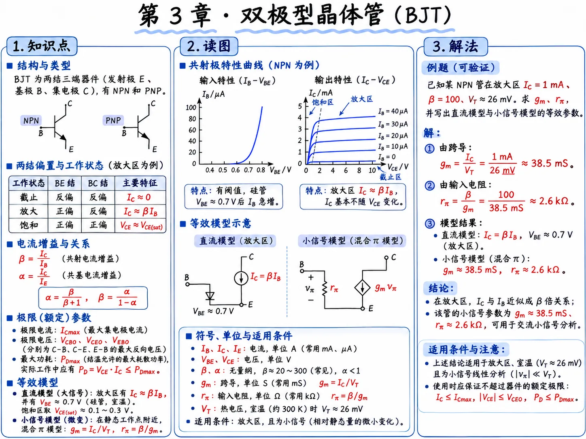
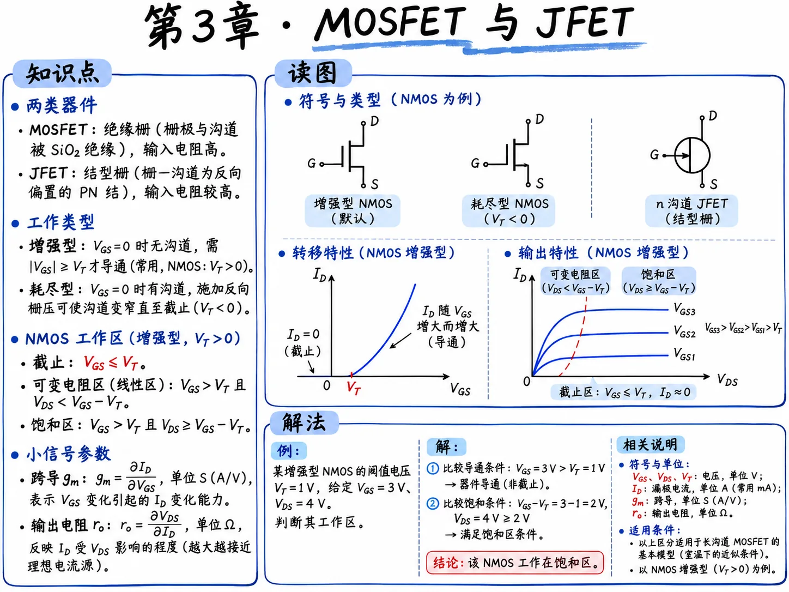
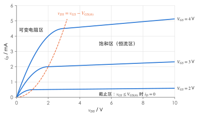
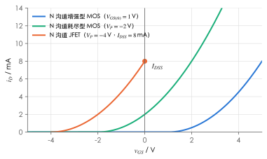

# 双极型晶体管与场效应管

!!! abstract "TL;DR"
    - **BJT** 是电流控制器件：放大区 $I_C=\beta I_B$，$I_E=I_B+I_C$。条件是**发射结正偏、集电结反偏**；NPN 放大时 $V_C>V_B>V_E$，PNP 相反。
    - 直流分析先**假设放大区**（$V_{BE}=0.7\,\mathrm V$、$I_C=\beta I_B$），再验证 $V_{CE}>V_{CE(sat)}\approx0.2\,\mathrm V$；不满足就是饱和，$I_C<\beta I_B$ 由外电路决定。
    - 小信号用混合 π 模型：$g_m=\dfrac{I_C}{V_T}$，$r_\pi=\dfrac{\beta}{g_m}$，$r_o=\dfrac{V_A}{I_C}$。
    - **FET** 是电压控制器件，栅极几乎不取电流。N 沟道增强型 MOS：$v_{GS}>V_{GS(th)}$ 导通，$v_{DS}\ge v_{GS}-V_{GS(th)}$ 时进入**饱和区**（恒流区，放大用），$i_D=K(v_{GS}-V_{GS(th)})^2$；JFET 与耗尽型 MOS：$i_D=I_{DSS}(1-v_{GS}/V_P)^2$。
    - 名称陷阱：**MOS 的"饱和区"对应 BJT 的"放大区"**，BJT 的"饱和区"反而对应 MOS 的可变电阻区。

??? info "本章图卡（AI 生成速览，错误见文末「图卡勘误」）"
    { loading=lazy }
    { loading=lazy }

## 1. BJT 的结构与电流分配

{ .circuit }

BJT 由两个背靠背的 PN 结构成：发射结（BE）和集电结（BC）。结构上**发射区高掺杂、基区很薄且轻掺杂、集电结面积大**——这是它能放大而两个分立二极管不能的原因。符号中的箭头画在发射极上，指向 PN 结的正向电流方向：NPN 向外，PNP 指向基极。

放大区内的载流子过程（以 NPN 为例）：发射结正偏，发射区向基区注入大量电子；基区薄，只有少部分电子与空穴复合形成 $I_B$；绝大部分扩散到集电结边缘，被反偏集电结的电场拉入集电区形成 $I_C$。于是

$$
I_E=I_B+I_C,\qquad \alpha=\frac{I_C}{I_E}\ (\text{略小于 1}),\qquad \beta=\frac{I_C}{I_B}=\frac{\alpha}{1-\alpha},\qquad \alpha=\frac{\beta}{1+\beta}.
$$

$\beta$ 一般为几十到几百，同型号离散性大，且随温度、$I_C$ 变化，所以好的电路设计不应依赖 $\beta$ 的准确值。

考虑集电结反向饱和电流 $I_{CBO}$ 时更准确的关系是 $I_C=\beta I_B+I_{CEO}$，**穿透电流** $I_{CEO}=(1+\beta)I_{CBO}$。硅管 $I_{CBO}$ 为 nA 级，一般可忽略；它随温度指数增长，是 BJT 温漂的来源之一。

## 2. 三种工作状态

| 状态 | 发射结 | 集电结 | 特征（NPN） | 用途 |
| --- | --- | --- | --- | --- |
| 截止 | 反偏（或 $V_{BE}<V_{th}$） | 反偏 | $I_B\approx0$，$I_C\approx0$，C–E 相当于断开 | 开关"断" |
| 放大 | 正偏 | 反偏 | $I_C=\beta I_B$，$V_{BE}\approx0.7\,\mathrm V$，$V_{CE}>V_{CE(sat)}$ | 放大电路 |
| 饱和 | 正偏 | 正偏 | $V_{CE}=V_{CE(sat)}\approx0.1\sim0.3\,\mathrm V$，$I_C<\beta I_B$ | 开关"通" |
| 倒置 | 反偏 | 正偏 | $\beta$ 很小 | 很少使用 |

**由电位判断**（硅 NPN）：$V_{BE}<0.5\,\mathrm V$ 截止；$V_{BE}\approx0.7\,\mathrm V$ 且 $V_C>V_B$ 放大；$V_{BE}\approx0.7\,\mathrm V$ 且 $V_C<V_B$（$V_{CE}$ 只剩零点几伏）饱和。PNP 所有电压反号。

**由放大区的三个管脚电位判断管型、材料与管脚**（常考）：

1. 找电位差为 $0.6\sim0.8\,\mathrm V$（硅）或 $0.2\sim0.3\,\mathrm V$（锗）的两个脚，它们是 B、E，另一脚是 C；
2. C 电位最高 → NPN；C 电位最低 → PNP；
3. B 的电位居中：NPN 中 B 比 E 高，PNP 中 B 比 E 低。

??? example "例：由管脚电位判断"
    两只放大区的晶体管，三脚电位分别为（1）$2.0\,\mathrm V$、$2.7\,\mathrm V$、$6.0\,\mathrm V$；（2）$-6.0\,\mathrm V$、$-2.2\,\mathrm V$、$-2.0\,\mathrm V$。

    1. $2.7-2.0=0.7\,\mathrm V$ → 硅管，这两脚为 B、E；$6.0\,\mathrm V$ 为 C 且最高 → **NPN**；B $=2.7\,\mathrm V$，E $=2.0\,\mathrm V$。验证 $V_C>V_B>V_E$ ✓。
    2. $-2.0-(-2.2)=0.2\,\mathrm V$ → 锗管；$-6.0\,\mathrm V$ 为 C 且最低 → **PNP**；PNP 的 B 比 E 低，所以 B $=-2.2\,\mathrm V$，E $=-2.0\,\mathrm V$。验证 $V_E>V_B>V_C$ ✓。

## 3. 特性曲线与参数

共射接法下有两组曲线：

{ .circuit }

**输入特性** $i_B=f(v_{BE})\big|_{v_{CE}}$：与二极管正向特性相同，有死区（硅约 $0.5\,\mathrm V$），导通后 $v_{BE}\approx0.6\sim0.8\,\mathrm V$。$v_{CE}$ 从 0 增大时曲线右移（集电结由正偏变反偏，基区复合减少），$v_{CE}\ge1\,\mathrm V$ 后基本重合。

{ .circuit }

**输出特性** $i_C=f(v_{CE})\big|_{i_B}$，三个区域：

- **放大区**：曲线近似水平、等间隔，$\Delta i_C=\beta\Delta i_B$；
- **饱和区**：靠近纵轴的陡升段，$i_C$ 不再受 $i_B$ 控制；虚线 $v_{CE}=v_{BE}$（$v_{CB}=0$）是临界饱和线；
- **截止区**：$i_B\le0$ 那条曲线以下，$i_C\approx I_{CEO}\approx0$。

放大区曲线并不完全水平：$v_{CE}$ 增大使集电结耗尽层变宽、有效基区变窄，$i_C$ 略增，称**基区宽度调制效应**（厄利效应）。把各曲线反向延长，交横轴于 $-V_A$（**厄利电压**，几十到几百伏），输出电阻

$$
r_o=\frac{\partial v_{CE}}{\partial i_C}\Big|_{Q}\approx\frac{V_A}{I_C}.
$$

**极限参数**：最大集电极电流 $I_{CM}$（超过后 $\beta$ 明显下降）；最大集电极耗散功率 $P_{CM}$，要求 $P_C=V_{CE}I_C\le P_{CM}$（输出特性上是一条双曲线）；反向击穿电压 $V_{(BR)CEO}$（基极开路时 C–E 间）、$V_{(BR)CBO}$、$V_{(BR)EBO}$，其中 $V_{(BR)EBO}$ 只有几伏，发射结不能承受大反压。安全工作区由这三条边界围成。

**温度的影响**：温度每升 $1^\circ\mathrm C$，$V_{BE}$ 约降 $2\,\mathrm{mV}$，$\beta$ 约增 $0.5\%\sim1\%$，$I_{CBO}$ 约每 $10^\circ\mathrm C$ 翻倍——三者都使 $I_C$ 增大，这就是 [基本放大电路](basic-amplifiers.md) 要用分压偏置和射极电阻稳定 $Q$ 点的原因。

## 4. BJT 的直流分析

**直流模型（放大区）**：B–E 间是恒压降 $V_{BE(on)}=0.7\,\mathrm V$（硅）；C–E 间是受控电流源 $\beta I_B$。**饱和区**：B–E 仍为 $0.7\,\mathrm V$，C–E 间为 $V_{CE(sat)}\approx0.2\,\mathrm V$ 的电压源。

**步骤**：

1. 判断发射结是否正偏；不正偏则截止，$I_B=I_C=0$。
2. 假设放大区：由基极回路 KVL 求 $I_B$，$I_C=\beta I_B$，再由集电极回路求 $V_{CE}$。
3. 验证 $V_{CE}>V_{CE(sat)}$（或 $V_C>V_B$）。不满足则改为饱和：$V_{CE}=V_{CE(sat)}$，$I_C=I_{C(sat)}$ 由集电极回路求出，此时 $I_C<\beta I_B$。

也可以先算临界饱和电流 $I_{C(sat)}=\dfrac{V_{CC}-V_{CE(sat)}}{R_C}$，若 $\beta I_B>I_{C(sat)}$ 则饱和。

??? example "例：固定偏置电路的工作状态"
    { .circuit }

    硅管 $\beta=100$，$V_{CE(sat)}=0.2\,\mathrm V$。（1）求 $Q$ 点；（2）$R_B$ 改为 $113\,\mathrm{k\Omega}$ 时管子处于什么状态？（3）$R_B$ 小于多少时饱和？

    1. 基极回路：$I_B=\dfrac{12-0.7}{565}=0.02\,\mathrm{mA}=20\,\mu\mathrm A$；设放大区，$I_C=100\times0.02=2\,\mathrm{mA}$；$V_{CE}=12-2\times3=6\,\mathrm V>0.2\,\mathrm V$ ✓，放大区。管耗 $P_C=6\times2=12\,\mathrm{mW}$。
    2. $I_B=\dfrac{11.3}{113}=0.1\,\mathrm{mA}$，若放大则 $I_C=10\,\mathrm{mA}$，$V_{CE}=12-30=-18\,\mathrm V$，不可能 → **饱和**。$I_C=\dfrac{12-0.2}{3}\approx3.93\,\mathrm{mA}$，此时 $I_C/I_B\approx39<\beta$。
    3. 临界：$\beta I_B=I_{C(sat)}=3.93\,\mathrm{mA}\Rightarrow I_B=39.3\,\mu\mathrm A$，$R_B=\dfrac{11.3}{0.0393}\approx287\,\mathrm{k\Omega}$。$R_B<287\,\mathrm{k\Omega}$ 时饱和。

## 5. BJT 小信号模型

在 $Q$ 点附近叠加小信号时，用线性化的**混合 π 模型**（低频，忽略结电容）：

{ .circuit }

$$
g_m=\frac{\partial i_C}{\partial v_{BE}}\Big|_Q=\frac{I_C}{V_T},\qquad r_\pi=\frac{\partial v_{BE}}{\partial i_B}\Big|_Q=\frac{\beta}{g_m}=\frac{V_T}{I_B},\qquad r_o=\frac{V_A}{I_C}.
$$

$g_m$ 来自 $i_C=I_Se^{v_{BE}/V_T}$ 的导数，只取决于 $I_C$，与管子型号无关。本征电压增益上限 $g_mr_o=V_A/V_T$，可达数千。线性化要求 $|v_{be}|\ll V_T$（通常 $5\sim10\,\mathrm{mV}$ 以下）。

不少教材用 H 参数的 $r_{be}$：$r_{be}=r_{bb'}+(1+\beta)\dfrac{V_T}{I_E}$，$r_{bb'}$ 为基区体电阻（常取 $200\,\Omega$ 左右）；$r_{bb'}$ 可忽略时 $r_{be}\approx r_\pi$。受控源写成 $\beta i_b$ 与写成 $g_mv_\pi$ 等价（$\beta i_b=\beta\dfrac{v_\pi}{r_\pi}=g_mv_\pi$）。

小信号模型对 PNP 完全相同（参数用电流的绝对值）。高频时还要在 B–E、B–C 间加 $C_\pi$、$C_\mu$，见 [频率响应](frequency-response.md)。

??? example "例：小信号参数（图卡 06 例的补充）"
    NPN 管 $I_C=1\,\mathrm{mA}$，$\beta=100$，$V_A=100\,\mathrm V$，$V_T=26\,\mathrm{mV}$，$r_{bb'}=200\,\Omega$。求 $g_m$、$r_\pi$、$r_o$、$g_mr_o$ 和 $r_{be}$。

    1. $g_m=\dfrac{1\,\mathrm{mA}}{26\,\mathrm{mV}}\approx38.5\,\mathrm{mS}$。
    2. $r_\pi=\dfrac{100}{38.5\,\mathrm{mS}}=2.6\,\mathrm{k\Omega}$（等价地 $V_T/I_B=26\,\mathrm{mV}/10\,\mu\mathrm A$）。
    3. $r_o=\dfrac{100\,\mathrm V}{1\,\mathrm{mA}}=100\,\mathrm{k\Omega}$；$g_mr_o\approx3846$。
    4. $I_E=1.01\,\mathrm{mA}$，$r_{be}=200+101\times\dfrac{26}{1.01}=200+2600=2.8\,\mathrm{k\Omega}$。

    直流模型（$V_{BE}=0.7\,\mathrm V$、$I_C=\beta I_B$）只用来求 $Q$ 点；交流计算只用 $g_m$、$r_\pi$、$r_o$，二者不能混用。

## 6. 场效应管

### 分类与符号

{ .circuit }

| 类型 | 栅极 | $v_{GS}=0$ 时 | 导通条件（N 沟道） | 参数 |
| --- | --- | --- | --- | --- |
| 增强型 MOS | $\mathrm{SiO_2}$ 绝缘，$R_{GS}>10^{9}\,\Omega$ | 无沟道 | $v_{GS}>V_{GS(th)}>0$ | 开启电压 $V_{GS(th)}$ |
| 耗尽型 MOS | 绝缘 | 已有沟道 | $v_{GS}>V_P$（$V_P<0$），$v_{GS}$ 可正可负 | 夹断电压 $V_P$（$V_{GS(off)}$）、$I_{DSS}$ |
| JFET | 反偏 PN 结，$R_{GS}\sim10^{7}\,\Omega$ 以上 | 已有沟道（属耗尽型） | $V_P<v_{GS}\le0$，栅结不能正偏 | $V_P$、$I_{DSS}$ |

符号规律：MOS 管沟道线**断开为增强型、连续为耗尽型**；衬底（或 JFET 栅极）箭头由 P 指向 N，所以 N 沟道箭头指向沟道、P 沟道箭头背离沟道。P 沟道器件所有电压、电流反号（例如增强型 PMOS 要求 $v_{GS}<V_{GS(th)}<0$）。

### N 沟道增强型 MOS 的电流方程

记 $K=\dfrac12\mu_nC_{ox}\dfrac WL$（单位 $\mathrm{mA/V^2}$），过驱动电压 $V_{ov}=v_{GS}-V_{GS(th)}$：

| 区域 | 条件 | 电流 |
| --- | --- | --- |
| 截止区 | $v_{GS}\le V_{GS(th)}$ | $i_D=0$ |
| 可变电阻区（三极管区） | $v_{GS}>V_{GS(th)}$，$v_{DS}<v_{GS}-V_{GS(th)}$ | $i_D=K\big[2(v_{GS}-V_{GS(th)})v_{DS}-v_{DS}^2\big]$；$v_{DS}$ 很小时 $i_D\approx2KV_{ov}v_{DS}$，相当于受 $v_{GS}$ 控制的电阻 |
| 饱和区（恒流区） | $v_{GS}>V_{GS(th)}$，$v_{DS}\ge v_{GS}-V_{GS(th)}$ | $i_D=K(v_{GS}-V_{GS(th)})^2(1+\lambda v_{DS})$ |

有的教材写作 $i_D=I_{DO}\Big(\dfrac{v_{GS}}{V_{GS(th)}}-1\Big)^2$，其中 $I_{DO}=KV_{GS(th)}^2$，两者等价。

{ .circuit }

$v_{DS}=v_{GS}-V_{GS(th)}$ 是两区分界（漏端沟道恰好**预夹断**），在输出特性上是抛物线 $i_D=Kv_{DS}^2$。饱和区中 $v_{DS}$ 再增大，夹断点略向源端移动，有效沟道变短，$i_D$ 微增——**沟道长度调制**，$\lambda$ 对应 BJT 的 $1/V_A$。

**判区步骤**：先比较 $v_{GS}$ 与 $V_{GS(th)}$ 定截止与否；再比较 $v_{DS}$ 与 $v_{GS}-V_{GS(th)}$。偏置电路中 $v_{DS}$ 未知时，先设饱和区求 $I_D$，再验证 $V_{DS}\ge V_{GS}-V_{GS(th)}$。

### 耗尽型 MOS 与 JFET

饱和区电流

$$
i_D=I_{DSS}\Big(1-\frac{v_{GS}}{V_P}\Big)^2,\qquad V_P<v_{GS}\ (\text{JFET 还要求 } v_{GS}\le0),
$$

$I_{DSS}$ 是 $v_{GS}=0$ 时的饱和漏极电流；预夹断条件为 $v_{DS}\ge v_{GS}-V_P$。三类 N 沟道管的转移特性对比：

{ .circuit }

耗尽型 MOS 的方程也可写成 $K(v_{GS}-V_P)^2$ 的形式，$I_{DSS}=KV_P^2$——与增强型只差把 $V_{GS(th)}$ 换成负的 $V_P$。

### FET 小信号参数

$$
g_m=\frac{\partial i_D}{\partial v_{GS}}\Big|_Q=2K(V_{GS}-V_{GS(th)})=2\sqrt{KI_D}=\frac{2I_D}{V_{GS}-V_{GS(th)}},\qquad r_o=\frac{1}{\lambda I_D}.
$$

JFET：$g_m=-\dfrac{2I_{DSS}}{V_P}\Big(1-\dfrac{V_{GS}}{V_P}\Big)$。小信号模型：G–S 间开路，D–S 间为 $g_mv_{gs}$ 并 $r_o$——即混合 π 模型令 $r_\pi\to\infty$。

同样的电流下，MOS 管的 $g_m=\dfrac{2I_D}{V_{ov}}$ 比 BJT 的 $\dfrac{I_C}{V_T}$ 小（$V_{ov}$ 一般为零点几伏，远大于 $V_T/2=13\,\mathrm{mV}$），所以 FET 放大电路的电压增益通常低于 BJT 电路。

??? example "例：判断工作区并求电流（图卡 07 例的扩展）"
    增强型 NMOS $V_{GS(th)}=1\,\mathrm V$，$K=0.5\,\mathrm{mA/V^2}$，$\lambda=0.02\,\mathrm V^{-1}$（计算 $I_D$ 时忽略）。（1）$V_{GS}=3\,\mathrm V$、$V_{DS}=4\,\mathrm V$；（2）$V_{GS}=3\,\mathrm V$、$V_{DS}=1\,\mathrm V$。

    1. $V_{GS}=3>V_{GS(th)}$，导通；$V_{GS}-V_{GS(th)}=2\,\mathrm V$，$V_{DS}=4\ge2$ → **饱和区**。$I_D=0.5\times2^2=2\,\mathrm{mA}$；$g_m=2\times0.5\times2=2\,\mathrm{mS}$（或 $2\sqrt{0.5\times2}=2\,\mathrm{mS}$）；$r_o=\dfrac{1}{0.02\times2\,\mathrm{mA}}=25\,\mathrm{k\Omega}$。
    2. $V_{DS}=1<2$ → **可变电阻区**。$I_D=0.5\times(2\times2\times1-1^2)=1.5\,\mathrm{mA}$。

??? example "例：分压偏置 NMOS 的 Q 点"
    { .circuit }

    $V_{GS(th)}=1\,\mathrm V$，$K=0.5\,\mathrm{mA/V^2}$，忽略 $\lambda$。求 $I_D$、$V_{GS}$、$V_{DS}$ 及 $g_m$。

    1. 栅极不取电流，$V_G=12\times\dfrac{100}{200+100}=4\,\mathrm V$；$V_S=I_DR_S$，$V_{GS}=4-I_D$（mA、kΩ）。
    2. 设饱和区：$I_D=0.5(4-I_D-1)^2\Rightarrow I_D^2-8I_D+9=0$，$I_D=4\mp\sqrt7$。
    3. 舍根：$I_D=6.65\,\mathrm{mA}$ 时 $V_{GS}=-2.65\,\mathrm V<V_{GS(th)}$，管子应截止，矛盾；取 $I_D=4-\sqrt7\approx1.35\,\mathrm{mA}$，$V_{GS}\approx2.65\,\mathrm V$。
    4. $V_{DS}=12-1.354\times(3+1)\approx6.58\,\mathrm V\ge V_{GS}-V_{GS(th)}=1.65\,\mathrm V$ ✓，饱和区成立。
    5. $g_m=2\times0.5\times1.65\approx1.65\,\mathrm{mS}$。

    $R_S$ 引入直流负反馈：$I_D$ 增大 → $V_S$ 升高 → $V_{GS}$ 减小 → $I_D$ 回落，所以 $Q$ 点对 $K$、$V_{GS(th)}$ 的离散不敏感。

??? example "例：JFET 的电流与跨导"
    N 沟道 JFET $I_{DSS}=8\,\mathrm{mA}$，$V_P=-4\,\mathrm V$，饱和区 $V_{GS}=-2\,\mathrm V$。

    1. $I_D=8\Big(1-\dfrac{-2}{-4}\Big)^2=8\times0.25=2\,\mathrm{mA}$。
    2. $g_m=-\dfrac{2\times8}{-4}\Big(1-\dfrac{-2}{-4}\Big)=4\times0.5=2\,\mathrm{mS}$。

## 7. BJT 与 FET 对比

| | BJT | FET |
| --- | --- | --- |
| 控制方式 | 电流控制（$i_B$ 控制 $i_C$），实质由 $v_{BE}$ 指数控制 | 电压控制（$v_{GS}$ 控制 $i_D$），平方律 |
| 导电载流子 | 多子与少子都参与（双极型） | 只有多子（单极型），温度稳定性较好 |
| 输入电阻 | $r_\pi$，千欧级 | JFET $10^7\,\Omega$ 以上，MOS $10^9\,\Omega$ 以上 |
| 同电流下跨导 | 大，$I_C/V_T$ | 较小，$2I_D/V_{ov}$ |
| 放大区名称 | 放大区 | 饱和区（恒流区） |
| 开关导通区名称 | 饱和区 | 可变电阻区 |
| 其他 | 噪声、匹配好，速度快 | 集成度高、功耗低；MOS 栅极易被静电击穿 |

## 练习

### 1. 概念判断 :material-star::material-star-outline::material-star-outline:

1. 把两只二极管背靠背连接，也能实现晶体管的电流放大作用。
2. NPN 管处于饱和区时，$I_C=\beta I_B$ 仍然成立。
3. MOS 管工作在饱和区时，$i_D$ 基本不随 $v_{DS}$ 变化。
4. N 沟道 JFET 的栅源电压可以取正值以增大漏极电流。
5. 同样的静态电流下，BJT 的跨导一般大于 MOS 管。

??? success "答案"
    1 ✗　2 ✗　3 ✓　4 ✗　5 ✓

??? note "解析"
    1. 放大依赖薄而轻掺杂的基区，让注入的载流子绝大部分扩散到集电结；两只分立二极管之间没有这样的基区。
    2. 饱和时 $I_C$ 由外电路限定，$I_C<\beta I_B$。
    3. 饱和区即恒流区，只有沟道长度调制带来的微小变化。
    4. JFET 栅结正偏会产生很大栅流，失去电压控制的意义；只能 $V_P<v_{GS}\le0$。
    5. $I_C/V_T$ 对 $2I_D/V_{ov}$，$V_{ov}$ 一般远大于 $2V_T$。

### 2. 判断管型与工作状态 :material-star::material-star-outline::material-star-outline:

（1）放大区晶体管三脚电位 $12\,\mathrm V$、$11.3\,\mathrm V$、$6\,\mathrm V$，判断管型、材料与各脚；（2）同上，电位 $5\,\mathrm V$、$1.2\,\mathrm V$、$0.5\,\mathrm V$；（3）某硅 NPN 管实测 $V_B=0.7\,\mathrm V$、$V_E=0$、$V_C=0.2\,\mathrm V$；（4）某硅 NPN 管 $V_B=-1\,\mathrm V$、$V_E=0$、$V_C=5\,\mathrm V$。判断（3）（4）的工作状态。

??? success "答案"
    （1）硅 PNP，E $=12$、B $=11.3$、C $=6\,\mathrm V$；（2）硅 NPN，E $=0.5$、B $=1.2$、C $=5\,\mathrm V$；（3）饱和；（4）截止。

??? note "解析"
    1. $12-11.3=0.7\,\mathrm V$ → 硅；$6\,\mathrm V$ 是 C 且最低 → PNP，B 比 E 低。
    2. $1.2-0.5=0.7\,\mathrm V$ → 硅；$5\,\mathrm V$ 是 C 且最高 → NPN，B 比 E 高。
    3. 发射结正偏，$V_C<V_B$ 集电结也正偏，$V_{CE}=0.2\,\mathrm V$ → 饱和。
    4. 发射结反偏，集电结反偏 → 截止。

### 3. 带射极电阻的偏置 :material-star::material-star::material-star-outline:

{ .circuit }

硅管 $\beta=100$，求 $I_B$、$I_C$、$V_{CE}$，并判断工作状态。

??? success "答案"
    $I_B\approx21.3\,\mu\mathrm A$，$I_C\approx2.13\,\mathrm{mA}$，$V_{CE}\approx5.59\,\mathrm V$，放大区。

??? note "解析"
    1. 基极回路 KVL：$12=I_BR_B+0.7+(1+\beta)I_BR_E$，
        $$
        I_B=\frac{12-0.7}{430+101\times1}=\frac{11.3}{531}\approx0.0213\,\mathrm{mA}.
        $$
        $R_E$ 折算到基极回路要乘 $(1+\beta)$，因为流过它的是 $I_E$。
    2. $I_C=100I_B\approx2.128\,\mathrm{mA}$，$I_E\approx2.149\,\mathrm{mA}$。
    3. $V_{CE}=12-2.128\times2-2.149\times1\approx5.59\,\mathrm V>0.2\,\mathrm V$ → 放大区 ✓。

### 4. MOS 管判区 :material-star::material-star-outline::material-star-outline:

增强型 NMOS $V_{GS(th)}=1\,\mathrm V$，$K=0.5\,\mathrm{mA/V^2}$。判断工作区并求 $I_D$：（1）$V_{GS}=0.8\,\mathrm V$，$V_{DS}=5\,\mathrm V$；（2）$V_{GS}=2.5\,\mathrm V$，$V_{DS}=0.5\,\mathrm V$；（3）$V_{GS}=2.5\,\mathrm V$，$V_{DS}=5\,\mathrm V$。（4）增强型 PMOS $V_{GS(th)}=-1\,\mathrm V$，$K=0.5\,\mathrm{mA/V^2}$，$V_{GS}=-3\,\mathrm V$，$V_{DS}=-1\,\mathrm V$。

??? success "答案"
    （1）截止，0；（2）可变电阻区，$0.625\,\mathrm{mA}$；（3）饱和区，$1.125\,\mathrm{mA}$；（4）可变电阻区，$|I_D|=1.5\,\mathrm{mA}$。

??? note "解析"
    1. $V_{GS}<V_{GS(th)}$，无沟道。
    2. $V_{ov}=1.5\,\mathrm V$，$V_{DS}=0.5<1.5$：$I_D=0.5(2\times1.5\times0.5-0.25)=0.625\,\mathrm{mA}$。
    3. $V_{DS}=5\ge1.5$：$I_D=0.5\times1.5^2=1.125\,\mathrm{mA}$。
    4. PMOS 全部取反：$V_{SG}=3>|V_{GS(th)}|=1$ 导通，$|V_{ov}|=2\,\mathrm V$；$V_{SD}=1<2$ → 可变电阻区，$|I_D|=0.5(2\times2\times1-1)=1.5\,\mathrm{mA}$，电流从源极流向漏极。

### 5. JFET 自偏压 :material-star::material-star::material-star:

N 沟道 JFET $I_{DSS}=8\,\mathrm{mA}$，$V_P=-4\,\mathrm V$，栅极经大电阻接地，源极接 $R_S=1\,\mathrm{k\Omega}$ 到地，漏极经 $R_D$ 接正电源（保证饱和区）。求 $I_D$、$V_{GS}$。

??? success "答案"
    $I_D=2\,\mathrm{mA}$，$V_{GS}=-2\,\mathrm V$。

??? note "解析"
    1. 栅流为零，$V_G=0$，$V_{GS}=-I_DR_S=-I_D$（mA、kΩ）。
    2. 代入 $I_D=8\Big(1-\dfrac{-I_D}{-4}\Big)^2=8\Big(1-\dfrac{I_D}{4}\Big)^2$，整理得 $I_D^2-10I_D+16=0$，$I_D=2$ 或 $8\,\mathrm{mA}$。
    3. $I_D=8\,\mathrm{mA}$ 时 $V_{GS}=-8\,\mathrm V<V_P$，管子已夹断，舍去。所以 $I_D=2\,\mathrm{mA}$，$V_{GS}=-2\,\mathrm V$。

    耗尽型器件 $v_{GS}=0$ 时就有电流，所以可以靠源极电阻自己产生负栅压，不需要另加负电源；增强型 MOS 不能用这种自偏压。

## 图卡勘误

| 图卡位置 | 原文 | 更正 |
| --- | --- | --- |
| 06 知识点·结构与类型 | PNP 符号的发射极箭头与 NPN 一样向外 | PNP 的箭头应**指向基极**（向内），见第 1 节图 |
| 06 两结偏置表 | 只列截止、放大、饱和 | 截止的确切条件是发射结电压小于开启电压（不必反偏）；另有发射结反偏、集电结正偏的倒置状态 |
| 06 读图·输入特性 | "有阈值，$V_{BE}\approx0.7\,\mathrm V$ 后 $I_B$ 急增" | 开启电压约 $0.5\,\mathrm V$，$0.6\sim0.7\,\mathrm V$ 是导通后的典型值；且曲线随 $V_{CE}$ 有移动，应注明 $V_{CE}\ge1\,\mathrm V$ |
| 06 读图·输出特性 | 放大区"$I_C$ 基本不随 $V_{CE}$ 变化"，曲线画得水平 | 有厄利效应，曲线略上倾，$r_o=V_A/I_C$；截止区应指 $I_B=0$ 曲线以下的区域，而非横轴右端 |
| 06 等效模型 | 直流模型只画二极管与 $\beta I_B$；小信号模型缺 $r_o$ | 直流模型中的二极管应理解为恒压降 $0.7\,\mathrm V$，仅适用于放大区；完整的低频混合 π 模型还有 $r_o$（及 $r_{bb'}$） |
| 06 极限参数 | $V_{CBO}$、$V_{CEO}$、$V_{EBO}$；"$\lvert V_{CE}\rvert\le V_{CEO}$" | 应写反向击穿电压 $V_{(BR)CBO}$、$V_{(BR)CEO}$、$V_{(BR)EBO}$（第三极开路时测得）；$V_{(BR)EBO}$ 只有几伏 |
| 07 读图·符号 | 增强型 NMOS 画成连续沟道线且无箭头 | 增强型应画断开的沟道线，并用衬底箭头（N 沟道指向沟道）区分 N/P；连续线是耗尽型的画法 |
| 07 知识点·增强型 | "需 $\lvert V_{GS}\rvert\ge V_T$ 才导通" | NMOS 为 $V_{GS}>V_{GS(th)}$（$V_{GS(th)}>0$）；PMOS 为 $V_{GS}<V_{GS(th)}$（$V_{GS(th)}<0$）；取绝对值的写法对 $V_{GS(th)}$ 的符号含糊 |
| 07 知识点·耗尽型 | 耗尽型 NMOS 用 $V_T<0$ | 教材常用夹断电压 $V_P$（$V_{GS(off)}$）与 $I_{DSS}$ 描述，方程 $i_D=I_{DSS}(1-v_{GS}/V_P)^2$ |
| 07 知识点 | JFET 只给结构，没有工作条件与方程 | JFET 属耗尽型，N 沟道要求 $V_P<v_{GS}\le0$，饱和区 $i_D=I_{DSS}(1-v_{GS}/V_P)^2$，见第 6 节 |
| 07 小信号参数 | 只给 $g_m$、$r_o$ 的定义 | 应给出可计算的 $g_m=2K(V_{GS}-V_{GS(th)})=2\sqrt{KI_D}$、$r_o=1/(\lambda I_D)$ |
| 07 读图·输出特性 | 饱和区曲线完全水平 | 实际有沟道长度调制，曲线略上倾；另需注意 MOS"饱和区"对应 BJT"放大区"，名称相反 |
