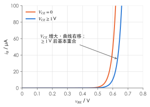
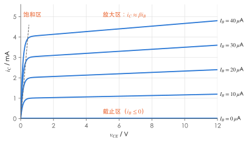

# 双极型晶体管与场效应管

!!! abstract "本章要点"
    - BJT 用小的基极电流控制大的集电极电流，放大区 $I_C=\beta I_B$。
    - BJT 放大的条件是发射结正偏、集电结反偏；NPN 放大时 $V_C>V_B>V_E$。
    - 直流分析先假设放大区，再验证 $V_{CE}>V_{CE(sat)}$；不满足就是饱和。
    - 小信号分析只用三个参数：$g_m$、$r_\pi$、$r_o$，它们都由静态电流决定。
    - FET 用栅源电压控制漏极电流，栅极几乎不取电流；注意 MOS 的"饱和区"对应 BJT 的"放大区"。

??? info "本章图卡"
    { loading=lazy }
    { loading=lazy }

!!! note "知识点清单"
    **BJT 基础**

    - [ ] 结构：三个区、两个结、三个极；NPN 与 PNP 符号
    - [ ] 能放大的结构条件
    - [ ] 放大区的载流子传输过程
    - [ ] 电流分配：$I_E=I_B+I_C$，$\alpha$ 与 $\beta$
    - [ ] 穿透电流 $I_{CEO}$
    - [ ] 三种接法：共射、共基、共集

    **工作状态与特性**

    - [ ] 截止、放大、饱和、倒置四种状态
    - [ ] 由电位判断工作状态
    - [ ] 由三个管脚电位判断管型、材料与管脚
    - [ ] 输入特性
    - [ ] 输出特性的三个区
    - [ ] 厄利效应与输出电阻 $r_o$
    - [ ] 极限参数与安全工作区
    - [ ] 温度对 BJT 的影响

    **BJT 分析**

    - [ ] 直流模型与"假设—验证"步骤
    - [ ] 临界饱和判据
    - [ ] 混合 π 小信号模型：$g_m$、$r_\pi$、$r_o$

    **场效应管**

    - [ ] FET 的分类与符号
    - [ ] MOS 管沟道的形成（增强型 NMOS 的工作原理）
    - [ ] 增强型 NMOS 的三个工作区与电流方程
    - [ ] 预夹断与沟道长度调制
    - [ ] 判区步骤；PMOS 的符号规则
    - [ ] 耗尽型 MOS 与 JFET 的电流方程
    - [ ] FET 小信号参数：$g_m$、$r_o$
    - [ ] FET 的偏置：分压偏置与自偏压
    - [ ] BJT 与 FET 的对比，以及"饱和区"名称陷阱

## 1. BJT 的结构与电流分配

### 1.1 结构与符号

{ .circuit }

双极型晶体管（BJT）由三块半导体叠成，像两个背靠背的 PN 结。

| 组成 | 名称 |
| --- | --- |
| 三个区 | 发射区、基区、集电区 |
| 两个结 | 发射结（BE 之间）、集电结（BC 之间） |
| 三个极 | 发射极 E、基极 B、集电极 C |

按排列分 NPN 和 PNP 两种。符号里的箭头画在发射极上，指向发射结的正向电流方向：

- NPN：箭头**向外**。
- PNP：箭头**指向基极**。

### 1.2 能放大的结构条件

BJT 的三个区在掺杂和尺寸上有特殊安排：

| 区域 | 特点 | 作用 |
| --- | --- | --- |
| 发射区 | 高掺杂 | 能发射大量载流子 |
| 基区 | **很薄、轻掺杂** | 载流子穿过时很少被复合 |
| 集电结 | 面积大 | 便于收集载流子 |

!!! warning "易错"
    - 两只分立二极管背靠背连接**不能**放大。它们之间没有又薄又轻掺杂的基区。

### 1.3 放大区的载流子传输

放大区的条件是**发射结正偏、集电结反偏**。

以 NPN 为例：

发射结正偏 → 发射区向基区注入大量电子 → 基区很薄，只有少数电子与空穴复合（形成 $I_B$）→ 绝大部分电子扩散到集电结边缘 → 被反偏集电结的电场拉进集电区（形成 $I_C$）。

### 1.4 电流分配：α 与 β

$$
I_E=I_B+I_C,\qquad \beta=\frac{I_C}{I_B},\qquad \alpha=\frac{I_C}{I_E}=\frac{\beta}{1+\beta}
$$

适用条件：放大区，忽略穿透电流。其中 $\beta$ 是共射电流放大系数（几十到几百），$\alpha$ 是共基电流放大系数（略小于 1）。反过来 $\beta=\dfrac{\alpha}{1-\alpha}$。

!!! warning "易错"
    - $\beta$ 同型号离散性大，还随温度、$I_C$ 变化。好的电路设计不应依赖 $\beta$ 的准确值。

### 1.5 穿透电流

基极开路时，C、E 之间仍有一点电流，叫穿透电流 $I_{CEO}$。

$$
I_C=\beta I_B+I_{CEO},\qquad I_{CEO}=(1+\beta)I_{CBO}
$$

适用条件：放大区。其中 $I_{CBO}$ 是集电结反向饱和电流（发射极开路时测得）。

硅管 $I_{CBO}$ 为 nA 级，一般可忽略。但它**随温度指数增长**，是 BJT 温漂的来源之一。

### 1.6 三种接法

BJT 有三个极，组成放大电路时总有一个极是输入、输出回路的公共端。按公共端分三种接法：

| 接法 | 公共端 | 输入端 | 输出端 |
| --- | --- | --- | --- |
| 共射 | E | B | C |
| 共基 | B | E | C |
| 共集 | C | B | E |

本章的特性曲线都按**共射**接法给出。三种接法的放大电路及性能对比见 [基本放大电路](basic-amplifiers.md)。

## 2. 三种工作状态

### 2.1 四种状态

两个结各有正偏、反偏，组合出四种状态。

| 状态 | 发射结 | 集电结 | 特征（NPN） | 用途 |
| --- | --- | --- | --- | --- |
| 截止 | 反偏或 $V_{BE}<V_{th}$ | 反偏 | $I_B\approx0$，$I_C\approx0$，C–E 像断开 | 开关"断" |
| 放大 | 正偏 | 反偏 | $I_C=\beta I_B$，$V_{BE}\approx0.7\,\mathrm V$ | 放大电路 |
| 饱和 | 正偏 | 正偏 | $V_{CE}=V_{CE(sat)}\approx0.1\sim0.3\,\mathrm V$，$I_C<\beta I_B$ | 开关"通" |
| 倒置 | 反偏 | 正偏 | $\beta$ 很小 | 很少使用 |

其中 $V_{th}$ 是发射结开启电压（硅约 $0.5\,\mathrm V$），$V_{CE(sat)}$ 是饱和压降。

饱和时 $I_B$ 再增大，$I_C$ 也上不去了，因为外电路（$V_{CC}$ 和 $R_C$）只能提供这么多电流。

### 2.2 由电位判断工作状态

硅 NPN：

1. $V_{BE}<0.5\,\mathrm V$：截止。
2. $V_{BE}\approx0.7\,\mathrm V$ 且 $V_C>V_B$：放大。
3. $V_{BE}\approx0.7\,\mathrm V$ 且 $V_C<V_B$（$V_{CE}$ 只剩零点几伏）：饱和。

PNP 管所有电压反号。

### 2.3 由三个管脚电位判断管型、材料与管脚

已知晶体管工作在放大区，量出三个脚的电位，就能判断它是 NPN 还是 PNP、硅还是锗、哪个脚是什么。这是常考题。

1. 找电位差为 $0.6\sim0.8\,\mathrm V$（硅）或 $0.2\sim0.3\,\mathrm V$（锗）的两个脚，它们是 B 和 E；剩下的是 C。
2. C 电位最高 → NPN；C 电位最低 → PNP。
3. B 的电位居中：NPN 中 B 比 E 高，PNP 中 B 比 E 低。

??? example "例 1：由管脚电位判断"
    两只放大区的晶体管，三脚电位分别为（1）$2.0\,\mathrm V$、$2.7\,\mathrm V$、$6.0\,\mathrm V$；（2）$-6.0\,\mathrm V$、$-2.2\,\mathrm V$、$-2.0\,\mathrm V$。

    **思路**：按三步法，先找 B、E，再看 C 的高低。

    1. （1）$2.7-2.0=0.7\,\mathrm V$ → 硅管，这两脚是 B、E。
    2. $6.0\,\mathrm V$ 是 C 且最高 → NPN。NPN 中 B 比 E 高，所以 B $=2.7\,\mathrm V$，E $=2.0\,\mathrm V$。验证 $V_C>V_B>V_E$ ✓。
    3. （2）$-2.0-(-2.2)=0.2\,\mathrm V$ → 锗管。
    4. $-6.0\,\mathrm V$ 是 C 且最低 → PNP。PNP 中 B 比 E 低，所以 B $=-2.2\,\mathrm V$，E $=-2.0\,\mathrm V$。验证 $V_E>V_B>V_C$ ✓。

    **结论**：（1）硅 NPN；（2）锗 PNP。

## 3. 特性曲线与参数

### 3.1 输入特性

{ .circuit }

$v_{CE}$ 固定时，$i_B$ 随 $v_{BE}$ 变化的曲线，记作 $i_B=f(v_{BE})\big|_{v_{CE}}$。

它和二极管的正向特性一样：

- 有死区，硅管开启电压约 $0.5\,\mathrm V$。
- 导通后 $v_{BE}\approx0.6\sim0.8\,\mathrm V$。

$v_{CE}$ 从 0 增大时，曲线右移；$v_{CE}\ge1\,\mathrm V$ 后各条曲线基本重合，所以通常只画一条。

??? tip "为什么曲线随 $v_{CE}$ 右移"
    $v_{CE}$ 很小时集电结正偏，收集电子的能力弱，更多电子在基区复合，$i_B$ 偏大。$v_{CE}$ 增大到集电结反偏后，大部分电子被集电区收走，同样 $v_{BE}$ 下 $i_B$ 变小，曲线右移。

### 3.2 输出特性的三个区

{ .circuit }

$i_B$ 固定时，$i_C$ 随 $v_{CE}$ 变化的曲线族，记作 $i_C=f(v_{CE})\big|_{i_B}$。

| 区域 | 位置 | 特点 |
| --- | --- | --- |
| 放大区 | 中间平坦部分 | 曲线近似水平、等间隔，$\Delta i_C=\beta\Delta i_B$ |
| 饱和区 | 靠近纵轴的陡升段 | $i_C$ 不再受 $i_B$ 控制 |
| 截止区 | $i_B=0$ 那条曲线以下 | $i_C\approx I_{CEO}\approx0$ |

图中虚线 $v_{CE}=v_{BE}$（即 $v_{CB}=0$）是放大区和饱和区的分界，叫**临界饱和线**。

### 3.3 厄利效应与输出电阻

放大区的曲线并不完全水平，而是略微上倾。这叫**厄利效应**，也叫基区宽度调制效应。

$v_{CE}$↑ → 集电结反偏加大，耗尽层变宽 → 有效基区变窄 → 复合更少 → $i_C$ 略增。

$$
r_o=\frac{\partial v_{CE}}{\partial i_C}\Big|_{Q}\approx\frac{V_A}{I_C}
$$

适用条件：放大区。其中 $V_A$ 是**厄利电压**（几十到几百伏）：把各条曲线向左延长，它们交横轴于 $-V_A$。$r_o$ 是 BJT 的输出电阻。

### 3.4 极限参数与安全工作区

超过这些值，管子性能变坏甚至损坏。

| 参数 | 含义 |
| --- | --- |
| 最大集电极电流 $I_{CM}$ | 超过后 $\beta$ 明显下降 |
| 最大集电极耗散功率 $P_{CM}$ | 要求 $P_C=V_{CE}I_C\le P_{CM}$，在输出特性上是一条双曲线 |
| 反向击穿电压 $V_{(BR)CEO}$ | 基极开路时 C–E 间的击穿电压 |
| 反向击穿电压 $V_{(BR)CBO}$ | 发射极开路时 C–B 间的击穿电压 |
| 反向击穿电压 $V_{(BR)EBO}$ | 集电极开路时 E–B 间的击穿电压，**只有几伏** |

$I_{CM}$、$P_{CM}$、$V_{(BR)CEO}$ 三条边界围成的区域，叫**安全工作区**。

!!! warning "易错"
    - 发射结不能承受大的反向电压，$V_{(BR)EBO}$ 只有几伏。

### 3.5 温度的影响

| 参数 | 温度升高时 |
| --- | --- |
| $V_{BE}$ | 约每 $1^\circ\mathrm C$ 降低 $2\,\mathrm{mV}$ |
| $\beta$ | 约每 $1^\circ\mathrm C$ 增大 $0.5\%\sim1\%$ |
| $I_{CBO}$ | 约每 $10^\circ\mathrm C$ 翻一倍 |

三者都使 $I_C$ 增大。温度↑ → $I_C$↑ → Q 点漂移。这就是 [基本放大电路](basic-amplifiers.md) 要用分压偏置和射极电阻稳定 Q 点的原因。

## 4. BJT 的直流分析

### 4.1 直流模型

求静态工作点时，把 BJT 换成简单的直流模型。

| 状态 | B–E 之间 | C–E 之间 |
| --- | --- | --- |
| 放大 | 恒压降 $V_{BE(on)}=0.7\,\mathrm V$（硅） | 受控电流源 $\beta I_B$ |
| 饱和 | 恒压降 $0.7\,\mathrm V$ | 电压源 $V_{CE(sat)}\approx0.2\,\mathrm V$ |
| 截止 | 开路 | 开路 |

假设—验证：

1. 判断发射结是否正偏。不正偏就是截止，$I_B=I_C=0$。
2. 假设放大区：由基极回路 KVL 求 $I_B$，$I_C=\beta I_B$，再由集电极回路求 $V_{CE}$。
3. 验证 $V_{CE}>V_{CE(sat)}$（或 $V_C>V_B$）。成立就是放大区。
4. 不成立就改为饱和：$V_{CE}=V_{CE(sat)}$，$I_C$ 由集电极回路求出，此时 $I_C<\beta I_B$。

### 4.2 临界饱和判据

先算出外电路最多能提供多少集电极电流，再和 $\beta I_B$ 比较。

$$
I_{C(sat)}=\frac{V_{CC}-V_{CE(sat)}}{R_C},\qquad \beta I_B>I_{C(sat)}\ \Rightarrow\ \text{饱和}
$$

适用条件：共射电路，集电极经 $R_C$ 接 $V_{CC}$，发射极接地。其中 $I_{C(sat)}$ 是临界饱和电流。

??? example "例 2：固定偏置电路的工作状态"
    { .circuit }

    硅管 $\beta=100$，$V_{CE(sat)}=0.2\,\mathrm V$。（1）求 Q 点；（2）$R_B$ 改为 $113\,\mathrm{k\Omega}$ 时管子处于什么状态？（3）$R_B$ 小于多少时饱和？

    **思路**：先假设放大区求 $V_{CE}$ 并验证；临界时 $\beta I_B=I_{C(sat)}$。

    1. 基极回路：$I_B=\dfrac{12-0.7}{565}=0.02\,\mathrm{mA}=20\,\mu\mathrm A$。
    2. 设放大区：$I_C=100\times0.02=2\,\mathrm{mA}$，$V_{CE}=12-2\times3=6\,\mathrm V>0.2\,\mathrm V$ ✓。管耗 $P_C=6\times2=12\,\mathrm{mW}$。
    3. $R_B=113\,\mathrm{k\Omega}$：$I_B=\dfrac{11.3}{113}=0.1\,\mathrm{mA}$。若放大，$I_C=10\,\mathrm{mA}$，$V_{CE}=12-30=-18\,\mathrm V$，不可能 → 饱和。
    4. 饱和时 $I_C=\dfrac{12-0.2}{3}\approx3.93\,\mathrm{mA}$，$I_C/I_B\approx39<\beta$。
    5. 临界：$\beta I_B=3.93\,\mathrm{mA}\Rightarrow I_B=39.3\,\mu\mathrm A$，$R_B=\dfrac{11.3}{0.0393}\approx287\,\mathrm{k\Omega}$。

    **结论**：（1）$I_C=2\,\mathrm{mA}$、$V_{CE}=6\,\mathrm V$，放大区；（2）饱和；（3）$R_B<287\,\mathrm{k\Omega}$ 时饱和。

## 5. BJT 小信号模型

Q 点附近叠加的小信号，只"看到"曲线在 Q 点的切线。把 BJT 在 Q 点线性化，得到**混合 π 模型**（低频，忽略结电容）。

{ .circuit }

模型由三部分组成：

- B–E 之间：电阻 $r_\pi$。
- C–E 之间：受控电流源 $g_mv_\pi$，并联电阻 $r_o$。
- 其中 $v_\pi$ 是 $r_\pi$ 两端的小信号电压，即 $v_{be}$。

$$
g_m=\frac{I_C}{V_T},\qquad r_\pi=\frac{\beta}{g_m}=\frac{V_T}{I_B},\qquad r_o=\frac{V_A}{I_C}
$$

适用条件：放大区，$|v_{be}|\ll V_T$（通常 $5\sim10\,\mathrm{mV}$ 以下）。其中 $g_m$ 是跨导，$V_T=26\,\mathrm{mV}$。

**为什么 $g_m=I_C/V_T$**：$i_C=I_Se^{v_{BE}/V_T}$，对 $v_{BE}$ 求导就得 $I_C/V_T$。所以 $g_m$ 只取决于 $I_C$，与管子型号无关。

1. 用直流模型求 Q 点，得 $I_C$。
2. 由 $I_C$ 算 $g_m$、$r_\pi$、$r_o$。
3. 画交流通路，BJT 换成混合 π 模型，求增益和电阻。

!!! warning "易错"
    - 直流模型（$0.7\,\mathrm V$、$\beta I_B$）只用来求 Q 点；交流计算只用 $g_m$、$r_\pi$、$r_o$。两者不能混用。
    - PNP 管的小信号模型和 NPN 完全相同，参数用电流的绝对值计算。

??? tip "$r_{be}$ 写法、本征增益与高频模型"
    - 不少教材用 H 参数的 $r_{be}$：

        $$
        r_{be}=r_{bb'}+(1+\beta)\frac{V_T}{I_E},
        $$

        $r_{bb'}$ 是基区体电阻（常取 $200\,\Omega$ 左右）。$r_{bb'}$ 可忽略时 $r_{be}\approx r_\pi$。
    - 受控源写成 $\beta i_b$ 与写成 $g_mv_\pi$ 等价：$\beta i_b=\beta\dfrac{v_\pi}{r_\pi}=g_mv_\pi$。
    - 本征电压增益上限 $g_mr_o=V_A/V_T$，可达数千。
    - 高频时还要在 B–E、B–C 间加结电容 $C_\pi$、$C_\mu$，见 [频率响应](frequency-response.md)。

??? example "例 3：小信号参数（图卡 06 例的补充）"
    NPN 管 $I_C=1\,\mathrm{mA}$，$\beta=100$，$V_A=100\,\mathrm V$，$V_T=26\,\mathrm{mV}$，$r_{bb'}=200\,\Omega$。求 $g_m$、$r_\pi$、$r_o$、$g_mr_o$ 和 $r_{be}$。

    **思路**：全部由 $I_C$ 代公式。

    1. $g_m=\dfrac{1\,\mathrm{mA}}{26\,\mathrm{mV}}\approx38.5\,\mathrm{mS}$。
    2. $r_\pi=\dfrac{100}{38.5\,\mathrm{mS}}=2.6\,\mathrm{k\Omega}$。等价地 $V_T/I_B=26\,\mathrm{mV}/10\,\mu\mathrm A$。
    3. $r_o=\dfrac{100\,\mathrm V}{1\,\mathrm{mA}}=100\,\mathrm{k\Omega}$，$g_mr_o\approx3846$。
    4. $I_E=1.01\,\mathrm{mA}$，$r_{be}=200+101\times\dfrac{26}{1.01}=200+2600=2.8\,\mathrm{k\Omega}$。

    **结论**：$g_m\approx38.5\,\mathrm{mS}$，$r_\pi=2.6\,\mathrm{k\Omega}$，$r_o=100\,\mathrm{k\Omega}$，$r_{be}=2.8\,\mathrm{k\Omega}$。

## 6. 场效应管

### 6.1 分类与符号

场效应管（FET）用栅源电压 $v_{GS}$ 控制漏极电流 $i_D$。三个极是栅极 G、源极 S、漏极 D，分别对应 BJT 的 B、E、C。

{ .circuit }

| 类型 | 栅极 | $v_{GS}=0$ 时 | 导通条件（N 沟道） | 参数 |
| --- | --- | --- | --- | --- |
| 增强型 MOS | $\mathrm{SiO_2}$ 绝缘，$R_{GS}>10^{9}\,\Omega$ | 无沟道 | $v_{GS}>V_{GS(th)}>0$ | 开启电压 $V_{GS(th)}$ |
| 耗尽型 MOS | 绝缘 | 已有沟道 | $v_{GS}>V_P$（$V_P<0$），$v_{GS}$ 可正可负 | 夹断电压 $V_P$、$I_{DSS}$ |
| JFET | 反偏 PN 结，$R_{GS}\sim10^{7}\,\Omega$ 以上 | 已有沟道（属耗尽型） | $V_P<v_{GS}\le0$ | $V_P$、$I_{DSS}$ |

其中 $I_{DSS}$ 是 $v_{GS}=0$ 时的饱和漏极电流。$V_P$ 也写作 $V_{GS(off)}$。

**符号规律**：

- MOS 管沟道线**断开是增强型，连续是耗尽型**。
- 衬底（或 JFET 栅极）的箭头由 P 指向 N：N 沟道箭头**指向**沟道，P 沟道箭头**背离**沟道。

### 6.2 MOS 管沟道的形成

以增强型 NMOS 为例。它在 P 型衬底上做两个 N 区，作为源极和漏极；中间的衬底表面盖一层很薄的 $\mathrm{SiO_2}$，上面是栅极。

- $v_{GS}=0$：源、漏之间是两个背靠背的 PN 结，没有导电通道，$i_D=0$。
- $v_{GS}$↑ → 栅极正电压把衬底里的电子吸到表面 → 超过 $V_{GS(th)}$ 后，表面形成一层 N 型薄层，叫**反型层**，即导电**沟道** → 源、漏接通。
- $v_{GS}$ 越大 → 沟道越厚 → 同样 $v_{DS}$ 下 $i_D$ 越大。

栅极与沟道之间隔着绝缘层，所以**栅极几乎不取电流**。

### 6.3 增强型 NMOS 的三个工作区

按 $v_{GS}$、$v_{DS}$ 的大小，分截止区、可变电阻区、饱和区。

记 $K=\dfrac12\mu_nC_{ox}\dfrac WL$（单位 $\mathrm{mA/V^2}$），过驱动电压 $V_{ov}=v_{GS}-V_{GS(th)}$。

| 区域 | 条件 | 电流 |
| --- | --- | --- |
| 截止区 | $v_{GS}\le V_{GS(th)}$ | $i_D=0$ |
| 可变电阻区（三极管区） | $v_{GS}>V_{GS(th)}$，$v_{DS}<v_{GS}-V_{GS(th)}$ | $i_D=K\big[2(v_{GS}-V_{GS(th)})v_{DS}-v_{DS}^2\big]$ |
| 饱和区（恒流区） | $v_{GS}>V_{GS(th)}$，$v_{DS}\ge v_{GS}-V_{GS(th)}$ | $i_D=K(v_{GS}-V_{GS(th)})^2$ |

适用条件：N 沟道增强型，饱和区忽略沟道长度调制。其中 $\mu_n$ 是电子迁移率，$C_{ox}$ 是单位面积栅氧电容，$W/L$ 是沟道宽长比。

- **可变电阻区**：$v_{DS}$ 很小时 $i_D\approx2KV_{ov}v_{DS}$，管子像一个受 $v_{GS}$ 控制的电阻。用作开关的"通"。
- **饱和区**：$i_D$ 只由 $v_{GS}$ 决定，基本与 $v_{DS}$ 无关。放大电路用这个区。

{ .circuit }

??? tip "另一种写法"
    有的教材把饱和区电流写作

    $$
    i_D=I_{DO}\Big(\frac{v_{GS}}{V_{GS(th)}}-1\Big)^2,\qquad I_{DO}=KV_{GS(th)}^2 ,
    $$

    与 $K(v_{GS}-V_{GS(th)})^2$ 完全等价。

### 6.4 预夹断与沟道长度调制

$v_{DS}=v_{GS}-V_{GS(th)}$ 时，漏端的沟道刚好消失，叫**预夹断**。它是可变电阻区和饱和区的分界，在输出特性上是抛物线 $i_D=Kv_{DS}^2$。

$v_{DS}$↑ → 漏端栅—沟道电压 $v_{GD}=v_{GS}-v_{DS}$ 减小 → 漏端沟道变薄 → 降到 $V_{GS(th)}$ 时漏端夹断。再增大 $v_{DS}$，多出的电压都落在夹断区上，$i_D$ 基本不变，所以叫"恒流区"。

**沟道长度调制**：饱和区中 $v_{DS}$ 再增大，夹断点略向源端移动，有效沟道变短，$i_D$ 微增。

$$
i_D=K(v_{GS}-V_{GS(th)})^2(1+\lambda v_{DS}),\qquad r_o=\frac{1}{\lambda I_D}
$$

适用条件：饱和区。其中 $\lambda$ 是沟道长度调制系数，对应 BJT 的 $1/V_A$。

### 6.5 判区步骤与 PMOS

1. 比较 $v_{GS}$ 与 $V_{GS(th)}$：$v_{GS}\le V_{GS(th)}$ 就截止。
2. 比较 $v_{DS}$ 与 $v_{GS}-V_{GS(th)}$：大于等于是饱和区，小于是可变电阻区。
3. 偏置电路中 $v_{DS}$ 未知时，先设饱和区求 $I_D$，再验证 $V_{DS}\ge V_{GS}-V_{GS(th)}$。

**PMOS**：所有电压、电流反号。增强型 PMOS 要求 $v_{GS}<V_{GS(th)}<0$。实用做法是改用 $V_{SG}$、$V_{SD}$、$|V_{GS(th)}|$，然后按 NMOS 的规则判断。

??? example "例 4：判断工作区并求电流（图卡 07 例的扩展）"
    增强型 NMOS $V_{GS(th)}=1\,\mathrm V$，$K=0.5\,\mathrm{mA/V^2}$，$\lambda=0.02\,\mathrm V^{-1}$（计算 $I_D$ 时忽略）。（1）$V_{GS}=3\,\mathrm V$、$V_{DS}=4\,\mathrm V$；（2）$V_{GS}=3\,\mathrm V$、$V_{DS}=1\,\mathrm V$。

    **思路**：按判区两步走，再代对应区的公式。

    1. $V_{GS}=3>V_{GS(th)}$，导通；$V_{GS}-V_{GS(th)}=2\,\mathrm V$。
    2. （1）$V_{DS}=4\ge2$ → 饱和区。$I_D=0.5\times2^2=2\,\mathrm{mA}$。
    3. 小信号参数：$g_m=2\times0.5\times2=2\,\mathrm{mS}$；$r_o=\dfrac{1}{0.02\times2\,\mathrm{mA}}=25\,\mathrm{k\Omega}$。
    4. （2）$V_{DS}=1<2$ → 可变电阻区。$I_D=0.5\times(2\times2\times1-1^2)=1.5\,\mathrm{mA}$。

    **结论**：（1）饱和区，$2\,\mathrm{mA}$；（2）可变电阻区，$1.5\,\mathrm{mA}$。

### 6.6 耗尽型 MOS 与 JFET

这两种管子在 $v_{GS}=0$ 时已经有沟道。N 沟道管加负的 $v_{GS}$ 会把沟道"挤窄"，到 $V_P$ 时完全夹断。

饱和区：

$$
i_D=I_{DSS}\Big(1-\frac{v_{GS}}{V_P}\Big)^2
$$

适用条件：N 沟道，$v_{GS}>V_P$，且 $v_{DS}\ge v_{GS}-V_P$（预夹断条件）；JFET 还要求 $v_{GS}\le0$。

三类 N 沟道管的转移特性对比：

{ .circuit }

!!! warning "易错"
    - N 沟道 JFET 的栅源电压**不能取正**。栅结一旦正偏，栅流会很大，失去电压控制的意义。

??? tip "耗尽型与增强型方程的统一"
    耗尽型 MOS 的方程也可写成 $K(v_{GS}-V_P)^2$，其中 $I_{DSS}=KV_P^2$。与增强型相比，只是把 $V_{GS(th)}$ 换成了负的 $V_P$。

### 6.7 FET 小信号参数

和 BJT 一样，在 Q 点线性化。FET 的小信号模型是：G–S 间开路，D–S 间为 $g_mv_{gs}$ 并联 $r_o$。相当于混合 π 模型令 $r_\pi\to\infty$。

$$
g_m=2K(V_{GS}-V_{GS(th)})=2\sqrt{KI_D}=\frac{2I_D}{V_{GS}-V_{GS(th)}},\qquad r_o=\frac{1}{\lambda I_D}
$$

适用条件：增强型 MOS，饱和区。三种写法等价，按已知量选用。

JFET 与耗尽型 MOS：

$$
g_m=-\frac{2I_{DSS}}{V_P}\Big(1-\frac{V_{GS}}{V_P}\Big)
$$

适用条件：饱和区。

**和 BJT 比**：同样的电流下，MOS 管 $g_m=\dfrac{2I_D}{V_{ov}}$，BJT $g_m=\dfrac{I_C}{V_T}$。$V_{ov}$ 一般为零点几伏，远大于 $V_T/2=13\,\mathrm{mV}$，所以 FET 的跨导较小，放大电路的电压增益通常低于 BJT 电路。

??? example "例 5：JFET 的电流与跨导"
    N 沟道 JFET $I_{DSS}=8\,\mathrm{mA}$，$V_P=-4\,\mathrm V$，饱和区 $V_{GS}=-2\,\mathrm V$。

    **思路**：直接代入耗尽型方程和 $g_m$ 公式。

    1. $I_D=8\Big(1-\dfrac{-2}{-4}\Big)^2=8\times0.25=2\,\mathrm{mA}$。
    2. $g_m=-\dfrac{2\times8}{-4}\Big(1-\dfrac{-2}{-4}\Big)=4\times0.5=2\,\mathrm{mS}$。

    **结论**：$I_D=2\,\mathrm{mA}$，$g_m=2\,\mathrm{mS}$。

### 6.8 FET 的偏置

给 FET 设置合适的 $V_{GS}$，让它工作在饱和区。常用两种：

| 偏置方式 | 做法 | 适用 |
| --- | --- | --- |
| 分压偏置 | 两个电阻分压给栅极，源极接 $R_S$ | 所有 FET |
| 自偏压 | 栅极经大电阻接地，靠 $R_S$ 上的压降产生负栅压 | 只适用耗尽型（JFET、耗尽型 MOS） |

1. 栅极不取电流，所以 $V_G$ 由电阻分压直接得到。
2. 写出 $V_{GS}=V_G-I_DR_S$。
3. 与饱和区电流方程联立，解一元二次方程。
4. 舍去使管子截止（或夹断）的那个根。
5. 验证 $V_{DS}$ 满足饱和区条件。

!!! warning "易错"
    - 二次方程有两个根，**一定有一个是假根**：代回后 $V_{GS}<V_{GS(th)}$（或 $<V_P$），管子应截止，与"饱和区"假设矛盾。

??? example "例 6：分压偏置 NMOS 的 Q 点"
    { .circuit }

    $V_{GS(th)}=1\,\mathrm V$，$K=0.5\,\mathrm{mA/V^2}$，忽略 $\lambda$。求 $I_D$、$V_{GS}$、$V_{DS}$ 及 $g_m$。

    **思路**：按偏置五步走，注意舍根。

    1. 栅极不取电流：$V_G=12\times\dfrac{100}{200+100}=4\,\mathrm V$。$V_{GS}=4-I_D$（单位 mA、kΩ）。
    2. 设饱和区：$I_D=0.5(4-I_D-1)^2\Rightarrow I_D^2-8I_D+9=0$，$I_D=4\mp\sqrt7$。
    3. 舍根：$I_D=6.65\,\mathrm{mA}$ 时 $V_{GS}=-2.65\,\mathrm V<V_{GS(th)}$，矛盾。取 $I_D=4-\sqrt7\approx1.35\,\mathrm{mA}$，$V_{GS}\approx2.65\,\mathrm V$。
    4. $V_{DS}=12-1.354\times(3+1)\approx6.58\,\mathrm V\ge V_{GS}-V_{GS(th)}=1.65\,\mathrm V$ ✓。
    5. $g_m=2\times0.5\times1.65\approx1.65\,\mathrm{mS}$。

    **结论**：$I_D\approx1.35\,\mathrm{mA}$，$V_{GS}\approx2.65\,\mathrm V$，$V_{DS}\approx6.58\,\mathrm V$，$g_m\approx1.65\,\mathrm{mS}$。

    $R_S$ 引入直流负反馈：$I_D$↑ → $V_S$↑ → $V_{GS}$↓ → $I_D$ 回落。所以 Q 点对 $K$、$V_{GS(th)}$ 的离散不敏感。

## 7. BJT 与 FET 对比

| | BJT | FET |
| --- | --- | --- |
| 控制方式 | 电流控制（$i_B$ 控制 $i_C$），实质是 $v_{BE}$ 指数控制 | 电压控制（$v_{GS}$ 控制 $i_D$），平方律 |
| 导电载流子 | 多子与少子都参与（双极型） | 只有多子（单极型），温度稳定性较好 |
| 输入电阻 | $r_\pi$，千欧级 | JFET $10^7\,\Omega$ 以上，MOS $10^9\,\Omega$ 以上 |
| 同电流下跨导 | 大，$I_C/V_T$ | 较小，$2I_D/V_{ov}$ |
| 放大用的区 | 放大区 | **饱和区**（恒流区） |
| 开关导通用的区 | **饱和区** | 可变电阻区 |
| 其他 | 噪声、匹配好，速度快 | 集成度高、功耗低；MOS 栅极易被静电击穿 |

!!! warning "易错"
    - **名称陷阱**：MOS 的"饱和区"对应 BJT 的"放大区"；BJT 的"饱和区"反而对应 MOS 的可变电阻区。两个"饱和"是指不同的东西：BJT 饱和指 $I_C$ 不再随 $I_B$ 增大，MOS 饱和指 $i_D$ 不再随 $v_{DS}$ 增大。

## 公式速查

| 内容 | 公式 | 条件 |
| --- | --- | --- |
| 电流分配 | $I_E=I_B+I_C$，$I_C=\beta I_B$ | BJT 放大区 |
| $\alpha$ 与 $\beta$ | $\alpha=\dfrac{\beta}{1+\beta}$，$\beta=\dfrac{\alpha}{1-\alpha}$ | — |
| 穿透电流 | $I_{CEO}=(1+\beta)I_{CBO}$ | — |
| 临界饱和电流 | $I_{C(sat)}=\dfrac{V_{CC}-V_{CE(sat)}}{R_C}$ | $\beta I_B>I_{C(sat)}$ 则饱和 |
| BJT 跨导 | $g_m=I_C/V_T$ | 放大区 |
| 输入电阻 | $r_\pi=\beta/g_m=V_T/I_B$ | 放大区 |
| 输出电阻 | $r_o=V_A/I_C$ | 放大区 |
| $r_{be}$ | $r_{be}=r_{bb'}+(1+\beta)V_T/I_E$ | H 参数写法 |
| NMOS 可变电阻区 | $i_D=K[2(v_{GS}-V_{GS(th)})v_{DS}-v_{DS}^2]$ | $v_{DS}<v_{GS}-V_{GS(th)}$ |
| NMOS 饱和区 | $i_D=K(v_{GS}-V_{GS(th)})^2(1+\lambda v_{DS})$ | $v_{DS}\ge v_{GS}-V_{GS(th)}$ |
| 耗尽型 / JFET | $i_D=I_{DSS}(1-v_{GS}/V_P)^2$ | 饱和区，$v_{GS}>V_P$ |
| MOS 跨导 | $g_m=2K V_{ov}=2\sqrt{KI_D}=2I_D/V_{ov}$ | 饱和区 |
| JFET 跨导 | $g_m=-\dfrac{2I_{DSS}}{V_P}\Big(1-\dfrac{V_{GS}}{V_P}\Big)$ | 饱和区 |
| FET 输出电阻 | $r_o=1/(\lambda I_D)$ | 饱和区 |

## 练习

### 1. 概念判断 :material-star::material-star-outline::material-star-outline:

1. 把两只二极管背靠背连接，也能实现晶体管的电流放大作用。
2. NPN 管处于饱和区时，$I_C=\beta I_B$ 仍然成立。
3. MOS 管工作在饱和区时，$i_D$ 基本不随 $v_{DS}$ 变化。
4. N 沟道 JFET 的栅源电压可以取正值以增大漏极电流。
5. 同样的静态电流下，BJT 的跨导一般大于 MOS 管。

??? success "答案"
    1 ✗　2 ✗　3 ✓　4 ✗　5 ✓

??? note "解析"
    1. 放大依赖又薄又轻掺杂的基区，让注入的载流子大部分扩散到集电结。两只分立二极管之间没有这样的基区。
    2. 饱和时 $I_C$ 由外电路限定，$I_C<\beta I_B$。
    3. 饱和区就是恒流区，只有沟道长度调制带来的微小变化。
    4. 栅结正偏会产生很大栅流，失去电压控制的意义。只能 $V_P<v_{GS}\le0$。
    5. $I_C/V_T$ 对 $2I_D/V_{ov}$，$V_{ov}$ 一般远大于 $2V_T$。

### 2. 判断管型与工作状态 :material-star::material-star-outline::material-star-outline:

（1）放大区晶体管三脚电位 $12\,\mathrm V$、$11.3\,\mathrm V$、$6\,\mathrm V$，判断管型、材料与各脚；（2）同上，电位 $5\,\mathrm V$、$1.2\,\mathrm V$、$0.5\,\mathrm V$；（3）某硅 NPN 管实测 $V_B=0.7\,\mathrm V$、$V_E=0$、$V_C=0.2\,\mathrm V$；（4）某硅 NPN 管 $V_B=-1\,\mathrm V$、$V_E=0$、$V_C=5\,\mathrm V$。判断（3）（4）的工作状态。

??? success "答案"
    （1）硅 PNP，E $=12$、B $=11.3$、C $=6\,\mathrm V$；（2）硅 NPN，E $=0.5$、B $=1.2$、C $=5\,\mathrm V$；（3）饱和；（4）截止。

??? note "解析"
    1. $12-11.3=0.7\,\mathrm V$ → 硅；$6\,\mathrm V$ 是 C 且最低 → PNP，B 比 E 低。
    2. $1.2-0.5=0.7\,\mathrm V$ → 硅；$5\,\mathrm V$ 是 C 且最高 → NPN，B 比 E 高。
    3. 发射结正偏；$V_C<V_B$，集电结也正偏；$V_{CE}=0.2\,\mathrm V$ → 饱和。
    4. 发射结反偏，集电结反偏 → 截止。

### 3. 带射极电阻的偏置 :material-star::material-star::material-star-outline:

{ .circuit }

硅管 $\beta=100$，求 $I_B$、$I_C$、$V_{CE}$，并判断工作状态。

??? success "答案"
    $I_B\approx21.3\,\mu\mathrm A$，$I_C\approx2.13\,\mathrm{mA}$，$V_{CE}\approx5.59\,\mathrm V$，放大区。

??? note "解析"
    1. 基极回路 KVL：$12=I_BR_B+0.7+(1+\beta)I_BR_E$，

        $$
        I_B=\frac{12-0.7}{430+101\times1}=\frac{11.3}{531}\approx0.0213\,\mathrm{mA}.
        $$

    2. $R_E$ 折算到基极回路要乘 $(1+\beta)$，因为流过它的是 $I_E$。
    3. $I_C=100I_B\approx2.128\,\mathrm{mA}$，$I_E\approx2.149\,\mathrm{mA}$。
    4. $V_{CE}=12-2.128\times2-2.149\times1\approx5.59\,\mathrm V>0.2\,\mathrm V$ → 放大区 ✓。

### 4. MOS 管判区 :material-star::material-star-outline::material-star-outline:

增强型 NMOS $V_{GS(th)}=1\,\mathrm V$，$K=0.5\,\mathrm{mA/V^2}$。判断工作区并求 $I_D$：（1）$V_{GS}=0.8\,\mathrm V$，$V_{DS}=5\,\mathrm V$；（2）$V_{GS}=2.5\,\mathrm V$，$V_{DS}=0.5\,\mathrm V$；（3）$V_{GS}=2.5\,\mathrm V$，$V_{DS}=5\,\mathrm V$。（4）增强型 PMOS $V_{GS(th)}=-1\,\mathrm V$，$K=0.5\,\mathrm{mA/V^2}$，$V_{GS}=-3\,\mathrm V$，$V_{DS}=-1\,\mathrm V$。

??? success "答案"
    （1）截止，0；（2）可变电阻区，$0.625\,\mathrm{mA}$；（3）饱和区，$1.125\,\mathrm{mA}$；（4）可变电阻区，$|I_D|=1.5\,\mathrm{mA}$。

??? note "解析"
    1. $V_{GS}<V_{GS(th)}$，无沟道，截止。
    2. $V_{ov}=1.5\,\mathrm V$，$V_{DS}=0.5<1.5$：$I_D=0.5(2\times1.5\times0.5-0.25)=0.625\,\mathrm{mA}$。
    3. $V_{DS}=5\ge1.5$：$I_D=0.5\times1.5^2=1.125\,\mathrm{mA}$。
    4. PMOS 全部取反：$V_{SG}=3>|V_{GS(th)}|=1$，导通，$|V_{ov}|=2\,\mathrm V$。$V_{SD}=1<2$ → 可变电阻区，$|I_D|=0.5(2\times2\times1-1)=1.5\,\mathrm{mA}$，电流从源极流向漏极。

### 5. JFET 自偏压 :material-star::material-star::material-star:

N 沟道 JFET $I_{DSS}=8\,\mathrm{mA}$，$V_P=-4\,\mathrm V$，栅极经大电阻接地，源极接 $R_S=1\,\mathrm{k\Omega}$ 到地，漏极经 $R_D$ 接正电源（保证饱和区）。求 $I_D$、$V_{GS}$。

??? success "答案"
    $I_D=2\,\mathrm{mA}$，$V_{GS}=-2\,\mathrm V$。

??? note "解析"
    1. 栅流为零，$V_G=0$，$V_{GS}=-I_DR_S=-I_D$（mA、kΩ）。
    2. 代入 $I_D=8\Big(1-\dfrac{-I_D}{-4}\Big)^2=8\Big(1-\dfrac{I_D}{4}\Big)^2$，整理得 $I_D^2-10I_D+16=0$，$I_D=2$ 或 $8\,\mathrm{mA}$。
    3. $I_D=8\,\mathrm{mA}$ 时 $V_{GS}=-8\,\mathrm V<V_P$，管子已夹断，舍去。
    4. 所以 $I_D=2\,\mathrm{mA}$，$V_{GS}=-2\,\mathrm V$。
    5. 耗尽型器件 $v_{GS}=0$ 时就有电流，才能靠源极电阻自己产生负栅压；增强型 MOS 不能用自偏压。

## 图卡勘误

| 图卡位置 | 原文 | 更正 |
| --- | --- | --- |
| 06 知识点·结构与类型 | PNP 符号的发射极箭头与 NPN 一样向外 | PNP 箭头应**指向基极**，见 1.1 节图 |
| 06 两结偏置表 | 只列截止、放大、饱和 | 截止只需发射结电压低于开启电压，不必反偏；另有倒置状态 |
| 06 读图·输入特性 | "有阈值，$V_{BE}\approx0.7\,\mathrm V$ 后 $I_B$ 急增" | 开启电压约 $0.5\,\mathrm V$，$0.7\,\mathrm V$ 是导通后典型值；曲线应注明 $V_{CE}\ge1\,\mathrm V$ |
| 06 读图·输出特性 | 放大区"$I_C$ 基本不随 $V_{CE}$ 变化"，曲线画得水平 | 有厄利效应，曲线略上倾，$r_o=V_A/I_C$；截止区是 $I_B=0$ 曲线以下的区域 |
| 06 等效模型 | 直流模型只画二极管与 $\beta I_B$；小信号模型缺 $r_o$ | 直流模型的二极管应理解为 $0.7\,\mathrm V$ 恒压降，仅用于放大区；小信号模型应补 $r_o$ |
| 06 极限参数 | $V_{CBO}$、$V_{CEO}$、$V_{EBO}$；"$\lvert V_{CE}\rvert\le V_{CEO}$" | 应写 $V_{(BR)CBO}$、$V_{(BR)CEO}$、$V_{(BR)EBO}$；$V_{(BR)EBO}$ 只有几伏 |
| 07 读图·符号 | 增强型 NMOS 画成连续沟道线且无箭头 | 增强型应画断开的沟道线，并用衬底箭头区分 N/P |
| 07 知识点·增强型 | "需 $\lvert V_{GS}\rvert\ge V_T$ 才导通" | NMOS 为 $V_{GS}>V_{GS(th)}>0$；PMOS 为 $V_{GS}<V_{GS(th)}<0$ |
| 07 知识点·耗尽型 | 耗尽型 NMOS 用 $V_T<0$ | 教材常用 $V_P$ 与 $I_{DSS}$，$i_D=I_{DSS}(1-v_{GS}/V_P)^2$ |
| 07 知识点 | JFET 只给结构，没有工作条件与方程 | N 沟道 JFET 要求 $V_P<v_{GS}\le0$，方程同耗尽型，见 6.6 节 |
| 07 小信号参数 | 只给 $g_m$、$r_o$ 的定义 | 应给出 $g_m=2K(V_{GS}-V_{GS(th)})=2\sqrt{KI_D}$、$r_o=1/(\lambda I_D)$ |
| 07 读图·输出特性 | 饱和区曲线完全水平 | 有沟道长度调制，曲线略上倾；MOS"饱和区"对应 BJT"放大区" |
