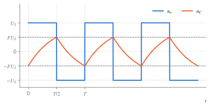

# 波形发生电路

!!! abstract "本章要点"
    - 正弦波振荡器 = 放大电路 + 正反馈网络 + 选频网络 + 稳幅环节。
    - 振荡的平衡条件是 $\dot A\dot F=1$；起振要求 $|AF|>1$，再靠稳幅让它回落到 1。
    - 文氏桥振荡器用于低频，$f_0=\dfrac{1}{2\pi RC}$，放大器增益要略大于 3。
    - LC 振荡器用于高频，三点式按"射同基反"判断；石英晶体振荡器频率最稳。
    - 非正弦波发生器 = 滞回比较器 + RC 积分（或充放电），频率由 RC 和门限决定。

??? info "本章图卡"
    { loading=lazy }
    { loading=lazy }

!!! note "知识点清单"
    **正弦波振荡的基本原理**

    - [ ] 正弦波振荡器的组成与分类
    - [ ] 平衡条件：幅值平衡与相位平衡
    - [ ] 起振条件
    - [ ] 稳幅
    - [ ] 判断电路能否振荡的步骤

    **RC 正弦波振荡器**

    - [ ] 文氏网络的频率特性
    - [ ] 文氏桥振荡器的 $f_0$ 与起振条件
    - [ ] 稳幅方法：二极管、热敏电阻
    - [ ] 频率调节与适用范围
    - [ ] RC 移相式振荡器（了解）

    **LC 正弦波振荡器**

    - [ ] LC 并联谐振回路
    - [ ] 变压器反馈式振荡器与同名端
    - [ ] 三点式振荡器的判别：射同基反
    - [ ] 电容三点式（考毕兹）与电感三点式（哈特莱）
    - [ ] 克拉泼电路

    **石英晶体振荡器**

    - [ ] 晶体的等效电路
    - [ ] 串联谐振频率 $f_s$、并联谐振频率 $f_p$ 与电抗特性
    - [ ] 并联型与串联型晶体振荡器
    - [ ] 晶体振荡器频率稳定的原因

    **非正弦波发生器**

    - [ ] 非正弦波发生器的组成
    - [ ] RC 方波发生器
    - [ ] 占空比可调的矩形波
    - [ ] 方波–三角波发生器
    - [ ] 锯齿波发生器
    - [ ] 压控振荡器（VCO）与 V–F 变换
    - [ ] CMOS 门多谐振荡器

## 1. 正弦波振荡的条件

### 1.1 组成与分类

振荡器不需要外加输入，自己产生周期信号。正弦波振荡器由四部分组成：

| 部分 | 作用 |
| --- | --- |
| 放大电路 | 提供能量，补偿损耗 |
| 正反馈网络 | 把输出送回输入，代替外加信号 |
| 选频网络 | 只让一个频率 $f_0$ 满足振荡条件，保证输出是正弦 |
| 稳幅环节 | 让振幅稳定在某个值，不无限增长 |

选频网络常和反馈网络合在一起。按选频网络分类：

| 类型 | 选频网络 | 频率范围 | 特点 |
| --- | --- | --- | --- |
| RC 振荡器 | RC 网络 | $1\,\mathrm{Hz}\sim1\,\mathrm{MHz}$ | 低频，结构简单 |
| LC 振荡器 | LC 谐振回路 | 几百千赫～几百兆赫 | 高频，选频好 |
| 石英晶体振荡器 | 石英晶体 | 固定频率 | 频率稳定度极高 |

### 1.2 平衡条件

输出已经稳定时，信号绕环一圈回来，必须和原来**一模一样**，大小相同、相位相同。

把 [负反馈框图](feedback.md#1-反馈框图与闭环增益) 中的"相减"改成"相加"（正反馈）。没有输入 $x_i=0$ 时要维持输出，需要反馈信号恰好等于净输入 $x_f=x_{id}$。

$$
\dot A\dot F=1\quad\Longleftrightarrow\quad |\dot A\dot F|=1\ (\text{幅值平衡}),\qquad \varphi_A+\varphi_F=2n\pi\ (\text{相位平衡})
$$

适用条件：正反馈接法；$n$ 为整数。其中 $\varphi_A$、$\varphi_F$ 为放大电路和反馈网络的相移。

### 1.3 起振条件

刚通电时没有信号，靠电路里的噪声起步。噪声包含各种频率，其中 $f_0$ 分量每绕一圈都被放大，越来越大。

$$
|\dot A\dot F|>1\quad(\text{在 } f_0 \text{ 处})
$$

适用条件：同时满足相位平衡。

### 1.4 稳幅

振幅增大后，$|AF|$ 要自动降回 1，振幅才能停在一个值上。

振幅↑ → 稳幅元件使 $|A|$↓ → $|AF|$ 降到 1 → 振幅不再增长。

稳幅靠非线性：一是放大器件自身限幅（晶体管进入饱和、截止）；二是外加稳幅元件（二极管、热敏电阻、场效应管）。外加稳幅的波形失真小。

| 条件 | 内容 | 由谁保证 |
| --- | --- | --- |
| 相位平衡 | 只在 $f_0$ 处环路相移为 $2n\pi$ | 选频网络 |
| 起振 | $f_0$ 处 $\lvert AF\rvert>1$ | 放大器增益留余量 |
| 稳幅 | 稳态时 $\lvert AF\rvert=1$ | 非线性元件 |

### 1.5 判断能否振荡

1. 看结构：是否有放大、反馈、选频三部分；放大电路的静态工作点是否合适。
2. 判相位（瞬时极性法）：在反馈引入点断开环路，加 $\oplus$ 信号。经放大器和选频网络（取 $f_0$ 处的相移）回来，与原信号同相才满足相位条件。
3. 判幅值：起振时 $|AF|>1$ 是否成立。

!!! warning "易错"
    - 有正反馈不一定能产生正弦波。没有选频网络，只会饱和或产生非正弦振荡。
    - 判相位时要用选频网络在 $f_0$ 处的相移，不是随便某个频率。

## 2. RC 文氏桥振荡器

{ .circuit }

### 2.1 文氏网络的频率特性

输出经 $R$、$C$ **串联**支路接到同相端，同相端经 $R$、$C$ **并联**支路接地。这个 RC 串并联网络叫文氏网络，它既是正反馈网络，又是选频网络。

频率很低时串联电容几乎断开，频率很高时并联电容几乎短路，两头输出都很小。只有中间某个频率输出最大，而且不产生相移。

$Z_1=R+\dfrac1{j\omega C}$，$Z_2=R\parallel\dfrac1{j\omega C}$，

$$
\dot F=\frac{\dot U_f}{\dot U_o}=\frac{Z_2}{Z_1+Z_2}=\frac{1}{3+j\Big(\omega RC-\dfrac{1}{\omega RC}\Big)}
$$

适用条件：两个 $R$ 相等、两个 $C$ 相等；网络负载（运放同相端）电阻很大。

- $\omega=\omega_0=\dfrac1{RC}$ 时，$\dot F=\dfrac13$，相移为零，幅值最大。
- 低于 $\omega_0$ 时相位超前，高于 $\omega_0$ 时相位滞后。

{ .circuit }

### 2.2 振荡频率与起振条件

放大部分是同相放大器，$A=1+\dfrac{R_f}{R_g}$，$\varphi_A=0$。文氏网络在 $f_0$ 处 $\varphi_F=0$，相位条件自然满足。

$$
f_0=\frac{1}{2\pi RC},\qquad \text{起振：}A>3\ \Leftrightarrow\ R_f>2R_g,\qquad\text{稳定：}A=3
$$

适用条件：两个 $R$、两个 $C$ 分别相等。

$R_f$、$R_g$ 构成负反馈，文氏网络构成正反馈，四个臂组成电桥，故名"文氏桥"。

!!! warning "易错"
    - $A$ 恰等于 3 不能可靠起振，也抵抗不了元件误差。
    - $A$ 过大：振幅一直长到运放饱和，波形严重失真。所以 $A$ 要**略大于 3**，再配稳幅。

??? example "例 1：图卡的文氏桥振荡器"
    $R=10\,\mathrm{k\Omega}$，$C=10\,\mathrm{nF}$，$R_f=20\,\mathrm{k\Omega}$，$R_g=10\,\mathrm{k\Omega}$。求 $f_0$、$F$，能否起振。

    思路：算 $f_0$，再看 $AF$ 是否大于 1。

    1. $f_0=\dfrac{1}{2\pi\times10^4\times10^{-8}}\approx1.59\,\mathrm{kHz}$，$F(f_0)=\dfrac13$。
    2. $A=1+\dfrac{20}{10}=3$，$AF=1$：只满足平衡条件，**不能可靠起振**。
    3. 改 $R_f=22\,\mathrm{k\Omega}$：$A=3.2$，$AF\approx1.07>1$，能起振。

    **结论**：原参数不能可靠起振；$R_f$ 改为 $22\,\mathrm{k\Omega}$ 并配稳幅环节即可。

### 2.3 稳幅方法

**二极管稳幅**（图中接法）：$R_f$ 分成 $R_{f1}$、$R_{f2}$ 两段，$R_{f2}$ 并联两只反向二极管。

小振幅 → 二极管截止 → $A=1+\dfrac{R_{f1}+R_{f2}}{R_g}>3$，起振；
振幅增大 → 峰值附近二极管导通 → 等效 $R_f$ 减小 → $A$ 降回 3。

**热敏电阻稳幅**：$R_f$ 用负温度系数热敏电阻。

振幅↑ → 流过 $R_f$ 的电流↑ → 温度↑ → $R_f$↓ → $A$↓。

（也可用正温度系数的热敏电阻作 $R_g$，效果相同。）

??? example "例 2：二极管稳幅与频率调节"
    $R_g=10\,\mathrm{k\Omega}$，$R_{f1}=15\,\mathrm{k\Omega}$，$R_{f2}=10\,\mathrm{k\Omega}$（并反向二极管）；$C=0.1\,\mu\mathrm F$，$R$ 用双联电位器在 $1\sim10\,\mathrm{k\Omega}$ 调节。

    思路：分别算二极管截止、完全导通两种极端下的 $A$。

    1. 小振幅（二极管截止）：$A=1+\dfrac{15+10}{10}=3.5>3$，能起振。
    2. 振幅很大（二极管导通电阻远小于 $R_{f2}$ 的极限）：$A\to1+\dfrac{15}{10}=2.5<3$。
    3. $A$ 随振幅在 $3.5$ 与 $2.5$ 之间连续变化，必有一个振幅使平均意义上 $A=3$，振幅就稳在那里。大约是 $R_{f2}$ 两端峰值电压接近二极管导通电压时。
    4. 频率：$R=10\,\mathrm{k\Omega}$ 时 $f_0=159\,\mathrm{Hz}$；$R=1\,\mathrm{k\Omega}$ 时 $f_0=1.59\,\mathrm{kHz}$。

    **结论**：能起振并自动稳幅；频率可在 $159\,\mathrm{Hz}\sim1.59\,\mathrm{kHz}$ 内连续调节。

### 2.4 频率调节与适用范围

**怎么调**：用双联电位器同时改变两个 $R$（连续调），或切换两组 $C$（换频段）。

**为什么只适合低频**：频率高要求 $R$、$C$ 很小，会受运放输出电阻、分布电容和运放带宽影响；频率低要求 $R$ 很大，又会受运放输入电阻影响。所以文氏桥适合 $1\,\mathrm{MHz}$ 以下。

??? tip "RC 移相式振荡器"
    另一种 RC 振荡器用三节 RC 移相网络接在反相放大器后面。反相放大器贡献 $180^\circ$，三节 RC 在某一频率共移相 $180^\circ$，合起来满足相位条件。

    对三节相同 $R$、$C$ 的 CR 高通梯形网络（忽略负载效应），振荡频率 $f_0=\dfrac{1}{2\pi\sqrt6\,RC}$，此处 $|F|=\dfrac1{29}$，起振要求 $|A|>29$。结构简单，但调频不便、波形较差，用得不如文氏桥多。

## 3. LC 正弦波振荡器

### 3.1 LC 并联谐振回路

电感和电容并联。在谐振频率处，回路阻抗**最大且为纯电阻**；偏离谐振频率，阻抗迅速下降并出现相移。

$$
f_0\approx\frac{1}{2\pi\sqrt{LC}}
$$

适用条件：回路品质因数 $Q\gg1$（损耗小）。

LC 回路的 $Q$ 值有几十到几百，选频特性比 RC 网络好得多，用于几百千赫到几百兆赫。频率太高运放带宽不够，所以放大器多用分立晶体管。

### 3.2 变压器反馈式

LC 回路接在集电极作负载，变压器次级线圈把信号送回基极。

**为什么要看同名端**：共射放大器 $c$ 对 $b$ 反相 $180^\circ$。次级线圈必须再反相一次，环路才是正反馈。反相与否由同名端决定。

1. 设基极 $\oplus$，则集电极 $\ominus$。
2. 按同名端标出次级反馈端的极性。
3. 回到基极为 $\oplus$ 是正反馈，能振荡；为 $\ominus$ 是负反馈，不振荡。

### 3.3 三点式振荡器：射同基反

LC 回路有三个端点，分别接晶体管的三个电极，叫三点式。

**判别规则——射同基反**：

1. 与**发射极**相连的两个电抗元件，性质相同（同为 $C$ 或同为 $L$）。
2. 接在**集电极与基极**之间的元件，性质与它们相反。
3. 场效应管把"射"换成"源"。

满足这条规则，相位条件就满足。

{ .circuit }

### 3.4 电容三点式与电感三点式

| 类型 | 与 $e$ 相连 | $c$–$b$ 之间 | $f_0$ | 特点 |
| --- | --- | --- | --- | --- |
| 电容三点式（考毕兹） | $C_1$、$C_2$ | $L$ | $\dfrac{1}{2\pi\sqrt{L\dfrac{C_1C_2}{C_1+C_2}}}$ | 反馈取自电容，谐波被旁路，波形好；频率可很高 |
| 电感三点式（哈特莱） | $L_1$、$L_2$ | $C$ | $\dfrac{1}{2\pi\sqrt{(L_1+L_2+2M)C}}$ | 易起振，调 $C$ 调频方便；反馈取自电感，谐波多 |

其中 $M$ 为 $L_1$、$L_2$ 之间的互感。

**电容三点式的起振条件**：

$$
|F|=\frac{u_{be}}{u_{ce}}\approx\frac{C_1}{C_2},\qquad |A|>\frac{C_2}{C_1}
$$

适用条件：$C_1$ 接 $c$–$e$，$C_2$ 接 $b$–$e$；忽略回路损耗。

### 3.5 克拉泼电路

**为什么需要**：晶体管极间电容与 $C_1$、$C_2$ 并联，会随温度、换管子变化，使 $f_0$ 漂移。

**怎么做**：在 $L$ 支路串一个小电容 $C_3$（$C_3\ll C_1,C_2$）。总电容主要由 $C_3$ 决定，极间电容几乎不起作用。

$$
f_0\approx\frac{1}{2\pi\sqrt{LC_3}}
$$

适用条件：$C_3\ll C_1$、$C_2$。

??? example "例 3：电容三点式的振荡频率"
    $L=50\,\mu\mathrm H$，$C_1=C_2=2\,\mathrm{nF}$。检查相位条件，求 $f_0$ 和起振要求。

    思路：先用射同基反，再算串联等效电容。

    1. **相位**：$e$ 两侧都是电容，$c$–$b$ 间是电感，符合射同基反。共射反相 $180^\circ$，$C_1$–$L$–$C_2$ 网络再反相 $180^\circ$。
    2. **等效电容**：$C_{eq}=\dfrac{C_1C_2}{C_1+C_2}=1\,\mathrm{nF}$。
    3. **频率**：$f_0=\dfrac{1}{2\pi\sqrt{50\times10^{-6}\times10^{-9}}}\approx712\,\mathrm{kHz}$。
    4. **起振**：$|F|\approx C_1/C_2=1$，放大倍数大于 1 即可（计入回路损耗后实际要求更高）。

    **结论**：能振荡，$f_0\approx712\,\mathrm{kHz}$。

## 4. 石英晶体振荡器

### 4.1 等效电路

{ .circuit }

石英晶片有压电效应：加电压会形变，形变又产生电压。在某个机械固有频率上，这种振动非常强，电学上等效为一个高 $Q$ 的串联谐振支路。

| 元件 | 含义 | 特点 |
| --- | --- | --- |
| $L_q$、$C_q$、$R_q$ | 机械振动的等效电感、电容、损耗 | $L_q$ 很大，$C_q$ 很小，$R_q$ 很小 |
| $C_0$ | 电极间的静态电容 | $C_0\gg C_q$ |

$Q$ 值可达 $10^4\sim10^6$，远高于 LC 回路。

### 4.2 两个谐振频率与电抗特性

$$
f_s=\frac{1}{2\pi\sqrt{L_qC_q}},\qquad f_p=f_s\sqrt{1+\frac{C_q}{C_0}}\approx f_s\Big(1+\frac{C_q}{2C_0}\Big)
$$

适用条件：$C_0\gg C_q$。其中 $f_s$ 为串联谐振频率，$f_p$ 为并联谐振频率。

| 频率 | 电抗性质 | 阻抗 |
| --- | --- | --- |
| $f<f_s$ | 容性 | — |
| $f=f_s$ | 串联谐振，纯阻 | 最小（$\approx R_q$） |
| $f_s<f<f_p$ | **感性**（极窄的一段） | — |
| $f=f_p$ | 并联谐振 | 最大 |
| $f>f_p$ | 容性 | — |

{ .circuit }

### 4.3 并联型与串联型晶体振荡器

| 类型 | 晶体工作点 | 晶体的作用 | 振荡频率 |
| --- | --- | --- | --- |
| 并联型 | $f_s<f<f_p$ | 当作**电感**，代替电容三点式中的 $L$ | 由晶体与外接负载电容共同决定，十分接近 $f_s$ |
| 串联型 | $f=f_s$ | 接在正反馈通路中，此时阻抗最小、相移为零，反馈最强 | $f_s$ |

### 4.4 频率为什么稳

晶体 $Q$ 极高，电抗随频率变化极陡。电路其他元件变化带来一点相移，频率只要偏移极小一点，晶体就能产生足够的相移把它补回来。所以频率几乎不动，稳定度可达 $10^{-6}$ 以下。

??? example "例 4：晶体的两个谐振频率"
    $L_q=50\,\mathrm{mH}$，$C_q=0.02\,\mathrm{pF}$，$R_q=10\,\Omega$，$C_0=5\,\mathrm{pF}$。求 $f_s$、$f_p-f_s$ 和 $Q$。

    思路：代两个谐振频率公式，再算 $Q$。

    1. $f_s=\dfrac{1}{2\pi\sqrt{0.05\times2\times10^{-14}}}\approx5.033\,\mathrm{MHz}$。
    2. $f_p-f_s\approx f_s\dfrac{C_q}{2C_0}=5.033\,\mathrm{MHz}\times0.002\approx10\,\mathrm{kHz}$。
    3. $Q=\dfrac{2\pi f_sL_q}{R_q}\approx1.6\times10^5$。

    **结论**：感性区只有 $f_s$ 的 $0.2\%$ 宽，$Q$ 高达 $1.6\times10^5$，所以频率极稳。

## 5. 非正弦波发生器

**组成**：非正弦波发生器 = **滞回比较器 + RC 积分（或 RC 充放电）延时**。

比较器输出高 → 电容向一个方向充电 → 到达门限 → 比较器翻转 → 电容反向充电 → 到达另一门限 → 再翻转……

比较器负责"开关"，RC 负责"计时"。频率由 RC 和门限决定。

### 5.1 RC 方波发生器（多谐振荡器）

{ .circuit }

一个反相滞回比较器，输出经 $R$ 给 $C$ 充放电，$u_C$ 送回反相端。

同相端 $u_+=Fu_o$，门限为 $\pm FU_Z$。

1. $u_o=+U_Z$：$C$ 从 $-FU_Z$ 向 $+U_Z$ 充电。
2. $u_C$ 到达 $+FU_Z$：输出翻转为 $-U_Z$。
3. $C$ 反向放电到 $-FU_Z$：输出再翻回 $+U_Z$，如此往复。

由 [三要素法](../notes/dynamic-circuits.md)，$u_C(t)=U_Z-(U_Z+FU_Z)e^{-t/RC}$ 到达 $FU_Z$ 的时间为半周期：

$$
\frac T2=RC\ln\frac{1+F}{1-F},\qquad T=2RC\ln\Big(1+\frac{2R_2}{R_1}\Big)
$$

适用条件：$F=\dfrac{R_2}{R_1+R_2}$，输出为对称的 $\pm U_Z$。

{ .circuit }

??? example "例 5：方波频率"
    $R=10\,\mathrm{k\Omega}$，$C=0.1\,\mu\mathrm F$，$R_1=R_2$（$F=0.5$），$U_Z=6\,\mathrm V$。求门限和频率。

    思路：先求门限，再代周期公式。

    1. 门限 $\pm FU_Z=\pm3\,\mathrm V$，$u_C$ 在 $\pm3\,\mathrm V$ 间按指数规律往返。
    2. $T=2RC\ln3=2\times10^{-3}\times1.0986\approx2.197\,\mathrm{ms}$。
    3. $f=1/T\approx455\,\mathrm{Hz}$。

    **结论**：$f\approx455\,\mathrm{Hz}$。

### 5.2 占空比可调的矩形波

**怎么做**：把充放电电阻 $R$ 换成两条支路，各串一只方向相反的二极管。充电走一条，放电走另一条，时间不同，就得到占空比可调的矩形波。

### 5.3 方波–三角波发生器

{ .circuit }

$A_1$ 是**同相**滞回比较器，输出方波；$A_2$ 是反相积分器，把方波积分成三角波。三角波又送回 $A_1$ 控制翻转。

$A_1$ 接法：反相端接地，同相端经 $R_1$ 接三角波输出 $u_o$、经 $R_2$ 接方波输出 $u_{o1}$。

1. **门限**：$u_+=\dfrac{R_2u_o+R_1u_{o1}}{R_1+R_2}=0$ 时翻转，得 $u_o=-\dfrac{R_1}{R_2}u_{o1}$，所以三角波幅值 $U_T=\dfrac{R_1}{R_2}U_Z$。
2. **积分**：$u_{o1}=+U_Z$ 时，$u_o$ 以斜率 $-\dfrac{U_Z}{RC}$ **下降**。
3. **翻转**：$u_o$ 降到 $-U_T$ 时 $u_+$ 过零变负，$u_{o1}$ 翻为 $-U_Z$，$u_o$ 转而上升到 $+U_T$……

半周期内 $u_o$ 变化 $2U_T$：

$$
U_T=\frac{R_1}{R_2}U_Z,\qquad \frac T2=\frac{2U_T}{U_Z/RC}=\frac{2R_1RC}{R_2},\qquad T=\frac{4R_1RC}{R_2}
$$

适用条件：方波为对称 $\pm U_Z$；$R$、$C$ 为积分电阻、电容。

{ .circuit }

**怎么调**：调 $R$ 或 $C$，只改频率不改幅值；调 $R_1/R_2$，幅值和频率同时变。

!!! warning "易错"
    - 比较器必须是**同相**的。积分器已反相一次，比较器若也反相，环路反相两次，电路停在饱和而不振荡。
    - 反相积分器：方波为**高**时三角波**下降**。
    - $U_T$ 这里是比较器门限（三角波幅值），不要和热电压 $V_T$ 混淆。

??? example "例 6：图卡例（积分斜率 $2\,\mathrm{V/ms}$，阈值 $\pm1\,\mathrm V$）"
    思路：半周期 = 三角波峰峰值 ÷ 斜率。

    1. 半周期 $t_{1/2}=\dfrac{2U_T}{|\mathrm du_o/\mathrm dt|}=\dfrac{2\,\mathrm V}{2\,\mathrm{V/ms}}=1\,\mathrm{ms}$。
    2. $T=2\,\mathrm{ms}$，$f=500\,\mathrm{Hz}$。

    **结论**：$f=500\,\mathrm{Hz}$；$u_o$ 是 $\pm1\,\mathrm V$ 的三角波，$u_{o1}$ 是同周期方波，方波为高时三角波下降。

??? example "例 7：由元件参数求频率与幅值"
    $U_Z=6\,\mathrm V$，$R_1=10\,\mathrm{k\Omega}$，$R_2=20\,\mathrm{k\Omega}$，$R=10\,\mathrm{k\Omega}$，$C=0.05\,\mu\mathrm F$。

    思路：先求幅值，再求斜率和半周期。

    1. 幅值 $U_T=\dfrac{10}{20}\times6=3\,\mathrm V$。
    2. 斜率 $\dfrac{U_Z}{RC}=\dfrac{6}{0.5\,\mathrm{ms}}=12\,\mathrm{V/ms}$。
    3. 半周期 $t_{1/2}=\dfrac{6\,\mathrm V}{12\,\mathrm{V/ms}}=0.5\,\mathrm{ms}$。
    4. 公式校核：$T=\dfrac{4\times10\times0.5\,\mathrm{ms}}{20}=1\,\mathrm{ms}$ ✓。

    **结论**：三角波幅值 $\pm3\,\mathrm V$，$f=1\,\mathrm{kHz}$。

### 5.4 锯齿波发生器

上升和下降速度差别很大的三角波，叫锯齿波。

**怎么做**：把积分电阻换成两条支路：$R_a$ 串二极管、$R_b$ 串反向二极管。正、反向积分速率不同。

$$
t_1=\frac{2U_TR_aC}{U_Z},\qquad t_2=\frac{2U_TR_bC}{U_Z},\qquad T=t_1+t_2
$$

适用条件：忽略二极管压降。$R_a\ll R_b$ 时得到锯齿波，同时方波变成窄脉冲。

### 5.5 压控振荡器（VCO）

输出频率随控制电压 $u_C$ 线性变化的振荡器。

**怎么做**：积分器的输入不再取 $\pm U_Z$，而是由比较器输出控制一个电子开关，在 $+u_C$、$-u_C$ 之间切换。

$u_C$↑ → 积分斜率 $\dfrac{u_C}{RC}$↑ → 到达门限更快 → 频率↑。幅值仍由门限 $U_T$ 决定，不变。

$$
f=\frac{u_C}{4U_TRC}=\frac{R_2}{4R_1RCU_Z}\,u_C\ \propto\ u_C
$$

适用条件：$U_T=\dfrac{R_1}{R_2}U_Z$；频率不太高（比较器翻转、运放压摆率的影响可忽略）。

**V–F 变换**：VCO 也就是电压–频率变换器。在固定时间内对输出脉冲计数，得到与 $u_C$ 成正比的数字量。集成函数发生器、锁相环中的 VCO 都基于这一原理（见 [集成功能电路](special-ics.md)）。

??? example "例 8：VCO 的压控灵敏度"
    在例 7 的参数下（$U_T=3\,\mathrm V$，$RC=0.5\,\mathrm{ms}$），积分器输入改为 $\pm u_C$。求灵敏度和频率范围。

    思路：代 VCO 公式。

    1. $f=\dfrac{u_C}{4\times3\times0.5\times10^{-3}}\approx166.7\,u_C\ (\mathrm{Hz/V})$。
    2. $u_C$ 从 $1\,\mathrm V$ 调到 $10\,\mathrm V$，$f$ 从 $167\,\mathrm{Hz}$ 线性变到 $1.67\,\mathrm{kHz}$。

    **结论**：灵敏度约 $167\,\mathrm{Hz/V}$；三角波幅值始终为 $\pm3\,\mathrm V$。

### 5.6 CMOS 门多谐振荡器

两个 CMOS 反相器加 $R$、$C$ 构成的方波发生器。门的阈值 $V_{TH}\approx V_{DD}/2$，相当于比较器的门限。

| 情况 | 周期 |
| --- | --- |
| 输入有保护二极管钳位 | $T=2RC\ln2\approx1.4RC$ |
| 输入端串大电阻，钳位不起作用 | $T=2RC\ln3\approx2.2RC$ |

适用条件：$V_{TH}=V_{DD}/2$。它和石英晶体无关。

## 公式速查

| 内容 | 公式 | 条件 |
| --- | --- | --- |
| 平衡条件 | $\dot A\dot F=1$：$\lvert AF\rvert=1$，$\varphi_A+\varphi_F=2n\pi$ | 正反馈 |
| 起振条件 | $\lvert AF\rvert>1$ | $f_0$ 处 |
| 文氏网络 | $\dot F=\dfrac{1}{3+j(\omega RC-1/\omega RC)}$ | 等 $R$ 等 $C$ |
| 文氏桥频率 | $f_0=\dfrac{1}{2\pi RC}$ | 等 $R$ 等 $C$ |
| 文氏桥起振 | $A=1+\dfrac{R_f}{R_g}>3$，即 $R_f>2R_g$ | 稳态 $A=3$ |
| LC 谐振 | $f_0\approx\dfrac{1}{2\pi\sqrt{LC}}$ | 回路 $Q\gg1$ |
| 电容三点式 | $f_0=\dfrac{1}{2\pi\sqrt{LC_1C_2/(C_1+C_2)}}$，$\lvert A\rvert>\dfrac{C_2}{C_1}$ | $C_1$ 接 $c$–$e$ |
| 电感三点式 | $f_0=\dfrac{1}{2\pi\sqrt{(L_1+L_2+2M)C}}$ | — |
| 克拉泼 | $f_0\approx\dfrac{1}{2\pi\sqrt{LC_3}}$ | $C_3\ll C_1,C_2$ |
| 晶体串联谐振 | $f_s=\dfrac{1}{2\pi\sqrt{L_qC_q}}$ | — |
| 晶体并联谐振 | $f_p\approx f_s\Big(1+\dfrac{C_q}{2C_0}\Big)$ | $C_0\gg C_q$ |
| RC 方波 | $T=2RC\ln\Big(1+\dfrac{2R_2}{R_1}\Big)$ | 输出 $\pm U_Z$ |
| 三角波幅值 | $U_T=\dfrac{R_1}{R_2}U_Z$ | 同相滞回 |
| 方波–三角波周期 | $T=\dfrac{4R_1RC}{R_2}$ | — |
| 锯齿波 | $t_1=\dfrac{2U_TR_aC}{U_Z}$，$t_2=\dfrac{2U_TR_bC}{U_Z}$ | 忽略二极管压降 |
| VCO | $f=\dfrac{u_C}{4U_TRC}$ | 频率不太高 |
| CMOS 门多谐 | $T=2RC\ln2$（钳位）/ $2RC\ln3$（不钳位） | $V_{TH}=V_{DD}/2$ |

## 练习

### 1. 概念判断 :material-star::material-star-outline::material-star-outline:

1. 只要电路中有正反馈就一定能产生正弦波振荡。
2. 文氏桥振荡器中，放大器增益取得越大越容易起振，波形越好。
3. 石英晶体在串联谐振频率与并联谐振频率之间呈感性。
4. 电容三点式振荡器中，接在 $c$、$b$ 之间的元件应是电感。
5. 方波–三角波发生器中，调节积分电阻 $R$ 会同时改变三角波的频率和幅值。

??? success "答案"
    1 ✗　2 ✗　3 ✓　4 ✓　5 ✗

??? note "解析"
    1. 还需要选频网络、合适的幅值条件和稳幅环节。没有选频的正反馈只会饱和或产生非正弦振荡。
    2. 增益过大，振幅要长到严重非线性才稳定，波形失真。应略大于 3 并配稳幅。
    3. 见第 4 节，感性区为 $f_s<f<f_p$。
    4. 射同基反：与 $e$ 相连的是 $C_1$、$C_2$，$c$–$b$ 间必须是异性质的 $L$。
    5. 幅值 $U_T=\dfrac{R_1}{R_2}U_Z$ 与 $R$ 无关。$R$ 只改变斜率，即只改变频率。

### 2. 设计文氏桥振荡器 :material-star::material-star-outline::material-star-outline:

要求 $f_0=1\,\mathrm{kHz}$，选 $C=0.01\,\mu\mathrm F$，$R_g=10\,\mathrm{k\Omega}$。求 $R$，并确定 $R_f$ 的取值条件。

??? success "答案"
    $R\approx15.9\,\mathrm{k\Omega}$；$R_f$ 略大于 $20\,\mathrm{k\Omega}$（如 $22\,\mathrm{k\Omega}$，并加稳幅环节）。

??? note "解析"
    1. $R=\dfrac{1}{2\pi f_0C}=\dfrac{1}{2\pi\times10^3\times10^{-8}}\approx15.92\,\mathrm{k\Omega}$。取标称值 $16\,\mathrm{k\Omega}$ 时 $f_0\approx995\,\mathrm{Hz}$。
    2. 起振：$1+\dfrac{R_f}{R_g}>3$，得 $R_f>20\,\mathrm{k\Omega}$。
    3. $R_f$ 不宜过大，否则失真。

### 3. 三点式振荡器 :material-star::material-star::material-star-outline:

共射放大器构成的三点式振荡器交流通路中，$c$–$e$ 间接 $C_1=1\,\mathrm{nF}$，$b$–$e$ 间接 $C_2=4\,\mathrm{nF}$，$c$–$b$ 间接 $L=100\,\mu\mathrm H$。（1）能否满足相位条件？（2）求 $f_0$；（3）起振对放大倍数有何要求？（4）若把 $L$ 与 $C_2$ 对调呢？

??? success "答案"
    （1）能；（2）$f_0\approx563\,\mathrm{kHz}$；（3）$|A|>4$；（4）不满足射同基反，不能振荡。

??? note "解析"
    1. $e$ 两侧都是电容，$c$–$b$ 间是电感，符合射同基反。
    2. $C_{eq}=\dfrac{1\times4}{1+4}=0.8\,\mathrm{nF}$，$f_0=\dfrac{1}{2\pi\sqrt{10^{-4}\times0.8\times10^{-9}}}\approx562.7\,\mathrm{kHz}$。
    3. $|F|\approx C_1/C_2=0.25$，$|AF|>1$ 得 $|A|>4$。
    4. 对调后与 $e$ 相连的是 $C_1$ 和 $L$，性质不同，环路相移不能为 $2n\pi$。

### 4. 锯齿波发生器 :material-star::material-star::material-star-outline:

在方波–三角波发生器中，$U_Z=6\,\mathrm V$，$U_T=3\,\mathrm V$，$C=0.05\,\mu\mathrm F$；积分电阻改为两条二极管选通的支路，一个方向用 $R_a=1\,\mathrm{k\Omega}$，另一个方向用 $R_b=10\,\mathrm{k\Omega}$。求两段时间、振荡频率和方波的占空比。

??? success "答案"
    $t_1=0.05\,\mathrm{ms}$，$t_2=0.5\,\mathrm{ms}$，$f\approx1.82\,\mathrm{kHz}$，占空比 $1/11\approx9\%$（或 $91\%$，取决于哪个电平对应 $R_a$）。

??? note "解析"
    1. 每段积分电压变化 $2U_T=6\,\mathrm V$。
    2. 斜率分别为 $\dfrac{U_Z}{R_aC}=120\,\mathrm{V/ms}$、$\dfrac{U_Z}{R_bC}=12\,\mathrm{V/ms}$。
    3. $t_1=\dfrac{6}{120}=0.05\,\mathrm{ms}$，$t_2=\dfrac{6}{12}=0.5\,\mathrm{ms}$；$T=0.55\,\mathrm{ms}$，$f\approx1818\,\mathrm{Hz}$。
    4. 占空比 $\dfrac{t_1}{T}=\dfrac{1}{11}$：三角波变成快升慢降（或快降慢升）的锯齿波。

### 5. 设计压控振荡器 :material-star::material-star::material-star:

用 5.5 节的 VCO 结构，$U_T=3\,\mathrm V$，$C=0.05\,\mu\mathrm F$，要求压控灵敏度为 $1\,\mathrm{kHz/V}$。求积分电阻 $R$；若运放输出摆幅限制要求 $u_C\le10\,\mathrm V$，最高频率是多少？

??? success "答案"
    $R\approx1.67\,\mathrm{k\Omega}$；$f_{max}=10\,\mathrm{kHz}$。

??? note "解析"
    1. 灵敏度 $\dfrac{f}{u_C}=\dfrac{1}{4U_TRC}=1000\,\mathrm{Hz/V}$。
    2. $R=\dfrac{1}{4\times3\times0.05\times10^{-6}\times1000}\approx1667\,\Omega$。
    3. $u_C=10\,\mathrm V$ 时 $f=10\,\mathrm{kHz}$。频率越高，比较器翻转时间和运放压摆率的误差越明显，线性度变差。

## 图卡勘误

| 图卡位置 | 原文 | 更正 |
| --- | --- | --- |
| 卡 20 文氏桥电路图 | 运放两个输入端都标"−"；串联 RC 与并联 RC 两条支路画成并接在同一对节点之间 | 应为：输出→$RC$ 串联→**同相端**→$RC$ 并联→地；$R_f$（输出到反相端）与 $R_g$（反相端到地）构成负反馈 |
| 卡 20「适用条件」 | 选频网络具有高 $Q$ | 只适用于 LC 和晶体振荡器。文氏网络等效 $Q$ 很低，选频差，所以必须稳幅 |
| 卡 20「石英晶体」 | 常用其附近的并联谐振频率作为振荡频率；"并联谐振：$f_p$，常用于振荡" | 并联型振荡器中晶体工作在 $f_s$～$f_p$ 的感性区，频率接近 $f_s$；串联型工作在 $f_s$ |
| 卡 20 变压器反馈电路图 | 未标同名端，基极回路连接不清 | 相位条件取决于同名端，必须标出并用瞬时极性法检查 |
| 卡 20 例题 | $f_0=1.59\,\mathrm{kHz}$，$A=3$ 恰为平衡、改 $R_f=22\,\mathrm{k\Omega}$ 可起振 | 正确 |
| 卡 21 电路图 | 比较器两输入端都接到 $R_1$、$R_2$ 的连接点；积分器输出直接连到地线；比较器输出没有反馈到同相端 | 应为同相滞回比较器：反相端接地，同相端经 $R_1$ 接三角波、经 $R_2$ 接方波（见 5.3 节图） |
| 卡 21「阈值」 | $U_T=\beta U_o$，$\beta=\dfrac{R_2}{R_1+R_2}$ | 这是反相滞回的公式。本电路用同相滞回，$U_T=\dfrac{R_1}{R_2}U_Z$ |
| 卡 21 波形图 | $u_o=+U_o$ 期间 $v_i$ 上升 | 积分器是反相的，方波为高时三角波应**下降** |
| 卡 21「CMOS 门多谐振荡器」 | CMOS 门和 RC 构成**晶体**多谐振荡器 | 应删去"晶体"二字。RC 多谐振荡器与石英晶体无关 |
| 卡 21「VCO / V–F」 | 将 $f$ 与脉冲计数可得到与 $U_c$ 成正比的频率 | 应为：VCO 输出频率 $f=Ku_C$；固定时间内对脉冲计数，得到与 $u_C$ 成正比的数字量 |
| 卡 21 符号 | 阈值记作 $U_T$ | 与热电压 $V_T$ 相近，注意区分。本文 $U_T$ 只表示比较器门限 |
| 卡 21 例题与公式 | $\lvert\mathrm dv/\mathrm dt\rvert=U_o/RC$，$t_{1/2}=2U_TRC/U_o$，$1\,\mathrm{ms}$、$500\,\mathrm{Hz}$ | 正确 |
