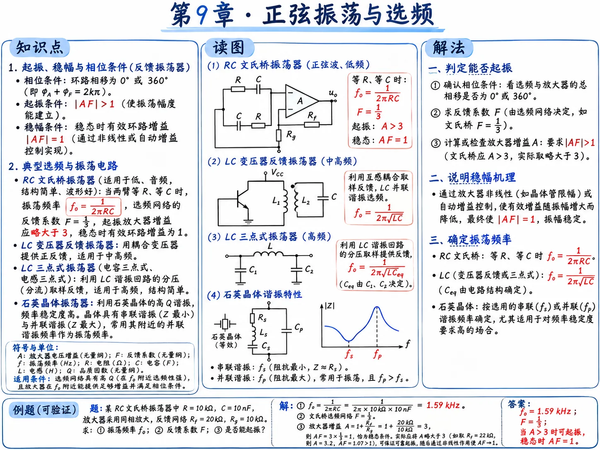
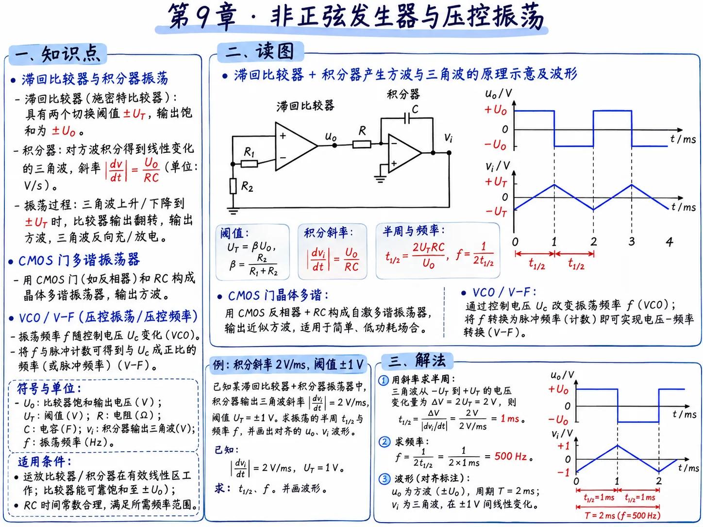
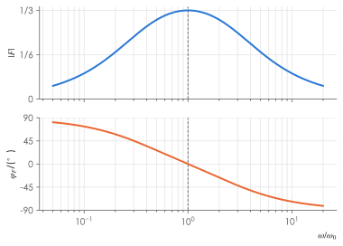
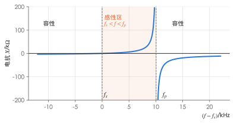
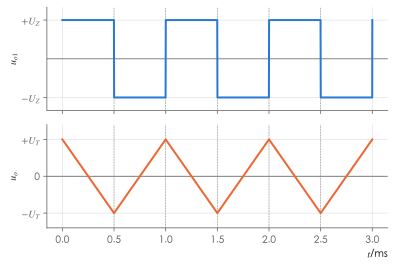

# 波形发生电路

!!! abstract "TL;DR"
    - 正弦波振荡器 = 放大电路 + **正反馈**网络 + 选频网络 + 稳幅环节。平衡条件 $\dot A\dot F=1$（$|AF|=1$，$\varphi_A+\varphi_F=2n\pi$）；起振要求 $|AF|>1$，再靠非线性使 $|AF|$ 回落到 1。
    - **文氏桥**（低频，$1\,\mathrm{Hz}\sim1\,\mathrm{MHz}$）：$f_0=\dfrac{1}{2\pi RC}$，$F=\dfrac13$，同相放大器增益须**略大于 3**。
    - **LC 振荡器**（高频）：$f_0\approx\dfrac{1}{2\pi\sqrt{LC}}$；三点式按"**射同基反**"判断能否振荡；**石英晶体**在 $f_s$～$f_p$ 之间呈感性，频率稳定度可达 $10^{-6}$ 以下。
    - 非正弦波发生器 = **滞回比较器 + RC 积分（或延时）**：RC 方波 $T=2RC\ln\Big(1+\dfrac{2R_2}{R_1}\Big)$；方波–三角波 $U_T=\dfrac{R_1}{R_2}U_Z$，$T=\dfrac{4R_1RC}{R_2}$。
    - 积分速率由控制电压决定时，频率 $f\propto u_C$，就是**压控振荡器（VCO）**。

??? info "本章图卡（AI 生成速览，错误见文末「图卡勘误」）"
    { loading=lazy }
    { loading=lazy }

## 1. 正弦波振荡的条件

振荡器没有外加输入：把 [负反馈框图](feedback.md#1-反馈框图与闭环增益) 中的比较改成相加（正反馈），$x_i=0$ 时要维持输出，需 $x_f=x_{id}$，即

$$
\dot A\dot F=1\quad\Longleftrightarrow\quad |\dot A\dot F|=1\ (\text{幅值平衡}),\qquad \varphi_A+\varphi_F=2n\pi\ (\text{相位平衡}).
$$

| 条件 | 内容 | 由谁保证 |
| --- | --- | --- |
| 相位平衡 | 只在 $f_0$ 处环路相移为 $2n\pi$ | 选频网络决定 $f_0$ |
| 起振 | $f_0$ 处 $\lvert AF\rvert>1$，噪声中 $f_0$ 分量逐圈放大 | 放大器增益留余量 |
| 稳幅 | 振幅增大后 $\lvert AF\rvert$ 自动降到 1 | 器件非线性（晶体管限幅）或外加稳幅元件（二极管、热敏电阻、场效应管） |

**判断能否振荡的步骤**：

1. 检查电路是否具备放大、反馈、选频三部分，放大电路的静态工作点是否合适；
2. **瞬时极性法判相位**：在反馈引入点断开环路，加 $\oplus$ 信号，经放大器和选频网络（在 $f_0$ 处的相移）得到反馈信号，与原信号同相则满足相位条件；
3. 再看起振时 $|AF|>1$ 是否成立。

## 2. RC 文氏桥振荡器

{ .circuit }

**选频网络**：输出经 $R$、$C$ 串联支路接到同相端，同相端经 $R$、$C$ 并联支路接地。$Z_1=R+\dfrac1{j\omega C}$，$Z_2=R\parallel\dfrac1{j\omega C}$，

$$
\dot F=\frac{\dot U_f}{\dot U_o}=\frac{Z_2}{Z_1+Z_2}=\frac{1}{3+j\Big(\omega RC-\dfrac{1}{\omega RC}\Big)} .
$$

$\omega=\omega_0=\dfrac1{RC}$ 时 $\dot F=\dfrac13$，相移为零且幅值最大；偏离 $\omega_0$ 时幅值减小并产生相移（低频超前、高频滞后）：

{ .circuit }

**放大部分**：同相放大器 $A=1+\dfrac{R_f}{R_g}$，$\varphi_A=0$。于是

$$
f_0=\frac{1}{2\pi RC},\qquad \text{起振：}A>3\ \Leftrightarrow\ R_f>2R_g,\qquad\text{稳定：}A=3 .
$$

- $R_f$ 与 $R_g$ 构成负反馈，文氏网络构成正反馈，两者组成电桥，故名"文氏桥"。
- $A$ 恰等于 3 不能起振（也无法抵抗元件误差）；$A$ 过大则振幅一直增长到运放饱和，波形严重失真。所以要稳幅：图中 $R_{f2}$ 并联两只反向二极管——小信号时二极管截止，$A=1+\dfrac{R_{f1}+R_{f2}}{R_g}>3$ 起振；振幅增大后二极管在峰值附近导通，等效 $R_f$ 减小，$A$ 降回 3。
- 调频：用双联电位器同时改变两个 $R$，或切换两个 $C$ 改变频段。$R$、$C$ 太大或太小都会受运放输入电阻、输出电阻和分布电容影响，所以文氏桥适合 $1\,\mathrm{MHz}$ 以下。

??? example "例 1：图卡的文氏桥振荡器"
    $R=10\,\mathrm{k\Omega}$，$C=10\,\mathrm{nF}$，$R_f=20\,\mathrm{k\Omega}$，$R_g=10\,\mathrm{k\Omega}$。求 $f_0$、$F$，能否起振。

    1. $f_0=\dfrac{1}{2\pi\times10^4\times10^{-8}}\approx1.59\,\mathrm{kHz}$；$F(f_0)=\dfrac13$。
    2. $A=1+\dfrac{20}{10}=3$，$AF=1$：只满足平衡条件，**不能可靠起振**。
    3. 改 $R_f=22\,\mathrm{k\Omega}$：$A=3.2$，$AF\approx1.07>1$，能起振；再配稳幅环节使稳态 $AF=1$。

??? example "例 2：二极管稳幅与频率调节"
    $R_g=10\,\mathrm{k\Omega}$，$R_{f1}=15\,\mathrm{k\Omega}$，$R_{f2}=10\,\mathrm{k\Omega}$（并反向二极管）；$C=0.1\,\mu\mathrm F$，$R$ 用双联电位器在 $1\sim10\,\mathrm{k\Omega}$ 调节。

    1. 小振幅（二极管截止）：$A=1+\dfrac{15+10}{10}=3.5>3$，能起振。
    2. 振幅很大（二极管导通电阻远小于 $R_{f2}$ 的极限情况）：$A\to1+\dfrac{15}{10}=2.5<3$。$A$ 在 $3.5$ 与 $2.5$ 之间随振幅连续变化，必有一个振幅使平均意义上 $A=3$——振幅就稳定在那里（约为输出峰值使 $R_{f2}$ 两端电压接近二极管导通电压时）。
    3. 频率范围：$f_0=\dfrac{1}{2\pi RC}$，$R=10\,\mathrm{k\Omega}$ 时 $159\,\mathrm{Hz}$，$R=1\,\mathrm{k\Omega}$ 时 $1.59\,\mathrm{kHz}$。

## 3. LC 正弦波振荡器

LC 并联回路在 $f_0=\dfrac{1}{2\pi\sqrt{LC}}$ 处谐振，阻抗最大且为纯电阻，$Q$ 值高（几十到几百），选频特性比 RC 网络好得多，用于几百千赫到几百兆赫。放大器多用分立晶体管（运放带宽不够）。

**变压器反馈式**：LC 回路接在集电极作负载，次级线圈把信号送回基极。共射放大器 $c$ 对 $b$ 反相，所以次级线圈必须再反相一次——用**同名端**判断：设基极 $\oplus$，集电极 $\ominus$，按同名端得到反馈端极性，回到基极为 $\oplus$ 才是正反馈。接反了只是负反馈，不振荡。

**三点式**：LC 回路的三个端点分别接晶体管的三个电极。判别规则——**射同基反**：与发射极相连的两个电抗元件性质相同（同为 $C$ 或同为 $L$），接在集电极与基极之间的元件与它们性质相反（场效应管把"射"换成"源"）。

{ .circuit }

| 类型 | 与 $e$ 相连 | $c$–$b$ 之间 | $f_0$ | 特点 |
| --- | --- | --- | --- | --- |
| 电容三点式（考毕兹） | $C_1$、$C_2$ | $L$ | $\dfrac{1}{2\pi\sqrt{L\dfrac{C_1C_2}{C_1+C_2}}}$ | 反馈取自电容，谐波被电容旁路，波形好；频率可很高 |
| 电感三点式（哈特莱） | $L_1$、$L_2$ | $C$ | $\dfrac{1}{2\pi\sqrt{(L_1+L_2+2M)C}}$ | 易起振、调频方便（调 $C$）；反馈取自电感，谐波多 |

- 电容三点式反馈系数 $|F|=\dfrac{u_{be}}{u_{ce}}\approx\dfrac{C_1}{C_2}$（$C_1$ 接 $c$–$e$，$C_2$ 接 $b$–$e$），起振要求放大倍数 $|A|>\dfrac{C_2}{C_1}$。
- 晶体管极间电容与 $C_1$、$C_2$ 并联，会影响 $f_0$；在 $L$ 支路串一个小电容 $C_3$（$C_3\ll C_1,C_2$），$f_0\approx\dfrac{1}{2\pi\sqrt{LC_3}}$ 几乎不受极间电容影响，称为**克拉泼电路**。

??? example "例：电容三点式的振荡频率"
    $L=50\,\mu\mathrm H$，$C_1=C_2=2\,\mathrm{nF}$。

    1. 用射同基反检查：$e$ 两侧都是电容、$c$–$b$ 间是电感，满足相位条件（共射反相 $180^\circ$，$C_1$–$L$–$C_2$ 网络再反相 $180^\circ$）。
    2. $C_{eq}=\dfrac{C_1C_2}{C_1+C_2}=1\,\mathrm{nF}$，$f_0=\dfrac{1}{2\pi\sqrt{50\times10^{-6}\times10^{-9}}}\approx712\,\mathrm{kHz}$。
    3. $|F|\approx C_1/C_2=1$，只要放大倍数大于 1（计入回路损耗后实际要求更高）即可起振。

## 4. 石英晶体振荡器

{ .circuit }

石英晶片的压电效应等效为 $R_q L_q C_q$ 串联支路（$L_q$ 很大、$C_q$ 很小、$R_q$ 很小，$Q$ 达 $10^4\sim10^6$），再并上电极间的静态电容 $C_0$（$C_0\gg C_q$）：

$$
f_s=\frac{1}{2\pi\sqrt{L_qC_q}},\qquad f_p=f_s\sqrt{1+\frac{C_q}{C_0}}\approx f_s\Big(1+\frac{C_q}{2C_0}\Big).
$$

- $f<f_s$ 和 $f>f_p$ 时呈容性；$f_s<f<f_p$ 这一极窄的频段内呈**感性**；$f_s$ 处串联谐振，阻抗最小（$\approx R_q$）；$f_p$ 处并联谐振，阻抗最大。
- **并联型晶体振荡器**：晶体工作在 $f_s$ 与 $f_p$ 之间当作电感，代替电容三点式中的 $L$，振荡频率由晶体与外接负载电容共同决定，十分接近 $f_s$。
- **串联型晶体振荡器**：晶体接在正反馈通路中，只在 $f_s$ 处阻抗最小、相移为零，反馈最强，电路振荡于 $f_s$。

{ .circuit }

??? example "例：晶体的两个谐振频率"
    $L_q=50\,\mathrm{mH}$，$C_q=0.02\,\mathrm{pF}$，$R_q=10\,\Omega$，$C_0=5\,\mathrm{pF}$。

    1. $f_s=\dfrac{1}{2\pi\sqrt{0.05\times2\times10^{-14}}}\approx5.033\,\mathrm{MHz}$。
    2. $f_p-f_s\approx f_s\dfrac{C_q}{2C_0}=5.033\,\mathrm{MHz}\times0.002\approx10\,\mathrm{kHz}$：感性区只有 $f_s$ 的 $0.2\%$。
    3. $Q=\dfrac{2\pi f_sL_q}{R_q}\approx1.6\times10^5$。$Q$ 越高，环路中其他元件参数变化引起的相移只需频率极小的偏移就能补偿，所以频率极稳。

## 5. 非正弦波发生器

### 5.1 RC 方波发生器（多谐振荡器）

{ .circuit }

反相滞回比较器的同相端取 $u_+=Fu_o$，$F=\dfrac{R_2}{R_1+R_2}$，门限 $\pm FU_Z$；输出经 $R$ 对 $C$ 充放电，$u_C$ 加在反相端。$u_o=+U_Z$ 时 $C$ 从 $-FU_Z$ 向 $+U_Z$ 充电，到达 $+FU_Z$ 时输出翻转为 $-U_Z$，再反向放电……由[三要素法](../notes/dynamic-circuits.md)：

$$
u_C(t)=U_Z-(U_Z+FU_Z)e^{-t/RC}=FU_Z\ \Rightarrow\
\frac T2=RC\ln\frac{1+F}{1-F},\qquad T=2RC\ln\Big(1+\frac{2R_2}{R_1}\Big).
$$

{ .circuit }

充放电走不同电阻（$R$ 换成两条各串一只二极管的支路）就得到占空比可调的矩形波。

??? example "例：方波频率"
    $R=10\,\mathrm{k\Omega}$，$C=0.1\,\mu\mathrm F$，$R_1=R_2$（$F=0.5$），$U_Z=6\,\mathrm V$。

    1. 门限 $\pm FU_Z=\pm3\,\mathrm V$，$u_C$ 在 $\pm3\,\mathrm V$ 间按指数规律往返。
    2. $T=2RC\ln3=2\times10^{-3}\times1.0986\approx2.197\,\mathrm{ms}$，$f\approx455\,\mathrm{Hz}$。

### 5.2 方波–三角波发生器

{ .circuit }

$A_1$ 是**同相**滞回比较器（反相端接地，同相端经 $R_1$ 接三角波输出 $u_o$、经 $R_2$ 接方波输出 $u_{o1}$），$A_2$ 是反相积分器。

1. **门限**：$u_+=\dfrac{R_2u_o+R_1u_{o1}}{R_1+R_2}=0$ 时翻转，$u_o=-\dfrac{R_1}{R_2}u_{o1}$，所以三角波幅值 $U_T=\dfrac{R_1}{R_2}U_Z$。
2. **积分**：$u_{o1}=+U_Z$ 时 $u_o$ 以斜率 $-\dfrac{U_Z}{RC}$ **下降**；降到 $-U_T$ 时 $u_+$ 过零变负，$u_{o1}$ 翻为 $-U_Z$，$u_o$ 转而上升到 $+U_T$……
3. **周期**：半周期内 $u_o$ 变化 $2U_T$，

$$
\frac T2=\frac{2U_T}{U_Z/RC}=\frac{2R_1RC}{R_2},\qquad T=\frac{4R_1RC}{R_2},\qquad f=\frac{R_2}{4R_1RC}.
$$

{ .circuit }

调 $R$ 或 $C$ 改频率而不改幅值；调 $R_1/R_2$ 同时改变幅值和频率。为什么比较器必须是同相的：积分器反相，比较器若也反相，环路总共反相两次，$u_o$ 下降时比较器只会维持原状态，电路停在饱和而不振荡。

??? example "例 1：图卡例（积分斜率 $2\,\mathrm{V/ms}$，阈值 $\pm1\,\mathrm V$）"
    1. 半周期 $t_{1/2}=\dfrac{2U_T}{|\mathrm du_o/\mathrm dt|}=\dfrac{2\,\mathrm V}{2\,\mathrm{V/ms}}=1\,\mathrm{ms}$。
    2. $T=2\,\mathrm{ms}$，$f=500\,\mathrm{Hz}$；$u_o$ 为 $\pm1\,\mathrm V$ 间的三角波，$u_{o1}$ 为同周期方波（对反相积分器，方波为高时三角波下降）。

??? example "例 2：由元件参数求频率与幅值"
    $U_Z=6\,\mathrm V$，$R_1=10\,\mathrm{k\Omega}$，$R_2=20\,\mathrm{k\Omega}$，$R=10\,\mathrm{k\Omega}$，$C=0.05\,\mu\mathrm F$。

    1. $U_T=\dfrac{10}{20}\times6=3\,\mathrm V$。
    2. 斜率 $\dfrac{U_Z}{RC}=\dfrac{6}{0.5\,\mathrm{ms}}=12\,\mathrm{V/ms}$，$t_{1/2}=\dfrac{6\,\mathrm V}{12\,\mathrm{V/ms}}=0.5\,\mathrm{ms}$。
    3. $f=\dfrac{1}{1\,\mathrm{ms}}=1\,\mathrm{kHz}$；公式校核 $T=\dfrac{4\times10\times0.5\,\mathrm{ms}}{20}=1\,\mathrm{ms}$ ✓。

### 5.3 锯齿波与压控振荡器

**锯齿波**：积分电阻换成两条支路（$R_a$ 串二极管、$R_b$ 串反向二极管），正、反向积分速率不同。上升时间 $t_1=\dfrac{2U_TR_aC}{U_Z}$，下降时间 $t_2=\dfrac{2U_TR_bC}{U_Z}$；$R_a\ll R_b$ 时得到锯齿波，方波变为窄脉冲。

**压控振荡器（VCO）**：积分器的输入不取 $\pm U_Z$，而是由比较器输出控制的电子开关在 $+u_C$、$-u_C$ 之间切换。斜率 $\dfrac{u_C}{RC}$，

$$
f=\frac{u_C}{4U_TRC}=\frac{R_2}{4R_1RCU_Z}\,u_C\ \propto\ u_C .
$$

这也是**电压–频率（V–F）变换器**：对输出脉冲在固定时间内计数，得到与 $u_C$ 成正比的数字量。集成函数发生器、锁相环中的 VCO 都基于这一原理（见 [集成功能电路](special-ics.md)）。

**CMOS 门多谐振荡器**：两个 CMOS 反相器加 $R$、$C$ 构成，门的阈值 $V_{TH}\approx V_{DD}/2$ 相当于比较器门限。输入有保护二极管钳位时 $T=2RC\ln2\approx1.4RC$；输入端串大电阻使钳位不起作用时 $T=2RC\ln3\approx2.2RC$。

??? example "例：VCO 的压控灵敏度"
    在 5.2 节例 2 的参数下（$U_T=3\,\mathrm V$，$RC=0.5\,\mathrm{ms}$），积分器输入改为 $\pm u_C$。

    1. $f=\dfrac{u_C}{4\times3\times0.5\times10^{-3}}\approx166.7\,u_C\ (\mathrm{Hz/V})$。
    2. $u_C$ 从 $1\,\mathrm V$ 调到 $10\,\mathrm V$，$f$ 从 $167\,\mathrm{Hz}$ 线性变化到 $1.67\,\mathrm{kHz}$；三角波幅值始终为 $\pm3\,\mathrm V$。

## 练习

### 1. 概念判断 :material-star::material-star-outline::material-star-outline:

1. 只要电路中有正反馈就一定能产生正弦波振荡。
2. 文氏桥振荡器中，放大器增益取得越大越容易起振，波形越好。
3. 石英晶体在串联谐振频率与并联谐振频率之间呈感性。
4. 电容三点式振荡器中，接在 $c$、$b$ 之间的元件应是电感。
5. 方波–三角波发生器中，调节积分电阻 $R$ 会同时改变三角波的频率和幅值。

??? success "答案"
    1 ✗　2 ✗　3 ✓　4 ✓　5 ✗

??? note "解析"
    1. 还需要选频网络（只在一个频率满足相位条件）和合适的幅值条件、稳幅环节；没有选频的正反馈只会使电路饱和或产生非正弦振荡。
    2. 增益过大，振幅要增长到放大器严重非线性才能稳定，波形失真；应略大于 3 并配合稳幅。
    3. 见第 4 节，感性区为 $f_s<f<f_p$。
    4. 射同基反：与 $e$ 相连的是 $C_1$、$C_2$，$c$–$b$ 间必须是异性质的 $L$。
    5. 幅值 $U_T=\dfrac{R_1}{R_2}U_Z$ 与 $R$ 无关，$R$ 只改变斜率，即只改变频率。

### 2. 设计文氏桥振荡器 :material-star::material-star-outline::material-star-outline:

要求 $f_0=1\,\mathrm{kHz}$，选 $C=0.01\,\mu\mathrm F$，$R_g=10\,\mathrm{k\Omega}$。求 $R$，并确定 $R_f$ 的取值条件。

??? success "答案"
    $R\approx15.9\,\mathrm{k\Omega}$；$R_f$ 略大于 $20\,\mathrm{k\Omega}$（如 $22\,\mathrm{k\Omega}$，并加稳幅环节）。

??? note "解析"
    1. $R=\dfrac{1}{2\pi f_0C}=\dfrac{1}{2\pi\times10^3\times10^{-8}}\approx15.92\,\mathrm{k\Omega}$（取标称值 $16\,\mathrm{k\Omega}$，$f_0\approx995\,\mathrm{Hz}$）。
    2. 起振 $1+\dfrac{R_f}{R_g}>3\Rightarrow R_f>20\,\mathrm{k\Omega}$；不宜过大，否则失真。

### 3. 三点式振荡器 :material-star::material-star::material-star-outline:

共射放大器构成的三点式振荡器交流通路中，$c$–$e$ 间接 $C_1=1\,\mathrm{nF}$，$b$–$e$ 间接 $C_2=4\,\mathrm{nF}$，$c$–$b$ 间接 $L=100\,\mu\mathrm H$。（1）能否满足相位条件？（2）求 $f_0$；（3）起振对放大倍数有何要求？（4）若把 $L$ 与 $C_2$ 对调呢？

??? success "答案"
    （1）能；（2）$f_0\approx563\,\mathrm{kHz}$；（3）$|A|>4$；（4）不满足射同基反，不能振荡。

??? note "解析"
    1. $e$ 两侧都是电容，$c$–$b$ 间是电感，符合射同基反。
    2. $C_{eq}=\dfrac{1\times4}{1+4}=0.8\,\mathrm{nF}$，$f_0=\dfrac{1}{2\pi\sqrt{10^{-4}\times0.8\times10^{-9}}}\approx562.7\,\mathrm{kHz}$。
    3. $|F|\approx C_1/C_2=0.25$，$|AF|>1\Rightarrow|A|>4$。
    4. 对调后与 $e$ 相连的是 $C_1$ 和 $L$，性质不同，环路相移不能为 $2n\pi$。

### 4. 锯齿波发生器 :material-star::material-star::material-star-outline:

在方波–三角波发生器中，$U_Z=6\,\mathrm V$，$U_T=3\,\mathrm V$，$C=0.05\,\mu\mathrm F$；积分电阻改为两条二极管选通的支路，一个方向用 $R_a=1\,\mathrm{k\Omega}$，另一个方向用 $R_b=10\,\mathrm{k\Omega}$。求两段时间、振荡频率和方波的占空比。

??? success "答案"
    $t_1=0.05\,\mathrm{ms}$，$t_2=0.5\,\mathrm{ms}$，$f\approx1.82\,\mathrm{kHz}$，占空比 $1/11\approx9\%$（或 $91\%$，取决于哪个电平对应 $R_a$）。

??? note "解析"
    1. 每段积分电压变化 $2U_T=6\,\mathrm V$，斜率分别为 $\dfrac{U_Z}{R_aC}=120\,\mathrm{V/ms}$、$\dfrac{U_Z}{R_bC}=12\,\mathrm{V/ms}$。
    2. $t_1=\dfrac{6}{120}=0.05\,\mathrm{ms}$，$t_2=\dfrac{6}{12}=0.5\,\mathrm{ms}$；$T=0.55\,\mathrm{ms}$，$f\approx1818\,\mathrm{Hz}$。
    3. 占空比 $\dfrac{t_1}{T}=\dfrac{1}{11}$：三角波变成快升慢降（或快降慢升）的锯齿波。

### 5. 设计压控振荡器 :material-star::material-star::material-star:

用 5.3 节的 VCO 结构，$U_T=3\,\mathrm V$，$C=0.05\,\mu\mathrm F$，要求压控灵敏度为 $1\,\mathrm{kHz/V}$。求积分电阻 $R$；若运放输出摆幅限制要求 $u_C\le10\,\mathrm V$，最高频率是多少？

??? success "答案"
    $R\approx1.67\,\mathrm{k\Omega}$；$f_{max}=10\,\mathrm{kHz}$。

??? note "解析"
    1. $f=\dfrac{u_C}{4U_TRC}$，灵敏度 $\dfrac{1}{4U_TRC}=1000\,\mathrm{Hz/V}\Rightarrow R=\dfrac{1}{4\times3\times0.05\times10^{-6}\times1000}\approx1667\,\Omega$。
    2. $u_C=10\,\mathrm V$ 时 $f=10\,\mathrm{kHz}$。频率越高，比较器的翻转时间和运放压摆率带来的误差越明显，线性度变差。

## 图卡勘误

| 图卡位置 | 原文 | 更正 |
| --- | --- | --- |
| 卡 20 文氏桥电路图 | 运放两个输入端都标"−"；串联 RC 与并联 RC 两条支路画成并接在同一对节点之间 | 应为：输出→$R$、$C$ 串联→**同相端**→$R$、$C$ 并联→地；$R_f$（输出到反相端）与 $R_g$（反相端到地）构成负反馈 |
| 卡 20「适用条件」 | 选频网络具有高 $Q$ | 只适用于 LC 和晶体振荡器；文氏网络在 $f_0$ 处 $F=1/3$，等效 $Q$ 很低，选频性能差，所以必须配合稳幅 |
| 卡 20「石英晶体」 | 常用其附近的并联谐振频率作为振荡频率；"并联谐振：$f_p$，常用于振荡" | 并联型振荡器中晶体工作在 $f_s$～$f_p$ 之间的感性区（当电感用），频率接近 $f_s$ 而非 $f_p$；串联型振荡器工作在 $f_s$ |
| 卡 20 变压器反馈电路图 | 未标同名端，基极回路连接不清 | 相位条件完全取决于同名端的接法，必须标出并用瞬时极性法检查 |
| 卡 20 例题 | $f_0=1.59\,\mathrm{kHz}$，$A=3$ 恰为平衡、改 $R_f=22\,\mathrm{k\Omega}$ 可起振 | 正确 |
| 卡 21 电路图 | 比较器两输入端都接到 $R_1$、$R_2$ 的连接点；积分器输出直接连到地线；比较器输出没有反馈到同相端 | 应为同相滞回比较器：反相端接地，同相端经 $R_1$ 接三角波输出、经 $R_2$ 接方波输出（见第 5.2 节图） |
| 卡 21「阈值」 | $U_T=\beta U_o$，$\beta=\dfrac{R_2}{R_1+R_2}$ | 这是反相滞回（输出分压）的公式；方波–三角波发生器用同相滞回，$U_T=\dfrac{R_1}{R_2}U_Z$（$R_1$ 接三角波、$R_2$ 接方波） |
| 卡 21 波形图 | $u_o=+U_o$ 期间 $v_i$ 上升 | 积分器为反相积分器，方波为高时三角波应**下降** |
| 卡 21「CMOS 门多谐振荡器」 | CMOS 门和 RC 构成**晶体**多谐振荡器 | RC 多谐振荡器与石英晶体无关，"晶体"二字应删去（晶体振荡器是另一种电路） |
| 卡 21「VCO / V–F」 | 将 $f$ 与脉冲计数可得到与 $U_c$ 成正比的频率 | 应为：VCO 的输出频率与控制电压成正比 $f=Ku_C$；在固定时间内对输出脉冲计数，得到与 $u_C$ 成正比的数字量（V–F 型 A/D） |
| 卡 21 符号 | 阈值记作 $U_T$ | 与热电压 $V_T$ 记号相近，注意区分；本文的 $U_T$ 只表示比较器门限 |
| 卡 21 例题与公式 | $\lvert\mathrm dv/\mathrm dt\rvert=U_o/RC$，$t_{1/2}=2U_TRC/U_o$，$1\,\mathrm{ms}$、$500\,\mathrm{Hz}$ | 正确 |
