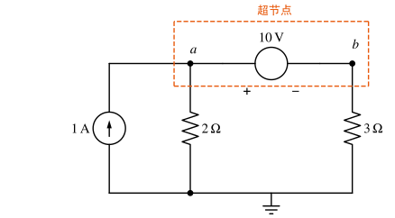
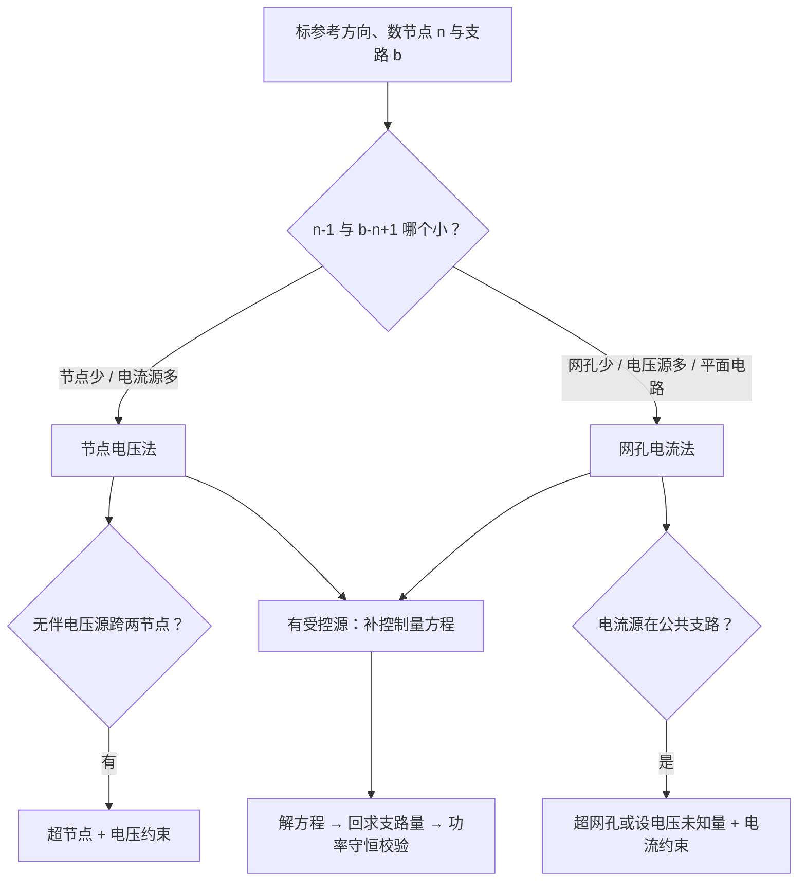

# 电路的一般分析方法

!!! abstract "TL;DR"
    $n$ 个节点、$b$ 条支路的电路有 $n-1$ 个独立 KCL 方程和 $b-n+1$ 个独立 KVL 方程。**节点法**以 $n-1$ 个节点电压为未知量（只写 KCL），**网孔法**以 $b-n+1$ 个网孔电流为未知量（只写 KVL）。哪个未知量少、哪类电源好处理就用哪个。受控源一律"先当独立源列方程，再补控制量方程"。

## 1. 独立方程有多少

- **树**：连通全部节点、但不含回路的支路集合，有 $n-1$ 条**树支**；其余 $b-n+1$ 条为**连支**。
- 每加一条连支形成一个**基本回路**，所以独立回路数 $=b-n+1$。
- 平面电路的**网孔**（内部不含其他支路的回路）数也等于 $b-n+1$。

| 方法 | 未知量 | 方程数 |
| --- | --- | --- |
| 支路电流法 | 各支路电流 | $b$（$n-1$ 个 KCL + $b-n+1$ 个 KVL） |
| 网孔 / 回路电流法 | 网孔 / 基本回路电流 | $b-n+1$ |
| 节点电压法 | 节点电压（对参考点） | $n-1$ |

## 2. 网孔电流法

假想每个网孔中流着一个环形电流（通常都取顺时针），支路电流等于流经它的网孔电流的代数和。对网孔 $k$ 列 KVL，整理成标准形式：

$$
R_{kk}I_k+\sum_{j\neq k}R_{kj}I_j=U_{sk}
$$

| 符号 | 含义 | 符号规律 |
| --- | --- | --- |
| $R_{kk}$ 自电阻 | 网孔 $k$ 中所有电阻之和 | 恒正 |
| $R_{kj}$ 互电阻 | 网孔 $k$、$j$ 公共支路的电阻 | 两网孔电流在公共支路上**同向取正、反向取负**；全取顺时针时互电阻都为负 |
| $U_{sk}$ | 沿网孔 $k$ 绕行方向的**电压源电压升**之和 | 绕行时从 $-$ 到 $+$ 取正 |

**遇到电流源**：

- 电流源只在一个网孔的**外侧支路**上：该网孔电流直接等于（或负的）电流源值，少一个方程。
- 电流源在**两个网孔的公共支路**上：设电流源两端电压 $U$ 为新未知量写进两个网孔方程，再补"两网孔电流之差 = 电流源"；或者把两个网孔合成**超网孔**，沿外圈列 KVL，再补电流约束。
- 回路电流法可以选择回路，使每个电流源只属于一个回路，从而直接得到该回路电流。

## 3. 节点电压法

选参考节点（电位为零），其余节点电压为未知量。对节点 $k$ 列 KCL（流出 = 流入），整理成：

$$
G_{kk}U_k-\sum_{j\neq k}G_{kj}'U_j=I_{sk}
$$

| 符号 | 含义 |
| --- | --- |
| $G_{kk}$ 自电导 | 接在节点 $k$ 上的所有电导之和（恒正） |
| $G_{kj}'$ | 节点 $k$、$j$ 之间直接相连的电导之和（方程中前面带负号） |
| $I_{sk}$ | **流入**节点 $k$ 的电源电流之和；电压源串电阻 $R$ 的支路贡献 $U_s/R$（$+$ 端朝向节点时为正） |

!!! warning "节点法三大易错点"
    1. **与电流源串联的电阻不计入电导**——那条支路的电流就是电流源值，与电阻无关。
    2. 理想电压源**一端接参考点**：另一端节点电压直接已知，不必列该节点的 KCL。
    3. 理想电压源**跨在两个非参考节点之间**（无串联电阻）：电流无法用节点电压表示。用**超节点**——把两个节点和电压源圈成一个广义节点列 KCL，再补 $U_a-U_b=U_s$；或设该电压源电流为新未知量。

### 含受控源

受控源先按独立源写进方程，再把控制量用节点电压表示，代入消元。这样得到的系数矩阵**一般不再对称**，这是正常的。

### 同一电路，两种方法

=== "网孔法"

    { .circuit }

    两网孔均取顺时针。网孔 2 沿顺时针向下经过 $4\,\mathrm V$ 电源，是从 $+$ 到 $-$，电压升为 $-4\,\mathrm V$。

    $$
    \begin{cases}
    (2+4)I_1-4I_2=10\\
    -4I_1+(4+4)I_2=-4
    \end{cases}
    \quad\Longrightarrow\quad I_1=2\,\mathrm A,\ I_2=0.5\,\mathrm A
    $$

    $R_3$ 中向下的电流 $I_1-I_2=1.5\,\mathrm A$。

=== "节点法"

    同一电路，以下方导线为参考点，中间上方节点电压记 $U$，只需**一个**方程：

    $$
    \frac{U-10}{2}+\frac U4+\frac{U-4}{4}=0\quad\Longrightarrow\quad U=6\,\mathrm V
    $$

    $I_{R_3}=6/4=1.5\,\mathrm A$，$I_1=(10-6)/2=2\,\mathrm A$，$I_2=(6-4)/4=0.5\,\mathrm A$，与网孔法一致。

??? example "例：含 CCVS 的节点法"
    { .circuit }

    $U_1$ 为 $1\,\Omega$ 电阻左端减右端的电压，受控电压源 $3U_1$ 上正下负接在节点 $B$ 与地之间。求 $I_1\sim I_4$。

    1. **受控源约束**：$B$ 点被受控电压源直接钉住，$U_1=10-U_A$，所以 $U_B=3U_1=30-3U_A$。
    2. **节点 $A$ 的 KCL**（流出为正）：

        $$
        \frac{U_A-10}{1}+\frac{U_A}{8}+\frac{U_A-U_B}{2}=0 .
        $$

        代入 $U_B$：$U_A-10+\dfrac{U_A}8+\dfrac{4U_A-30}{2}=0\Rightarrow \dfrac{25}{8}U_A=25\Rightarrow U_A=8\,\mathrm V$，$U_B=6\,\mathrm V$。
    3. **支路电流**：$I_1=8/8=1\,\mathrm A$，$I_3=6/3=2\,\mathrm A$；$A\to B$ 的电流 $(8-6)/2=1\,\mathrm A$；节点 $B$：$1+I_2=I_3\Rightarrow I_2=1\,\mathrm A$；电源支路 $I_4=(10-8)/1=2\,\mathrm A$。
    4. **功率校验**：电阻吸收 $2^2\!\times\!1+1^2\!\times\!8+1^2\!\times\!2+2^2\!\times\!3=26\,\mathrm W$；$10\,\mathrm V$ 源发出 $10\times2=20\,\mathrm W$，受控源发出 $6\times1=6\,\mathrm W$。$20+6=26$ ✓

??? example "例：超节点"
    { .circuit }

    $10\,\mathrm V$ 电压源跨在 $a$、$b$ 之间（$a$ 正），两端都不接地。把 $a$、$b$ 和电压源圈成超节点：

    $$
    \frac{U_a}{2}+\frac{U_b}{3}=1,\qquad U_a-U_b=10
    $$

    解得 $U_a=5.2\,\mathrm V$，$U_b=-4.8\,\mathrm V$。电压源中的电流可回到单个节点求：节点 $a$ 处 $1=\dfrac{5.2}{2}+i_{ab}$，$i_{ab}=-1.6\,\mathrm A$，即实际 $1.6\,\mathrm A$ 由 $b$ 经电压源流向 $a$。

## 4. 方法怎么选

| 情境 | 推荐 |
| --- | --- |
| 只求一个端口的电压/电流，负载会变 | 戴维南 / 诺顿（见下一篇） |
| 节点少、电流源多 | 节点法 |
| 网孔少、电压源多 | 网孔法 |
| 非平面电路 | 节点法或回路法（网孔法不适用） |
| 题目指定树 | 回路电流法：按连支选基本回路 |

## 5. 理想二极管：先假设，再验证

理想二极管（阳极 → 阴极为正向）只有两种状态：

| 状态 | 等效 | 需要验证的条件 |
| --- | --- | --- |
| 导通 | 短路，$u_D=0$ | 正向电流 $i_D\ge0$ |
| 截止 | 开路，$i_D=0$ | 正向电压 $u_D\le0$ |

步骤：假设一种状态 → 替换成线性电路求解 → 检查条件；不满足就换另一种状态重算。理想模型**不加 0.7 V 压降**。

??? example "例：二极管导通判断与截止范围"
    { .circuit }

    各端电位均对同一参考点。$3.5\,\mathrm{mA}$ 电流源从 $+10\,\mathrm V$ 端注入节点 $b$。（1）$V_a=-4\,\mathrm V$ 时求 $I_D$ 与 $V_b$；（2）$V_a$ 在什么范围内二极管截止？（以下电阻用 $\mathrm{k\Omega}$、电流用 $\mathrm{mA}$。）

    **（1）假设导通**，则 $V_x=V_a=-4\,\mathrm V$。节点 $b$：

    $$
    \frac{V_b+4}{8}+\frac{V_b-10}{20}=3.5\quad\Rightarrow\quad 7V_b=140,\ V_b=20\,\mathrm V .
    $$

    $x$ 点向下流经 $4\,\mathrm{k\Omega}$：$\dfrac{-4+24}{4}=5\,\mathrm{mA}$；由 $b$ 经 $8\,\mathrm{k\Omega}$ 流入 $x$：$\dfrac{20+4}{8}=3\,\mathrm{mA}$。

    $$
    I_D=5-3=2\,\mathrm{mA}>0 \quad\checkmark\ \text{假设成立}.
    $$

    **（2）截止时** $I_D=0$，求此时 $x$ 点电位：

    $$
    \frac{V_x+24}{4}+\frac{V_x-V_b}{8}=0,\qquad \frac{V_b-V_x}{8}+\frac{V_b-10}{20}=3.5
    $$

    即 $3V_x-V_b=-48$，$-5V_x+7V_b=160$，解得 $V_x=-11\,\mathrm V$，$V_b=15\,\mathrm V$。
    截止要求 $u_D=V_a-V_x\le0$，所以 **$V_a\le-11\,\mathrm V$ 时截止**（取等号时电压、电流都为零，是临界状态）。

下一篇：[电路定理](circuit-theorems.md)。
