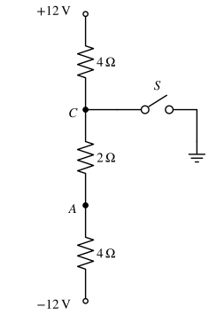

# 基本概念、元件与基尔霍夫定律

!!! abstract "TL;DR"
    电路分析只用两类约束：**拓扑约束**（KCL、KVL，只和连接方式有关）和**元件约束**（VCR，伏安关系，只和元件本身有关）。所有方法——节点法、网孔法、戴维南、相量法——都是这两类约束的不同组织方式。做题第一步永远是**先标参考方向**，负号只说明"实际方向与参考方向相反"。

## 1. 参考方向与功率

电流、电压的真实方向事先往往未知，于是先**任意假定**一个参考方向再列方程：

- 电流参考方向：用箭头表示；算出 $i<0$ 说明实际电流与箭头相反。
- 电压参考极性：用 $+$、$-$ 表示，$u_{ab}=V_a-V_b$；算出 $u<0$ 说明实际 $a$ 点电位更低。

同一元件上，**电流从电压的 $+$ 端流入**称为**关联参考方向**，否则为非关联。

{ .circuit }

| 参考方向 | 元件**吸收**的功率 | 判断 |
| --- | --- | --- |
| 关联 | $p=ui$ | $p>0$ 吸收（负载性质），$p<0$ 发出（电源性质） |
| 非关联 | $p=-ui$ | 同上 |

!!! tip "一句话记忆"
    先按上表算出"吸收功率"，再看正负。整个电路满足**功率守恒**：$\sum p_{\text{吸收}}=0$，即发出的总功率等于吸收的总功率——这是检验答案最好用的办法。

??? example "例：2 Ω 电阻上的负电流"
    电阻 $R=2\,\Omega$，电压 $u_{ab}$ 取 $a$ 正 $b$ 负，电流参考方向 $a\to b$，算得 $i=-3\,\mathrm{A}$。

    关联方向，$u_{ab}=Ri=-6\,\mathrm V$，吸收功率 $p=u_{ab}i=(-6)(-3)=18\,\mathrm W>0$。
    负号只说明实际电流从 $b$ 流向 $a$；电阻永远耗能，$p=i^2R=18\,\mathrm W$ 吻合。

## 2. 基本元件的伏安关系

以下均取**关联参考方向**（非关联时右边加负号）。

| 元件 | VCR | 储能 | 直流稳态 | 关键性质 |
| --- | --- | --- | --- | --- |
| 电阻 $R$ | $u=Ri$ | 不储能，$p=i^2R\ge0$ | — | 无记忆 |
| 电感 $L$ | $u=L\dfrac{\mathrm di}{\mathrm dt}$ | $w_L=\tfrac12Li^2$ | 短路（$u=0$） | 电流一般不能突变 |
| 电容 $C$ | $i=C\dfrac{\mathrm du}{\mathrm dt}$ | $w_C=\tfrac12Cu^2$ | 开路（$i=0$） | 电压一般不能突变 |

- 电感、电容是**动态元件**（有记忆）：$i_L(t)=i_L(t_0)+\frac1L\int_{t_0}^t u\,\mathrm d\xi$，$u_C(t)=u_C(t_0)+\frac1C\int_{t_0}^t i\,\mathrm d\xi$。
- 串并联：电感与电阻相同（串联相加、并联倒数相加）；**电容恰好相反**——并联相加 $C=C_1+C_2$，串联 $C=\dfrac{C_1C_2}{C_1+C_2}$。

## 3. 独立电源

| | 理想电压源 $u_s$ | 理想电流源 $i_s$ |
| --- | --- | --- |
| 确定的量 | 端电压恒为 $u_s$ | 输出电流恒为 $i_s$ |
| 由外电路决定 | 流过的电流（大小、方向都可能变） | 两端电压 |
| 置零（叠加/求等效电阻时） | **短路** | **开路** |
| 不允许的连接 | 不同值的电压源并联、电压源短路 | 不同值的电流源串联、电流源开路 |

!!! warning "电源不一定在发出功率"
    电压源的电流由外电路决定，可以从 $+$ 端流入——此时它在**吸收**功率（例如给电池充电）。判断依据仍是第 1 节的表，而不是"它是电源"。

??? example "例：串联回路中两个电源的功率"
    { .circuit }

    串联回路中电流处处相同，由电流源决定：$I=2\,\mathrm A$（顺时针）。

    1. 电阻：$U_R=5\times2=10\,\mathrm V$，吸收 $20\,\mathrm W$。
    2. 电压源：电流从其 $+$ 端流入（关联），吸收 $P_U=15\times2=30\,\mathrm W$——**在吸收功率**。
    3. 电流源两端电压（上 $+$ 下 $-$）：沿回路 KVL，$U_I=U_R+15=25\,\mathrm V$；电流从 $+$ 端流出（非关联），吸收 $P_I=-25\times2=-50\,\mathrm W$，即**发出** $50\,\mathrm W$。
    4. 校验：$20+30-50=0$ ✓

## 4. 受控源

受控源的输出受电路中另一处电压或电流控制，是晶体管、运放等器件的电路模型。符号是**菱形**。

| 类型 | 关系 | 控制系数 |
| --- | --- | --- |
| VCVS 电压控制电压源 | $u=\mu u_1$ | $\mu$ 无量纲 |
| CCVS 电流控制电压源 | $u=ri_1$ | $r$ 单位 $\Omega$ |
| VCCS 电压控制电流源 | $i=gu_1$ | $g$ 单位 $\mathrm S$ |
| CCCS 电流控制电流源 | $i=\beta i_1$ | $\beta$ 无量纲 |

!!! warning "受控源 ≠ 独立源"
    - 列方程时先把受控源**当独立源**写进去，再**补一条方程**把控制量 $u_1$ 或 $i_1$ 用未知量表示。
    - 叠加定理、求等效电阻时，受控源**不能置零**，必须保留。
    - 受控源可以发出功率，因此含受控源的网络可能出现**负的等效电阻**。

## 5. 基尔霍夫定律

**KCL**（电荷守恒）：任一节点，$\sum i_{\text{流出}}=0$，即流入 = 流出。推广到任意闭合面（**广义节点**）：穿过闭合面的电流代数和为零。

**KVL**（能量守恒、电位单值）：沿任一闭合回路，$\sum u=0$。常用写法是"电压升 = 电压降"，或沿绕行方向逐元件写"$+$ 进 $-$ 出记为正降"。

!!! note "KCL、KVL 与元件性质无关"
    无论元件线性、非线性、时变与否，KCL、KVL 都成立；正弦稳态下对相量同样成立（$\sum\dot I=0$，$\sum\dot U=0$），但**有效值一般不满足**：$\sum I\ne0$。

### 电位

选一个参考点（接地符号）令其电位为零，某点电位就是该点到参考点的电压。

- 沿电流方向经过电阻，电位**降低** $IR$；经过电压源从 $-$ 到 $+$，电位**升高** $U_s$。
- 换参考点，所有电位一起平移，**任意两点间电压不变**。
- 短路（理想导线）两端电位相等；开路只保证电流为零，**两端电压不一定为零**。

??? example "例：开关通断时的电位"
    { .circuit }

    图中 $+12\,\mathrm V$、$-12\,\mathrm V$ 是两个端点对地的电位，开关 $S$ 把节点 $C$ 接地。求 $S$ 断开和闭合时 $V_A$。

    **$S$ 断开**：三个电阻串联在 $+12\,\mathrm V$ 与 $-12\,\mathrm V$ 之间，

    $$
    I=\frac{12-(-12)}{4+2+4}=2.4\,\mathrm A,\qquad V_A=-12+4\times2.4=-2.4\,\mathrm V.
    $$

    **$S$ 闭合**：$V_C=0$，下面两只电阻串联在 $0$ 与 $-12\,\mathrm V$ 之间，

    $$
    I'=\frac{0-(-12)}{2+4}=2\,\mathrm A,\qquad V_A=-12+4\times2=-4\,\mathrm V.
    $$

    （上面 $4\,\Omega$ 中的电流变为 $12/4=3\,\mathrm A$，经开关入地，不影响下半部分。）

## 6. 小结

| 约束 | 内容 | 适用 |
| --- | --- | --- |
| KCL | $\sum i=0$（节点 / 闭合面） | 任何集总电路 |
| KVL | $\sum u=0$（回路） | 任何集总电路 |
| VCR | $u=Ri$、$u=L\,\mathrm di/\mathrm dt$、$i=C\,\mathrm du/\mathrm dt$、电源、受控源 | 由元件决定 |

下一篇：[等效变换](equivalent-transformation.md)。
