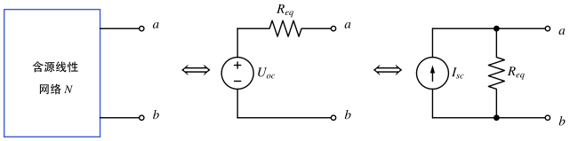
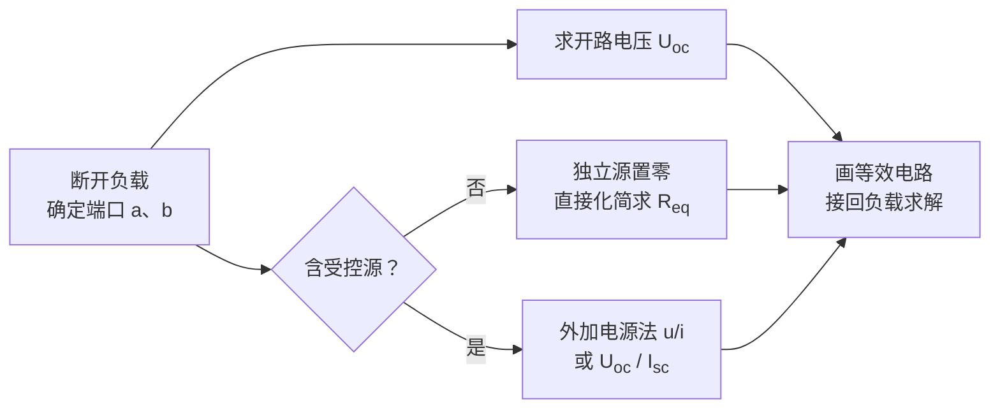
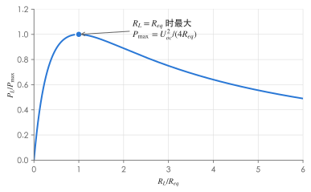

# 电路定理

!!! abstract "TL;DR"
    - **叠加**：线性电路中，响应 = 各独立源单独作用的响应之和；置零时电压源短路、电流源开路、**受控源保留**；功率不能叠加。
    - **戴维南**：任何线性含源二端网络 = $U_{oc}$ 串 $R_{eq}$；**诺顿**：= $I_{sc}$ 并 $R_{eq}$，$U_{oc}=R_{eq}I_{sc}$。
    - **最大功率**：$R_L=R_{eq}$ 时负载功率最大，$P_{\max}=\dfrac{U_{oc}^2}{4R_{eq}}$（要求 $R_{eq}>0$）。

## 1. 叠加定理与齐次定理

**叠加定理**：线性电路中有多个独立源时，任一支路的电压或电流等于每个独立源单独作用时在该支路产生的响应的代数和。

| 某个独立源"不作用"时 | 处理 |
| --- | --- |
| 独立电压源 | 置零 → **短路** |
| 独立电流源 | 置零 → **开路** |
| 受控源 | **保留**，控制量在每个分电路中重新计算 |
| 电源内阻、其余电阻 | 全部保留 |

**齐次定理**：只有一个独立源时，所有响应与该激励成正比；所有独立源同时乘 $k$，所有响应也乘 $k$。

!!! warning "功率不能叠加"
    $p=R(i'+i'')^2=Ri'^2+Ri''^2+2Ri'i''$，交叉项一般不为零。正确做法：**先叠加电流/电压，再算功率**。叠加定理也只适用于线性电路——含二极管时要先确定其工作状态。

??? example "例：叠加定理"
    { .circuit }

    求 $R_2$ 中的电流 $i$。

    - $U_s$ 单独作用（$I_s$ 开路）：$i'=\dfrac{12}{4+6}=1.2\,\mathrm A$
    - $I_s$ 单独作用（$U_s$ 短路）：$R_1$、$R_2$ 并联分流，$i''=3\times\dfrac{4}{4+6}=1.2\,\mathrm A$
    - 叠加：$i=i'+i''=2.4\,\mathrm A$

    **检验**（节点法）：$\dfrac{U_a-12}{4}+\dfrac{U_a}{6}=3\Rightarrow U_a=14.4\,\mathrm V$，$i=14.4/6=2.4\,\mathrm A$ ✓

    **功率**：$P_{R_2}=6\times2.4^2=34.56\,\mathrm W$，而 $6\times1.2^2+6\times1.2^2=17.28\,\mathrm W$——差了一个交叉项。

## 2. 替代定理

若某支路的电压 $u_k$（或电流 $i_k$）已知，可以用一个 $u_s=u_k$ 的电压源（或 $i_s=i_k$ 的电流源）替代该支路，其余部分的电压电流不变（要求替代前后电路有唯一解）。

它的一个重要推论：把可变负载**替代成电流源** $I_1$ 后，网络里只剩"固定的内部独立源"和"$I_1$"两类激励，所以**任意其他响应都是 $I_1$ 的一次函数** $y=aI_1+b$（$b$ 来自内部独立源，一般不为零）。

??? example "例：两次测量确定线性关系"
    $A$ 为线性含源网络，外接可调电阻 $R$，$I_1$ 为 $R$ 中电流，$I_2$ 为网络中另一支路电流。$R=R_0$ 时 $I_1=2\,\mathrm A$、$I_2=\tfrac13\,\mathrm A$；$R=R_0+10\,\Omega$ 时 $I_1=1.5\,\mathrm A$、$I_2=0.5\,\mathrm A$。求 $R=R_0-10\,\Omega$ 时的 $I_1$、$I_2$。

    1. 从 $R$ 看进去把网络等效为 $E$ 串 $r$：$I_1=\dfrac{E}{R+r}$。

        $$
        E=2(R_0+r)=1.5(R_0+r+10)\ \Rightarrow\ R_0+r=30\,\Omega,\ E=60\,\mathrm V,
        $$

        $$
        I_1=\frac{60}{30-10}=3\,\mathrm A .
        $$

    2. 由替代定理，$I_2=aI_1+b$：

        $$
        \tfrac13=2a+b,\quad \tfrac12=1.5a+b\ \Rightarrow\ a=-\tfrac13,\ b=1,\qquad I_2=1-\tfrac13\times3=0 .
        $$

    !!! warning "不能直接按比例缩放"
        网络内部有独立源，$I_2$ 与 $I_1$ 不成正比（$b\neq0$），所以不能写 $I_2/I_1=$ 常数。

## 3. 戴维南定理与诺顿定理

{ .circuit }

任何线性含源二端网络 $N$，对外电路可等效为：

- **戴维南**：电压源 $U_{oc}$ 串联电阻 $R_{eq}$。$U_{oc}$ 为端口**开路电压**。
- **诺顿**：电流源 $I_{sc}$ 并联电阻 $R_{eq}$。$I_{sc}$ 为端口**短路电流**（从 $a$ 经短路线流到 $b$）。
- 二者关系：$U_{oc}=R_{eq}I_{sc}$。$R_{eq}=0$ 时只有戴维南形式，$R_{eq}=\infty$ 时只有诺顿形式。

求 $R_{eq}$ 的三种方法：

| 方法 | 做法 | 适用 |
| --- | --- | --- |
| 直接化简 | 独立源置零（电压源短路、电流源开路），串并联 / Y–Δ 化简 | **不含受控源** |
| 外加电源法 | 独立源置零、**受控源保留**，端口加 $u$ 求 $i$（关联），$R_{eq}=u/i$ | 通用，含受控源首选 |
| 开路短路法 | 独立源保留，分别求 $U_{oc}$、$I_{sc}$，$R_{eq}=U_{oc}/I_{sc}$ | 通用；但 $U_{oc}=I_{sc}=0$ 时失效 |

!!! warning "常见错误"
    - 负载**不属于**被等效的网络，求 $U_{oc}$、$R_{eq}$ 前先把它拿掉。
    - 若受控源的控制量在负载上，等效前要先把控制量改写成端口量，否则等效后控制关系丢失。
    - 用开路短路法时，$U_{oc}$ 和 $I_{sc}$ 必须是**同一端口、方向配套**（$I_{sc}$ 从 $U_{oc}$ 的 $+$ 端经短路线流出）。

## 4. 最大功率传输定理

负载 $R_L$ 接在戴维南等效电路上：

$$
P_L=\left(\frac{U_{oc}}{R_{eq}+R_L}\right)^2R_L,\qquad
\frac{\mathrm dP_L}{\mathrm dR_L}=U_{oc}^2\frac{R_{eq}-R_L}{(R_{eq}+R_L)^3}.
$$

$R_L=R_{eq}$ 时 $P_L$ 最大：

$$
P_{\max}=\frac{U_{oc}^2}{4R_{eq}}\qquad(R_{eq}>0)
$$

{ .circuit }

!!! note "匹配不等于高效率"
    匹配时负载功率最大，但 $R_{eq}$ 上消耗同样多，**传输效率只有 50%**（这里指戴维南等效电路中的效率；原网络内部的实际损耗另算）。电力系统追求效率，不工作在匹配状态；通信电路追求信号功率，常工作在匹配状态。

??? example "例：负载功率、电流、电压分别何时最大"
    { .circuit }

    $R\ge0$ 可调。分别求使 $R$ 的功率、电流、电压最大的 $R$ 及最大值。

    **开路电压**（移去 $R$）：$I_S=1\,\mathrm A$ 从 $A$ 出发，经 $R_1$ 或 $R_4+R_2$ 两条路径到 $B$，再全部经 $R_3$ 回地，故 $U_B=3\times1=3\,\mathrm V$。经 $R_4$、$R_2$ 的分流

    $$
    I_{42}=1\times\frac{40}{40+(16+8)}=\frac58\,\mathrm A,
    $$

    它从 $C$ 流向 $B$，所以 $U_C=U_B+\tfrac58\times8=8\,\mathrm V$，即 $U_{oc}=8\,\mathrm V$。

    **等效电阻**（电流源开路）：从 $C$ 看入，$R_2$ 与 $(R_4+R_1)$ 并联后再串 $R_3$：

    $$
    R_{eq}=8\parallel(16+40)+3=7+3=10\,\Omega .
    $$

    | 目标 | 表达式 | 结论 |
    | --- | --- | --- |
    | 功率最大 | $P=\dfrac{64R}{(R+10)^2}$ | $R=10\,\Omega$，$P_{\max}=\dfrac{8^2}{40}=1.6\,\mathrm W$ |
    | 电流最大 | $I=\dfrac{8}{R+10}$，单调减 | $R=0$，$I_{\max}=0.8\,\mathrm A$ |
    | 电压最大 | $U=\dfrac{8R}{R+10}$，单调增 | $R\to\infty$（开路），$U\to8\,\mathrm V$ |

??? example "例：含受控源，等效电阻为负"
    { .circuit }

    $U_2$ 为 $2\,\Omega$ 电阻上的电压（上正下负），受控电流源 $gU_2$ 由 $b$ 流向 $a$，$g=1\,\mathrm S$。求 $a$、$b$ 端的戴维南等效电路。（以 $b$ 为参考点，$x$ 点电位 $V=U_2$，端口电压 $U=U_{ab}$。）

    **开路电压**：节点 $a$ 的 KCL（$3\,\Omega$ 中流入 $a$ 的电流 + 受控源流入 $a$ 的电流 = 0）：

    $$
    \frac{V-U}{3}+V=0\ \Rightarrow\ U=4V .
    $$

    节点 $x$：$\dfrac V2+\dfrac{V-U}{3}=1\Rightarrow \dfrac V2-V=1\Rightarrow V=-2\,\mathrm V$，所以 $U_{oc}=-8\,\mathrm V$。

    **等效电阻**（$1\,\mathrm A$ 开路，受控源保留）：端口加 $U_t$，流入 $a$ 的电流为 $I_t$。

    $$
    \frac V2+\frac{V-U_t}{3}=0\ \Rightarrow\ V=\tfrac25U_t,\qquad
    I_t=\frac{U_t-V}{3}-V=\frac{U_t}{5}-\frac{2U_t}{5}=-\frac{U_t}{5}.
    $$

    $$
    R_{eq}=\frac{U_t}{I_t}=-5\,\Omega,\qquad I_{sc}=\frac{U_{oc}}{R_{eq}}=1.6\,\mathrm A .
    $$

    **检验**：端口短路时 $V=\dfrac{1}{1/2+1/3}=1.2\,\mathrm V$，流经短路线的电流 $\dfrac{V}{3}+V=0.4+1.2=1.6\,\mathrm A$ ✓

    负电阻说明网络在向外输出功率（受控源提供能量），此时**不能**套用 $R_L=R_{eq}$ 的最大功率结论。

## 5. 互易定理（了解）

对**只含线性电阻、不含受控源和独立源**的网络（互易网络），激励与响应互换位置时比值不变。例如：在端口 1 加电压源 $U_s$、测端口 2 的短路电流 $I_2$；把同一电压源移到端口 2、测端口 1 的短路电流 $I_1$，则 $I_1=I_2$。含受控源的网络一般不满足互易性。

下一篇：[正弦稳态与相量法](phasor-method.md)。
