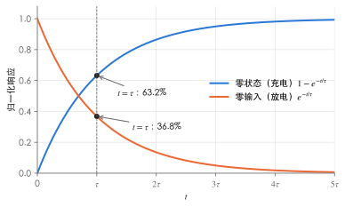
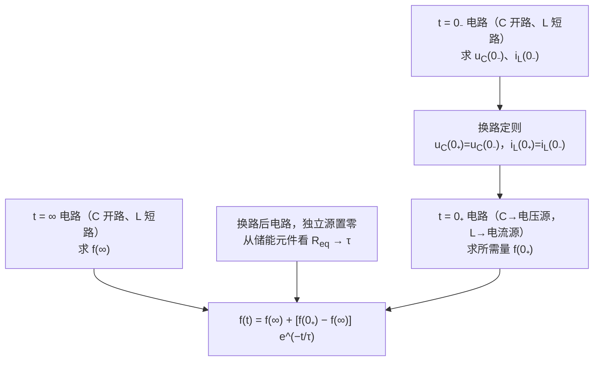
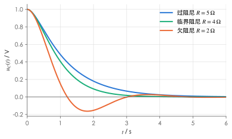

# 动态电路的时域分析

!!! abstract "TL;DR"
    一阶电路（直流激励）只需三个量：**初始值 $f(0_+)$、稳态值 $f(\infty)$、时间常数 $\tau$**，

    $$
    f(t)=f(\infty)+\big[f(0_+)-f(\infty)\big]e^{-t/\tau},\qquad t\ge0_+ .
    $$

    $\tau=R_{eq}C$ 或 $L/R_{eq}$，$R_{eq}$ 是从储能元件两端看进去的戴维南等效电阻。初始值靠**换路定则**：$u_C(0_+)=u_C(0_-)$、$i_L(0_+)=i_L(0_-)$——只有这两个量连续，其余量都可能跳变。

## 1. 换路与换路定则

电路结构或参数突然改变（开关动作、电源接入）称为**换路**，记换路时刻为 $t=0$，$0_-$、$0_+$ 分别为换路前、后瞬间。

由 $u_C(t)=u_C(0_-)+\frac1C\int_{0_-}^{t}i_C\,\mathrm d\xi$：只要电容电流**有限**，积分在 $0_-\to0_+$ 上为零，所以

$$
u_C(0_+)=u_C(0_-),\qquad i_L(0_+)=i_L(0_-)\quad(\text{电感电压有限时}).
$$

这本质上是**能量不能突变**（$w_C=\tfrac12Cu_C^2$，$w_L=\tfrac12Li_L^2$）。

!!! warning "能跳变的量"
    电阻的电压电流、电容**电流**、电感**电压**都可以在换路瞬间跳变。$i_C(0_+)$、$u_L(0_+)$ 必须用 $0_+$ 等效电路重新求，不能拿 $0_-$ 的值。

### 求初始值的步骤

1. 画 $t=0_-$ 电路（换路前为直流稳态：**C 开路、L 短路**），求 $u_C(0_-)$、$i_L(0_-)$；
2. 换路定则得 $u_C(0_+)$、$i_L(0_+)$；
3. 画 $t=0_+$ 等效电路：**电容 → 电压源 $u_C(0_+)$，电感 → 电流源 $i_L(0_+)$**（为零时分别为短路、开路），求其他量的 $0_+$ 值。

## 2. 一阶电路的三种响应

只含一个（或可等效为一个）储能元件的电路，方程是一阶线性常微分方程。以 RC 为例：$R_{eq}C\dfrac{\mathrm du_C}{\mathrm dt}+u_C=U_{oc}$。

| 响应 | 条件 | 结果（RC） |
| --- | --- | --- |
| 零输入响应 | 换路后无独立源，靠初始储能 | $u_C=U_0e^{-t/\tau}$ |
| 零状态响应 | 初始储能为零，靠外加激励 | $u_C=U_{oc}\big(1-e^{-t/\tau}\big)$ |
| 全响应 | 两者都有 | 零输入 + 零状态 = 稳态分量 + 暂态分量 |

{ .circuit }

**时间常数**：$\tau=R_{eq}C$（RC），$\tau=\dfrac{L}{R_{eq}}$（RL），单位秒。经过 $\tau$ 暂态分量衰减到初值的 $36.8\%$；工程上认为 $3\tau\sim5\tau$ 后过渡过程结束（剩 $5\%\sim0.7\%$）。

!!! tip "$R_{eq}$ 怎么求"
    把储能元件拿掉，从它的两端看进去，**独立源置零**求戴维南等效电阻。含受控源时用外加电源法——不能直接串并联。换路后电路结构变了，$R_{eq}$ 要按**换路后**的电路求。

## 3. 三要素法

三要素法适用于**直流激励下的一阶线性电路**，对电路中任何电压、电流都成立（同一电路中所有量的 $\tau$ 相同）。

??? example "例：开关闭合后的 RC 电路"
    { .circuit }

    换路前电路已稳定，$t=0$ 时 $S$ 闭合。求 $u_C(t)$、$u(t)$。

    1. **$0_-$**：$S$ 断开、电容开路，$u_C(0_-)=12\times\dfrac{3}{6+3}=4\,\mathrm V$；
    2. **$0_+$**：$u_C(0_+)=4\,\mathrm V$；$2\,\Omega$ 与电容并联，$u(0_+)=4\,\mathrm V$（而 $u(0_-)=0$，**跳变**了）；
    3. **$\infty$**：$u_C(\infty)=12\times\dfrac{3\parallel2}{6+3\parallel2}=12\times\dfrac{1.2}{7.2}=2\,\mathrm V$；
    4. **$\tau$**：电压源短路，从电容看入 $R_{eq}=6\parallel3\parallel2=1\,\Omega$，$\tau=1\times1=1\,\mathrm s$。

    $$
    u_C(t)=2+(4-2)e^{-t}=2+2e^{-t}\ \mathrm V,\qquad u(t)=u_C(t)=2+2e^{-t}\ \mathrm V\quad(t>0)
    $$

??? example "例：开关断开后的 RL 电路"
    { .circuit }

    换路前已稳定，$t=0$ 时 $S$ 断开。求 $i_L(t)$、$u_L(t)$。

    1. **$0_-$**：电感短路，$R_2\parallel R_3=6\parallel3=2\,\Omega$，$u_a=12\times\dfrac{2}{2+2}=6\,\mathrm V$，$i_L(0_-)=\dfrac63=2\,\mathrm A$；
    2. **$0_+$**：$i_L(0_+)=2\,\mathrm A$，$u_a(0_+)=12-2\times2=8\,\mathrm V$，$u_L(0_+)=8-3\times2=2\,\mathrm V$；
    3. **$\infty$**：$i_L(\infty)=\dfrac{12}{2+3}=2.4\,\mathrm A$，$u_L(\infty)=0$；
    4. **$\tau$**：$R_{eq}=R_1+R_3=5\,\Omega$，$\tau=\dfrac{1}{5}=0.2\,\mathrm s$。

    $$
    i_L(t)=2.4-0.4e^{-5t}\ \mathrm A,\qquad u_L(t)=L\frac{\mathrm di_L}{\mathrm dt}=2e^{-5t}\ \mathrm V
    $$

    （$u_L$ 也可直接用三要素：$0+(2-0)e^{-5t}$，结果相同。注意 $R_1$ 中的电流从 $3\,\mathrm A$ 跳变为 $2\,\mathrm A$。）

??? example "例：含受控源的一阶电路"
    { .circuit }

    $u_C(0_-)=0$，$t=0$ 时 $S$ 闭合，受控电流源 $0.5i_1$ 注入节点 $a$。求 $u_C(t)$。

    **方法一：直接列方程**。$i_1=\dfrac{10-u_C}{2}$，节点 $a$：$i_1+0.5i_1=\dfrac{u_C}{2}+0.5\dfrac{\mathrm du_C}{\mathrm dt}$，整理得

    $$
    \frac{\mathrm du_C}{\mathrm dt}+2.5u_C=15 .
    $$

    **方法二：三要素**。

    - $u_C(\infty)$：$1.5\times\dfrac{10-u_C}{2}=\dfrac{u_C}{2}\Rightarrow u_C(\infty)=6\,\mathrm V$；
    - $R_{eq}$（外加电源法：拿掉电容、电压源短路、受控源保留，在 $a$ 点加电压 $u$）：$i_1=-\dfrac u2$；流出 $a$ 的电流有 $R_1$ 中的 $\dfrac u2$ 和 $R_2$ 中的 $\dfrac u2$，受控源流入 $a$ 的电流为 $0.5i_1=-\dfrac u4$，所以外加源提供 $i=\dfrac u2+\dfrac u2+\dfrac u4=1.25u$，$R_{eq}=\dfrac ui=0.8\,\Omega$；
    - $\tau=R_{eq}C=0.8\times0.5=0.4\,\mathrm s$。

    $$
    u_C(t)=6\big(1-e^{-2.5t}\big)\ \mathrm V,\qquad i_1(t)=\frac{10-u_C}{2}=2+3e^{-2.5t}\ \mathrm A
    $$

    两种方法一致（方程的系数 $2.5=1/\tau$，稳态 $15/2.5=6$）。

!!! tip "激励本身是指数时"
    若一阶电路被另一个指数信号驱动（例如前级 RC 的输出 $6e^{-t/2}$ 作为后级的激励），三要素法不再适用，要解微分方程。例如

    $$
    \frac{\mathrm du}{\mathrm dt}+u=6e^{-t/2},\quad u(0_+)=6
    $$

    设特解 $Ae^{-t/2}$，代入得 $A=12$；通解 $u=12e^{-t/2}+Be^{-t}$，由 $u(0_+)=6$ 得 $B=-6$，即 $u=12e^{-t/2}-6e^{-t}$。若激励的指数恰好等于电路的固有频率，特解要改设为 $Ate^{-t/\tau}$。

## 4. 换路定则失效：电荷守恒与磁链守恒

换路定则的前提是"电容电流、电感电压有限"。下面两种情况会出现**冲激**，电容电压或电感电流在换路瞬间**跳变**：

| 情况 | 例子 | 改用 |
| --- | --- | --- |
| 换路后出现**只由电容（和理想电压源）组成的回路** | 两个电压不同的电容直接并联 | 节点**电荷守恒** $\sum q(0_+)=\sum q(0_-)$ + KVL |
| 换路后出现**只由电感（和理想电流源）组成的割集** | 两个电流不同的电感直接串联 | **磁链守恒** $\sum\Psi(0_+)=\sum\Psi(0_-)$ + KCL |

??? example "例：两个电容突然并联"
    { .circuit }

    $u_1(0_-)=6\,\mathrm V$，$u_2(0_-)=0$，$t=0$ 时 $S$ 闭合。闭合后 $u_1=u_2$，若用换路定则会得到矛盾（$6\ne0$）。

    上极板构成的节点电荷守恒：

    $$
    C_1u_1(0_-)+C_2u_2(0_-)=(C_1+C_2)\,u(0_+)\ \Rightarrow\ u(0_+)=\frac{1\times6+0}{3}=2\,\mathrm V .
    $$

    储能从 $\tfrac12\times1\times6^2=18\,\mathrm J$ 变为 $\tfrac12\times3\times2^2=6\,\mathrm J$。若回路中串有电阻 $R$，损失的 $12\,\mathrm J$ 全部消耗在 $R$ 上，且与 $R$ 的大小无关；理想模型（$R=0$）中对应冲激电流。

!!! warning "课程作业中的典型情形"
    第七章里"两电容串接后接到电源上""两电感并联后电阻电流趋于零"之类的题，都要先检查换路后有没有纯电容回路或纯电感割集。有，就用电荷 / 磁链守恒求 $0_+$ 值（例如两电感并联时 $L_1i_1-L_2i_2$ 在整个过程中保持不变，正负号取决于两电流的参考方向）。

## 5. 阶跃响应与冲激响应（了解）

- 单位阶跃 $\varepsilon(t)$：$t<0$ 为 $0$，$t>0$ 为 $1$。电路在 $\varepsilon(t)$ 激励下的零状态响应称**阶跃响应** $s(t)$，例如 RC 电路电容电压 $s(t)=(1-e^{-t/\tau})\varepsilon(t)$。
- 单位冲激 $\delta(t)=\dfrac{\mathrm d\varepsilon(t)}{\mathrm dt}$。线性时不变电路的冲激响应 $h(t)=\dfrac{\mathrm ds(t)}{\mathrm dt}$。
- 用 $\varepsilon(t)$ 可以把分段激励写成一个式子，例如宽度为 $t_0$ 的矩形脉冲 $=\varepsilon(t)-\varepsilon(t-t_0)$，响应按时不变性和叠加性相减。

## 6. 二阶电路（RLC 串联零输入）

$$
LC\frac{\mathrm d^2u_C}{\mathrm dt^2}+RC\frac{\mathrm du_C}{\mathrm dt}+u_C=0,\qquad
s_{1,2}=-\frac{R}{2L}\pm\sqrt{\Big(\frac{R}{2L}\Big)^2-\frac{1}{LC}}
$$

| 条件 | 特征根 | 响应 |
| --- | --- | --- |
| $R>2\sqrt{L/C}$ | 两个不等负实根 | **过阻尼**，非振荡衰减 |
| $R=2\sqrt{L/C}$ | 二重负实根 | **临界阻尼**，最快的非振荡衰减 |
| $R<2\sqrt{L/C}$ | 共轭复根 $-\alpha\pm j\omega_d$ | **欠阻尼**，衰减振荡，$\alpha=\dfrac{R}{2L}$，$\omega_d=\sqrt{\dfrac1{LC}-\alpha^2}$ |
| $R=0$ | $\pm j\omega_0$ | 无阻尼，等幅振荡 |

下图取 $L=1\,\mathrm H$、$C=0.25\,\mathrm F$（临界电阻 $2\sqrt{L/C}=4\,\Omega$），$u_C(0)=1\,\mathrm V$、$i(0)=0$：

{ .circuit }

- $R=5\,\Omega$：$s=-1,-4$，$u_C=\tfrac43e^{-t}-\tfrac13e^{-4t}$；
- $R=4\,\Omega$：$s=-2$（二重），$u_C=(1+2t)e^{-2t}$；
- $R=2\,\Omega$：$s=-1\pm j\sqrt3$，$u_C=e^{-t}\Big(\cos\sqrt3t+\dfrac{1}{\sqrt3}\sin\sqrt3t\Big)$。

下一篇：[题型与解题套路](problem-patterns.md)。
