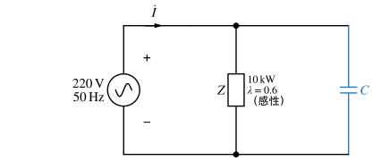

# 习题：正弦稳态功率与谐振

对应知识点：[正弦稳态功率与谐振](../notes/ac-power-resonance.md)。全部采用 sin 约定与有效值相量：$u=\sqrt2U\sin(\omega t+\psi)\leftrightarrow\dot U=U\angle\psi$。

## 各种功率与功率守恒

### 1. 概念判断 :material-star::material-star-outline::material-star-outline:

判断下列说法是否正确：

1. 复功率守恒，所以各支路视在功率之和等于电源的视在功率。
2. 感性负载并联电容后，负载本身的电流和有功功率都不变。
3. RLC 串联谐振时，电感上的电压可以远大于电源电压。
4. 共轭匹配时负载获得最大功率，此时传输效率为 $100\%$。
5. 电感线圈（$R$、$L$ 串联）与电容 $C$ 并联，谐振角频率一定是 $1/\sqrt{LC}$。

??? success "答案"
    1 ✗　2 ✓　3 ✓　4 ✗　5 ✗

??? note "解析"
    1. 守恒的是复功率 $\bar S=P+jQ$，即 $P$、$Q$ 分别守恒；视在功率 $S=|\bar S|$ 是模，模之和一般大于和的模。
    2. 负载两端电压不变，所以负载电流、$P$、$Q$ 都不变；变小的是**电源**电流。
    3. 谐振时 $U_L=U_C=QU$，品质因数 $Q\gg1$ 时远大于 $U$。
    4. 匹配时等效内阻 $R_{eq}$ 与负载消耗同样多的功率，戴维南等效电路中的效率只有 $50\%$。
    5. 令 $\operatorname{Im}Y=0$ 得 $\omega_0=\sqrt{\dfrac1{LC}-\dfrac{R^2}{L^2}}$，只有 $R=0$ 时才是 $1/\sqrt{LC}$。

### 2. 一端口的各种功率 :material-star::material-star-outline::material-star-outline:

（作业 5-18 改编）某无源一端口在关联参考方向下

$$
u=100\sqrt2\sin(\omega t+50^\circ)\ \mathrm V,\qquad i=5\sqrt2\cos(\omega t-70^\circ)\ \mathrm A .
$$

求复功率 $\bar S$、有功功率 $P$、无功功率 $Q$、视在功率 $S$、功率因数 $\lambda$（注明超前或滞后），以及等效阻抗 $Z$。

??? success "答案"
    $\bar S=500\angle30^\circ=433.0+j250\,\mathrm{VA}$；$P\approx433.0\,\mathrm W$，$Q=250\,\mathrm{var}$，$S=500\,\mathrm{VA}$；$\lambda=\cos30^\circ\approx0.866$（滞后）；$Z=20\angle30^\circ\approx17.32+j10\,\Omega$。

??? note "解析"
    1. **先统一成 sin**：$\cos(\omega t-70^\circ)=\sin(\omega t-70^\circ+90^\circ)=\sin(\omega t+20^\circ)$，所以

        $$
        \dot U=100\angle50^\circ\,\mathrm V,\qquad \dot I=5\angle20^\circ\,\mathrm A .
        $$

    2. **复功率**（共轭加在电流上）：

        $$
        \bar S=\dot U\dot I^*=100\angle50^\circ\times5\angle(-20^\circ)=500\angle30^\circ=250\sqrt3+j250\approx433.0+j250\,\mathrm{VA}.
        $$

    3. $P=433.0\,\mathrm W$，$Q=250\,\mathrm{var}>0$（吸收感性无功），$S=500\,\mathrm{VA}$，$\lambda=\cos30^\circ\approx0.866$；电流滞后电压 $30^\circ$，称**滞后**功率因数。
    4. $Z=\dfrac{\dot U}{\dot I}=20\angle30^\circ=10\sqrt3+j10\approx17.32+j10\,\Omega$。

    !!! warning "易错"
        直接拿 $50^\circ-(-70^\circ)=120^\circ$ 当相位差，会得到 $P<0$ 的荒谬结果——无源网络的 $P$ 不可能为负。比相位前必须先把 cos 换成 sin。

### 3. 逐支路复功率 :material-star::material-star::material-star-outline:

求图中各支路吸收的复功率和电源发出的复功率，验证复功率守恒；再比较各支路视在功率之和与电源视在功率。

{ .circuit }

??? success "答案"
    $\dot I_1=12.5\angle0^\circ\,\mathrm A$，$\dot I_2=8.84\angle(-45^\circ)\,\mathrm A$，$\dot I_3=8.84\angle45^\circ\,\mathrm A$。
    串联支路 $156.25-j156.25\,\mathrm{VA}$，$6+j8$ 支路 $468.75+j625\,\mathrm{VA}$，$8-j6$ 支路 $625-j468.75\,\mathrm{VA}$；合计 $1250+j0\,\mathrm{VA}$，等于电源发出的 $\bar S=1250\,\mathrm{VA}$。视在功率之和约 $1783.5\,\mathrm{VA}\ne1250\,\mathrm{VA}$。

??? note "解析"
    1. **并联部分**：

        $$
        Z_p=\frac{(6+j8)(8-j6)}{14+j2}=\frac{96+j28}{14+j2}=7+j1\,\Omega ,
        $$

        总阻抗 $Z=(1-j1)+(7+j1)=8\,\Omega$，恰为纯电阻。
    2. $\dot I_1=\dfrac{100}{8}=12.5\angle0^\circ\,\mathrm A$，$\dot U_{ab}=12.5(7+j1)=87.5+j12.5\,\mathrm V$，

        $$
        \dot I_2=\frac{\dot U_{ab}}{6+j8}=6.25-j6.25\,\mathrm A,\qquad \dot I_3=\frac{\dot U_{ab}}{8-j6}=6.25+j6.25\,\mathrm A ,
        $$

        $I_2=I_3=6.25\sqrt2\approx8.84\,\mathrm A$，$I_2^2=I_3^2=78.125$。
    3. **各支路**用 $\bar S_k=I_k^2Z_k$：

        | 支路 | $I_k^2$ | $\bar S_k$ / VA | $S_k$ / VA |
        | --- | --- | --- | --- |
        | $1-j1$ | $156.25$ | $156.25-j156.25$ | $220.97$ |
        | $6+j8$ | $78.125$ | $468.75+j625$ | $781.25$ |
        | $8-j6$ | $78.125$ | $625-j468.75$ | $781.25$ |
        | **合计** | | $1250+j0$ | $1783.5$ |

    4. 电源：$\bar S=\dot U_S\dot I_1^*=100\times12.5=1250\,\mathrm{VA}$ ✓，$\lambda=1$。

    电感吸收的无功 $625\,\mathrm{var}$ 恰好被两只电容发出的 $156.25+468.75=625\,\mathrm{var}$ 抵消，电源只提供有功；但各支路的视在功率加起来 $1783.5\,\mathrm{VA}$，比电源的 $1250\,\mathrm{VA}$ 大得多——视在功率不守恒。

### 4. 输电线路的损耗与效率 :material-star::material-star::material-star-outline:

（作业 5-23 改编）负载端电压 $U_2=220\,\mathrm V$，负载有功功率 $P_2=10\,\mathrm{kW}$，功率因数 $\lambda_2=0.8$（感性），线路总阻抗 $Z_l=0.1+j0.1\,\Omega$。求线路电流 $I$、电源端电压 $U_1$、电源端功率因数 $\lambda_1$ 及输电效率 $\eta$。

{ .circuit }

??? success "答案"
    $I\approx56.82\,\mathrm A$，$U_1\approx227.96\,\mathrm V$，$\lambda_1\approx0.797$（感性），$\eta\approx96.87\%$。

??? note "解析"
    1. **负载**：$I=\dfrac{P_2}{U_2\lambda_2}=\dfrac{10000}{220\times0.8}\approx56.82\,\mathrm A$，$Q_2=P_2\tan\varphi_2=10000\times\dfrac{0.6}{0.8}=7500\,\mathrm{var}$。
    2. **线路**吸收：$\Delta P=I^2\times0.1\approx322.8\,\mathrm W$，$\Delta Q=I^2\times0.1\approx322.8\,\mathrm{var}$。
    3. **电源端**（功率守恒，$P$、$Q$ 分别相加）：

        $$
        P_1\approx10322.8\,\mathrm W,\quad Q_1\approx7822.8\,\mathrm{var},\quad S_1=\sqrt{P_1^2+Q_1^2}\approx12952\,\mathrm{VA}.
        $$

        $$
        U_1=\frac{S_1}{I}\approx227.96\,\mathrm V,\qquad \lambda_1=\frac{P_1}{S_1}\approx0.797,\qquad \eta=\frac{P_2}{P_1}\approx96.87\% .
        $$

    **相量校验**：取 $\dot U_2=220\angle0^\circ$，$\dot I=56.82\angle(-36.87^\circ)$，$\dot I Z_l=56.82\times0.1414\angle(-36.87^\circ+45^\circ)\approx8.03\angle8.13^\circ\,\mathrm V$，

    $$
    \dot U_1=220+7.95+j1.14\approx227.96\angle0.29^\circ\,\mathrm V\ \checkmark
    $$

    !!! warning "易错"
        $U_1\neq U_2+IZ_l$ 的有效值直接相加（$220+8.03=228.03$）：线路压降与 $\dot U_2$ 不同相，必须相量相加。

### 5. 功率因数补偿 :material-star::material-star::material-star-outline:

一台感性负载接在 $220\,\mathrm V$、$50\,\mathrm{Hz}$ 电源上，有功功率 $10\,\mathrm{kW}$，功率因数 $0.6$。要把功率因数提高到 $0.9$（仍为感性），求并联电容 $C$，以及补偿前后的电源电流。

{ .circuit }

??? success "答案"
    $C\approx558.4\,\mu\mathrm F$；电源电流由 $75.76\,\mathrm A$ 降为 $50.51\,\mathrm A$。

??? note "解析"
    1. $\tan\varphi_1=\dfrac{0.8}{0.6}=\dfrac43$，$\tan\varphi_2=\dfrac{\sqrt{1-0.9^2}}{0.9}\approx0.4843$。
    2. 电容需提供的无功：

        $$
        |Q_C|=P(\tan\varphi_1-\tan\varphi_2)=10000\times(1.3333-0.4843)\approx8490\,\mathrm{var}.
        $$

    3. $|Q_C|=\omega CU^2$：

        $$
        C=\frac{8490}{100\pi\times220^2}\approx558.4\,\mu\mathrm F .
        $$

    4. 电流：补偿前 $I=\dfrac{10000}{220\times0.6}\approx75.76\,\mathrm A$，补偿后 $I'=\dfrac{10000}{220\times0.9}\approx50.51\,\mathrm A$。负载本身仍是 $75.76\,\mathrm A$，电容只是就近提供无功。

    !!! tip "补偿越到后面越不划算"
        若继续补偿到 $\lambda=1$，需 $C=\dfrac{P\tan\varphi_1}{\omega U^2}\approx876.9\,\mu\mathrm F$：从 $0.9$ 到 $1$ 还要再加约 $318\,\mu\mathrm F$，电流却只从 $50.51\,\mathrm A$ 降到 $45.45\,\mathrm A$。所以工程上一般补偿到 $0.9$ 左右。

## 最大功率与瓦特表

### 6. 共轭匹配与模匹配 :material-star::material-star::material-star-outline:

图中 $Z_L$ 为负载。（1）$Z_L$ 的电阻、电抗都可任意调节时，$Z_L$ 取何值功率最大？最大功率多少？（2）若 $Z_L$ 只能是纯电阻 $R_L$，结果如何？

{ .circuit }

??? success "答案"
    （1）$Z_L=2-j2\,\Omega$，$P_{\max}=25\,\mathrm W$；（2）$R_L=2\sqrt2\approx2.83\,\Omega$，$P=50(\sqrt2-1)\approx20.71\,\mathrm W$。

??? note "解析"
    1. **戴维南等效**（断开 $Z_L$）：

        $$
        \dot U_{oc}=20\times\frac{j4}{4+j4}=10+j10=10\sqrt2\angle45^\circ\,\mathrm V,\qquad
        Z_{eq}=\frac{4\times j4}{4+j4}=2+j2\,\Omega .
        $$

    2. **共轭匹配**：$Z_L=Z_{eq}^*=2-j2\,\Omega$，$P_{\max}=\dfrac{U_{oc}^2}{4R_{eq}}=\dfrac{200}{8}=25\,\mathrm W$。
    3. **只能接电阻**：$R_L=|Z_{eq}|=2\sqrt2\,\Omega$，

        $$
        P=\frac{U_{oc}^2R_L}{(R_{eq}+R_L)^2+X_{eq}^2}=\frac{200\times2\sqrt2}{(2+2\sqrt2)^2+2^2}=50(\sqrt2-1)\approx20.71\,\mathrm W<25\,\mathrm W .
        $$

    !!! warning "易错"
        只能接电阻时不要写 $R_L=R_{eq}=2\,\Omega$：对 $P(R_L)$ 求导得到的条件是 $R_L^2=R_{eq}^2+X_{eq}^2$。

### 7. 读数为负的瓦特表 :material-star::material-star::material-star-outline:

$\dot U_A=100\angle0^\circ\,\mathrm V$，$\dot U_B=100\angle(-90^\circ)\,\mathrm V$，两电源经 $j10\,\Omega$ 线路相连。瓦特表电流线圈串在线路中，其 $*$ 端朝向 $\dot U_B$；电压线圈 $*$ 端接在同一点，另一端接下方导线。求瓦特表读数，并说明两电源各自发出还是吸收有功功率。

{ .circuit }

??? success "答案"
    读数 $W=-1000\,\mathrm W$；$\dot U_A$ 发出 $1000\,\mathrm W$，$\dot U_B$ 吸收 $1000\,\mathrm W$。

??? note "解析"
    1. 线路电流（图中 $\dot I$ 从左向右）：

        $$
        \dot I=\frac{\dot U_A-\dot U_B}{j10}=\frac{100+j100}{j10}=10-j10\,\mathrm A .
        $$

    2. 瓦特表读数 $W=\mathrm{Re}[\dot U\dot I_W^*]$，其中 $\dot U$ 以电压线圈 $*$ 端为 $+$，即 $\dot U=\dot U_B$；$\dot I_W$ 是**从 $*$ 端流入电流线圈**的电流，即从右向左的 $-\dot I$：

        $$
        W=\mathrm{Re}\big[\dot U_B(-\dot I)^*\big]=\mathrm{Re}\big[(-j100)(-10-j10)\big]=\mathrm{Re}[-1000+j1000]=-1000\,\mathrm W .
        $$

    3. 读数为负说明按表的接法，"从 $\dot U_B$ 流向线路"的有功为负，即 $\dot U_B$ **吸收** $1000\,\mathrm W$。$\dot U_A$：$\mathrm{Re}[\dot U_A\dot I^*]=\mathrm{Re}[100(10+j10)]=1000\,\mathrm W$，发出。线路纯电抗不耗能，$1000=1000$ ✓

    !!! warning "易错"
        读数不能取绝对值，正负号正是判断能量流向的依据；也不能把 $\dot I$ 与 $\dot I_W$ 混为一谈——表只认电流从哪一端流进 $*$。

## 谐振

### 8. 收音机调谐回路 :material-star::material-star::material-star-outline:

（作业 5-26 改编）图示 RLC 串联回路中 $R=12.5\,\Omega$，$L=250\,\mu\mathrm H$，天线感应的信号 $U=10\,\mu\mathrm V$、频率 $1\,\mathrm{MHz}$。调节 $C$ 使回路对该信号谐振，求 $C$、电流 $I_0$、品质因数 $Q$、电容电压 $U_C$ 及通频带 $\Delta f$。

{ .circuit }

??? success "答案"
    $C\approx101.3\,\mathrm{pF}$，$I_0=0.8\,\mu\mathrm A$，$Q\approx125.7$，$U_C\approx1.257\,\mathrm{mV}$，$\Delta f\approx7.96\,\mathrm{kHz}$。

??? note "解析"
    1. $\omega_0=2\pi\times10^6\,\mathrm{rad/s}$，

        $$
        C=\frac{1}{\omega_0^2L}=\frac{1}{(2\pi\times10^6)^2\times250\times10^{-6}}\approx1.013\times10^{-10}\,\mathrm F=101.3\,\mathrm{pF}.
        $$

    2. 谐振时 $Z=R$：$I_0=\dfrac{10\,\mu\mathrm V}{12.5\,\Omega}=0.8\,\mu\mathrm A$。
    3. $X_L=X_C=\omega_0L=2\pi\times10^6\times2.5\times10^{-4}\approx1570.8\,\Omega$，$Q=\dfrac{1570.8}{12.5}\approx125.7$。
    4. $U_C=I_0X_C\approx0.8\,\mu\mathrm A\times1570.8\,\Omega\approx1257\,\mu\mathrm V=1.257\,\mathrm{mV}$，正好是 $QU$。
    5. $\Delta f=\dfrac{f_0}{Q}=\dfrac{10^6}{125.7}\approx7.96\,\mathrm{kHz}$。

    !!! warning "单位"
        $\mu\mathrm H=10^{-6}\,\mathrm H$，$\mathrm{pF}=10^{-12}\,\mathrm F$；$\mu\mathrm V/\Omega$ 得到的是 $\mu\mathrm A$。这类题的错误大多是数量级错误，算完用 $U_C=QU$ 核一遍。

### 9. 多支路电路中的串联谐振 :material-star::material-star::material-star:

（作业 5-28 改编）$u=200\sqrt2\sin(500t+30^\circ)\,\mathrm V$ 加在端口 $ab$ 上（$a$ 正）。求 $i_1$、$i_2$、电感电压有效值 $U_L$ 及电源发出的有功功率。

{ .circuit }

??? success "答案"
    $i_1=2\sqrt2\sin(500t+30^\circ)\,\mathrm A$，$i_2=0$，$U_L=400\,\mathrm V$，$P=400\,\mathrm W$。

??? note "解析"
    1. **先算右支路**：$X_L=500\times0.4=200\,\Omega$，$X_{C1}=X_{C2}=\dfrac{1}{500\times20\times10^{-6}}=100\,\Omega$，

        $$
        Z_{右}=j200-j100-j100=0 ,
        $$

        右支路串联谐振，相当于**短路**。
    2. $c$ 点被短路到 $b$，$R_2$ 两端电压为零，$\dot I_2=0$；端口只剩 $R_1$：

        $$
        \dot I_1=\frac{200\angle30^\circ}{100}=2\angle30^\circ\,\mathrm A\ \Rightarrow\ i_1=2\sqrt2\sin(500t+30^\circ)\,\mathrm A .
        $$

        全部 $\dot I_1$ 流过右支路。
    3. $\dot U_L=j200\times2\angle30^\circ=400\angle120^\circ\,\mathrm V$，$U_L=400\,\mathrm V$，是电源电压的 2 倍；两只电容各 $200\,\mathrm V$，与 $\dot U_L$ 反相，三者相加为零。
    4. $P=I_1^2R_1=4\times100=400\,\mathrm W$（$=UI_1\cos0^\circ$）✓

    !!! warning "易错"
        只看到 $R_2$ 与右支路"并联"就去算 $R_2\parallel Z_{右}$ 会除以零。先判断谐振支路是**短路**（串联谐振，$Z=0$）还是**开路**（并联谐振，$Y=0$），再化简。
