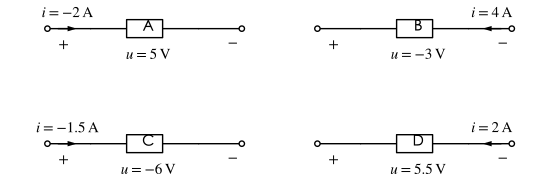
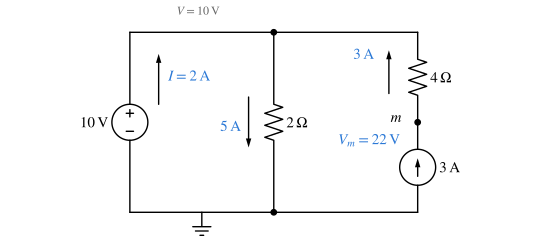
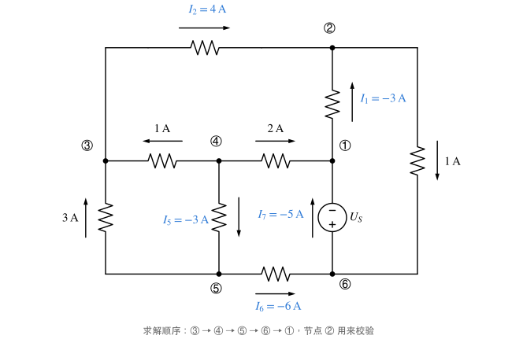
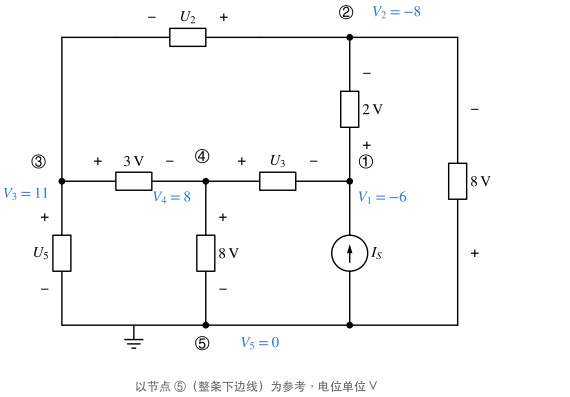
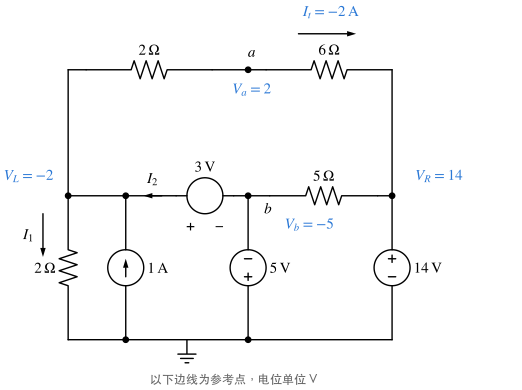

# 习题：基本概念与基尔霍夫定律

对应知识点：[基本概念、元件与基尔霍夫定律](../notes/basics.md)

## 参考方向与功率

### 1. 概念判断 :material-star::material-star-outline::material-star-outline:

判断下列说法是否正确：

1. 电压源总是发出功率。
2. 关联参考方向下算得 $p=ui=-5\,\mathrm W$，说明该元件实际发出 $5\,\mathrm W$。
3. 电流源两端的电压由电流源本身决定。
4. 直流稳态下，电感相当于短路，电容相当于开路。
5. KCL、KVL 只适用于线性电路。

??? success "答案"
    1 ✗　2 ✓　3 ✗　4 ✓　5 ✗

??? note "解析"
    1. 电压源的电流由外电路决定，电流从 $+$ 端流入时它在**吸收**功率（如给电池充电）。
    2. 关联方向下 $p=ui$ 就是吸收功率，吸收 $-5\,\mathrm W$ 即发出 $5\,\mathrm W$。
    3. 电流源只确定电流，端电压由外电路决定。
    4. 直流稳态各量不随时间变化：$u_L=L\,\mathrm di/\mathrm dt=0$，$i_C=C\,\mathrm du/\mathrm dt=0$。
    5. KCL、KVL 是拓扑约束，与元件性质无关，对非线性、时变电路同样成立。

### 2. 四个元件的功率 :material-star::material-star-outline::material-star-outline:

四个元件的电压、电流参考方向及数值如图（A、C 为关联方向，B、D 为非关联方向）。求各元件**吸收**的功率，指出哪些实际在发出功率；若这四个元件恰好组成一个完整电路，检验功率是否守恒。

{ .circuit }

??? success "答案"
    $P_A=-10\,\mathrm W$（发出 $10\,\mathrm W$），$P_B=12\,\mathrm W$，$P_C=9\,\mathrm W$，$P_D=-11\,\mathrm W$（发出 $11\,\mathrm W$）；$\sum P=0$，守恒。

??? note "解析"
    先看关联与否，再代入带符号的数值：

    | 元件 | 方向 | 吸收功率 | 性质 |
    | --- | --- | --- | --- |
    | A | 关联 | $p=ui=5\times(-2)=-10\,\mathrm W$ | 发出 |
    | B | 非关联 | $p=-ui=-(-3)\times4=12\,\mathrm W$ | 吸收 |
    | C | 关联 | $p=ui=(-6)\times(-1.5)=9\,\mathrm W$ | 吸收 |
    | D | 非关联 | $p=-ui=-5.5\times2=-11\,\mathrm W$ | 发出 |

    $-10+12+9-11=0$：发出 $21\,\mathrm W$，吸收 $21\,\mathrm W$。

    !!! warning "易错"
        不能只看数值正负判断吸收或发出——B 的 $u$ 为负、$i$ 为正，但它是非关联方向，算下来是**吸收**功率。

### 3. 并联的电压源与电流源 :material-star::material-star-outline::material-star-outline:

求图中电压源、电流源、两个电阻各自的功率，并说明 $4\,\Omega$ 电阻对哪些量有影响。

{ .circuit }

??? success "答案"
    $2\,\Omega$ 吸收 $50\,\mathrm W$，$4\,\Omega$ 吸收 $36\,\mathrm W$；电压源发出 $20\,\mathrm W$，电流源发出 $66\,\mathrm W$。$4\,\Omega$ 只影响电流源自身的端电压和功率。

??? note "解析"
    1. 上下两节点之间被 $10\,\mathrm V$ 电压源钉住，$2\,\Omega$ 中电流 $10/2=5\,\mathrm A$（向下），吸收 $50\,\mathrm W$。
    2. 右支路是电流源串电阻，电流就是 $3\,\mathrm A$（向上），$4\,\Omega$ 吸收 $3^2\times4=36\,\mathrm W$。
    3. 上节点 KCL：电压源从 $+$ 端流出的电流 $I=5-3=2\,\mathrm A$，发出 $10\times2=20\,\mathrm W$。
    4. 电流源端电压（$m$ 正、下负）：$3\,\mathrm A$ 向上流过 $4\,\Omega$，$m$ 点比上节点高 $12\,\mathrm V$，$V_m=10+3\times4=22\,\mathrm V$；电流从其 $+$ 端流出，发出 $22\times3=66\,\mathrm W$。
    5. 校验：$20+66=50+36$ ✓

        { .circuit }

    "电流源串联任意元件对外等效为电流源本身"——所以 $4\,\Omega$ 不影响电压源和 $2\,\Omega$ 的量，但会改变电流源**自己**的电压和功率（对内不等效）。

## 元件的伏安关系

### 4. 直流稳态下的储能 :material-star::material-star-outline::material-star-outline:

电路已处于直流稳态。求 $i_L$、$u_C$，以及电感、电容的储能。

{ .circuit }

??? success "答案"
    $i_L=2\,\mathrm A$，$u_C=8\,\mathrm V$；$W_L=2\,\mathrm J$，$W_C=64\,\mathrm J$。

??? note "解析"
    直流稳态：电感短路、电容开路。电路化为 $12\,\mathrm V$ 串 $2\,\Omega$、$4\,\Omega$：

    { .circuit }

    $$
    i_L=\frac{12}{2+4}=2\,\mathrm A,\qquad u_C=u_a=4\times2=8\,\mathrm V .
    $$

    $$
    W_L=\tfrac12Li_L^2=\tfrac12\times1\times2^2=2\,\mathrm J,\qquad W_C=\tfrac12Cu_C^2=\tfrac12\times2\times8^2=64\,\mathrm J .
    $$

    !!! warning "易错"
        电容"开路"只是电流为零，它两端仍有电压 $u_C=u_a$；电感"短路"只是电压为零，它仍有电流。储能就是靠这两个量算的。

## 基尔霍夫定律与电位

### 5. 由部分支路电流求其余电流 :material-star::material-star::material-star-outline:

（作业 2-4）图中只给出了部分支路电流，求 $I_1$、$I_2$、$I_5$、$I_6$、$I_7$。

{ .circuit }

??? success "答案"
    $I_1=-3\,\mathrm A$，$I_2=4\,\mathrm A$，$I_5=-3\,\mathrm A$，$I_6=-6\,\mathrm A$，$I_7=-5\,\mathrm A$。

??? note "解析"
    按箭头方向逐个节点写"流入 = 流出"，每次只留一个未知量：

    - 节点 ③：流入 $1\,\mathrm A$（来自 ④）$+\,3\,\mathrm A$（左支路向上），流出 $I_2$ → $I_2=4\,\mathrm A$；
    - 节点 ④：$1\,\mathrm A$、$2\,\mathrm A$、$I_5$ 三个箭头都**流出** → $1+2+I_5=0$，$I_5=-3\,\mathrm A$；
    - 节点 ⑤：流入 $I_5$，流出 $3\,\mathrm A$ 与 $I_6$ → $I_6=I_5-3=-6\,\mathrm A$；
    - 节点 ⑥：流入 $I_6$ 与 $1\,\mathrm A$，流出 $I_7$ → $I_7=-5\,\mathrm A$；
    - 节点 ①：流入 $2\,\mathrm A$ 与 $I_7$，流出 $I_1$ → $I_1=-3\,\mathrm A$。

    **校验**（节点 ②）：流入 $I_1+I_2=-3+4=1\,\mathrm A$，等于右侧支路向下流出的 $1\,\mathrm A$ ✓

    { .circuit }

    !!! note "关于教材答案"
        部分书后答案给出 $I_5=3\,\mathrm A$、$I_6=0$，与图中节点 ④、⑤ 的箭头方向不相容；按图逐节点核对，以上结果满足全部 KCL。

### 6. 由部分元件电压求其余电压 :material-star::material-star::material-star-outline:

（作业 2-5）图中方框为任意元件，已知部分元件电压及其极性，求 $U_2$、$U_3$、$U_5$、$U_7$。

{ .circuit }

??? success "答案"
    $U_2=-19\,\mathrm V$，$U_3=14\,\mathrm V$，$U_5=11\,\mathrm V$，$U_7=-6\,\mathrm V$。

??? note "解析"
    取节点 ⑤（整条下边线）为参考点，沿已知电压的元件依次推出各节点电位：

    - ④–⑤ 的 $8\,\mathrm V$ 上正下负：$V_4=8\,\mathrm V$；
    - ③–④ 的 $3\,\mathrm V$ 左正右负：$V_3=V_4+3=11\,\mathrm V$；
    - 右侧 $8\,\mathrm V$ 下正上负：$V_2=-8\,\mathrm V$；
    - ②–① 的 $2\,\mathrm V$ 下正上负：$V_1=V_2+2=-6\,\mathrm V$。

    { .circuit }

    再按各未知电压标注的极性取"$+$ 端电位减 $-$ 端电位"：

    $$
    U_2=V_2-V_3=-19\,\mathrm V,\quad U_3=V_4-V_1=14\,\mathrm V,\quad U_5=V_3-V_5=11\,\mathrm V,\quad U_7=V_1-V_5=-6\,\mathrm V .
    $$

    **校验**（回路 ③→④→①→②→③）：$(V_3-V_4)+(V_4-V_1)+(V_1-V_2)+(V_2-V_3)=3+14+2-19=0$ ✓

### 7. 电位法求电流与电压 :material-star::material-star::material-star-outline:

（作业 2-9）求图中 $I_1$、$I_2$ 及 $U_{ab}$。

{ .circuit }

??? success "答案"
    $I_1=-1\,\mathrm A$，$I_2=-4\,\mathrm A$，$U_{ab}=7\,\mathrm V$。

??? note "解析"
    取下边线为参考点，左、右两侧的竖直节点分别记为 $L$、$R$。三个电压源把电位直接钉住：

    $$
    V_b=-5\,\mathrm V,\qquad V_L=V_b+3=-2\,\mathrm V,\qquad V_R=14\,\mathrm V .
    $$

    { .circuit }

    1. 左下 $2\,\Omega$：$I_1=\dfrac{V_L}{2}=-1\,\mathrm A$。
    2. 上方 $2\,\Omega$、$6\,\Omega$ 串联，从 $L$ 流向 $R$ 的电流 $I_t=\dfrac{V_L-V_R}{2+6}=-2\,\mathrm A$。
    3. 节点 $L$ 的 KCL（流入 $I_2$ 与 $1\,\mathrm A$，流出 $I_1$ 与 $I_t$）：

        $$
        I_2+1=I_1+I_t\ \Rightarrow\ I_2=-1-2-1=-4\,\mathrm A .
        $$

    4. $V_a=V_L-2I_t=-2+4=2\,\mathrm V$，$U_{ab}=V_a-V_b=2-(-5)=7\,\mathrm V$。

    !!! tip "技巧"
        理想电压源两端电位差固定，从参考点出发沿电压源"跳"电位，往往比列方程快得多。右侧 $5\,\Omega$ 电阻两端电位已被钉住（$V_R$、$V_b$），它只影响电源电流，不影响所求量。

## 受控源

### 8. 受控源与功率平衡 :material-star::material-star::material-star:

图中受控电流源输出 $0.5u$（$u$ 为 $3\,\Omega$ 电阻电压），方向向上流入节点 $a$。求 $u$、$I$ 及各元件功率，并检验功率守恒。

{ .circuit }

??? success "答案"
    $u=15\,\mathrm V$，$I=-2.5\,\mathrm A$。$2\,\Omega$ 吸收 $12.5\,\mathrm W$，$3\,\Omega$ 吸收 $75\,\mathrm W$，$10\,\mathrm V$ 电压源**吸收** $25\,\mathrm W$，受控源发出 $112.5\,\mathrm W$。

??? note "解析"
    1. 节点 $a$ 的 KCL（流出为正），受控源当作独立源写入：

        $$
        \frac{u-10}{2}+\frac u3-0.5u=0\ \Rightarrow\ \frac u3=5\ \Rightarrow\ u=15\,\mathrm V .
        $$

    2. $I=\dfrac{10-u}{2}=-2.5\,\mathrm A$：实际电流从 $a$ 经 $2\,\Omega$ 流**进**电压源的 $+$ 端。
    3. 功率（吸收为正）：
        - $2\,\Omega$：$2\times2.5^2=12.5\,\mathrm W$；$3\,\Omega$：$15^2/3=75\,\mathrm W$；
        - 电压源：$I$ 从其 $+$ 端流出（非关联），$P=-10I=25\,\mathrm W$，在**吸收**；
        - 受控源：电流 $0.5u=7.5\,\mathrm A$ 从其 $+$ 端（$a$）流出，$P=-15\times7.5=-112.5\,\mathrm W$，发出 $112.5\,\mathrm W$。
    4. 校验：$12.5+75+25=112.5$ ✓

    !!! warning "易错"
        $u=15\,\mathrm V$ 比电源电压还高，这并不矛盾——受控源能向电路输出能量，它"推高"了节点电位，连独立电压源都在被充电。
