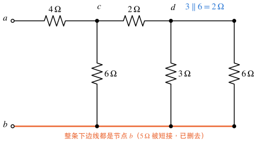
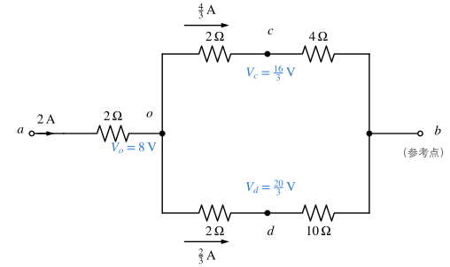
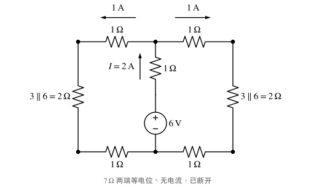
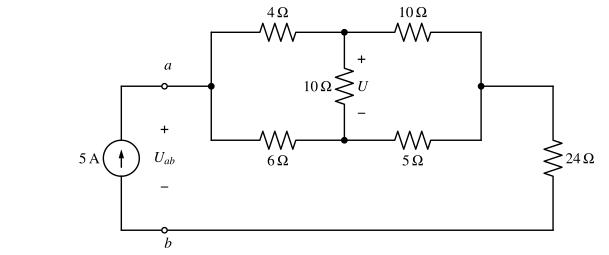
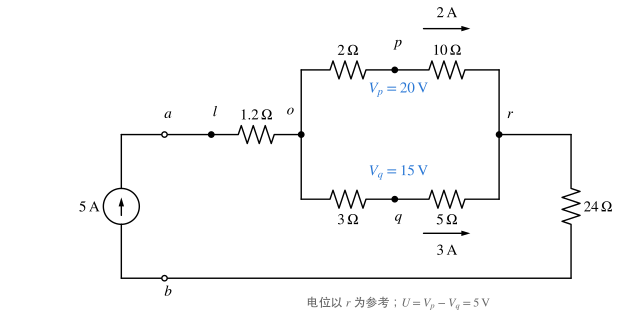
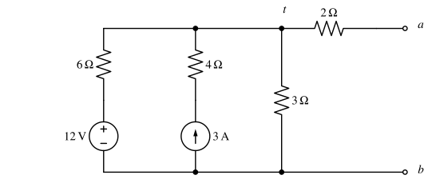
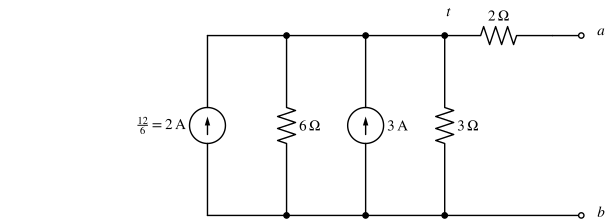
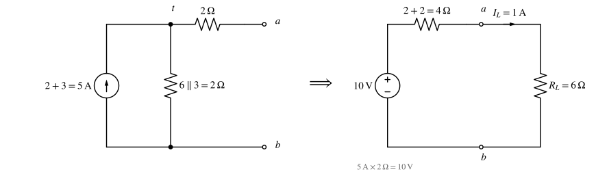
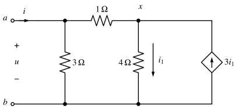

# 习题：电阻电路的等效变换

对应知识点：[电阻电路的等效变换](../notes/equivalent-transformation.md)

## 概念

### 1. 等效变换判断 :material-star::material-star-outline::material-star-outline:

判断下列说法是否正确：

1. 两个电阻画在纸面上平行的位置，就一定是并联。
2. 理想电压源与理想电流源之间可以按 $I_s=U_s/R$ 互相等效变换。
3. 理想电压源与一个电阻并联，对外电路等效为该电压源本身。
4. 含受控源的二端网络，可以把受控源置零后用串并联求输入电阻。
5. 平衡电桥的桥支路既可以断开，也可以短接，结果相同。

??? success "答案"
    1 ✗　2 ✗　3 ✓　4 ✗　5 ✓

??? note "解析"
    1. 判断并联只看是否**接在同一对节点之间**，与纸面上的位置无关，要先给节点标号。
    2. 理想电压源内阻为 $0$、理想电流源内阻为 $\infty$，没有对应的另一种模型；只有"电压源串电阻"与"电流源并电阻"才能互换。
    3. "并联看电压"：端口电压恒为 $U_s$，与并联的电阻无关（该电阻只改变电压源自身的电流）。
    4. 受控源**不能置零**，必须保留，用外加电源法 $R_{in}=u/i$。
    5. 平衡时桥支路两端等电位、电流为零，断开（电流仍为零）与短接（电位仍相等）都不改变其余部分。

## 电阻网络的化简

### 2. 被短接的电阻 :material-star::material-star-outline::material-star-outline:

求图中 $a$、$b$ 端的等效电阻 $R_{ab}$。

{ .circuit }

??? success "答案"
    $R_{ab}=6.4\,\Omega$

??? note "解析"
    1. **标节点**：下边线上的 $5\,\Omega$ 两端被下方的导线连在一起，两端是同一个节点（都属于 $b$），所以 $5\,\Omega$ 被短接、无电流，可以删去。于是整条下边线都是节点 $b$。
    2. $d$、$b$ 之间有 $3\,\Omega$ 与右侧 $6\,\Omega$ 两条支路：$3\parallel6=2\,\Omega$。

        { .circuit }

    3. 再串 $2\,\Omega$（$c$–$d$）：$2+2=4\,\Omega$；与 $c$–$b$ 的 $6\,\Omega$ 并联：$6\parallel4=2.4\,\Omega$。
    4. 加上 $4\,\Omega$：$R_{ab}=4+2.4=6.4\,\Omega$。

    !!! warning "易错"
        把 $5\,\Omega$ 当成与 $3\,\Omega$ 或 $6\,\Omega$ 串联——它两端是同一节点，任何电阻接在同一节点上都不起作用。

### 3. 电桥的平衡 :material-star::material-star-outline::material-star-outline:

求 $R_{ab}$，并说明桥支路 $10\,\Omega$ 中的电流。

{ .circuit }

??? success "答案"
    电桥平衡，桥支路电流为 $0$；$R_{ab}=\dfrac{36}{7}\approx5.14\,\Omega$。

??? note "解析"
    检查平衡条件：$R_{ac}R_{db}=3\times8=24$，$R_{cb}R_{ad}=6\times4=24$，相等，**电桥平衡**，$c$、$d$ 等电位，$10\,\Omega$ 中无电流，可直接断开：

    $$
    R_{ab}=(3+6)\parallel(4+8)=9\parallel12=\frac{108}{21}=\frac{36}{7}\approx5.14\,\Omega .
    $$

    （若改为短接 $c$、$d$：$(3\parallel4)+(6\parallel8)=\tfrac{12}{7}+\tfrac{24}{7}=\tfrac{36}{7}\,\Omega$，结果相同。）

### 4. 不平衡电桥：Y–Δ 变换 :material-star::material-star::material-star-outline:

（1）求 $R_{ab}$；（2）在 $a$、$b$ 间加 $12\,\mathrm V$ 电压（$a$ 正），求桥支路电流 $I_{cd}$。

{ .circuit }

??? success "答案"
    （1）$R_{ab}=6\,\Omega$；（2）$I_{cd}=-\dfrac29\,\mathrm A\approx-0.222\,\mathrm A$，即实际 $\tfrac29\,\mathrm A$ 由 $d$ 流向 $c$。

??? note "解析"
    $6\times10\ne4\times6$，电桥不平衡，不能用串并联。

    **（1）** $a$、$c$、$d$ 间的三个 $6\,\Omega$ 构成对称 Δ，化为 Y：每臂 $6/3=2\,\Omega$，中心记为 $o$。

    $$
    R_{ab}=2+(2+4)\parallel(2+10)=2+6\parallel12=2+4=6\,\Omega .
    $$

    **（2）** 总电流 $I=12/6=2\,\mathrm A$，$V_o=12-2\times2=8\,\mathrm V$（以 $b$ 为参考）。两条路径分流：

    $$
    I_{o\to c\to b}=\frac{8}{6}=\frac43\,\mathrm A,\quad I_{o\to d\to b}=\frac{8}{12}=\frac23\,\mathrm A
    \ \Rightarrow\ V_c=\frac43\times4=\frac{16}{3}\,\mathrm V,\quad V_d=\frac23\times10=\frac{20}{3}\,\mathrm V .
    $$

    { .circuit }

    Y–Δ 变换对外等效，$c$、$d$ 的电位与原电路相同，回到**原电路**求桥支路电流：

    $$
    I_{cd}=\frac{V_c-V_d}{6}=\frac{-4/3}{6}=-\frac29\,\mathrm A .
    $$

    **校验**（节点 $c$）：流入 $\dfrac{12-16/3}{6}=\dfrac{10}{9}$，流出 $\dfrac{16/3}{4}+I_{cd}=\dfrac43-\dfrac29=\dfrac{10}{9}$ ✓

    !!! warning "易错"
        变换后电路中**没有** $c$–$d$ 这条支路了，桥支路电流只能在原电路中由 $V_c$、$V_d$ 求出。

### 5. 利用对称性 :material-star::material-star::material-star-outline:

（作业 4-47）电路左右对称。求电压源支路电流 $I$ 及电压源发出的功率。

{ .circuit }

??? success "答案"
    $I=2\,\mathrm A$，电压源发出 $12\,\mathrm W$。

??? note "解析"
    1. **对称性**：结构、参数、激励（电压源在对称轴上）都关于竖直中线对称，所以 $7\,\Omega$ 两端的节点等电位，$7\,\Omega$ 中无电流，可断开。
    2. **每一侧**：$3\,\Omega$ 与 $6\,\Omega$ 都接在该侧上、下两个节点之间，并联为 $2\,\Omega$；再串上、下两个 $1\,\Omega$：$1+2+1=4\,\Omega$。

        { .circuit }

    3. 左右两侧并联 $4\parallel4=2\,\Omega$，再与电源支路的 $1\,\Omega$ 串联：总电阻 $3\,\Omega$，

        $$
        I=\frac{6}{3}=2\,\mathrm A .
        $$

    4. $I$ 从电压源 $+$ 端流出，发出 $P=6\times2=12\,\mathrm W$。

    **校验**：电源支路 $1\,\Omega$ 消耗 $4\,\mathrm W$；每侧 $1\,\mathrm A$ 流过 $4\,\Omega$，各 $4\,\mathrm W$；合计 $12\,\mathrm W$ ✓

### 6. 电流源驱动的不平衡电桥 :material-star::material-star::material-star-outline:

（作业 4-5）求桥支路电压 $U$ 与电流源端电压 $U_{ab}$。

{ .circuit }

??? success "答案"
    $U=5\,\mathrm V$，$U_{ab}=150\,\mathrm V$。

??? note "解析"
    记桥左端 $l$、上中点 $p$、下中点 $q$、右端 $r$。$4\times5\ne6\times10$，不平衡。电流源串联电路，$5\,\mathrm A$ 全部流过电桥和 $24\,\Omega$。

    1. **Δ→Y**：$l$、$p$、$q$ 间三角形 $R_{lp}=4$、$R_{lq}=6$、$R_{pq}=10$，和为 $20\,\Omega$：

        $$
        R_{lo}=\frac{4\times6}{20}=1.2,\quad R_{po}=\frac{4\times10}{20}=2,\quad R_{qo}=\frac{6\times10}{20}=3\ (\Omega).
        $$

    2. $o$ 到 $r$ 两条路径：$2+10=12\,\Omega$ 与 $3+5=8\,\Omega$，分流

        $$
        I_{opr}=5\times\frac{8}{20}=2\,\mathrm A,\qquad I_{oqr}=5\times\frac{12}{20}=3\,\mathrm A .
        $$

    3. 以 $r$ 为参考：$V_p=10\times2=20\,\mathrm V$，$V_q=5\times3=15\,\mathrm V$，所以 $U=V_p-V_q=5\,\mathrm V$。

        { .circuit }

    4. 电桥等效电阻 $1.2+12\parallel8=1.2+4.8=6\,\Omega$，

        $$
        U_{ab}=5\times(6+24)=150\,\mathrm V .
        $$

    **校验**（原电路）：$V_l=30\,\mathrm V$，$4\,\Omega$ 中 $\tfrac{30-20}{4}=2.5\,\mathrm A$，$6\,\Omega$ 中 $\tfrac{30-15}{6}=2.5\,\mathrm A$，桥支路 $\tfrac{5}{10}=0.5\,\mathrm A$（向下）；节点 $p$：$2.5=0.5+\tfrac{20}{10}$ ✓，节点 $q$：$2.5+0.5=\tfrac{15}{5}$ ✓

## 含源支路的等效

### 7. 化为戴维南形式 :material-star::material-star::material-star-outline:

（1）用电源等效变换把 $a$、$b$ 左侧网络化为最简的电压源串电阻形式；（2）$a$、$b$ 间接 $6\,\Omega$ 负载，求负载电流；（3）此时 $12\,\mathrm V$ 电压源实际输出的电流是多少？

{ .circuit }

??? success "答案"
    （1）$10\,\mathrm V$（$a$ 正）串 $4\,\Omega$；（2）$1\,\mathrm A$；（3）$\tfrac23\,\mathrm A\approx0.667\,\mathrm A$（从 $+$ 端流出）。

??? note "解析"
    **（1）** 逐步变换（$t$ 为上方节点）：

    1. $3\,\mathrm A$ 电流源串 $4\,\Omega$ → 就是 $3\,\mathrm A$ 电流源（串联看电流，$4\,\Omega$ 删去）；
    2. $12\,\mathrm V$ 串 $6\,\Omega$ → $2\,\mathrm A$（指向 $t$）并 $6\,\Omega$；

        { .circuit }

    3. 两电流源并联 $2+3=5\,\mathrm A$；$6\parallel3=2\,\Omega$；
    4. $5\,\mathrm A$ 并 $2\,\Omega$ → $10\,\mathrm V$ 串 $2\,\Omega$，再串 $2\,\Omega$：$U_{oc}=10\,\mathrm V$，$R_{eq}=4\,\Omega$。

        { .circuit }

    **检验**（开路时节点 $t$）：$\dfrac{U_t-12}{6}+\dfrac{U_t}{3}=3\Rightarrow U_t=10\,\mathrm V=U_{oc}$ ✓

    **（2）** $I_L=\dfrac{10}{4+6}=1\,\mathrm A$。

    **（3）** 必须回到**原电路**：$U_t=I_L(2+6)=8\,\mathrm V$，$12\,\mathrm V$ 电源输出 $\dfrac{12-8}{6}=\dfrac23\,\mathrm A$。

    !!! warning "对内不等效"
        等效电路里看不到 $12\,\mathrm V$ 电源本身，它的电流、功率不能在等效电路中求。$4\,\Omega$ 同理：它不影响端口，却决定了 $3\,\mathrm A$ 电流源两端的电压。

## 含受控源的输入电阻

### 8. 外加电源法：负的输入电阻 :material-star::material-star::material-star:

受控电流源 $3i_1$ 由下向上注入节点 $x$，$i_1$ 为 $4\,\Omega$ 中向下的电流。求 $a$、$b$ 端的输入电阻 $R_{in}$。

{ .circuit }

??? success "答案"
    $R_{in}=-1.5\,\Omega$

??? note "解析"
    端口加电压 $u$，设流入 $a$ 的电流为 $i$（关联）。受控源保留。

    1. 右支路：设经 $1\,\Omega$ 流入 $x$ 的电流为 $i_r$。节点 $x$ 的 KCL：

        $$
        i_r+3i_1=i_1\ \Rightarrow\ i_1=-\frac{i_r}{2}.
        $$

    2. 沿 $a\to x\to b$：$u=1\cdot i_r+4i_1=i_r-2i_r=-i_r$，即右支路相当于 $-1\,\Omega$。
    3. 与 $3\,\Omega$ 并联：

        $$
        i=\frac u3+i_r=\frac u3-u=-\frac{2u}{3}\quad\Rightarrow\quad R_{in}=\frac ui=-\frac32\,\Omega .
        $$

    !!! note "负电阻的含义"
        $R_{in}<0$ 表示端口电压与流入电流反号：外加 $u>0$ 时，电流实际从 $a$ **流出**，网络在向外输出功率，能量来自受控源。若把受控源置零，会得到 $3\parallel(1+4)=1.875\,\Omega$ 这个错误结果。
