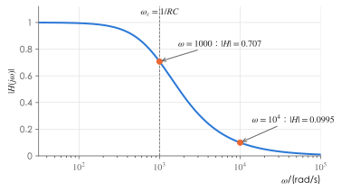
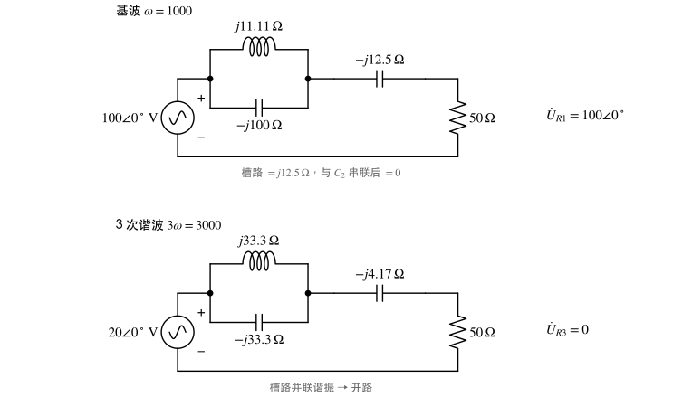

# 习题：非正弦周期电路与频率响应

对应知识点：[非正弦周期电路与频率响应](../notes/nonsinusoidal.md)

本页约定：sin 约定、有效值相量；电流表、电压表读数均为**有效值**，功率表读数为平均功率。

## 有效值与平均功率

### 1. 概念判断 :material-star::material-star-outline::material-star-outline:

判断下列说法是否正确：

1. $u=6+8\sqrt2\sin\omega t\ \mathrm V$ 的有效值为 $14\,\mathrm V$。
2. 不同频率的正弦电压与电流相乘，一个周期内的平均值为零。
3. 求非正弦电路的响应时，可以先把各次谐波的相量相加，再写回时域。
4. 对 3 次谐波，电感的感抗是基波时的 3 倍，电容的容抗是基波时的 $1/3$。
5. 某电路对基波呈容性，则它对 3 次谐波也一定呈容性。

??? success "答案"
    1 ✗　2 ✓　3 ✗　4 ✓　5 ✗

??? note "解析"
    1. 有效值是平方和开方：$\sqrt{6^2+8^2}=10\,\mathrm V$，不是 $6+8$。
    2. 三角函数的正交性，这正是"跨频不产生平均功率"的根据。
    3. 相量只对同一频率有意义，不同频率的分量只能在**时域**相加。
    4. $X_L=k\omega L$，$X_C=\dfrac{1}{k\omega C}$。
    5. 阻抗性质随频率变化。例如 RLC 串联在基波下 $X=\omega L-\dfrac{1}{\omega C}<0$（容性），到 3 次谐波可能为零甚至为正——第 6 题就是这样。

### 2. 有效值、平均功率与功率因数 :material-star::material-star::material-star-outline:

某二端网络的电压、电流取关联参考方向：

$$
u=10+20\sqrt2\sin\omega t+10\sqrt2\cos3\omega t\ \ \mathrm V,
$$

$$
i=2+4\sqrt2\sin(\omega t-60^\circ)+\sqrt2\sin(3\omega t+30^\circ)+2\sqrt2\sin5\omega t\ \ \mathrm A .
$$

求 $U$、$I$、网络吸收的平均功率 $P$ 及功率因数 $\lambda$。

??? success "答案"
    $U=\sqrt{600}\approx24.49\,\mathrm V$，$I=5\,\mathrm A$，$P=65\,\mathrm W$，$\lambda=\dfrac{P}{UI}\approx0.531$。

??? note "解析"
    1. **有效值**（直流不除 $\sqrt2$，各谐波取有效值）：

        $$
        U=\sqrt{10^2+20^2+10^2}=\sqrt{600}\approx24.49\,\mathrm V,\qquad I=\sqrt{2^2+4^2+1^2+2^2}=5\,\mathrm A .
        $$

    2. **统一成 sin**：$10\sqrt2\cos3\omega t=10\sqrt2\sin(3\omega t+90^\circ)$。各次相位差：

        - 基波：$\varphi_1=0^\circ-(-60^\circ)=60^\circ$；
        - 3 次：$\varphi_3=90^\circ-30^\circ=60^\circ$；
        - 5 次：电压中没有 5 次分量，不产生功率。

    3. **平均功率**（只有同频分量相乘才有贡献）：

        $$
        P=10\times2+20\times4\cos60^\circ+10\times1\cos60^\circ=20+40+5=65\,\mathrm W .
        $$

    4. $\lambda=\dfrac{65}{24.49\times5}\approx0.531$。

    !!! warning "易错"
        - $\cos3\omega t$ 不先化成 sin 就直接拿"初相 $0^\circ$"去减，会把 $\varphi_3$ 错算成 $-30^\circ$。
        - 电流中的 5 次谐波不产生功率，但**照样计入** $I$，从而拉低功率因数。

### 3. 直流源与交流源共同作用时的功率分配 :material-star::material-star::material-star-outline:

图中电压源为直流 $12\,\mathrm V$，电流源 $i_S=2\sqrt2\sin\omega t\ \mathrm A$（向上流入节点 $a$）。求 $u_a$ 及其有效值、两个电阻的平均功率，以及两个电源各自发出的平均功率。

{ .circuit }

??? success "答案"
    $u_a=6+4\sqrt2\sin\omega t\ \mathrm V$，$U_a=\sqrt{52}\approx7.21\,\mathrm V$；$P_{R_1}=P_{R_2}=13\,\mathrm W$；电压源发出 $18\,\mathrm W$，电流源发出 $8\,\mathrm W$。

??? note "解析"
    两个电源频率不同，用叠加定理分别求：

    - **直流**（电流源开路）：$U_{a0}=12\times\dfrac{4}{4+4}=6\,\mathrm V$，$R_1$ 中直流 $\dfrac{12-6}{4}=1.5\,\mathrm A$。
    - **交流**（电压源短路）：$R_1\parallel R_2=2\,\Omega$，$\dot U_{a1}=2\angle0^\circ\times2=4\angle0^\circ\,\mathrm V$；$R_1$、$R_2$ 中交流各 $1\,\mathrm A$。

    { .circuit }

    { .circuit }

    所以 $u_a=6+4\sqrt2\sin\omega t\ \mathrm V$，$U_a=\sqrt{6^2+4^2}\approx7.21\,\mathrm V$。

    **电阻功率**（同一电阻上各频率功率可以相加）：

    $$
    P_{R_2}=\frac{6^2+4^2}{4}=13\,\mathrm W,\qquad P_{R_1}=(1.5^2+1^2)\times4=13\,\mathrm W .
    $$

    **电源功率**：直流电压源只与流过它的**直流**电流产生平均功率，$12\times1.5=18\,\mathrm W$（流过它的 $1\,\mathrm A$ 交流分量与恒定电压相乘平均为零）；电流源只与其两端的**基波**电压产生平均功率，$4\times2\cos0^\circ=8\,\mathrm W$。

    **校验**：$18+8=13+13$ ✓

    !!! tip "要点"
        "功率不能叠加"指的是**同一频率**的两个分响应；不同频率的分量互不产生平均功率，因此各频率的功率**可以**直接相加。

### 4. 由仪表读数反求参数 :material-star::material-star::material-star-outline:

$RL$ 串联电路接电压 $u=12+20\sqrt2\sin\omega t\ \mathrm V$，电流表读数为 $5\,\mathrm A$，电源输出的平均功率为 $100\,\mathrm W$。求 $R$ 与基波感抗 $\omega L$，以及电源电压的有效值。

{ .circuit }

??? success "答案"
    $R=4\,\Omega$，$\omega L=3\,\Omega$；$U=\sqrt{12^2+20^2}\approx23.32\,\mathrm V$。

??? note "解析"
    1. 平均功率全部消耗在 $R$ 上，而 $I$ 是总有效值：$P=I^2R\Rightarrow R=\dfrac{100}{5^2}=4\,\Omega$。
    2. 直流时电感短路：$I_0=\dfrac{12}{4}=3\,\mathrm A$。由 $I^2=I_0^2+I_1^2$，$I_1=\sqrt{25-9}=4\,\mathrm A$。
    3. 基波：$|Z_1|=\dfrac{20}{4}=5\,\Omega=\sqrt{R^2+(\omega L)^2}\Rightarrow\omega L=3\,\Omega$。

    **校验**：$P=I_0^2R+I_1^2R=36+64=100\,\mathrm W$ ✓

    !!! warning "易错"
        不能用 $|Z|=U/I=23.32/5$ 求阻抗——非正弦电路没有统一的"阻抗"，必须逐个频率处理。

## 频率响应与谐波分析

### 5. RC 低通滤波 :material-star::material-star::material-star-outline:

图示 RC 电路输入 $u_i=10\sqrt2\sin(1000t)+10\sqrt2\sin(10^4t)\ \mathrm V$，输出端开路。求截止角频率 $\omega_c$、输出 $u_o$，并比较输入、输出中两个分量有效值之比。

{ .circuit }

??? success "答案"
    $\omega_c=1000\,\mathrm{rad/s}$；
    $u_o=10\sin(1000t-45^\circ)+1.407\sin(10^4t-84.29^\circ)\ \mathrm V$（有效值分别 $7.07\,\mathrm V$、$0.995\,\mathrm V$）；
    高频与低频分量之比由输入的 $1:1$ 变为输出的约 $0.141:1$。

??? note "解析"
    $H(j\omega)=\dfrac{\dot U_o}{\dot U_i}=\dfrac{1}{1+j\omega RC}$，$RC=10^3\times10^{-6}=10^{-3}\,\mathrm s$，$\omega_c=\dfrac{1}{RC}=1000\,\mathrm{rad/s}$。

    - $\omega=1000$：$H=\dfrac{1}{1+j1}=0.7071\angle(-45^\circ)$，$\dot U_{o1}=7.071\angle(-45^\circ)\,\mathrm V$；
    - $\omega=10^4$：$H=\dfrac{1}{1+j10}=\dfrac{1}{\sqrt{101}}\angle(-84.29^\circ)=0.0995\angle(-84.29^\circ)$，$\dot U_{o2}=0.995\angle(-84.29^\circ)\,\mathrm V$。

    写回时域（有效值乘 $\sqrt2$）：$7.071\sqrt2=10$，$0.995\sqrt2\approx1.407$，得答案中的 $u_o$。

    高频分量被衰减到原来的约 $1/10$，而截止频率处的分量只衰减到 $0.707$ 倍——低通滤波器对 $\omega\gg\omega_c$ 的分量才有明显的抑制作用。

    { .circuit }

### 6. RLC 串联的谐波响应与仪表读数 :material-star::material-star::material-star:

RLC 串联电路中 $R=10\,\Omega$，基波下 $\omega L=3\,\Omega$、$\dfrac{1}{\omega C}=27\,\Omega$，外加

$$
u=10+100\sqrt2\sin\omega t+30\sqrt2\sin3\omega t\ \ \mathrm V .
$$

求电流 $i$、电流表与电压表（接在电容两端）的读数，以及电路吸收的平均功率。

{ .circuit }

??? success "答案"
    $i=3.846\sqrt2\sin(\omega t+67.38^\circ)+3\sqrt2\sin3\omega t\ \mathrm A$；
    电流表 $\approx4.88\,\mathrm A$，电压表 $\approx107.8\,\mathrm V$；$P\approx237.9\,\mathrm W$。

??? note "解析"
    逐个频率求解：

    { .circuit }

    | 分量 | 阻抗 | 电流 | 电容电压有效值 |
    | --- | --- | --- | --- |
    | 直流 | 电容开路 | $I_0=0$ | $U_{C0}=10\,\mathrm V$（直流电压全加在 $C$ 上） |
    | 基波 | $10+j(3-27)=26\angle(-67.38^\circ)$ | $\dot I_1=\dfrac{100}{26\angle(-67.38^\circ)}=3.846\angle67.38^\circ$ | $3.846\times27=103.85\,\mathrm V$ |
    | 3 次 | $10+j(9-9)=10$（串联谐振） | $\dot I_3=3\angle0^\circ$ | $3\times9=27\,\mathrm V$ |

    $$
    I=\sqrt{0+3.846^2+3^2}\approx4.88\,\mathrm A,\qquad U_C=\sqrt{10^2+103.85^2+27^2}\approx107.8\,\mathrm V,
    $$

    $$
    P=(I_1^2+I_3^2)R=(14.79+9)\times10\approx237.9\,\mathrm W .
    $$

    **校验**：$P=100\times3.846\cos67.38^\circ+30\times3\cos0^\circ=147.9+90=237.9\,\mathrm W$ ✓

    !!! warning "易错"
        - 电容"隔直"只说明直流**电流**为零，直流**电压**并不为零：$10\,\mathrm V$ 全部落在电容上，电压表读数要把它算进去。
        - 3 次谐波下 $X_L=3\times3=9$、$X_C=27/3=9$，电路对 3 次谐波谐振、呈纯阻性，而对基波呈容性。

### 7. 设计 LC 滤波网络 :material-star::material-star::material-star:

电源 $u_S=100\sqrt2\sin(1000t)+20\sqrt2\sin(3000t)\ \mathrm V$，经图示网络接负载 $R=50\,\Omega$：$L_1$ 与 $C_1=10\,\mu\mathrm F$ 并联后再串联 $C_2$。要求负载电压 $u_R=100\sqrt2\sin(1000t)\ \mathrm V$（3 次谐波完全滤除，基波完全通过），求 $L_1$ 和 $C_2$。

{ .circuit }

??? success "答案"
    $L_1=\dfrac{1}{90}\,\mathrm H\approx11.1\,\mathrm{mH}$，$C_2=80\,\mu\mathrm F$。

??? note "解析"
    1. **滤除 3 次谐波**：负载中没有 3 次电流，串联支路必须对 $3000\,\mathrm{rad/s}$ **开路**，即 $L_1\parallel C_1$ 在 3 次谐波下并联谐振：

        $$
        L_1=\frac{1}{(3\omega)^2C_1}=\frac{1}{(3000)^2\times10\times10^{-6}}=\frac{1}{90}\,\mathrm H\approx11.1\,\mathrm{mH}.
        $$

    2. **基波完全通过**：$u_{R1}=u_{S1}$ 要求串联部分对基波的总阻抗为零。基波下 $\omega L_1=\dfrac{1000}{90}\approx11.11\,\Omega$，$\dfrac{1}{\omega C_1}=100\,\Omega$，

        $$
        Y_{槽}=\frac{1}{j11.11}+\frac{1}{-j100}=-j0.09+j0.01=-j0.08\,\mathrm S,\qquad Z_{槽}=j12.5\,\Omega\ (\text{感性}).
        $$

        需要串联一个容抗 $12.5\,\Omega$ 的电容来抵消：$\dfrac{1}{1000\,C_2}=12.5\Rightarrow C_2=80\,\mu\mathrm F$。

    **校验**：基波串联阻抗 $j12.5-j12.5=0$，$\dot U_{R1}=\dot U_{S1}=100\angle0^\circ$；3 次谐波槽路开路，$\dot U_{R3}=0$ ✓

    { .circuit }

    !!! tip "思路"
        LC **并联**谐振 → 该频率开路（阻断）；LC **串联**谐振 → 该频率短路（全通）。槽路的谐振频率高于基波，所以它在基波下呈感性，补偿元件必须是电容；若槽路谐振频率低于基波，就要串电感。
