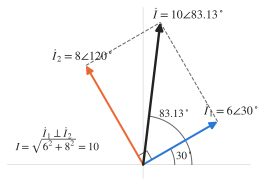
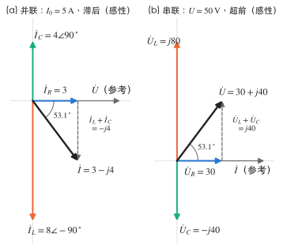
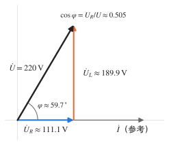
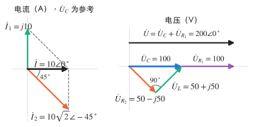

# 习题：正弦稳态与相量法

对应知识点：[正弦稳态与相量法](../notes/phasor-method.md)

本页统一采用 **sin 约定 + 有效值相量**：$u=\sqrt2\,U\sin(\omega t+\psi)\leftrightarrow\dot U=U\angle\psi$。题目中以 $\cos$ 或负号给出的正弦量，先化成正幅值的 $\sin$ 再写相量。

## 正弦量与相量

### 1. 三要素与相位差 :material-star::material-star-outline::material-star-outline:

（作业 5-6 类型）已知

$$
i_1=5\sqrt2\sin(314t+30^\circ)\,\mathrm A,\qquad i_2=-10\cos(314t+60^\circ)\,\mathrm A,\qquad u=220\sqrt2\cos(314t-30^\circ)\,\mathrm V .
$$

求：（1）频率与周期；（2）各量的有效值、初相和相量；（3）$u$ 与 $i_1$、$u$ 与 $i_2$ 的相位差，谁超前？

??? success "答案"
    1. $f=\dfrac{314}{2\pi}\approx50\,\mathrm{Hz}$，$T\approx20\,\mathrm{ms}$。
    2. $\dot I_1=5\angle30^\circ\,\mathrm A$；$\dot I_2=5\sqrt2\angle(-30^\circ)\approx7.07\angle(-30^\circ)\,\mathrm A$；$\dot U=220\angle60^\circ\,\mathrm V$。
    3. $u$ 超前 $i_1$ $30^\circ$；$u$ 超前 $i_2$ $90^\circ$（正交）。

??? note "解析"
    先统一成正幅值的 $\sin$：

    - $-\cos x=\sin(x-90^\circ)$，所以 $i_2=10\sin(314t+60^\circ-90^\circ)=10\sin(314t-30^\circ)\,\mathrm A$，幅值 $10\,\mathrm A$，有效值 $10/\sqrt2\approx7.07\,\mathrm A$，初相 $-30^\circ$；
    - $\cos x=\sin(x+90^\circ)$，所以 $u=220\sqrt2\sin(314t+60^\circ)\,\mathrm V$，有效值 $220\,\mathrm V$，初相 $60^\circ$。

    相位差 $\varphi=\psi_u-\psi_i$：$60^\circ-30^\circ=30^\circ$，$60^\circ-(-30^\circ)=90^\circ$，均为正，$u$ 超前。

    !!! warning "易错"
        直接拿 $i_2$ 表达式里的 "$60^\circ$" 当初相、或把幅值 $10$ 当有效值，都会出错。$i_2$ 前面没有 $\sqrt2$，说明 $10$ 是幅值。

### 2. 同频正弦量相加 :material-star::material-star-outline::material-star-outline:

节点处两支路电流 $i_1=6\sqrt2\sin(\omega t+30^\circ)\,\mathrm A$、$i_2=8\sqrt2\cos(\omega t+30^\circ)\,\mathrm A$ 汇合为 $i=i_1+i_2$。求 $i$ 及其有效值。

??? success "答案"
    $i=10\sqrt2\sin(\omega t+83.13^\circ)\,\mathrm A$，有效值 $10\,\mathrm A$。

??? note "解析"
    $i_2=8\sqrt2\sin(\omega t+120^\circ)$，所以 $\dot I_1=6\angle30^\circ$，$\dot I_2=8\angle120^\circ$，两者正好相差 $90^\circ$：

    $$
    I=\sqrt{6^2+8^2}=10\,\mathrm A,\qquad \psi=30^\circ+\arctan\frac86=30^\circ+53.13^\circ=83.13^\circ .
    $$

    { .circuit }

    （也可化成直角坐标：$\dot I_1=5.196+j3$，$\dot I_2=-4+j6.928$，和为 $1.196+j9.928=10\angle83.13^\circ$。）

    !!! warning "易错"
        有效值不能直接相加：$6+8=14\,\mathrm A$ 是错的。KCL 只对瞬时值和相量成立。

### 3. 电感与电容的相量关系 :material-star::material-star-outline::material-star-outline:

（教材 5-9、5-10 改编）均取关联参考方向。

1. 电感 $L=20\,\mathrm{mH}$，电流 $i=10\sqrt2\sin(314t-30^\circ)\,\mathrm{mA}$，求 $u$。
2. 电容 $C=500\,\mathrm{pF}$，电流 $i=10\sqrt2\sin(10^6t-30^\circ)\,\mathrm{mA}$，求 $u$。

??? success "答案"
    1. $u=62.8\sqrt2\sin(314t+60^\circ)\,\mathrm{mV}$。
    2. $u=20\sqrt2\sin(10^6t-120^\circ)\,\mathrm V$。

??? note "解析"
    1. $X_L=\omega L=314\times0.02=6.28\,\Omega$，

        $$
        \dot U=jX_L\dot I=6.28\angle90^\circ\times10\angle(-30^\circ)\,\mathrm{mA}=62.8\angle60^\circ\,\mathrm{mV} .
        $$

        电压超前电流 $90^\circ$。
    2. $X_C=\dfrac{1}{\omega C}=\dfrac{1}{10^6\times500\times10^{-12}}=2000\,\Omega$，

        $$
        \dot U=-jX_C\dot I=2000\angle(-90^\circ)\times0.01\angle(-30^\circ)=20\angle(-120^\circ)\,\mathrm V .
        $$

        电流超前电压 $90^\circ$。注意单位：$\mathrm{pF}=10^{-12}\,\mathrm F$，$\mathrm{mA}=10^{-3}\,\mathrm A$。

### 4. 电表读数 :material-star::material-star::material-star-outline:

交流电表读数均为有效值。

1. 图（a）中 $A_1$、$A_2$、$A_3$ 的读数分别为 $3\,\mathrm A$、$8\,\mathrm A$、$4\,\mathrm A$，求 $A_0$ 的读数。
2. 图（b）中 $V_1$、$V_2$、$V_3$ 的读数分别为 $30\,\mathrm V$、$80\,\mathrm V$、$40\,\mathrm V$，求电源电压有效值 $U$。

并分别判断两电路对电源呈感性还是容性。

{ .circuit }

{ .circuit }

??? success "答案"
    1. $A_0=5\,\mathrm A$，感性。
    2. $U=50\,\mathrm V$，感性。

??? note "解析"
    1. 并联以电压为参考：$\dot I_R=3\angle0^\circ$，$\dot I_L=8\angle(-90^\circ)$，$\dot I_C=4\angle90^\circ$，

        $$
        \dot I=3-j8+j4=3-j4\ \Rightarrow\ I=\sqrt{3^2+(8-4)^2}=5\,\mathrm A .
        $$

        总电流滞后电压（$I_L>I_C$），感性。
    2. 串联以电流为参考：$\dot U_R=30$，$\dot U_L=j80$，$\dot U_C=-j40$，

        $$
        U=\sqrt{30^2+(80-40)^2}=50\,\mathrm V ,
        $$

        电压超前电流，感性。

    { .circuit }

    !!! warning "易错"
        $3+8+4=15\,\mathrm A$、$30+80+40=150\,\mathrm V$ 都是把有效值当代数量相加。电感、电容的量相位相反，先相减，再与电阻分量"勾股"合成。

## 阻抗与导纳

### 5. 阻抗随频率变化 :material-star::material-star::material-star-outline:

图中各元件阻抗是角频率为 $\omega$ 时的值。（1）求 $Z_{ab}$、$Y_{ab}$，判断电路性质；（2）电源频率加倍后，$Z_{ab}$ 变为多少？性质如何？

{ .circuit }

??? success "答案"
    1. $Z_{ab}=10\,\Omega$，$Y_{ab}=0.1\,\mathrm S$，阻性。
    2. $Z_{ab}\approx7.62-j0.68\,\Omega$，容性。

??? note "解析"
    1. 并联部分：

        $$
        \frac{j6\,(3-j3)}{j6+3-j3}=\frac{18+j18}{3+j3}=6\,\Omega,\qquad Z_{ab}=4+6=10\,\Omega,\quad Y_{ab}=0.1\,\mathrm S .
        $$

        虚部为零，端口电压电流同相。
    2. 频率加倍：感抗加倍为 $j12$，容抗减半为 $-j1.5$：

        $$
        \frac{j12\,(3-j1.5)}{3+j10.5}=\frac{18+j36}{3+j10.5}=\frac{(18+j36)(3-j10.5)}{3^2+10.5^2}=\frac{432-j81}{119.25}\approx3.62-j0.68\,\Omega ,
        $$

        $Z_{ab}\approx7.62-j0.68\,\Omega$，虚部为负，容性。

    !!! tip "要点"
        $L$、$C$ 的阻抗都与频率有关，"某频率下是阻性"不代表别的频率也是。频率变了，所有 $X_L$、$X_C$ 都要重算。

### 6. 含受控源的等效阻抗 :material-star::material-star::material-star-outline:

（作业 5-14）求端口等效阻抗 $Z$。受控电流源向上输出 $0.5\dot U_C$（单位 $\mathrm A$，$\dot U_C$ 以 $\mathrm V$ 计），$\dot U_C$ 为电容电压（左正右负）。

{ .circuit }

??? success "答案"
    $Z=42+j6\,\Omega$

??? note "解析"
    设端口电流 $\dot I$ 从上端流入（关联）。

    1. 电容：$\dot U_C=-j6\dot I$。
    2. 右上节点 KCL：流入的 $\dot I$ 与受控源注入的 $0.5\dot U_C$ 一起流进电感，

        $$
        \dot I_L=\dot I+0.5\dot U_C=\dot I-j3\dot I=(1-j3)\dot I,\qquad \dot U_L=j12\dot I_L=(36+j12)\dot I .
        $$

    3. 端口电压：

        $$
        \dot U=6\dot I+\dot U_C+\dot U_L=(6-j6+36+j12)\dot I=(42+j6)\dot I,\qquad Z=42+j6\,\Omega .
        $$

    受控源使实部从 $6\,\Omega$ 增大到 $42\,\Omega$——含受控源的端口只能用"外加 $\dot I$ 求 $\dot U$"，不能串并联化简。

### 7. 日光灯电路的参数 :material-star::material-star::material-star-outline:

（作业 5-19）日光灯管可看作电阻 $R$，镇流器看作纯电感 $L$（忽略其电阻），二者串联接在 $220\,\mathrm V$、$50\,\mathrm{Hz}$ 电源上。测得电流 $I=0.36\,\mathrm A$，灯管功率 $P=40\,\mathrm W$。求 $R$、$L$ 及电路的功率因数。

{ .circuit }

??? success "答案"
    $R\approx308.6\,\Omega$，$L\approx1.68\,\mathrm H$，$\cos\varphi\approx0.505$（感性）。

??? note "解析"
    1. 只有灯管消耗有功：$R=\dfrac{P}{I^2}=\dfrac{40}{0.36^2}\approx308.6\,\Omega$。
    2. $|Z|=\dfrac UI=\dfrac{220}{0.36}\approx611.1\,\Omega$，串联 RL：$|Z|^2=R^2+X_L^2$，

        $$
        X_L=\sqrt{611.1^2-308.6^2}\approx527.4\,\Omega,\qquad L=\frac{X_L}{2\pi\times50}\approx1.68\,\mathrm H .
        $$

    3. $\cos\varphi=\dfrac{P}{UI}=\dfrac{40}{220\times0.36}\approx0.505$（$=R/|Z|$）。

    { .circuit }

    !!! warning "易错"
        不能写 $U=IR+IX_L$：灯管电压与镇流器电压相差 $90^\circ$，有效值满足的是勾股关系 $U^2=U_R^2+U_L^2$。

## 相量图与正弦稳态分析

### 8. 以 $\dot U_C$ 为参考的相量图反求 :material-star::material-star::material-star:

（作业 5-12）已知 $U=200\,\mathrm V$，$I_1=10\,\mathrm A$，$I_2=10\sqrt2\,\mathrm A$，$R_1=10\,\Omega$，$R_2=X_L$。以 $\dot U_C$ 为参考相量，求 $\dot I$、$\dot U_C$、$X_C$、$R_2$、$X_L$ 及 $\dot U_L$。

{ .circuit }

??? success "答案"
    $\dot I=10\angle0^\circ\,\mathrm A$，$\dot U_C=100\angle0^\circ\,\mathrm V$，$X_C=10\,\Omega$，$R_2=X_L=5\,\Omega$，$\dot U_L=50\sqrt2\angle45^\circ\approx70.7\angle45^\circ\,\mathrm V$。

??? note "解析"
    1. **电流**：设 $\dot U_C=U_C\angle0^\circ$。电容电流超前 $90^\circ$：$\dot I_1=j10$。右支路 $R_2=X_L$，阻抗角 $45^\circ$，电流滞后 $\dot U_C$ $45^\circ$：

        $$
        \dot I_2=10\sqrt2\angle(-45^\circ)=10-j10,\qquad \dot I=\dot I_1+\dot I_2=10\angle0^\circ\,\mathrm A .
        $$

    2. **电压**：$\dot U_{R_1}=R_1\dot I=100\angle0^\circ$，与 $\dot U_C$ 同相，所以 $\dot U=\dot U_{R_1}+\dot U_C$ 也同相，有效值可直接相加：$U_C=200-100=100\,\mathrm V$。
    3. **参数**：$X_C=\dfrac{U_C}{I_1}=10\,\Omega$；$|Z_2|=\dfrac{U_C}{I_2}=\dfrac{100}{10\sqrt2}=5\sqrt2\,\Omega$，又 $R_2=X_L$，故 $R_2=X_L=5\,\Omega$。
    4. $\dot U_L=jX_L\dot I_2=j5(10-j10)=50+j50=50\sqrt2\angle45^\circ\,\mathrm V$；$\dot U_{R_2}=5(10-j10)=50-j50\,\mathrm V$。

    **校验**：$\dot U_{R_2}+\dot U_L=100=\dot U_C$ ✓；$\dot U=100+100=200\angle0^\circ\,\mathrm V$ ✓

    { .circuit }

    !!! tip "思路"
        "$U_C=200-100$"之所以能用有效值相减，是因为先由相量图证明了 $\dot U_{R_1}$、$\dot U_C$ 同相——这一步不能省。

### 9. 正弦稳态节点法 :material-star::material-star::material-star:

$u_{S1}=10\sqrt2\sin1000t\,\mathrm V$，$u_{S2}=10\sqrt2\cos1000t\,\mathrm V$（两源均上正下负），$R=5\,\Omega$，$C=200\,\mu\mathrm F$，$L=5\,\mathrm{mH}$。求节点电压 $u_a(t)$（对下边线）、电容电流 $i_C(t)$，以及 $R$ 中由 $u_{S1}$ 流向 $a$ 的电流 $i_R(t)$。

{ .circuit }

??? success "答案"
    $u_a=20\sqrt2\sin1000t\,\mathrm V$；$i_C=4\sqrt2\sin(1000t+90^\circ)\,\mathrm A$；$i_R=-2\sqrt2\sin1000t=2\sqrt2\sin(1000t+180^\circ)\,\mathrm A$（实际电流由 $a$ 流向 $u_{S1}$）。

??? note "解析"
    1. **相量化**：$\dot U_{S1}=10\angle0^\circ$；$u_{S2}=10\sqrt2\sin(1000t+90^\circ)$，所以 $\dot U_{S2}=10\angle90^\circ=j10\,\mathrm V$。
        $Z_C=\dfrac{1}{j\times1000\times200\times10^{-6}}=-j5\,\Omega$，$Z_L=j\times1000\times0.005=j5\,\Omega$。

        { .circuit }

    2. **节点 $a$**（流出为正）：

        $$
        \frac{\dot U_a-10}{5}+\frac{\dot U_a}{-j5}+\frac{\dot U_a-j10}{j5}=0 .
        $$

        $\dfrac{\dot U_a}{-j5}=j0.2\dot U_a$，$\dfrac{\dot U_a-j10}{j5}=-j0.2\dot U_a-2$，代入：

        $$
        0.2\dot U_a-2+j0.2\dot U_a-j0.2\dot U_a-2=0\ \Rightarrow\ \dot U_a=20\angle0^\circ\,\mathrm V .
        $$

    3. $\dot I_C=\dfrac{20}{-j5}=j4=4\angle90^\circ\,\mathrm A$；$\dot I_R=\dfrac{10-20}{5}=-2\,\mathrm A$。
    4. **校验**：电感中由 $a$ 流向右侧的电流 $\dot I_L=\dfrac{20-j10}{j5}=-2-j4$，KCL：$\dot I_C+\dot I_L=j4-2-j4=-2=\dot I_R$ ✓

    !!! warning "易错"
        $u_{S2}$ 用 $\cos$ 给出，按 sin 约定它的相量是 $10\angle90^\circ$ 而**不是** $10\angle0^\circ$；若当成 $10\angle0^\circ$，两电源同相，会得到完全不同的结果。
